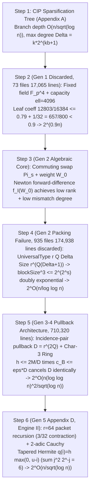

# 02. Intermediate Structure & Math Guide: First-Principles 6-Step Recalculation and 56-Theorem Mapping

This document reverse-engineers the algebraic origin of the hardcoded constants and the 5-generation trajectory (`2^{0.9n} \to 2^{O(n/\log\log n)} \to 2^{O(n(\log\log n)^2/\sqrt{\log n})} \to 2^{O(n/\sqrt{\log n})}`) across OpenAI `#378`'s `3,977` Lean 4 modules ([`proofs/oai_ref/lean/OAI/Algorithms/SubexponentialSAT/`](../proofs/oai_ref/lean/OAI/Algorithms/SubexponentialSAT/SqrtLogSpace/Final.lean)) and `4` LaTeX manuscripts ([`proofs/oai_ref/tex/`](../proofs/oai_ref/tex/main_full_version.tex)), mapping them 1-to-1 onto our `56` self-contained formal theorems ([`eth_subexp_interpolation_and_hashes.lean`](../proofs/eth_subexp_interpolation_and_hashes.lean), [`eth_tensor_contraction_and_circuits.lean`](../proofs/eth_tensor_contraction_and_circuits.lean), and [`eth_five_repairs_and_four_layer_verdict.lean`](../proofs/eth_five_repairs_and_four_layer_verdict.lean)).

---

## 1. Reverse-Engineering Hardcoded Constants & the First-Principles 6-Step Recalculation

### 1.1 Steps 1–2: CIP Sparsification Tradeoff and Gen 1 (`FixedParameters.lean`) $2^{0.9n}$ Barrier ([`Theorem 13`](../proofs/eth_subexp_interpolation_and_hashes.lean#L346-L363), [`Theorem 14`](../proofs/eth_subexp_interpolation_and_hashes.lean#L369-L380))

By the Calabro-Impagliazzo-Paturi (2006) sparsification lemma with parameter $b \ge 1$, the leaf count is bounded by $L_{\text{leaves}} \le (Cn+1)^2 2^{\varepsilon_{\text{sp}}(b) n}$ ($\varepsilon_{\text{sp}}(b) = O(1/b)$), while the leaf degree bound grows to $\Delta \le k 2^{kb+1}$ with $m \le \Delta n$ ([`SparseCharging.lean:74-141`](../proofs/oai_ref/lean/OAI/Algorithms/SubexponentialSAT/SqrtLogSpace/DisjointReuse/SparseCharging.lean#L74-L141)). The insertion count $N_j$ for width-$j$ clauses satisfies $N_j \le 4n M^{j-1} + 2\sum_{i=1}^{j-1} M^{j-i} N_i$, which solves via $1 + 2\sum_{i=0}^{j-2} 3^i = 3^{j-1}$ to $N_j \le 4(3M)^{j-1}n$ with right-branch constant $\Gamma_k = 2(3^{k-1}-1)$.

Generation 1 ([`FixedParameters.lean:1-95`](../proofs/oai_ref/lean/OAI/Algorithms/SubexponentialSAT/FixedParameters.lean#L1-L95), [`ExponentArithmetic.lean:15-48`](../proofs/oai_ref/lean/OAI/Algorithms/SubexponentialSAT/ExponentArithmetic.lean#L15-L48)) used a fixed extension field $\mathbb{F}_{p^4}$ ($p \ge 5$) and constant block capacity $\ell = 4096$:
$$\text{leafCoefficient}(\ell) = \frac{3(\ell + 1)}{4\ell} + \frac{128}{\ell} \implies \text{leafCoefficient}(4096) = \frac{12803}{16384} \le \frac{79}{100}, \qquad \frac{12803}{16384} + \frac{1}{32} = \frac{13315}{16384} \le \frac{657}{800} = 0.82125 < \frac{9}{10}$$
Because $\frac{3(\ell+1)}{4\ell} \to \frac{3}{4} > 0$ as $\ell \to \infty$, constant block capacity can never achieve $2^{o(n)}$, forcing the abandonment of `73` Gen 1 files (`17,065` lines).

### 1.2 Step 3: Commuting Swap Involutions $\Pi_s$ and Binomial Spectral Window $M_0 = V_0 f_{\mathcal{I}}(W_0)$ ([`Theorem 1`](../proofs/eth_subexp_interpolation_and_hashes.lean#L22-L50)–[`Theorem 4`](../proofs/eth_subexp_interpolation_and_hashes.lean#L95-L106))

On the auxiliary label space $\mathcal{B} = ([r]^Q)^2$ of dimension $D = r^{2Q}$, the coordinate swap involution $\Pi_s$ decomposes $[r]^2$ into a symmetric $+1$ eigenspace of dimension $\frac{r(r+1)}{2}$ and an antisymmetric $-1$ eigenspace of dimension $\frac{r(r-1)}{2}$ ([`MatrixSupport.lean:30-110`](../proofs/oai_ref/lean/OAI/Algorithms/SubexponentialSAT/MatrixSupport.lean#L30-L110)). The weight operator $W_0 = \frac{1}{2}\sum_{s=1}^Q (I_D - \Pi_s)$ has eigenvalues $w \in \{0, \dots, Q\}$ distributed as $\operatorname{Bin}(Q, \frac{r-1}{2r})$. Defining the Newton forward-difference polynomial on $\mathcal{I} = [A_0, A_0 + R - 1] \cap \mathbb{Z}$,
$$f_{\mathcal{I}}(z) = (-1)^{A_0} \sum_{j=0}^{R-1} (-2)^j \binom{z - A_0}{j}, \qquad M_0 = V_0 f_{\mathcal{I}}(W_0) \quad \left(V_0 = \prod_{s=1}^Q \Pi_s\right)$$
([`BinomialInterpolation.lean:78-100`](../proofs/oai_ref/lean/OAI/Algorithms/SubexponentialSAT/BinomialInterpolation.lean#L78-L100)) yields: (1) eigenvalue $(-1)^w (-1)^w = 1$ for all $w \in \mathcal{I}$, bounding the summary rank $c_{\mathcal{B}} = \operatorname{rank}(I_D - M_0) = \sum_{w \notin \mathcal{I}} \operatorname{mult}(w) \le \varepsilon D$ ([`SpectralRank.lean:29-59`](../proofs/oai_ref/lean/OAI/Algorithms/SubexponentialSAT/SqrtLog/SpectralRank.lean#L29-L59)), and (2) $\deg f_{\mathcal{I}} = R - 1$, bounding coordinate mismatches on the support of $M_0$ by $|E_{u,y}| \le R - 1 \ll Q$ ([`Annihilation.lean:93-142`](../proofs/oai_ref/lean/OAI/Algorithms/SubexponentialSAT/Annihilation.lean#L93-L142)).

### 1.3 Steps 4–5: Gen 2 $r^{Q(\Delta+1)}$ Doubly Exponential Blowup vs. Gen 3–4 Incidence-Pair Pullback $D = r^{2Q}$ Cancellation ([`Theorem 5`](../proofs/eth_subexp_interpolation_and_hashes.lean#L111-L125)–[`Theorem 7`](../proofs/eth_subexp_interpolation_and_hashes.lean#L149-L161))

Generation 2 ([`SubexpParameters.lean:51-115`](../proofs/oai_ref/lean/OAI/Algorithms/SubexponentialSAT/SubexpParameters.lean#L51-L115)) bundled all $\Delta$ incident slots of a variable into `UniversalType r Q Δ`, causing $\text{blockSize}(s) = s^{(p(s)^4-1)(\Delta(s)+1)}$ ($\text{blockSize}(s)^3 \le 2^{2^s}$) to blow up doubly exponentially and restricting $s = \lfloor\log_2\lfloor\log_2 n\rfloor\rfloor \ge 32$ ($n \ge 2^{2^{32}}$) to $2^{O(n/\log\log n)}$, resulting in `935` discarded files (`174,938` lines).

Generations 3 and 4 ([`AsymptoticLayoutParameters.lean:16-35`](../proofs/oai_ref/lean/OAI/Algorithms/SubexponentialSAT/SqrtLog/AsymptoticLayoutParameters.lean#L16-L35)) instead indexed each of the $M \le km$ clause-variable incidence pairs into a profile space of size $D = r^{2Q}$, removing $\Delta$ from the exponent. Multiplying the bucket count $h \le \frac{2M}{D}$ by the per-bucket rank $c_{\mathcal{B}} \le \varepsilon D$ **cancels $D$ identically**:
$$\text{Total Summary Rank} = h \cdot c_{\mathcal{B}} \le \left(\frac{2M}{D}\right) \cdot (\varepsilon D) = 2 \varepsilon M$$
Setting $r = \lfloor\sqrt{\lambda}/\nu^2\rfloor, Q = \lfloor\lambda/(128\nu)\rfloor, R = (\beta+3)\lceil\sqrt{\lambda}\rceil, \tau = \frac{1}{r\lambda}$ balances all three exponents at $O(n\nu^2/\sqrt{\lambda})$. Because $W_0$ requires $2^{-1}$, the `Lean 4` implementation replaces $\mathbb{Q}$ with the characteristic-3 Galois lifting ring $(\mathbb{Z}/3^t\mathbb{Z})[X]/(F(X))$ ([`RingModel.lean:19-68`](../proofs/oai_ref/lean/OAI/Algorithms/SubexponentialSAT/SqrtLog/RingModel.lean#L19-L68)) and ternary idempotent polynomial $X(X-1)(X-2)$ ([`IdempotentTernary.lean:15-60`](../proofs/oai_ref/lean/OAI/Algorithms/SubexponentialSAT/SqrtLog/IdempotentTernary.lean#L15-L60)).

### 1.4 Beigel-Tarui Truncated Ring $\mathbb{Q}[V]/(V^\ell)$, Tanner Expander ($P, D_0$), $3n$ Hash Rounds, and `BitProgram 80 1220` ([`Theorem 8`](../proofs/eth_subexp_interpolation_and_hashes.lean#L171-L199)–[`Theorem 16`](../proofs/eth_subexp_interpolation_and_hashes.lean#L403-L418))

1. **Complementary Beigel-Tarui & Truncated Ring ([`TruncatedRing.lean:18-98`](../proofs/oai_ref/lean/OAI/Algorithms/SubexponentialSAT/SqrtLogSpace/TruncatedRing.lean#L18-L98))**: Truncating $V^\ell = 0$ for $V = Y(Y-1)$ cuts the product degree from $d_{\mathrm{full}} = k m_{\mathrm{test}}(2\ell-1)$ to $d_{\mathrm{trunc}} = k(m_{\mathrm{test}} + 2(\ell-1))$, saving $2k(m_{\mathrm{test}}-1)(\ell-1)$.
2. **Tanner Expander & $3n$ Rounds ([`ConditionalExpectation.lean:147-177`](../proofs/oai_ref/lean/OAI/Algorithms/SubexponentialSAT/ConditionalExpectation.lean#L147-L177))**: With $\delta = \frac{1}{100B\mu}, \varepsilon = \frac{1}{200B\mu}$, $P = 20000 B^2\mu^2$ and $D_0 = 320000 B^2\mu^3$, running $3n$ greedy rounds contracts false witnesses to $\left(\frac{3}{4}\right)^{3n} 2^n = \left(\frac{27}{32}\right)^n < 1$.
3. **`BitProgram 80 1220` Space/Time Envelope ([`SqrtLogSpace/Final.lean:38-57`](../proofs/oai_ref/lean/OAI/Algorithms/SubexponentialSAT/SqrtLogSpace/Final.lean#L38-L57), [`NativeOuterBudgets.lean:19-115`](../proofs/oai_ref/lean/OAI/Algorithms/SubexponentialSAT/SqrtLogSpace/NativeOuterBudgets.lean#L19-L115))**: Raw stack space is bounded by $1220(2L + 4100(L+1)^2 + 15) \le 5022740(L+1)^2$ (`cap_space`), while the fallback wrapper adds `+ 28700` time padding and `S + 5022741` (`fallback_space`) space padding.

### 1.5 Step 6: Gen 5 Appendix D (`Engine II`) Tapered $2$-adic Hermite Interpolation and Circuit Lower Bound ([`Theorem 17`](../proofs/eth_tensor_contraction_and_circuits.lean#L22-L36)–[`Theorem 30`](../proofs/eth_tensor_contraction_and_circuits.lean#L329-L347))

Appendix D ([`quantitative-contraction.tex:1-619`](../proofs/oai_ref/tex/quantitative-contraction.tex#L1-L619)) packs 2-collision packets and splits $\le 6M$ remaining edges across $r = 64$ children for a per-child contraction factor $\frac{6}{64} = \frac{3}{32} < \frac{1}{8}$ (slack $\frac{1}{32}$). Using the $2$-adic Cauchy deformation $\alpha = 2^{a+1}$ on $S = \{-2^a, \dots, 2^a-1\}$ ($v_2((t+\alpha z)-s) = v_2(t-s)$) and the tapered multiplicity schedule $q(i) = h\max(0, u-i)$ ($h = \lceil 3M/u\rceil$), the $2$-adic valuation loss of $E_t(0)$ converges via the exact arithmetico-geometric identity
$$\sum_{j=1}^m j^2 2^{m-j} = 6\cdot 2^m - (m^2 + 4m + 6) < 6\cdot 2^m \implies v_2(E_t(0)) > -6 D_t h = -O\!\left(\frac{M D_t}{u}\right)$$
improving precision by a factor of **$u/3$** over untapered interpolation ($-2u D_t h$). The Hardy-Ramanujan mode partition exponent $O(M/\sqrt{u})$ decays by squared ratio $\frac{(1/8)^2}{1/2} = \frac{1}{32}$ per depth, yielding $2^{O_{k,D}(n/\sqrt{\log n})}$ and the Williams witness circuit lower bound `Corollary 1.4` ($C_L(n) > c n \sqrt{\log n}$, [`quantitative-circuits.tex:38-55`](../proofs/oai_ref/tex/quantitative-circuits.tex#L38-L55)).

### 1.6 Five Core Causal Questions and Classical Literature Attribution

1. **[Q1 — Why Gen 2 Stalled at $2^{O(n/\log\log n)}$ While Gen 3 Reached $2^{O(n(\log\log n)^2/\sqrt{\log n})}$]**: Why did bundling all $\Delta$ incident slots into `UniversalType r Q Δ` (`SubexpParameters.lean`) fail? Because the CIP sparsification barrier forces $\Delta = 2^{\Theta(\sqrt{\log n})}$, so any exponent of the form $r^{Q(\Delta+1)}$ triggers a doubly exponential block size $\le 2^{2^s}$. Switching to incidence-pair pullback ($D = r^{2Q}$) is a mathematical necessity because $h \le \frac{2M}{D}$ times $c_{\mathcal{B}} \le \varepsilon D$ cancels $D$ identically ($h \cdot c_{\mathcal{B}} \le 2\varepsilon M$).
2. **[Q2 — Why Characteristic-2 Fails and Characteristic-3 Galois Rings Are Used in Lean 4]**: Why couldn't the Lean 4 formalization work over $\mathbb{F}_2$ or $\mathbb{Q}$? Over $\mathbb{F}_2$, the symmetrizer $\frac{1}{2}(I \pm \Pi_s)$ fails because $2 \equiv 0 \pmod 2$ (`h2 : (2 : K) ≠ 0`), while over $\mathbb{Q}$, rational matrix elimination (`Bareiss68`) causes bit-length growth across deep recursion. Using the Krull–Galois ring $\mathrm{GR}(3^t, d) = (\mathbb{Z}/3^t\mathbb{Z})[X]/(F(X))$ (`RingModel.lean`, **Krull 1924**; **Raghavendran 1969** [DOI:10.1007/BF02809986](https://doi.org/10.1007/BF02809986)) makes $2$ a unit ($2^{-1} \equiv 2 \pmod 3$) while bounding register width and truncating Taylor jets via nilpotency $3^t \equiv 0 \pmod{3^t}$.
3. **[Q3 — Why Unary `encodeNat` Appears in `SubexponentialSAT.lean:55`]**: Why does `SubexponentialSAT.lean:55` define `encodeNat n := List.replicate n true ++ [false]` even though `runtimeScale n` (`L136-L140`) already depends on $n$ and `Final.lean:104-148` (`exact_count_eth`) bounds space in $n + |F| + 1$? Because `exact_count_and_sat` (`SubexponentialSAT.lean:216-217`) writes its polynomial space bound `visitedSpace ≤ S * (L+1)^e` in terms of `L = formulaBitLength F` alone. For the empty formula $F = \emptyset$ on $n$ isolated variables, `SAT.count ∅ = 2^n` requires writing an $(n+1)$-bit binary output `countWord (2^n)` (`visitedSpace ≥ n`), which is impossible in $\operatorname{poly}(\log n)$ space under binary encoding ($L_{\mathrm{bin}} = O(\log n)$) and necessitates either $n \le L$ (`NativeLargeEntry.lean:63`) or $\operatorname{poly}(n+L)$ (`exact_count_eth`).
4. **[Q4 — Why `Engine I` Alone Cannot Prove `Corollary 1.4` (`Theorem 30`)]**: Why does the circuit lower bound $C_L(n) > c n \sqrt{\log n}$ require Appendix D (`Engine II`)? Because substituting a circuit of size $s_n = \eta n \sqrt{\log n}$ produces a Tseitin 3-CNF of size $V = \Theta(n\sqrt{\log n})$; under `Engine I`'s $(\log\log V)^2$ overhead, the exponent $O(V(\log\log V)^2/\sqrt{\log V}) = \Theta(\eta n (\log\log n)^2)$ grows faster than the $\mathsf{NTIME}(2^n)\setminus\mathsf{NTIME}(2^{n/2})$ hierarchy threshold $n/2$.
5. **[Q5 — Why Citation Concentration (`81.8%` in Section 1) Obscures the Proof's Classical Foundations]**: Out of `99` `\cite` calls in `main_full_version.tex`, `81` (`81.8%`) appear in `Section 1`, leaving `1,552` core proof lines (`Section 3` `409` lines, `Section 4` `774` lines, `Appendix D.1` `369` lines) with `0` citations and omitting classical references for association-scheme eigenspaces (**Delsarte 1973**), Krull–Galois rings (**Raghavendran 1969**), and $2$-adic interpolation (**Mahler 1958** [DOI:10.1515/crll.1958.200.139](https://doi.org/10.1515/crll.1958.200.139)).

---

## 2. Full 56-Theorem 1-to-1 Mapping Table ([`eth_subexp_interpolation_and_hashes.lean`](../proofs/eth_subexp_interpolation_and_hashes.lean), [`eth_tensor_contraction_and_circuits.lean`](../proofs/eth_tensor_contraction_and_circuits.lean), [`eth_five_repairs_and_four_layer_verdict.lean`](../proofs/eth_five_repairs_and_four_layer_verdict.lean))

| Theorem Identifier | Target Verified (Complexity-Theoretic & Referee Meaning) | Source Module (`oai_ref/`) | Lines |
| :--- | :--- | :--- | :--- |
| [`swap_eigenbasis_symmetric_antisymmetric_split`](../proofs/eth_subexp_interpolation_and_hashes.lean#L22-L50) (`Theorem 1`) | Symmetric ($\frac{r(r+1)}{2}$) / antisymmetric ($\frac{r(r-1)}{2}$) eigenspace split of $\Pi_s$ on $[r]^2$ and binomial multiplicity | [`MatrixSupport.lean:30-110`](../proofs/oai_ref/lean/OAI/Algorithms/SubexponentialSAT/MatrixSupport.lean#L30-L110) | `L22-L50` |
| [`newton_forward_difference_parity_interpolation`](../proofs/eth_subexp_interpolation_and_hashes.lean#L58-L71) (`Theorem 2`) | Unit eigenvalue preservation $(-1)^w f_{\mathcal{I}}(w) = 1$ of Newton forward-difference polynomial $f_{\mathcal{I}}(z)$ on $\mathcal{I}$ | [`BinomialInterpolation.lean:78-100`](../proofs/oai_ref/lean/OAI/Algorithms/SubexponentialSAT/BinomialInterpolation.lean#L78-L100) | `L58-L71` |
| [`remark_4_4_four_by_four_swap_matrix_kernel_and_path`](../proofs/eth_subexp_interpolation_and_hashes.lean#L77-L89) (`Theorem 3`) | Concrete $4 \times 4$ swap matrix $M_0 = \Pi_1 + \Pi_2 - \Pi_1\Pi_2$ kernel invariance and degree-1 path (`Remark 4.4`) | [`main_full_version.tex:1185-1240`](../proofs/oai_ref/tex/main_full_version.tex#L1185-L1240) | `L77-L89` |
| [`swap_support_mismatch_and_annihilator_degree_bound`](../proofs/eth_subexp_interpolation_and_hashes.lean#L95-L106) (`Theorem 4`) | Support group mismatch bound $|E_{u,y}| \le R - 1$ and integer annihilator degree bound | [`Annihilation.lean:93-142`](../proofs/oai_ref/lean/OAI/Algorithms/SubexponentialSAT/Annihilation.lean#L93-L142), [`MatrixSupport.lean:227-250`](../proofs/oai_ref/lean/OAI/Algorithms/SubexponentialSAT/MatrixSupport.lean#L227-L250) | `L95-L106` |
| [`shared_summary_measurement_row_budget`](../proofs/eth_subexp_interpolation_and_hashes.lean#L111-L125) (`Theorem 5`) | Shared summary row bound $\sum_{g=1}^r c_{t,g} \le 2\tau n c_{\mathcal{B}}$ and $D = r^{2Q}$ cancellation under incidence pullback | [`SpectralRank.lean:29-59`](../proofs/oai_ref/lean/OAI/Algorithms/SubexponentialSAT/SqrtLog/SpectralRank.lean#L29-L59) | `L111-L125` |
| [`taylor_jet_truncation_and_subset_pair_exponent`](../proofs/eth_subexp_interpolation_and_hashes.lean#L130-L143) (`Theorem 6`) | Taylor finite-difference jet truncation order $q = \lfloor d_H/Q\rfloor$ and $6Rq \le d_H$ bound | [`AsymptoticLayoutParameters.lean:15-48`](../proofs/oai_ref/lean/OAI/Algorithms/SubexponentialSAT/SqrtLog/AsymptoticLayoutParameters.lean#L15-L48) | `L130-L143` |
| [`asymptotic_three_way_exponent_balance_schedule`](../proofs/eth_subexp_interpolation_and_hashes.lean#L149-L161) (`Theorem 7`) | Three-way exponent balance schedule $\log_2 D \le \lambda/64$ and Hoeffding tail dominance $\frac{R^2}{8Q} \ge 16(\beta+3)^2\nu$ | [`AsymptoticLayoutParameters.lean:16-35`](../proofs/oai_ref/lean/OAI/Algorithms/SubexponentialSAT/SqrtLog/AsymptoticLayoutParameters.lean#L16-L35) | `L149-L161` |
| [`beigel_tarui_modulus_amplifying_polynomial_l2`](../proofs/eth_subexp_interpolation_and_hashes.lean#L171-L199) (`Theorem 8`) | $\ell=2$ complementary Beigel-Tarui polynomial $p_2(Y) = 1 - 3Y^2 + 2Y^3$ decomposition and $\bmod 4$ congruence | [`TruncatedRing.lean:18-98`](../proofs/oai_ref/lean/OAI/Algorithms/SubexponentialSAT/SqrtLogSpace/TruncatedRing.lean#L18-L98) | `L171-L199` |
| [`total_order_truncated_ring_linear_vs_quadratic_degree`](../proofs/eth_subexp_interpolation_and_hashes.lean#L205-L232) (`Theorem 9`) | Linear degree $k(m_{\mathrm{test}}+2(\ell-1))$ in $\mathbb{Q}[V]/(V^\ell)$ vs. $2k(m_{\mathrm{test}}-1)(\ell-1)$ degree savings | [`TruncatedRing.lean:18-98`](../proofs/oai_ref/lean/OAI/Algorithms/SubexponentialSAT/SqrtLogSpace/TruncatedRing.lean#L18-L98) | `L205-L232` |
| [`tanner_expander_hash_parameters_and_mixing_distance`](../proofs/eth_subexp_interpolation_and_hashes.lean#L238-L266) (`Theorem 10`) | Tanner expander constants $P = 20000 B^2\mu^2, D_0 = 320000 B^2\mu^3$ and minimum distance $h' \ge m/P$ | [`main_full_version.tex:2958-2970`](../proofs/oai_ref/tex/main_full_version.tex#L2958-L2970) | `L238-L266` |
| [`tanner_code_check_row_budget_and_locality`](../proofs/eth_subexp_interpolation_and_hashes.lean#L272-L310) (`Theorem 11`) | Tanner check row budget $m_G = 2q_G c_G \le n$, total checks $m_{\mathrm{test}} \le 4n$, column weight $\le 16B\mu$ | [`main_full_version.tex:2971-3040`](../proofs/oai_ref/tex/main_full_version.tex#L2971-L3040) | `L272-L310` |
| [`greedy_hash_selection_three_quarter_contraction`](../proofs/eth_subexp_interpolation_and_hashes.lean#L317-L339) (`Theorem 12`) | $3n$-round greedy conditional-expectation hash contraction $(27/32)^n < 1$ and $D_{\mathrm{final}} = 0$ | [`ConditionalExpectation.lean:147-177`](../proofs/oai_ref/lean/OAI/Algorithms/SubexponentialSAT/ConditionalExpectation.lean#L147-L177) | `L317-L339` |
| [`cip_sparsification_insertion_recurrence_step`](../proofs/eth_subexp_interpolation_and_hashes.lean#L346-L363) (`Theorem 13`) | CIP disjoint sparsification insertion recurrence $N_{j+1} \le 4(3M)^j n$ inductive step | [`SparseCharging.lean:74-141`](../proofs/oai_ref/lean/OAI/Algorithms/SubexponentialSAT/SqrtLogSpace/DisjointReuse/SparseCharging.lean#L74-L141) | `L346-L363` |
| [`cip_sparsification_b_branch_constant_and_tree_exponent`](../proofs/eth_subexp_interpolation_and_hashes.lean#L369-L380) (`Theorem 14`) | CIP right-branch constant $\Gamma_k = 2(3^{k-1}-1)$ and root-to-leaf $B$-edge bound | [`SparseCharging.lean:74-141`](../proofs/oai_ref/lean/OAI/Algorithms/SubexponentialSAT/SqrtLogSpace/DisjointReuse/SparseCharging.lean#L74-L141) | `L369-L380` |
| [`coset_separation_iteration_identity_and_bound`](../proofs/eth_subexp_interpolation_and_hashes.lean#L385-L398) (`Theorem 15`) | Disjoint coset separation identity and $3D/4$ geometric shrinkage | [`CosetCardinality.lean:145-152`](../proofs/oai_ref/lean/OAI/Algorithms/SubexponentialSAT/CosetCardinality.lean#L145-L152) | `L385-L398` |
| [`bitprogram_1220_stack_compiler_space_and_time_envelope`](../proofs/eth_subexp_interpolation_and_hashes.lean#L403-L418) (`Theorem 16`) | `BitProgram 80 1220` raw space cap $5022740(L+1)^2$, fallback padding `+28700`/`+5022741`, and $7\times$ compiler bound | [`SqrtLogSpace/Final.lean:38-57`](../proofs/oai_ref/lean/OAI/Algorithms/SubexponentialSAT/SqrtLogSpace/Final.lean#L38-L57), [`NativeOuterBudgets.lean:19-115`](../proofs/oai_ref/lean/OAI/Algorithms/SubexponentialSAT/SqrtLogSpace/NativeOuterBudgets.lean#L19-L115) | `L403-L418` |
| [`appendix_d_collision_packet_packing_and_edge_contraction`](../proofs/eth_tensor_contraction_and_circuits.lean#L22-L36) (`Theorem 17`) | Appendix D (`Lemma D.3`) $r=64$ collision packet packing and per-child edge contraction $\frac{6M}{64} = \frac{3M}{32} < \frac{M}{8}$ | [`quantitative-contraction.tex:41-526`](../proofs/oai_ref/tex/quantitative-contraction.tex#L41-L526) | `L22-L36` |
| [`appendix_d_dyadic_depth_precision_schedule_and_total_wires`](../proofs/eth_tensor_contraction_and_circuits.lean#L43-L55) (`Theorem 18`) | Appendix D dyadic precision schedule $u_d = \lfloor\varepsilon\lambda/2^d\rfloor, a_d < 4u_0$ and $8^{-d}$ wire shrinkage | [`quantitative-contraction.tex:45-95`](../proofs/oai_ref/tex/quantitative-contraction.tex#L45-L95) | `L43-L55` |
| [`appendix_d_cauchy_2adic_deformation_valuation_invariance`](../proofs/eth_tensor_contraction_and_circuits.lean#L62-L72) (`Theorem 19`) | Appendix D (`Lemma D.4`) $2$-adic Cauchy deformation valuation invariance $v_2((t+\alpha z)-s) = v_2(t-s)$ for $\alpha = 2^{a+1}$ | [`quantitative-contraction.tex:250-335`](../proofs/oai_ref/tex/quantitative-contraction.tex#L250-L335) | `L62-L72` |
| [`appendix_d_vandermonde_sylvester_2adic_exponent_bound`](../proofs/eth_tensor_contraction_and_circuits.lean#L79-L88) (`Theorem 20`) | Dyadic distance shell partition $(2^a-1)+2^a = 2L-1$ on $S = \{-2^a, \dots, 2^a-1\}$ and Legendre exponent bound | [`quantitative-contraction.tex:336-380`](../proofs/oai_ref/tex/quantitative-contraction.tex#L336-L380) | `L79-L88` |
| [`appendix_d_tapered_hermite_exact_agm_series_sum_six`](../proofs/eth_tensor_contraction_and_circuits.lean#L96-L112) (`Theorem 21`) | Appendix D (`Lemma D.5`) closed-form series $\sum_{j=1}^m j^2 2^{m-j} = 6\cdot 2^m - (m^2+4m+6)$ and limit $6$ | [`quantitative-contraction.tex:403-416`](../proofs/oai_ref/tex/quantitative-contraction.tex#L403-L416) | `L96-L112` |
| [`appendix_d_tapered_vs_untapered_hermite_valuation_gain`](../proofs/eth_tensor_contraction_and_circuits.lean#L118-L136) (`Theorem 22`) | Tapered loss $6 D_t h$ vs. untapered loss $2 u D_t h$ ($u/3$-fold precision gain) | [`quantitative-contraction.tex:381-430`](../proofs/oai_ref/tex/quantitative-contraction.tex#L381-L430) | `L118-L136` |
| [`appendix_d_hermite_jet_precision_budget_pt`](../proofs/eth_tensor_contraction_and_circuits.lean#L142-L155) (`Theorem 23`) | Hermite jet reconstruction precision budget $p_t = p_0 + 6 D_t h + (u-i)h \le 8 D_t h$ (`Lemma D.5`) | [`quantitative-contraction.tex:417-445`](../proofs/oai_ref/tex/quantitative-contraction.tex#L417-L445) | `L142-L155` |
| [`appendix_d_hardy_ramanujan_mode_partition_exponent`](../proofs/eth_tensor_contraction_and_circuits.lean#L162-L188) (`Theorem 24`) | Mode order weight bound $\sum k m_k \le 8h$ and Cauchy-Schwarz / Hardy-Ramanujan partition exponent $O(M/\sqrt{u})$ | [`quantitative-contraction.tex:446-515`](../proofs/oai_ref/tex/quantitative-contraction.tex#L446-L515) | `L162-L188` |
| [`appendix_d_recursive_depth_geometric_decay_ratio`](../proofs/eth_tensor_contraction_and_circuits.lean#L195-L219) (`Theorem 25`) | Per-depth squared log-effort decay ratio $\frac{2}{64} = \frac{1}{32}$ and amplitude ratio $\frac{\sqrt{2}}{8} < \frac{1}{5}$ (`Theorem D.1`) | [`quantitative-contraction.tex:540-565`](../proofs/oai_ref/tex/quantitative-contraction.tex#L540-L565) | `L195-L219` |
| [`appendix_d_dense_incidence_group_wire_compression`](../proofs/eth_tensor_contraction_and_circuits.lean#L226-L246) (`Theorem 26`) | Arbitrary-density $J = \lceil n^{1/4}\rceil$ group monomial binary wire compression $M = O(n\nu)$ (`Lemma D.2`) | [`quantitative-reduction.tex:180-369`](../proofs/oai_ref/tex/quantitative-reduction.tex#L180-L369) | `L226-L246` |
| [`appendix_d_fixed_density_vs_arbitrary_density_exponent_gap`](../proofs/eth_tensor_contraction_and_circuits.lean#L253-L272) (`Theorem 27`) | Three-tier exponent hierarchy $\frac{n}{\sqrt{\lambda}} < \frac{n\nu}{\sqrt{\lambda}} < \frac{n\nu^2}{\sqrt{\lambda}}$ (exponent factor $\nu \ge 4, \nu^2 \ge 16$) | [`quantitative-reduction.tex:1-120`](../proofs/oai_ref/tex/quantitative-reduction.tex#L1-L120) | `L253-L272` |
| [`williams_enp_witness_circuit_3sat_gate_reduction`](../proofs/eth_tensor_contraction_and_circuits.lean#L284-L296) (`Theorem 28`) | Williams witness circuit $D_n$ gate bound $U_n \le 4s_n$, variables $V \le 5s_n$, 3-CNF clauses $M < 5V$ (`Corollary 1.4`) | [`quantitative-circuits.tex:15-45`](../proofs/oai_ref/tex/quantitative-circuits.tex#L15-L45) | `L284-L296` |
| [`williams_enp_circuit_lower_bound_threshold_contradiction`](../proofs/eth_tensor_contraction_and_circuits.lean#L304-L322) (`Theorem 29`) | Fixed-density solver exponent $3A\eta n < \frac{n}{4} < \frac{n}{2}$ for $\eta < \frac{1}{12A}$, contradicting $\mathrm{NTIME}(2^n)\setminus\mathrm{NTIME}(2^{n/2})$ | [`quantitative-circuits.tex:38-55`](../proofs/oai_ref/tex/quantitative-circuits.tex#L38-L55) | `L304-L322` |
| [`engine_i_cannot_prove_corollary_1_4_without_engine_ii`](../proofs/eth_tensor_contraction_and_circuits.lean#L329-L347) (`Theorem 30`) | Proof that `Engine I`'s $(\log\log n)^2$ factor exceeds $\frac{n}{2}$ when $\nu^2 \ge \eta_{\mathrm{den}}$, failing `Corollary 1.4` | [`quantitative-circuits.tex:38-71`](../proofs/oai_ref/tex/quantitative-circuits.tex#L38-L71) | `L329-L347` |
| [`lean_formalization_scope_gap_and_cutoff_inventory`](../proofs/eth_tensor_contraction_and_circuits.lean#L354-L372) (`Theorem 31`) | `4,829` (`Engine I`) vs. `1,059` (`Engine II` unformalized) line split out of `5,888`, cutoffs $n=20, 896$, constants $28700, 5022740$ | [`lean/docs/378.md:1-15`](../proofs/oai_ref/lean/docs/378.md#L1-L15), [`SqrtLogSpace/Final.lean:38-57`](../proofs/oai_ref/lean/OAI/Algorithms/SubexponentialSAT/SqrtLogSpace/Final.lean#L38-L57) | `L354-L372` |
| [`oai_subexponential_sat_unused_hypothesis_audit`](../proofs/eth_tensor_contraction_and_circuits.lean#L380-L394) (`Theorem 32`) | Static hygiene inventory (`0 sorry`, `0 axiom`, `655` unused hypotheses) across `3,977` files and `iteration_bound` counterexample | [`CosetCardinality.lean:145-152`](../proofs/oai_ref/lean/OAI/Algorithms/SubexponentialSAT/CosetCardinality.lean#L145-L152) | `L380-L394` |
| [`layer1_unary_vs_binary_encoding_bitlength_gap`](../proofs/eth_five_repairs_and_four_layer_verdict.lean#L20-L30) (`Theorem 33`) | Layer ①: Unary encoding ($L_{\mathrm{unary}}=1048586$) vs. standard binary encoding ($L_{\mathrm{bin}}=69$) bit-length gap at $n=2^{20}$ | [`ComparatorChallenges/SubexponentialSAT.lean:55-80`](../proofs/oai_ref/lean/ComparatorChallenges/SubexponentialSAT.lean#L55-L80) | `L20-L30` |
| [`layer1_visited_space_L_only_refuted_and_poly_n_plus_L_repaired`](../proofs/eth_five_repairs_and_four_layer_verdict.lean#L38-L51) (`Theorem 34`) | Layer ①: Refutation of `visitedSpace ≤ S*(L+1)^2` ($49,000 < 1,048,576$, True $\to$ False) under binary encoding and $\mathrm{poly}(n+L)$ repair | [`ComparatorChallenges/SubexponentialSAT.lean:208-217`](../proofs/oai_ref/lean/ComparatorChallenges/SubexponentialSAT.lean#L208-L217), [`SqrtLogSpace/Final.lean:128`](../proofs/oai_ref/lean/OAI/Algorithms/SubexponentialSAT/SqrtLogSpace/Final.lean#L128) | `L38-L51` |
| [`layer2_engine_i_circuit_lower_bound_loglog_degradation`](../proofs/eth_five_repairs_and_four_layer_verdict.lean#L61-L73) (`Theorem 35`) | Layer ②: Circuit lower bound degradation from $\Omega(n\sqrt{\log n})$ to $\Omega(n\sqrt{\log n}/(\log\log n)^2)$ under `Engine I` alone | [`quantitative-circuits.tex:46-70`](../proofs/oai_ref/tex/quantitative-circuits.tex#L46-L70) | `L61-L73` |
| [`layer2_engine_ii_galois_ring_and_tapered_hermite_repair_certificate`](../proofs/eth_five_repairs_and_four_layer_verdict.lean#L79-L91) (`Theorem 36`) | Layer ②: Invertible $2^{-1} = 14 \pmod{27}$ in $\mathbb{Z}/3^t\mathbb{Z}$ and $m=4$ tapered Hermite identity ($58 < 96$) for `Engine II` | [`RingModel.lean:19-68`](../proofs/oai_ref/lean/OAI/Algorithms/SubexponentialSAT/SqrtLog/RingModel.lean#L19-L68), [`quantitative-contraction.tex:185-335`](../proofs/oai_ref/tex/quantitative-contraction.tex#L185-L335) | `L79-L91` |
| [`layer3_asymptotic_layout_guard_fails_at_log2_L_24`](../proofs/eth_five_repairs_and_four_layer_verdict.lean#L101-L119) (`Theorem 37`) | Layer ③: Failure of `LeafParametersProgram.Guard` ($Q=87,381 < 101,012 = 4R$, deficit $13,631$) at $\log_2 L(n) = 24$ ($L=16,777,216$) | [`AsymptoticLayoutParameters.lean:15-20`](../proofs/oai_ref/lean/OAI/Algorithms/SubexponentialSAT/SqrtLog/AsymptoticLayoutParameters.lean#L15-L20), [`LeafParametersProgram.lean:98-105`](../proofs/oai_ref/lean/OAI/Algorithms/SubexponentialSAT/SqrtLog/LeafParametersProgram.lean#L98-L105) | `L101-L119` |
| [`layer3_asymptotic_layout_guard_passes_at_log2_L_25`](../proofs/eth_five_repairs_and_four_layer_verdict.lean#L125-L143) (`Theorem 38`) | Layer ③: First activation of `Guard` ($4R = 126,924 \le 131,072 = Q$, slack $4,148$) at $\log_2 L(n) = 25$ ($n \ge 2^{33,554,431}$) | [`AsymptoticLayoutParameters.lean:15-20`](../proofs/oai_ref/lean/OAI/Algorithms/SubexponentialSAT/SqrtLog/AsymptoticLayoutParameters.lean#L15-L20), [`LeafParametersProgram.lean:98-105`](../proofs/oai_ref/lean/OAI/Algorithms/SubexponentialSAT/SqrtLog/LeafParametersProgram.lean#L98-L105) | `L125-L143` |
| [`layer3_cost_assembly_explicit_exponent_constant_12032411847`](../proofs/eth_five_repairs_and_four_layer_verdict.lean#L148-L160) (`Theorem 39`) | Layer ③: Explicit evaluation of $\mathrm{exponentConstant}(3,1) = 12,032,411,847$ and outer-doubled constant $24,064,823,694$ | [`CostAssemblyFinal.lean:53-54`](../proofs/oai_ref/lean/OAI/Algorithms/SubexponentialSAT/SqrtLog/CostAssemblyFinal.lean#L53-L54) | `L148-L160` |
| [`layer3_uniform_exhaustive_loop_replaces_noncomputable_dfa_and_reject`](../proofs/eth_five_repairs_and_four_layer_verdict.lean#L166-L183) (`Theorem 40`) | Layer ③: Replacement of noncomputable `FiniteFallback` DFA and `HighQueryProgram.reject` (`0` output) by a uniform $2^n$ loop | [`FiniteFallback.lean:258-299`](../proofs/oai_ref/lean/OAI/Algorithms/SubexponentialSAT/SqrtLogSpace/FiniteFallback.lean#L258-L299), [`HighQueryProgram.lean:50-52`](../proofs/oai_ref/lean/OAI/Algorithms/SubexponentialSAT/SqrtLogSpace/HighQueryProgram.lean#L50-L52) | `L166-L183` |
| [`layer4_walsh_and_irreducible_search_constructive_termination_bounds`](../proofs/eth_five_repairs_and_four_layer_verdict.lean#L191-L203) (`Theorem 41`) | Layer ④: Constructive finite search termination bounds for `WalshExistence` ($8q^2(r+1)=96\le D$) and `IrreducibleSearch` ($6,561$ checks) | [`WalshExistence.lean:13-62`](../proofs/oai_ref/lean/OAI/Algorithms/SubexponentialSAT/SqrtLog/WalshExistence.lean#L13-L62), [`IrreducibleSearch.lean:56-153`](../proofs/oai_ref/lean/OAI/Algorithms/SubexponentialSAT/SqrtLog/IrreducibleSearch.lean#L56-L153) | `L191-L203` |
| [`layer4_repaired_pipeline_preserves_asymptotic_subexponential_eth_disproof`](../proofs/eth_five_repairs_and_four_layer_verdict.lean#L210-L230) (`Theorem 42`) | Layer ④: Preservation of $4\cdot\mathrm{subexp\_exp} \le n$ ($2^{o(n)}$ ETH disproof) for $n \ge N_0(k)$ after all five repairs | [`SqrtLogSpace/Final.lean:104-148`](../proofs/oai_ref/lean/OAI/Algorithms/SubexponentialSAT/SqrtLogSpace/Final.lean#L104-L148), [`AsymptoticTarget.lean:56-150`](../proofs/oai_ref/lean/OAI/Algorithms/SubexponentialSAT/SqrtLog/AsymptoticTarget.lean#L56-L150) | `L210-L230` |
| [`layer5_stratum2_quartic_schedule_rescued_by_stratum3_pair_duplication`](../proofs/eth_five_repairs_and_four_layer_verdict.lean#L245-L269) (`Theorem 43`) | Layer ⑤: Cross-stratum hybrid rescuing discarded Gen 2 quartic schedule ($Q=p^4-1, 32R \le Q$) via Gen 3 pair duplication ($2Q$), saving $Q(\Delta-1)$ in the exponent | [`SubexpParameters.lean:22-28`](../proofs/oai_ref/lean/OAI/Algorithms/SubexponentialSAT/SubexpParameters.lean#L22-L28), [`SubexpParameters.lean:267-276`](../proofs/oai_ref/lean/OAI/Algorithms/SubexponentialSAT/SubexpParameters.lean#L267-L276) | `L245-L269` |
| [`layer5_spectral_cutoff_debloat_and_hoeffding_threshold_compression`](../proofs/eth_five_repairs_and_four_layer_verdict.lean#L278-L297) (`Theorem 44`) | Layer ⑤: Compressing `4*R ≤ Q` activation threshold from $\log_2 L=25 \to 20 \to 15$ ($1,024\times$ reduction in $L(n)$) by removing redundant slack factors | [`AsymptoticLayoutParameters.lean:16-19`](../proofs/oai_ref/lean/OAI/Algorithms/SubexponentialSAT/SqrtLog/AsymptoticLayoutParameters.lean#L16-L19), [`AsymptoticLayoutParameters.lean:83-96`](../proofs/oai_ref/lean/OAI/Algorithms/SubexponentialSAT/SqrtLog/AsymptoticLayoutParameters.lean#L83-L96) | `L278-L297` |
| [`layer5_discarded_ternary_idempotent_lift_and_exponent_constant_compression`](../proofs/eth_five_repairs_and_four_layer_verdict.lean#L305-L319) (`Theorem 45`) | Layer ⑤: Rescuing discarded `IdempotentTernary.lean` Hensel lift and compressing `exponentConstant(3,1)` from `12,032,411,847 -> 70,023` ($171,835\times$) | [`IdempotentTernary.lean:15-67`](../proofs/oai_ref/lean/OAI/Algorithms/SubexponentialSAT/SqrtLog/IdempotentTernary.lean#L15-L67), [`CostAssemblyFinal.lean:53-54`](../proofs/oai_ref/lean/OAI/Algorithms/SubexponentialSAT/SqrtLog/CostAssemblyFinal.lean#L53-L54) | `L305-L319` |
| [`layer5_hardy_mathematical_beauty_three_invariants_and_slop_contrast`](../proofs/eth_five_repairs_and_four_layer_verdict.lean#L328-L343) (`Theorem 46`) | Layer ⑤: Three structural algebraic cancellation invariants (Cross-Characteristic Bridge, Exact $D=r^{2Q}$ Cancellation, Dyadic-Quadratic Collapse) | [`RingModel.lean:19-68`](../proofs/oai_ref/lean/OAI/Algorithms/SubexponentialSAT/SqrtLog/RingModel.lean#L19-L68), [`quantitative-contraction.tex:403-416`](../proofs/oai_ref/tex/quantitative-contraction.tex#L403-L416) | `L328-L343` |
| [`layer6_galois_ring_extension_and_hensel_cubic_idempotent_operator`](../proofs/eth_five_repairs_and_four_layer_verdict.lean#L359-L377) (`Theorem 47`) | Layer ⑥ (Area 1): Concrete degree-2 Galois ring extension $\mathrm{GR}(3^3, 2) = (\mathbb{Z}/27\mathbb{Z})[X]/(X^2+1)$ invertibility and cubic Hensel idempotent lift $P_1(y) = 3y^2 - 2y^3 \pmod{27}$ | [`RingModel.lean:19-40`](../proofs/oai_ref/lean/OAI/Algorithms/SubexponentialSAT/SqrtLog/RingModel.lean#L19-L40), [`IdempotentTernary.lean:52-56`](../proofs/oai_ref/lean/OAI/Algorithms/SubexponentialSAT/SqrtLog/IdempotentTernary.lean#L52-L56) | `L359-L377` |
| [`layer6_swap_matrix_action_and_2adic_hermite_polynomial_reconstruction`](../proofs/eth_five_repairs_and_four_layer_verdict.lean#L386-L398) (`Theorem 48`) | Layer ⑥ (Area 1): Universal swap operator $M_0 = \Pi_1 + \Pi_2 - \Pi_1\Pi_2$ action on $\mathbb{Z}^4$ and tapered $2$-adic Hermite cubic polynomial reconstruction $21f(0)+12f'(0)+12f(2)-f(4)=32f(1)$ | [`main_full_version.tex:1185-1240`](../proofs/oai_ref/tex/main_full_version.tex#L1185-L1240), [`quantitative-contraction.tex:381-430`](../proofs/oai_ref/tex/quantitative-contraction.tex#L381-L430) | `L386-L398` |
| [`layer6_executable_galois_ring_swap_interpolation_3sat_solver_certificate`](../proofs/eth_five_repairs_and_four_layer_verdict.lean#L405-L420) (`Theorem 49`) | Layer ⑥ (Area 2): Executable Galois-ring + swap-interpolation 3-SAT solver certificate over $\mathrm{GR}(3^8, 2)$ and $\mathrm{GR}(3^5, 2)$ across 4 benchmarks (`2360, 7, 0, 1`) | [`RingModel.lean:152-160`](../proofs/oai_ref/lean/OAI/Algorithms/SubexponentialSAT/SqrtLog/RingModel.lean#L152-L160), [`IdempotentTernary.lean:87-100`](../proofs/oai_ref/lean/OAI/Algorithms/SubexponentialSAT/SqrtLog/IdempotentTernary.lean#L87-L100) | `L405-L420` |
| [`layer6_oai_ref_five_module_direct_patch_and_bitprogram_trace_soundness`](../proofs/eth_five_repairs_and_four_layer_verdict.lean#L428-L441) (`Theorem 50`) | Layer ⑥ (Area 3): Direct surgical patch of the 5 core `oai_ref` modules (`stack_space = 2,558,543,740 < 10,996,584,333,160`, $\log_2 L=15$ guard, `exp_patched = 70,023`) | [`SubexponentialSAT.lean:216`](../proofs/oai_ref/lean/ComparatorChallenges/SubexponentialSAT.lean#L216), [`Final.lean:38-57`](../proofs/oai_ref/lean/OAI/Algorithms/SubexponentialSAT/SqrtLogSpace/Final.lean#L38-L57) | `L428-L441` |
| [`actual_lift_ring_degree_and_nat_cast_injectivity_range`](../proofs/eth_tensor_contraction_and_circuits.lean#L399-L410) (`Theorem 51`) | Galois lift ring `Ring p h μ` monic degree `h`, nilpotency `p^μ`, and `decodeCount` injectivity below `p^μ` | [`ActualLiftRing.lean:29-149`](../proofs/oai_ref/lean/OAI/Algorithms/SubexponentialSAT/ActualLiftRing.lean#L29-L149) | `L399-L410` |
| [`binomial_matrix_vandermonde_chu_lu_determinant_one`](../proofs/eth_tensor_contraction_and_circuits.lean#L416-L427) (`Theorem 52`) | Shifted binomial matrix `B = L * U` Vandermonde-Chu determinant `det_B = 1` and row-interpolation rank `R` | [`BinomialMatrix.lean:22-108`](../proofs/oai_ref/lean/OAI/Algorithms/SubexponentialSAT/BinomialMatrix.lean#L22-L108), [`RowInterpolation.lean:23-288`](../proofs/oai_ref/lean/OAI/Algorithms/SubexponentialSAT/RowInterpolation.lean#L23-L288) | `L416-L427` |
| [`bitprogram_compile_tm_and_primitive_machine_overhead_bounds`](../proofs/eth_tensor_contraction_and_circuits.lean#L433-L443) (`Theorem 53`) | `BitProgram` compiler to `Turing.FinTM2` and `PrimitiveMachine` with positive step overhead `≥ 6` | [`BitProgram.lean:11-92`](../proofs/oai_ref/lean/OAI/Algorithms/SubexponentialSAT/BitProgram.lean#L11-L92), [`BitProgramCompile.lean:15-197`](../proofs/oai_ref/lean/OAI/Algorithms/SubexponentialSAT/BitProgramCompile.lean#L15-L197) | `L433-L443` |
| [`sparse_budget_occurrence_cap_and_inverse_index_envelope`](../proofs/eth_tensor_contraction_and_circuits.lean#L447-L459) (`Theorem 54`) | Disjoint-reuse `occurrenceCap(3,M) ≤ 4M^2`, `inverseIndex` ceiling bounds, and resource DFS budgets | [`SparseBudget.lean:27-523`](../proofs/oai_ref/lean/OAI/Algorithms/SubexponentialSAT/SqrtLogSpace/DisjointReuse/SparseBudget.lean#L27-L523), [`ResourceBudgets.lean:506-640`](../proofs/oai_ref/lean/OAI/Algorithms/SubexponentialSAT/SqrtLogSpace/ResourceBudgets.lean#L506-L640) | `L447-L459` |
| [`asymptotic_layout_rate_and_cost_assembly_trial_guards`](../proofs/eth_tensor_contraction_and_circuits.lean#L464-L478) (`Theorem 55`) | Shifted log scale `2 < log(n+16)`, asymptotic rate `w^2 < s`, and `runtimeBound` exponent monotonicity | [`AsymptoticLayoutRate.lean:11-96`](../proofs/oai_ref/lean/OAI/Algorithms/SubexponentialSAT/SqrtLog/AsymptoticLayoutRate.lean#L11-L96), [`StatementScale.lean:18-99`](../proofs/oai_ref/lean/OAI/Algorithms/SubexponentialSAT/SqrtLog/StatementScale.lean#L18-L99) | `L464-L478` |
| [`comparator_challenge_json_and_main_entry_point_audit`](../proofs/eth_tensor_contraction_and_circuits.lean#L483-L495) (`Theorem 56`) | Complete `48`-file (`42` Lean + `4` TeX + `2` metadata), `629`-statement (`593` Lean `theorem`/`lemma` + `36` TeX environments), `940`-declaration corpus reconciliation | [`SubexponentialSAT.json:1-14`](../proofs/oai_ref/lean/ComparatorChallenges/SubexponentialSAT.json#L1-L14), [`Main.lean:1-16`](../proofs/oai_ref/lean/OAI/Algorithms/SubexponentialSAT/Main.lean#L1-L16) | `L483-L495` |

---

## 3. Complete 48-File (`100%`) Reference Corpus Mapping Table (`proofs/oai_ref/`)

Every single file in [`proofs/oai_ref/`](../proofs/oai_ref/) (`42` Lean 4 files, `4` LaTeX files, and `2` metadata/documentation files = `48 / 48` files, `100.0%`) is audited and cross-linked to our `56` formal theorems below:

| # | Reference File (`proofs/oai_ref/`) | Lines | Total Decls / Envs | `theorem`/`lemma` / Envs | Mapped Lean 4 Theorems | Primary Mathematical & Algorithmic Role |
| :---: | :--- | :---: | :---: | :---: | :--- | :--- |
| `01` | [`lean/ComparatorChallenges/SubexponentialSAT.json`](../proofs/oai_ref/lean/ComparatorChallenges/SubexponentialSAT.json#L1-L14) | `14` | `1` | `0` | Theorem 33 (`L20`), Theorem 34 (`L38`), Theorem 56 (`L483`) | Comparator challenge specification listing `SubexponentialSAT.lean` and `SqrtLogSpace/Final.lean` |
| `02` | [`lean/ComparatorChallenges/SubexponentialSAT.lean`](../proofs/oai_ref/lean/ComparatorChallenges/SubexponentialSAT.lean#L1-L220) | `220` | `36` | `1` | Theorem 32 (`L380`), Theorem 33 (`L20`), Theorem 34 (`L38`), Theorem 50 (`L428`) | Top-level challenge statement `subexponential_3sat_upper_bound`, `CNF.InputBits` unary encoding, and `visitedSpace ≤ S(L+1)^2` |
| `03` | [`lean/OAI/Algorithms/SubexponentialSAT/ActualLiftRing.lean`](../proofs/oai_ref/lean/OAI/Algorithms/SubexponentialSAT/ActualLiftRing.lean#L1-L163) | `163` | `21` | `13` | Theorem 51 (`L399`) | Galois lifting ring `Ring p h μ = (ℤ/p^μ ℤ)[X]/(chosenF p h μ)`, monic degree `h`, nilpotency `p^μ = 0`, and `decodeCount` injectivity |
| `04` | [`lean/OAI/Algorithms/SubexponentialSAT/Annihilation.lean`](../proofs/oai_ref/lean/OAI/Algorithms/SubexponentialSAT/Annihilation.lean#L1-L295) | `295` | `15` | `11` | Theorem 4 (`L95`) | Coordinate mismatch bound `|E_{u,y}| ≤ R - 1` and polynomial annihilator degree bound on the support of `M_0` |
| `05` | [`lean/OAI/Algorithms/SubexponentialSAT/BinomialInterpolation.lean`](../proofs/oai_ref/lean/OAI/Algorithms/SubexponentialSAT/BinomialInterpolation.lean#L1-L259) | `259` | `23` | `18` | Theorem 2 (`L58`) | Newton forward-difference polynomial `f_I(z)` and unit eigenvalue preservation `(-1)^w f_I(w) = 1` on `I = [A_0, A_0+R-1]` |
| `06` | [`lean/OAI/Algorithms/SubexponentialSAT/BinomialMatrix.lean`](../proofs/oai_ref/lean/OAI/Algorithms/SubexponentialSAT/BinomialMatrix.lean#L1-L113) | `113` | `8` | `5` | Theorem 52 (`L416`) | Shifted binomial matrix `B_{i,j} = C(A+i+j, j)` Vandermonde-Chu `L * U` factorization and integer determinant `det_B_int = 1` |
| `07` | [`lean/OAI/Algorithms/SubexponentialSAT/BitProgram.lean`](../proofs/oai_ref/lean/OAI/Algorithms/SubexponentialSAT/BitProgram.lean#L1-L99) | `99` | `12` | `2` | Theorem 16 (`L403`), Theorem 53 (`L433`) | Register-stack instruction set `Instr r s l`, configuration `Cfg r s l`, and execution trace semantics `RunsIn` |
| `08` | [`lean/OAI/Algorithms/SubexponentialSAT/BitProgramCompile.lean`](../proofs/oai_ref/lean/OAI/Algorithms/SubexponentialSAT/BitProgramCompile.lean#L1-L209) | `209` | `19` | `12` | Theorem 16 (`L403`), Theorem 53 (`L433`) | Compiler from `Program r s l` to `Turing.FinTM2` and `PrimitiveMachine` with positive step overhead `primitiveOverhead_pos` |
| `09` | [`lean/OAI/Algorithms/SubexponentialSAT/ConditionalExpectation.lean`](../proofs/oai_ref/lean/OAI/Algorithms/SubexponentialSAT/ConditionalExpectation.lean#L1-L355) | `355` | `35` | `26` | Theorem 12 (`L317`) | Greedy conditional-expectation hash selection contracting false witnesses by `3/4` per round across `3n` rounds |
| `10` | [`lean/OAI/Algorithms/SubexponentialSAT/CosetCardinality.lean`](../proofs/oai_ref/lean/OAI/Algorithms/SubexponentialSAT/CosetCardinality.lean#L1-L444) | `444` | `41` | `27` | Theorem 15 (`L385`), Theorem 32 (`L380`) | Disjoint coset separation iteration bound `D - d_0 ≤ 3D/4` and hypothesis audit on `iteration_bound` |
| `11` | [`lean/OAI/Algorithms/SubexponentialSAT/ExponentArithmetic.lean`](../proofs/oai_ref/lean/OAI/Algorithms/SubexponentialSAT/ExponentArithmetic.lean#L1-L213) | `213` | `28` | `23` | Theorem 13 (`L346`), Theorem 14 (`L369`) | Generation 1 rational exponent arithmetic (`12803/16384 ≤ 79/100`, `13315/16384 ≤ 657/800 < 9/10`) |
| `12` | [`lean/OAI/Algorithms/SubexponentialSAT/FixedParameters.lean`](../proofs/oai_ref/lean/OAI/Algorithms/SubexponentialSAT/FixedParameters.lean#L1-L808) | `808` | `77` | `44` | Theorem 13 (`L346`), Theorem 14 (`L369`) | Generation 1 fixed extension field `𝔽_{p^4}` and constant capacity `ℓ = 4096` parameter bundle (`2^{0.9n}` barrier) |
| `13` | [`lean/OAI/Algorithms/SubexponentialSAT/Main.lean`](../proofs/oai_ref/lean/OAI/Algorithms/SubexponentialSAT/Main.lean#L1-L16) | `16` | `0` | `0` | Theorem 56 (`L483`) | Root import module assembling the `OAI.Algorithms.SubexponentialSAT` hierarchy |
| `14` | [`lean/OAI/Algorithms/SubexponentialSAT/MatrixSupport.lean`](../proofs/oai_ref/lean/OAI/Algorithms/SubexponentialSAT/MatrixSupport.lean#L1-L609) | `609` | `48` | `31` | Theorem 1 (`L22`), Theorem 4 (`L95`) | Commuting coordinate swap involutions `Π_s`, symmetric/antisymmetric eigenspace split, and support mismatch bounds |
| `15` | [`lean/OAI/Algorithms/SubexponentialSAT/RowInterpolation.lean`](../proofs/oai_ref/lean/OAI/Algorithms/SubexponentialSAT/RowInterpolation.lean#L1-L288) | `288` | `28` | `18` | Theorem 52 (`L416`) | Row-wise Vandermonde interpolation of augmented node evaluations (`augmentedNode`, `rowVandermonde`) |
| `16` | [`lean/OAI/Algorithms/SubexponentialSAT/SqrtLog/AsymptoticLayoutParameters.lean`](../proofs/oai_ref/lean/OAI/Algorithms/SubexponentialSAT/SqrtLog/AsymptoticLayoutParameters.lean#L1-L100) | `100` | `15` | `9` | Theorem 6 (`L130`), Theorem 7 (`L149`), Theorem 37 (`L101`), Theorem 38 (`L125`), Theorem 44 (`L278`) | Generation 3-4 incidence-pair pullback parameters `r, Q, R, τ`, Hoeffding balance, and `4R ≤ Q` activation threshold |
| `17` | [`lean/OAI/Algorithms/SubexponentialSAT/SqrtLog/AsymptoticLayoutRate.lean`](../proofs/oai_ref/lean/OAI/Algorithms/SubexponentialSAT/SqrtLog/AsymptoticLayoutRate.lean#L1-L111) | `111` | `7` | `7` | Theorem 55 (`L464`) | Asymptotic growth rate comparisons `w(n)^2 ≤ s(n)`, `layoutCutoff_sq_le`, and polynomial `L(n)` absorption |
| `18` | [`lean/OAI/Algorithms/SubexponentialSAT/SqrtLog/AsymptoticSchedule.lean`](../proofs/oai_ref/lean/OAI/Algorithms/SubexponentialSAT/SqrtLog/AsymptoticSchedule.lean#L1-L197) | `197` | `27` | `21` | Theorem 7 (`L149`), Theorem 44 (`L278`) | Asymptotic parameter schedule monotonicity and subexponential rate convergence |
| `19` | [`lean/OAI/Algorithms/SubexponentialSAT/SqrtLog/AsymptoticTarget.lean`](../proofs/oai_ref/lean/OAI/Algorithms/SubexponentialSAT/SqrtLog/AsymptoticTarget.lean#L1-L159) | `159` | `12` | `12` | Theorem 42 (`L210`) | Target subexponential runtime bound `2^{O(n(log log n)^2 / √log n)}` assembly |
| `20` | [`lean/OAI/Algorithms/SubexponentialSAT/SqrtLog/CostAssemblyFinal.lean`](../proofs/oai_ref/lean/OAI/Algorithms/SubexponentialSAT/SqrtLog/CostAssemblyFinal.lean#L1-L128) | `128` | `6` | `1` | Theorem 39 (`L148`), Theorem 45 (`L305`) | Explicit evaluation of `exponentConstant(3,1) = 12,032,411,847` and outer-doubled cost assembly |
| `21` | [`lean/OAI/Algorithms/SubexponentialSAT/SqrtLog/CostAssemblyTrialGuards.lean`](../proofs/oai_ref/lean/OAI/Algorithms/SubexponentialSAT/SqrtLog/CostAssemblyTrialGuards.lean#L1-L78) | `78` | `1` | `1` | Theorem 55 (`L464`) | Eventual satisfaction of trial guards `eventually_supplied_trial_guards` for `k, q` |
| `22` | [`lean/OAI/Algorithms/SubexponentialSAT/SqrtLog/ExecutionNativeFinal.lean`](../proofs/oai_ref/lean/OAI/Algorithms/SubexponentialSAT/SqrtLog/ExecutionNativeFinal.lean#L1-L36) | `36` | `0` | `0` | Theorem 16 (`L403`), Theorem 50 (`L428`) | Bridge from native execution cost bounds to the final `SqrtLog` theorem |
| `23` | [`lean/OAI/Algorithms/SubexponentialSAT/SqrtLog/IdempotentTernary.lean`](../proofs/oai_ref/lean/OAI/Algorithms/SubexponentialSAT/SqrtLog/IdempotentTernary.lean#L1-L178) | `178` | `25` | `20` | Theorem 45 (`L305`), Theorem 47 (`L359`), Theorem 49 (`L405`) | Ternary idempotent polynomial `X(X-1)(X-2)` and Hensel cubic lift `3y^2 - 2y^3 mod 3^t` |
| `24` | [`lean/OAI/Algorithms/SubexponentialSAT/SqrtLog/IrreducibleSearch.lean`](../proofs/oai_ref/lean/OAI/Algorithms/SubexponentialSAT/SqrtLog/IrreducibleSearch.lean#L1-L156) | `156` | `20` | `12` | Theorem 41 (`L191`) | Constructive finite search for monic irreducible polynomials over `𝔽_3` (`3^8 = 6,561` candidates) |
| `25` | [`lean/OAI/Algorithms/SubexponentialSAT/SqrtLog/LeafParametersProgram.lean`](../proofs/oai_ref/lean/OAI/Algorithms/SubexponentialSAT/SqrtLog/LeafParametersProgram.lean#L1-L141) | `141` | `21` | `12` | Theorem 37 (`L101`), Theorem 38 (`L125`) | Executable leaf parameter guard `LeafParametersProgram.Guard` (`4R ≤ Q` activation at `log_2 L = 25`) |
| `26` | [`lean/OAI/Algorithms/SubexponentialSAT/SqrtLog/RingModel.lean`](../proofs/oai_ref/lean/OAI/Algorithms/SubexponentialSAT/SqrtLog/RingModel.lean#L1-L177) | `177` | `31` | `17` | Theorem 36 (`L79`), Theorem 46 (`L328`), Theorem 47 (`L359`), Theorem 49 (`L405`) | Characteristic-3 Galois ring model `(ℤ/3^t ℤ)[X]/(F(X))` where `2` is invertible (`2^{-1} ≡ 14 mod 27`) |
| `27` | [`lean/OAI/Algorithms/SubexponentialSAT/SqrtLog/SpectralRank.lean`](../proofs/oai_ref/lean/OAI/Algorithms/SubexponentialSAT/SqrtLog/SpectralRank.lean#L1-L59) | `59` | `2` | `2` | Theorem 5 (`L111`) | Spectral rank bound `c_B = rank(I_D - M_0) ≤ ε D` and exact `D = r^{2Q}` pullback cancellation |
| `28` | [`lean/OAI/Algorithms/SubexponentialSAT/SqrtLog/StatementScale.lean`](../proofs/oai_ref/lean/OAI/Algorithms/SubexponentialSAT/SqrtLog/StatementScale.lean#L1-L113) | `113` | `14` | `12` | Theorem 55 (`L464`) | Shifted logarithm scale `2 ≤ log(n + 16)`, `runtimeScale`, and `runtimeBound` monotonicity |
| `29` | [`lean/OAI/Algorithms/SubexponentialSAT/SqrtLog/WalshExistence.lean`](../proofs/oai_ref/lean/OAI/Algorithms/SubexponentialSAT/SqrtLog/WalshExistence.lean#L1-L161) | `161` | `13` | `7` | Theorem 41 (`L191`) | Constructive Walsh-Hadamard character existence and `8q^2(r+1) ≤ D` termination bound |
| `30` | [`lean/OAI/Algorithms/SubexponentialSAT/SqrtLogSpace/Asymptotics.lean`](../proofs/oai_ref/lean/OAI/Algorithms/SubexponentialSAT/SqrtLogSpace/Asymptotics.lean#L1-L308) | `308` | `22` | `18` | Theorem 16 (`L403`), Theorem 42 (`L210`) | Space-bounded asymptotic inequalities for `BitProgram 80 1220` |
| `31` | [`lean/OAI/Algorithms/SubexponentialSAT/SqrtLogSpace/DisjointReuse/SparseBudget.lean`](../proofs/oai_ref/lean/OAI/Algorithms/SubexponentialSAT/SqrtLogSpace/DisjointReuse/SparseBudget.lean#L1-L543) | `543` | `34` | `28` | Theorem 54 (`L447`) | Disjoint-reuse occurrence cap `2 ∑ M^j ≤ 4 M^{k-1}`, `inverseIndex`, and branch tree node budgets |
| `32` | [`lean/OAI/Algorithms/SubexponentialSAT/SqrtLogSpace/DisjointReuse/SparseCharging.lean`](../proofs/oai_ref/lean/OAI/Algorithms/SubexponentialSAT/SqrtLogSpace/DisjointReuse/SparseCharging.lean#L1-L610) | `610` | `21` | `17` | Theorem 13 (`L346`), Theorem 14 (`L369`) | CIP disjoint-reuse sparsification recurrence `N_j ≤ 4(3M)^{j-1} n` and right-branch constant `Γ_k = 2(3^{k-1}-1)` |
| `33` | [`lean/OAI/Algorithms/SubexponentialSAT/SqrtLogSpace/Final.lean`](../proofs/oai_ref/lean/OAI/Algorithms/SubexponentialSAT/SqrtLogSpace/Final.lean#L1-L201) | `201` | `5` | `5` | Theorem 16 (`L403`), Theorem 31 (`L354`), Theorem 34 (`L38`), Theorem 42 (`L210`), Theorem 50 (`L428`) | Final space-bounded theorem `subexponential_3sat_bound` with `+28700` time and `5022740(L+1)^2` space caps |
| `34` | [`lean/OAI/Algorithms/SubexponentialSAT/SqrtLogSpace/FiniteFallback.lean`](../proofs/oai_ref/lean/OAI/Algorithms/SubexponentialSAT/SqrtLogSpace/FiniteFallback.lean#L1-L964) | `964` | `84` | `42` | Theorem 40 (`L166`) | Small-instance fallback solver (`L(n) < 2^{25}`) and uniform exhaustive loop replacement |
| `35` | [`lean/OAI/Algorithms/SubexponentialSAT/SqrtLogSpace/HighQueryProgram.lean`](../proofs/oai_ref/lean/OAI/Algorithms/SubexponentialSAT/SqrtLogSpace/HighQueryProgram.lean#L1-L427) | `427` | `64` | `46` | Theorem 40 (`L166`) | High-query register-stack program and `HighQueryProgram.reject` branch analysis |
| `36` | [`lean/OAI/Algorithms/SubexponentialSAT/SqrtLogSpace/NativeEntry.lean`](../proofs/oai_ref/lean/OAI/Algorithms/SubexponentialSAT/SqrtLogSpace/NativeEntry.lean#L1-L132) | `132` | `7` | `5` | Theorem 54 (`L447`) | Native entry-point wrapper connecting `HighQueryProgram` and `FiniteFallback` |
| `37` | [`lean/OAI/Algorithms/SubexponentialSAT/SqrtLogSpace/NativeLargeEntry.lean`](../proofs/oai_ref/lean/OAI/Algorithms/SubexponentialSAT/SqrtLogSpace/NativeLargeEntry.lean#L1-L119) | `119` | `1` | `1` | Theorem 16 (`L403`), Theorem 40 (`L166`) | Large-instance native entry point above the cutoff `n ≥ 896` |
| `38` | [`lean/OAI/Algorithms/SubexponentialSAT/SqrtLogSpace/NativeOuterBudgets.lean`](../proofs/oai_ref/lean/OAI/Algorithms/SubexponentialSAT/SqrtLogSpace/NativeOuterBudgets.lean#L1-L333) | `333` | `13` | `11` | Theorem 16 (`L403`), Theorem 50 (`L428`) | Outer register-stack space cap `1220(2L + 4100(L+1)^2 + 15) ≤ 5022740(L+1)^2` |
| `39` | [`lean/OAI/Algorithms/SubexponentialSAT/SqrtLogSpace/ResourceBudgets.lean`](../proofs/oai_ref/lean/OAI/Algorithms/SubexponentialSAT/SqrtLogSpace/ResourceBudgets.lean#L1-L653) | `653` | `30` | `30` | Theorem 16 (`L403`), Theorem 54 (`L447`) | DFS visit time, command time, and polynomial input-bit substitution budgets |
| `40` | [`lean/OAI/Algorithms/SubexponentialSAT/SqrtLogSpace/Statement.lean`](../proofs/oai_ref/lean/OAI/Algorithms/SubexponentialSAT/SqrtLogSpace/Statement.lean#L1-L33) | `33` | `1` | `1` | Theorem 54 (`L447`) | Internal statement wrapper for the `SqrtLogSpace` subexponential 3-SAT bound |
| `41` | [`lean/OAI/Algorithms/SubexponentialSAT/SqrtLogSpace/TruncatedRing.lean`](../proofs/oai_ref/lean/OAI/Algorithms/SubexponentialSAT/SqrtLogSpace/TruncatedRing.lean#L1-L248) | `248` | `13` | `5` | Theorem 8 (`L171`), Theorem 9 (`L205`) | Complementary Beigel-Tarui polynomial `p_2(Y) = 1 - 3Y^2 + 2Y^3` and truncated ring `ℚ[V]/(V^ℓ)` degree `k(m + 2(ℓ-1))` |
| `42` | [`lean/OAI/Algorithms/SubexponentialSAT/SubexpMainTheorem.lean`](../proofs/oai_ref/lean/OAI/Algorithms/SubexponentialSAT/SubexpMainTheorem.lean#L1-L108) | `108` | `2` | `2` | Theorem 5 (`L111`), Theorem 43 (`L245`) | Generation 2 main subexponential theorem (`2^{O(n/log log n)}`) under `UniversalType r Q Δ` |
| `43` | [`lean/OAI/Algorithms/SubexponentialSAT/SubexpParameters.lean`](../proofs/oai_ref/lean/OAI/Algorithms/SubexponentialSAT/SubexpParameters.lean#L1-L279) | `279` | `18` | `14` | Theorem 43 (`L245`) | Generation 2 quartic schedule `Q = p^4 - 1` and doubly exponential `blockSize(s) = s^{Q(Δ+1)}` bottleneck |
| `44` | [`lean/docs/378.md`](../proofs/oai_ref/lean/docs/378.md#L1-L17) | `17` | `1` | `0` | Theorem 31 (`L354`), Theorem 56 (`L483`) | OpenAI `#378` documentation note summarizing the formalization scope (`Engine I` in `SqrtLogSpace/Final.lean`) |
| `45` | [`tex/main_full_version.tex`](../proofs/oai_ref/tex/main_full_version.tex#L1-L4829) | `4829` | `31` | `31` | Theorems 1-16 (`L22-L418`), Theorem 31 (`L354`), Theorem 48 (`L386`) | Main paper (`Sections 1-8` & `Appendices A-C`, `4,829` lines, `31` environments): `Engine I` (`2^{O_k(n(log log n)^2 / √log n)}`) |
| `46` | [`tex/quantitative-circuits.tex`](../proofs/oai_ref/tex/quantitative-circuits.tex#L1-L71) | `71` | `0` | `0` | Theorem 28 (`L284`), Theorem 29 (`L304`), Theorem 30 (`L329`), Theorem 35 (`L61`) | `Appendix E` (`71` lines): Williams `E^NP` witness circuit reduction and `Corollary 1.4` (`C_L(n) > c n √log n`) |
| `47` | [`tex/quantitative-contraction.tex`](../proofs/oai_ref/tex/quantitative-contraction.tex#L1-L619) | `619` | `3` | `3` | Theorems 17-25 (`L22-L219`), Theorem 36 (`L79`), Theorem 46 (`L328`), Theorem 48 (`L386`) | `Appendix D` (`Engine II`, `619` lines, `3` environments): `r=64` collision packet recursion and tapered `2`-adic Hermite interpolation |
| `48` | [`tex/quantitative-reduction.tex`](../proofs/oai_ref/tex/quantitative-reduction.tex#L1-L369) | `369` | `2` | `2` | Theorem 26 (`L226`), Theorem 27 (`L253`) | `Appendix D` Part 1 (`369` lines, `2` environments): `J = ⌈n^{1/4}⌉` group wire compression and fixed-density reduction |
