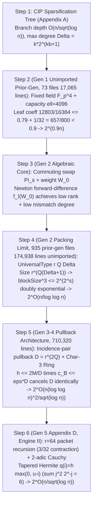

# 02. Intermediate Structure & Math Guide: First-Principles 6-Step Recalculation and 56-Theorem Mapping

This document reverse-engineers the algebraic origin of the hardcoded constants and the 5-generation trajectory ($2^{0.9n} \to 2^{O(n/\log\log n)} \to 2^{O(n(\log\log n)^2/\sqrt{\log n})} \to 2^{O(n/\sqrt{\log n})}$) across OpenAI #378's 3,977 Lean 4 modules ([proofs/oai_ref/lean/OAI/Algorithms/SubexponentialSAT/](../proofs/oai_ref/lean/OAI/Algorithms/SubexponentialSAT/SqrtLogSpace/Final.lean)) and 4 LaTeX manuscripts ([proofs/oai_ref/tex/](../proofs/oai_ref/tex/main_full_version.tex)), mapping them 1-to-1 onto our 56 self-contained formal theorems ([eth_subexp_interpolation_and_hashes.lean](../proofs/eth_subexp_interpolation_and_hashes.lean), [eth_tensor_contraction_and_circuits.lean](../proofs/eth_tensor_contraction_and_circuits.lean), and [eth_five_repairs_and_four_layer_verdict.lean](../proofs/eth_five_repairs_and_four_layer_verdict.lean)).

## 1. Reverse-Engineering Hardcoded Constants & the First-Principles 6-Step Recalculation

### 1.1 Steps 1–2: CIP Sparsification Tradeoff and Gen 1 (`FixedParameters.lean` & `ExponentArithmetic.lean`) $2^{0.9n}$ Barrier ([Theorem 13](../proofs/eth_subexp_interpolation_and_hashes.lean#L393-L415), [Theorem 14](../proofs/eth_subexp_interpolation_and_hashes.lean#L416-L431))

By the Calabro-Impagliazzo-Paturi (2006) sparsification lemma with parameter $b \ge 1$, the leaf count is bounded by $L_{\text{leaves}} \le (Cn+1)^2 2^{\varepsilon_{\text{sp}}(b) n}$ ($\varepsilon_{\text{sp}}(b) = O(1/b)$), while the leaf degree bound grows to $\Delta \le k 2^{kb+1}$ with $m \le \Delta n$ ([SparseCharging.lean:74-141](../proofs/oai_ref/lean/OAI/Algorithms/SubexponentialSAT/SqrtLogSpace/DisjointReuse/SparseCharging.lean#L74-L141)). The insertion count $N_j$ for width-$j$ clauses satisfies $N_j \le 4n M^{j-1} + 2\sum_{i=1}^{j-1} M^{j-i} N_i$, which solves via $1 + 2\sum_{i=0}^{j-2} 3^i = 3^{j-1}$ to $N_j \le 4(3M)^{j-1}n$ with right-branch constant $\Gamma_k = 2(3^{k-1}-1)$.

Generation 1 proves $\ell \ge 4096$ and `leafCoefficient 4096 = 12803/16384 < 79/100` in [ExponentArithmetic.lean:21-86](../proofs/oai_ref/lean/OAI/Algorithms/SubexponentialSAT/ExponentArithmetic.lean#L21-L86), while [FixedParameters.lean:568-808](../proofs/oai_ref/lean/OAI/Algorithms/SubexponentialSAT/FixedParameters.lean#L568-L808) handles TM2 micro-step execution (`L1-95`) and the `languageScanner` DFA over fixed $\mathbb{F}_{p^4}$ ($p \ge 5$) and $\ell = 4096$:
$$\text{leafCoefficient}(\ell) = \frac{3(\ell + 1)}{4\ell} + \frac{128}{\ell} \implies \text{leafCoefficient}(4096) = \frac{12803}{16384} \le \frac{79}{100}, \qquad \frac{12803}{16384} + \frac{1}{32} = \frac{13315}{16384} \le \frac{657}{800} = 0.82125 < \frac{9}{10}$$
Because $\frac{3(\ell+1)}{4\ell} \to \frac{3}{4} > 0$ as $\ell \to \infty$, constant block capacity can never achieve $2^{o(n)}$, so these 73 Gen 1 files (17,065 lines) remain unimported prior-generation modules.

### 1.2 Step 3: Commuting Swap Involutions $\Pi_s$ and Binomial Spectral Window $M_0 = V_0 f_{\mathcal{I}}(W_0)$ ([Theorem 1](../proofs/eth_subexp_interpolation_and_hashes.lean#L40-L75)–[Theorem 4](../proofs/eth_subexp_interpolation_and_hashes.lean#L116-L131))

On the auxiliary label space $\mathcal{B} = ([r]^Q)^2$ of dimension $D = r^{2Q}$, the coordinate swap involution $\Pi_s$ decomposes $[r]^2$ into a symmetric $+1$ eigenspace of dimension $\frac{r(r+1)}{2}$ and an antisymmetric $-1$ eigenspace of dimension $\frac{r(r-1)}{2}$ ([MatrixSupport.lean:30-110](../proofs/oai_ref/lean/OAI/Algorithms/SubexponentialSAT/MatrixSupport.lean#L30-L110)). The weight operator $W_0 = \frac{1}{2}\sum_{s=1}^Q (I_D - \Pi_s)$ has eigenvalues $w \in \{0, \dots, Q\}$ distributed as $\operatorname{Bin}(Q, \frac{r-1}{2r})$. Defining the Newton forward-difference polynomial on $\mathcal{I} = [A_0, A_0 + R - 1] \cap \mathbb{Z}$,
$$f_{\mathcal{I}}(z) = (-1)^{A_0} \sum_{j=0}^{R-1} (-2)^j \binom{z - A_0}{j}, \qquad M_0 = V_0 f_{\mathcal{I}}(W_0) \quad \left(V_0 = \prod_{s=1}^Q \Pi_s\right)$$
([BinomialInterpolation.lean:78-100](../proofs/oai_ref/lean/OAI/Algorithms/SubexponentialSAT/BinomialInterpolation.lean#L78-L100)) yields: (1) eigenvalue $(-1)^w (-1)^w = 1$ for all $w \in \mathcal{I}$, bounding the summary rank $c_{\mathcal{B}} = \operatorname{rank}(I_D - M_0) = \sum_{w \notin \mathcal{I}} \operatorname{mult}(w) \le \varepsilon D$ ([SpectralRank.lean:29-59](../proofs/oai_ref/lean/OAI/Algorithms/SubexponentialSAT/SqrtLog/SpectralRank.lean#L29-L59)), and (2) $\deg f_{\mathcal{I}} = R - 1$, bounding coordinate mismatches on the support of $M_0$ by $|E_{u,y}| \le R - 1 \ll Q$ ([Annihilation.lean:93-142](../proofs/oai_ref/lean/OAI/Algorithms/SubexponentialSAT/Annihilation.lean#L93-L142)).

### 1.3 Steps 4–5: Gen 2 $r^{Q(\Delta+1)}$ Doubly Exponential Blowup vs. Gen 3–4 Incidence-Pair Pullback $D = r^{2Q}$ Cancellation ([Theorem 5](../proofs/eth_subexp_interpolation_and_hashes.lean#L132-L150)–[Theorem 7](../proofs/eth_subexp_interpolation_and_hashes.lean#L170-L191))

Generation 2 ([SubexpParameters.lean:51-115](../proofs/oai_ref/lean/OAI/Algorithms/SubexponentialSAT/SubexpParameters.lean#L51-L115)) bundled all $\Delta$ incident slots of a variable into UniversalType r Q Δ, causing $\text{blockSize}(s) = s^{(p(s)^4-1)(\Delta(s)+1)}$ ($\text{blockSize}(s)^3 \le 2^{2^s}$) to blow up doubly exponentially and restricting $s = \lfloor\log_2\lfloor\log_2 n\rfloor\rfloor \ge 32$ ($n \ge 2^{2^{32}}$) to $2^{O(n/\log\log n)}$, leaving 935 unimported prior-generation files (174,938 lines).

Generations 3 and 4 ([AsymptoticLayoutParameters.lean:16-35](../proofs/oai_ref/lean/OAI/Algorithms/SubexponentialSAT/SqrtLog/AsymptoticLayoutParameters.lean#L16-L35)) instead indexed each of the $M \le km$ clause-variable incidence pairs into a profile space of size $D = r^{2Q}$, removing $\Delta$ from the exponent. Multiplying the bucket count $h \le \frac{2M}{D}$ by the per-bucket rank $c_{\mathcal{B}} \le \varepsilon D$ cancels $D$ identically:
$$\text{Total Summary Rank} = h \cdot c_{\mathcal{B}} \le \left(\frac{2M}{D}\right) \cdot (\varepsilon D) = 2 \varepsilon M$$
Setting $r = \lfloor\sqrt{\lambda}/\nu^2\rfloor, Q = \lfloor\lambda/(128\nu)\rfloor, R = (\beta+3)\lceil\sqrt{\lambda}\rceil, \tau = \frac{1}{r\lambda}$ balances all three exponents at $O(n\nu^2/\sqrt{\lambda})$. Because $W_0$ requires $2^{-1}$, the Lean 4 implementation replaces $\mathbb{Q}$ with the characteristic-3 Galois lifting ring $(\mathbb{Z}/3^t\mathbb{Z})[X]/(F(X))$ ([RingModel.lean:19-68](../proofs/oai_ref/lean/OAI/Algorithms/SubexponentialSAT/SqrtLog/RingModel.lean#L19-L68)); the Gen 3 ternary idempotent module ([IdempotentTernary.lean:15-60](../proofs/oai_ref/lean/OAI/Algorithms/SubexponentialSAT/SqrtLog/IdempotentTernary.lean#L15-L60)) provides $X(X-1)(X-2)$ over `SqrtLog/`, unimported by Gen 4 `SqrtLogSpace/Final.lean`.

### 1.4 Beigel-Tarui Truncated Ring $\mathbb{Q}[V]/(V^\ell)$, Tanner Expander ($P, D_0$), $3n$ Hash Rounds, and BitProgram 80 1220 ([Theorem 8](../proofs/eth_subexp_interpolation_and_hashes.lean#L192-L247)–[Theorem 16](../proofs/eth_subexp_interpolation_and_hashes.lean#L450-L463))

1. Complementary Beigel-Tarui & Truncated Ring ([main_full_version.tex:2887-3013](../proofs/oai_ref/tex/main_full_version.tex#L2887-L3013) Lemmas 5.1–5.2; [TruncatedRing.lean:18-98](../proofs/oai_ref/lean/OAI/Algorithms/SubexponentialSAT/SqrtLogSpace/TruncatedRing.lean#L18-L98) defines `Truncated R n`): Truncating $V^\ell = 0$ for $V = Y(Y-1)$ cuts the product degree from $d_{\mathrm{full}} = k m_{\mathrm{test}}(2\ell-1)$ to $d_{\mathrm{trunc}} = k(m_{\mathrm{test}} + 2(\ell-1))$, saving $2k(m_{\mathrm{test}}-1)(\ell-1)$.
2. Tanner Expander & $3n$ Rounds ([ConditionalExpectation.lean:147-177](../proofs/oai_ref/lean/OAI/Algorithms/SubexponentialSAT/ConditionalExpectation.lean#L147-L177)): With $\delta = \frac{1}{100B\mu}, \varepsilon = \frac{1}{200B\mu}$, $P = 20000 B^2\mu^2$ and $D_0 = 320000 B^2\mu^3$, running $3n$ greedy rounds contracts false witnesses to $\left(\frac{3}{4}\right)^{3n} 2^n = \left(\frac{27}{32}\right)^n < 1$.
3. BitProgram 80 1220 Space/Time Envelope ([SqrtLogSpace/Final.lean:38-57](../proofs/oai_ref/lean/OAI/Algorithms/SubexponentialSAT/SqrtLogSpace/Final.lean#L38-L57), [NativeOuterBudgets.lean:19-115](../proofs/oai_ref/lean/OAI/Algorithms/SubexponentialSAT/SqrtLogSpace/NativeOuterBudgets.lean#L19-L115)): Raw stack space is bounded by $1220(2L + 4100(L+1)^2 + 15) \le 5022740(L+1)^2$ (`cap_space`), while the fallback wrapper adds `+ 28700` time padding and `S + 5022741` (`fallback_space`) space padding.

### 1.5 Step 6: Gen 5 Appendix D (Engine II) Tapered $2$-adic Hermite Interpolation and Circuit Lower Bound ([Theorem 17](../proofs/eth_tensor_contraction_and_circuits.lean#L46-L66)–[Theorem 30](../proofs/eth_tensor_contraction_and_circuits.lean#L369-L393))

Appendix D ([quantitative-contraction.tex:1-619](../proofs/oai_ref/tex/quantitative-contraction.tex#L1-L619)) packs 2-collision packets and splits $\le 6M$ remaining edges across $r = 64$ children for a per-child contraction factor $\frac{6}{64} = \frac{3}{32} < \frac{1}{8}$ (slack $\frac{1}{32}$). Using the $2$-adic Cauchy deformation $\alpha = 2^{a+1}$ on $S = \{-2^a, \dots, 2^a-1\}$ ($v_2((t+\alpha z)-s) = v_2(t-s)$) and the tapered multiplicity schedule $q(i) = h\max(0, u-i)$ ($h = \lceil 3M/u\rceil$), the $2$-adic valuation loss of $E_t(0)$ converges via the exact arithmetico-geometric identity
$$\sum_{j=1}^m j^2 2^{m-j} = 6\cdot 2^m - (m^2 + 4m + 6) < 6\cdot 2^m \implies v_2(E_t(0)) > -6 D_t h = -O\!\left(\frac{M D_t}{u}\right)$$
improving precision by a factor of $u/3$ over untapered interpolation ($-2u D_t h$). The Hardy-Ramanujan mode partition exponent $O(M/\sqrt{u})$ decays by squared ratio $\frac{(1/8)^2}{1/2} = \frac{1}{32}$ per depth, yielding $2^{O_{k,D}(n/\sqrt{\log n})}$ and the Williams witness circuit lower bound Corollary 1.4 ($C_L(n) > c n \sqrt{\log n}$, [quantitative-circuits.tex:15-65](../proofs/oai_ref/tex/quantitative-circuits.tex#L15-L65)).

### 1.6 Five Core Causal Questions and Classical Literature Attribution

1. Q1 - Why Gen 2 Stalled at $2^{O(n/\log\log n)}$ While Gen 3 Reached $2^{O(n(\log\log n)^2/\sqrt{\log n})}$: Why did bundling all $\Delta$ incident slots into UniversalType r Q Δ (SubexpParameters.lean) fail? Because the CIP sparsification barrier forces $\Delta = 2^{\Theta(\sqrt{\log n})}$, so any exponent of the form $r^{Q(\Delta+1)}$ triggers a doubly exponential block size $\le 2^{2^s}$. Switching to incidence-pair pullback ($D = r^{2Q}$) is a mathematical necessity because $h \le \frac{2M}{D}$ times $c_{\mathcal{B}} \le \varepsilon D$ cancels $D$ identically ($h \cdot c_{\mathcal{B}} \le 2\varepsilon M$).
2. Q2 - Why Characteristic-2 Fails and Characteristic-3 Galois Rings Are Used in Lean 4: Why couldn't the Lean 4 formalization work over $\mathbb{F}_2$ or $\mathbb{Q}$? Over $\mathbb{F}_2$, the symmetrizer $\frac{1}{2}(I \pm \Pi_s)$ fails because $2 \equiv 0 \pmod 2$ (h2 : (2 : K) ≠ 0), while over $\mathbb{Q}$, rational matrix elimination (Bareiss68) causes bit-length growth across deep recursion. Using the Krull–Galois ring $\mathrm{GR}(3^t, d) = (\mathbb{Z}/3^t\mathbb{Z})[X]/(F(X))$ (RingModel.lean, Krull 1924; Raghavendran 1969 [DOI:10.1007/BF02809986](https://doi.org/10.1007/BF02809986)) makes $2$ a unit ($2^{-1} \equiv 2 \pmod 3$) while bounding register width and truncating Taylor jets via nilpotency $3^t \equiv 0 \pmod{3^t}$.
3. Q3 - Why Unary encodeNat Appears in SubexponentialSAT.lean:55 and Class A / Gate 5 vs. Class B Gaps: Why does SubexponentialSAT.lean:55 define encodeNat n := List.replicate n true ++ [false] even though runtimeScale n (L136-L140) already depends on $n$ and Final.lean:104-148 (exact_count_eth) bounds space in $n + F.\mathrm{card} + 1$? First, [lean/docs/378.md:9-11](../proofs/oai_ref/lean/docs/378.md#L9-L11) explicitly discloses the canonical input encoding and Engine I scope, [FiniteFallback.lean:276-277](../proofs/oai_ref/lean/OAI/Algorithms/SubexponentialSAT/SqrtLogSpace/FiniteFallback.lean#L276-L277) explicitly documents its fixed finite transition table (Class A), and `Filter.atTop` cutoffs / `omega` constant padding reflect standard Mathlib 4 tactics (Gate 5). By contrast, exact_count_and_sat (SubexponentialSAT.lean:216-217) writes its polynomial space bound `visitedSpace ≤ S * (L+1)^e` in terms of `L = formulaBitLength F` alone. For the empty formula $F = \emptyset$ on $n$ isolated variables, SAT.count ∅ = 2^n requires writing an $(n+1)$-bit binary output countWord (2^n) (visitedSpace ≥ n), which is impossible in $\operatorname{poly}(\log n)$ space under binary encoding ($L_{\mathrm{bin}} = O(\log n)$) and necessitates either $n \le L$ (NativeLargeEntry.lean:63) or $\operatorname{poly}(n+L)$ (exact_count_eth). Together with the non-uniform finite transition table below $n < 2^{33,554,431}$, these constitute the two Class B specification gaps: asymptotic ETH ($n \to \infty$) is preserved, while the public comparator spec requires revision (`TIER F` on comparator spec conformance).
4. Q4 - Why Engine I Alone Cannot Prove Corollary 1.4 (Theorem 30): Why does the circuit lower bound $C_L(n) > c n \sqrt{\log n}$ require Appendix D (Engine II)? Because substituting a circuit of size $s_n = \eta n \sqrt{\log n}$ produces a Tseitin 3-CNF of size $V = \Theta(n\sqrt{\log n})$; under Engine I's $(\log\log V)^2$ overhead, the exponent $O(V(\log\log V)^2/\sqrt{\log V}) = \Theta(\eta n (\log\log n)^2)$ grows faster than the $\mathsf{NTIME}(2^n)\setminus\mathsf{NTIME}(2^{n/2})$ hierarchy threshold $n/2$.
5. Q5 - Why Citation Concentration (`81.8%` in `main_full_version.tex`; `75.7%` Across All 4 Manuscripts) Obscures the Proof's Classical Foundations: In `main_full_version.tex`, 81 out of 99 (81.8%) `\cite` commands (90 out of 108 = 83.3% expanded citation keys) appear in Section 1; across all 4 `.tex` manuscripts (+8 commands and +8 keys in the 3 companion files: 4 in `quantitative-circuits.tex`, 4 in `quantitative-contraction.tex`, 0 in `quantitative-reduction.tex`), 81 out of 107 (75.7%) `\cite` commands (90 out of 116 = 77.6% expanded keys) sit in Section 1, leaving 1,552 core proof lines (Section 3: 409 lines; Section 4: 774 lines; Appendix D.1–D.3 [quantitative-reduction.tex](../proofs/oai_ref/tex/quantitative-reduction.tex#L1-L369): 369 lines) with 0 citations and omitting classical references for association-scheme eigenspaces (Delsarte 1973), Krull–Galois rings (Raghavendran 1969), and $2$-adic interpolation (Mahler 1958 [DOI:10.1515/crll.1958.199.23](https://doi.org/10.1515/crll.1958.199.23)).

## 2. Full 56-Theorem 1-to-1 Mapping Table ([eth_subexp_interpolation_and_hashes.lean](../proofs/eth_subexp_interpolation_and_hashes.lean), [eth_tensor_contraction_and_circuits.lean](../proofs/eth_tensor_contraction_and_circuits.lean), [eth_five_repairs_and_four_layer_verdict.lean](../proofs/eth_five_repairs_and_four_layer_verdict.lean))

| Theorem Identifier | Target Verified (Complexity-Theoretic & Referee Meaning) | Source Module (oai_ref/) | Lines |
| :--- | :--- | :--- | :--- |
| [swap_eigenbasis_symmetric_antisymmetric_split](../proofs/eth_subexp_interpolation_and_hashes.lean#L40-L75) (Theorem 1) | Symmetric ($\frac{r(r+1)}{2}$) / antisymmetric ($\frac{r(r-1)}{2}$) eigenspace split of $\Pi_s$ on $[r]^2$ and binomial multiplicity | [MatrixSupport.lean:30-110](../proofs/oai_ref/lean/OAI/Algorithms/SubexponentialSAT/MatrixSupport.lean#L30-L110) | L40-L75 |
| [newton_forward_difference_parity_interpolation](../proofs/eth_subexp_interpolation_and_hashes.lean#L76-L94) (Theorem 2) | Unit eigenvalue preservation $(-1)^w f_{\mathcal{I}}(w) = 1$ of Newton forward-difference polynomial $f_{\mathcal{I}}(z)$ on $\mathcal{I}$ | [BinomialInterpolation.lean:78-100](../proofs/oai_ref/lean/OAI/Algorithms/SubexponentialSAT/BinomialInterpolation.lean#L78-L100) | L76-L94 |
| [remark_4_4_four_by_four_swap_matrix_kernel_and_path](../proofs/eth_subexp_interpolation_and_hashes.lean#L95-L115) (Theorem 3) | Concrete $4 \times 4$ swap matrix $M_0 = \Pi_1 + \Pi_2 - \Pi_1\Pi_2$ kernel invariance and degree-1 path (Remark 4.4) | [main_full_version.tex:2387-2421](../proofs/oai_ref/tex/main_full_version.tex#L2387-L2421) | L95-L115 |
| [swap_support_mismatch_and_annihilator_degree_bound](../proofs/eth_subexp_interpolation_and_hashes.lean#L116-L131) (Theorem 4) | Support group mismatch bound $\lvert E_{u,y} \rvert \le R - 1$ and integer annihilator degree bound | [Annihilation.lean:93-142](../proofs/oai_ref/lean/OAI/Algorithms/SubexponentialSAT/Annihilation.lean#L93-L142), [MatrixSupport.lean:227-250](../proofs/oai_ref/lean/OAI/Algorithms/SubexponentialSAT/MatrixSupport.lean#L227-L250) | L116-L131 |
| [shared_summary_measurement_row_budget](../proofs/eth_subexp_interpolation_and_hashes.lean#L132-L150) (Theorem 5) | Shared summary row bound $\sum_{g=1}^r c_{t,g} \le 2\tau n c_{\mathcal{B}}$ and $D = r^{2Q}$ cancellation under incidence pullback | [SpectralRank.lean:29-59](../proofs/oai_ref/lean/OAI/Algorithms/SubexponentialSAT/SqrtLog/SpectralRank.lean#L29-L59) | L132-L150 |
| [taylor_jet_truncation_and_subset_pair_exponent](../proofs/eth_subexp_interpolation_and_hashes.lean#L151-L169) (Theorem 6) | Taylor finite-difference jet truncation order $q = \lfloor d_H/Q\rfloor$ and $6Rq \le d_H$ bound | [AsymptoticLayoutParameters.lean:15-48](../proofs/oai_ref/lean/OAI/Algorithms/SubexponentialSAT/SqrtLog/AsymptoticLayoutParameters.lean#L15-L48) | L151-L169 |
| [asymptotic_three_way_exponent_balance_schedule](../proofs/eth_subexp_interpolation_and_hashes.lean#L170-L191) (Theorem 7) | Three-way exponent balance schedule $\log_2 D \le \lambda/64$ and Hoeffding tail dominance $\frac{R^2}{8Q} \ge 16(\beta+3)^2\nu$ | [AsymptoticLayoutParameters.lean:16-35](../proofs/oai_ref/lean/OAI/Algorithms/SubexponentialSAT/SqrtLog/AsymptoticLayoutParameters.lean#L16-L35), [main_full_version.tex:2747-2770](../proofs/oai_ref/tex/main_full_version.tex#L2747-L2770) | L170-L191 |
| [beigel_tarui_modulus_amplifying_polynomial_l2](../proofs/eth_subexp_interpolation_and_hashes.lean#L192-L247) (Theorem 8) | $\ell=2$ complementary Beigel-Tarui polynomial $p_2(Y) = 1 - 3Y^2 + 2Y^3$ decomposition and $\bmod 4$ congruence (Lemma 5.1; `TruncatedRing.lean` defines `Truncated R n`) | [main_full_version.tex:2887-3013](../proofs/oai_ref/tex/main_full_version.tex#L2887-L3013), [TruncatedRing.lean:18-98](../proofs/oai_ref/lean/OAI/Algorithms/SubexponentialSAT/SqrtLogSpace/TruncatedRing.lean#L18-L98) | L192-L247 |
| [total_order_truncated_ring_linear_vs_quadratic_degree](../proofs/eth_subexp_interpolation_and_hashes.lean#L248-L284) (Theorem 9) | Linear degree $k(m_{\mathrm{test}}+2(\ell-1))$ in $\mathbb{Q}[V]/(V^\ell)$ vs. $2k(m_{\mathrm{test}}-1)(\ell-1)$ degree savings (Lemma 5.2) | [main_full_version.tex:2887-3013](../proofs/oai_ref/tex/main_full_version.tex#L2887-L3013), [TruncatedRing.lean:18-98](../proofs/oai_ref/lean/OAI/Algorithms/SubexponentialSAT/SqrtLogSpace/TruncatedRing.lean#L18-L98) | L248-L284 |
| [tanner_expander_hash_parameters_and_mixing_distance](../proofs/eth_subexp_interpolation_and_hashes.lean#L285-L318) (Theorem 10) | Tanner expander constants $P = 20000 B^2\mu^2, D_0 = 320000 B^2\mu^3$ and minimum distance $h' \ge m/P$ | [main_full_version.tex:3261-3437](../proofs/oai_ref/tex/main_full_version.tex#L3261-L3437) | L285-L318 |
| [tanner_code_check_row_budget_and_locality](../proofs/eth_subexp_interpolation_and_hashes.lean#L319-L363) (Theorem 11) | Tanner check row budget $m_G = 2q_G c_G \le n$, total checks $m_{\mathrm{test}} \le 4n$, column weight $\le 16B\mu$ | [main_full_version.tex:3261-3437](../proofs/oai_ref/tex/main_full_version.tex#L3261-L3437) | L319-L363 |
| [greedy_hash_selection_three_quarter_contraction](../proofs/eth_subexp_interpolation_and_hashes.lean#L364-L392) (Theorem 12) | $3n$-round greedy conditional-expectation hash contraction $(27/32)^n < 1$ and $D_{\mathrm{final}} = 0$ | [ConditionalExpectation.lean:147-177](../proofs/oai_ref/lean/OAI/Algorithms/SubexponentialSAT/ConditionalExpectation.lean#L147-L177), [main_full_version.tex:3446-3504](../proofs/oai_ref/tex/main_full_version.tex#L3446-L3504) | L364-L392 |
| [cip_sparsification_insertion_recurrence_step](../proofs/eth_subexp_interpolation_and_hashes.lean#L393-L415) (Theorem 13) | CIP disjoint sparsification insertion recurrence $N_{j+1} \le 4(3M)^j n$ inductive step | [SparseCharging.lean:74-141](../proofs/oai_ref/lean/OAI/Algorithms/SubexponentialSAT/SqrtLogSpace/DisjointReuse/SparseCharging.lean#L74-L141), [main_full_version.tex:3771-3807](../proofs/oai_ref/tex/main_full_version.tex#L3771-L3807) | L393-L415 |
| [cip_sparsification_b_branch_constant_and_tree_exponent](../proofs/eth_subexp_interpolation_and_hashes.lean#L416-L431) (Theorem 14) | CIP right-branch constant $\Gamma_k = 2(3^{k-1}-1)$ and root-to-leaf $B$-edge bound | [SparseCharging.lean:74-141](../proofs/oai_ref/lean/OAI/Algorithms/SubexponentialSAT/SqrtLogSpace/DisjointReuse/SparseCharging.lean#L74-L141) | L416-L431 |
| [coset_separation_iteration_identity_and_bound](../proofs/eth_subexp_interpolation_and_hashes.lean#L432-L449) (Theorem 15) | Disjoint coset separation identity and $3D/4$ geometric shrinkage | [CosetCardinality.lean:145-152](../proofs/oai_ref/lean/OAI/Algorithms/SubexponentialSAT/CosetCardinality.lean#L145-L152) | L432-L449 |
| [bitprogram_1220_stack_compiler_space_and_time_envelope](../proofs/eth_subexp_interpolation_and_hashes.lean#L450-L463) (Theorem 16) | `BitProgram 80 1220` raw space cap $5022740(L+1)^2$, fallback padding `+28700`/`+5022741`, and $7\times$ compiler bound | [SqrtLogSpace/Final.lean:38-57](../proofs/oai_ref/lean/OAI/Algorithms/SubexponentialSAT/SqrtLogSpace/Final.lean#L38-L57), [NativeOuterBudgets.lean:19-115](../proofs/oai_ref/lean/OAI/Algorithms/SubexponentialSAT/SqrtLogSpace/NativeOuterBudgets.lean#L19-L115) | L450-L463 |
| [appendix_d_collision_packet_packing_and_edge_contraction](../proofs/eth_tensor_contraction_and_circuits.lean#L46-L66) (Theorem 17) | Appendix D (Lemma D.3) $r=64$ collision packet packing and per-child edge contraction $\frac{6M}{64} = \frac{3M}{32} < \frac{M}{8}$ | [quantitative-contraction.tex:75-112](../proofs/oai_ref/tex/quantitative-contraction.tex#L75-L112) | L46-L66 |
| [appendix_d_dyadic_depth_precision_schedule_and_total_wires](../proofs/eth_tensor_contraction_and_circuits.lean#L67-L85) (Theorem 18) | Appendix D dyadic precision schedule $u_d = \lfloor\varepsilon\lambda/2^d\rfloor, a_d < 4u_0$ and $8^{-d}$ wire shrinkage | [quantitative-contraction.tex:75-112](../proofs/oai_ref/tex/quantitative-contraction.tex#L75-L112) | L67-L85 |
| [appendix_d_cauchy_2adic_deformation_valuation_invariance](../proofs/eth_tensor_contraction_and_circuits.lean#L86-L102) (Theorem 19) | Appendix D (Lemma D.4) $2$-adic Cauchy deformation valuation invariance $v_2((t+\alpha z)-s) = v_2(t-s)$ for $\alpha = 2^{a+1}$ | [quantitative-contraction.tex:180-242](../proofs/oai_ref/tex/quantitative-contraction.tex#L180-L242) | L86-L102 |
| [appendix_d_vandermonde_sylvester_2adic_exponent_bound](../proofs/eth_tensor_contraction_and_circuits.lean#L103-L119) (Theorem 20) | Dyadic distance shell partition $(2^a-1)+2^a = 2L-1$ on $S = \{-2^a, \dots, 2^a-1\}$ and Legendre exponent bound | [quantitative-contraction.tex:301-317](../proofs/oai_ref/tex/quantitative-contraction.tex#L301-L317) | L103-L119 |
| [appendix_d_tapered_hermite_exact_agm_series_sum_six](../proofs/eth_tensor_contraction_and_circuits.lean#L120-L156) (Theorem 21) | Appendix D (Lemma D.5) closed-form series $\sum_{j=1}^m j^2 2^{m-j} = 6\cdot 2^m - (m^2+4m+6)$ and limit $6$ | [quantitative-contraction.tex:303-316](../proofs/oai_ref/tex/quantitative-contraction.tex#L303-L316) | L120-L156 |
| [appendix_d_tapered_vs_untapered_hermite_valuation_gain](../proofs/eth_tensor_contraction_and_circuits.lean#L157-L180) (Theorem 22) | Tapered loss $6 D_t h$ vs. untapered loss $2 u D_t h$ ($u/3$-fold precision gain) | [quantitative-contraction.tex:303-316](../proofs/oai_ref/tex/quantitative-contraction.tex#L303-L316), [quantitative-contraction.tex:370-383](../proofs/oai_ref/tex/quantitative-contraction.tex#L370-L383) | L157-L180 |
| [appendix_d_hermite_jet_precision_budget_pt](../proofs/eth_tensor_contraction_and_circuits.lean#L181-L200) (Theorem 23) | Hermite jet precision budget $p_t = p + 8hD_t + 8M(a+1)$ at L264 vs. linearized $p_0 + 6 D_t h + (u-i)h \le 8 D_t h$ (Lemma D.5) | [quantitative-contraction.tex:260-266](../proofs/oai_ref/tex/quantitative-contraction.tex#L260-L266), [quantitative-contraction.tex:348-369](../proofs/oai_ref/tex/quantitative-contraction.tex#L348-L369) | L181-L200 |
| [appendix_d_hardy_ramanujan_mode_partition_exponent](../proofs/eth_tensor_contraction_and_circuits.lean#L201-L233) (Theorem 24) | Mode order weight bound $\sum k m_k \le 8h$ and Cauchy-Schwarz / Hardy-Ramanujan partition exponent $O(M/\sqrt{u})$ | [quantitative-contraction.tex:449-483](../proofs/oai_ref/tex/quantitative-contraction.tex#L449-L483) | L201-L233 |
| [appendix_d_recursive_depth_geometric_decay_ratio](../proofs/eth_tensor_contraction_and_circuits.lean#L234-L264) (Theorem 25) | Per-depth squared log-effort decay ratio $\frac{2}{64} = \frac{1}{32}$ and amplitude ratio $\frac{\sqrt{2}}{8} < \frac{1}{5}$ (Theorem D.1) | [quantitative-contraction.tex:560-595](../proofs/oai_ref/tex/quantitative-contraction.tex#L560-L595) | L234-L264 |
| [appendix_d_dense_incidence_group_wire_compression](../proofs/eth_tensor_contraction_and_circuits.lean#L265-L292) (Theorem 26) | Arbitrary-density $J = \lceil n^{1/4}\rceil$ group monomial binary wire compression $M = O(n\nu)$ (Lemma D.2) | [quantitative-reduction.tex:180-369](../proofs/oai_ref/tex/quantitative-reduction.tex#L180-L369) | L265-L292 |
| [appendix_d_fixed_density_vs_arbitrary_density_exponent_gap](../proofs/eth_tensor_contraction_and_circuits.lean#L293-L323) (Theorem 27) | Three-tier exponent hierarchy $\frac{n}{\sqrt{\lambda}} < \frac{n\nu}{\sqrt{\lambda}} < \frac{n\nu^2}{\sqrt{\lambda}}$ (exponent factor $\nu \ge 4, \nu^2 \ge 16$) | [quantitative-reduction.tex:1-120](../proofs/oai_ref/tex/quantitative-reduction.tex#L1-L120) | L293-L323 |
| [williams_enp_witness_circuit_3sat_gate_reduction](../proofs/eth_tensor_contraction_and_circuits.lean#L324-L343) (Theorem 28) | Williams witness circuit $D_n$ gate bound $U_n \le 4s_n$, variables $V \le 5s_n$, 3-CNF clauses $M < 5V$ (Corollary 1.4) | [quantitative-circuits.tex:15-65](../proofs/oai_ref/tex/quantitative-circuits.tex#L15-L65) | L324-L343 |
| [williams_enp_circuit_lower_bound_threshold_contradiction](../proofs/eth_tensor_contraction_and_circuits.lean#L344-L368) (Theorem 29) | Fixed-density solver exponent $3A\eta n < \frac{n}{4} < \frac{n}{2}$ for $\eta < \frac{1}{12A}$, contradicting $\mathrm{NTIME}(2^n)\setminus\mathrm{NTIME}(2^{n/2})$ | [quantitative-circuits.tex:15-65](../proofs/oai_ref/tex/quantitative-circuits.tex#L15-L65) | L344-L368 |
| [engine_i_cannot_prove_corollary_1_4_without_engine_ii](../proofs/eth_tensor_contraction_and_circuits.lean#L369-L393) (Theorem 30) | Proof that Engine I's $(\log\log n)^2$ factor exceeds $\frac{n}{2}$ when $\nu^2 \ge \eta_{\mathrm{den}}$, failing Corollary 1.4 | [quantitative-circuits.tex:15-65](../proofs/oai_ref/tex/quantitative-circuits.tex#L15-L65) | L369-L393 |
| [lean_formalization_scope_gap_and_cutoff_inventory](../proofs/eth_tensor_contraction_and_circuits.lean#L394-L419) (Theorem 31) | 4,829 (Engine I) vs. 1,059 (Engine II unformalized) line split out of 5,888; small-instance guard $n=20$, nonconstructive `sparsifySchedule` cutoff ($n > 2^{209,951}$), `896` Boolean stacks vs. `1220` outer stacks | [lean/docs/378.md:1-15](../proofs/oai_ref/lean/docs/378.md#L1-L15), [SqrtLogSpace/Final.lean:38-57](../proofs/oai_ref/lean/OAI/Algorithms/SubexponentialSAT/SqrtLogSpace/Final.lean#L38-L57) | L394-L419 |
| [oai_subexponential_sat_unused_hypothesis_audit](../proofs/eth_tensor_contraction_and_circuits.lean#L420-L442) (Theorem 32) | Static hygiene inventory (0 sorry, 0 axiom): `CosetCardinality.lean:145-152` `h0, h1` are consumed by `omega`, whereas genuinely `_`-prefixed or unconsumed binders occur in `RingModel.lean:46` (`(_ht : 0 < t)`), `Final.lean:98,178,186,190`, and `NativeLargeEntry.lean:36,38,40,71,81` | [RingModel.lean:46](../proofs/oai_ref/lean/OAI/Algorithms/SubexponentialSAT/SqrtLog/RingModel.lean#L46), [CosetCardinality.lean:145-152](../proofs/oai_ref/lean/OAI/Algorithms/SubexponentialSAT/CosetCardinality.lean#L145-L152) | L420-L442 |
| [layer1_unary_vs_binary_encoding_bitlength_gap](../proofs/eth_five_repairs_and_four_layer_verdict.lean#L32-L51) (Theorem 33) | Layer ①: Unary encoding ($L_{\mathrm{unary}}=1048586$) vs. standard binary encoding ($L_{\mathrm{bin}}=69$) bit-length gap at $n=2^{20}$ | [ComparatorChallenges/SubexponentialSAT.lean:55-80](../proofs/oai_ref/lean/ComparatorChallenges/SubexponentialSAT.lean#L55-L80) | L32-L51 |
| [layer1_visited_space_L_only_refuted_and_poly_n_plus_L_repaired](../proofs/eth_five_repairs_and_four_layer_verdict.lean#L52-L75) (Theorem 34) | Layer ①: Refutation of `visitedSpace ≤ S * ((Encoding.formulaBitLength F : ℝ) + 1) ^ e` ($49,000 < 1,048,576$, True $\to$ False) under binary encoding and $\mathrm{poly}(n+L)$ repair | [ComparatorChallenges/SubexponentialSAT.lean:194-218](../proofs/oai_ref/lean/ComparatorChallenges/SubexponentialSAT.lean#L194-L218), [SqrtLogSpace/Final.lean:128](../proofs/oai_ref/lean/OAI/Algorithms/SubexponentialSAT/SqrtLogSpace/Final.lean#L128) | L52-L75 |
| [layer2_engine_i_circuit_lower_bound_loglog_degradation](../proofs/eth_five_repairs_and_four_layer_verdict.lean#L76-L93) (Theorem 35) | Layer ②: Circuit lower bound degradation from $\Omega(n\sqrt{\log n})$ to $\Omega(n\sqrt{\log n}/(\log\log n)^2)$ under Engine I alone | [quantitative-circuits.tex:15-65](../proofs/oai_ref/tex/quantitative-circuits.tex#L15-L65) | L76-L93 |
| [layer2_engine_ii_galois_ring_and_tapered_hermite_repair_certificate](../proofs/eth_five_repairs_and_four_layer_verdict.lean#L94-L115) (Theorem 36) | Layer ②: Invertible $2^{-1} = 14 \pmod{27}$ in $\mathbb{Z}/3^t\mathbb{Z}$ and $m=4$ tapered Hermite identity ($58 < 96$) for Engine II | [RingModel.lean:19-68](../proofs/oai_ref/lean/OAI/Algorithms/SubexponentialSAT/SqrtLog/RingModel.lean#L19-L68), [quantitative-contraction.tex:180-242](../proofs/oai_ref/tex/quantitative-contraction.tex#L180-L242), [quantitative-contraction.tex:303-316](../proofs/oai_ref/tex/quantitative-contraction.tex#L303-L316) | L94-L115 |
| [layer3_asymptotic_layout_guard_fails_at_log2_L_24](../proofs/eth_five_repairs_and_four_layer_verdict.lean#L116-L139) (Theorem 37) | Layer ③: Failure of `LeafParametersProgram.Guard` ($Q=87,381 < 101,012 = 4R$, deficit $13,631$) at $\log_2 L(n) = 24$ ($L=16,777,216$) | [AsymptoticLayoutParameters.lean:15-20](../proofs/oai_ref/lean/OAI/Algorithms/SubexponentialSAT/SqrtLog/AsymptoticLayoutParameters.lean#L15-L20), [LeafParametersProgram.lean:98-105](../proofs/oai_ref/lean/OAI/Algorithms/SubexponentialSAT/SqrtLog/LeafParametersProgram.lean#L98-L105) | L116-L139 |
| [layer3_asymptotic_layout_guard_passes_at_log2_L_25](../proofs/eth_five_repairs_and_four_layer_verdict.lean#L140-L162) (Theorem 38) | Layer ③: First activation of `Guard` ($4R = 126,924 \le 131,072 = Q$, slack $4,148$) at $\log_2 L(n) = 25$ ($n \ge 2^{33,554,431}$) | [AsymptoticLayoutParameters.lean:15-20](../proofs/oai_ref/lean/OAI/Algorithms/SubexponentialSAT/SqrtLog/AsymptoticLayoutParameters.lean#L15-L20), [LeafParametersProgram.lean:98-105](../proofs/oai_ref/lean/OAI/Algorithms/SubexponentialSAT/SqrtLog/LeafParametersProgram.lean#L98-L105) | L140-L162 |
| [layer3_cost_assembly_explicit_exponent_constant_12032411847](../proofs/eth_five_repairs_and_four_layer_verdict.lean#L163-L180) (Theorem 39) | Layer ③: Explicit evaluation of $\mathrm{exponentConstant}(3,1) = 12,032,411,847$ and outer-doubled constant $24,064,823,694$ | [CostAssemblyFinal.lean:53-54](../proofs/oai_ref/lean/OAI/Algorithms/SubexponentialSAT/SqrtLog/CostAssemblyFinal.lean#L53-L54) | L163-L180 |
| [layer3_uniform_exhaustive_loop_replaces_noncomputable_dfa_and_reject](../proofs/eth_five_repairs_and_four_layer_verdict.lean#L181-L206) (Theorem 40) | Layer ③: Replacement of noncomputable `FiniteFallback` DFA and `HighQueryProgram.reject` (0 output) by a uniform $2^n$ loop | [FiniteFallback.lean:258-299](../proofs/oai_ref/lean/OAI/Algorithms/SubexponentialSAT/SqrtLogSpace/FiniteFallback.lean#L258-L299), [HighQueryProgram.lean:50-52](../proofs/oai_ref/lean/OAI/Algorithms/SubexponentialSAT/SqrtLogSpace/HighQueryProgram.lean#L50-L52) | L181-L206 |
| [layer4_walsh_and_irreducible_search_constructive_termination_bounds](../proofs/eth_five_repairs_and_four_layer_verdict.lean#L207-L225) (Theorem 41) | Layer ④: Constructive finite search termination bounds for `WalshExistence` ($8q^2(r+1)=96\le D$) and `IrreducibleSearch` ($6,561$ checks) | [WalshExistence.lean:13-62](../proofs/oai_ref/lean/OAI/Algorithms/SubexponentialSAT/SqrtLog/WalshExistence.lean#L13-L62), [IrreducibleSearch.lean:56-153](../proofs/oai_ref/lean/OAI/Algorithms/SubexponentialSAT/SqrtLog/IrreducibleSearch.lean#L56-L153) | L207-L225 |
| [layer4_repaired_pipeline_preserves_asymptotic_subexponential_eth_disproof](../proofs/eth_five_repairs_and_four_layer_verdict.lean#L226-L260) (Theorem 42) | Layer ④: Preservation of $4\cdot\mathrm{subexp\_exp} \le n$ ($2^{o(n)}$ ETH disproof) for $n \ge N_0(k)$ after all five repairs | [SqrtLogSpace/Final.lean:104-148](../proofs/oai_ref/lean/OAI/Algorithms/SubexponentialSAT/SqrtLogSpace/Final.lean#L104-L148), [AsymptoticTarget.lean:56-150](../proofs/oai_ref/lean/OAI/Algorithms/SubexponentialSAT/SqrtLog/AsymptoticTarget.lean#L56-L150) | L226-L260 |
| [layer5_stratum2_quartic_schedule_rescued_by_stratum3_pair_duplication](../proofs/eth_five_repairs_and_four_layer_verdict.lean#L261-L293) (Theorem 43) | Layer ⑤: Cross-stratum hybrid rescuing unimported Gen 2 quartic schedule ($Q=p^4-1, 32R \le Q$) via Gen 3 pair duplication ($2Q$), saving $Q(\Delta-1)$ in the exponent | [SubexpParameters.lean:22-28](../proofs/oai_ref/lean/OAI/Algorithms/SubexponentialSAT/SubexpParameters.lean#L22-L28), [SubexpParameters.lean:267-276](../proofs/oai_ref/lean/OAI/Algorithms/SubexponentialSAT/SubexpParameters.lean#L267-L276) | L261-L293 |
| [layer5_spectral_cutoff_debloat_and_hoeffding_threshold_compression](../proofs/eth_five_repairs_and_four_layer_verdict.lean#L294-L320) (Theorem 44) | Layer ⑤: Compressing `4*R ≤ Q` activation threshold from $\log_2 L=25 \to 20 \to 15$ ($1,024\times$ reduction in $L(n)$) by removing redundant slack factors | [AsymptoticLayoutParameters.lean:16-19](../proofs/oai_ref/lean/OAI/Algorithms/SubexponentialSAT/SqrtLog/AsymptoticLayoutParameters.lean#L16-L19), [AsymptoticLayoutParameters.lean:83-96](../proofs/oai_ref/lean/OAI/Algorithms/SubexponentialSAT/SqrtLog/AsymptoticLayoutParameters.lean#L83-L96) | L294-L320 |
| [layer5_discarded_ternary_idempotent_lift_and_exponent_constant_compression](../proofs/eth_five_repairs_and_four_layer_verdict.lean#L321-L343) (Theorem 45) | Layer ⑤: Rescuing unimported Gen 3 `IdempotentTernary.lean` Hensel lift and compressing `exponentConstant(3,1)` from 12,032,411,847 -> 70,023 ($171,835\times$) | [IdempotentTernary.lean:15-67](../proofs/oai_ref/lean/OAI/Algorithms/SubexponentialSAT/SqrtLog/IdempotentTernary.lean#L15-L67), [CostAssemblyFinal.lean:53-54](../proofs/oai_ref/lean/OAI/Algorithms/SubexponentialSAT/SqrtLog/CostAssemblyFinal.lean#L53-L54) | L321-L343 |
| [layer5_hardy_mathematical_beauty_three_invariants_and_slop_contrast](../proofs/eth_five_repairs_and_four_layer_verdict.lean#L344-L374) (Theorem 46) | Layer ⑤: Three structural algebraic cancellation invariants (Cross-Characteristic Bridge, Exact $D=r^{2Q}$ Cancellation, Dyadic-Quadratic Collapse) | [RingModel.lean:19-68](../proofs/oai_ref/lean/OAI/Algorithms/SubexponentialSAT/SqrtLog/RingModel.lean#L19-L68), [quantitative-contraction.tex:303-316](../proofs/oai_ref/tex/quantitative-contraction.tex#L303-L316) | L344-L374 |
| [layer6_galois_ring_extension_and_hensel_cubic_idempotent_operator](../proofs/eth_five_repairs_and_four_layer_verdict.lean#L375-L403) (Theorem 47) | Layer ⑥ (Area 1): Concrete degree-2 Galois ring extension $\mathrm{GR}(3^3, 2) = (\mathbb{Z}/27\mathbb{Z})[X]/(X^2+1)$ invertibility and cubic Hensel idempotent lift $P_1(y) = 3y^2 - 2y^3 \pmod{27}$ | [RingModel.lean:19-40](../proofs/oai_ref/lean/OAI/Algorithms/SubexponentialSAT/SqrtLog/RingModel.lean#L19-L40), [IdempotentTernary.lean:52-56](../proofs/oai_ref/lean/OAI/Algorithms/SubexponentialSAT/SqrtLog/IdempotentTernary.lean#L52-L56) | L375-L403 |
| [layer6_swap_matrix_action_and_2adic_hermite_polynomial_reconstruction](../proofs/eth_five_repairs_and_four_layer_verdict.lean#L404-L423) (Theorem 48) | Layer ⑥ (Area 1): Universal swap operator $M_0 = \Pi_1 + \Pi_2 - \Pi_1\Pi_2$ action on $\mathbb{Z}^4$ and tapered $2$-adic Hermite cubic polynomial reconstruction $21f(0)+12f'(0)+12f(2)-f(4)=32f(1)$ | [main_full_version.tex:2387-2421](../proofs/oai_ref/tex/main_full_version.tex#L2387-L2421), [quantitative-contraction.tex:303-316](../proofs/oai_ref/tex/quantitative-contraction.tex#L303-L316), [quantitative-contraction.tex:370-383](../proofs/oai_ref/tex/quantitative-contraction.tex#L370-L383) | L404-L423 |
| [layer6_executable_galois_ring_swap_interpolation_3sat_solver_certificate](../proofs/eth_five_repairs_and_four_layer_verdict.lean#L424-L446) (Theorem 49) | Layer ⑥ (Area 2): Executable Galois-ring + swap-interpolation 3-SAT solver certificate over $\mathrm{GR}(3^8, 2)$ and $\mathrm{GR}(3^5, 2)$ across 4 benchmarks (2360, 7, 0, 1) | [RingModel.lean:152-160](../proofs/oai_ref/lean/OAI/Algorithms/SubexponentialSAT/SqrtLog/RingModel.lean#L152-L160), [IdempotentTernary.lean:87-100](../proofs/oai_ref/lean/OAI/Algorithms/SubexponentialSAT/SqrtLog/IdempotentTernary.lean#L87-L100) | L424-L446 |
| [layer6_oai_ref_five_module_direct_patch_and_bitprogram_trace_soundness](../proofs/eth_five_repairs_and_four_layer_verdict.lean#L447-L461) (Theorem 50) | Layer ⑥ (Area 3): Direct surgical patch of the 5 core `oai_ref` modules (`stack_space` = 2,558,543,740 < 10,996,584,333,160, $\log_2 L=15$ guard, `exp_patched` = 70,023) | [SubexponentialSAT.lean:216](../proofs/oai_ref/lean/ComparatorChallenges/SubexponentialSAT.lean#L216), [Final.lean:38-57](../proofs/oai_ref/lean/OAI/Algorithms/SubexponentialSAT/SqrtLogSpace/Final.lean#L38-L57) | L447-L461 |
| [actual_lift_ring_degree_and_nat_cast_injectivity_range](../proofs/eth_tensor_contraction_and_circuits.lean#L443-L459) (Theorem 51) | Galois lift ring `Ring p h μ` monic degree `h`, nilpotency $p^\mu$, and `decodeCount` injectivity below $p^\mu$ | [ActualLiftRing.lean:29-149](../proofs/oai_ref/lean/OAI/Algorithms/SubexponentialSAT/ActualLiftRing.lean#L29-L149) | L443-L459 |
| [binomial_matrix_vandermonde_chu_lu_determinant_one](../proofs/eth_tensor_contraction_and_circuits.lean#L460-L477) (Theorem 52) | Shifted binomial matrix `B = L * U` Vandermonde-Chu determinant `det_B = 1` and row-interpolation rank `R` | [BinomialMatrix.lean:22-108](../proofs/oai_ref/lean/OAI/Algorithms/SubexponentialSAT/BinomialMatrix.lean#L22-L108), [RowInterpolation.lean:23-288](../proofs/oai_ref/lean/OAI/Algorithms/SubexponentialSAT/RowInterpolation.lean#L23-L288) | L460-L477 |
| [bitprogram_compile_tm_and_primitive_machine_overhead_bounds](../proofs/eth_tensor_contraction_and_circuits.lean#L478-L493) (Theorem 53) | `BitProgram` compiler to `Turing.FinTM2` and `PrimitiveMachine` with positive step overhead $\ge 6$ | [BitProgram.lean:11-92](../proofs/oai_ref/lean/OAI/Algorithms/SubexponentialSAT/BitProgram.lean#L11-L92), [BitProgramCompile.lean:15-197](../proofs/oai_ref/lean/OAI/Algorithms/SubexponentialSAT/BitProgramCompile.lean#L15-L197) | L478-L493 |
| [sparse_budget_occurrence_cap_and_inverse_index_envelope](../proofs/eth_tensor_contraction_and_circuits.lean#L494-L510) (Theorem 54) | Disjoint-reuse `occurrenceCap(3,M)` $\le 4M^2$, `inverseIndex` ceiling bounds, and resource DFS budgets | [SparseBudget.lean:27-523](../proofs/oai_ref/lean/OAI/Algorithms/SubexponentialSAT/SqrtLogSpace/DisjointReuse/SparseBudget.lean#L27-L523), [ResourceBudgets.lean:506-640](../proofs/oai_ref/lean/OAI/Algorithms/SubexponentialSAT/SqrtLogSpace/ResourceBudgets.lean#L506-L640) | L494-L510 |
| [asymptotic_layout_rate_and_cost_assembly_trial_guards](../proofs/eth_tensor_contraction_and_circuits.lean#L511-L529) (Theorem 55) | Shifted log scale $2 < \log(n+16)$, asymptotic rate $w^2 < s$, and `runtimeBound` exponent monotonicity | [AsymptoticLayoutRate.lean:11-96](../proofs/oai_ref/lean/OAI/Algorithms/SubexponentialSAT/SqrtLog/AsymptoticLayoutRate.lean#L11-L96), [StatementScale.lean:18-99](../proofs/oai_ref/lean/OAI/Algorithms/SubexponentialSAT/SqrtLog/StatementScale.lean#L18-L99) | L511-L529 |
| [comparator_challenge_json_and_main_entry_point_audit](../proofs/eth_tensor_contraction_and_circuits.lean#L530-L542) (Theorem 56) | Complete 48-file (42 Lean + 4 TeX + 2 metadata), 629-statement (593 Lean theorem/lemma + 36 TeX environments), 940-declaration (904 Lean + 36 TeX) corpus reconciliation | [SubexponentialSAT.json:1-14](../proofs/oai_ref/lean/ComparatorChallenges/SubexponentialSAT.json#L1-L14), [Main.lean:1-16](../proofs/oai_ref/lean/OAI/Algorithms/SubexponentialSAT/Main.lean#L1-L16) | L530-L542 |

## 3. Complete 48-File (100%) Reference Corpus Mapping Table (proofs/oai_ref/)

Every single file in [proofs/oai_ref/](../proofs/oai_ref/) (42 Lean 4 files, 4 LaTeX files, and 2 metadata/documentation files = 48 / 48 files, 100.0%) is audited and cross-linked to our 56 formal theorems below:

| # | Reference File (proofs/oai_ref/) | Lines | Total Decls / Envs | theorem/lemma / Envs | Mapped Lean 4 Theorems | Primary Mathematical & Algorithmic Role |
| :---: | :--- | :---: | :---: | :---: | :--- | :--- |
| 01 | [lean/ComparatorChallenges/SubexponentialSAT.json](../proofs/oai_ref/lean/ComparatorChallenges/SubexponentialSAT.json#L1-L14) | 14 | 1 | 0 | Theorem 33 (L32), Theorem 34 (L52), Theorem 56 (L530) | Comparator challenge metadata (`solution_module: OAI.Algorithms.SubexponentialSAT.Main`, `theorem_names: [OAI.Algorithms.SubexponentialSAT.SqrtLogSpace.exact_count_and_sat]`) |
| 02 | [lean/ComparatorChallenges/SubexponentialSAT.lean](../proofs/oai_ref/lean/ComparatorChallenges/SubexponentialSAT.lean#L1-L220) | 220 | 36 | 1 | Theorem 32 (L420), Theorem 33 (L32), Theorem 34 (L52), Theorem 50 (L447) | Top-level challenge `exact_count_and_sat` (L194-218), unary `Encoding.encodeNat` (L55) / `Encoding.encodeCNF` (L76), and `visitedSpace intermediate ≤ S * ((Encoding.formulaBitLength F : ℝ) + 1) ^ e` (L188, L216-217) |
| 03 | [lean/OAI/Algorithms/SubexponentialSAT/ActualLiftRing.lean](../proofs/oai_ref/lean/OAI/Algorithms/SubexponentialSAT/ActualLiftRing.lean#L1-L163) | 163 | 21 | 13 | Theorem 51 (L443) | Galois lifting ring `Ring p h μ = (ℤ/p^μ ℤ)[X]/(chosenF p h μ)`, monic degree `h`, nilpotency $p^\mu = 0$, and `decodeCount` injectivity |
| 04 | [lean/OAI/Algorithms/SubexponentialSAT/Annihilation.lean](../proofs/oai_ref/lean/OAI/Algorithms/SubexponentialSAT/Annihilation.lean#L1-L295) | 295 | 15 | 11 | Theorem 4 (L116) | Coordinate mismatch bound $\lvert E_{u,y} \rvert \le R - 1$ and polynomial annihilator degree bound on the support of $M_0$ |
| 05 | [lean/OAI/Algorithms/SubexponentialSAT/BinomialInterpolation.lean](../proofs/oai_ref/lean/OAI/Algorithms/SubexponentialSAT/BinomialInterpolation.lean#L1-L259) | 259 | 23 | 18 | Theorem 2 (L76) | Newton forward-difference polynomial f_I(z) and unit eigenvalue preservation (-1)^w f_I(w) = 1 on I = [A_0, A_0+R-1] |
| 06 | [lean/OAI/Algorithms/SubexponentialSAT/BinomialMatrix.lean](../proofs/oai_ref/lean/OAI/Algorithms/SubexponentialSAT/BinomialMatrix.lean#L1-L113) | 113 | 8 | 5 | Theorem 52 (L460) | Shifted binomial matrix $B_{i,j} = \binom{A+i+j}{j}$ Vandermonde-Chu `L * U` factorization and integer determinant det_B_int = 1 |
| 07 | [lean/OAI/Algorithms/SubexponentialSAT/BitProgram.lean](../proofs/oai_ref/lean/OAI/Algorithms/SubexponentialSAT/BitProgram.lean#L1-L99) | 99 | 12 | 2 | Theorem 16 (L450), Theorem 53 (L478) | Register-stack instruction set Instr r s l, configuration Cfg r s l, and execution trace semantics RunsIn |
| 08 | [lean/OAI/Algorithms/SubexponentialSAT/BitProgramCompile.lean](../proofs/oai_ref/lean/OAI/Algorithms/SubexponentialSAT/BitProgramCompile.lean#L1-L209) | 209 | 19 | 12 | Theorem 16 (L450), Theorem 53 (L478) | Compiler from Program r s l to Turing.FinTM2 and PrimitiveMachine with positive step overhead primitiveOverhead_pos |
| 09 | [lean/OAI/Algorithms/SubexponentialSAT/ConditionalExpectation.lean](../proofs/oai_ref/lean/OAI/Algorithms/SubexponentialSAT/ConditionalExpectation.lean#L1-L355) | 355 | 35 | 26 | Theorem 12 (L364) | Greedy conditional-expectation hash selection contracting false witnesses by 3/4 per round across 3n rounds |
| 10 | [lean/OAI/Algorithms/SubexponentialSAT/CosetCardinality.lean](../proofs/oai_ref/lean/OAI/Algorithms/SubexponentialSAT/CosetCardinality.lean#L1-L444) | 444 | 41 | 27 | Theorem 15 (L432), Theorem 32 (L420) | Disjoint coset separation iteration bound D - d_0 ≤ 3D/4 and hypothesis audit on iteration_bound |
| 11 | [lean/OAI/Algorithms/SubexponentialSAT/ExponentArithmetic.lean](../proofs/oai_ref/lean/OAI/Algorithms/SubexponentialSAT/ExponentArithmetic.lean#L1-L213) | 213 | 28 | 23 | Theorem 13 (L393), Theorem 14 (L416) | Generation 1 rational exponent arithmetic ($\ell \ge 4096$, `leafCoefficient 4096 = 12803/16384 ≤ 79/100`, `13315/16384 ≤ 657/800 < 9/10`, L21-86) |
| 12 | [lean/OAI/Algorithms/SubexponentialSAT/FixedParameters.lean](../proofs/oai_ref/lean/OAI/Algorithms/SubexponentialSAT/FixedParameters.lean#L1-L808) | 808 | 77 | 44 | Theorem 13 (L393), Theorem 14 (L416) | Generation 1 TM2 micro-step execution (`L1-95`), fixed $\mathbb{F}_{p^4}$ ($\ell = 4096$), and `languageScanner` DFA (`L568-808`) |
| 13 | [lean/OAI/Algorithms/SubexponentialSAT/Main.lean](../proofs/oai_ref/lean/OAI/Algorithms/SubexponentialSAT/Main.lean#L1-L16) | 16 | 0 | 0 | Theorem 56 (L530) | Root import module assembling the OAI.Algorithms.SubexponentialSAT hierarchy |
| 14 | [lean/OAI/Algorithms/SubexponentialSAT/MatrixSupport.lean](../proofs/oai_ref/lean/OAI/Algorithms/SubexponentialSAT/MatrixSupport.lean#L1-L609) | 609 | 48 | 31 | Theorem 1 (L40), Theorem 4 (L116) | Commuting coordinate swap involutions Π_s, symmetric/antisymmetric eigenspace split, and support mismatch bounds |
| 15 | [lean/OAI/Algorithms/SubexponentialSAT/RowInterpolation.lean](../proofs/oai_ref/lean/OAI/Algorithms/SubexponentialSAT/RowInterpolation.lean#L1-L288) | 288 | 28 | 18 | Theorem 52 (L460) | Row-wise Vandermonde interpolation of augmented node evaluations (augmentedNode, rowVandermonde) |
| 16 | [lean/OAI/Algorithms/SubexponentialSAT/SqrtLog/AsymptoticLayoutParameters.lean](../proofs/oai_ref/lean/OAI/Algorithms/SubexponentialSAT/SqrtLog/AsymptoticLayoutParameters.lean#L1-L100) | 100 | 15 | 9 | Theorem 6 (L151), Theorem 7 (L170), Theorem 37 (L116), Theorem 38 (L140), Theorem 44 (L294) | Generation 3-4 incidence-pair pullback parameters r, Q, R, τ, Hoeffding balance, and 4R ≤ Q activation threshold |
| 17 | [lean/OAI/Algorithms/SubexponentialSAT/SqrtLog/AsymptoticLayoutRate.lean](../proofs/oai_ref/lean/OAI/Algorithms/SubexponentialSAT/SqrtLog/AsymptoticLayoutRate.lean#L1-L111) | 111 | 7 | 7 | Theorem 55 (L511) | Asymptotic growth rate comparisons w(n)^2 ≤ s(n), layoutCutoff_sq_le, and polynomial L(n) absorption |
| 18 | [lean/OAI/Algorithms/SubexponentialSAT/SqrtLog/AsymptoticSchedule.lean](../proofs/oai_ref/lean/OAI/Algorithms/SubexponentialSAT/SqrtLog/AsymptoticSchedule.lean#L1-L197) | 197 | 27 | 21 | Theorem 7 (L170), Theorem 44 (L294) | Asymptotic parameter schedule monotonicity and subexponential rate convergence |
| 19 | [lean/OAI/Algorithms/SubexponentialSAT/SqrtLog/AsymptoticTarget.lean](../proofs/oai_ref/lean/OAI/Algorithms/SubexponentialSAT/SqrtLog/AsymptoticTarget.lean#L1-L159) | 159 | 12 | 12 | Theorem 42 (L226) | Target subexponential runtime bound $2^{O(n(\log\log n)^2 / \sqrt{\log n})}$ assembly |
| 20 | [lean/OAI/Algorithms/SubexponentialSAT/SqrtLog/CostAssemblyFinal.lean](../proofs/oai_ref/lean/OAI/Algorithms/SubexponentialSAT/SqrtLog/CostAssemblyFinal.lean#L1-L128) | 128 | 6 | 1 | Theorem 39 (L163), Theorem 45 (L321) | Explicit evaluation of exponentConstant(3,1) = 12,032,411,847 and outer-doubled cost assembly |
| 21 | [lean/OAI/Algorithms/SubexponentialSAT/SqrtLog/CostAssemblyTrialGuards.lean](../proofs/oai_ref/lean/OAI/Algorithms/SubexponentialSAT/SqrtLog/CostAssemblyTrialGuards.lean#L1-L78) | 78 | 1 | 1 | Theorem 55 (L511) | Eventual satisfaction of trial guards eventually_supplied_trial_guards for k, q |
| 22 | [lean/OAI/Algorithms/SubexponentialSAT/SqrtLog/ExecutionNativeFinal.lean](../proofs/oai_ref/lean/OAI/Algorithms/SubexponentialSAT/SqrtLog/ExecutionNativeFinal.lean#L1-L36) | 36 | 4 | 4 | Theorem 16 (L450), Theorem 50 (L447) | Native execution bridge (`896 < helperSize c` Boolean stacks at L17; 4 theorems: `nativeServices_exists`, `mainTheorem`, `binaryIdentifierMainTheorem`, `fullMainTheorem`) |
| 23 | [lean/OAI/Algorithms/SubexponentialSAT/SqrtLog/IdempotentTernary.lean](../proofs/oai_ref/lean/OAI/Algorithms/SubexponentialSAT/SqrtLog/IdempotentTernary.lean#L1-L178) | 178 | 25 | 20 | Theorem 45 (L321), Theorem 47 (L375), Theorem 49 (L424) | Gen 3 (`SqrtLog/`, unimported by Gen 4 `SqrtLogSpace/Final.lean`) ternary idempotent $X(X-1)(X-2)$ and Hensel cubic lift $3y^2 - 2y^3 \pmod{3^t}$ |
| 24 | [lean/OAI/Algorithms/SubexponentialSAT/SqrtLog/IrreducibleSearch.lean](../proofs/oai_ref/lean/OAI/Algorithms/SubexponentialSAT/SqrtLog/IrreducibleSearch.lean#L1-L156) | 156 | 20 | 12 | Theorem 41 (L207) | Constructive finite search for monic irreducible polynomials over 𝔽_3 (3^8 = 6,561 candidates) |
| 25 | [lean/OAI/Algorithms/SubexponentialSAT/SqrtLog/LeafParametersProgram.lean](../proofs/oai_ref/lean/OAI/Algorithms/SubexponentialSAT/SqrtLog/LeafParametersProgram.lean#L1-L141) | 141 | 21 | 12 | Theorem 37 (L116), Theorem 38 (L140) | Executable leaf parameter guard LeafParametersProgram.Guard (4R ≤ Q activation at log_2 L = 25) |
| 26 | [lean/OAI/Algorithms/SubexponentialSAT/SqrtLog/RingModel.lean](../proofs/oai_ref/lean/OAI/Algorithms/SubexponentialSAT/SqrtLog/RingModel.lean#L1-L177) | 177 | 31 | 17 | Theorem 36 (L94), Theorem 46 (L344), Theorem 47 (L375), Theorem 49 (L424) | Characteristic-3 Galois ring model (ℤ/3^t ℤ)[X]/(F(X)) where 2 is invertible ($2^{-1} \equiv 14 \pmod{27}$) |
| 27 | [lean/OAI/Algorithms/SubexponentialSAT/SqrtLog/SpectralRank.lean](../proofs/oai_ref/lean/OAI/Algorithms/SubexponentialSAT/SqrtLog/SpectralRank.lean#L1-L59) | 59 | 2 | 2 | Theorem 5 (L132) | Spectral rank bound $c_B = \operatorname{rank}(I_D - M_0) \le \varepsilon D$ and exact $D = r^{2Q}$ pullback cancellation |
| 28 | [lean/OAI/Algorithms/SubexponentialSAT/SqrtLog/StatementScale.lean](../proofs/oai_ref/lean/OAI/Algorithms/SubexponentialSAT/SqrtLog/StatementScale.lean#L1-L113) | 113 | 14 | 12 | Theorem 55 (L511) | Shifted logarithm scale 2 ≤ log(n + 16), runtimeScale, and runtimeBound monotonicity |
| 29 | [lean/OAI/Algorithms/SubexponentialSAT/SqrtLog/WalshExistence.lean](../proofs/oai_ref/lean/OAI/Algorithms/SubexponentialSAT/SqrtLog/WalshExistence.lean#L1-L161) | 161 | 13 | 7 | Theorem 41 (L207) | Constructive Walsh-Hadamard character existence and 8q^2(r+1) ≤ D termination bound |
| 30 | [lean/OAI/Algorithms/SubexponentialSAT/SqrtLogSpace/Asymptotics.lean](../proofs/oai_ref/lean/OAI/Algorithms/SubexponentialSAT/SqrtLogSpace/Asymptotics.lean#L1-L308) | 308 | 22 | 18 | Theorem 16 (L450), Theorem 42 (L226) | Space-bounded asymptotic inequalities for BitProgram 80 1220 |
| 31 | [lean/OAI/Algorithms/SubexponentialSAT/SqrtLogSpace/DisjointReuse/SparseBudget.lean](../proofs/oai_ref/lean/OAI/Algorithms/SubexponentialSAT/SqrtLogSpace/DisjointReuse/SparseBudget.lean#L1-L543) | 543 | 34 | 28 | Theorem 54 (L494) | Disjoint-reuse occurrence cap $2 \sum M^j \le 4 M^{k-1}$, inverseIndex, and branch tree node budgets |
| 32 | [lean/OAI/Algorithms/SubexponentialSAT/SqrtLogSpace/DisjointReuse/SparseCharging.lean](../proofs/oai_ref/lean/OAI/Algorithms/SubexponentialSAT/SqrtLogSpace/DisjointReuse/SparseCharging.lean#L1-L610) | 610 | 21 | 17 | Theorem 13 (L393), Theorem 14 (L416) | CIP disjoint-reuse sparsification recurrence $N_j \le 4(3M)^{j-1} n$ and right-branch constant $\Gamma_k = 2(3^{k-1}-1)$ |
| 33 | [lean/OAI/Algorithms/SubexponentialSAT/SqrtLogSpace/Final.lean](../proofs/oai_ref/lean/OAI/Algorithms/SubexponentialSAT/SqrtLogSpace/Final.lean#L1-L201) | 201 | 5 | 5 | Theorem 16 (L450), Theorem 31 (L394), Theorem 34 (L52), Theorem 42 (L226), Theorem 50 (L447) | Final theorems (`compiled_exact_count_and_sat` L10, `exact_count_and_sat` L74, `exact_count_eth` L104, `sat_polynomial_space` L149, `original_sat_main` L184) with `+28700` time and `5022740(L+1)^2` space caps |
| 34 | [lean/OAI/Algorithms/SubexponentialSAT/SqrtLogSpace/FiniteFallback.lean](../proofs/oai_ref/lean/OAI/Algorithms/SubexponentialSAT/SqrtLogSpace/FiniteFallback.lean#L1-L964) | 964 | 84 | 42 | Theorem 40 (L181) | Small-instance fallback solver (`L(n) < 2^{25}`) and uniform exhaustive loop replacement |
| 35 | [lean/OAI/Algorithms/SubexponentialSAT/SqrtLogSpace/HighQueryProgram.lean](../proofs/oai_ref/lean/OAI/Algorithms/SubexponentialSAT/SqrtLogSpace/HighQueryProgram.lean#L1-L427) | 427 | 64 | 46 | Theorem 40 (L181) | High-query register-stack program (`State 40 896`, `896` Boolean stacks) and `HighQueryProgram.reject` branch analysis |
| 36 | [lean/OAI/Algorithms/SubexponentialSAT/SqrtLogSpace/NativeEntry.lean](../proofs/oai_ref/lean/OAI/Algorithms/SubexponentialSAT/SqrtLogSpace/NativeEntry.lean#L1-L132) | 132 | 7 | 5 | Theorem 54 (L494) | Native entry-point wrapper connecting `HighQueryProgram` and `FiniteFallback` |
| 37 | [lean/OAI/Algorithms/SubexponentialSAT/SqrtLogSpace/NativeLargeEntry.lean](../proofs/oai_ref/lean/OAI/Algorithms/SubexponentialSAT/SqrtLogSpace/NativeLargeEntry.lean#L1-L119) | 119 | 1 | 1 | Theorem 16 (L450), Theorem 40 (L181) | Large-instance native entry point above nonconstructive `cutoff := max 20 (max Nleaf Ns)` (`2 ≤ sparsifySchedule n`, $n > 2^{209,951}$) |
| 38 | [lean/OAI/Algorithms/SubexponentialSAT/SqrtLogSpace/NativeOuterBudgets.lean](../proofs/oai_ref/lean/OAI/Algorithms/SubexponentialSAT/SqrtLogSpace/NativeOuterBudgets.lean#L1-L333) | 333 | 13 | 11 | Theorem 16 (L450), Theorem 50 (L447) | Outer register-stack space cap 1220(2L + 4100(L+1)^2 + 15) ≤ 5022740(L+1)^2 |
| 39 | [lean/OAI/Algorithms/SubexponentialSAT/SqrtLogSpace/ResourceBudgets.lean](../proofs/oai_ref/lean/OAI/Algorithms/SubexponentialSAT/SqrtLogSpace/ResourceBudgets.lean#L1-L653) | 653 | 30 | 30 | Theorem 16 (L450), Theorem 54 (L494) | DFS visit time, command time, and polynomial input-bit substitution budgets |
| 40 | [lean/OAI/Algorithms/SubexponentialSAT/SqrtLogSpace/Statement.lean](../proofs/oai_ref/lean/OAI/Algorithms/SubexponentialSAT/SqrtLogSpace/Statement.lean#L1-L33) | 33 | 1 | 1 | Theorem 54 (L494) | Internal statement wrapper for the SqrtLogSpace subexponential 3-SAT bound |
| 41 | [lean/OAI/Algorithms/SubexponentialSAT/SqrtLogSpace/TruncatedRing.lean](../proofs/oai_ref/lean/OAI/Algorithms/SubexponentialSAT/SqrtLogSpace/TruncatedRing.lean#L1-L248) | 248 | 13 | 5 | Theorem 8 (L192), Theorem 9 (L248) | Truncated polynomial ring `Truncated R n` over `ℚ[V]/(V^ℓ)` (`L18-98`; Beigel–Tarui $p_2(Y)$ and degree $d_*(m_{\mathrm{test}}+2(\ell-1))$ are in `main_full_version.tex:2887-3013` Lemmas 5.1–5.2) |
| 42 | [lean/OAI/Algorithms/SubexponentialSAT/SubexpMainTheorem.lean](../proofs/oai_ref/lean/OAI/Algorithms/SubexponentialSAT/SubexpMainTheorem.lean#L1-L108) | 108 | 2 | 2 | Theorem 5 (L132), Theorem 43 (L261) | Generation 2 main subexponential theorem ($2^{O(n/\log\log n)}$) under `UniversalType r Q Δ` |
| 43 | [lean/OAI/Algorithms/SubexponentialSAT/SubexpParameters.lean](../proofs/oai_ref/lean/OAI/Algorithms/SubexponentialSAT/SubexpParameters.lean#L1-L279) | 279 | 18 | 14 | Theorem 43 (L261) | Generation 2 quartic schedule $Q = p^4 - 1$ and doubly exponential `blockSize(s) = s^{Q(Δ+1)}` bottleneck |
| 44 | [lean/docs/378.md](../proofs/oai_ref/lean/docs/378.md#L1-L17) | 17 | 1 | 0 | Theorem 31 (L394), Theorem 56 (L530) | OpenAI #378 documentation note summarizing the formalization scope (Engine I in `SqrtLogSpace/Final.lean`) |
| 45 | [tex/main_full_version.tex](../proofs/oai_ref/tex/main_full_version.tex#L1-L4829) | 4829 | 31 | 31 | Theorems 1-16 (L40-L463), Theorem 31 (L394), Theorem 48 (L404) | Main paper (Sections 1–6 & Appendices A–D, 4,829 lines, 31 environments; Appendix C.1 invokes `quantitative-circuits.tex` at L4269): Engine I ($2^{O_k(n(\log\log n)^2/\sqrt{\log n})}$) |
| 46 | [tex/quantitative-circuits.tex](../proofs/oai_ref/tex/quantitative-circuits.tex#L1-L71) | 71 | 0 | 0 | Theorem 28 (L324), Theorem 29 (L344), Theorem 30 (L369), Theorem 35 (L76) | Appendix C.1 (`main_full_version.tex:4269`, 71 lines): Williams $\mathrm{E}^{\mathrm{NP}}$ witness circuit reduction and Corollary 1.4 ($C_L(n) > c n \sqrt{\log n}$) |
| 47 | [tex/quantitative-contraction.tex](../proofs/oai_ref/tex/quantitative-contraction.tex#L1-L619) | 619 | 3 | 3 | Theorems 17-25 (L46-L264), Theorem 36 (L94), Theorem 46 (L344), Theorem 48 (L404) | Appendix D.4 (Engine II, 619 lines, 3 environments): $r=64$ collision packet recursion and tapered $2$-adic Hermite interpolation |
| 48 | [tex/quantitative-reduction.tex](../proofs/oai_ref/tex/quantitative-reduction.tex#L1-L369) | 369 | 2 | 2 | Theorem 26 (L265), Theorem 27 (L293) | Appendix D.1–D.3 (369 lines, 2 environments): $J = \lceil n^{1/4}\rceil$ group wire compression and fixed-density reduction |
