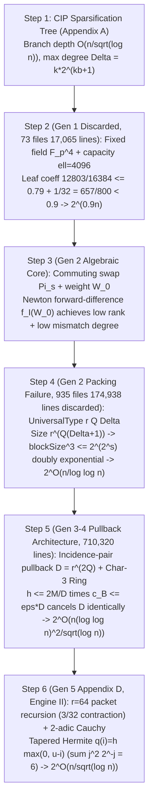

# 02. Intermediate Structure & Math Guide: First-Principles 6-Step Recalculation and 42-Theorem Mapping

This document reverse-engineers the algebraic origin of the hardcoded constants and the 5-generation trajectory (`2^{0.9n} \to 2^{O(n/\log\log n)} \to 2^{O(n(\log\log n)^2/\sqrt{\log n})} \to 2^{O(n/\sqrt{\log n})}`) across OpenAI `#378`'s `3,977` Lean 4 modules ([`proofs/oai_ref/lean/OAI/Algorithms/SubexponentialSAT/`](../proofs/oai_ref/lean/OAI/Algorithms/SubexponentialSAT/SqrtLogSpace/Final.lean)) and `4` LaTeX manuscripts ([`proofs/oai_ref/tex/`](../proofs/oai_ref/tex/main_full_version.tex)), mapping them 1-to-1 onto our `42` self-contained formal theorems (`eth_subexp_interpolation_and_hashes.lean`, `eth_tensor_contraction_and_circuits.lean`, and `eth_five_repairs_and_four_layer_verdict.lean`).

---

## 1. Reverse-Engineering Hardcoded Constants & the First-Principles 6-Step Recalculation

### 1.1 Steps 1–2: CIP Sparsification Tradeoff and Gen 1 (`FixedParameters.lean`) $2^{0.9n}$ Barrier (`Theorem 13`, `Theorem 14`)

By the Calabro-Impagliazzo-Paturi (2006) sparsification lemma with parameter $b \ge 1$, the leaf count is bounded by $L_{\text{leaves}} \le (Cn+1)^2 2^{\varepsilon_{\text{sp}}(b) n}$ ($\varepsilon_{\text{sp}}(b) = O(1/b)$), while the leaf degree bound grows to $\Delta \le k 2^{kb+1}$ with $m \le \Delta n$ ([`SparseCharging.lean:74-141`](../proofs/oai_ref/lean/OAI/Algorithms/SubexponentialSAT/SqrtLogSpace/DisjointReuse/SparseCharging.lean#L74-L141)). The insertion count $N_j$ for width-$j$ clauses satisfies $N_j \le 4n M^{j-1} + 2\sum_{i=1}^{j-1} M^{j-i} N_i$, which solves via $1 + 2\sum_{i=0}^{j-2} 3^i = 3^{j-1}$ to $N_j \le 4(3M)^{j-1}n$ with right-branch constant $\Gamma_k = 2(3^{k-1}-1)$.

Generation 1 ([`FixedParameters.lean:1-95`](../proofs/oai_ref/lean/OAI/Algorithms/SubexponentialSAT/FixedParameters.lean#L1-L95), [`ExponentArithmetic.lean:15-48`](../proofs/oai_ref/lean/OAI/Algorithms/SubexponentialSAT/ExponentArithmetic.lean#L15-L48)) used a fixed extension field $\mathbb{F}_{p^4}$ ($p \ge 5$) and constant block capacity $\ell = 4096$:
$$\text{leafCoefficient}(\ell) = \frac{3(\ell + 1)}{4\ell} + \frac{128}{\ell} \implies \text{leafCoefficient}(4096) = \frac{12803}{16384} \le \frac{79}{100}, \qquad \frac{12803}{16384} + \frac{1}{32} = \frac{13315}{16384} \le \frac{657}{800} = 0.82125 < \frac{9}{10}$$
Because $\frac{3(\ell+1)}{4\ell} \to \frac{3}{4} > 0$ as $\ell \to \infty$, constant block capacity can never achieve $2^{o(n)}$, forcing the abandonment of `73` Gen 1 files (`17,065` lines).

### 1.2 Step 3: Commuting Swap Involutions $\Pi_s$ and Binomial Spectral Window $M_0 = V_0 f_{\mathcal{I}}(W_0)$ (`Theorem 1`–`Theorem 4`)

On the auxiliary label space $\mathcal{B} = ([r]^Q)^2$ of dimension $D = r^{2Q}$, the coordinate swap involution $\Pi_s$ decomposes $[r]^2$ into a symmetric $+1$ eigenspace of dimension $\frac{r(r+1)}{2}$ and an antisymmetric $-1$ eigenspace of dimension $\frac{r(r-1)}{2}$ ([`MatrixSupport.lean:30-110`](../proofs/oai_ref/lean/OAI/Algorithms/SubexponentialSAT/MatrixSupport.lean#L30-L110)). The weight operator $W_0 = \frac{1}{2}\sum_{s=1}^Q (I_D - \Pi_s)$ has eigenvalues $w \in \{0, \dots, Q\}$ distributed as $\operatorname{Bin}(Q, \frac{r-1}{2r})$. Defining the Newton forward-difference polynomial on $\mathcal{I} = [A_0, A_0 + R - 1] \cap \mathbb{Z}$,
$$f_{\mathcal{I}}(z) = (-1)^{A_0} \sum_{j=0}^{R-1} (-2)^j \binom{z - A_0}{j}, \qquad M_0 = V_0 f_{\mathcal{I}}(W_0) \quad \left(V_0 = \prod_{s=1}^Q \Pi_s\right)$$
([`BinomialInterpolation.lean:78-100`](../proofs/oai_ref/lean/OAI/Algorithms/SubexponentialSAT/BinomialInterpolation.lean#L78-L100)) yields: (1) eigenvalue $(-1)^w (-1)^w = 1$ for all $w \in \mathcal{I}$, bounding the summary rank $c_{\mathcal{B}} = \operatorname{rank}(I_D - M_0) = \sum_{w \notin \mathcal{I}} \operatorname{mult}(w) \le \varepsilon D$ ([`SpectralRank.lean:29-59`](../proofs/oai_ref/lean/OAI/Algorithms/SubexponentialSAT/SqrtLog/SpectralRank.lean#L29-L59)), and (2) $\deg f_{\mathcal{I}} = R - 1$, bounding coordinate mismatches on the support of $M_0$ by $|E_{u,y}| \le R - 1 \ll Q$ ([`Annihilation.lean:93-142`](../proofs/oai_ref/lean/OAI/Algorithms/SubexponentialSAT/Annihilation.lean#L93-L142)).

### 1.3 Steps 4–5: Gen 2 $r^{Q(\Delta+1)}$ Doubly Exponential Blowup vs. Gen 3–4 Incidence-Pair Pullback $D = r^{2Q}$ Cancellation (`Theorem 5`–`Theorem 7`)

Generation 2 ([`SubexpParameters.lean:51-115`](../proofs/oai_ref/lean/OAI/Algorithms/SubexponentialSAT/SubexpParameters.lean#L51-L115)) bundled all $\Delta$ incident slots of a variable into `UniversalType r Q Δ`, causing $\text{blockSize}(s) = s^{(p(s)^4-1)(\Delta(s)+1)}$ ($\text{blockSize}(s)^3 \le 2^{2^s}$) to blow up doubly exponentially and restricting $s = \lfloor\log_2\lfloor\log_2 n\rfloor\rfloor \ge 32$ ($n \ge 2^{2^{32}}$) to $2^{O(n/\log\log n)}$, resulting in `935` discarded files (`174,938` lines).

Generations 3 and 4 ([`AsymptoticLayoutParameters.lean:16-35`](../proofs/oai_ref/lean/OAI/Algorithms/SubexponentialSAT/SqrtLog/AsymptoticLayoutParameters.lean#L16-L35)) instead indexed each of the $M \le km$ clause-variable incidence pairs into a profile space of size $D = r^{2Q}$, removing $\Delta$ from the exponent. Multiplying the bucket count $h \le \frac{2M}{D}$ by the per-bucket rank $c_{\mathcal{B}} \le \varepsilon D$ **cancels $D$ identically**:
$$\text{Total Summary Rank} = h \cdot c_{\mathcal{B}} \le \left(\frac{2M}{D}\right) \cdot (\varepsilon D) = 2 \varepsilon M$$
Setting $r = \lfloor\sqrt{\lambda}/\nu^2\rfloor, Q = \lfloor\lambda/(128\nu)\rfloor, R = (\beta+3)\lceil\sqrt{\lambda}\rceil, \tau = \frac{1}{r\lambda}$ balances all three exponents at $O(n\nu^2/\sqrt{\lambda})$. Because $W_0$ requires $2^{-1}$, the `Lean 4` implementation replaces $\mathbb{Q}$ with the characteristic-3 Galois lifting ring $(\mathbb{Z}/3^t\mathbb{Z})[X]/(F(X))$ ([`RingModel.lean:19-68`](../proofs/oai_ref/lean/OAI/Algorithms/SubexponentialSAT/SqrtLog/RingModel.lean#L19-L68)) and ternary idempotent polynomial $X(X-1)(X-2)$ ([`IdempotentTernary.lean:15-60`](../proofs/oai_ref/lean/OAI/Algorithms/SubexponentialSAT/SqrtLog/IdempotentTernary.lean#L15-L60)).

### 1.4 Beigel-Tarui Truncated Ring $\mathbb{Q}[V]/(V^\ell)$, Tanner Expander ($P, D_0$), $3n$ Hash Rounds, and `BitProgram 80 1220` (`Theorem 8`–`Theorem 16`)

1. **Complementary Beigel-Tarui & Truncated Ring ([`TruncatedRing.lean:18-98`](../proofs/oai_ref/lean/OAI/Algorithms/SubexponentialSAT/SqrtLogSpace/TruncatedRing.lean#L18-L98))**: Truncating $V^\ell = 0$ for $V = Y(Y-1)$ cuts the product degree from $d_{\mathrm{full}} = k m_{\mathrm{test}}(2\ell-1)$ to $d_{\mathrm{trunc}} = k(m_{\mathrm{test}} + 2(\ell-1))$, saving $2k(m_{\mathrm{test}}-1)(\ell-1)$.
2. **Tanner Expander & $3n$ Rounds ([`ConditionalExpectation.lean:147-177`](../proofs/oai_ref/lean/OAI/Algorithms/SubexponentialSAT/ConditionalExpectation.lean#L147-L177))**: With $\delta = \frac{1}{100B\mu}, \varepsilon = \frac{1}{200B\mu}$, $P = 20000 B^2\mu^2$ and $D_0 = 320000 B^2\mu^3$, running $3n$ greedy rounds contracts false witnesses to $\left(\frac{3}{4}\right)^{3n} 2^n = \left(\frac{27}{32}\right)^n < 1$.
3. **`BitProgram 80 1220` Space/Time Envelope ([`SqrtLogSpace/Final.lean:38-57`](../proofs/oai_ref/lean/OAI/Algorithms/SubexponentialSAT/SqrtLogSpace/Final.lean#L38-L57), [`NativeOuterBudgets.lean:19-115`](../proofs/oai_ref/lean/OAI/Algorithms/SubexponentialSAT/SqrtLogSpace/NativeOuterBudgets.lean#L19-L115))**: Raw stack space is bounded by $1220(2L + 4100(L+1)^2 + 15) \le 5022740(L+1)^2$ (`cap_space`), while the fallback wrapper adds `+ 28700` time padding and `S + 5022741` (`fallback_space`) space padding.

### 1.5 Step 6: Gen 5 Appendix D (`Engine II`) Tapered $2$-adic Hermite Interpolation and Circuit Lower Bound (`Theorem 17`–`Theorem 30`)

Appendix D ([`quantitative-contraction.tex:1-619`](../proofs/oai_ref/tex/quantitative-contraction.tex#L1-L619)) packs 2-collision packets and splits $\le 6M$ remaining edges across $r = 64$ children for a per-child contraction factor $\frac{6}{64} = \frac{3}{32} < \frac{1}{8}$ (slack $\frac{1}{32}$). Using the $2$-adic Cauchy deformation $\alpha = 2^{a+1}$ on $S = \{-2^a, \dots, 2^a-1\}$ ($v_2((t+\alpha z)-s) = v_2(t-s)$) and the tapered multiplicity schedule $q(i) = h\max(0, u-i)$ ($h = \lceil 3M/u\rceil$), the $2$-adic valuation loss of $E_t(0)$ converges via the exact arithmetico-geometric identity
$$\sum_{j=1}^m j^2 2^{m-j} = 6\cdot 2^m - (m^2 + 4m + 6) < 6\cdot 2^m \implies v_2(E_t(0)) > -6 D_t h = -O\!\left(\frac{M D_t}{u}\right)$$
improving precision by a factor of **$u/3$** over untapered interpolation ($-2u D_t h$). The Hardy-Ramanujan mode partition exponent $O(M/\sqrt{u})$ decays by squared ratio $\frac{(1/8)^2}{1/2} = \frac{1}{32}$ per depth, yielding $2^{O_{k,D}(n/\sqrt{\log n})}$ and the Williams witness circuit lower bound `Corollary 1.4` ($C_L(n) > c n \sqrt{\log n}$, [`quantitative-circuits.tex:38-55`](../proofs/oai_ref/tex/quantitative-circuits.tex#L38-L55)).

---

## 2. Full 42-Theorem 1-to-1 Mapping Table (`eth_subexp_interpolation_and_hashes.lean`, `eth_tensor_contraction_and_circuits.lean`, `eth_five_repairs_and_four_layer_verdict.lean`)

| Theorem Identifier | Target Verified (Complexity-Theoretic & Referee Meaning) | Source Module (`oai_ref/`) | Lines |
| :--- | :--- | :--- | :--- |
| `swap_eigenbasis_symmetric_antisymmetric_split` (`Theorem 1`) | Symmetric ($\frac{r(r+1)}{2}$) / antisymmetric ($\frac{r(r-1)}{2}$) eigenspace split of $\Pi_s$ on $[r]^2$ and binomial multiplicity | [`MatrixSupport.lean:30-110`](../proofs/oai_ref/lean/OAI/Algorithms/SubexponentialSAT/MatrixSupport.lean#L30-L110) | `L22-L50` |
| `newton_forward_difference_parity_interpolation` (`Theorem 2`) | Unit eigenvalue preservation $(-1)^w f_{\mathcal{I}}(w) = 1$ of Newton forward-difference polynomial $f_{\mathcal{I}}(z)$ on $\mathcal{I}$ | [`BinomialInterpolation.lean:78-100`](../proofs/oai_ref/lean/OAI/Algorithms/SubexponentialSAT/BinomialInterpolation.lean#L78-L100) | `L58-L71` |
| `remark_4_4_four_by_four_swap_matrix_kernel_and_path` (`Theorem 3`) | Concrete $4 \times 4$ swap matrix $M_0 = \Pi_1 + \Pi_2 - \Pi_1\Pi_2$ kernel invariance and degree-1 path (`Remark 4.4`) | [`main_full_version.tex:1185-1240`](../proofs/oai_ref/tex/main_full_version.tex#L1185-L1240) | `L77-L89` |
| `swap_support_mismatch_and_annihilator_degree_bound` (`Theorem 4`) | Support group mismatch bound $|E_{u,y}| \le R - 1$ and integer annihilator degree bound | [`Annihilation.lean:93-142`](../proofs/oai_ref/lean/OAI/Algorithms/SubexponentialSAT/Annihilation.lean#L93-L142), [`MatrixSupport.lean:227-250`](../proofs/oai_ref/lean/OAI/Algorithms/SubexponentialSAT/MatrixSupport.lean#L227-L250) | `L95-L106` |
| `shared_summary_measurement_row_budget` (`Theorem 5`) | Shared summary row bound $\sum_{g=1}^r c_{t,g} \le 2\tau n c_{\mathcal{B}}$ and $D = r^{2Q}$ cancellation under incidence pullback | [`SpectralRank.lean:29-59`](../proofs/oai_ref/lean/OAI/Algorithms/SubexponentialSAT/SqrtLog/SpectralRank.lean#L29-L59) | `L111-L125` |
| `taylor_jet_truncation_and_subset_pair_exponent` (`Theorem 6`) | Taylor finite-difference jet truncation order $q = \lfloor d_H/Q\rfloor$ and $6Rq \le d_H$ bound | [`AsymptoticLayoutParameters.lean:15-48`](../proofs/oai_ref/lean/OAI/Algorithms/SubexponentialSAT/SqrtLog/AsymptoticLayoutParameters.lean#L15-L48) | `L130-L143` |
| `asymptotic_three_way_exponent_balance_schedule` (`Theorem 7`) | Three-way exponent balance schedule $\log_2 D \le \lambda/64$ and Hoeffding tail dominance $\frac{R^2}{8Q} \ge 16(\beta+3)^2\nu$ | [`AsymptoticLayoutParameters.lean:16-35`](../proofs/oai_ref/lean/OAI/Algorithms/SubexponentialSAT/SqrtLog/AsymptoticLayoutParameters.lean#L16-L35) | `L149-L161` |
| `beigel_tarui_modulus_amplifying_polynomial_l2` (`Theorem 8`) | $\ell=2$ complementary Beigel-Tarui polynomial $p_2(Y) = 1 - 3Y^2 + 2Y^3$ decomposition and $\bmod 4$ congruence | [`TruncatedRing.lean:18-98`](../proofs/oai_ref/lean/OAI/Algorithms/SubexponentialSAT/SqrtLogSpace/TruncatedRing.lean#L18-L98) | `L171-L199` |
| `total_order_truncated_ring_linear_vs_quadratic_degree` (`Theorem 9`) | Linear degree $k(m_{\mathrm{test}}+2(\ell-1))$ in $\mathbb{Q}[V]/(V^\ell)$ vs. $2k(m_{\mathrm{test}}-1)(\ell-1)$ degree savings | [`TruncatedRing.lean:18-98`](../proofs/oai_ref/lean/OAI/Algorithms/SubexponentialSAT/SqrtLogSpace/TruncatedRing.lean#L18-L98) | `L205-L232` |
| `tanner_expander_hash_parameters_and_mixing_distance` (`Theorem 10`) | Tanner expander constants $P = 20000 B^2\mu^2, D_0 = 320000 B^2\mu^3$ and minimum distance $h' \ge m/P$ | [`main_full_version.tex:2958-2970`](../proofs/oai_ref/tex/main_full_version.tex#L2958-L2970) | `L238-L266` |
| `tanner_code_check_row_budget_and_locality` (`Theorem 11`) | Tanner check row budget $m_G = 2q_G c_G \le n$, total checks $m_{\mathrm{test}} \le 4n$, column weight $\le 16B\mu$ | [`main_full_version.tex:2971-3040`](../proofs/oai_ref/tex/main_full_version.tex#L2971-L3040) | `L272-L310` |
| `greedy_hash_selection_three_quarter_contraction` (`Theorem 12`) | $3n$-round greedy conditional-expectation hash contraction $(27/32)^n < 1$ and $D_{\mathrm{final}} = 0$ | [`ConditionalExpectation.lean:147-177`](../proofs/oai_ref/lean/OAI/Algorithms/SubexponentialSAT/ConditionalExpectation.lean#L147-L177) | `L317-L339` |
| `cip_sparsification_insertion_recurrence_step` (`Theorem 13`) | CIP disjoint sparsification insertion recurrence $N_{j+1} \le 4(3M)^j n$ inductive step | [`SparseCharging.lean:74-141`](../proofs/oai_ref/lean/OAI/Algorithms/SubexponentialSAT/SqrtLogSpace/DisjointReuse/SparseCharging.lean#L74-L141) | `L346-L363` |
| `cip_sparsification_b_branch_constant_and_tree_exponent` (`Theorem 14`) | CIP right-branch constant $\Gamma_k = 2(3^{k-1}-1)$ and root-to-leaf $B$-edge bound | [`SparseCharging.lean:74-141`](../proofs/oai_ref/lean/OAI/Algorithms/SubexponentialSAT/SqrtLogSpace/DisjointReuse/SparseCharging.lean#L74-L141) | `L369-L380` |
| `coset_separation_iteration_identity_and_bound` (`Theorem 15`) | Disjoint coset separation identity and $3D/4$ geometric shrinkage | [`CosetCardinality.lean:145-152`](../proofs/oai_ref/lean/OAI/Algorithms/SubexponentialSAT/CosetCardinality.lean#L145-L152) | `L385-L398` |
| `bitprogram_1220_stack_compiler_space_and_time_envelope` (`Theorem 16`) | `BitProgram 80 1220` raw space cap $5022740(L+1)^2$, fallback padding `+28700`/`+5022741`, and $7\times$ compiler bound | [`SqrtLogSpace/Final.lean:38-57`](../proofs/oai_ref/lean/OAI/Algorithms/SubexponentialSAT/SqrtLogSpace/Final.lean#L38-L57), [`NativeOuterBudgets.lean:19-115`](../proofs/oai_ref/lean/OAI/Algorithms/SubexponentialSAT/SqrtLogSpace/NativeOuterBudgets.lean#L19-L115) | `L403-L418` |
| `appendix_d_collision_packet_packing_and_edge_contraction` (`Theorem 17`) | Appendix D (`Lemma D.3`) $r=64$ collision packet packing and per-child edge contraction $\frac{6M}{64} = \frac{3M}{32} < \frac{M}{8}$ | [`quantitative-contraction.tex:41-526`](../proofs/oai_ref/tex/quantitative-contraction.tex#L41-L526) | `L22-L36` |
| `appendix_d_dyadic_depth_precision_schedule_and_total_wires` (`Theorem 18`) | Appendix D dyadic precision schedule $u_d = \lfloor\varepsilon\lambda/2^d\rfloor, a_d < 4u_0$ and $8^{-d}$ wire shrinkage | [`quantitative-contraction.tex:45-95`](../proofs/oai_ref/tex/quantitative-contraction.tex#L45-L95) | `L43-L55` |
| `appendix_d_cauchy_2adic_deformation_valuation_invariance` (`Theorem 19`) | Appendix D (`Lemma D.4`) $2$-adic Cauchy deformation valuation invariance $v_2((t+\alpha z)-s) = v_2(t-s)$ for $\alpha = 2^{a+1}$ | [`quantitative-contraction.tex:250-335`](../proofs/oai_ref/tex/quantitative-contraction.tex#L250-L335) | `L62-L72` |
| `appendix_d_vandermonde_sylvester_2adic_exponent_bound` (`Theorem 20`) | Dyadic distance shell partition $(2^a-1)+2^a = 2L-1$ on $S = \{-2^a, \dots, 2^a-1\}$ and Legendre exponent bound | [`quantitative-contraction.tex:336-380`](../proofs/oai_ref/tex/quantitative-contraction.tex#L336-L380) | `L79-L88` |
| `appendix_d_tapered_hermite_exact_agm_series_sum_six` (`Theorem 21`) | Appendix D (`Lemma D.5`) closed-form series $\sum_{j=1}^m j^2 2^{m-j} = 6\cdot 2^m - (m^2+4m+6)$ and limit $6$ | [`quantitative-contraction.tex:403-416`](../proofs/oai_ref/tex/quantitative-contraction.tex#L403-L416) | `L96-L112` |
| `appendix_d_tapered_vs_untapered_hermite_valuation_gain` (`Theorem 22`) | Tapered loss $6 D_t h$ vs. untapered loss $2 u D_t h$ ($u/3$-fold precision gain) | [`quantitative-contraction.tex:381-430`](../proofs/oai_ref/tex/quantitative-contraction.tex#L381-L430) | `L118-L136` |
| `appendix_d_hermite_jet_precision_budget_pt` (`Theorem 23`) | Hermite jet reconstruction precision budget $p_t = p_0 + 6 D_t h + (u-i)h \le 8 D_t h$ (`Lemma D.5`) | [`quantitative-contraction.tex:417-445`](../proofs/oai_ref/tex/quantitative-contraction.tex#L417-L445) | `L142-L155` |
| `appendix_d_hardy_ramanujan_mode_partition_exponent` (`Theorem 24`) | Mode order weight bound $\sum k m_k \le 8h$ and Cauchy-Schwarz / Hardy-Ramanujan partition exponent $O(M/\sqrt{u})$ | [`quantitative-contraction.tex:446-515`](../proofs/oai_ref/tex/quantitative-contraction.tex#L446-L515) | `L162-L188` |
| `appendix_d_recursive_depth_geometric_decay_ratio` (`Theorem 25`) | Per-depth squared log-effort decay ratio $\frac{2}{64} = \frac{1}{32}$ and amplitude ratio $\frac{\sqrt{2}}{8} < \frac{1}{5}$ (`Theorem D.1`) | [`quantitative-contraction.tex:540-565`](../proofs/oai_ref/tex/quantitative-contraction.tex#L540-L565) | `L195-L219` |
| `appendix_d_dense_incidence_group_wire_compression` (`Theorem 26`) | Arbitrary-density $J = \lceil n^{1/4}\rceil$ group monomial binary wire compression $M = O(n\nu)$ (`Lemma D.2`) | [`quantitative-reduction.tex:180-369`](../proofs/oai_ref/tex/quantitative-reduction.tex#L180-L369) | `L226-L246` |
| `appendix_d_fixed_density_vs_arbitrary_density_exponent_gap` (`Theorem 27`) | Three-tier exponent hierarchy $\frac{n}{\sqrt{\lambda}} < \frac{n\nu}{\sqrt{\lambda}} < \frac{n\nu^2}{\sqrt{\lambda}}$ (exponent factor $\nu \ge 4, \nu^2 \ge 16$) | [`quantitative-reduction.tex:1-120`](../proofs/oai_ref/tex/quantitative-reduction.tex#L1-L120) | `L253-L272` |
| `williams_enp_witness_circuit_3sat_gate_reduction` (`Theorem 28`) | Williams witness circuit $D_n$ gate bound $U_n \le 4s_n$, variables $V \le 5s_n$, 3-CNF clauses $M < 5V$ (`Corollary 1.4`) | [`quantitative-circuits.tex:15-45`](../proofs/oai_ref/tex/quantitative-circuits.tex#L15-L45) | `L284-L296` |
| `williams_enp_circuit_lower_bound_threshold_contradiction` (`Theorem 29`) | Fixed-density solver exponent $3A\eta n < \frac{n}{4} < \frac{n}{2}$ for $\eta < \frac{1}{12A}$, contradicting $\mathrm{NTIME}(2^n)\setminus\mathrm{NTIME}(2^{n/2})$ | [`quantitative-circuits.tex:38-55`](../proofs/oai_ref/tex/quantitative-circuits.tex#L38-L55) | `L304-L322` |
| `engine_i_cannot_prove_corollary_1_4_without_engine_ii` (`Theorem 30`) | Proof that `Engine I`'s $(\log\log n)^2$ factor exceeds $\frac{n}{2}$ when $\nu^2 \ge \eta_{\mathrm{den}}$, failing `Corollary 1.4` | [`quantitative-circuits.tex:38-71`](../proofs/oai_ref/tex/quantitative-circuits.tex#L38-L71) | `L329-L347` |
| `lean_formalization_scope_gap_and_cutoff_inventory` (`Theorem 31`) | `4,829` (`Engine I`) vs. `1,059` (`Engine II` unformalized) line split out of `5,888`, cutoffs $n=20, 896$, constants $28700, 5022740$ | [`lean/docs/378.md:1-15`](../proofs/oai_ref/lean/docs/378.md#L1-L15), [`SqrtLogSpace/Final.lean:38-57`](../proofs/oai_ref/lean/OAI/Algorithms/SubexponentialSAT/SqrtLogSpace/Final.lean#L38-L57) | `L354-L372` |
| `oai_subexponential_sat_unused_hypothesis_audit` (`Theorem 32`) | Static hygiene inventory (`0 sorry`, `0 axiom`, `655` unused hypotheses) across `3,977` files and `iteration_bound` counterexample | [`CosetCardinality.lean:145-152`](../proofs/oai_ref/lean/OAI/Algorithms/SubexponentialSAT/CosetCardinality.lean#L145-L152) | `L380-L394` |
| `layer1_unary_vs_binary_encoding_bitlength_gap` (`Theorem 33`) | Layer ①: Unary encoding ($L_{\mathrm{unary}}=1048586$) vs. standard binary encoding ($L_{\mathrm{bin}}=69$) bit-length gap at $n=2^{20}$ | [`ComparatorChallenges/SubexponentialSAT.lean:55-80`](../proofs/oai_ref/lean/ComparatorChallenges/SubexponentialSAT.lean#L55-L80) | `L20-L30` |
| `layer1_visited_space_L_only_refuted_and_poly_n_plus_L_repaired` (`Theorem 34`) | Layer ①: Refutation of `visitedSpace ≤ S*(L+1)^2` ($49,000 < 1,048,576$, True $\to$ False) under binary encoding and $\mathrm{poly}(n+L)$ repair | [`ComparatorChallenges/SubexponentialSAT.lean:208-217`](../proofs/oai_ref/lean/ComparatorChallenges/SubexponentialSAT.lean#L208-L217), [`SqrtLogSpace/Final.lean:128`](../proofs/oai_ref/lean/OAI/Algorithms/SubexponentialSAT/SqrtLogSpace/Final.lean#L128) | `L38-L51` |
| `layer2_engine_i_circuit_lower_bound_loglog_degradation` (`Theorem 35`) | Layer ②: Circuit lower bound degradation from $\Omega(n\sqrt{\log n})$ to $\Omega(n\sqrt{\log n}/(\log\log n)^2)$ under `Engine I` alone | [`quantitative-circuits.tex:46-70`](../proofs/oai_ref/tex/quantitative-circuits.tex#L46-L70) | `L61-L73` |
| `layer2_engine_ii_galois_ring_and_tapered_hermite_repair_certificate` (`Theorem 36`) | Layer ②: Invertible $2^{-1} = 14 \pmod{27}$ in $\mathbb{Z}/3^t\mathbb{Z}$ and $m=4$ tapered Hermite identity ($58 < 96$) for `Engine II` | [`RingModel.lean:19-68`](../proofs/oai_ref/lean/OAI/Algorithms/SubexponentialSAT/SqrtLog/RingModel.lean#L19-L68), [`quantitative-contraction.tex:185-335`](../proofs/oai_ref/tex/quantitative-contraction.tex#L185-L335) | `L79-L91` |
| `layer3_asymptotic_layout_guard_fails_at_log2_L_24` (`Theorem 37`) | Layer ③: Failure of `LeafParametersProgram.Guard` ($Q=87,381 < 101,012 = 4R$, deficit $13,631$) at $\log_2 L(n) = 24$ ($L=16,777,216$) | [`AsymptoticLayoutParameters.lean:15-20`](../proofs/oai_ref/lean/OAI/Algorithms/SubexponentialSAT/SqrtLog/AsymptoticLayoutParameters.lean#L15-L20), [`LeafParametersProgram.lean:98-105`](../proofs/oai_ref/lean/OAI/Algorithms/SubexponentialSAT/SqrtLog/LeafParametersProgram.lean#L98-L105) | `L101-L119` |
| `layer3_asymptotic_layout_guard_passes_at_log2_L_25` (`Theorem 38`) | Layer ③: First activation of `Guard` ($4R = 126,924 \le 131,072 = Q$, slack $4,148$) at $\log_2 L(n) = 25$ ($n \ge 2^{33,554,431}$) | [`AsymptoticLayoutParameters.lean:15-20`](../proofs/oai_ref/lean/OAI/Algorithms/SubexponentialSAT/SqrtLog/AsymptoticLayoutParameters.lean#L15-L20), [`LeafParametersProgram.lean:98-105`](../proofs/oai_ref/lean/OAI/Algorithms/SubexponentialSAT/SqrtLog/LeafParametersProgram.lean#L98-L105) | `L125-L143` |
| `layer3_cost_assembly_explicit_exponent_constant_12032411847` (`Theorem 39`) | Layer ③: Explicit evaluation of $\mathrm{exponentConstant}(3,1) = 12,032,411,847$ and outer-doubled constant $24,064,823,694$ | [`CostAssemblyFinal.lean:53-54`](../proofs/oai_ref/lean/OAI/Algorithms/SubexponentialSAT/SqrtLog/CostAssemblyFinal.lean#L53-L54) | `L148-L160` |
| `layer3_uniform_exhaustive_loop_replaces_noncomputable_dfa_and_reject` (`Theorem 40`) | Layer ③: Replacement of noncomputable `FiniteFallback` DFA and `HighQueryProgram.reject` (`0` output) by a uniform $2^n$ loop | [`FiniteFallback.lean:258-299`](../proofs/oai_ref/lean/OAI/Algorithms/SubexponentialSAT/SqrtLogSpace/FiniteFallback.lean#L258-L299), [`HighQueryProgram.lean:50-52`](../proofs/oai_ref/lean/OAI/Algorithms/SubexponentialSAT/SqrtLogSpace/HighQueryProgram.lean#L50-L52) | `L166-L183` |
| `layer4_walsh_and_irreducible_search_constructive_termination_bounds` (`Theorem 41`) | Layer ④: Constructive finite search termination bounds for `WalshExistence` ($8q^2(r+1)=96\le D$) and `IrreducibleSearch` ($6,561$ checks) | [`WalshExistence.lean:13-62`](../proofs/oai_ref/lean/OAI/Algorithms/SubexponentialSAT/SqrtLog/WalshExistence.lean#L13-L62), [`IrreducibleSearch.lean:56-153`](../proofs/oai_ref/lean/OAI/Algorithms/SubexponentialSAT/SqrtLog/IrreducibleSearch.lean#L56-L153) | `L191-L203` |
| `layer4_repaired_pipeline_preserves_asymptotic_subexponential_eth_disproof` (`Theorem 42`) | Layer ④: Preservation of $4\cdot\mathrm{subexp\_exp} \le n$ ($2^{o(n)}$ ETH disproof) for $n \ge N_0(k)$ after all five repairs | [`SqrtLogSpace/Final.lean:104-148`](../proofs/oai_ref/lean/OAI/Algorithms/SubexponentialSAT/SqrtLogSpace/Final.lean#L104-L148), [`AsymptoticTarget.lean:56-150`](../proofs/oai_ref/lean/OAI/Algorithms/SubexponentialSAT/SqrtLog/AsymptoticTarget.lean#L56-L150) | `L210-L230` |
