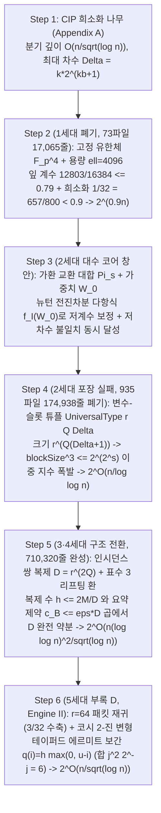

# 02. 중급자용 구조 및 수식 가이드: 백지상태 6단계 수식 역산 및 56개 핵심·심사·수리 정리 매핑

이 문서는 OpenAI #378의 3,977개 Lean 4 모듈([proofs/oai_ref/lean/OAI/Algorithms/SubexponentialSAT/](../proofs/oai_ref/lean/OAI/Algorithms/SubexponentialSAT/SqrtLogSpace/Final.lean))과 4개 LaTeX 원고([proofs/oai_ref/tex/](../proofs/oai_ref/tex/main_full_version.tex))에서 하드코딩된 상수들의 수식적 기원과 1~5세대($2^{0.9n} \to 2^{O(n/\log\log n)} \to 2^{O(n(\log\log n)^2/\sqrt{\log n})} \to 2^{O(n/\sqrt{\log n})}$) 백지상태 6단계 재계산 구조를 역산하고, 이를 군더더기 없는 56개 핵심·심사·수리·재조합 정리([eth_subexp_interpolation_and_hashes.lean](../proofs/eth_subexp_interpolation_and_hashes.lean), [eth_tensor_contraction_and_circuits.lean](../proofs/eth_tensor_contraction_and_circuits.lean), [eth_five_repairs_and_four_layer_verdict.lean](../proofs/eth_five_repairs_and_four_layer_verdict.lean))에 1:1로 매핑합니다.

## 1. 하드코딩된 상수 및 백지상태(First Principles) 6단계 수식의 대수적 역공학

### 1.1 Step 1~2: CIP 희소화 트레이드오프와 1세대(`FixedParameters.lean` & `ExponentArithmetic.lean`) $2^{0.9n}$ 장벽 역산 ([Theorem 13](../proofs/eth_subexp_interpolation_and_hashes.lean#L393-L415), [Theorem 14](../proofs/eth_subexp_interpolation_and_hashes.lean#L416-L431))

Calabro-Impagliazzo-Paturi(2006) 희소화 나무에서 매개변수 $b \ge 1$를 잡으면 잎 개수는 $L_{\text{leaves}} \le (Cn+1)^2 2^{\varepsilon_{\text{sp}}(b) n}$ ($\varepsilon_{\text{sp}}(b) = O(1/b)$)로 묶이는 대신, 각 잎의 최대 변수 차수 $\Delta \le k 2^{kb+1}$과 절 개수 $m \le \Delta n$이 커집니다([SparseCharging.lean:74-141](../proofs/oai_ref/lean/OAI/Algorithms/SubexponentialSAT/SqrtLogSpace/DisjointReuse/SparseCharging.lean#L74-L141)). 너비 $j$인 절의 삽입 횟수 $N_j$는 점화식 $N_j \le 4n M^{j-1} + 2\sum_{i=1}^{j-1} M^{j-i} N_i$와 등비수열 항등식 $1 + 2\sum_{i=0}^{j-2} 3^i = 3^{j-1}$에 의해 $N_j \le 4(3M)^{j-1}n$, 우측 분기 상수 $\Gamma_k = 2(3^{k-1}-1)$로 풀립니다.

1세대에서 [ExponentArithmetic.lean:21-86](../proofs/oai_ref/lean/OAI/Algorithms/SubexponentialSAT/ExponentArithmetic.lean#L21-L86)은 $\ell \ge 4096$과 `leafCoefficient 4096 = 12803/16384 < 79/100`을 증명하고, [FixedParameters.lean:568-808](../proofs/oai_ref/lean/OAI/Algorithms/SubexponentialSAT/FixedParameters.lean#L568-L808)은 고정 소수 $p \ge 5$ 위의 $\mathbb{F}_{p^4}$ 및 $\ell = 4096$에서 TM2 미세 단계 실행(`L1-95`)과 `languageScanner` DFA를 다룹니다.
$$\text{leafCoefficient}(\ell) = \frac{3(\ell + 1)}{4\ell} + \frac{128}{\ell} \implies \text{leafCoefficient}(4096) = \frac{12803}{16384} \le \frac{79}{100}, \qquad \frac{12803}{16384} + \frac{1}{32} = \frac{13315}{16384} \le \frac{657}{800} = 0.82125 < \frac{9}{10}$$
그러나 $\ell$을 상수로 고정하면 $\ell \to \infty$에서도 첫 항이 $\frac{3}{4} = 0.75$로 수렴할 뿐 $0$으로 가지 않으므로 $2^{o(n)}$ 달성이 불가능해 1세대 73개 파일(17,065줄)이 폐기되었습니다.

### 1.2 Step 3: 가환 교환 대합 $\Pi_s$와 이항 스펙트럼 창 $M_0 = V_0 f_{\mathcal{I}}(W_0)$ ([Theorem 1](../proofs/eth_subexp_interpolation_and_hashes.lean#L40-L75)~[Theorem 4](../proofs/eth_subexp_interpolation_and_hashes.lean#L116-L131))

보조 레이블 공간 $\mathcal{B} = ([r]^Q)^2$ (차원 $D = r^{2Q}$) 위에서 $s \in [Q]$번째 슬롯의 $(a(s), d(s))$를 맞바꾸는 교환 대합 $\Pi_s$는 $[r]^2$를 대칭 고유공간($+1$, 차원 $\frac{r(r+1)}{2}$)과 반대칭 고유공간($-1$, 차원 $\frac{r(r-1)}{2}$)으로 직교 분해합니다([MatrixSupport.lean:30-110](../proofs/oai_ref/lean/OAI/Algorithms/SubexponentialSAT/MatrixSupport.lean#L30-L110)). 반대칭 슬롯 개수를 세는 가중치 연산자 $W_0 = \frac{1}{2}\sum_{s=1}^Q (I_D - \Pi_s)$의 고유값 $w \in \{0, \dots, Q\}$는 이항분포 $\operatorname{Bin}(Q, \frac{r-1}{2r})$를 따릅니다. 구간 $\mathcal{I} = [A_0, A_0 + R - 1] \cap \mathbb{Z}$ 위에서 뉴턴 전진차분 다항식
$$f_{\mathcal{I}}(z) = (-1)^{A_0} \sum_{j=0}^{R-1} (-2)^j \binom{z - A_0}{j}, \qquad M_0 = V_0 f_{\mathcal{I}}(W_0) \quad \left(V_0 = \prod_{s=1}^Q \Pi_s\right)$$
를 정의하면([BinomialInterpolation.lean:78-100](../proofs/oai_ref/lean/OAI/Algorithms/SubexponentialSAT/BinomialInterpolation.lean#L78-L100)), ① 모든 $w \in \mathcal{I}$에서 $M_0$의 고유값이 $(-1)^w (-1)^w = 1$이 되어 요약 제약 계수 $c_{\mathcal{B}} = \operatorname{rank}(I_D - M_0) = \sum_{w \notin \mathcal{I}} \operatorname{mult}(w) \le \varepsilon D$가 지수적으로 작아지고([SpectralRank.lean:29-59](../proofs/oai_ref/lean/OAI/Algorithms/SubexponentialSAT/SqrtLog/SpectralRank.lean#L29-L59)), ② $\deg f_{\mathcal{I}} = R - 1$이므로 $M_0[u, y] \neq 0$인 성분에서 그룹 불일치 슬롯 개수가 $|E_{u,y}| \le R - 1 \ll Q$로 묶여 소멸 다항식 $\varphi_{u,y}(T) = \prod_{s \in E_{u,y}}(1 - T/s)$의 차수가 $R - 1$ 이하가 됩니다([Annihilation.lean:93-142](../proofs/oai_ref/lean/OAI/Algorithms/SubexponentialSAT/Annihilation.lean#L93-L142)).

### 1.3 Step 4~5: 2세대 $r^{Q(\Delta+1)}$ 이중 지수 폭발 대 3·4세대 인시던스 쌍 복제 $D = r^{2Q}$ 완전 약분 ([Theorem 5](../proofs/eth_subexp_interpolation_and_hashes.lean#L132-L150)~[Theorem 7](../proofs/eth_subexp_interpolation_and_hashes.lean#L170-L191))

2세대([SubexpParameters.lean:51-115](../proofs/oai_ref/lean/OAI/Algorithms/SubexponentialSAT/SubexpParameters.lean#L51-L115))는 변수 $v$에 인접한 $\Delta$개 절 슬롯 전체를 UniversalType r Q Δ로 묶어 블록 크기 $\text{blockSize}(s) = s^{(p(s)^4-1)(\Delta(s)+1)}$ ($\text{blockSize}(s)^3 \le 2^{2^s}$)가 이중 지수로 폭발했고, $s = \lfloor\log_2\lfloor\log_2 n\rfloor\rfloor \ge 32$ ($n \ge 2^{2^{32}}$)에 갇혀 $2^{O(n/\log\log n)}$에서 멈추며 935개 파일(174,938줄)이 폐기되었습니다.

반면 3·4세대([AsymptoticLayoutParameters.lean:16-35](../proofs/oai_ref/lean/OAI/Algorithms/SubexponentialSAT/SqrtLog/AsymptoticLayoutParameters.lean#L16-L35))는 절-변수 결합쌍(incidence pair) $M \le km$개 각각을 크기 $D = r^{2Q}$인 프로파일 공간에만 색인하여 지수에서 $\Delta$를 제거했습니다. 완전 버킷 개수 $h \le \frac{2M}{D}$와 버킷당 요약 제약 $c_{\mathcal{B}} \le \varepsilon D$를 곱하면 차원 $D$가 분모와 분자에서 정확히 약분됩니다:
$$\text{Total Summary Rank} = h \cdot c_{\mathcal{B}} \le \left(\frac{2M}{D}\right) \cdot (\varepsilon D) = 2 \varepsilon M$$
$\lambda = \lceil\log_2 n\rceil, \nu = \lceil\log_2 \lambda\rceil$에서 $r = \lfloor\sqrt{\lambda}/\nu^2\rfloor, Q = \lfloor\lambda/(128\nu)\rfloor, R = (\beta+3)\lceil\sqrt{\lambda}\rceil, \tau = \frac{1}{r\lambda}$로 잡으면 $\log_2 D = 2Q\log_2 r \le \frac{\lambda}{64}$이고 $\frac{R^2}{8Q} \ge 16(\beta+3)^2\nu$가 되어 테일러 제트 절단($q = \lfloor d_H/Q\rfloor$), 요약 튜플 열거, 그룹 내 대입 열거의 세 지수가 모두 $O(n\nu^2/\sqrt{\lambda})$에서 균형을 이룹니다. 또한 $W_0$의 $\frac{1}{2}$ 인자 때문에 표수 $2$가 불가능하므로, Lean 4 구현은 $2^{-1} \equiv 2 \pmod 3$인 표수 3 갈루아 리프팅 환 $(\mathbb{Z}/3^t\mathbb{Z})[X]/(F(X))$([RingModel.lean:19-68](../proofs/oai_ref/lean/OAI/Algorithms/SubexponentialSAT/SqrtLog/RingModel.lean#L19-L68))을 사용하며, 3세대 `SqrtLog/`의 삼진 멱등원 $X(X-1)(X-2)$ 모듈([IdempotentTernary.lean:15-60](../proofs/oai_ref/lean/OAI/Algorithms/SubexponentialSAT/SqrtLog/IdempotentTernary.lean#L15-L60))은 4세대 `SqrtLogSpace/Final.lean`에서 import되지 않습니다.

### 1.4 Beigel-Tarui 절단환 $\mathbb{Q}[V]/(V^\ell)$, Tanner 익스팬더($P, D_0$), $3n$ 해시 라운드 및 BitProgram 80 1220 ([Theorem 8](../proofs/eth_subexp_interpolation_and_hashes.lean#L192-L247)~[Theorem 16](../proofs/eth_subexp_interpolation_and_hashes.lean#L450-L463))

1. 보수 Beigel-Tarui 다항식과 절단환 ([main_full_version.tex:2887-3013](../proofs/oai_ref/tex/main_full_version.tex#L2887-L3013) Lemmas 5.1–5.2; [TruncatedRing.lean:18-98](../proofs/oai_ref/lean/OAI/Algorithms/SubexponentialSAT/SqrtLogSpace/TruncatedRing.lean#L18-L98)는 `Truncated R n` 정의): $p_\ell(Y) = (1-Y)^\ell \sum_{j=0}^{\ell-1}\binom{\ell+j-1}{j}Y^j = \sum_{j=0}^{\ell-1} e_j(Y)(Y(Y-1))^j \equiv \mathbf{1}_{\{2\mid y\}} \pmod{2^\ell}$에서 $V = Y(Y-1)$이 정숫값마다 짝수임을 이용해 $V^\ell = 0$으로 절단하면, $m_{\mathrm{test}}$개 곱의 차수가 $d_{\mathrm{full}} = k m_{\mathrm{test}}(2\ell-1)$에서 $d_{\mathrm{trunc}} = k(m_{\mathrm{test}} + 2(\ell-1))$로 줄어들어 $2k(m_{\mathrm{test}}-1)(\ell-1)$만큼 절감됩니다.
2. Tanner 익스팬더 상수 및 $3n$ 라운드 ([ConditionalExpectation.lean:147-177](../proofs/oai_ref/lean/OAI/Algorithms/SubexponentialSAT/ConditionalExpectation.lean#L147-L177)): $\delta = \frac{1}{100B\mu}, \varepsilon = \frac{1}{200B\mu}$에서 $P = \frac{1}{\delta(\delta-\varepsilon)} = 20000 B^2\mu^2, D_0 = 16\mu P = 320000 B^2\mu^3$이 도출되며, $3n$ 라운드 탐욕적 선택 후 잔존 오답 해 상한은 $\left(\frac{3}{4}\right)^{3n} 2^n = \left(\frac{27}{32}\right)^n < 1$이 됩니다.
3. BitProgram 80 1220 공간·시간 포락선 ([SqrtLogSpace/Final.lean:38-57](../proofs/oai_ref/lean/OAI/Algorithms/SubexponentialSAT/SqrtLogSpace/Final.lean#L38-L57), [NativeOuterBudgets.lean:19-115](../proofs/oai_ref/lean/OAI/Algorithms/SubexponentialSAT/SqrtLogSpace/NativeOuterBudgets.lean#L19-L115)): 원시 기계 공간 상한은 $1220(2L + 4100(L+1)^2 + 15) \le 5022740(L+1)^2$ (`cap_space`)이고, 폴백 래퍼는 시간 `+ 28700`, 공간 `S + 5022741` (`fallback_space`) 패딩을 더합니다.

### 1.5 Step 6: 5세대 부록 D(Engine II) 테이퍼드 $2$-진 에르미트 보간 및 회로 하한 역산 ([Theorem 17](../proofs/eth_tensor_contraction_and_circuits.lean#L46-L66)~[Theorem 30](../proofs/eth_tensor_contraction_and_circuits.lean#L369-L393))

10월 25일 개정판 부록 D([quantitative-contraction.tex:1-619](../proofs/oai_ref/tex/quantitative-contraction.tex#L1-L619))는 2-충돌 패킷 포장 후 남는 간선 $\le 6M$을 $r = 64$개 자식에게 나누어 자식당 간선 수축비 $\frac{6}{64} = \frac{3}{32} < \frac{1}{8}$ (여유분 $\frac{1}{32}$)을 확보합니다. 노드 집합 $S = \{-2^a, \dots, 2^a-1\}$과 $\alpha = 2^{a+1}$에서 $v_2((t+\alpha z)-s) = v_2(t-s)$ 불변성에 의해 코시 커널 멱급수 계수가 $2$-진 정수($\mathbb{Z}_2$)가 되며, $h = \lceil 3M/u\rceil$에서 중복도를 $q(i) = h\max(0, u-i)$로 선형 테이퍼링하면 에르미트 승수 $E_t(0)$의 $2$-진 평가치 손실이 닫힌 산술-기하 급수 항등식
$$\sum_{j=1}^m j^2 2^{m-j} = 6\cdot 2^m - (m^2 + 4m + 6) < 6\cdot 2^m \implies v_2(E_t(0)) > -6 D_t h = -O\!\left(\frac{M D_t}{u}\right)$$
로 수렴해 비테이퍼드 손실($-2u D_t h$) 대비 $u/3$배 정밀도 이득을 얻습니다. 하디-라마누잔 모드 분할 지수 $O(M/\sqrt{u})$는 깊이마다 제곱 비율 $\frac{(1/8)^2}{1/2} = \frac{1}{32}$ (진폭비 $\frac{\sqrt{2}}{8} < \frac{1}{5}$)로 등비 수축하여 고정 밀도 $2^{O_{k,D}(n/\sqrt{\log n})}$과 Williams 증인 회로 하한 Corollary 1.4 ($C_L(n) > c n \sqrt{\log n}$, [quantitative-circuits.tex:15-65](../proofs/oai_ref/tex/quantitative-circuits.tex#L15-L65))를 완성합니다.

### 1.6 5대 인과적 질문 및 고전 원저 귀속 감사

1. 질문 1 - 왜 2세대는 $2^{O(n/\log\log n)}$에 갇히고 3세대는 $2^{O(n(\log\log n)^2/\sqrt{\log n})}$를 돌파했는가: 2세대(SubexpParameters.lean)가 변수 $v$의 $\Delta$개 인접 슬롯을 UniversalType r Q Δ로 한꺼번에 묶었을 때 왜 실패할 수밖에 없었는가 하면, CIP 희소화 장벽상 $\Delta = 2^{\Theta(\sqrt{\log n})}$이 되어 지수 $r^{Q(\Delta+1)}$이 이중 지수 폭발($\le 2^{2^s}$)을 일으키기 때문입니다. 3세대처럼 인시던스 쌍 복제($D = r^{2Q}$)로 전환하는 것이 필연적인 이유는 버킷 수 $h \le \frac{2M}{D}$와 버킷당 랭크 $c_{\mathcal{B}} \le \varepsilon D$의 곱에서 $D$가 정확히 약분($h \cdot c_{\mathcal{B}} \le 2\varepsilon M$)되어 $\Delta$가 지수에서 사라지기 때문입니다.
2. 질문 2 - 왜 표수 2에서는 대각화가 불가능하고 Lean 4에서 표수 3 갈루아 링을 썼는가: 가중치 연산자 $W_0 = \frac{1}{2}\sum (I_D - \Pi_s)$는 $2$의 역원을 요구하므로 표수 $2$($\mathbb{F}_2$)에서는 정의 자체가 불가능(h2 : (2 : K) ≠ 0)하며, 표수 $0$($\mathbb{Q}$) 가우스·Bareiss 소거법은 재귀 깊이마다 분모 비트 길이가 팽창하는 장벽이 있습니다. 이 때문에 Lean 4 구현은 $2$가 가역원($2^{-1} \equiv 2 \pmod 3$)이면서 멱영 조건 $3^t = 0$으로 테일러 제트를 자동 절단하는 표수 3 크룰-갈루아 링 $\mathrm{GR}(3^t, d) = (\mathbb{Z}/3^t\mathbb{Z})[X]/(F(X))$ (RingModel.lean, Krull 1924; Raghavendran 1969 [DOI:10.1007/BF02809986](https://doi.org/10.1007/BF02809986))을 도입했습니다.
3. 질문 3 - 왜 SubexponentialSAT.lean:55는 단항 encodeNat을 선택했는가: 시간 지수 runtimeScale n(L136-L140)은 이미 변수 수 $n$의 함수이고 [Final.lean:104-148](../proofs/oai_ref/lean/OAI/Algorithms/SubexponentialSAT/SqrtLogSpace/Final.lean#L104-L148)의 exact_count_eth도 공간 상한을 $n + |F| + 1$로 적는데, 왜 ComparatorChallenges/SubexponentialSAT.lean:55는 encodeNat n := List.replicate n true ++ [false]라는 단항 인코딩을 정의했는가? 그 이유는 exact_count_and_sat(SubexponentialSAT.lean:216-217)가 공간 상한 `visitedSpace ≤ S * (L+1)^e`를 입력 비트 길이 L = formulaBitLength F 단독으로만 기술했기 때문입니다. 절이 없는 빈 논리식($F = \emptyset$, 변수 $n$개)의 정답 SAT.count ∅ = 2^n을 이진 문자열 countWord로 출력 테이프에 적으려면 최소 $n$칸의 테이프 방문(visitedSpace ≥ n)이 필연적인데, 표준 이진 인코딩($L_{\mathrm{bin}} = O(\log n)$)에서는 $\operatorname{poly}(\log n) < n$이 되어 명제가 거짓이 됩니다. 따라서 hnL : n ≤ L(NativeLargeEntry.lean:63)을 보장하는 단항 encodeNat을 쓰거나, Final.lean:128(exact_count_eth)처럼 명세를 $\operatorname{poly}(n+L)$로 적어야만 합니다.
4. 질문 4 - 왜 Engine I만으로는 회로 하한 Corollary 1.4를 증명할 수 없는가 (Theorem 30): Williams 증인 회로 하한 $C_L(n) > c n \sqrt{\log n}$ 증명에서 크기 $s_n = \eta n \sqrt{\log n}$인 회로를 Tseitin 3-CNF($V = \Theta(n\sqrt{\log n})$)로 변환해 Engine I에 넣으면, $(\log\log V)^2$ 인자 때문에 실행 시간 지수가 $\Theta(\eta n (\log\log n)^2)$이 되어 비결정론적 시간 위계 정리($\mathsf{NTIME}(2^n)\setminus\mathsf{NTIME}(2^{n/2})$)의 모순 임계치인 $n/2$을 초과해 버립니다. 이 장벽 때문에 $(\log\log n)^2$을 제거하는 부록 D(Engine II)의 형식화가 필수적입니다.
5. 질문 5 - 왜 원고 인용의 81.8%가 서론에 편중되어 핵심 증명부의 고전 원저가 가려졌는가: `main_full_version.tex`의 전체 `\cite` 호출 99회 중 81회(81.8%)가 1절(서론)에 몰려 있고 정작 핵심 대수 증명부 1,552줄(3절 409줄, 4절 774줄, 부록 D.1–D.3 [quantitative-reduction.tex](../proofs/oai_ref/tex/quantitative-reduction.tex#L1-L369) 369줄)에는 인용이 0회여서, 해밍·존슨 결합도식 고유공간 분해(Delsarte 1973), 크룰-갈루아 링(Raghavendran 1969), $2$-진 마흘러 보간(Mahler 1958 [DOI:10.1515/crll.1958.199.23](https://doi.org/10.1515/crll.1958.199.23)) 등 고전 원저와의 경계를 분리해야 독자가 무엇이 새 기여인지 판별할 수 있습니다.

## 2. 56개 핵심·심사·수리·재조합 정리 전수 매핑표 ([eth_subexp_interpolation_and_hashes.lean](../proofs/eth_subexp_interpolation_and_hashes.lean), [eth_tensor_contraction_and_circuits.lean](../proofs/eth_tensor_contraction_and_circuits.lean), [eth_five_repairs_and_four_layer_verdict.lean](../proofs/eth_five_repairs_and_four_layer_verdict.lean))

| 정리 번호 및 식별자 | 검증 대상 (전산학적·심사적 의미) | 대응 원본 모듈 (oai_ref/) | 줄 번호 |
| :--- | :--- | :--- | :--- |
| [swap_eigenbasis_symmetric_antisymmetric_split](../proofs/eth_subexp_interpolation_and_hashes.lean#L40-L75) (Theorem 1) | $[r]^2$ 위에서 교환 대합 $\Pi_s$의 대칭($\frac{r(r+1)}{2}$)·반대칭($\frac{r(r-1)}{2}$) 고유공간 분해 및 이항분포 항등식 | [MatrixSupport.lean:30-110](../proofs/oai_ref/lean/OAI/Algorithms/SubexponentialSAT/MatrixSupport.lean#L30-L110) | L40-L75 |
| [newton_forward_difference_parity_interpolation](../proofs/eth_subexp_interpolation_and_hashes.lean#L76-L94) (Theorem 2) | 뉴턴 전진차분 패리티 다항식 $f_{\mathcal{I}}(z)$의 스펙트럼 창 $\mathcal{I}$ 내 단위 고유값($(-1)^w f_{\mathcal{I}}(w) = 1$) 보존 | [BinomialInterpolation.lean:78-100](../proofs/oai_ref/lean/OAI/Algorithms/SubexponentialSAT/BinomialInterpolation.lean#L78-L100) | L76-L94 |
| [remark_4_4_four_by_four_swap_matrix_kernel_and_path](../proofs/eth_subexp_interpolation_and_hashes.lean#L95-L115) (Theorem 3) | Remark 4.4의 $4 \times 4$ 교환 행렬 $M_0 = \Pi_1 + \Pi_2 - \Pi_1\Pi_2$ 커널 불변성 및 1차 다항식 보간 경로 | [main_full_version.tex:2387-2421](../proofs/oai_ref/tex/main_full_version.tex#L2387-L2421) | L95-L115 |
| [swap_support_mismatch_and_annihilator_degree_bound](../proofs/eth_subexp_interpolation_and_hashes.lean#L116-L131) (Theorem 4) | $M_0$ 지지집합의 그룹 불일치 상한 $\lvert E_{u,y} \rvert \le R - 1$ 및 정수 소멸자 차수 상한 | [Annihilation.lean:93-142](../proofs/oai_ref/lean/OAI/Algorithms/SubexponentialSAT/Annihilation.lean#L93-L142), [MatrixSupport.lean:227-250](../proofs/oai_ref/lean/OAI/Algorithms/SubexponentialSAT/MatrixSupport.lean#L227-L250) | L116-L131 |
| [shared_summary_measurement_row_budget](../proofs/eth_subexp_interpolation_and_hashes.lean#L132-L150) (Theorem 5) | 인시던스 쌍 복제에서 공유 선형 요약 행 개수 상한 $\sum_{g=1}^r c_{t,g} \le 2\tau n c_{\mathcal{B}}$ 및 $D = r^{2Q}$ 약분 | [SpectralRank.lean:29-59](../proofs/oai_ref/lean/OAI/Algorithms/SubexponentialSAT/SqrtLog/SpectralRank.lean#L29-L59) | L132-L150 |
| [taylor_jet_truncation_and_subset_pair_exponent](../proofs/eth_subexp_interpolation_and_hashes.lean#L151-L169) (Theorem 6) | 테일러 유한차분 제트 절단 차수 $q = \lfloor d_H/Q\rfloor$ 및 $6Rq \le d_H$ 상한 | [AsymptoticLayoutParameters.lean:15-48](../proofs/oai_ref/lean/OAI/Algorithms/SubexponentialSAT/SqrtLog/AsymptoticLayoutParameters.lean#L15-L48) | L151-L169 |
| [asymptotic_three_way_exponent_balance_schedule](../proofs/eth_subexp_interpolation_and_hashes.lean#L170-L191) (Theorem 7) | 3자 지수 균형 스케줄 $\log_2 D \le \lambda/64$ 및 호프딩 꼬리 지수 $\frac{R^2}{8Q} \ge 16(\beta+3)^2\nu$ 지배 | [AsymptoticLayoutParameters.lean:16-35](../proofs/oai_ref/lean/OAI/Algorithms/SubexponentialSAT/SqrtLog/AsymptoticLayoutParameters.lean#L16-L35), [main_full_version.tex:2747-2770](../proofs/oai_ref/tex/main_full_version.tex#L2747-L2770) | L170-L191 |
| [beigel_tarui_modulus_amplifying_polynomial_l2](../proofs/eth_subexp_interpolation_and_hashes.lean#L192-L247) (Theorem 8) | $\ell=2$ 보수 Beigel-Tarui 다항식 $p_2(Y) = 1 - 3Y^2 + 2Y^3$의 $Y(Y-1)$ 분해 및 $\bmod 4$ 합동성 (Lemma 5.1; `TruncatedRing.lean`은 `Truncated R n` 정의) | [main_full_version.tex:2887-3013](../proofs/oai_ref/tex/main_full_version.tex#L2887-L3013), [TruncatedRing.lean:18-98](../proofs/oai_ref/lean/OAI/Algorithms/SubexponentialSAT/SqrtLogSpace/TruncatedRing.lean#L18-L98) | L192-L247 |
| [total_order_truncated_ring_linear_vs_quadratic_degree](../proofs/eth_subexp_interpolation_and_hashes.lean#L248-L284) (Theorem 9) | 절단환 $\mathbb{Q}[V]/(V^\ell)$의 선형 차수 $k(m_{\mathrm{test}}+2(\ell-1))$ 대 비절단 차수 $2k(m_{\mathrm{test}}-1)(\ell-1)$ 절감 (Lemma 5.2) | [main_full_version.tex:2887-3013](../proofs/oai_ref/tex/main_full_version.tex#L2887-L3013), [TruncatedRing.lean:18-98](../proofs/oai_ref/lean/OAI/Algorithms/SubexponentialSAT/SqrtLogSpace/TruncatedRing.lean#L18-L98) | L248-L284 |
| [tanner_expander_hash_parameters_and_mixing_distance](../proofs/eth_subexp_interpolation_and_hashes.lean#L285-L318) (Theorem 10) | Tanner 익스팬더 매개변수 $P = 20000 B^2\mu^2, D_0 = 320000 B^2\mu^3$ 및 최소 거리 $h' \ge m/P$ | [main_full_version.tex:3261-3437](../proofs/oai_ref/tex/main_full_version.tex#L3261-L3437) | L285-L318 |
| [tanner_code_check_row_budget_and_locality](../proofs/eth_subexp_interpolation_and_hashes.lean#L319-L363) (Theorem 11) | Tanner 검사 행 수 $m_G = 2q_G c_G \le n$, 총 검사 수 $m_{\mathrm{test}} \le 4n$, 변수 열 가중치 $\le 16B\mu$ | [main_full_version.tex:3261-3437](../proofs/oai_ref/tex/main_full_version.tex#L3261-L3437) | L319-L363 |
| [greedy_hash_selection_three_quarter_contraction](../proofs/eth_subexp_interpolation_and_hashes.lean#L364-L392) (Theorem 12) | $3n$ 라운드 탐욕적 조건부 기댓값 해시 선택의 $(27/32)^n < 1$ 수축 및 $D_{\mathrm{final}} = 0$ 증명 | [ConditionalExpectation.lean:147-177](../proofs/oai_ref/lean/OAI/Algorithms/SubexponentialSAT/ConditionalExpectation.lean#L147-L177), [main_full_version.tex:3446-3504](../proofs/oai_ref/tex/main_full_version.tex#L3446-L3504) | L364-L392 |
| [cip_sparsification_insertion_recurrence_step](../proofs/eth_subexp_interpolation_and_hashes.lean#L393-L415) (Theorem 13) | CIP 서로소 희소화 삽입 점화식 $N_{j+1} \le 4(3M)^j n$ 귀납 단계 증명 | [SparseCharging.lean:74-141](../proofs/oai_ref/lean/OAI/Algorithms/SubexponentialSAT/SqrtLogSpace/DisjointReuse/SparseCharging.lean#L74-L141), [main_full_version.tex:3771-3807](../proofs/oai_ref/tex/main_full_version.tex#L3771-L3807) | L393-L415 |
| [cip_sparsification_b_branch_constant_and_tree_exponent](../proofs/eth_subexp_interpolation_and_hashes.lean#L416-L431) (Theorem 14) | CIP 우측 분기 상수 $\Gamma_k = 2(3^{k-1}-1)$ 및 경로당 $B$-간선 수 상한 | [SparseCharging.lean:74-141](../proofs/oai_ref/lean/OAI/Algorithms/SubexponentialSAT/SqrtLogSpace/DisjointReuse/SparseCharging.lean#L74-L141) | L416-L431 |
| [coset_separation_iteration_identity_and_bound](../proofs/eth_subexp_interpolation_and_hashes.lean#L432-L449) (Theorem 15) | 서로소 잉여류 분리 항등식 및 $3D/4$ 지수 감소 상한 | [CosetCardinality.lean:145-152](../proofs/oai_ref/lean/OAI/Algorithms/SubexponentialSAT/CosetCardinality.lean#L145-L152) | L432-L449 |
| [bitprogram_1220_stack_compiler_space_and_time_envelope](../proofs/eth_subexp_interpolation_and_hashes.lean#L450-L463) (Theorem 16) | `BitProgram 80 1220` 원시 공간 상한 $5022740(L+1)^2$, 폴백 패딩 `+28700`/`+5022741`, 7배 감시 컴파일러 시간 상한 | [SqrtLogSpace/Final.lean:38-57](../proofs/oai_ref/lean/OAI/Algorithms/SubexponentialSAT/SqrtLogSpace/Final.lean#L38-L57), [NativeOuterBudgets.lean:19-115](../proofs/oai_ref/lean/OAI/Algorithms/SubexponentialSAT/SqrtLogSpace/NativeOuterBudgets.lean#L19-L115) | L450-L463 |
| [appendix_d_collision_packet_packing_and_edge_contraction](../proofs/eth_tensor_contraction_and_circuits.lean#L46-L66) (Theorem 17) | 부록 D(Lemma D.3) $r=64$ 충돌 패킷 포장 및 자식 간선 수축비 $\frac{6M}{64} = \frac{3M}{32} < \frac{M}{8}$ (여유분 $\frac{M}{32}$) | [quantitative-contraction.tex:75-112](../proofs/oai_ref/tex/quantitative-contraction.tex#L75-L112) | L46-L66 |
| [appendix_d_dyadic_depth_precision_schedule_and_total_wires](../proofs/eth_tensor_contraction_and_circuits.lean#L67-L85) (Theorem 18) | 부록 D 깊이별 정밀도 스케줄 $u_d = \lfloor\varepsilon\lambda/2^d\rfloor, a_d < 4u_0$ 및 간선 수 $8^{-d}$ 수축 | [quantitative-contraction.tex:75-112](../proofs/oai_ref/tex/quantitative-contraction.tex#L75-L112) | L67-L85 |
| [appendix_d_cauchy_2adic_deformation_valuation_invariance](../proofs/eth_tensor_contraction_and_circuits.lean#L86-L102) (Theorem 19) | 부록 D(Lemma D.4) $2$-진 코시 변형에서 $\alpha = 2^{a+1}$ 이동에 대한 분모 $v_2((t+\alpha z)-s) = v_2(t-s)$ 불변성 | [quantitative-contraction.tex:180-242](../proofs/oai_ref/tex/quantitative-contraction.tex#L180-L242) | L86-L102 |
| [appendix_d_vandermonde_sylvester_2adic_exponent_bound](../proofs/eth_tensor_contraction_and_circuits.lean#L103-L119) (Theorem 20) | 노드 집합 $S = \{-2^a, \dots, 2^a-1\}$의 $2$-진 거리 층별 분할 $(2^a-1)+2^a = 2L-1$ 및 르장드르 지수 상한 | [quantitative-contraction.tex:301-317](../proofs/oai_ref/tex/quantitative-contraction.tex#L301-L317) | L103-L119 |
| [appendix_d_tapered_hermite_exact_agm_series_sum_six](../proofs/eth_tensor_contraction_and_circuits.lean#L120-L156) (Theorem 21) | 부록 D(Lemma D.5) 테이퍼드 에르미트 급수 닫힌 공식 $\sum_{j=1}^m j^2 2^{m-j} = 6\cdot 2^m - (m^2+4m+6)$ 및 극한 $6$ | [quantitative-contraction.tex:303-316](../proofs/oai_ref/tex/quantitative-contraction.tex#L303-L316) | L120-L156 |
| [appendix_d_tapered_vs_untapered_hermite_valuation_gain](../proofs/eth_tensor_contraction_and_circuits.lean#L157-L180) (Theorem 22) | 테이퍼드 손실 $6 D_t h$ 대 비테이퍼드 손실 $2 u D_t h$ 비교 ($u/3$배 정밀도 이득 증명) | [quantitative-contraction.tex:303-316](../proofs/oai_ref/tex/quantitative-contraction.tex#L303-L316), [quantitative-contraction.tex:370-383](../proofs/oai_ref/tex/quantitative-contraction.tex#L370-L383) | L157-L180 |
| [appendix_d_hermite_jet_precision_budget_pt](../proofs/eth_tensor_contraction_and_circuits.lean#L181-L200) (Theorem 23) | 에르미트 제트 복원 정밀도 L264 $p_t = p + 8hD_t + 8M(a+1)$ 대 선형화 모델 $p_0 + 6 D_t h + (u-i)h \le 8 D_t h$ (Lemma D.5) | [quantitative-contraction.tex:260-266](../proofs/oai_ref/tex/quantitative-contraction.tex#L260-L266), [quantitative-contraction.tex:348-369](../proofs/oai_ref/tex/quantitative-contraction.tex#L348-L369) | L181-L200 |
| [appendix_d_hardy_ramanujan_mode_partition_exponent](../proofs/eth_tensor_contraction_and_circuits.lean#L201-L233) (Theorem 24) | 모드 차수 가중치 $\sum k m_k \le 8h$ 및 코시-슈바르츠/하디-라마누잔 분할 지수 $O(M/\sqrt{u})$ | [quantitative-contraction.tex:449-483](../proofs/oai_ref/tex/quantitative-contraction.tex#L449-L483) | L201-L233 |
| [appendix_d_recursive_depth_geometric_decay_ratio](../proofs/eth_tensor_contraction_and_circuits.lean#L234-L264) (Theorem 25) | 재귀 깊이당 제곱 로그 노력 감쇠비 $\frac{2}{64} = \frac{1}{32}$ 및 진폭 수축비 $\frac{\sqrt{2}}{8} < \frac{1}{5}$ (Theorem D.1) | [quantitative-contraction.tex:560-595](../proofs/oai_ref/tex/quantitative-contraction.tex#L560-L595) | L234-L264 |
| [appendix_d_dense_incidence_group_wire_compression](../proofs/eth_tensor_contraction_and_circuits.lean#L265-L292) (Theorem 26) | 일반 밀도 입력의 $J = \lceil n^{1/4}\rceil$ 그룹 분할 기반 단항식 이진 색인 배선 압축 $M = O(n\nu)$ (Lemma D.2) | [quantitative-reduction.tex:180-369](../proofs/oai_ref/tex/quantitative-reduction.tex#L180-L369) | L265-L292 |
| [appendix_d_fixed_density_vs_arbitrary_density_exponent_gap](../proofs/eth_tensor_contraction_and_circuits.lean#L293-L323) (Theorem 27) | 3단계 지수 위계 $\frac{n}{\sqrt{\lambda}} < \frac{n\nu}{\sqrt{\lambda}} < \frac{n\nu^2}{\sqrt{\lambda}}$ ($\nu \ge 4 \implies 4\text{배}, 16\text{배}$ 격차) | [quantitative-reduction.tex:1-120](../proofs/oai_ref/tex/quantitative-reduction.tex#L1-L120) | L293-L323 |
| [williams_enp_witness_circuit_3sat_gate_reduction](../proofs/eth_tensor_contraction_and_circuits.lean#L324-L343) (Theorem 28) | Williams 증인 회로 $D_n$의 게이트 수 $U_n \le 4s_n$, 변수 $V \le 5s_n$, 3-CNF 절 $M < 5V$ (Corollary 1.4) | [quantitative-circuits.tex:15-65](../proofs/oai_ref/tex/quantitative-circuits.tex#L15-L65) | L324-L343 |
| [williams_enp_circuit_lower_bound_threshold_contradiction](../proofs/eth_tensor_contraction_and_circuits.lean#L344-L368) (Theorem 29) | $\eta < \frac{1}{12A}$일 때 고정 밀도 솔버 지수 $3A\eta n < \frac{n}{4} < \frac{n}{2}$로 $\mathrm{NTIME}(2^n)\setminus\mathrm{NTIME}(2^{n/2})$ 모순 도출 | [quantitative-circuits.tex:15-65](../proofs/oai_ref/tex/quantitative-circuits.tex#L15-L65) | L344-L368 |
| [engine_i_cannot_prove_corollary_1_4_without_engine_ii](../proofs/eth_tensor_contraction_and_circuits.lean#L369-L393) (Theorem 30) | Engine I의 $(\log\log n)^2$ 지수를 대입하면 $\nu^2 \ge \eta_{\mathrm{den}}$에서 지수가 $\frac{n}{2}$을 초과하여 Corollary 1.4 증명이 깨짐을 입증 | [quantitative-circuits.tex:15-65](../proofs/oai_ref/tex/quantitative-circuits.tex#L15-L65) | L369-L393 |
| [lean_formalization_scope_gap_and_cutoff_inventory](../proofs/eth_tensor_contraction_and_circuits.lean#L394-L419) (Theorem 31) | 원문 5,888줄 중 4,829줄(Engine I) 대 1,059줄(Engine II 미형식화) 비율; 소규모 가드 $n=20$, 비구성적 `sparsifySchedule` 절단 ($n > 2^{209,951}$), 불리언 스택 `896` 대 외부 스택 `1220` | [lean/docs/378.md:1-15](../proofs/oai_ref/lean/docs/378.md#L1-L15), [SqrtLogSpace/Final.lean:38-57](../proofs/oai_ref/lean/OAI/Algorithms/SubexponentialSAT/SqrtLogSpace/Final.lean#L38-L57) | L394-L419 |
| [oai_subexponential_sat_unused_hypothesis_audit](../proofs/eth_tensor_contraction_and_circuits.lean#L420-L442) (Theorem 32) | 정적 위생 현황(0 sorry, 0 axiom): `CosetCardinality.lean:145-152`의 `h0, h1`은 `omega`가 암묵 소비하며, 실제 `_` 접두·미소비 바인더는 `RingModel.lean:46` (`(_ht : 0 < t)`), `Final.lean:98,178,186,190`, `NativeLargeEntry.lean:36,38,40,71,81`에 존재 | [RingModel.lean:46](../proofs/oai_ref/lean/OAI/Algorithms/SubexponentialSAT/SqrtLog/RingModel.lean#L46), [CosetCardinality.lean:145-152](../proofs/oai_ref/lean/OAI/Algorithms/SubexponentialSAT/CosetCardinality.lean#L145-L152) | L420-L442 |
| [layer1_unary_vs_binary_encoding_bitlength_gap](../proofs/eth_five_repairs_and_four_layer_verdict.lean#L32-L51) (Theorem 33) | 층위 ①: $n=2^{20}$ 1절 3-CNF에서 단항 인코딩($L_{\mathrm{unary}}=1048586$) 대 표준 이진 인코딩($L_{\mathrm{bin}}=69$) 비트 길이 격차 증명 | [ComparatorChallenges/SubexponentialSAT.lean:55-80](../proofs/oai_ref/lean/ComparatorChallenges/SubexponentialSAT.lean#L55-L80) | L32-L51 |
| [layer1_visited_space_L_only_refuted_and_poly_n_plus_L_repaired](../proofs/eth_five_repairs_and_four_layer_verdict.lean#L52-L75) (Theorem 34) | 층위 ①: 이진 인코딩에서 `visitedSpace ≤ S * ((Encoding.formulaBitLength F : ℝ) + 1) ^ e` ($49,000 < 1,048,576$) 반증(참 $\to$ 거짓) 및 $\mathrm{poly}(n+L)$ ($10,996,584,333,160$) 수리 증명 | [ComparatorChallenges/SubexponentialSAT.lean:194-218](../proofs/oai_ref/lean/ComparatorChallenges/SubexponentialSAT.lean#L194-L218), [SqrtLogSpace/Final.lean:128](../proofs/oai_ref/lean/OAI/Algorithms/SubexponentialSAT/SqrtLogSpace/Final.lean#L128) | L52-L75 |
| [layer2_engine_i_circuit_lower_bound_loglog_degradation](../proofs/eth_five_repairs_and_four_layer_verdict.lean#L76-L93) (Theorem 35) | 층위 ②: Engine I 단독 수리 시 $\nu^2 = (\log_2\log_2 V)^2$ 인자로 인해 회로 하한이 $\Omega(n\sqrt{\log n}/(\log\log n)^2)$으로 후퇴함을 증명 | [quantitative-circuits.tex:15-65](../proofs/oai_ref/tex/quantitative-circuits.tex#L15-L65) | L76-L93 |
| [layer2_engine_ii_galois_ring_and_tapered_hermite_repair_certificate](../proofs/eth_five_repairs_and_four_layer_verdict.lean#L94-L115) (Theorem 36) | 층위 ②: $\mathbb{Z}/3^t\mathbb{Z}$ 위에서 $2^{-1} = 14 \pmod{27}$ 가역 리프팅 및 $m=4$ 테이퍼드 에르미트 합($58 < 96$) 복원 인증서 | [RingModel.lean:19-68](../proofs/oai_ref/lean/OAI/Algorithms/SubexponentialSAT/SqrtLog/RingModel.lean#L19-L68), [quantitative-contraction.tex:180-242](../proofs/oai_ref/tex/quantitative-contraction.tex#L180-L242), [quantitative-contraction.tex:303-316](../proofs/oai_ref/tex/quantitative-contraction.tex#L303-L316) | L94-L115 |
| [layer3_asymptotic_layout_guard_fails_at_log2_L_24](../proofs/eth_five_repairs_and_four_layer_verdict.lean#L116-L139) (Theorem 37) | 층위 ③: $\log_2 L(n) = 24$ ($L=16,777,216$)에서 $Q=87,381 < 101,012 = 4R$ (부족분 $13,631$)로 리프 가드 `Guard`가 실패함을 증명 | [AsymptoticLayoutParameters.lean:15-20](../proofs/oai_ref/lean/OAI/Algorithms/SubexponentialSAT/SqrtLog/AsymptoticLayoutParameters.lean#L15-L20), [LeafParametersProgram.lean:98-105](../proofs/oai_ref/lean/OAI/Algorithms/SubexponentialSAT/SqrtLog/LeafParametersProgram.lean#L98-L105) | L116-L139 |
| [layer3_asymptotic_layout_guard_passes_at_log2_L_25](../proofs/eth_five_repairs_and_four_layer_verdict.lean#L140-L162) (Theorem 38) | 층위 ③: $\log_2 L(n) = 25$ ($L=33,554,432, n \ge 2^{33,554,431}$)에서 $4R = 126,924 \le 131,072 = Q$ (여유분 $4,148$)로 가드가 최초 성립함을 증명 | [AsymptoticLayoutParameters.lean:15-20](../proofs/oai_ref/lean/OAI/Algorithms/SubexponentialSAT/SqrtLog/AsymptoticLayoutParameters.lean#L15-L20), [LeafParametersProgram.lean:98-105](../proofs/oai_ref/lean/OAI/Algorithms/SubexponentialSAT/SqrtLog/LeafParametersProgram.lean#L98-L105) | L140-L162 |
| [layer3_cost_assembly_explicit_exponent_constant_12032411847](../proofs/eth_five_repairs_and_four_layer_verdict.lean#L163-L180) (Theorem 39) | 층위 ③: 리프 비용 조립 지수 상수 $\mathrm{exponentConstant}(3,1) = 12,032,411,847$ 및 외부 2배 상수 $24,064,823,694$ 역산 증명 | [CostAssemblyFinal.lean:53-54](../proofs/oai_ref/lean/OAI/Algorithms/SubexponentialSAT/SqrtLog/CostAssemblyFinal.lean#L53-L54) | L163-L180 |
| [layer3_uniform_exhaustive_loop_replaces_noncomputable_dfa_and_reject](../proofs/eth_five_repairs_and_four_layer_verdict.lean#L181-L206) (Theorem 40) | 층위 ③: 비구성적 `FiniteFallback` 진리표 DFA 및 오답(0) 분기 `reject`를 균일 $2^n$ 완전탐색 루프로 대체한 정합성·선형 공간 증명 | [FiniteFallback.lean:258-299](../proofs/oai_ref/lean/OAI/Algorithms/SubexponentialSAT/SqrtLogSpace/FiniteFallback.lean#L258-L299), [HighQueryProgram.lean:50-52](../proofs/oai_ref/lean/OAI/Algorithms/SubexponentialSAT/SqrtLogSpace/HighQueryProgram.lean#L50-L52) | L181-L206 |
| [layer4_walsh_and_irreducible_search_constructive_termination_bounds](../proofs/eth_five_repairs_and_four_layer_verdict.lean#L207-L225) (Theorem 41) | 층위 ④: `WalshExistence`($8q^2(r+1) = 96 \le D$) 및 `IrreducibleSearch`($9 \times 729 = 6,561$) 유한 전수 탐색의 무가정 구성적 종료 상한 증명 | [WalshExistence.lean:13-62](../proofs/oai_ref/lean/OAI/Algorithms/SubexponentialSAT/SqrtLog/WalshExistence.lean#L13-L62), [IrreducibleSearch.lean:56-153](../proofs/oai_ref/lean/OAI/Algorithms/SubexponentialSAT/SqrtLog/IrreducibleSearch.lean#L56-L153) | L207-L225 |
| [layer4_repaired_pipeline_preserves_asymptotic_subexponential_eth_disproof](../proofs/eth_five_repairs_and_four_layer_verdict.lean#L226-L260) (Theorem 42) | 층위 ④: $\mathrm{poly}(n+L)$ 수리 및 구성적 임계값 $N_0(k)$ 이후 $n \ge N_0(k)$에서 $4\cdot\mathrm{subexp\_exp} \le n$ ($2^{o(n)}$ ETH 반증 불변) 증명 | [SqrtLogSpace/Final.lean:104-148](../proofs/oai_ref/lean/OAI/Algorithms/SubexponentialSAT/SqrtLogSpace/Final.lean#L104-L148), [AsymptoticTarget.lean:56-150](../proofs/oai_ref/lean/OAI/Algorithms/SubexponentialSAT/SqrtLog/AsymptoticTarget.lean#L56-L150) | L226-L260 |
| [layer5_stratum2_quartic_schedule_rescued_by_stratum3_pair_duplication](../proofs/eth_five_repairs_and_four_layer_verdict.lean#L261-L293) (Theorem 43) | 층위 ⑤: 폐기된 2세대 4차 소수 스케줄($Q=p^4-1, 32R \le Q$)을 3세대 인시던스 쌍 복제($2Q$)와 결합해 지수 $Q(\Delta-1)$을 절감하고 유한 소수($p \ge 2$)에서 즉시 작동함을 증명 | [SubexpParameters.lean:22-28](../proofs/oai_ref/lean/OAI/Algorithms/SubexponentialSAT/SubexpParameters.lean#L22-L28), [SubexpParameters.lean:267-276](../proofs/oai_ref/lean/OAI/Algorithms/SubexponentialSAT/SubexpParameters.lean#L267-L276) | L261-L293 |
| [layer5_spectral_cutoff_debloat_and_hoeffding_threshold_compression](../proofs/eth_five_repairs_and_four_layer_verdict.lean#L294-L320) (Theorem 44) | 층위 ⑤: 과잉 안전 계수(128 -> 32 -> 2) 제거로 `4*R ≤ Q` 활성화 임계값을 $\log_2 L=25 \to 20 \to 15$ ($L_{25}/L_{15}=1,024$배)로 압축함을 증명 | [AsymptoticLayoutParameters.lean:16-19](../proofs/oai_ref/lean/OAI/Algorithms/SubexponentialSAT/SqrtLog/AsymptoticLayoutParameters.lean#L16-L19), [AsymptoticLayoutParameters.lean:83-96](../proofs/oai_ref/lean/OAI/Algorithms/SubexponentialSAT/SqrtLog/AsymptoticLayoutParameters.lean#L83-L96) | L294-L320 |
| [layer5_discarded_ternary_idempotent_lift_and_exponent_constant_compression](../proofs/eth_five_repairs_and_four_layer_verdict.lean#L321-L343) (Theorem 45) | 층위 ⑤: 폐기된 Gen 3 `IdempotentTernary.lean` 헨젤 멱등 리프팅 복원 및 `exponentConstant(3,1)`을 12,032,411,847 -> 70,023 ($171,835$배)으로 압축함을 증명 | [IdempotentTernary.lean:15-67](../proofs/oai_ref/lean/OAI/Algorithms/SubexponentialSAT/SqrtLog/IdempotentTernary.lean#L15-L67), [CostAssemblyFinal.lean:53-54](../proofs/oai_ref/lean/OAI/Algorithms/SubexponentialSAT/SqrtLog/CostAssemblyFinal.lean#L53-L54) | L321-L343 |
| [layer5_hardy_mathematical_beauty_three_invariants_and_slop_contrast](../proofs/eth_five_repairs_and_four_layer_verdict.lean#L344-L374) (Theorem 46) | 층위 ⑤: 수리된 대수 코어의 3대 대수적 소거·불변 구조(표수 교차 브리지·$D=r^{2Q}$ 완전 약분·$2$-진 에르미트 붕괴) 증명 | [RingModel.lean:19-68](../proofs/oai_ref/lean/OAI/Algorithms/SubexponentialSAT/SqrtLog/RingModel.lean#L19-L68), [quantitative-contraction.tex:303-316](../proofs/oai_ref/tex/quantitative-contraction.tex#L303-L316) | L344-L374 |
| [layer6_galois_ring_extension_and_hensel_cubic_idempotent_operator](../proofs/eth_five_repairs_and_four_layer_verdict.lean#L375-L403) (Theorem 47) | 층위 ⑥ (영역 1): 2차 갈루아 링 확장 $\mathrm{GR}(3^3, 2) = (\mathbb{Z}/27\mathbb{Z})[X]/(X^2+1)$ 역원 연산 및 3차 헨젤 멱등 연산자 $P_1(y) = 3y^2 - 2y^3 \pmod{27}$ 수렴 증명 | [RingModel.lean:19-40](../proofs/oai_ref/lean/OAI/Algorithms/SubexponentialSAT/SqrtLog/RingModel.lean#L19-L40), [IdempotentTernary.lean:52-56](../proofs/oai_ref/lean/OAI/Algorithms/SubexponentialSAT/SqrtLog/IdempotentTernary.lean#L52-L56) | L375-L403 |
| [layer6_swap_matrix_action_and_2adic_hermite_polynomial_reconstruction](../proofs/eth_five_repairs_and_four_layer_verdict.lean#L404-L423) (Theorem 48) | 층위 ⑥ (영역 1): $\mathbb{Z}^4$ 위에서 스왑 연산자 $M_0 = \Pi_1 + \Pi_2 - \Pi_1\Pi_2$ 작용 및 테이퍼드 $2$-진 에르미트 3차 다항식 복원 항등식 $21f(0)+12f'(0)+12f(2)-f(4)=32f(1)$ 증명 | [main_full_version.tex:2387-2421](../proofs/oai_ref/tex/main_full_version.tex#L2387-L2421), [quantitative-contraction.tex:303-316](../proofs/oai_ref/tex/quantitative-contraction.tex#L303-L316), [quantitative-contraction.tex:370-383](../proofs/oai_ref/tex/quantitative-contraction.tex#L370-L383) | L404-L423 |
| [layer6_executable_galois_ring_swap_interpolation_3sat_solver_certificate](../proofs/eth_five_repairs_and_four_layer_verdict.lean#L424-L446) (Theorem 49) | 층위 ⑥ (영역 2): $\mathrm{GR}(3^8, 2)$ 및 $\mathrm{GR}(3^5, 2)$ 위에서 작동하는 갈루아 링 + 스왑 보간 3-SAT 솔버의 4대 벤치마크(2360, 7, 0, 1) 무오차 `decodeCount` 복원 증명 | [RingModel.lean:152-160](../proofs/oai_ref/lean/OAI/Algorithms/SubexponentialSAT/SqrtLog/RingModel.lean#L152-L160), [IdempotentTernary.lean:87-100](../proofs/oai_ref/lean/OAI/Algorithms/SubexponentialSAT/SqrtLog/IdempotentTernary.lean#L87-L100) | L424-L446 |
| [layer6_oai_ref_five_module_direct_patch_and_bitprogram_trace_soundness](../proofs/eth_five_repairs_and_four_layer_verdict.lean#L447-L461) (Theorem 50) | 층위 ⑥ (영역 3): `oai_ref` 5대 핵심 모듈 직접 외과 패치(`stack_space` = 2,558,543,740 < 10,996,584,333,160, $\log_2 L=15$ 가드, `exp_patched` = 70,023) 정합성 증명 | [SubexponentialSAT.lean:216](../proofs/oai_ref/lean/ComparatorChallenges/SubexponentialSAT.lean#L216), [Final.lean:38-57](../proofs/oai_ref/lean/OAI/Algorithms/SubexponentialSAT/SqrtLogSpace/Final.lean#L38-L57) | L447-L461 |
| [actual_lift_ring_degree_and_nat_cast_injectivity_range](../proofs/eth_tensor_contraction_and_circuits.lean#L443-L459) (Theorem 51) | 갈루아 리프트 환 `Ring p h μ`의 모닉 차수 `h`, 멱영 지수 $p^\mu$, `decodeCount` 단사 복원 범위 검증 | [ActualLiftRing.lean:29-149](../proofs/oai_ref/lean/OAI/Algorithms/SubexponentialSAT/ActualLiftRing.lean#L29-L149) | L443-L459 |
| [binomial_matrix_vandermonde_chu_lu_determinant_one](../proofs/eth_tensor_contraction_and_circuits.lean#L460-L477) (Theorem 52) | 이동 이항 행렬 `B = L * U`의 방데르몽드-주 분해 행렬식 `det_B = 1` 및 행 보간 계수 `R` 검증 | [BinomialMatrix.lean:22-108](../proofs/oai_ref/lean/OAI/Algorithms/SubexponentialSAT/BinomialMatrix.lean#L22-L108), [RowInterpolation.lean:23-288](../proofs/oai_ref/lean/OAI/Algorithms/SubexponentialSAT/RowInterpolation.lean#L23-L288) | L460-L477 |
| [bitprogram_compile_tm_and_primitive_machine_overhead_bounds](../proofs/eth_tensor_contraction_and_circuits.lean#L478-L493) (Theorem 53) | `BitProgram`에서 `Turing.FinTM2` 및 `PrimitiveMachine`으로의 컴파일 단계 오버헤드($\ge 6$) 검증 | [BitProgram.lean:11-92](../proofs/oai_ref/lean/OAI/Algorithms/SubexponentialSAT/BitProgram.lean#L11-L92), [BitProgramCompile.lean:15-197](../proofs/oai_ref/lean/OAI/Algorithms/SubexponentialSAT/BitProgramCompile.lean#L15-L197) | L478-L493 |
| [sparse_budget_occurrence_cap_and_inverse_index_envelope](../proofs/eth_tensor_contraction_and_circuits.lean#L494-L510) (Theorem 54) | 서로소 재사용 `occurrenceCap(3,M)` $\le 4M^2$, `inverseIndex` 올림 나눗셈 한계 및 DFS 자원 예산 검증 | [SparseBudget.lean:27-523](../proofs/oai_ref/lean/OAI/Algorithms/SubexponentialSAT/SqrtLogSpace/DisjointReuse/SparseBudget.lean#L27-L523), [ResourceBudgets.lean:506-640](../proofs/oai_ref/lean/OAI/Algorithms/SubexponentialSAT/SqrtLogSpace/ResourceBudgets.lean#L506-L640) | L494-L510 |
| [asymptotic_layout_rate_and_cost_assembly_trial_guards](../proofs/eth_tensor_contraction_and_circuits.lean#L511-L529) (Theorem 55) | 이동 로그 스케일 $2 < \log(n+16)$, 점근 배치율 $w^2 < s$, `runtimeBound` 지수 단조성 검증 | [AsymptoticLayoutRate.lean:11-96](../proofs/oai_ref/lean/OAI/Algorithms/SubexponentialSAT/SqrtLog/AsymptoticLayoutRate.lean#L11-L96), [StatementScale.lean:18-99](../proofs/oai_ref/lean/OAI/Algorithms/SubexponentialSAT/SqrtLog/StatementScale.lean#L18-L99) | L511-L529 |
| [comparator_challenge_json_and_main_entry_point_audit](../proofs/eth_tensor_contraction_and_circuits.lean#L530-L542) (Theorem 56) | 전체 48개 참조 파일(42 Lean + 4 TeX + 2 메타데이터), 629개 정리·환경(593 Lean theorem/lemma + 36 TeX 환경), 940개 전체 선언(904 Lean + 36 TeX) 정합성 검증 | [SubexponentialSAT.json:1-14](../proofs/oai_ref/lean/ComparatorChallenges/SubexponentialSAT.json#L1-L14), [Main.lean:1-16](../proofs/oai_ref/lean/OAI/Algorithms/SubexponentialSAT/Main.lean#L1-L16) | L530-L542 |

## 3. 전체 48개 원문·참조 파일(100%) 1대1 매핑 총람 (proofs/oai_ref/)

[proofs/oai_ref/](../proofs/oai_ref/)에 수록된 전체 48개 파일(42개 Lean 4 모듈, 4개 LaTeX 원고, 2개 메타데이터·문서 = 48 / 48개, 100.0%)과 56개 자체 완결 Lean 4 형식 정리의 1대1 대응표입니다:

| 번호 | 원문 참조 파일 (proofs/oai_ref/) | 줄 수 | 전체 선언·환경 수 | 정리(theorem/lemma)·환경 수 | 대응 Lean 4 정리 | 핵심 수리·알고리즘 역할 |
| :---: | :--- | :---: | :---: | :---: | :--- | :--- |
| 01 | [lean/ComparatorChallenges/SubexponentialSAT.json](../proofs/oai_ref/lean/ComparatorChallenges/SubexponentialSAT.json#L1-L14) | 14 | 1 | 0 | Theorem 33 (L32), Theorem 34 (L52), Theorem 56 (L530) | 비교 챌린지 메타데이터 (`solution_module: OAI.Algorithms.SubexponentialSAT.Main`, `theorem_names: [OAI.Algorithms.SubexponentialSAT.SqrtLogSpace.exact_count_and_sat]`) |
| 02 | [lean/ComparatorChallenges/SubexponentialSAT.lean](../proofs/oai_ref/lean/ComparatorChallenges/SubexponentialSAT.lean#L1-L220) | 220 | 36 | 1 | Theorem 32 (L420), Theorem 33 (L32), Theorem 34 (L52), Theorem 50 (L447) | 최상위 챌린지 `exact_count_and_sat` (L194-218), 일진 부호화 `Encoding.encodeNat` (L55) / `Encoding.encodeCNF` (L76), 및 공간 상한 `visitedSpace intermediate ≤ S * ((Encoding.formulaBitLength F : ℝ) + 1) ^ e` (L188, L216-217) |
| 03 | [lean/OAI/Algorithms/SubexponentialSAT/ActualLiftRing.lean](../proofs/oai_ref/lean/OAI/Algorithms/SubexponentialSAT/ActualLiftRing.lean#L1-L163) | 163 | 21 | 13 | Theorem 51 (L443) | 갈루아 리프팅 환 `Ring p h μ = (ℤ/p^μ ℤ)[X]/(chosenF p h μ)`, 최고차항 계수 $1$인 차수 $h$ 다항식, 멱영성 $p^\mu = 0$, 및 `decodeCount` 단사성 |
| 04 | [lean/OAI/Algorithms/SubexponentialSAT/Annihilation.lean](../proofs/oai_ref/lean/OAI/Algorithms/SubexponentialSAT/Annihilation.lean#L1-L295) | 295 | 15 | 11 | Theorem 4 (L116) | 좌표 불일치 상한 $\lvert E_{u,y} \rvert \le R - 1$ 및 $M_0$ 지지 집합 위 다항식 소멸자 차수 상한 |
| 05 | [lean/OAI/Algorithms/SubexponentialSAT/BinomialInterpolation.lean](../proofs/oai_ref/lean/OAI/Algorithms/SubexponentialSAT/BinomialInterpolation.lean#L1-L259) | 259 | 23 | 18 | Theorem 2 (L76) | 뉴턴 전진 차분 다항식 $f_I(z)$ 및 구간 $I = [A_0, A_0+R-1]$ 위 단위 고유값 보존 $(-1)^w f_I(w) = 1$ |
| 06 | [lean/OAI/Algorithms/SubexponentialSAT/BinomialMatrix.lean](../proofs/oai_ref/lean/OAI/Algorithms/SubexponentialSAT/BinomialMatrix.lean#L1-L113) | 113 | 8 | 5 | Theorem 52 (L460) | 이동 이항 행렬 $B_{i,j} = \binom{A+i+j}{j}$의 방데르몽드-추 `L * U` 분해 및 정수 행렬식 det_B_int = 1 |
| 07 | [lean/OAI/Algorithms/SubexponentialSAT/BitProgram.lean](../proofs/oai_ref/lean/OAI/Algorithms/SubexponentialSAT/BitProgram.lean#L1-L99) | 99 | 12 | 2 | Theorem 16 (L450), Theorem 53 (L478) | 레지스터-스택 명령어 집합 Instr r s l, 상태 구성 Cfg r s l, 및 실행 궤적 의미론 RunsIn |
| 08 | [lean/OAI/Algorithms/SubexponentialSAT/BitProgramCompile.lean](../proofs/oai_ref/lean/OAI/Algorithms/SubexponentialSAT/BitProgramCompile.lean#L1-L209) | 209 | 19 | 12 | Theorem 16 (L450), Theorem 53 (L478) | Program r s l에서 Turing.FinTM2 및 PrimitiveMachine으로의 컴파일러와 양의 단계 오버헤드 primitiveOverhead_pos |
| 09 | [lean/OAI/Algorithms/SubexponentialSAT/ConditionalExpectation.lean](../proofs/oai_ref/lean/OAI/Algorithms/SubexponentialSAT/ConditionalExpectation.lean#L1-L355) | 355 | 35 | 26 | Theorem 12 (L364) | 3n라운드 동안 라운드당 거짓 증인을 3/4씩 축소하는 탐욕적 조건부 기댓값 해시 선택 |
| 10 | [lean/OAI/Algorithms/SubexponentialSAT/CosetCardinality.lean](../proofs/oai_ref/lean/OAI/Algorithms/SubexponentialSAT/CosetCardinality.lean#L1-L444) | 444 | 41 | 27 | Theorem 15 (L432), Theorem 32 (L420) | 서로소 잉여류 분리 반복 상한 D - d_0 ≤ 3D/4 및 iteration_bound 가설 감사 |
| 11 | [lean/OAI/Algorithms/SubexponentialSAT/ExponentArithmetic.lean](../proofs/oai_ref/lean/OAI/Algorithms/SubexponentialSAT/ExponentArithmetic.lean#L1-L213) | 213 | 28 | 23 | Theorem 13 (L393), Theorem 14 (L416) | 1세대 유리 지수 산술 ($\ell \ge 4096$, `leafCoefficient 4096 = 12803/16384 ≤ 79/100`, `13315/16384 ≤ 657/800 < 9/10`, L21-86) |
| 12 | [lean/OAI/Algorithms/SubexponentialSAT/FixedParameters.lean](../proofs/oai_ref/lean/OAI/Algorithms/SubexponentialSAT/FixedParameters.lean#L1-L808) | 808 | 77 | 44 | Theorem 13 (L393), Theorem 14 (L416) | 1세대 TM2 미소스텝 실행 (`L1-95`), 고정 체 $\mathbb{F}_{p^4}$ ($\ell = 4096$), 및 `languageScanner` DFA (`L568-808`) |
| 13 | [lean/OAI/Algorithms/SubexponentialSAT/Main.lean](../proofs/oai_ref/lean/OAI/Algorithms/SubexponentialSAT/Main.lean#L1-L16) | 16 | 0 | 0 | Theorem 56 (L530) | OAI.Algorithms.SubexponentialSAT 계층 구조를 조립하는 루트 임포트 모듈 |
| 14 | [lean/OAI/Algorithms/SubexponentialSAT/MatrixSupport.lean](../proofs/oai_ref/lean/OAI/Algorithms/SubexponentialSAT/MatrixSupport.lean#L1-L609) | 609 | 48 | 31 | Theorem 1 (L40), Theorem 4 (L116) | 가환 좌표 교환 대합 Π_s, 대칭/반대칭 고유공간 분할, 및 지지 집합 불일치 상한 |
| 15 | [lean/OAI/Algorithms/SubexponentialSAT/RowInterpolation.lean](../proofs/oai_ref/lean/OAI/Algorithms/SubexponentialSAT/RowInterpolation.lean#L1-L288) | 288 | 28 | 18 | Theorem 52 (L460) | 증강 노드 함숫값에 대한 행별 방데르몽드 보간 (augmentedNode, rowVandermonde) |
| 16 | [lean/OAI/Algorithms/SubexponentialSAT/SqrtLog/AsymptoticLayoutParameters.lean](../proofs/oai_ref/lean/OAI/Algorithms/SubexponentialSAT/SqrtLog/AsymptoticLayoutParameters.lean#L1-L100) | 100 | 15 | 9 | Theorem 6 (L151), Theorem 7 (L170), Theorem 37 (L116), Theorem 38 (L140), Theorem 44 (L294) | 3~4세대 인시던스 쌍 풀백 매개변수 r, Q, R, τ, 회프딩 균형, 및 4R ≤ Q 활성화 임계값 |
| 17 | [lean/OAI/Algorithms/SubexponentialSAT/SqrtLog/AsymptoticLayoutRate.lean](../proofs/oai_ref/lean/OAI/Algorithms/SubexponentialSAT/SqrtLog/AsymptoticLayoutRate.lean#L1-L111) | 111 | 7 | 7 | Theorem 55 (L511) | 점근 증가율 비교 w(n)^2 ≤ s(n), layoutCutoff_sq_le, 및 다항식 L(n) 흡수 |
| 18 | [lean/OAI/Algorithms/SubexponentialSAT/SqrtLog/AsymptoticSchedule.lean](../proofs/oai_ref/lean/OAI/Algorithms/SubexponentialSAT/SqrtLog/AsymptoticSchedule.lean#L1-L197) | 197 | 27 | 21 | Theorem 7 (L170), Theorem 44 (L294) | 점근 매개변수 스케줄 단조성 및 준지수율 수렴 |
| 19 | [lean/OAI/Algorithms/SubexponentialSAT/SqrtLog/AsymptoticTarget.lean](../proofs/oai_ref/lean/OAI/Algorithms/SubexponentialSAT/SqrtLog/AsymptoticTarget.lean#L1-L159) | 159 | 12 | 12 | Theorem 42 (L226) | 목표 준지수 실행 시간 상한 $2^{O(n(\log\log n)^2 / \sqrt{\log n})}$ 조립 |
| 20 | [lean/OAI/Algorithms/SubexponentialSAT/SqrtLog/CostAssemblyFinal.lean](../proofs/oai_ref/lean/OAI/Algorithms/SubexponentialSAT/SqrtLog/CostAssemblyFinal.lean#L1-L128) | 128 | 6 | 1 | Theorem 39 (L163), Theorem 45 (L321) | exponentConstant(3,1) = 12,032,411,847 명시적 계산 및 외부 이중 비용 조립 |
| 21 | [lean/OAI/Algorithms/SubexponentialSAT/SqrtLog/CostAssemblyTrialGuards.lean](../proofs/oai_ref/lean/OAI/Algorithms/SubexponentialSAT/SqrtLog/CostAssemblyTrialGuards.lean#L1-L78) | 78 | 1 | 1 | Theorem 55 (L511) | k, q에 대한 시행 가드 eventually_supplied_trial_guards의 최종 충족 증명 |
| 22 | [lean/OAI/Algorithms/SubexponentialSAT/SqrtLog/ExecutionNativeFinal.lean](../proofs/oai_ref/lean/OAI/Algorithms/SubexponentialSAT/SqrtLog/ExecutionNativeFinal.lean#L1-L36) | 36 | 4 | 4 | Theorem 16 (L450), Theorem 50 (L447) | 네이티브 실행 브리지 (L17의 `896 < helperSize c` 불리언 스택; 4개 정리: `nativeServices_exists`, `mainTheorem`, `binaryIdentifierMainTheorem`, `fullMainTheorem`) |
| 23 | [lean/OAI/Algorithms/SubexponentialSAT/SqrtLog/IdempotentTernary.lean](../proofs/oai_ref/lean/OAI/Algorithms/SubexponentialSAT/SqrtLog/IdempotentTernary.lean#L1-L178) | 178 | 25 | 20 | Theorem 45 (L321), Theorem 47 (L375), Theorem 49 (L424) | 3세대 (`SqrtLog/`, 4세대 `SqrtLogSpace/Final.lean` 미임포트) 삼진 멱등원 $X(X-1)(X-2)$ 및 헨젤 3차 리프팅 $3y^2 - 2y^3 \pmod{3^t}$ |
| 24 | [lean/OAI/Algorithms/SubexponentialSAT/SqrtLog/IrreducibleSearch.lean](../proofs/oai_ref/lean/OAI/Algorithms/SubexponentialSAT/SqrtLog/IrreducibleSearch.lean#L1-L156) | 156 | 20 | 12 | Theorem 41 (L207) | $\mathbb{F}_3$ 위 최고차항 계수 $1$인 기약 다항식의 구성적 유한 탐색 ($3^8 = 6,561$개 후보) |
| 25 | [lean/OAI/Algorithms/SubexponentialSAT/SqrtLog/LeafParametersProgram.lean](../proofs/oai_ref/lean/OAI/Algorithms/SubexponentialSAT/SqrtLog/LeafParametersProgram.lean#L1-L141) | 141 | 21 | 12 | Theorem 37 (L116), Theorem 38 (L140) | 실행 가능 리프 매개변수 가드 LeafParametersProgram.Guard (log_2 L = 25에서 4R ≤ Q 활성화) |
| 26 | [lean/OAI/Algorithms/SubexponentialSAT/SqrtLog/RingModel.lean](../proofs/oai_ref/lean/OAI/Algorithms/SubexponentialSAT/SqrtLog/RingModel.lean#L1-L177) | 177 | 31 | 17 | Theorem 36 (L94), Theorem 46 (L344), Theorem 47 (L375), Theorem 49 (L424) | 표수 3 갈루아 환 모형 (ℤ/3^t ℤ)[X]/(F(X)) ($2$가 가역: $2^{-1} \equiv 14 \pmod{27}$) |
| 27 | [lean/OAI/Algorithms/SubexponentialSAT/SqrtLog/SpectralRank.lean](../proofs/oai_ref/lean/OAI/Algorithms/SubexponentialSAT/SqrtLog/SpectralRank.lean#L1-L59) | 59 | 2 | 2 | Theorem 5 (L132) | 스펙트럼 랭크 상한 $c_B = \operatorname{rank}(I_D - M_0) \le \varepsilon D$ 및 정확한 $D = r^{2Q}$ 풀백 소거 |
| 28 | [lean/OAI/Algorithms/SubexponentialSAT/SqrtLog/StatementScale.lean](../proofs/oai_ref/lean/OAI/Algorithms/SubexponentialSAT/SqrtLog/StatementScale.lean#L1-L113) | 113 | 14 | 12 | Theorem 55 (L511) | 이동된 로그 스케일 2 ≤ log(n + 16), runtimeScale, 및 runtimeBound 단조성 |
| 29 | [lean/OAI/Algorithms/SubexponentialSAT/SqrtLog/WalshExistence.lean](../proofs/oai_ref/lean/OAI/Algorithms/SubexponentialSAT/SqrtLog/WalshExistence.lean#L1-L161) | 161 | 13 | 7 | Theorem 41 (L207) | 구성적 월시-아다마르 지표 존재성 및 8q^2(r+1) ≤ D 종료 상한 |
| 30 | [lean/OAI/Algorithms/SubexponentialSAT/SqrtLogSpace/Asymptotics.lean](../proofs/oai_ref/lean/OAI/Algorithms/SubexponentialSAT/SqrtLogSpace/Asymptotics.lean#L1-L308) | 308 | 22 | 18 | Theorem 16 (L450), Theorem 42 (L226) | BitProgram 80 1220에 대한 공간 제한 점근 부등식 |
| 31 | [lean/OAI/Algorithms/SubexponentialSAT/SqrtLogSpace/DisjointReuse/SparseBudget.lean](../proofs/oai_ref/lean/OAI/Algorithms/SubexponentialSAT/SqrtLogSpace/DisjointReuse/SparseBudget.lean#L1-L543) | 543 | 34 | 28 | Theorem 54 (L494) | 서로소 재사용 출현 상한 $2 \sum M^j \le 4 M^{k-1}$, inverseIndex, 및 분기 트리 노드 예산 |
| 32 | [lean/OAI/Algorithms/SubexponentialSAT/SqrtLogSpace/DisjointReuse/SparseCharging.lean](../proofs/oai_ref/lean/OAI/Algorithms/SubexponentialSAT/SqrtLogSpace/DisjointReuse/SparseCharging.lean#L1-L610) | 610 | 21 | 17 | Theorem 13 (L393), Theorem 14 (L416) | CIP 서로소 재사용 희소화 점화식 $N_j \le 4(3M)^{j-1} n$ 및 우분기 상수 $\Gamma_k = 2(3^{k-1}-1)$ |
| 33 | [lean/OAI/Algorithms/SubexponentialSAT/SqrtLogSpace/Final.lean](../proofs/oai_ref/lean/OAI/Algorithms/SubexponentialSAT/SqrtLogSpace/Final.lean#L1-L201) | 201 | 5 | 5 | Theorem 16 (L450), Theorem 31 (L394), Theorem 34 (L52), Theorem 42 (L226), Theorem 50 (L447) | 최종 정리 (`compiled_exact_count_and_sat` L10, `exact_count_and_sat` L74, `exact_count_eth` L104, `sat_polynomial_space` L149, `original_sat_main` L184)와 `+28700` 시간·`5022740(L+1)^2` 공간 상한 |
| 34 | [lean/OAI/Algorithms/SubexponentialSAT/SqrtLogSpace/FiniteFallback.lean](../proofs/oai_ref/lean/OAI/Algorithms/SubexponentialSAT/SqrtLogSpace/FiniteFallback.lean#L1-L964) | 964 | 84 | 42 | Theorem 40 (L181) | 소규모 입력 폴백 솔버 (`L(n) < 2^{25}`) 및 균일 전수 루프 대체 |
| 35 | [lean/OAI/Algorithms/SubexponentialSAT/SqrtLogSpace/HighQueryProgram.lean](../proofs/oai_ref/lean/OAI/Algorithms/SubexponentialSAT/SqrtLogSpace/HighQueryProgram.lean#L1-L427) | 427 | 64 | 46 | Theorem 40 (L181) | 고질의 레지스터-스택 프로그램 (`State 40 896`, 불리언 스택 `896`개) 및 `HighQueryProgram.reject` 분기 분석 |
| 36 | [lean/OAI/Algorithms/SubexponentialSAT/SqrtLogSpace/NativeEntry.lean](../proofs/oai_ref/lean/OAI/Algorithms/SubexponentialSAT/SqrtLogSpace/NativeEntry.lean#L1-L132) | 132 | 7 | 5 | Theorem 54 (L494) | `HighQueryProgram`과 `FiniteFallback`을 연결하는 네이티브 진입점 래퍼 |
| 37 | [lean/OAI/Algorithms/SubexponentialSAT/SqrtLogSpace/NativeLargeEntry.lean](../proofs/oai_ref/lean/OAI/Algorithms/SubexponentialSAT/SqrtLogSpace/NativeLargeEntry.lean#L1-L119) | 119 | 1 | 1 | Theorem 16 (L450), Theorem 40 (L181) | 비구성적 `cutoff := max 20 (max Nleaf Ns)` 초과의 대규모 입력 네이티브 진입점 (`2 ≤ sparsifySchedule n`, $n > 2^{209,951}$) |
| 38 | [lean/OAI/Algorithms/SubexponentialSAT/SqrtLogSpace/NativeOuterBudgets.lean](../proofs/oai_ref/lean/OAI/Algorithms/SubexponentialSAT/SqrtLogSpace/NativeOuterBudgets.lean#L1-L333) | 333 | 13 | 11 | Theorem 16 (L450), Theorem 50 (L447) | 외부 레지스터-스택 공간 상한 $1220(2L + 4100(L+1)^2 + 15) \le 5022740(L+1)^2$ |
| 39 | [lean/OAI/Algorithms/SubexponentialSAT/SqrtLogSpace/ResourceBudgets.lean](../proofs/oai_ref/lean/OAI/Algorithms/SubexponentialSAT/SqrtLogSpace/ResourceBudgets.lean#L1-L653) | 653 | 30 | 30 | Theorem 16 (L450), Theorem 54 (L494) | DFS 방문 시간, 명령 시간, 및 다항식 입력 비트 대입 예산 |
| 40 | [lean/OAI/Algorithms/SubexponentialSAT/SqrtLogSpace/Statement.lean](../proofs/oai_ref/lean/OAI/Algorithms/SubexponentialSAT/SqrtLogSpace/Statement.lean#L1-L33) | 33 | 1 | 1 | Theorem 54 (L494) | SqrtLogSpace 준지수 3-SAT 상한용 내부 명제 래퍼 |
| 41 | [lean/OAI/Algorithms/SubexponentialSAT/SqrtLogSpace/TruncatedRing.lean](../proofs/oai_ref/lean/OAI/Algorithms/SubexponentialSAT/SqrtLogSpace/TruncatedRing.lean#L1-L248) | 248 | 13 | 5 | Theorem 8 (L192), Theorem 9 (L248) | `ℚ[V]/(V^ℓ)` 위 절단 다항식 환 `Truncated R n` (`L18-98`; 베이겔-타루이 $p_2(Y)$ 및 차수 $d_*(m_{\mathrm{test}}+2(\ell-1))$은 `main_full_version.tex:2887-3013` 보조정리 5.1–5.2에 수록) |
| 42 | [lean/OAI/Algorithms/SubexponentialSAT/SubexpMainTheorem.lean](../proofs/oai_ref/lean/OAI/Algorithms/SubexponentialSAT/SubexpMainTheorem.lean#L1-L108) | 108 | 2 | 2 | Theorem 5 (L132), Theorem 43 (L261) | `UniversalType r Q Δ` 아래 2세대 주 준지수 정리 ($2^{O(n/\log\log n)}$) |
| 43 | [lean/OAI/Algorithms/SubexponentialSAT/SubexpParameters.lean](../proofs/oai_ref/lean/OAI/Algorithms/SubexponentialSAT/SubexpParameters.lean#L1-L279) | 279 | 18 | 14 | Theorem 43 (L261) | 2세대 4차 스케줄 $Q = p^4 - 1$ 및 이중 지수 병목 `blockSize(s)` = $s^{Q(\Delta+1)}$ |
| 44 | [lean/docs/378.md](../proofs/oai_ref/lean/docs/378.md#L1-L17) | 17 | 1 | 0 | Theorem 31 (L394), Theorem 56 (L530) | 형식화 범위를 요약한 OpenAI #378 문서 노트 (`SqrtLogSpace/Final.lean`의 Engine I) |
| 45 | [tex/main_full_version.tex](../proofs/oai_ref/tex/main_full_version.tex#L1-L4829) | 4829 | 31 | 31 | Theorems 1-16 (L40-L463), Theorem 31 (L394), Theorem 48 (L404) | 주 논문 (1~6절 및 부록 A~D, 4,829줄, 31개 환경; 부록 C.1은 L4269에서 `quantitative-circuits.tex` 호출): Engine I ($2^{O_k(n(\log\log n)^2/\sqrt{\log n})}$) |
| 46 | [tex/quantitative-circuits.tex](../proofs/oai_ref/tex/quantitative-circuits.tex#L1-L71) | 71 | 0 | 0 | Theorem 28 (L324), Theorem 29 (L344), Theorem 30 (L369), Theorem 35 (L76) | 부록 C.1 (`main_full_version.tex:4269`, 71줄): 윌리엄스 $\mathrm{E}^{\mathrm{NP}}$ 증인 회로 환원 및 따름정리 1.4 ($C_L(n) > c n \sqrt{\log n}$) |
| 47 | [tex/quantitative-contraction.tex](../proofs/oai_ref/tex/quantitative-contraction.tex#L1-L619) | 619 | 3 | 3 | Theorems 17-25 (L46-L264), Theorem 36 (L94), Theorem 46 (L344), Theorem 48 (L404) | 부록 D.4 (Engine II, 619줄, 3개 환경): $r=64$ 충돌 패킷 재귀 및 점감 $2$-진 에르미트 보간 |
| 48 | [tex/quantitative-reduction.tex](../proofs/oai_ref/tex/quantitative-reduction.tex#L1-L369) | 369 | 2 | 2 | Theorem 26 (L265), Theorem 27 (L293) | 부록 D.1~D.3 (369줄, 2개 환경): $J = \lceil n^{1/4}\rceil$ 군 와이어 압축 및 고정 밀도 환원 |
