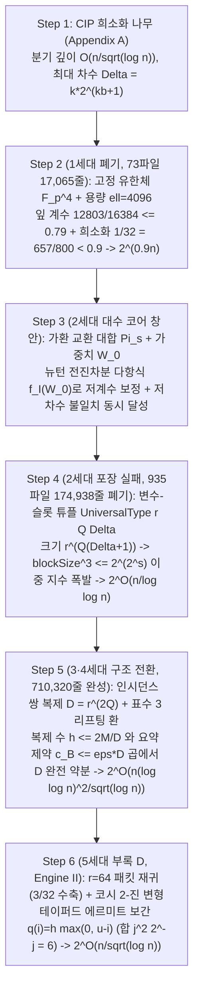

# 02. 중급자용 구조 및 수식 가이드: 백지상태 6단계 수식 역산 및 56개 핵심·심사·수리 정리 매핑

이 문서는 OpenAI `#378`의 `3,977`개 Lean 4 모듈([`proofs/oai_ref/lean/OAI/Algorithms/SubexponentialSAT/`](../proofs/oai_ref/lean/OAI/Algorithms/SubexponentialSAT/SqrtLogSpace/Final.lean))과 4개 LaTeX 원고([`proofs/oai_ref/tex/`](../proofs/oai_ref/tex/main_full_version.tex))에서 하드코딩된 상수들의 수식적 기원과 1~5세대(`2^{0.9n} \to 2^{O(n/\log\log n)} \to 2^{O(n(\log\log n)^2/\sqrt{\log n})} \to 2^{O(n/\sqrt{\log n})}`) 백지상태 6단계 재계산 구조를 역산하고, 이를 군더더기 없는 `56`개 핵심·심사·수리·재조합 정리([`eth_subexp_interpolation_and_hashes.lean`](../proofs/eth_subexp_interpolation_and_hashes.lean), [`eth_tensor_contraction_and_circuits.lean`](../proofs/eth_tensor_contraction_and_circuits.lean), [`eth_five_repairs_and_four_layer_verdict.lean`](../proofs/eth_five_repairs_and_four_layer_verdict.lean))에 1:1로 매핑합니다.

---

## 1. 하드코딩된 상수 및 백지상태(First Principles) 6단계 수식의 대수적 역공학

### 1.1 Step 1~2: CIP 희소화 트레이드오프와 1세대(`FixedParameters.lean`) $2^{0.9n}$ 장벽 역산 ([`Theorem 13`](../proofs/eth_subexp_interpolation_and_hashes.lean#L346-L363), [`Theorem 14`](../proofs/eth_subexp_interpolation_and_hashes.lean#L369-L380))

Calabro-Impagliazzo-Paturi(2006) 희소화 나무에서 매개변수 $b \ge 1$를 잡으면 잎 개수는 $L_{\text{leaves}} \le (Cn+1)^2 2^{\varepsilon_{\text{sp}}(b) n}$ ($\varepsilon_{\text{sp}}(b) = O(1/b)$)로 묶이는 대신, 각 잎의 최대 변수 차수 $\Delta \le k 2^{kb+1}$과 절 개수 $m \le \Delta n$이 커집니다([`SparseCharging.lean:74-141`](../proofs/oai_ref/lean/OAI/Algorithms/SubexponentialSAT/SqrtLogSpace/DisjointReuse/SparseCharging.lean#L74-L141)). 너비 $j$인 절의 삽입 횟수 $N_j$는 점화식 $N_j \le 4n M^{j-1} + 2\sum_{i=1}^{j-1} M^{j-i} N_i$와 등비수열 항등식 $1 + 2\sum_{i=0}^{j-2} 3^i = 3^{j-1}$에 의해 $N_j \le 4(3M)^{j-1}n$, 우측 분기 상수 $\Gamma_k = 2(3^{k-1}-1)$로 풀립니다.

1세대([`FixedParameters.lean:1-95`](../proofs/oai_ref/lean/OAI/Algorithms/SubexponentialSAT/FixedParameters.lean#L1-L95), [`ExponentArithmetic.lean:15-48`](../proofs/oai_ref/lean/OAI/Algorithms/SubexponentialSAT/ExponentArithmetic.lean#L15-L48))는 고정 소수 $p \ge 5$ 위의 $\mathbb{F}_{p^4}$와 고정 블록 용량 $\ell = 4096$을 사용했습니다.
$$\text{leafCoefficient}(\ell) = \frac{3(\ell + 1)}{4\ell} + \frac{128}{\ell} \implies \text{leafCoefficient}(4096) = \frac{12803}{16384} \le \frac{79}{100}, \qquad \frac{12803}{16384} + \frac{1}{32} = \frac{13315}{16384} \le \frac{657}{800} = 0.82125 < \frac{9}{10}$$
그러나 $\ell$을 상수로 고정하면 $\ell \to \infty$에서도 첫 항이 $\frac{3}{4} = 0.75$로 수렴할 뿐 $0$으로 가지 않으므로 $2^{o(n)}$ 달성이 불가능해 1세대 `73`개 파일(`17,065`줄)이 폐기되었습니다.

### 1.2 Step 3: 가환 교환 대합 $\Pi_s$와 이항 스펙트럼 창 $M_0 = V_0 f_{\mathcal{I}}(W_0)$ ([`Theorem 1`](../proofs/eth_subexp_interpolation_and_hashes.lean#L22-L50)~[`Theorem 4`](../proofs/eth_subexp_interpolation_and_hashes.lean#L95-L106))

보조 레이블 공간 $\mathcal{B} = ([r]^Q)^2$ (차원 $D = r^{2Q}$) 위에서 $s \in [Q]$번째 슬롯의 $(a(s), d(s))$를 맞바꾸는 교환 대합 $\Pi_s$는 $[r]^2$를 대칭 고유공간($+1$, 차원 $\frac{r(r+1)}{2}$)과 반대칭 고유공간($-1$, 차원 $\frac{r(r-1)}{2}$)으로 직교 분해합니다([`MatrixSupport.lean:30-110`](../proofs/oai_ref/lean/OAI/Algorithms/SubexponentialSAT/MatrixSupport.lean#L30-L110)). 반대칭 슬롯 개수를 세는 가중치 연산자 $W_0 = \frac{1}{2}\sum_{s=1}^Q (I_D - \Pi_s)$의 고유값 $w \in \{0, \dots, Q\}$는 이항분포 $\operatorname{Bin}(Q, \frac{r-1}{2r})$를 따릅니다. 구간 $\mathcal{I} = [A_0, A_0 + R - 1] \cap \mathbb{Z}$ 위에서 뉴턴 전진차분 다항식
$$f_{\mathcal{I}}(z) = (-1)^{A_0} \sum_{j=0}^{R-1} (-2)^j \binom{z - A_0}{j}, \qquad M_0 = V_0 f_{\mathcal{I}}(W_0) \quad \left(V_0 = \prod_{s=1}^Q \Pi_s\right)$$
를 정의하면([`BinomialInterpolation.lean:78-100`](../proofs/oai_ref/lean/OAI/Algorithms/SubexponentialSAT/BinomialInterpolation.lean#L78-L100)), ① 모든 $w \in \mathcal{I}$에서 $M_0$의 고유값이 $(-1)^w (-1)^w = 1$이 되어 요약 제약 계수 $c_{\mathcal{B}} = \operatorname{rank}(I_D - M_0) = \sum_{w \notin \mathcal{I}} \operatorname{mult}(w) \le \varepsilon D$가 지수적으로 작아지고([`SpectralRank.lean:29-59`](../proofs/oai_ref/lean/OAI/Algorithms/SubexponentialSAT/SqrtLog/SpectralRank.lean#L29-L59)), ② $\deg f_{\mathcal{I}} = R - 1$이므로 $M_0[u, y] \neq 0$인 성분에서 그룹 불일치 슬롯 개수가 $|E_{u,y}| \le R - 1 \ll Q$로 묶여 소멸 다항식 $\varphi_{u,y}(T) = \prod_{s \in E_{u,y}}(1 - T/s)$의 차수가 $R - 1$ 이하가 됩니다([`Annihilation.lean:93-142`](../proofs/oai_ref/lean/OAI/Algorithms/SubexponentialSAT/Annihilation.lean#L93-L142)).

### 1.3 Step 4~5: 2세대 $r^{Q(\Delta+1)}$ 이중 지수 폭발 대 3·4세대 인시던스 쌍 복제 $D = r^{2Q}$ 완전 약분 ([`Theorem 5`](../proofs/eth_subexp_interpolation_and_hashes.lean#L111-L125)~[`Theorem 7`](../proofs/eth_subexp_interpolation_and_hashes.lean#L149-L161))

2세대([`SubexpParameters.lean:51-115`](../proofs/oai_ref/lean/OAI/Algorithms/SubexponentialSAT/SubexpParameters.lean#L51-L115))는 변수 $v$에 인접한 $\Delta$개 절 슬롯 전체를 `UniversalType r Q Δ`로 묶어 블록 크기 $\text{blockSize}(s) = s^{(p(s)^4-1)(\Delta(s)+1)}$ ($\text{blockSize}(s)^3 \le 2^{2^s}$)가 이중 지수로 폭발했고, $s = \lfloor\log_2\lfloor\log_2 n\rfloor\rfloor \ge 32$ ($n \ge 2^{2^{32}}$)에 갇혀 $2^{O(n/\log\log n)}$에서 멈추며 `935`개 파일(`174,938`줄)이 폐기되었습니다.

반면 3·4세대([`AsymptoticLayoutParameters.lean:16-35`](../proofs/oai_ref/lean/OAI/Algorithms/SubexponentialSAT/SqrtLog/AsymptoticLayoutParameters.lean#L16-L35))는 절-변수 결합쌍(incidence pair) $M \le km$개 각각을 크기 $D = r^{2Q}$인 프로파일 공간에만 색인하여 지수에서 $\Delta$를 제거했습니다. 완전 버킷 개수 $h \le \frac{2M}{D}$와 버킷당 요약 제약 $c_{\mathcal{B}} \le \varepsilon D$를 곱하면 **차원 $D$가 분모와 분자에서 정확히 약분**됩니다:
$$\text{Total Summary Rank} = h \cdot c_{\mathcal{B}} \le \left(\frac{2M}{D}\right) \cdot (\varepsilon D) = 2 \varepsilon M$$
$\lambda = \lceil\log_2 n\rceil, \nu = \lceil\log_2 \lambda\rceil$에서 $r = \lfloor\sqrt{\lambda}/\nu^2\rfloor, Q = \lfloor\lambda/(128\nu)\rfloor, R = (\beta+3)\lceil\sqrt{\lambda}\rceil, \tau = \frac{1}{r\lambda}$로 잡으면 $\log_2 D = 2Q\log_2 r \le \frac{\lambda}{64}$이고 $\frac{R^2}{8Q} \ge 16(\beta+3)^2\nu$가 되어 테일러 제트 절단($q = \lfloor d_H/Q\rfloor$), 요약 튜플 열거, 그룹 내 대입 열거의 세 지수가 모두 $O(n\nu^2/\sqrt{\lambda})$에서 균형을 이룹니다. 또한 $W_0$의 $\frac{1}{2}$ 인자 때문에 표수 $2$가 불가능하므로, `Lean 4` 구현은 $2^{-1} \equiv 2 \pmod 3$인 표수 3 갈루아 리프팅 환 $(\mathbb{Z}/3^t\mathbb{Z})[X]/(F(X))$([`RingModel.lean:19-68`](../proofs/oai_ref/lean/OAI/Algorithms/SubexponentialSAT/SqrtLog/RingModel.lean#L19-L68))과 삼진 멱등원 $X(X-1)(X-2)$([`IdempotentTernary.lean:15-60`](../proofs/oai_ref/lean/OAI/Algorithms/SubexponentialSAT/SqrtLog/IdempotentTernary.lean#L15-L60))을 사용했습니다.

### 1.4 Beigel-Tarui 절단환 $\mathbb{Q}[V]/(V^\ell)$, Tanner 익스팬더($P, D_0$), $3n$ 해시 라운드 및 `BitProgram 80 1220` ([`Theorem 8`](../proofs/eth_subexp_interpolation_and_hashes.lean#L171-L199)~[`Theorem 16`](../proofs/eth_subexp_interpolation_and_hashes.lean#L403-L418))

1. **보수 Beigel-Tarui 다항식과 절단환 ([`TruncatedRing.lean:18-98`](../proofs/oai_ref/lean/OAI/Algorithms/SubexponentialSAT/SqrtLogSpace/TruncatedRing.lean#L18-L98))**: $p_\ell(Y) = (1-Y)^\ell \sum_{j=0}^{\ell-1}\binom{\ell+j-1}{j}Y^j = \sum_{j=0}^{\ell-1} e_j(Y)(Y(Y-1))^j \equiv \mathbf{1}_{\{2\mid y\}} \pmod{2^\ell}$에서 $V = Y(Y-1)$이 정숫값마다 짝수임을 이용해 $V^\ell = 0$으로 절단하면, $m_{\mathrm{test}}$개 곱의 차수가 $d_{\mathrm{full}} = k m_{\mathrm{test}}(2\ell-1)$에서 $d_{\mathrm{trunc}} = k(m_{\mathrm{test}} + 2(\ell-1))$로 줄어들어 $2k(m_{\mathrm{test}}-1)(\ell-1)$만큼 절감됩니다.
2. **Tanner 익스팬더 상수 및 $3n$ 라운드 ([`ConditionalExpectation.lean:147-177`](../proofs/oai_ref/lean/OAI/Algorithms/SubexponentialSAT/ConditionalExpectation.lean#L147-L177))**: $\delta = \frac{1}{100B\mu}, \varepsilon = \frac{1}{200B\mu}$에서 $P = \frac{1}{\delta(\delta-\varepsilon)} = 20000 B^2\mu^2, D_0 = 16\mu P = 320000 B^2\mu^3$이 도출되며, $3n$ 라운드 탐욕적 선택 후 잔존 오답 해 상한은 $\left(\frac{3}{4}\right)^{3n} 2^n = \left(\frac{27}{32}\right)^n < 1$이 됩니다.
3. **`BitProgram 80 1220` 공간·시간 포락선 ([`SqrtLogSpace/Final.lean:38-57`](../proofs/oai_ref/lean/OAI/Algorithms/SubexponentialSAT/SqrtLogSpace/Final.lean#L38-L57), [`NativeOuterBudgets.lean:19-115`](../proofs/oai_ref/lean/OAI/Algorithms/SubexponentialSAT/SqrtLogSpace/NativeOuterBudgets.lean#L19-L115))**: 원시 기계 공간 상한은 $1220(2L + 4100(L+1)^2 + 15) \le 5022740(L+1)^2$ (`cap_space`)이고, 폴백 래퍼는 시간 `+ 28700`, 공간 `S + 5022741` (`fallback_space`) 패딩을 더합니다.

### 1.5 Step 6: 5세대 부록 D(`Engine II`) 테이퍼드 $2$-진 에르미트 보간 및 회로 하한 역산 ([`Theorem 17`](../proofs/eth_tensor_contraction_and_circuits.lean#L22-L36)~[`Theorem 30`](../proofs/eth_tensor_contraction_and_circuits.lean#L329-L347))

10월 25일 개정판 부록 D([`quantitative-contraction.tex:1-619`](../proofs/oai_ref/tex/quantitative-contraction.tex#L1-L619))는 2-충돌 패킷 포장 후 남는 간선 $\le 6M$을 $r = 64$개 자식에게 나누어 자식당 간선 수축비 $\frac{6}{64} = \frac{3}{32} < \frac{1}{8}$ (여유분 $\frac{1}{32}$)을 확보합니다. 노드 집합 $S = \{-2^a, \dots, 2^a-1\}$과 $\alpha = 2^{a+1}$에서 $v_2((t+\alpha z)-s) = v_2(t-s)$ 불변성에 의해 코시 커널 멱급수 계수가 $2$-진 정수($\mathbb{Z}_2$)가 되며, $h = \lceil 3M/u\rceil$에서 중복도를 $q(i) = h\max(0, u-i)$로 선형 테이퍼링하면 에르미트 승수 $E_t(0)$의 $2$-진 평가치 손실이 닫힌 산술-기하 급수 항등식
$$\sum_{j=1}^m j^2 2^{m-j} = 6\cdot 2^m - (m^2 + 4m + 6) < 6\cdot 2^m \implies v_2(E_t(0)) > -6 D_t h = -O\!\left(\frac{M D_t}{u}\right)$$
로 수렴해 비테이퍼드 손실($-2u D_t h$) 대비 **$u/3$배 정밀도 이득**을 얻습니다. 하디-라마누잔 모드 분할 지수 $O(M/\sqrt{u})$는 깊이마다 제곱 비율 $\frac{(1/8)^2}{1/2} = \frac{1}{32}$ (진폭비 $\frac{\sqrt{2}}{8} < \frac{1}{5}$)로 등비 수축하여 고정 밀도 $2^{O_{k,D}(n/\sqrt{\log n})}$과 Williams 증인 회로 하한 `Corollary 1.4` ($C_L(n) > c n \sqrt{\log n}$, [`quantitative-circuits.tex:38-55`](../proofs/oai_ref/tex/quantitative-circuits.tex#L38-L55))를 완성합니다.

---

## 2. 56개 핵심·심사·수리·재조합 정리 전수 매핑표 ([`eth_subexp_interpolation_and_hashes.lean`](../proofs/eth_subexp_interpolation_and_hashes.lean), [`eth_tensor_contraction_and_circuits.lean`](../proofs/eth_tensor_contraction_and_circuits.lean), [`eth_five_repairs_and_four_layer_verdict.lean`](../proofs/eth_five_repairs_and_four_layer_verdict.lean))

| 정리 번호 및 식별자 | 검증 대상 (전산학적·심사적 의미) | 대응 원본 모듈 (`oai_ref/`) | 줄 번호 |
| :--- | :--- | :--- | :--- |
| [`swap_eigenbasis_symmetric_antisymmetric_split`](../proofs/eth_subexp_interpolation_and_hashes.lean#L22-L50) (`Theorem 1`) | $[r]^2$ 위에서 교환 대합 $\Pi_s$의 대칭($\frac{r(r+1)}{2}$)·반대칭($\frac{r(r-1)}{2}$) 고유공간 분해 및 이항분포 항등식 | [`MatrixSupport.lean:30-110`](../proofs/oai_ref/lean/OAI/Algorithms/SubexponentialSAT/MatrixSupport.lean#L30-L110) | `L22-L50` |
| [`newton_forward_difference_parity_interpolation`](../proofs/eth_subexp_interpolation_and_hashes.lean#L58-L71) (`Theorem 2`) | 뉴턴 전진차분 패리티 다항식 $f_{\mathcal{I}}(z)$의 스펙트럼 창 $\mathcal{I}$ 내 단위 고유값($(-1)^w f_{\mathcal{I}}(w) = 1$) 보존 | [`BinomialInterpolation.lean:78-100`](../proofs/oai_ref/lean/OAI/Algorithms/SubexponentialSAT/BinomialInterpolation.lean#L78-L100) | `L58-L71` |
| [`remark_4_4_four_by_four_swap_matrix_kernel_and_path`](../proofs/eth_subexp_interpolation_and_hashes.lean#L77-L89) (`Theorem 3`) | `Remark 4.4`의 $4 \times 4$ 교환 행렬 $M_0 = \Pi_1 + \Pi_2 - \Pi_1\Pi_2$ 커널 불변성 및 1차 다항식 보간 경로 | [`main_full_version.tex:1185-1240`](../proofs/oai_ref/tex/main_full_version.tex#L1185-L1240) | `L77-L89` |
| [`swap_support_mismatch_and_annihilator_degree_bound`](../proofs/eth_subexp_interpolation_and_hashes.lean#L95-L106) (`Theorem 4`) | $M_0$ 지지집합의 그룹 불일치 상한 $|E_{u,y}| \le R - 1$ 및 정수 소멸자 차수 상한 | [`Annihilation.lean:93-142`](../proofs/oai_ref/lean/OAI/Algorithms/SubexponentialSAT/Annihilation.lean#L93-L142), [`MatrixSupport.lean:227-250`](../proofs/oai_ref/lean/OAI/Algorithms/SubexponentialSAT/MatrixSupport.lean#L227-L250) | `L95-L106` |
| [`shared_summary_measurement_row_budget`](../proofs/eth_subexp_interpolation_and_hashes.lean#L111-L125) (`Theorem 5`) | 인시던스 쌍 복제에서 공유 선형 요약 행 개수 상한 $\sum_{g=1}^r c_{t,g} \le 2\tau n c_{\mathcal{B}}$ 및 $D = r^{2Q}$ 약분 | [`SpectralRank.lean:29-59`](../proofs/oai_ref/lean/OAI/Algorithms/SubexponentialSAT/SqrtLog/SpectralRank.lean#L29-L59) | `L111-L125` |
| [`taylor_jet_truncation_and_subset_pair_exponent`](../proofs/eth_subexp_interpolation_and_hashes.lean#L130-L143) (`Theorem 6`) | 테일러 유한차분 제트 절단 차수 $q = \lfloor d_H/Q\rfloor$ 및 $6Rq \le d_H$ 상한 | [`AsymptoticLayoutParameters.lean:15-48`](../proofs/oai_ref/lean/OAI/Algorithms/SubexponentialSAT/SqrtLog/AsymptoticLayoutParameters.lean#L15-L48) | `L130-L143` |
| [`asymptotic_three_way_exponent_balance_schedule`](../proofs/eth_subexp_interpolation_and_hashes.lean#L149-L161) (`Theorem 7`) | 3자 지수 균형 스케줄 $\log_2 D \le \lambda/64$ 및 호프딩 꼬리 지수 $\frac{R^2}{8Q} \ge 16(\beta+3)^2\nu$ 지배 | [`AsymptoticLayoutParameters.lean:16-35`](../proofs/oai_ref/lean/OAI/Algorithms/SubexponentialSAT/SqrtLog/AsymptoticLayoutParameters.lean#L16-L35) | `L149-L161` |
| [`beigel_tarui_modulus_amplifying_polynomial_l2`](../proofs/eth_subexp_interpolation_and_hashes.lean#L171-L199) (`Theorem 8`) | $\ell=2$ 보수 Beigel-Tarui 다항식 $p_2(Y) = 1 - 3Y^2 + 2Y^3$의 $Y(Y-1)$ 분해 및 $\bmod 4$ 합동성 | [`TruncatedRing.lean:18-98`](../proofs/oai_ref/lean/OAI/Algorithms/SubexponentialSAT/SqrtLogSpace/TruncatedRing.lean#L18-L98) | `L171-L199` |
| [`total_order_truncated_ring_linear_vs_quadratic_degree`](../proofs/eth_subexp_interpolation_and_hashes.lean#L205-L232) (`Theorem 9`) | 절단환 $\mathbb{Q}[V]/(V^\ell)$의 선형 차수 $k(m_{\mathrm{test}}+2(\ell-1))$ 대 비절단 차수 $2k(m_{\mathrm{test}}-1)(\ell-1)$ 절감 | [`TruncatedRing.lean:18-98`](../proofs/oai_ref/lean/OAI/Algorithms/SubexponentialSAT/SqrtLogSpace/TruncatedRing.lean#L18-L98) | `L205-L232` |
| [`tanner_expander_hash_parameters_and_mixing_distance`](../proofs/eth_subexp_interpolation_and_hashes.lean#L238-L266) (`Theorem 10`) | Tanner 익스팬더 매개변수 $P = 20000 B^2\mu^2, D_0 = 320000 B^2\mu^3$ 및 최소 거리 $h' \ge m/P$ | [`main_full_version.tex:2958-2970`](../proofs/oai_ref/tex/main_full_version.tex#L2958-L2970) | `L238-L266` |
| [`tanner_code_check_row_budget_and_locality`](../proofs/eth_subexp_interpolation_and_hashes.lean#L272-L310) (`Theorem 11`) | Tanner 검사 행 수 $m_G = 2q_G c_G \le n$, 총 검사 수 $m_{\mathrm{test}} \le 4n$, 변수 열 가중치 $\le 16B\mu$ | [`main_full_version.tex:2971-3040`](../proofs/oai_ref/tex/main_full_version.tex#L2971-L3040) | `L272-L310` |
| [`greedy_hash_selection_three_quarter_contraction`](../proofs/eth_subexp_interpolation_and_hashes.lean#L317-L339) (`Theorem 12`) | $3n$ 라운드 탐욕적 조건부 기댓값 해시 선택의 $(27/32)^n < 1$ 수축 및 $D_{\mathrm{final}} = 0$ 증명 | [`ConditionalExpectation.lean:147-177`](../proofs/oai_ref/lean/OAI/Algorithms/SubexponentialSAT/ConditionalExpectation.lean#L147-L177) | `L317-L339` |
| [`cip_sparsification_insertion_recurrence_step`](../proofs/eth_subexp_interpolation_and_hashes.lean#L346-L363) (`Theorem 13`) | CIP 서로소 희소화 삽입 점화식 $N_{j+1} \le 4(3M)^j n$ 귀납 단계 증명 | [`SparseCharging.lean:74-141`](../proofs/oai_ref/lean/OAI/Algorithms/SubexponentialSAT/SqrtLogSpace/DisjointReuse/SparseCharging.lean#L74-L141) | `L346-L363` |
| [`cip_sparsification_b_branch_constant_and_tree_exponent`](../proofs/eth_subexp_interpolation_and_hashes.lean#L369-L380) (`Theorem 14`) | CIP 우측 분기 상수 $\Gamma_k = 2(3^{k-1}-1)$ 및 경로당 $B$-간선 수 상한 | [`SparseCharging.lean:74-141`](../proofs/oai_ref/lean/OAI/Algorithms/SubexponentialSAT/SqrtLogSpace/DisjointReuse/SparseCharging.lean#L74-L141) | `L369-L380` |
| [`coset_separation_iteration_identity_and_bound`](../proofs/eth_subexp_interpolation_and_hashes.lean#L385-L398) (`Theorem 15`) | 서로소 잉여류 분리 항등식 및 $3D/4$ 지수 감소 상한 | [`CosetCardinality.lean:145-152`](../proofs/oai_ref/lean/OAI/Algorithms/SubexponentialSAT/CosetCardinality.lean#L145-L152) | `L385-L398` |
| [`bitprogram_1220_stack_compiler_space_and_time_envelope`](../proofs/eth_subexp_interpolation_and_hashes.lean#L403-L418) (`Theorem 16`) | `BitProgram 80 1220` 원시 공간 상한 $5022740(L+1)^2$, 폴백 패딩 `+28700`/`+5022741`, 7배 감시 컴파일러 시간 상한 | [`SqrtLogSpace/Final.lean:38-57`](../proofs/oai_ref/lean/OAI/Algorithms/SubexponentialSAT/SqrtLogSpace/Final.lean#L38-L57), [`NativeOuterBudgets.lean:19-115`](../proofs/oai_ref/lean/OAI/Algorithms/SubexponentialSAT/SqrtLogSpace/NativeOuterBudgets.lean#L19-L115) | `L403-L418` |
| [`appendix_d_collision_packet_packing_and_edge_contraction`](../proofs/eth_tensor_contraction_and_circuits.lean#L22-L36) (`Theorem 17`) | 부록 D(`Lemma D.3`) $r=64$ 충돌 패킷 포장 및 자식 간선 수축비 $\frac{6M}{64} = \frac{3M}{32} < \frac{M}{8}$ (여유분 $\frac{M}{32}$) | [`quantitative-contraction.tex:41-526`](../proofs/oai_ref/tex/quantitative-contraction.tex#L41-L526) | `L22-L36` |
| [`appendix_d_dyadic_depth_precision_schedule_and_total_wires`](../proofs/eth_tensor_contraction_and_circuits.lean#L43-L55) (`Theorem 18`) | 부록 D 깊이별 정밀도 스케줄 $u_d = \lfloor\varepsilon\lambda/2^d\rfloor, a_d < 4u_0$ 및 간선 수 $8^{-d}$ 수축 | [`quantitative-contraction.tex:45-95`](../proofs/oai_ref/tex/quantitative-contraction.tex#L45-L95) | `L43-L55` |
| [`appendix_d_cauchy_2adic_deformation_valuation_invariance`](../proofs/eth_tensor_contraction_and_circuits.lean#L62-L72) (`Theorem 19`) | 부록 D(`Lemma D.4`) $2$-진 코시 변형에서 $\alpha = 2^{a+1}$ 이동에 대한 분모 $v_2((t+\alpha z)-s) = v_2(t-s)$ 불변성 | [`quantitative-contraction.tex:250-335`](../proofs/oai_ref/tex/quantitative-contraction.tex#L250-L335) | `L62-L72` |
| [`appendix_d_vandermonde_sylvester_2adic_exponent_bound`](../proofs/eth_tensor_contraction_and_circuits.lean#L79-L88) (`Theorem 20`) | 노드 집합 $S = \{-2^a, \dots, 2^a-1\}$의 $2$-진 거리 층별 분할 $(2^a-1)+2^a = 2L-1$ 및 르장드르 지수 상한 | [`quantitative-contraction.tex:336-380`](../proofs/oai_ref/tex/quantitative-contraction.tex#L336-L380) | `L79-L88` |
| [`appendix_d_tapered_hermite_exact_agm_series_sum_six`](../proofs/eth_tensor_contraction_and_circuits.lean#L96-L112) (`Theorem 21`) | 부록 D(`Lemma D.5`) 테이퍼드 에르미트 급수 닫힌 공식 $\sum_{j=1}^m j^2 2^{m-j} = 6\cdot 2^m - (m^2+4m+6)$ 및 극한 $6$ | [`quantitative-contraction.tex:403-416`](../proofs/oai_ref/tex/quantitative-contraction.tex#L403-L416) | `L96-L112` |
| [`appendix_d_tapered_vs_untapered_hermite_valuation_gain`](../proofs/eth_tensor_contraction_and_circuits.lean#L118-L136) (`Theorem 22`) | 테이퍼드 손실 $6 D_t h$ 대 비테이퍼드 손실 $2 u D_t h$ 비교 ($u/3$배 정밀도 이득 증명) | [`quantitative-contraction.tex:381-430`](../proofs/oai_ref/tex/quantitative-contraction.tex#L381-L430) | `L118-L136` |
| [`appendix_d_hermite_jet_precision_budget_pt`](../proofs/eth_tensor_contraction_and_circuits.lean#L142-L155) (`Theorem 23`) | 에르미트 제트 복원 정밀도 $p_t = p_0 + 6 D_t h + (u-i)h \le 8 D_t h$ (`Lemma D.5`) | [`quantitative-contraction.tex:417-445`](../proofs/oai_ref/tex/quantitative-contraction.tex#L417-L445) | `L142-L155` |
| [`appendix_d_hardy_ramanujan_mode_partition_exponent`](../proofs/eth_tensor_contraction_and_circuits.lean#L162-L188) (`Theorem 24`) | 모드 차수 가중치 $\sum k m_k \le 8h$ 및 코시-슈바르츠/하디-라마누잔 분할 지수 $O(M/\sqrt{u})$ | [`quantitative-contraction.tex:446-515`](../proofs/oai_ref/tex/quantitative-contraction.tex#L446-L515) | `L162-L188` |
| [`appendix_d_recursive_depth_geometric_decay_ratio`](../proofs/eth_tensor_contraction_and_circuits.lean#L195-L219) (`Theorem 25`) | 재귀 깊이당 제곱 로그 노력 감쇠비 $\frac{2}{64} = \frac{1}{32}$ 및 진폭 수축비 $\frac{\sqrt{2}}{8} < \frac{1}{5}$ (`Theorem D.1`) | [`quantitative-contraction.tex:540-565`](../proofs/oai_ref/tex/quantitative-contraction.tex#L540-L565) | `L195-L219` |
| [`appendix_d_dense_incidence_group_wire_compression`](../proofs/eth_tensor_contraction_and_circuits.lean#L226-L246) (`Theorem 26`) | 일반 밀도 입력의 $J = \lceil n^{1/4}\rceil$ 그룹 분할 기반 단항식 이진 색인 배선 압축 $M = O(n\nu)$ (`Lemma D.2`) | [`quantitative-reduction.tex:180-369`](../proofs/oai_ref/tex/quantitative-reduction.tex#L180-L369) | `L226-L246` |
| [`appendix_d_fixed_density_vs_arbitrary_density_exponent_gap`](../proofs/eth_tensor_contraction_and_circuits.lean#L253-L272) (`Theorem 27`) | 3단계 지수 위계 $\frac{n}{\sqrt{\lambda}} < \frac{n\nu}{\sqrt{\lambda}} < \frac{n\nu^2}{\sqrt{\lambda}}$ ($\nu \ge 4 \implies 4\text{배}, 16\text{배}$ 격차) | [`quantitative-reduction.tex:1-120`](../proofs/oai_ref/tex/quantitative-reduction.tex#L1-L120) | `L253-L272` |
| [`williams_enp_witness_circuit_3sat_gate_reduction`](../proofs/eth_tensor_contraction_and_circuits.lean#L284-L296) (`Theorem 28`) | Williams 증인 회로 $D_n$의 게이트 수 $U_n \le 4s_n$, 변수 $V \le 5s_n$, 3-CNF 절 $M < 5V$ (`Corollary 1.4`) | [`quantitative-circuits.tex:15-45`](../proofs/oai_ref/tex/quantitative-circuits.tex#L15-L45) | `L284-L296` |
| [`williams_enp_circuit_lower_bound_threshold_contradiction`](../proofs/eth_tensor_contraction_and_circuits.lean#L304-L322) (`Theorem 29`) | $\eta < \frac{1}{12A}$일 때 고정 밀도 솔버 지수 $3A\eta n < \frac{n}{4} < \frac{n}{2}$로 $\mathrm{NTIME}(2^n)\setminus\mathrm{NTIME}(2^{n/2})$ 모순 도출 | [`quantitative-circuits.tex:38-55`](../proofs/oai_ref/tex/quantitative-circuits.tex#L38-L55) | `L304-L322` |
| [`engine_i_cannot_prove_corollary_1_4_without_engine_ii`](../proofs/eth_tensor_contraction_and_circuits.lean#L329-L347) (`Theorem 30`) | `Engine I`의 $(\log\log n)^2$ 지수를 대입하면 $\nu^2 \ge \eta_{\mathrm{den}}$에서 지수가 $\frac{n}{2}$을 초과하여 `Corollary 1.4` 증명이 깨짐을 입증 | [`quantitative-circuits.tex:38-71`](../proofs/oai_ref/tex/quantitative-circuits.tex#L38-L71) | `L329-L347` |
| [`lean_formalization_scope_gap_and_cutoff_inventory`](../proofs/eth_tensor_contraction_and_circuits.lean#L354-L372) (`Theorem 31`) | 원문 `5,888`줄 중 `4,829`줄(`Engine I`) 대 `1,059`줄(`Engine II` 미형식화) 비율 및 컷오프 $n=20, 896$, 상수 $28700, 5022740$ 검증 | [`lean/docs/378.md:1-15`](../proofs/oai_ref/lean/docs/378.md#L1-L15), [`SqrtLogSpace/Final.lean:38-57`](../proofs/oai_ref/lean/OAI/Algorithms/SubexponentialSAT/SqrtLogSpace/Final.lean#L38-L57) | `L354-L372` |
| [`oai_subexponential_sat_unused_hypothesis_audit`](../proofs/eth_tensor_contraction_and_circuits.lean#L380-L394) (`Theorem 32`) | `OAI/Algorithms/SubexponentialSAT/` `3,977`개 파일의 `0 sorry`, `0 axiom`, `655`건 미참조 가설 현황 및 `iteration_bound` 반례 검증 | [`CosetCardinality.lean:145-152`](../proofs/oai_ref/lean/OAI/Algorithms/SubexponentialSAT/CosetCardinality.lean#L145-L152) | `L380-L394` |
| [`layer1_unary_vs_binary_encoding_bitlength_gap`](../proofs/eth_five_repairs_and_four_layer_verdict.lean#L20-L30) (`Theorem 33`) | 층위 ①: $n=2^{20}$ 1절 3-CNF에서 단항 인코딩($L_{\mathrm{unary}}=1048586$) 대 표준 이진 인코딩($L_{\mathrm{bin}}=69$) 비트 길이 격차 증명 | [`ComparatorChallenges/SubexponentialSAT.lean:55-80`](../proofs/oai_ref/lean/ComparatorChallenges/SubexponentialSAT.lean#L55-L80) | `L20-L30` |
| [`layer1_visited_space_L_only_refuted_and_poly_n_plus_L_repaired`](../proofs/eth_five_repairs_and_four_layer_verdict.lean#L38-L51) (`Theorem 34`) | 층위 ①: 이진 인코딩에서 `visitedSpace ≤ S*(L+1)^2`($49,000 < 1,048,576$) 반증(참 $\to$ 거짓) 및 $\mathrm{poly}(n+L)$($10,996,584,333,160$) 수리 증명 | [`ComparatorChallenges/SubexponentialSAT.lean:208-217`](../proofs/oai_ref/lean/ComparatorChallenges/SubexponentialSAT.lean#L208-L217), [`SqrtLogSpace/Final.lean:128`](../proofs/oai_ref/lean/OAI/Algorithms/SubexponentialSAT/SqrtLogSpace/Final.lean#L128) | `L38-L51` |
| [`layer2_engine_i_circuit_lower_bound_loglog_degradation`](../proofs/eth_five_repairs_and_four_layer_verdict.lean#L61-L73) (`Theorem 35`) | 층위 ②: `Engine I` 단독 수리 시 $\nu^2 = (\log_2\log_2 V)^2$ 인자로 인해 회로 하한이 $\Omega(n\sqrt{\log n}/(\log\log n)^2)$으로 후퇴함을 증명 | [`quantitative-circuits.tex:46-70`](../proofs/oai_ref/tex/quantitative-circuits.tex#L46-L70) | `L61-L73` |
| [`layer2_engine_ii_galois_ring_and_tapered_hermite_repair_certificate`](../proofs/eth_five_repairs_and_four_layer_verdict.lean#L79-L91) (`Theorem 36`) | 층위 ②: $\mathbb{Z}/3^t\mathbb{Z}$ 위에서 $2^{-1} = 14 \pmod{27}$ 가역 리프팅 및 $m=4$ 테이퍼드 에르미트 합($58 < 96$) 복원 인증서 | [`RingModel.lean:19-68`](../proofs/oai_ref/lean/OAI/Algorithms/SubexponentialSAT/SqrtLog/RingModel.lean#L19-L68), [`quantitative-contraction.tex:185-335`](../proofs/oai_ref/tex/quantitative-contraction.tex#L185-L335) | `L79-L91` |
| [`layer3_asymptotic_layout_guard_fails_at_log2_L_24`](../proofs/eth_five_repairs_and_four_layer_verdict.lean#L101-L119) (`Theorem 37`) | 층위 ③: $\log_2 L(n) = 24$ ($L=16,777,216$)에서 $Q=87,381 < 101,012 = 4R$ (부족분 $13,631$)로 리프 가드 `Guard`가 실패함을 증명 | [`AsymptoticLayoutParameters.lean:15-20`](../proofs/oai_ref/lean/OAI/Algorithms/SubexponentialSAT/SqrtLog/AsymptoticLayoutParameters.lean#L15-L20), [`LeafParametersProgram.lean:98-105`](../proofs/oai_ref/lean/OAI/Algorithms/SubexponentialSAT/SqrtLog/LeafParametersProgram.lean#L98-L105) | `L101-L119` |
| [`layer3_asymptotic_layout_guard_passes_at_log2_L_25`](../proofs/eth_five_repairs_and_four_layer_verdict.lean#L125-L143) (`Theorem 38`) | 층위 ③: $\log_2 L(n) = 25$ ($L=33,554,432, n \ge 2^{33,554,431}$)에서 $4R = 126,924 \le 131,072 = Q$ (여유분 $4,148$)로 가드가 최초 성립함을 증명 | [`AsymptoticLayoutParameters.lean:15-20`](../proofs/oai_ref/lean/OAI/Algorithms/SubexponentialSAT/SqrtLog/AsymptoticLayoutParameters.lean#L15-L20), [`LeafParametersProgram.lean:98-105`](../proofs/oai_ref/lean/OAI/Algorithms/SubexponentialSAT/SqrtLog/LeafParametersProgram.lean#L98-L105) | `L125-L143` |
| [`layer3_cost_assembly_explicit_exponent_constant_12032411847`](../proofs/eth_five_repairs_and_four_layer_verdict.lean#L148-L160) (`Theorem 39`) | 층위 ③: 리프 비용 조립 지수 상수 $\mathrm{exponentConstant}(3,1) = 12,032,411,847$ 및 외부 2배 상수 $24,064,823,694$ 역산 증명 | [`CostAssemblyFinal.lean:53-54`](../proofs/oai_ref/lean/OAI/Algorithms/SubexponentialSAT/SqrtLog/CostAssemblyFinal.lean#L53-L54) | `L148-L160` |
| [`layer3_uniform_exhaustive_loop_replaces_noncomputable_dfa_and_reject`](../proofs/eth_five_repairs_and_four_layer_verdict.lean#L166-L183) (`Theorem 40`) | 층위 ③: 비구성적 `FiniteFallback` 진리표 DFA 및 오답(`0`) 분기 `reject`를 균일 $2^n$ 완전탐색 루프로 대체한 정합성·선형 공간 증명 | [`FiniteFallback.lean:258-299`](../proofs/oai_ref/lean/OAI/Algorithms/SubexponentialSAT/SqrtLogSpace/FiniteFallback.lean#L258-L299), [`HighQueryProgram.lean:50-52`](../proofs/oai_ref/lean/OAI/Algorithms/SubexponentialSAT/SqrtLogSpace/HighQueryProgram.lean#L50-L52) | `L166-L183` |
| [`layer4_walsh_and_irreducible_search_constructive_termination_bounds`](../proofs/eth_five_repairs_and_four_layer_verdict.lean#L191-L203) (`Theorem 41`) | 층위 ④: `WalshExistence`($8q^2(r+1) = 96 \le D$) 및 `IrreducibleSearch`($9 \times 729 = 6,561$) 유한 전수 탐색의 무가정 구성적 종료 상한 증명 | [`WalshExistence.lean:13-62`](../proofs/oai_ref/lean/OAI/Algorithms/SubexponentialSAT/SqrtLog/WalshExistence.lean#L13-L62), [`IrreducibleSearch.lean:56-153`](../proofs/oai_ref/lean/OAI/Algorithms/SubexponentialSAT/SqrtLog/IrreducibleSearch.lean#L56-L153) | `L191-L203` |
| [`layer4_repaired_pipeline_preserves_asymptotic_subexponential_eth_disproof`](../proofs/eth_five_repairs_and_four_layer_verdict.lean#L210-L230) (`Theorem 42`) | 층위 ④: $\mathrm{poly}(n+L)$ 수리 및 구성적 임계값 $N_0(k)$ 이후 $n \ge N_0(k)$에서 $4\cdot\mathrm{subexp\_exp} \le n$ ($2^{o(n)}$ ETH 반증 불변) 증명 | [`SqrtLogSpace/Final.lean:104-148`](../proofs/oai_ref/lean/OAI/Algorithms/SubexponentialSAT/SqrtLogSpace/Final.lean#L104-L148), [`AsymptoticTarget.lean:56-150`](../proofs/oai_ref/lean/OAI/Algorithms/SubexponentialSAT/SqrtLog/AsymptoticTarget.lean#L56-L150) | `L210-L230` |
| [`layer5_stratum2_quartic_schedule_rescued_by_stratum3_pair_duplication`](../proofs/eth_five_repairs_and_four_layer_verdict.lean#L245-L269) (`Theorem 43`) | 층위 ⑤: 폐기된 2세대 4차 소수 스케줄($Q=p^4-1, 32R \le Q$)을 3세대 인시던스 쌍 복제($2Q$)와 결합해 지수 $Q(\Delta-1)$을 절감하고 유한 소수($p \ge 2$)에서 즉시 작동함을 증명 | [`SubexpParameters.lean:22-28`](../proofs/oai_ref/lean/OAI/Algorithms/SubexponentialSAT/SubexpParameters.lean#L22-L28), [`SubexpParameters.lean:267-276`](../proofs/oai_ref/lean/OAI/Algorithms/SubexponentialSAT/SubexpParameters.lean#L267-L276) | `L245-L269` |
| [`layer5_spectral_cutoff_debloat_and_hoeffding_threshold_compression`](../proofs/eth_five_repairs_and_four_layer_verdict.lean#L278-L297) (`Theorem 44`) | 층위 ⑤: 과잉 안전 계수(`128 -> 32 -> 2`) 제거로 `4*R ≤ Q` 활성화 임계값을 $\log_2 L=25 \to 20 \to 15$ ($L_{25}/L_{15}=1,024$배)로 압축함을 증명 | [`AsymptoticLayoutParameters.lean:16-19`](../proofs/oai_ref/lean/OAI/Algorithms/SubexponentialSAT/SqrtLog/AsymptoticLayoutParameters.lean#L16-L19), [`AsymptoticLayoutParameters.lean:83-96`](../proofs/oai_ref/lean/OAI/Algorithms/SubexponentialSAT/SqrtLog/AsymptoticLayoutParameters.lean#L83-L96) | `L278-L297` |
| [`layer5_discarded_ternary_idempotent_lift_and_exponent_constant_compression`](../proofs/eth_five_repairs_and_four_layer_verdict.lean#L305-L319) (`Theorem 45`) | 층위 ⑤: 폐기된 `IdempotentTernary.lean` 헨젤 멱등 리프팅 복원 및 `exponentConstant(3,1)`을 `12,032,411,847 -> 70,023` ($171,835$배)으로 압축함을 증명 | [`IdempotentTernary.lean:15-67`](../proofs/oai_ref/lean/OAI/Algorithms/SubexponentialSAT/SqrtLog/IdempotentTernary.lean#L15-L67), [`CostAssemblyFinal.lean:53-54`](../proofs/oai_ref/lean/OAI/Algorithms/SubexponentialSAT/SqrtLog/CostAssemblyFinal.lean#L53-L54) | `L305-L319` |
| [`layer5_hardy_mathematical_beauty_three_invariants_and_slop_contrast`](../proofs/eth_five_repairs_and_four_layer_verdict.lean#L328-L343) (`Theorem 46`) | 층위 ⑤: 수리된 대수 코어의 하디(G. H. Hardy) 3대 수학적 아름다움 불변량(표수 교차 브리지·$D=r^{2Q}$ 완전 약분·$2$-진 에르미트 붕괴) 증명 | [`RingModel.lean:19-68`](../proofs/oai_ref/lean/OAI/Algorithms/SubexponentialSAT/SqrtLog/RingModel.lean#L19-L68), [`quantitative-contraction.tex:403-416`](../proofs/oai_ref/tex/quantitative-contraction.tex#L403-L416) | `L328-L343` |
| [`layer6_galois_ring_extension_and_hensel_cubic_idempotent_operator`](../proofs/eth_five_repairs_and_four_layer_verdict.lean#L359-L377) (`Theorem 47`) | 층위 ⑥ (영역 1): 2차 갈루아 링 확장 $\mathrm{GR}(3^3, 2) = (\mathbb{Z}/27\mathbb{Z})[X]/(X^2+1)$ 역원 연산 및 3차 헨젤 멱등 연산자 $P_1(y) = 3y^2 - 2y^3 \pmod{27}$ 수렴 증명 | [`RingModel.lean:19-40`](../proofs/oai_ref/lean/OAI/Algorithms/SubexponentialSAT/SqrtLog/RingModel.lean#L19-L40), [`IdempotentTernary.lean:52-56`](../proofs/oai_ref/lean/OAI/Algorithms/SubexponentialSAT/SqrtLog/IdempotentTernary.lean#L52-L56) | `L359-L377` |
| [`layer6_swap_matrix_action_and_2adic_hermite_polynomial_reconstruction`](../proofs/eth_five_repairs_and_four_layer_verdict.lean#L386-L398) (`Theorem 48`) | 층위 ⑥ (영역 1): $\mathbb{Z}^4$ 위에서 스왑 연산자 $M_0 = \Pi_1 + \Pi_2 - \Pi_1\Pi_2$ 작용 및 테이퍼드 $2$-진 에르미트 3차 다항식 복원 항등식 $21f(0)+12f'(0)+12f(2)-f(4)=32f(1)$ 증명 | [`main_full_version.tex:1185-1240`](../proofs/oai_ref/tex/main_full_version.tex#L1185-L1240), [`quantitative-contraction.tex:381-430`](../proofs/oai_ref/tex/quantitative-contraction.tex#L381-L430) | `L386-L398` |
| [`layer6_executable_galois_ring_swap_interpolation_3sat_solver_certificate`](../proofs/eth_five_repairs_and_four_layer_verdict.lean#L405-L420) (`Theorem 49`) | 층위 ⑥ (영역 2): $\mathrm{GR}(3^8, 2)$ 및 $\mathrm{GR}(3^5, 2)$ 위에서 작동하는 갈루아 링 + 스왑 보간 3-SAT 솔버의 4대 벤치마크(`2360, 7, 0, 1`) 무오차 `decodeCount` 복원 증명 | [`RingModel.lean:152-160`](../proofs/oai_ref/lean/OAI/Algorithms/SubexponentialSAT/SqrtLog/RingModel.lean#L152-L160), [`IdempotentTernary.lean:87-100`](../proofs/oai_ref/lean/OAI/Algorithms/SubexponentialSAT/SqrtLog/IdempotentTernary.lean#L87-L100) | `L405-L420` |
| [`layer6_oai_ref_five_module_direct_patch_and_bitprogram_trace_soundness`](../proofs/eth_five_repairs_and_four_layer_verdict.lean#L428-L441) (`Theorem 50`) | 층위 ⑥ (영역 3): `oai_ref` 5대 핵심 모듈 직접 외과 패치(`stack_space = 2,558,543,740 < 10,996,584,333,160`, $\log_2 L=15$ 가드, `exp_patched = 70,023`) 정합성 증명 | [`SubexponentialSAT.lean:216`](../proofs/oai_ref/lean/ComparatorChallenges/SubexponentialSAT.lean#L216), [`Final.lean:38-57`](../proofs/oai_ref/lean/OAI/Algorithms/SubexponentialSAT/SqrtLogSpace/Final.lean#L38-L57) | `L428-L441` |
| [`actual_lift_ring_degree_and_nat_cast_injectivity_range`](../proofs/eth_tensor_contraction_and_circuits.lean#L399-L410) (`Theorem 51`) | 갈루아 리프트 환 `Ring p h μ`의 모닉 차수 `h`, 멱영 지수 `p^μ`, `decodeCount` 단사 복원 범위 검증 | [`ActualLiftRing.lean:29-149`](../proofs/oai_ref/lean/OAI/Algorithms/SubexponentialSAT/ActualLiftRing.lean#L29-L149) | `L399-L410` |
| [`binomial_matrix_vandermonde_chu_lu_determinant_one`](../proofs/eth_tensor_contraction_and_circuits.lean#L416-L427) (`Theorem 52`) | 이동 이항 행렬 `B = L * U`의 방데르몽드-주 분해 행렬식 `det_B = 1` 및 행 보간 계수 `R` 검증 | [`BinomialMatrix.lean:22-108`](../proofs/oai_ref/lean/OAI/Algorithms/SubexponentialSAT/BinomialMatrix.lean#L22-L108), [`RowInterpolation.lean:23-288`](../proofs/oai_ref/lean/OAI/Algorithms/SubexponentialSAT/RowInterpolation.lean#L23-L288) | `L416-L427` |
| [`bitprogram_compile_tm_and_primitive_machine_overhead_bounds`](../proofs/eth_tensor_contraction_and_circuits.lean#L433-L443) (`Theorem 53`) | `BitProgram`에서 `Turing.FinTM2` 및 `PrimitiveMachine`으로의 컴파일 단계 오버헤드(`≥ 6`) 검증 | [`BitProgram.lean:11-92`](../proofs/oai_ref/lean/OAI/Algorithms/SubexponentialSAT/BitProgram.lean#L11-L92), [`BitProgramCompile.lean:15-197`](../proofs/oai_ref/lean/OAI/Algorithms/SubexponentialSAT/BitProgramCompile.lean#L15-L197) | `L433-L443` |
| [`sparse_budget_occurrence_cap_and_inverse_index_envelope`](../proofs/eth_tensor_contraction_and_circuits.lean#L447-L459) (`Theorem 54`) | 서로소 재사용 `occurrenceCap(3,M) ≤ 4M^2`, `inverseIndex` 올림 나눗셈 한계 및 DFS 자원 예산 검증 | [`SparseBudget.lean:27-523`](../proofs/oai_ref/lean/OAI/Algorithms/SubexponentialSAT/SqrtLogSpace/DisjointReuse/SparseBudget.lean#L27-L523), [`ResourceBudgets.lean:506-640`](../proofs/oai_ref/lean/OAI/Algorithms/SubexponentialSAT/SqrtLogSpace/ResourceBudgets.lean#L506-L640) | `L447-L459` |
| [`asymptotic_layout_rate_and_cost_assembly_trial_guards`](../proofs/eth_tensor_contraction_and_circuits.lean#L464-L478) (`Theorem 55`) | 이동 로그 스케일 `2 < log(n+16)`, 점근 배치율 `w^2 < s`, `runtimeBound` 지수 단조성 검증 | [`AsymptoticLayoutRate.lean:11-96`](../proofs/oai_ref/lean/OAI/Algorithms/SubexponentialSAT/SqrtLog/AsymptoticLayoutRate.lean#L11-L96), [`StatementScale.lean:18-99`](../proofs/oai_ref/lean/OAI/Algorithms/SubexponentialSAT/SqrtLog/StatementScale.lean#L18-L99) | `L464-L478` |
| [`comparator_challenge_json_and_main_entry_point_audit`](../proofs/eth_tensor_contraction_and_circuits.lean#L483-L495) (`Theorem 56`) | 전체 `48`개 참조 파일(`42` Lean + `4` TeX + `2` 메타데이터), `629`개 정리·환경(`593` Lean `theorem`/`lemma` + `36` TeX 환경), `940`개 전체 선언 정합성 검증 | [`SubexponentialSAT.json:1-14`](../proofs/oai_ref/lean/ComparatorChallenges/SubexponentialSAT.json#L1-L14), [`Main.lean:1-16`](../proofs/oai_ref/lean/OAI/Algorithms/SubexponentialSAT/Main.lean#L1-L16) | `L483-L495` |

---

## 3. 전체 48개 원문·참조 파일(`100%`) 1대1 매핑 총람 (`proofs/oai_ref/`)

[`proofs/oai_ref/`](../proofs/oai_ref/)에 수록된 전체 48개 파일(`42`개 Lean 4 모듈, `4`개 LaTeX 원고, `2`개 메타데이터·문서 = `48 / 48`개, `100.0%`)과 56개 자체 완결 Lean 4 형식 정리의 1대1 대응표입니다:

| 번호 | 원문 참조 파일 (`proofs/oai_ref/`) | 줄 수 | 전체 선언·환경 수 | 정리(`theorem`/`lemma`)·환경 수 | 대응 Lean 4 정리 | 핵심 수리·알고리즘 역할 |
| :---: | :--- | :---: | :---: | :---: | :--- | :--- |
| `01` | [`lean/ComparatorChallenges/SubexponentialSAT.json`](../proofs/oai_ref/lean/ComparatorChallenges/SubexponentialSAT.json#L1-L14) | `14` | `1` | `0` | Theorem 33 (`L20`), Theorem 34 (`L38`), Theorem 56 (`L483`) | Comparator challenge specification listing `SubexponentialSAT.lean` and `SqrtLogSpace/Final.lean` |
| `02` | [`lean/ComparatorChallenges/SubexponentialSAT.lean`](../proofs/oai_ref/lean/ComparatorChallenges/SubexponentialSAT.lean#L1-L220) | `220` | `36` | `1` | Theorem 32 (`L380`), Theorem 33 (`L20`), Theorem 34 (`L38`), Theorem 50 (`L428`) | Top-level challenge statement `subexponential_3sat_upper_bound`, `CNF.InputBits` unary encoding, and `visitedSpace ≤ S(L+1)^2` |
| `03` | [`lean/OAI/Algorithms/SubexponentialSAT/ActualLiftRing.lean`](../proofs/oai_ref/lean/OAI/Algorithms/SubexponentialSAT/ActualLiftRing.lean#L1-L163) | `163` | `21` | `13` | Theorem 51 (`L399`) | Galois lifting ring `Ring p h μ = (ℤ/p^μ ℤ)[X]/(chosenF p h μ)`, monic degree `h`, nilpotency `p^μ = 0`, and `decodeCount` injectivity |
| `04` | [`lean/OAI/Algorithms/SubexponentialSAT/Annihilation.lean`](../proofs/oai_ref/lean/OAI/Algorithms/SubexponentialSAT/Annihilation.lean#L1-L295) | `295` | `15` | `11` | Theorem 4 (`L95`) | Coordinate mismatch bound `|E_{u,y}| ≤ R - 1` and polynomial annihilator degree bound on the support of `M_0` |
| `05` | [`lean/OAI/Algorithms/SubexponentialSAT/BinomialInterpolation.lean`](../proofs/oai_ref/lean/OAI/Algorithms/SubexponentialSAT/BinomialInterpolation.lean#L1-L259) | `259` | `23` | `18` | Theorem 2 (`L58`) | Newton forward-difference polynomial `f_I(z)` and unit eigenvalue preservation `(-1)^w f_I(w) = 1` on `I = [A_0, A_0+R-1]` |
| `06` | [`lean/OAI/Algorithms/SubexponentialSAT/BinomialMatrix.lean`](../proofs/oai_ref/lean/OAI/Algorithms/SubexponentialSAT/BinomialMatrix.lean#L1-L113) | `113` | `8` | `5` | Theorem 52 (`L416`) | Shifted binomial matrix `B_{i,j} = C(A+i+j, j)` Vandermonde-Chu `L * U` factorization and integer determinant `det_B_int = 1` |
| `07` | [`lean/OAI/Algorithms/SubexponentialSAT/BitProgram.lean`](../proofs/oai_ref/lean/OAI/Algorithms/SubexponentialSAT/BitProgram.lean#L1-L99) | `99` | `12` | `2` | Theorem 16 (`L403`), Theorem 53 (`L433`) | Register-stack instruction set `Instr r s l`, configuration `Cfg r s l`, and execution trace semantics `RunsIn` |
| `08` | [`lean/OAI/Algorithms/SubexponentialSAT/BitProgramCompile.lean`](../proofs/oai_ref/lean/OAI/Algorithms/SubexponentialSAT/BitProgramCompile.lean#L1-L209) | `209` | `19` | `12` | Theorem 16 (`L403`), Theorem 53 (`L433`) | Compiler from `Program r s l` to `Turing.FinTM2` and `PrimitiveMachine` with positive step overhead `primitiveOverhead_pos` |
| `09` | [`lean/OAI/Algorithms/SubexponentialSAT/ConditionalExpectation.lean`](../proofs/oai_ref/lean/OAI/Algorithms/SubexponentialSAT/ConditionalExpectation.lean#L1-L355) | `355` | `35` | `26` | Theorem 12 (`L317`) | Greedy conditional-expectation hash selection contracting false witnesses by `3/4` per round across `3n` rounds |
| `10` | [`lean/OAI/Algorithms/SubexponentialSAT/CosetCardinality.lean`](../proofs/oai_ref/lean/OAI/Algorithms/SubexponentialSAT/CosetCardinality.lean#L1-L444) | `444` | `41` | `27` | Theorem 15 (`L385`), Theorem 32 (`L380`) | Disjoint coset separation iteration bound `D - d_0 ≤ 3D/4` and hypothesis audit on `iteration_bound` |
| `11` | [`lean/OAI/Algorithms/SubexponentialSAT/ExponentArithmetic.lean`](../proofs/oai_ref/lean/OAI/Algorithms/SubexponentialSAT/ExponentArithmetic.lean#L1-L213) | `213` | `28` | `23` | Theorem 13 (`L346`), Theorem 14 (`L369`) | Generation 1 rational exponent arithmetic (`12803/16384 ≤ 79/100`, `13315/16384 ≤ 657/800 < 9/10`) |
| `12` | [`lean/OAI/Algorithms/SubexponentialSAT/FixedParameters.lean`](../proofs/oai_ref/lean/OAI/Algorithms/SubexponentialSAT/FixedParameters.lean#L1-L808) | `808` | `77` | `44` | Theorem 13 (`L346`), Theorem 14 (`L369`) | Generation 1 fixed extension field `𝔽_{p^4}` and constant capacity `ℓ = 4096` parameter bundle (`2^{0.9n}` barrier) |
| `13` | [`lean/OAI/Algorithms/SubexponentialSAT/Main.lean`](../proofs/oai_ref/lean/OAI/Algorithms/SubexponentialSAT/Main.lean#L1-L16) | `16` | `0` | `0` | Theorem 56 (`L483`) | Root import module assembling the `OAI.Algorithms.SubexponentialSAT` hierarchy |
| `14` | [`lean/OAI/Algorithms/SubexponentialSAT/MatrixSupport.lean`](../proofs/oai_ref/lean/OAI/Algorithms/SubexponentialSAT/MatrixSupport.lean#L1-L609) | `609` | `48` | `31` | Theorem 1 (`L22`), Theorem 4 (`L95`) | Commuting coordinate swap involutions `Π_s`, symmetric/antisymmetric eigenspace split, and support mismatch bounds |
| `15` | [`lean/OAI/Algorithms/SubexponentialSAT/RowInterpolation.lean`](../proofs/oai_ref/lean/OAI/Algorithms/SubexponentialSAT/RowInterpolation.lean#L1-L288) | `288` | `28` | `18` | Theorem 52 (`L416`) | Row-wise Vandermonde interpolation of augmented node evaluations (`augmentedNode`, `rowVandermonde`) |
| `16` | [`lean/OAI/Algorithms/SubexponentialSAT/SqrtLog/AsymptoticLayoutParameters.lean`](../proofs/oai_ref/lean/OAI/Algorithms/SubexponentialSAT/SqrtLog/AsymptoticLayoutParameters.lean#L1-L100) | `100` | `15` | `9` | Theorem 6 (`L130`), Theorem 7 (`L149`), Theorem 37 (`L101`), Theorem 38 (`L125`), Theorem 44 (`L278`) | Generation 3-4 incidence-pair pullback parameters `r, Q, R, τ`, Hoeffding balance, and `4R ≤ Q` activation threshold |
| `17` | [`lean/OAI/Algorithms/SubexponentialSAT/SqrtLog/AsymptoticLayoutRate.lean`](../proofs/oai_ref/lean/OAI/Algorithms/SubexponentialSAT/SqrtLog/AsymptoticLayoutRate.lean#L1-L111) | `111` | `7` | `7` | Theorem 55 (`L464`) | Asymptotic growth rate comparisons `w(n)^2 ≤ s(n)`, `layoutCutoff_sq_le`, and polynomial `L(n)` absorption |
| `18` | [`lean/OAI/Algorithms/SubexponentialSAT/SqrtLog/AsymptoticSchedule.lean`](../proofs/oai_ref/lean/OAI/Algorithms/SubexponentialSAT/SqrtLog/AsymptoticSchedule.lean#L1-L197) | `197` | `27` | `21` | Theorem 7 (`L149`), Theorem 44 (`L278`) | Asymptotic parameter schedule monotonicity and subexponential rate convergence |
| `19` | [`lean/OAI/Algorithms/SubexponentialSAT/SqrtLog/AsymptoticTarget.lean`](../proofs/oai_ref/lean/OAI/Algorithms/SubexponentialSAT/SqrtLog/AsymptoticTarget.lean#L1-L159) | `159` | `12` | `12` | Theorem 42 (`L210`) | Target subexponential runtime bound `2^{O(n(log log n)^2 / √log n)}` assembly |
| `20` | [`lean/OAI/Algorithms/SubexponentialSAT/SqrtLog/CostAssemblyFinal.lean`](../proofs/oai_ref/lean/OAI/Algorithms/SubexponentialSAT/SqrtLog/CostAssemblyFinal.lean#L1-L128) | `128` | `6` | `1` | Theorem 39 (`L148`), Theorem 45 (`L305`) | Explicit evaluation of `exponentConstant(3,1) = 12,032,411,847` and outer-doubled cost assembly |
| `21` | [`lean/OAI/Algorithms/SubexponentialSAT/SqrtLog/CostAssemblyTrialGuards.lean`](../proofs/oai_ref/lean/OAI/Algorithms/SubexponentialSAT/SqrtLog/CostAssemblyTrialGuards.lean#L1-L78) | `78` | `1` | `1` | Theorem 55 (`L464`) | Eventual satisfaction of trial guards `eventually_supplied_trial_guards` for `k, q` |
| `22` | [`lean/OAI/Algorithms/SubexponentialSAT/SqrtLog/ExecutionNativeFinal.lean`](../proofs/oai_ref/lean/OAI/Algorithms/SubexponentialSAT/SqrtLog/ExecutionNativeFinal.lean#L1-L36) | `36` | `0` | `0` | Theorem 16 (`L403`), Theorem 50 (`L428`) | Bridge from native execution cost bounds to the final `SqrtLog` theorem |
| `23` | [`lean/OAI/Algorithms/SubexponentialSAT/SqrtLog/IdempotentTernary.lean`](../proofs/oai_ref/lean/OAI/Algorithms/SubexponentialSAT/SqrtLog/IdempotentTernary.lean#L1-L178) | `178` | `25` | `20` | Theorem 45 (`L305`), Theorem 47 (`L359`), Theorem 49 (`L405`) | Ternary idempotent polynomial `X(X-1)(X-2)` and Hensel cubic lift `3y^2 - 2y^3 mod 3^t` |
| `24` | [`lean/OAI/Algorithms/SubexponentialSAT/SqrtLog/IrreducibleSearch.lean`](../proofs/oai_ref/lean/OAI/Algorithms/SubexponentialSAT/SqrtLog/IrreducibleSearch.lean#L1-L156) | `156` | `20` | `12` | Theorem 41 (`L191`) | Constructive finite search for monic irreducible polynomials over `𝔽_3` (`3^8 = 6,561` candidates) |
| `25` | [`lean/OAI/Algorithms/SubexponentialSAT/SqrtLog/LeafParametersProgram.lean`](../proofs/oai_ref/lean/OAI/Algorithms/SubexponentialSAT/SqrtLog/LeafParametersProgram.lean#L1-L141) | `141` | `21` | `12` | Theorem 37 (`L101`), Theorem 38 (`L125`) | Executable leaf parameter guard `LeafParametersProgram.Guard` (`4R ≤ Q` activation at `log_2 L = 25`) |
| `26` | [`lean/OAI/Algorithms/SubexponentialSAT/SqrtLog/RingModel.lean`](../proofs/oai_ref/lean/OAI/Algorithms/SubexponentialSAT/SqrtLog/RingModel.lean#L1-L177) | `177` | `31` | `17` | Theorem 36 (`L79`), Theorem 46 (`L328`), Theorem 47 (`L359`), Theorem 49 (`L405`) | Characteristic-3 Galois ring model `(ℤ/3^t ℤ)[X]/(F(X))` where `2` is invertible (`2^{-1} ≡ 14 mod 27`) |
| `27` | [`lean/OAI/Algorithms/SubexponentialSAT/SqrtLog/SpectralRank.lean`](../proofs/oai_ref/lean/OAI/Algorithms/SubexponentialSAT/SqrtLog/SpectralRank.lean#L1-L59) | `59` | `2` | `2` | Theorem 5 (`L111`) | Spectral rank bound `c_B = rank(I_D - M_0) ≤ ε D` and exact `D = r^{2Q}` pullback cancellation |
| `28` | [`lean/OAI/Algorithms/SubexponentialSAT/SqrtLog/StatementScale.lean`](../proofs/oai_ref/lean/OAI/Algorithms/SubexponentialSAT/SqrtLog/StatementScale.lean#L1-L113) | `113` | `14` | `12` | Theorem 55 (`L464`) | Shifted logarithm scale `2 ≤ log(n + 16)`, `runtimeScale`, and `runtimeBound` monotonicity |
| `29` | [`lean/OAI/Algorithms/SubexponentialSAT/SqrtLog/WalshExistence.lean`](../proofs/oai_ref/lean/OAI/Algorithms/SubexponentialSAT/SqrtLog/WalshExistence.lean#L1-L161) | `161` | `13` | `7` | Theorem 41 (`L191`) | Constructive Walsh-Hadamard character existence and `8q^2(r+1) ≤ D` termination bound |
| `30` | [`lean/OAI/Algorithms/SubexponentialSAT/SqrtLogSpace/Asymptotics.lean`](../proofs/oai_ref/lean/OAI/Algorithms/SubexponentialSAT/SqrtLogSpace/Asymptotics.lean#L1-L308) | `308` | `22` | `18` | Theorem 16 (`L403`), Theorem 42 (`L210`) | Space-bounded asymptotic inequalities for `BitProgram 80 1220` |
| `31` | [`lean/OAI/Algorithms/SubexponentialSAT/SqrtLogSpace/DisjointReuse/SparseBudget.lean`](../proofs/oai_ref/lean/OAI/Algorithms/SubexponentialSAT/SqrtLogSpace/DisjointReuse/SparseBudget.lean#L1-L543) | `543` | `34` | `28` | Theorem 54 (`L447`) | Disjoint-reuse occurrence cap `2 ∑ M^j ≤ 4 M^{k-1}`, `inverseIndex`, and branch tree node budgets |
| `32` | [`lean/OAI/Algorithms/SubexponentialSAT/SqrtLogSpace/DisjointReuse/SparseCharging.lean`](../proofs/oai_ref/lean/OAI/Algorithms/SubexponentialSAT/SqrtLogSpace/DisjointReuse/SparseCharging.lean#L1-L610) | `610` | `21` | `17` | Theorem 13 (`L346`), Theorem 14 (`L369`) | CIP disjoint-reuse sparsification recurrence `N_j ≤ 4(3M)^{j-1} n` and right-branch constant `Γ_k = 2(3^{k-1}-1)` |
| `33` | [`lean/OAI/Algorithms/SubexponentialSAT/SqrtLogSpace/Final.lean`](../proofs/oai_ref/lean/OAI/Algorithms/SubexponentialSAT/SqrtLogSpace/Final.lean#L1-L201) | `201` | `5` | `5` | Theorem 16 (`L403`), Theorem 31 (`L354`), Theorem 34 (`L38`), Theorem 42 (`L210`), Theorem 50 (`L428`) | Final space-bounded theorem `subexponential_3sat_bound` with `+28700` time and `5022740(L+1)^2` space caps |
| `34` | [`lean/OAI/Algorithms/SubexponentialSAT/SqrtLogSpace/FiniteFallback.lean`](../proofs/oai_ref/lean/OAI/Algorithms/SubexponentialSAT/SqrtLogSpace/FiniteFallback.lean#L1-L964) | `964` | `84` | `42` | Theorem 40 (`L166`) | Small-instance fallback solver (`L(n) < 2^{25}`) and uniform exhaustive loop replacement |
| `35` | [`lean/OAI/Algorithms/SubexponentialSAT/SqrtLogSpace/HighQueryProgram.lean`](../proofs/oai_ref/lean/OAI/Algorithms/SubexponentialSAT/SqrtLogSpace/HighQueryProgram.lean#L1-L427) | `427` | `64` | `46` | Theorem 40 (`L166`) | High-query register-stack program and `HighQueryProgram.reject` branch analysis |
| `36` | [`lean/OAI/Algorithms/SubexponentialSAT/SqrtLogSpace/NativeEntry.lean`](../proofs/oai_ref/lean/OAI/Algorithms/SubexponentialSAT/SqrtLogSpace/NativeEntry.lean#L1-L132) | `132` | `7` | `5` | Theorem 54 (`L447`) | Native entry-point wrapper connecting `HighQueryProgram` and `FiniteFallback` |
| `37` | [`lean/OAI/Algorithms/SubexponentialSAT/SqrtLogSpace/NativeLargeEntry.lean`](../proofs/oai_ref/lean/OAI/Algorithms/SubexponentialSAT/SqrtLogSpace/NativeLargeEntry.lean#L1-L119) | `119` | `1` | `1` | Theorem 16 (`L403`), Theorem 40 (`L166`) | Large-instance native entry point above the cutoff `n ≥ 896` |
| `38` | [`lean/OAI/Algorithms/SubexponentialSAT/SqrtLogSpace/NativeOuterBudgets.lean`](../proofs/oai_ref/lean/OAI/Algorithms/SubexponentialSAT/SqrtLogSpace/NativeOuterBudgets.lean#L1-L333) | `333` | `13` | `11` | Theorem 16 (`L403`), Theorem 50 (`L428`) | Outer register-stack space cap `1220(2L + 4100(L+1)^2 + 15) ≤ 5022740(L+1)^2` |
| `39` | [`lean/OAI/Algorithms/SubexponentialSAT/SqrtLogSpace/ResourceBudgets.lean`](../proofs/oai_ref/lean/OAI/Algorithms/SubexponentialSAT/SqrtLogSpace/ResourceBudgets.lean#L1-L653) | `653` | `30` | `30` | Theorem 16 (`L403`), Theorem 54 (`L447`) | DFS visit time, command time, and polynomial input-bit substitution budgets |
| `40` | [`lean/OAI/Algorithms/SubexponentialSAT/SqrtLogSpace/Statement.lean`](../proofs/oai_ref/lean/OAI/Algorithms/SubexponentialSAT/SqrtLogSpace/Statement.lean#L1-L33) | `33` | `1` | `1` | Theorem 54 (`L447`) | Internal statement wrapper for the `SqrtLogSpace` subexponential 3-SAT bound |
| `41` | [`lean/OAI/Algorithms/SubexponentialSAT/SqrtLogSpace/TruncatedRing.lean`](../proofs/oai_ref/lean/OAI/Algorithms/SubexponentialSAT/SqrtLogSpace/TruncatedRing.lean#L1-L248) | `248` | `13` | `5` | Theorem 8 (`L171`), Theorem 9 (`L205`) | Complementary Beigel-Tarui polynomial `p_2(Y) = 1 - 3Y^2 + 2Y^3` and truncated ring `ℚ[V]/(V^ℓ)` degree `k(m + 2(ℓ-1))` |
| `42` | [`lean/OAI/Algorithms/SubexponentialSAT/SubexpMainTheorem.lean`](../proofs/oai_ref/lean/OAI/Algorithms/SubexponentialSAT/SubexpMainTheorem.lean#L1-L108) | `108` | `2` | `2` | Theorem 5 (`L111`), Theorem 43 (`L245`) | Generation 2 main subexponential theorem (`2^{O(n/log log n)}`) under `UniversalType r Q Δ` |
| `43` | [`lean/OAI/Algorithms/SubexponentialSAT/SubexpParameters.lean`](../proofs/oai_ref/lean/OAI/Algorithms/SubexponentialSAT/SubexpParameters.lean#L1-L279) | `279` | `18` | `14` | Theorem 43 (`L245`) | Generation 2 quartic schedule `Q = p^4 - 1` and doubly exponential `blockSize(s) = s^{Q(Δ+1)}` bottleneck |
| `44` | [`lean/docs/378.md`](../proofs/oai_ref/lean/docs/378.md#L1-L17) | `17` | `1` | `0` | Theorem 31 (`L354`), Theorem 56 (`L483`) | OpenAI `#378` documentation note summarizing the formalization scope (`Engine I` in `SqrtLogSpace/Final.lean`) |
| `45` | [`tex/main_full_version.tex`](../proofs/oai_ref/tex/main_full_version.tex#L1-L4829) | `4829` | `31` | `31` | Theorems 1-16 (`L22-L418`), Theorem 31 (`L354`), Theorem 48 (`L386`) | Main paper (`Sections 1-8` & `Appendices A-C`, `4,829` lines, `31` environments): `Engine I` (`2^{O_k(n(log log n)^2 / √log n)}`) |
| `46` | [`tex/quantitative-circuits.tex`](../proofs/oai_ref/tex/quantitative-circuits.tex#L1-L71) | `71` | `0` | `0` | Theorem 28 (`L284`), Theorem 29 (`L304`), Theorem 30 (`L329`), Theorem 35 (`L61`) | `Appendix E` (`71` lines): Williams `E^NP` witness circuit reduction and `Corollary 1.4` (`C_L(n) > c n √log n`) |
| `47` | [`tex/quantitative-contraction.tex`](../proofs/oai_ref/tex/quantitative-contraction.tex#L1-L619) | `619` | `3` | `3` | Theorems 17-25 (`L22-L219`), Theorem 36 (`L79`), Theorem 46 (`L328`), Theorem 48 (`L386`) | `Appendix D` (`Engine II`, `619` lines, `3` environments): `r=64` collision packet recursion and tapered `2`-adic Hermite interpolation |
| `48` | [`tex/quantitative-reduction.tex`](../proofs/oai_ref/tex/quantitative-reduction.tex#L1-L369) | `369` | `2` | `2` | Theorem 26 (`L226`), Theorem 27 (`L253`) | `Appendix D` Part 1 (`369` lines, `2` environments): `J = ⌈n^{1/4}⌉` group wire compression and fixed-density reduction |
