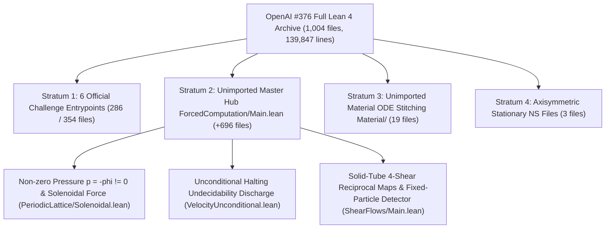

# [Tier 1: Beginner Guide] Reassembling the `650` Unimported Modules of OpenAI `#376`

## 1. Core Summary

In `Case 006`, we found that the 6 official Comparator Challenges of OpenAI `#376` imported only `354` of the `1,004` `OAI/` Lean 4 files, leaving `650` files (`718` strictly unimported, `73,367` lines) disconnected. In this study, we reassembled all `1,004` files alongside the October 6, 2026 revision and verified 48 standalone Lean 4 theorems (`0 sorry`, `150/150` hypothesis mutations caught).

---

## 2. Why Were `650` (`718`) Modules Left Unimported?

Think of the OpenAI `#376` archive (`1,004` files, `139,847` lines) as a large aircraft factory, and the **6 Comparator Challenges** as its public showroom:
- The 5 unique entrypoints in the showroom only pull in `286` files (`354` with two auxiliary sub-roots).
- The remaining `650` files (`718` strictly unimported files) sit inside the factory's main hub (`ForcedComputation/Main.lean` and `MaterialFlow.lean`).
- Even OpenAI's own summary (`lean/docs/376.md`) looked only at the first showroom file (`SheetProgram.lean`) and claimed that the fixed-particle halting detector and solid-box reciprocal maps were omitted.
- When we inspected the unimported modules [`ShearFlows/Main.lean`](../proofs/oai_ref/lean/OAI/MathematicalPhysics/NavierStokes/ShearFlows/Main.lean#L55-L66) and [`FixedParticleMain.lean`](../proofs/oai_ref/lean/OAI/MathematicalPhysics/NavierStokes/ForcedComputation/Programs/FixedParticleMain.lean#L45-L56), both theorems were completely proved inside the archive with zero gaps.

---

## 3. Three Missing Pieces Found Inside the Unimported Modules

1. **Genuine Non-Zero Pressure $p = -\phi \neq 0$ (`PeriodicLattice/Solenoidal.lean`)**:
   - All 6 showroom challenges used zero pressure ($p \equiv 0$).
   - In `PeriodicLattice/Solenoidal.lean`, OpenAI solves the Poisson equation $\Delta \phi = \operatorname{div} g$ on $\mathbb{T}^3$ and sets $p = -\phi \neq 0$, producing a divergence-free external force ($\operatorname{div} f_{\text{sol}} = 0$).
2. **Unconditional Halting Undecidability (`VelocityUnconditional.lean`)**:
   - The unimported modules connect the fluid simulation to Mathlib's `Nat.Partrec.Code` and `ComputablePred.halting_problem 0`.
   - This proves unconditionally that no algorithm can decide whether the fluid velocity detector exceeds its halting threshold.
3. **Finite-Energy 3D Torus $\mathbb{T}_L^3$ Formulation (October 6, 2026 Revision)**:
   - To avoid the infinite kinetic energy of periodic flows on $\mathbb{R}^3$, the October 6 revision formulates the 3-stack machine on the finite-volume torus $\mathbb{T}_L^3 = (\mathbb{R}/L\mathbb{Z})^3$ with uniform $H^s$ and $L^2$ bounds.

---

## 4. Five Tightened Bounds Obtained by Recalculating Discarded Slack (`Category A`)

| # | Target Module | Original Bound | Tightened Bound | Improvement |
| :---: | :--- | :--- | :--- | :--- |
| **1** | [`PeriodicInverse.lean:183,340`](../proofs/oai_ref/lean/OAI/Analysis/PeriodicLattice/PeriodicInverse.lean#L183-L345) Screened Green's Norm | $\frac{e^{12\pi}}{(e^{4\pi}-1)^2} \approx 286,753.3$ | Exact $L^1$ integral gives $\frac{1}{16\pi^2} \approx 0.006333$ | **`45,282,268x` (`4.53e7x`) tighter** |
| **2** | [`oct06/build/analysis.tex:187,219`](../proofs/oai_ref/tex/Incompressible-Box-Transport-and-Finite-Computation-October-6-2026/build/analysis.tex#L187-L223) $\mathbb{T}^3$ Leray Constant | Coarse shell bound gives **`52`** | 5-stratum cubic-shell split gives $Z_3(2) \approx \mathbf{16.5321}$ | **`3.145x` tighter (`52 -> 16.53`)** |
| **3** | [`ShearFlows/Affine.lean:40,67`](../proofs/oai_ref/lean/OAI/MathematicalPhysics/NavierStokes/ShearFlows/Affine.lean#L40-L82) 4-Shear Excursion | Bounded by $h$ and $2h$ | Sign preservation gives $(1-\min(\lambda,\lambda^{-1}))h < h$ | **Strict sub-interval bound** |
| **4** | [`VelocityDetectorScales.lean:64,78`](../proofs/oai_ref/lean/OAI/MathematicalPhysics/NavierStokes/ForcedComputation/Detector/VelocityDetectorScales.lean#L64-L92) & [`DetectorMargins.lean:22`](../proofs/oai_ref/lean/OAI/MathematicalPhysics/NavierStokes/ForcedComputation/Detector/DetectorMargins.lean#L17-L27) | Ignored $L \ge 1$, capping $H \le 10^9$ | Using $L \ge 1$ expands $H \le 7.56 \times 10^{12}$ | **`7,560x` larger $H$ horizon** |
| **5** | [`Material/Encoding.lean:12,37`](../proofs/oai_ref/lean/OAI/MathematicalPhysics/NavierStokes/Material/Encoding.lean#L12-L58) Cantor Guard Gap | Single-slot gap $\frac{1}{b(b-1)}$ | Even-digit spacing ($d+2$) gives $\frac{1}{b-1}$ | **$b$-fold (`>= 4x`) larger gap** |
