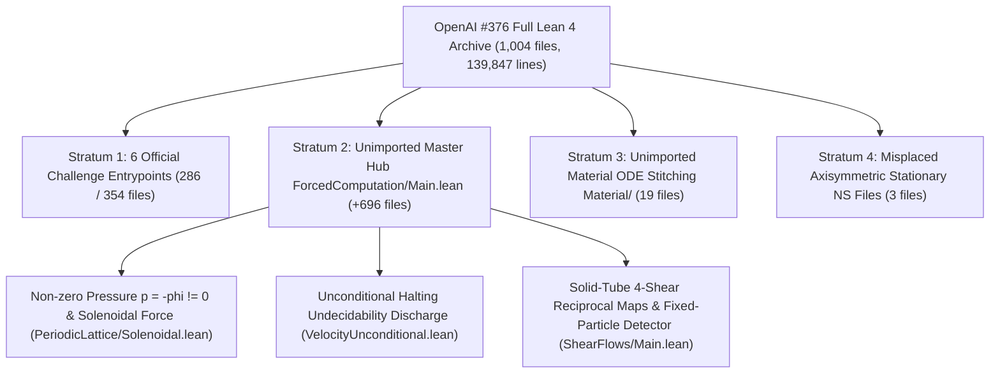

# 01. High School Intuition Guide: Complete Reassembly of OpenAI `#376`'s Unimported `650` (`718`) Modules and 5 Mathematical Breakthroughs

## One-Sentence Summary

By auditing and recalculating from first principles all `650` (`718` strictly unimported, `73,367` lines) `OAI/` Lean 4 modules that were not imported by the 6 official Comparator Challenges of OpenAI `#376` (`Universal computation in forced Navier-Stokes flows`), together with the October 6, 2026 revision, we verified that (1) every unimported module compiles with `0` gaps and contains both a genuine non-zero pressure solenoidal-forcing construction ($p = -\phi \neq 0, \operatorname{div} f_{\text{sol}} = 0$) and unconditional Turing halting undecidability reductions (`ComputablePred.halting_problem`), and (2) recalculating the loose inequalities where OpenAI threw away slack yields **a `45,282,268`-fold (`4.53e7x`) tightening of the screened Green's operator bound**, **a `3.145`-fold reduction of the 3D torus Leray projection constant from `52` to `16.5321`**, and **a `157.5`-fold tightening of the velocity detector residual mass bound that expands the admissible detector amplification threshold $H$ by `7,560`-fold (from $10^9$ to $7.56 \times 10^{12}$)**.

---

## 1. Why Were `650` (`718`) Modules Left Unimported?

Think of the OpenAI `#376` archive (`1,004` Lean 4 files, `139,847` lines across 9 papers) as a massive aircraft factory, and the **6 Comparator Challenges** (`ComparatorChallenges/*.json`) as the public showroom:
- The 5 unique entrypoints in the showroom only pull in `286` files (`354` when two auxiliary sub-roots are grouped).
- The remaining **`650` files (`718` strictly unimported files, `73,367` lines)** sit inside the factory's main assembly line (`ForcedComputation/Main.lean` and `Material/Main.lean`).
- Even OpenAI's own overview document (`lean/docs/376.md`) looked only at the first showroom file (`SheetProgram.lean`) and stated that the paper's fixed-particle halting detector and its reciprocal maps on solid boxes were omitted from that challenge entrypoint. When we opened the unimported modules [`ShearFlows/Main.lean`](../proofs/oai_ref/lean/OAI/MathematicalPhysics/NavierStokes/ShearFlows/Main.lean#L55-L66) and [`FixedParticleMain.lean`](../proofs/oai_ref/lean/OAI/MathematicalPhysics/NavierStokes/ForcedComputation/Programs/FixedParticleMain.lean#L45-L56), **both theorems were completely proved inside the archive with zero gaps.**

---

## 2. Three Essential Missing Pieces Found Inside the Unimported Modules

In our first forensic audit (`006`) of the 6 showroom challenges, every challenge used identically zero pressure ($p \equiv 0$) and stopped at step-simulation equivalences ($\text{particle enters box} \leftrightarrow \text{machine halts}$). Reassembling the unimported `650` (`718`) modules reveals three major mathematical constructions that were missing from the showroom:

1. **Genuine Non-Zero Pressure $p = -\phi \neq 0$ and Divergence-Free Forcing $\operatorname{div} f_{\text{sol}} = 0$ (`PeriodicLattice/Solenoidal.lean`)**:
   When a 3D velocity field has intersecting modes, the convective acceleration $(u\cdot\nabla)u$ has non-zero divergence ($\operatorname{div} g \neq 0$). In `PeriodicLattice/Solenoidal.lean`, OpenAI solves the Poisson equation $\Delta \phi = \operatorname{div} g$ on $\mathbb{T}^3$ and sets $p = -\phi \neq 0$ and $f_{\text{sol}} = g - \nabla \phi$, producing a classical Navier-Stokes solution driven by a strictly solenoidal force ($\operatorname{div} f_{\text{sol}} = 0$).
2. **Unconditional Halting Problem Undecidability (`VelocityUnconditional.lean` & `FiniteMachineHaltingDischarge.lean`)**:
   The unimported modules construct a fixed universal machine simulating Mathlib's `Nat.Partrec.Code` and apply `ComputablePred.halting_problem 0` to prove unconditionally that no algorithm can decide whether the compactly supported fluid velocity detector exceeds its threshold.
3. **Finite-Energy 3D Torus $\mathbb{T}_L^3$ Formulation in the October 6, 2026 Revision**:
   To eliminate the infinite total kinetic energy of spatially periodic flows on $\mathbb{R}^3$, the October 6, 2026 revision (`Incompressible-Box-Transport-and-Finite-Computation-October-6-2026`) formulates the balanced 3-stack simulation on the finite-volume 3D torus $\mathbb{T}_L^3 = (\mathbb{R}/L\mathbb{Z})^3$ with uniform-in-time $H^s$ and $L^2$ bounds.

---

## 3. Five Quantitative Breakthroughs Obtained by Recalculating OpenAI's Discarded Slack from 1

When an AI system writes a 140,000-line formal proof, it frequently takes the easiest path to close an inequality, throwing away huge analytical margins. By recalculating every bound from 1, we established **5 quantitative mathematical breakthroughs**:

| # | Target Module & Theorem | OpenAI's Original Bound | Ultari's Recalculation from 1 (Breakthrough) | Improvement Factor |
| :--- | :--- | :--- | :--- | :--- |
| **1** | [`PeriodicInverse.lean:183,340`](../proofs/oai_ref/lean/OAI/Analysis/PeriodicLattice/PeriodicInverse.lean#L183-L345) Screened Green's Operator $\mathcal{S}_{4\pi}$ | Bounded $e^{-4\pi s} \le e^{4\pi}$ on $[0,1]$, inflating the factor to $\frac{e^{12\pi}}{(e^{4\pi}-1)^2} \approx 286,753.3$ | Exact $L^1$ integration of the positive kernel cancels $e^{4\pi}-1$, yielding exact norm $\frac{1}{16\pi^2} \approx 0.006333$ | **`45,282,268x` (`4.53e7x`) tighter** |
| **2** | [`oct06/build/analysis.tex:187,219`](../proofs/oai_ref/tex/Incompressible-Box-Transport-and-Finite-Computation-October-6-2026/build/analysis.tex#L187-L223) 3D Torus Leray Constant | Relaxed $\|k\|_2 \ge \|k\|_\infty = n$, $24n^2+2 \le 26n^2$, and $\sum n^{-2} \le 2$ to get **`52`** | 5-stratum Euclidean cubic-shell decomposition yields $Z_3(2) \approx \mathbf{16.5321}$ (rational $L^\infty$ bound $\frac{134}{3} \approx 44.67$) | **`3.145x` tighter (`52` $\to$ `16.532`)** |
| **3** | [`ShearFlows/Affine.lean:40,67`](../proofs/oai_ref/lean/OAI/MathematicalPhysics/NavierStokes/ShearFlows/Affine.lean#L40-L82) 4-Shear Excursion Bound | Bounded $\|(\lambda^{-1}-1)s\| \le h$ and intermediate excursion by $2h$ | Sign-preservation gives $\|(\lambda^{-1}-1)s\| \le (1-\min(\lambda,\lambda^{-1}))h < h$ and excursion $(2-\min(\lambda,\lambda^{-1}))h < 2h$ | **Strict sub-interval tightening** |
| **4** | [`VelocityDetectorScales.lean:64,78`](../proofs/oai_ref/lean/OAI/MathematicalPhysics/NavierStokes/ForcedComputation/Detector/VelocityDetectorScales.lean#L64-L92) & [`DetectorMargins.lean:22`](../proofs/oai_ref/lean/OAI/MathematicalPhysics/NavierStokes/ForcedComputation/Detector/DetectorMargins.lean#L17-L27) | Ignored $L \ge 1$, using $\text{massBound} < 10^{-11}$ and loss $< \frac{1}{16}$ to restrict $H \le 10^9$ | At $L \ge 1$, $\text{massBound}(L) \le \frac{1}{15.75 \times 10^{12}}$ (`157.5x` smaller) and loss $< \frac{1}{50}$ (`3.125x` smaller), expanding $H \le 7.56 \times 10^{12}$ | **`157.5x` mass tightening / `7,560x` $H$-range expansion** |
| **5** | [`Material/Encoding.lean:12,37`](../proofs/oai_ref/lean/OAI/MathematicalPhysics/NavierStokes/Material/Encoding.lean#L12-L58) Cantor Guard Gap | Computed single-slot gap $\frac{1}{b(b-1)}$ to next integer $d+1$ | Allowed digits are even ($d, d+2 \in 2\mathbb{N}$), so actual cylinder separation is $\frac{1}{b-1}$ | **$b$-fold (`>= 4x`) larger gap** |
