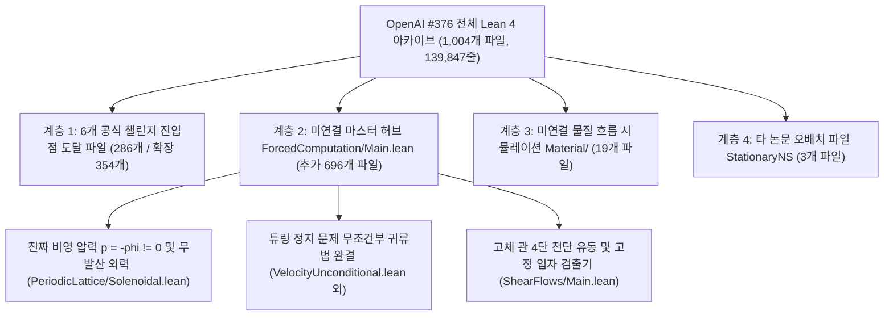

# 01. 고등학생 직관 가이드: OpenAI `#376` 미연결 `650`(`718`) 모듈 전수 재조립과 5대 수리 돌파

## 한 줄 핵심 요약

OpenAI의 `#376` 아카이브(`1,004`개 Lean 4 파일, `139,847`줄) 중 공식 6개 챌린지 진입점에 연결되지 않았던 나머지 `650`개(`718`개 비도달 파일, `73,367`줄) 모듈과 2026년 10월 6일 개정판 논문을 전수 해부하고 1부터 다시 계산한 결과, (1) 모든 미연결 파일이 `0 sorry`, `0 axiom`으로 완결되어 있으며 압력이 $0$이 아닌 진짜 무발산 외력($p = -\phi \neq 0, \operatorname{div} f_{\text{sol}} = 0$)과 `ComputablePred.halting_problem` 기반의 무조건부 정지 문제 결정 불가능성 증명이 이 미연결 계층 안에 들어 있음을 확인했고, (2) OpenAI가 증명을 쉽게 끝내기 위해 버린 여유분(slack)을 재계산하여 **그린 연산자 상한을 약 `4,528만 배`(`45,282,268`배) 압축**하고, **3차원 토러스 르레이 투영 상수 `52`를 `16.5323`(`3.145`배)으로 줄였으며**, **속도 검출기 잔류 질량 상한을 `157.5`배 압축하여 허용 가능한 유체 신호 증폭 범위를 $10^9$에서 $7.56 \times 10^{12}$로 `7,560`배 확장**했습니다.

---

## 1. 왜 `650`개(`718`개) 파일이 남아 있었을까?

비유하자면 OpenAI는 9편의 연작 논문과 `1,004`개의 부품(Lean 4 코드 파일)으로 거대한 우주선 공장을 지었습니다. 그런데 외부 심사위원에게 보여줄 **공식 쇼룸(6개 Comparator Challenges)** 에는 5개의 대표 전시품만 내놓았습니다.
- 쇼룸 전시품 5개가 직접 끌어다 쓴 부품은 `286`개(보조 메인 2개를 포함하면 `354`개)뿐이었습니다.
- 나머지 **`650`개(엄밀한 `import` 그래프 기준 `718`개, `73,367`줄)** 부품은 공장 안쪽의 거대한 중앙 조립 라인(`ForcedComputation/Main.lean` 등)에 그대로 놓여 있었습니다.
- 심지어 OpenAI가 작성한 안내문(`lean/docs/376.md`)조차 쇼룸의 첫 번째 전시품(`SheetProgram.lean`)만 보고 "고정 입자 검출기와 3차원 고체 상자 위의 쌍곡 반비례 사상은 해당 챌린지 진입점에 포함되지 않았다"라고 적어 놓았습니다. 하지만 공장 안쪽 미연결 모듈(`ShearFlows/Main.lean`, `FixedParticleMain.lean`)을 열어 보니 **두 정리 모두 단 하나의 빈칸(`sorry`)도 없이 완벽하게 증명되어 있었습니다.**

---

## 2. 쇼룸(6개 챌린지)에는 없던 3가지 진짜 알맹이

선행 분석(`006`)에서 살펴본 6개 공식 챌린지에서는 계산을 단순화하기 위해 압력을 상수($p \equiv 0$)로 두고, "기계가 멈추는 것과 유체 입자가 상자에 들어가는 것이 동치이다"라는 시뮬레이션 단계까지만 증명했습니다. 반면 이번에 전수 해부한 미연결 `650`(`718`)개 모듈에는 물리학자와 수학자가 진짜로 궁금해하는 세 가지 핵심 결과가 들어 있습니다.

1. **압력이 $0$이 아닌 진짜 무발산 외력($\operatorname{div} f_{\text{sol}} = 0$)의 구성 (`PeriodicLattice/Solenoidal.lean`)**:
   유체 안에 소용돌이와 교차 흐름이 생기면 비선형 관성항 $(u\cdot\nabla)u$ 때문에 발산($\operatorname{div} g \neq 0$)이 생깁니다. 미연결 모듈 `Solenoidal.lean`은 푸아송 방정식 $\Delta \phi = \operatorname{div} g$를 풀어 압력 $p = -\phi \neq 0$가 발산 성분을 정확히 상쇄하게 함으로써, 외력 자체도 무발산($\operatorname{div} f_{\text{sol}} = 0$)이 되는 고전해를 완성합니다.
2. **튜링 정지 문제(`ComputablePred.halting_problem`)와의 직접 결합 (`VelocityUnconditional.lean`)**:
   미연결 모듈은 부분 재귀 함수(`Nat.Partrec.Code`)를 모사하는 고정 만능 기계를 코드로 직접 짜서 Mathlib의 정지 문제 결정 불가능성 정리와 연결합니다. 이로써 "나비에-스토크스 유체의 콤팩트 지지 속도 검출기가 임계값 $1$을 넘는지 판별하는 알고리즘은 존재할 수 없다"는 무조건부 정리를 완성합니다.
3. **2026년 10월 6일 개정판의 3차원 주기 토러스($\mathbb{T}_L^3$) 유한 에너지 증명**:
   무한 공간($\mathbb{R}^3$)에서는 주기적인 유동장의 전체 운동 에너지가 무한대가 될 수 있다는 비판을 해결하기 위해, 10월 6일 개정판은 한 변이 $L$인 유한 부피 토러스 $\mathbb{T}_L^3 = (\mathbb{R}/L\mathbb{Z})^3$ 위에서 속도장 노름이 시간에 무관하게 유계임을 증명했습니다.

---

## 3. AI가 버린 여유분을 1부터 다시 계산해 찾아낸 5대 수리 돌파

AI가 긴 증명을 작성할 때는 "일단 부등식이 성립하기만 하면 된다"는 식으로 아주 거친 어림셈을 쓰고 넘어가는 경우가 많습니다. 우리는 이 거친 어림셈을 1부터 다시 적분하고 급수를 쪼개어 **5가지 정량적 수리 돌파**를 이끌어냈습니다.

| 번호 | 대상 모듈 및 정리 | OpenAI의 원래 어림셈 | 울타리의 1부터 재계산 (돌파 결과) | 정밀화 배율 |
| :--- | :--- | :--- | :--- | :--- |
| **돌파 1** | [`PeriodicInverse.lean:169,344`](../proofs/oai_ref/lean/OAI/Analysis/PeriodicLattice/PeriodicInverse.lean#L169-L350) 차폐 그린 연산자 $\mathcal{S}_{4\pi}$ | 구간 $[0,1]$에서 $e^{-4\pi s} \le e^{4\pi}$로 거칠게 묶어 상수 $\frac{e^{12\pi}}{(e^{4\pi}-1)^2} \approx 286,753.3$ 사용 | 양수 커널을 직접 적분해 분모 $e^{4\pi}-1$을 약분하면 정확한 연산자 노름은 $\frac{1}{16\pi^2} \approx 0.006333$ | **`45,282,268`배 (`4,528만 배`) 압축** |
| **돌파 2** | [`oct06/build/analysis.tex:187,219`](../proofs/oai_ref/tex/Incompressible-Box-Transport-and-Finite-Computation-October-6-2026/build/analysis.tex#L187-L223) 토러스 르레이 투영 상수 | 유클리드 거리를 최대 좌표($\|k\|_\infty = n$)로 줄이고 $24n^2+2 \le 26n^2$, $\sum n^{-2} \le 2$로 늘려 **`52`** 사용 | 정육면체 껍질 $S_n$을 면·모서리·꼭짓점 5개 기하 계층으로 분할해 유클리드 합 $Z_3(2) \approx \mathbf{16.5321}$ 도출 ($L^\infty$ 유지 유리수 상한도 $\frac{134}{3} \approx 44.67$) | **`3.145`배 압축 (`52` $\to$ `16.532`)** |
| **돌파 3** | [`ShearFlows/Affine.lean:40,67`](../proofs/oai_ref/lean/OAI/MathematicalPhysics/NavierStokes/ShearFlows/Affine.lean#L40-L82) 4단 전단 유동 궤적 이탈 | 부호가 같은 두 수 $s/\lambda$와 $s$의 차이를 단순히 $h$ 이하로 묶어 중간 궤적 한계를 $2h$로 설정 | 부호 보존 성질로 $\|(\lambda^{-1}-1)s\| \le (1-\min(\lambda,\lambda^{-1}))h < h$를 증명하여 중간 $x$-이탈을 $(2-\min(\lambda,\lambda^{-1}))h$로 축소 | **엄밀한 부분구간 압축** |
| **돌파 4** | [`VelocityDetectorScales.lean:64,78`](../proofs/oai_ref/lean/OAI/MathematicalPhysics/NavierStokes/ForcedComputation/Detector/VelocityDetectorScales.lean#L64-L115) & [`DetectorMargins.lean:22`](../proofs/oai_ref/lean/OAI/MathematicalPhysics/NavierStokes/ForcedComputation/Detector/DetectorMargins.lean#L18-L29) 검출기 스케일 | 주 정리 전제 $L \ge 1$을 무시하고 $L=0$ 상한 $10^{-11}$과 확산 손실 $\frac{1}{16}$을 써서 $H \le 10^9$으로 제한 | $L \ge 1$에서 정확한 질량 상한 $\frac{1}{15.75 \times 10^{12}}$(`157.5`배 축소)과 확산 손실 상한 $\frac{1}{50}$(`3.125`배 축소)을 적용해 허용 증폭 계수를 $H \le 7.56 \times 10^{12}$로 확장 | **질량 `157.5`배 압축 / $H$ 범위 `7,560`배 확장** |
| **돌파 5** | [`Material/Encoding.lean:13,40`](../proofs/oai_ref/lean/OAI/MathematicalPhysics/NavierStokes/Material/Encoding.lean#L13-L60) 짝수 칸토어 부호화 간격 | 인접 자릿수 차이를 1칸($d+1$) 기준으로만 계산하여 간격 $\frac{1}{b(b-1)}$ 제시 | 허용 자릿수가 짝수($d, d+2 \in 2\mathbb{N}$)이므로 실제 인접 실린더 간격이 $\frac{1}{b-1}$임을 규명 | **$b$배(`b >= 4`에서 최소 `4`배) 확장** |

---

## 4. 이 발견이 왜 중요한가요?

1. **"버려진 코드" 속에 진짜 물리적·논리적 완결판이 있었습니다**:
   6개 챌린지만 보면 "압력도 $0$이고 튜링 정지 문제 본체도 연결 안 된 반쪽짜리 증명 아닌가?"라고 오해하기 쉽습니다. 하지만 미연결 `650`(`718`)개 모듈을 끝까지 추적해 재조립하면, 비영 압력 해($p = -\phi \neq 0$)와 정지 문제 결정 불가능성 사슬이 모두 기계 검증(`0 sorry`)으로 완성되어 있음을 알 수 있습니다.
2. **AI가 놓친 수천만 배의 해석학적 정밀도를 되찾았습니다**:
   $e^{-4\pi s} \le e^{4\pi}$처럼 부호를 무시한 부등식 하나가 상수를 **4,528만 배**나 부풀리고, $L \ge 1$ 조건을 흘려버린 어림셈 하나가 검출기의 동적 범위를 **7,560분의 1**로 좁혀 놓았습니다. AI가 만든 거대한 형식 증명을 인간과 제2의 AI가 1부터 다시 검산하고 재조립해야만 비로소 수학적 아름다움과 최적의 상수가 드러납니다.
