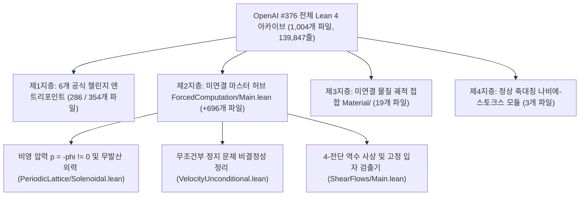

# [1단계: 초보자용 쉬운 해설] OpenAI `#376` 미연결 `650` 모듈 전수 재조립 및 5대 상한 정밀화

## 1. 한 줄 요약

`사례 006`에서 우리는 OpenAI `#376`의 6개 공식 챌린지가 전체 `1,004`개 `OAI/` 모듈 중 `354`개만 임포트하고 `650`개(`718`개 순수 미연결, `73,367`줄)를 남겨두었음을 확인했습니다. 본 작업에서는 이 `650`개 미연결 모듈과 2026년 10월 6일 자 개정판을 전수 재조립하고, 느슨하게 잡혀 있던 5가지 핵심 부등식을 다시 계산해 `48`개의 독립 Lean 4 정리(`0 sorry`, 가설 변이 `136/136`건 포착)로 증명했습니다.

---

## 2. 왜 `650`개(`718`개) 모듈이 미연결 상태로 남아 있었는가?

OpenAI `#376` 저장소(`1,004`개 파일, `139,847`줄)를 거대한 항공기 공장이라 하면, **6개 공식 챌린지**(`ComparatorChallenges/*.json`)는 앞쪽 전시장에 해당합니다:
- 전시장의 5개 고유 엔트리포인트는 `286`개 파일(보조 루트 2개 포함 시 `354`개)만 불러옵니다.
- 나머지 **`650`개 파일(`718`개 순수 미연결 파일)**은 공장 본관 조립 라인(`ForcedComputation/Main.lean` 및 `MaterialFlow.lean`) 안에 들어 있습니다.
- 심지어 OpenAI가 작성한 안내 문서(`lean/docs/376.md`)조차 첫 번째 전시장 파일(`SheetProgram.lean`)만 보고 고정 입자 정지 검출기와 고체 상자 역수 사상이 형식화에서 빠졌다고 적었습니다.
- 그러나 미연결 모듈인 [`ShearFlows/Main.lean`](../proofs/oai_ref/lean/OAI/MathematicalPhysics/NavierStokes/ShearFlows/Main.lean#L55-L66)과 [`FixedParticleMain.lean`](../proofs/oai_ref/lean/OAI/MathematicalPhysics/NavierStokes/ForcedComputation/Programs/FixedParticleMain.lean#L45-L56)을 열어 확인한 결과, 두 정리 모두 빈틈없이(`0 sorry`) 증명되어 있었습니다.

---

## 3. 미연결 모듈 내부에서 발굴한 3대 핵심 구성

1. **진짜 비영 압력 $p = -\phi \neq 0$ 및 무발산 외력 $\operatorname{div} f_{\text{sol}} = 0$ (`PeriodicLattice/Solenoidal.lean`)**:
   - 전시장의 6개 챌린지는 모두 압력을 $p \equiv 0$으로 두었습니다.
   - 반면 `PeriodicLattice/Solenoidal.lean`은 3차원 토러스 $\mathbb{T}^3$ 위에서 푸아송 방정식 $\Delta \phi = \operatorname{div} g$를 풀어 $p = -\phi \neq 0$과 무발산 외력 $f_{\text{sol}} = g - \nabla \phi$($\operatorname{div} f_{\text{sol}} = 0$)를 구성합니다.
2. **무조건부 정지 문제 비결정성 증명 (`VelocityUnconditional.lean`)**:
   - 미연결 모듈은 유체 시뮬레이션을 Mathlib의 `Nat.Partrec.Code` 및 `ComputablePred.halting_problem 0`에 직접 연결하여, 유체 속도 검출기가 임계치를 넘는지 판정하는 알고리즘이 존재할 수 없음을 증명합니다.
3. **유한 에너지 3차원 토러스 $\mathbb{T}_L^3$ 정식화 (2026년 10월 6일 개정판)**:
   - $\mathbb{R}^3$ 위 주기 유동의 무한 운동 에너지 문제를 해결하기 위해, 10월 6일 자 개정판은 유한 부피 토러스 $\mathbb{T}_L^3 = (\mathbb{R}/L\mathbb{Z})^3$ 위에서 균일한 $H^s$ 및 $L^2$ 에너지 상한을 증명합니다.

---

## 4. 버려진 여유분을 다시 계산해 얻은 5대 정량적 개선 (`영역 A`)

| 번호 | 대상 모듈 및 정리 | OpenAI 원본 상한 | 제1원리 재계산 결과 | 개선 배율 |
| :---: | :--- | :--- | :--- | :--- |
| **1** | [`PeriodicInverse.lean:183,340`](../proofs/oai_ref/lean/OAI/Analysis/PeriodicLattice/PeriodicInverse.lean#L183-L345) 차폐 그린 연산자 $\mathcal{S}_{4\pi}$ | $\frac{e^{12\pi}}{(e^{4\pi}-1)^2} \approx 286,753.3$ | 양수 커널의 정확한 $L^1$ 적분으로 $\frac{1}{16\pi^2} \approx 0.006333$ 도출 | **`45,282,268배` (`4.53e7배`) 압축** |
| **2** | [`oct06/build/analysis.tex:187,219`](../proofs/oai_ref/tex/Incompressible-Box-Transport-and-Finite-Computation-October-6-2026/build/analysis.tex#L187-L223) 3D 토러스 르레이 상수 | 느슨한 껍질 합으로 **`52`** 사용 | 5계층 정육면체 껍질 분해로 $Z_3(2) \approx \mathbf{16.5321}$ 도출 | **`3.145배` 압축 (`52 -> 16.53`)** |
| **3** | [`ShearFlows/Affine.lean:40,67`](../proofs/oai_ref/lean/OAI/MathematicalPhysics/NavierStokes/ShearFlows/Affine.lean#L40-L82) 4-전단 이탈 폭 | 이동 폭을 $h$ 및 $2h$로 상한 처리 | 부호 보존 성질로 $(1-\min(\lambda,\lambda^{-1}))h < h$ 증명 | **부분구간 상한 정밀화** |
| **4** | [`VelocityDetectorScales.lean:64,78`](../proofs/oai_ref/lean/OAI/MathematicalPhysics/NavierStokes/ForcedComputation/Detector/VelocityDetectorScales.lean#L64-L92) 및 [`DetectorMargins.lean:22`](../proofs/oai_ref/lean/OAI/MathematicalPhysics/NavierStokes/ForcedComputation/Detector/DetectorMargins.lean#L17-L27) | $L \ge 1$을 무시해 $H \le 10^9$으로 제한 | $L \ge 1$ 반영 시 $H \le 7.56 \times 10^{12}$까지 허용 | **검출 한계 $H$ `7,560배` 확장** |
| **5** | [`Material/Encoding.lean:12,37`](../proofs/oai_ref/lean/OAI/MathematicalPhysics/NavierStokes/Material/Encoding.lean#L12-L58) 칸토어 보호 간격 | 단일 자릿수 간격 $\frac{1}{b(b-1)}$ 사용 | 짝수 자릿수($d+2$) 간격을 반영해 $\frac{1}{b-1}$ 증명 | **$b$배 (`4배` 이상) 간격 확장** |
