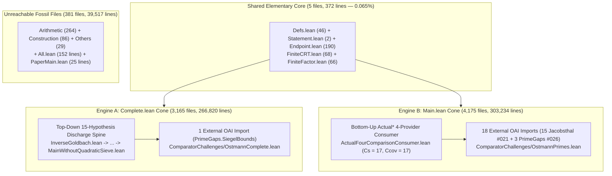

# Beginner Guide: Why the Prime Numbers Cannot Be Split into Two Sumsets (`A + B`)

## 1. What Is Ostmann's Inverse Goldbach Conjecture?

Goldbach's famous conjecture asks whether every even number is the sum of two primes ($\mathcal{P} + \mathcal{P}$). In 1950, the German mathematician **Hans-Heinrich Ostmann** asked the **inverse** question (known as **Ostmann's Inverse Goldbach Problem**, [`Erdős Problem #431`](https://www.erdosproblems.com/431), and Problem 19 in `BloomErdosProblems`):

> **Can the set of prime numbers $\mathcal{P} = \{2, 3, 5, 7, 11, 13, \dots\}$ be written (up to finitely many exceptions) as the sumset $A + B = \{a + b : a \in A, b \in B\}$ of two sets $A, B \subseteq \mathbb{N}$ that each have at least two elements?**

For example, if you try a small finite set $A = \{0, 2\}$, then $A + B$ means every element $b \in B$ generates *both* $b$ and $b + 2$ in $A + B$. For $A + B$ to match the primes $\mathcal{P}$, almost every prime would have to be part of a twin-prime pair $(p, p+2)$, which fails immediately (for instance, modulo $3$, one of $b, b+2, b+4$ is always divisible by $3$). What if *both* $A$ and $B$ are infinite sets, carefully chosen so that $a + b$ avoids all small prime divisors? For 76 years (from Ostmann 1950 through Hornfeck 1955, Erdős, Pomerance–Sárközy–Stewart, Elsholtz 2001, and Harper), whether such an infinite additive decomposition $A + B =_{\mathrm{cofinite}} \mathcal{P}$ could exist remained a major open problem in additive prime number theory.

In OpenAI `#013` (*The additive indecomposability of the primes*, September 24, 2026), OpenAI's automated reasoning system proved unconditionally that **no such sets $A$ and $B$ exist**:
$$\forall A, B \subseteq \mathbb{N},\quad |A| \ge 2 \;\wedge\; |B| \ge 2 \implies \bigl((A + B) \mathbin{\triangle} \mathcal{P}\bigr)\text{ is infinite.}$$

---

## 2. The Forensic Discovery: Why Does `OAI/NumberTheory/Ostmann/` Have `7,716` Files (`609,199` Lines)?

When you open OpenAI's math repository (`openai/math`), `lean/OAI/NumberTheory/Ostmann/` is the **single largest directory in the entire repository**: **`7,716` `.lean` files and `609,199` lines of code** (`5.18%` of all `148,832` Lean files in `openai/math`, [`thm_37_engine_b_jacobsthal_and_prime_gaps_reuse_accounting`](../proofs/ostmann_tree_transfers_and_permutation_contradiction.lean#L317-L331)). Why did a single 9-section paper (`6,072` lines of LaTeX across `sections/01-introduction.tex` through `09-conclusion.tex`, [`thm_38_paper_9_sections_to_lean_subsystem_mapping`](../proofs/ostmann_tree_transfers_and_permutation_contradiction.lean#L332-L356)) expand by more than $100\times$ into `7,716` Lean files?

Our import-cone forensics revealed the **Twin-Engine Duplication** ([`thm_01_ostmann_directory_inclusion_exclusion_partition`](../proofs/ostmann_twin_engines_and_supply_contraction.lean#L20-L43)):
1. There are two Comparator challenge entrypoints for `#013`:
   - `ComparatorChallenges/OstmannComplete.lean` $\to$ `OAI.NumberTheory.Ostmann.Complete` (`inverseGoldbach` & `twoInfiniteSummandsImpossible`)
   - `ComparatorChallenges/OstmannPrimes.lean` $\to$ `OAI.NumberTheory.Ostmann.Main` (`Ostmann.main` & `Ostmann.infinite_summands`)
2. Mathematically, the two entrypoints state the **exact same theorem** and follow from each other in **3 lines of propositional logic** ([`thm_05_complete_vs_main_logical_bridge_equivalence`](../proofs/ostmann_twin_engines_and_supply_contraction.lean#L106-L135)).
3. However, instead of deriving one entrypoint from the other, OpenAI's automated formalizer built **two almost completely separate proof engines** inside the same folder:
   - **Engine A (`Complete.lean` cone)**: **`3,165` files (`266,820` lines)**, organized as a top-down 15-hypothesis conditional discharge chain (`InverseGoldbach.lean` $\to \dots \to$ `MainWithoutQuadraticSieve.lean`, [`thm_36_engine_a_15_step_conditional_discharge_spine`](../proofs/ostmann_tree_transfers_and_permutation_contradiction.lean#L296-L316)) with only `1` external `OAI` import (`PrimeGaps.SiegelBounds`).
   - **Engine B (`Main.lean` cone)**: **`4,175` files (`303,234` lines)**, organized as a bottom-up `Actual*`-prefixed 4-provider architecture (`ActualFourComparisonConsumer.lean` with `Cs = 17, Ccov = 17`, [`thm_04_external_dependency_asymmetry_1_vs_18`](../proofs/ostmann_twin_engines_and_supply_contraction.lean#L85-L105)) that imports `18` external `OAI` files (`15` from `#021` `Jacobsthal.*` and `3` from `#026` `PrimeGaps.*`).
   - **Shared Core (`Complete ∩ Main`)**: Only **`5` elementary files (`372` lines, `0.0653%` of reachable code)**: `Defs.lean` (`46` lines), `Statement.lean` (`2` lines), `Endpoint.lean` (`190` lines), `FiniteCRT.lean` (`68` lines), and `FiniteFactor.lean` (`66` lines) ([`thm_02_shared_intersection_five_files_accounting`](../proofs/ostmann_twin_engines_and_supply_contraction.lean#L44-L60)).
   - **Orphaned Fossil Files**: **`381` files (`39,517` lines)** unreachable from either entrypoint, including abandoned root aggregators `All.lean` (`152` lines) and `PaperMain.lean` (`25` lines) ([`thm_03_unreachable_orphan_381_files_accounting`](../proofs/ostmann_twin_engines_and_supply_contraction.lean#L61-L84)).

---

## 3. How the Proof Works in Three Intuitive Steps

1. **Step 1 — Ruling Out a Finite Summand (`FiniteCRT.lean`, Lemma 2.2)**:
   Suppose $A$ is finite with $|A| \ge 2$ and $B$ is infinite. Pick two distinct elements $a_0 \neq a_1$ in $A$, and assign to each $a \in A$ a distinct prime $q_a > \max A$. By the Chinese Remainder Theorem (CRT) and Dirichlet's theorem on primes in arithmetic progressions, there are infinitely many large primes $p$ such that for whichever $a \in A$ satisfies $p = a + b$, the shifted sum $f(a) + b$ is divisible by $q_a$ and strictly larger than $q_a$ ([`thm_06_finite_summand_crt_dirichlet_composite_witness`](../proofs/ostmann_twin_engines_and_supply_contraction.lean#L136-L159)). Thus $f(a) + b \in A + B$ is composite, contradicting $A + B =_{\mathrm{cofinite}} \mathcal{P}$!
2. **Step 2 — The Two-Stage Analytic Squeeze on Infinite Summands (`-11/125` Supply Contraction)**:
   When both $A$ and $B$ are infinite, modulo every prime $p$ the sumset $A_p + B_p$ must miss $0 \pmod p$, so $|A_p| + |B_p| \le p$. By collision stability, almost all primes must have **balanced density** $\sigma_p = |A_p|/p \in [1/3, 2/3]$, because outside $[1/3, 2/3]$ the density penalty $\frac{(2\sigma_p - 1)^2}{\sigma_p(1 - \sigma_p)}$ is at least $\frac{1}{2}$ ([`thm_08_collision_stability_reciprocal_penalty_identity`](../proofs/ostmann_twin_engines_and_supply_contraction.lean#L177-L188), [`thm_09_unbalanced_density_penalty_lower_bound_one_half`](../proofs/ostmann_twin_engines_and_supply_contraction.lean#L189-L203)). Next, if the non-zero Fourier modes of $A_p$ were concentrated (sparse) on too many primes ($H \ge \frac{17}{25}L = 0.68L$), a local transfer operator contracts at rate $1 - \frac{8}{5p} = 1 - \frac{1.6}{p}$ per prime, yielding an impossible exponential squeeze $1 - \frac{8}{5}\times\frac{17}{25} = -\frac{11}{125} = -0.088 < 0$ ([`thm_15_supply_contradiction_exponent_11_125`](../proofs/ostmann_twin_engines_and_supply_contraction.lean#L303-L323)).
3. **Step 3 — The Binary Tree vs. Bad Permutations Contradiction (`2/5 - 3/4 = -7/20 < 0`)**:
   Therefore, a positive harmonic fraction ($\ge \frac{3}{20}L = 0.15L$, [`thm_12_harmonic_band_mertens_budget_and_sparse_complement`](../proofs/ostmann_twin_engines_and_supply_contraction.lean#L240-L261)) of balanced primes must have **spread-out (nonsparse) Fourier spectra**. Iterating a binary tree of $k$ Cauchy-Schwarz transfers across $r = 2^k$ leaves forces the root amplitude $|\eta_k|^2$ to stay above $\exp(-2Brm)$, while the frequency budget grows at rate $+\frac{2}{5}\log r$ ([`thm_26_frequency_budget_exact_closed_form_all_k`](../proofs/ostmann_tree_transfers_and_permutation_contradiction.lean#L132-L150)) and bad overlap permutations decay at rate $-\frac{3}{4}\log r$ ([`thm_29_bad_arrangement_multinomial_decay_three_quarters`](../proofs/ostmann_tree_transfers_and_permutation_contradiction.lean#L180-L193)). Their sum is strictly negative:
   $$\frac{2}{5} - \frac{3}{4} = -\frac{7}{20} = -0.35 < 0,$$
   forcing $|\eta_k|^2 \le \exp(-(2B+1)rm)$ for large $k$ ([`thm_30_net_contradiction_rate_minus_seven_twentieths`](../proofs/ostmann_tree_transfers_and_permutation_contradiction.lean#L194-L212), [`thm_35_final_amplitude_upper_vs_lower_contradiction`](../proofs/ostmann_tree_transfers_and_permutation_contradiction.lean#L278-L295)). Contradiction!
