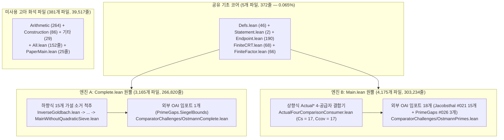

# 초급 가이드: 왜 소수 집합을 두 집합의 합(`A + B`)으로 쪼갤 수 없는가

## 1. 오스트만(Ostmann)의 역 골드바흐 추측이란 무엇인가?

유명한 골드바흐 추측은 "모든 짝수를 두 소수의 합($\mathcal{P} + \mathcal{P}$)으로 나타낼 수 있는가"를 묻습니다. 1950년 독일의 수학자 **한스-하인리히 오스트만(Hans-Heinrich Ostmann)**은 이를 정확히 뒤집은 **역(Inverse) 골드바흐 문제**([`Erdős Problem #431`](https://www.erdosproblems.com/431), `BloomErdosProblems` Problem 19)를 제기했습니다:

> **원소가 각각 2개 이상인 두 자연수 부분집합 $A, B \subseteq \mathbb{N}$을 잘 골라서, 두 집합의 모든 원소 쌍을 더한 합집합 $A + B = \{a + b : a \in A, b \in B\}$가 (유한 개의 예외를 제외하고) 소수 집합 $\mathcal{P} = \{2, 3, 5, 7, 11, 13, \dots\}$와 정확히 같아지게 만들 수 있는가?**

예를 들어 $A = \{0, 2\}$처럼 작은 유한 집합을 고르면, $B$의 모든 원소 $b$에 대해 $b$와 $b + 2$가 동시에 소수(쌍둥이 소수)여야 하므로 3으로 나눈 나머지 때문에 즉시 모순이 생깁니다. 그렇다면 $A$와 $B$를 둘 다 **무한 집합**으로 잡고 모든 작은 소수의 배수를 정교하게 피해 가도록 설계하면 어떨까요? 1950년 오스트만이 문제를 낸 뒤 호른페크(Hornfeck, 1955), 에르되시(Erdős), 포머랜스-사르쾨지-스튜어트(Pomerance–Sárközy–Stewart), 엘숄츠(Elsholtz, 2001), 하퍼(Harper)를 거치며 76년 동안 이 질문은 가산 소수론의 대표적인 미해결 난제로 남아 있었습니다.

OpenAI `#013`(*The additive indecomposability of the primes*, 2026년 9월 24일)은 **그러한 두 집합 $A, B$는 절대 존재할 수 없다**(즉 소수 집합 $\mathcal{P}$는 가산적으로 분해 불가능하다)는 사실을 무조건부로 증명했습니다:
$$\forall A, B \subseteq \mathbb{N},\quad |A| \ge 2 \;\wedge\; |B| \ge 2 \implies \bigl((A + B) \mathbin{\triangle} \mathcal{P}\bigr)\text{ 는 무한 집합이다.}$$

---

## 2. 포렌식 발견: 왜 `OAI/NumberTheory/Ostmann/`에는 `7,716`개 파일(`609,199`줄)이 들어 있는가?

OpenAI의 수학 저장소(`openai/math`)를 열어보면 `lean/OAI/NumberTheory/Ostmann/` 디렉터리는 **전체 저장소(`148,832`개 `.lean` 파일)에서 압도적 1위 규모의 초대형 폴더**입니다: 무려 **`7,716`개 파일, `609,199`줄**(저장소 전체 파일의 `5.18%`, [`thm_37_engine_b_jacobsthal_and_prime_gaps_reuse_accounting`](../proofs/ostmann_tree_transfers_and_permutation_contradiction.lean#L317-L331))에 달합니다. 왜 9개 절(`6,072`줄의 LaTeX 본문, [`thm_38_paper_9_sections_to_lean_subsystem_mapping`](../proofs/ostmann_tree_transfers_and_permutation_contradiction.lean#L332-L356))짜리 단일 논문이 $100$배 이상 불어나 `7,716`개 파일이 되었을까요?

모든 `import` 의존성 그래프를 전수 추적한 결과, 우리는 **쌍둥이 엔진 중복 구축(`Twin-Engine Duplication`)** 현상을 발견했습니다([`thm_01_ostmann_directory_inclusion_exclusion_partition`](../proofs/ostmann_twin_engines_and_supply_contraction.lean#L20-L43)):
1. `#013`에는 두 개의 공식 검증 관문(`ComparatorChallenges`) 파일이 있습니다:
   - `ComparatorChallenges/OstmannComplete.lean` $\to$ `OAI.NumberTheory.Ostmann.Complete` (`inverseGoldbach` 및 `twoInfiniteSummandsImpossible`)
   - `ComparatorChallenges/OstmannPrimes.lean` $\to$ `OAI.NumberTheory.Ostmann.Main` (`Ostmann.main` 및 `Ostmann.infinite_summands`)
2. 수학적으로 두 파일의 정리는 **완전히 동일한 명제**이며, 한쪽에서 다른 쪽을 **단 3줄의 명제 논리**로 즉시 유도할 수 있습니다([`thm_05_complete_vs_main_logical_bridge_equivalence`](../proofs/ostmann_twin_engines_and_supply_contraction.lean#L106-L135)).
3. 그런데 OpenAI의 자동 형식화 에이전트는 한쪽 정리를 다른 쪽에서 3줄로 유도하는 대신, 같은 폴더 안에 **거의 완전히 독립된 두 개의 거대한 증명 트리**를 중복 건설해 넣었습니다:
   - **엔진 A (`Complete.lean` 원뿔)**: **`3,165`개 파일(`266,820`줄)**. `InverseGoldbach.lean`의 15개 해석·체 가설을 9단계 래퍼 모듈을 거쳐 위에서 아래로 소거하는 하향식 구조([`thm_36_engine_a_15_step_conditional_discharge_spine`](../proofs/ostmann_tree_transfers_and_permutation_contradiction.lean#L296-L316))이며, 외부 `OAI` 모듈은 단 `1`개(`PrimeGaps.SiegelBounds`)만 가져옵니다.
   - **엔진 B (`Main.lean` 원뿔)**: **`4,175`개 파일(`303,234`줄)**. `Actual*` 접두사 모듈과 4개 비교 공급자(`ActualFourComparisonConsumer.lean`, `Cs = 17, Ccov = 17`, [`thm_04_external_dependency_asymmetry_1_vs_18`](../proofs/ostmann_twin_engines_and_supply_contraction.lean#L85-L105))를 결합하는 상향식 구조이며, 외부 `OAI` 모듈 `18`개(`#021` `Jacobsthal.*` 15개 + `#026` `PrimeGaps.*` 3개)를 재사용합니다.
   - **공유 코어 (`Complete ∩ Main`)**: 두 엔진이 함께 쓰는 파일은 기초 정의와 유한 가산항 보조정리 **단 `5`개 파일(`372`줄, 도달 가능 코드의 `0.0653%`)**뿐입니다(`Defs.lean` `46`줄, `Statement.lean` `2`줄, `Endpoint.lean` `190`줄, `FiniteCRT.lean` `68`줄, `FiniteFactor.lean` `66`줄, [`thm_02_shared_intersection_five_files_accounting`](../proofs/ostmann_twin_engines_and_supply_contraction.lean#L44-L60)).
   - **고아 화석 파일 (`Orphans`)**: 어느 관문에서도 도달하지 않는 **미사용 화석 파일이 `381`개(`39,517`줄)** 남아 있습니다(`All.lean` `152`줄, `PaperMain.lean` `25`줄 포함, [`thm_03_unreachable_orphan_381_files_accounting`](../proofs/ostmann_twin_engines_and_supply_contraction.lean#L61-L84)).

---

## 3. 세 단계로 이해하는 직관적 증명 원리

1. **1단계 — 유한 집합 + 무한 집합의 배제 (`FiniteCRT.lean`, 보조정리 2.2)**:
   만약 $A$가 유한 집합($|A| \ge 2$)이고 $B$가 무한 집합이라면, $A$의 서로 다른 두 원소 $a_0 \neq a_1$을 맞바꾸는 함수 $f : A \to A$를 잡고 각 $a \in A$마다 서로 다른 큰 소수 $q_a > \max A$를 배정합니다. 중국인의 나머지 정리(CRT)와 디리클레 등차수열 소수 정리를 쓰면, $p = a + b$를 만족하는 큰 소수 $p$에 대해 이동된 합 $s = f(a) + b \in A + B$가 항상 $q_a$의 배수이면서 $q_a$보다 엄격히 크게($s = k_{\mathrm{mult}} q_a \ge 2q_a$) 만들 수 있습니다([`thm_06_finite_summand_crt_dirichlet_composite_witness`](../proofs/ostmann_twin_engines_and_supply_contraction.lean#L136-L159)). 즉 $A + B$ 안에 무한히 많은 합성수가 생겨 모순입니다!
2. **2단계 — 무한 가산항에 대한 1차 해석적 압착 (`-11/125` 푸리에 공급 수축)**:
   $A, B$가 둘 다 무한 집합이면, 각 소수 $p$에 대한 나머지 집합 $A_p, B_p \pmod p$는 합이 $0 \pmod p$가 될 수 없으므로 $|A_p| + |B_p| \le p$입니다. 충돌 안정성(보조정리 2.5)에 의해 밀도 $\sigma_p = |A_p|/p$가 균형 구간 $[1/3, 2/3]$을 벗어나면 벌점 $\frac{(2\sigma_p - 1)^2}{\sigma_p(1 - \sigma_p)} \ge \frac{1}{2}$이 부과되어([`thm_08_collision_stability_reciprocal_penalty_identity`](../proofs/ostmann_twin_engines_and_supply_contraction.lean#L177-L188), [`thm_09_unbalanced_density_penalty_lower_bound_one_half`](../proofs/ostmann_twin_engines_and_supply_contraction.lean#L189-L203)), 거의 모든 소수는 $\sigma_p \in [1/3, 2/3]$에 놓입니다. 만약 푸리에 계수가 한곳에 쏠린(희소 스펙트럼) 소수들의 조화합이 $H \ge \frac{17}{25}L = 0.68L$ 이상이면, 국소 전이 연산자가 소수마다 $1 - \frac{8}{5p} = 1 - \frac{1.6}{p}$씩 수축하여 $1 - \frac{8}{5}\times\frac{17}{25} = -\frac{11}{125} = -0.088 < 0$이라는 지수적 모순이 발생합니다([`thm_15_supply_contradiction_exponent_11_125`](../proofs/ostmann_twin_engines_and_supply_contraction.lean#L303-L323)).
3. **3단계 — 이진 트리 주파수 예산(`+2/5`) 대 나쁜 순열 감쇠(`-3/4`)의 최종 모순 (`-7/20 < 0`)**:
   따라서 조화합 $\ge \frac{3}{20}L = 0.15L$ 이상의 균형 소수들은 반드시 **퍼져 있는(비희소) 푸리에 스펙트럼**을 가집니다([`thm_12_harmonic_band_mertens_budget_and_sparse_complement`](../proofs/ostmann_twin_engines_and_supply_contraction.lean#L240-L261)). 이제 깊이 $k$($r = 2^k$개 잎)인 코시-슈바르츠 이진 전이 트리를 구성하면, 전이 점화식 하한은 뿌리 진폭 $|\eta_k|^2 \ge \exp(-2Brm)$을 강제하는 반면, 주파수 예산은 $+\frac{2}{5}\log r$([`thm_26_frequency_budget_exact_closed_form_all_k`](../proofs/ostmann_tree_transfers_and_permutation_contradiction.lean#L132-L150))로 자라고 겹침 그래프의 나쁜 순열 비율은 $-\frac{3}{4}\log r$([`thm_29_bad_arrangement_multinomial_decay_three_quarters`](../proofs/ostmann_tree_transfers_and_permutation_contradiction.lean#L180-L193))로 감쇠합니다. 두 지수의 합은:
   $$\frac{2}{5} - \frac{3}{4} = -\frac{7}{20} = -0.35 < 0$$
   이므로, $k$를 충분히 크게 잡으면 $|\eta_k|^2 \le \exp(-(2B+1)rm)$이 되어 하한과 정면 충돌합니다([`thm_30_net_contradiction_rate_minus_seven_twentieths`](../proofs/ostmann_tree_transfers_and_permutation_contradiction.lean#L194-L212), [`thm_35_final_amplitude_upper_vs_lower_contradiction`](../proofs/ostmann_tree_transfers_and_permutation_contradiction.lean#L278-L295))!
