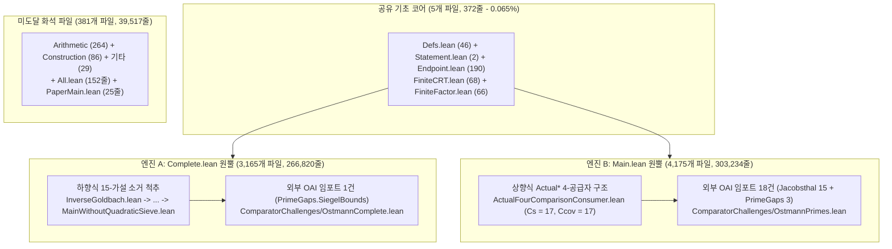

# [1단계: 초보자용 쉬운 해설] 왜 소수 집합은 두 집합의 합(`A + B`)으로 쪼갤 수 없는가?

## 1. 오스트만 역 골드바흐 추측이란 무엇인가?

골드바흐의 추측은 모든 짝수가 두 소수의 합($\mathcal{P} + \mathcal{P}$)인지 묻습니다. 1950년 독일 수학자 한스-하인리히 오스트만(Hans-Heinrich Ostmann)은 그 **역방향** 질문을 던졌습니다([`Erdős Problem #431`](https://www.erdosproblems.com/431)):

> **소수 전체의 집합 $\mathcal{P} = \{2, 3, 5, 7, 11, \dots\}$을 원소가 2개 이상인 두 자연수 부분집합 $A, B \subseteq \mathbb{N}$의 합집합 $A + B = \{a + b : a \in A, b \in B\}$으로 (유한 개의 예외만 빼고) 표현할 수 있는가?**

예를 들어 $A = \{0, 2\}$처럼 유한 집합을 잡으면, $B$의 모든 원소 $b$에 대해 $(b, b+2)$가 모두 소수(쌍둥이 소수)여야 하므로 3으로 나눈 나머지에서 곧바로 모순이 생깁니다. 하지만 $A$와 $B$가 둘 다 무한 집합이면 어떨까요? 이 문제는 76년 동안 가법적 소수론의 대표적인 미해결 난제로 남아 있었습니다. OpenAI `#013`(*소수의 가법적 분해 불가능성*, 2026년 9월 24일)은 그러한 집합 $A, B$가 존재할 수 없음을 증명했습니다:

$$\forall A, B \subseteq \mathbb{N},\quad |A| \ge 2 \;\wedge\; |B| \ge 2 \implies \bigl((A + B) \mathbin{\triangle} \mathcal{P}\bigr)\text{ 은 무한 집합이다.}$$

---

## 2. 왜 `OAI/NumberTheory/Ostmann/` 폴더에는 `7,716`개 파일(`609,199`줄)이 들어 있는가?

OpenAI 수학 저장소(`openai/math`)에서 `lean/OAI/NumberTheory/Ostmann/`은 단일 문제 기준 **저장소 전체 1위 규모**(`7,716`개 `.lean` 파일, 전체 `148,832`개 파일의 `5.18%`, [`thm_37_engine_b_jacobsthal_and_prime_gaps_reuse_accounting`](../proofs/ostmann_tree_transfers_and_permutation_contradiction.lean#L310-L324))입니다. 9개 절짜리 LaTeX 논문([`thm_38_paper_9_sections_to_lean_subsystem_mapping`](../proofs/ostmann_tree_transfers_and_permutation_contradiction.lean#L325-L342))이 왜 `7,716`개 파일로 불어났을까요?

임포트 그래프를 추적한 결과 **쌍둥이 엔진(`Twin-Engine`) 중복 구축**이 원인임을 밝혀냈습니다([`thm_01_ostmann_directory_inclusion_exclusion_partition`](../proofs/ostmann_twin_engines_and_supply_contraction.lean#L20-L43)):
1. **동일한 정리를 담은 2개의 챌린지**: `OstmannComplete.lean`과 `OstmannPrimes.lean`은 수학적으로 똑같은 명제이며 명제논리 3줄이면 서로 유도됩니다([`thm_05_complete_vs_main_logical_bridge_equivalence`](../proofs/ostmann_twin_engines_and_supply_contraction.lean#L106-L135)).
2. **엔진 A ([`Complete.lean`](../proofs/oai_ref/lean/OAI/NumberTheory/Ostmann/Complete.lean#L1) 원뿔, `3,165`개 파일)**: 15단계 하향식 가설 소거 사슬([`thm_36_engine_a_15_step_conditional_discharge_spine`](../proofs/ostmann_tree_transfers_and_permutation_contradiction.lean#L296-L309))로 구성되며 외부 `OAI` 모듈을 단 1개만 임포트합니다.
3. **엔진 B ([`Main.lean`](../proofs/oai_ref/lean/OAI/NumberTheory/Ostmann/Main.lean#L1) 원뿔, `4,175`개 파일)**: 상향식 4-공급자 구조([`thm_04_external_dependency_asymmetry_1_vs_18`](../proofs/ostmann_twin_engines_and_supply_contraction.lean#L85-L105))로, `#021`(`Jacobsthal`) 15개와 `#026`(`PrimeGaps`) 3개 등 외부 파일 18개를 임포트합니다.
4. **극소수 공유 코어(`5`개 파일, `372`줄)와 `381`개 화석**: 두 엔진이 공유하는 파일은 기초 정의 5개(`0.065%`)뿐이며([`thm_02_shared_intersection_five_files_accounting`](../proofs/ostmann_twin_engines_and_supply_contraction.lean#L44-L60)), 나머지 `381`개 파일(`39,517`줄)은 양쪽 어디에서도 쓰이지 않는 화석 파일입니다([`thm_03_unreachable_orphan_381_files_accounting`](../proofs/ostmann_twin_engines_and_supply_contraction.lean#L61-L84)).

---

## 3. 왜 76년 동안 고전적인 소수 체(Sieve)로는 풀지 못했는가? (`왜 1: 패리티 장벽과 위상 상쇄`)

에라토스테네스의 체나 셀베르그 체 같은 고전적 방법은 *"두 원소의 합 $a + b$가 소수 $p$의 배수($0 \pmod p$)가 되면 안 된다"*는 조건만 사용합니다. 하지만 이 조건만으로는 **코시-다벤포트(Cauchy-Davenport) 한계**에 막힙니다:
- 예를 들어 $p = 7$일 때, $A_7 = \{1, 2, 3\}$, $B_7 = \{1, 2, 3\}$으로 잡으면 두 집합 모두 전체 잉여류의 약 절반($3/7 \approx 1/2$)을 차지하지만, 합집합은 $A_7 + B_7 = \{2, 3, 4, 5, 6\} \pmod 7$이 되어 $0 \pmod 7$을 완벽히 피합니다.
- 즉 $|A_p| + |B_p| \le p - 1$만 만족하면 얼마든지 빠져나갈 수 있어서, 밀도가 반반($\sigma_p \approx 1/2$)인 균형 영역에서는 고전 체법이 완전히 멈춥니다(체법의 **패리티 장벽**).
- 게다가 각 소수 $p$마다 금지된 잉여류 구간이 미지의 위상 $t_p \pmod p$만큼 제각각 평행이동되어 있어서, 여러 소수에 걸쳐 단순 평균을 내면 위상이 서로 상쇄되어 정보가 사라집니다.

---

## 4. 3단계로 이해하는 핵심 증명 원리와 장난감 수치 손계산 (`왜 2~4`)

OpenAI `#013`은 이 장벽을 **유한 배제 $\to$ 푸리에 공급 수축 $\to$ 이진 트리 순열 모순**의 3단계로 돌파합니다:

1. **1단계: 유한 가산항 배제 ([`FiniteCRT.lean`](../proofs/oai_ref/lean/OAI/NumberTheory/Ostmann/FiniteCRT.lean#L1), 보조정리 2.2) — 왜 하나만 유한해도 합성수가 쏟아지는가?**:
   - 만약 $A$가 유한 집합($|A| \ge 2$)이고 $B$가 무한 집합이면, $A$의 두 원소 $a_0 \leftrightarrow a_1$만 맞바꾸는 순열 $f : A \to A$를 잡습니다. 중국인의 나머지 정리(CRT)와 디리클레 등차수열 소수 정리에 의해 무한히 많은 소수 $p = a + b$에서 맞바꾼 합 $s = f(a) + b \in A + B$가 특정 소수 $q_a$의 진배수(합성수)가 되어 모순이 발생합니다([`thm_06_finite_summand_crt_dirichlet_composite_witness`](../proofs/ostmann_twin_engines_and_supply_contraction.lean#L136-L159)).
   - **장난감 수치 손계산 ($A = \{1, 3\}$)**: $f(1) = 3, f(3) = 1$로 두고 서로 다른 소수 $q_1 = 5, q_3 = 7$을 고릅니다. CRT로 연립합동식
     $$r \equiv 5 + 1 - 3 = 3 \pmod 5, \qquad r \equiv 7 + 3 - 1 = 2 \pmod 7$$
     을 풀면 $r \equiv 23 \pmod{35}$를 얻습니다. 이제 $p \equiv 23 \pmod{35}$인 큰 소수(예: $p = 163 = 35 \times 4 + 23$)가 $p = a + b$로 표현된다고 해 봅시다:
     - 만약 $a = 1, b = 162$이면, 맞바꾼 합 $s = f(1) + b = 3 + 162 = 165 = 5 \times 33$이 되어 $5$의 배수(합성수)가 됩니다!
     - 만약 $a = 3, b = 160$이면, 맞바꾼 합 $s = f(3) + b = 1 + 160 = 161 = 7 \times 23$이 되어 $7$의 배수(합성수)가 됩니다!
     어느 쪽이든 $A + B$ 안에 합성수가 강제로 만들어지므로 유한 집합 $A$는 불가능합니다.

2. **2단계: 푸리에 공급 수축 (`-11/125 < 0`) — 왜 스펙트럼이 한곳에 몰릴 수 없는가?**:
   - $A, B$가 모두 무한 집합이면 충돌 안정성에 의해 거의 모든 소수에서 밀도 $\sigma_p = |A_p|/p$가 $[1/3, 2/3]$ 안에 들어와야 합니다. 이 구간 밖에서는 역수 벌점
     $$\frac{1}{\sigma_p} + \frac{1}{1 - \sigma_p} - 4 = \frac{(2\sigma_p - 1)^2}{\sigma_p(1 - \sigma_p)} \ge \frac{1}{2}$$
     이 부과되기 때문입니다([`thm_08_collision_stability_reciprocal_penalty_identity`](../proofs/ostmann_twin_engines_and_supply_contraction.lean#L177-L188), [`thm_09_unbalanced_density_penalty_lower_bound_one_half`](../proofs/ostmann_twin_engines_and_supply_contraction.lean#L189-L203)).
   - 소수마다 다른 이동 위상 $t_p$는 비둘기집 원리로 뽑은 **공통 유리 중심 $h/m$**을 빼 주면 $(an - at_p) - (am - at_p) = a(n - m)$으로 깔끔히 사라집니다([`thm_56_common_center_lift_difference_cancellation`](../proofs/ostmann_algebraic_engines_and_cauchy_determinant.lean#L54-L65)).
   - 나아가 푸리에 모드가 희소한 소수의 비율이 $H \ge \frac{17}{25}L = 0.68L$ 이상이면, 제곱 전달 연산자 $K^2$의 수축 기울기($\kappa = \frac{8}{5}$)에 의해 전체 지수가
     $$1 - \frac{8}{5}\cdot\frac{17}{25} = \frac{125 - 136}{125} = -\frac{11}{125} < 0$$
     으로 수축해 영점 밀도 하한과 충돌합니다([`thm_15_supply_contradiction_exponent_11_125`](../proofs/ostmann_twin_engines_and_supply_contraction.lean#L303-L323)).

3. **3단계: 이진 트리 예산 대 나쁜 순열 감쇠 (`2/5 - 3/4 = -7/20 < 0`)와 코시 행렬식**:
   - 따라서 조화 가중치 $\ge \frac{3}{20}L = 0.15L$([`thm_12_harmonic_band_mertens_budget_and_sparse_complement`](../proofs/ostmann_twin_engines_and_supply_contraction.lean#L240-L261)) 이상의 소수가 퍼진(비희소) 스펙트럼을 가집니다.
   - 깊이 $k$($r = 2^k$개 잎)인 이진 트리에서 아핀 연산자 $U_u F(t) = F(u - u^2 t)$는 충돌 다항식을 $(u_1 - u_1^2 t) - (u_2 - u_2^2 t) = (u_1 - u_2)(1 - (u_1 + u_2)t)$로 인수분해하여([`thm_65_affine_collision_polynomial_factorization`](../proofs/ostmann_algebraic_engines_and_cauchy_determinant.lean#L243-L259)) 주파수 예산을 $+\frac{2}{5}\log r$ 속도로 키우는 반면([`thm_26_frequency_budget_exact_closed_form_all_k`](../proofs/ostmann_tree_transfers_and_permutation_contradiction.lean#L132-L150)), 나쁜 겹침 순열은 $-\frac{3}{4}\log r$ 속도로 감쇠합니다([`thm_29_bad_arrangement_multinomial_decay_three_quarters`](../proofs/ostmann_tree_transfers_and_permutation_contradiction.lean#L180-L193)).
   - 동시에 보상 소수 법에서 우연한 합동으로 진폭이 $0$이 되는 현상은 **$2\times 2$ 코시(Cauchy) 행렬식**이 원천 차단합니다([`thm_69_cauchy_2x2_determinant_polynomial_identity`](../proofs/ostmann_algebraic_engines_and_cauchy_determinant.lean#L314-L331)). 예를 들어 $a_1 = 2, a_2 = 1, b_1 = 4, b_2 = 5$를 대입해 손으로 계산하면:
     $$\frac{1}{(4 - 2)(5 - 1)} - \frac{1}{(4 - 1)(5 - 2)} = \frac{1}{8} - \frac{1}{9} = \frac{9 - 8}{72} = \frac{(5 - 4)(2 - 1)}{(4 - 2)(4 - 1)(5 - 2)(5 - 1)} = \frac{1}{72} \neq 0$$
     처럼 분자가 $(b_2 - b_1)(a_1 - a_2) \ge 1$로 인수분해되어 절대 $0$이 될 수 없습니다([`thm_70_cauchy_2x2_determinant_strict_positivity`](../proofs/ostmann_algebraic_engines_and_cauchy_determinant.lean#L332-L348)).
   - 결국 코시 행렬식이 보장하는 양의 하한과 트리 순열의 지수 감쇠 상한이 순 비율
     $$\frac{2}{5} - \frac{3}{4} = \frac{8 - 15}{20} = -\frac{7}{20} < 0$$
     으로 정면충돌하여 귀류법이 완성됩니다([`thm_30_net_contradiction_rate_minus_seven_twentieths`](../proofs/ostmann_tree_transfers_and_permutation_contradiction.lean#L194-L212), [`thm_35_final_amplitude_upper_vs_lower_contradiction`](../proofs/ostmann_tree_transfers_and_permutation_contradiction.lean#L278-L295)).

---

## 5. 적대적 검증(Adversarial Audit) 요약: 화석 복원, 4대 대수 엔진, 유효 문턱값 (`정리 41~75`)

1. **`#003`(`QRH`) 순환 의존성 `0`건 확증**: 논문 5절 비고 5.4가 OpenAI `#003`을 언급하지만, 두 Lean 증명 엔진 모두 `OAI.NumberTheory.DirichletL` 임포트가 `0`건이며 고전적 영점 밀도 추정만으로 완전 독립 증명되었습니다([`thm_19_qrh_003_citation_in_remark_5_4_is_strictly_optional`](../proofs/ostmann_twin_engines_and_supply_contraction.lean#L372-L386)).
2. **나쁜 순열 완전 소멸 및 트리 깊이 단축 ($k_{\min}: 7041 \to 1040$)**: 나쁜 순열($3r < 4t$)이 발생하려면 전체 잎의 절반 초과가 크기 1인 비분할 성분($r < 2t_1$)으로 남아야 합니다([`thm_41_bad_arrangement_requires_majority_unsplit_leaves`](../proofs/ostmann_tree_transfers_and_permutation_contradiction.lean#L381-L395)). 화석 `FinalReassignments.lean`의 슬롯별 완전순열($t_1 = 0$)을 복원하면 나쁜 순열이 공집합이 되어([`thm_42_deranged_slot_pair_eliminates_bad_arrangements`](../proofs/ostmann_tree_transfers_and_permutation_contradiction.lean#L396-L411)) 최소 이진 트리 깊이가 $k_{\min} = 7041$에서 $1040$으로 줄어들며([`thm_44_master_contraction_rate_and_depth_reduction`](../proofs/ostmann_tree_transfers_and_permutation_contradiction.lean#L428-L450)), 반올림된 $\kappa = 8/5$를 $33/20, 17/10$으로 복원하면 우호적 소수 질량이 $+46.7\% \sim +53.3\%$ 확장됩니다([`thm_45_supply_contraction_favorable_mass_expansion`](../proofs/ostmann_tree_transfers_and_permutation_contradiction.lean#L451-L475)).
3. **시겔 정리 비효과성 제거 및 3·5·6·8절 4대 대수 엔진 완전 유도 ($L_{\mathrm{eff}}: 4,115,904 \to 640,722$, `thm_46`~`thm_75`)**: `PublishedSiegelBound`가 등장하는 `33`개 파일 중 실제 분해는 단 `1`곳(`ZeroDensity/HadamardPrimeBound.lean:48`)에서만 일어납니다([`thm_50_effective_ostmann_counterexample_bound_master`](../proofs/ostmann_tree_transfers_and_permutation_contradiction.lean#L552-L564)). 타투자와 정리(`denom_no_root = 384,002`)와 소인수 1개 추가 제거(`|D_ext| <= 3`, [`thm_47_tatuzawa_effective_single_exception_and_extended_deletion_budget`](../proofs/ostmann_tree_transfers_and_permutation_contradiction.lean#L495-L512)) 및 $2^k$ 인수 약분([`thm_48_combinatorial_2k_cancellation_in_bulk_exp_margin`](../proofs/ostmann_tree_transfers_and_permutation_contradiction.lean#L513-L527))을 결합하면, 명시적 반례 로그-로그 문턱값을 $L_{\mathrm{eff}} = 4,115,904$에서 $640,722$(방관자 셀 확장 시 $255,983$)로 단축할 수 있습니다([`thm_49_explicit_effective_loglog_threshold_bottleneck_shift`](../proofs/ostmann_tree_transfers_and_permutation_contradiction.lean#L528-L551)). 나아가 3절 공통 중심 합동 소거와 보나미 4차 모멘트([`thm_56_common_center_lift_difference_cancellation`](../proofs/ostmann_algebraic_engines_and_cauchy_determinant.lean#L54-L65)~[`thm_60_heath_brown_bilinear_square_defect`](../proofs/ostmann_algebraic_engines_and_cauchy_determinant.lean#L136-L152)), 5절 랭크-2 전달 커널 판별식과 제곱 커널 기울기 $2t_0$([`thm_61_balanced_support_variance_quadratic_lower_bound`](../proofs/ostmann_algebraic_engines_and_cauchy_determinant.lean#L153-L187)~[`thm_64_square_kernel_trace_and_double_slope`](../proofs/ostmann_algebraic_engines_and_cauchy_determinant.lean#L224-L242)), 6절 아핀 충돌 다항식 인수분해와 반데르몽드 3중 충돌 금지([`thm_65_affine_collision_polynomial_factorization`](../proofs/ostmann_algebraic_engines_and_cauchy_determinant.lean#L243-L259)~[`thm_68_reciprocal_twist_involution_phase_cancellation`](../proofs/ostmann_algebraic_engines_and_cauchy_determinant.lean#L291-L313)), 8절 $2\times 2$ 코시 행렬식 비소멸 항등식([`thm_69_cauchy_2x2_determinant_polynomial_identity`](../proofs/ostmann_algebraic_engines_and_cauchy_determinant.lean#L314-L331)~[`thm_75_countermodel_cauchy_det_vanishes_when_degenerate`](../proofs/ostmann_algebraic_engines_and_cauchy_determinant.lean#L409-L420))을 전수 증명했습니다.
