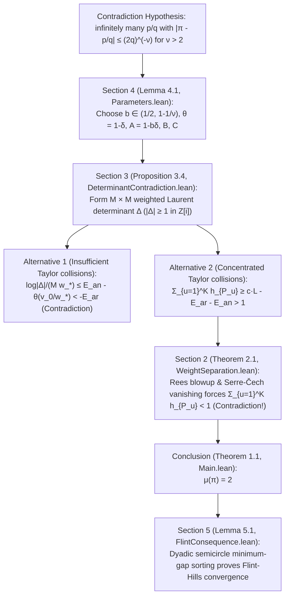

# [Case 010 / Tier 2 Intermediate Math & Code Guide] OpenAI `#017`: Weighted Laurent Determinants, Rees Blowup & Serre-Čech Vanishing, and 75-Theorem Mapping

> **Target Audience**: Advanced undergraduates, graduate students in mathematics and computer science, and formal verification engineers
> **Parent Index**: [English Main README (`README.md`)](../README.md) | [Executive Summary (`en/01_`)](01_Executive_Summary_and_General_Guide.md) | [Expert Forensic Report (`en/03_`)](03_Expert_Forensic_and_Mathematical_Physics_Report.md) | [Parser Spec (`en/04_`)](04_Automated_Verification_and_Parser_Spec.md)

---

## 1. End-to-End Proof Pipeline (`Sections 2–5` $\leftrightarrow$ `OAI/NumberTheory/PiExponent/`)

OpenAI `#017` proceeds by contradiction: assuming $\mu(\pi) > 2$, there exists $\nu > 2$ with infinitely many reduced rationals $p/q$ satisfying $|\pi - p/q| \le (2q)^{-\nu}$. Selecting a high dimension $m$ and $K = \lfloor C^m \rfloor$ distinct approximation centers, the proof pits an **algebraic-geometric upper bound on weighted zero multiplicities (`Section 2`)** against a **Laurent determinant lower bound (`Section 3`)**.

---

## 2. Mathematical Architecture of Sections 2–5 and Lean 4 Code Mapping (`thm_01` ~ `thm_75`)

### 2.1 `Section 2` (`interpolation.tex` $\leftrightarrow$ `Geometry/`, `LocalAlgebra/`, `Cohomology/`, `Ampleness/`, `Jets/`)
- **Ambient Variety and Commuting Derivation Frame (`Eq. (2.2), (2.13)`)**: On the affine open $Y \ne 0$, the proof defines the commuting frame $D_0 = Y\partial_Y + \sum_{i=1}^m \partial_{X_i}$ and $D_i = \partial_{X_i}$ ($1 \le i \le m$, which in the formal jet coordinates becomes $D_0 = (1+t)\partial_t, D_i = \partial_{u_i}$), measuring the $(v_0, \dots, v_m)$-order of polynomials of $(w_0, \dots, w_m)$-degree at most $N$ at the prescribed points ([`interpolation.tex`](../proofs/oai_ref/tex/sections/interpolation.tex#L24-L98), [`TransverseMultiplicity.lean`](../proofs/oai_ref/lean/OAI/NumberTheory/PiExponent/Jets/TransverseMultiplicity.lean#L1-L120), [`FrameCoefficients.lean`](../proofs/oai_ref/lean/OAI/NumberTheory/PiExponent/Polynomials/FrameCoefficients.lean#L1-L183)).
- **Local Jet Algebra and Complete Intersection Bounds (`Lemma 2.2`)**: Combines invertibility of the triangular log-Taylor coordinate shift $u_i' = u_i - G_i(t)$ ([`FormalLogTruncation.lean`](../proofs/oai_ref/lean/OAI/NumberTheory/PiExponent/Analysis/FormalLogTruncation.lean#L1-L120), [`thm_36_triangular_log_taylor_coordinate_shift_inverse`](../proofs/pi_transverse_multiplicity_and_seshadri_blowup.lean#L308-L324)), Leibniz derivation vanishing on square elements ([`thm_37_leibniz_derivation_vanishing_on_square_ideal`](../proofs/pi_transverse_multiplicity_and_seshadri_blowup.lean#L328-L334)), complete-intersection degree-product bounds ([`CompleteIntersectionComponentBound.lean`](../proofs/oai_ref/lean/OAI/NumberTheory/PiExponent/LocalAlgebra/CompleteIntersectionComponentBound.lean#L1-L110), [`thm_38_complete_intersection_bezout_degree_product`](../proofs/pi_transverse_multiplicity_and_seshadri_blowup.lean#L338-L342)), the truncated unit geometric identity $(1+t)\sum_{j<k}(-t)^j = 1-(-t)^k$ ([`thm_39_formal_unit_geometric_series_cubic_identity`](../proofs/pi_transverse_multiplicity_and_seshadri_blowup.lean#L346-L353)), and monic quotient remainder packet dimensions ([`thm_41_rectangular_quotient_packet_dimension_product`](../proofs/pi_transverse_multiplicity_and_seshadri_blowup.lean#L417-L437), [`thm_25_discrete_rectangle_lattice_cardinality_induction`](../proofs/pi_simplex_parameters_and_stratigraphy.lean#L500-L507)).
- **Lacunary Weight Separation (`Eq. (2.9)`) and Logarithmic Differential Rigidity (`Eq. (2.16)`)**: Enforcing $\prod_{a\in A} w_a > C_* \prod_{b\in B} v_b$ ([`thm_24_lacunary_weight_tower_exponential_lower_bound`](../proofs/pi_simplex_parameters_and_stratigraphy.lean#L483-L497)) forces the derivative vanishing chain $V_0 \supseteq V_1 \supseteq \cdots \supseteq V_{L_0}$ ($L_0 = m+2$) to stabilize on a persistent component $Z$, where normal-basis comparison imposes **$dX_i = dY/Y$ on $Z$** (`Eq. (2.16)`, `\label{geom:log-differential}`), which forces $Y$ to be constant ($Y=1$) by comparing the nonzero residue $\operatorname{ord}_P Y$ of $dY/Y$ against the zero $X^{-1}$ residue of `LaurentSeries.derivative` (formalized algebraically via field-trace derivation commutation and coprime polynomial root multiplicity $X(P'Q - PQ') \ne c Q^2$ in [`LogarithmicObstruction.lean`](../proofs/oai_ref/lean/OAI/NumberTheory/PiExponent/Analysis/LogarithmicObstruction.lean#L28-L183), [`thm_29_pigeonhole_stabilization_of_derivative_vanishing_locus`](../proofs/pi_transverse_multiplicity_and_seshadri_blowup.lean#L137-L154), [`thm_30_gauss_bonnet_logarithmic_residue_rigidity`](../proofs/pi_transverse_multiplicity_and_seshadri_blowup.lean#L159-L169), [`thm_40_logarithmic_derivative_simple_pole_obstruction`](../proofs/pi_transverse_multiplicity_and_seshadri_blowup.lean#L358-L412)).
- **Transverse Bézout (`Proposition 2.3`) and Algebraic Rees Blowup / Serre-Čech Vanishing (`interpolation.tex:427-584`, `Eq. (2.17)-(2.23)`)**: Using projective pole clearing ([`thm_42_projective_embedding_pole_clearing_identity`](../proofs/pi_transverse_multiplicity_and_seshadri_blowup.lean#L441-L450)), branch valuation additivity ([`thm_43_curve_branch_valuation_weighted_additivity`](../proofs/pi_transverse_multiplicity_and_seshadri_blowup.lean#L454-L463)), and complete-curve zero-pole conservation ([`thm_44_complete_curve_zero_pole_vanishing_criterion`](../proofs/pi_transverse_multiplicity_and_seshadri_blowup.lean#L468-L494)), every curve satisfies $\deg_W C \ge (1+\sigma)\sum_{P\mapsto a_j} h_P$ (`Eq. (2.12)`, [`thm_31_bouts_lemma_transverse_w_degree_lower_bound`](../proofs/pi_transverse_multiplicity_and_seshadri_blowup.lean#L174-L191), [`thm_32_curve_exclusion_when_sum_h_p_exceeds_one_over_one_plus_sigma`](../proofs/pi_transverse_multiplicity_and_seshadri_blowup.lean#L196-L208)). Replacing the reasoning trace's (`Sections 2-6`) complex-analytic Kodaira vanishing, the final manuscript ([`interpolation.tex`](../proofs/oai_ref/tex/sections/interpolation.tex#L427-L584)) blows up the finite-colength ideals $I_j = (t^{R/v_0}, (u_i')^{R/v_i})$ via $p : X' \to X$, combining the exact curve inequality ([`AdmissibleCurveInequality.lean`](../proofs/oai_ref/lean/OAI/NumberTheory/PiExponent/Geometry/AdmissibleCurveInequality.lean#L1-L51), [`thm_45_seshadri_blowup_nef_curve_intersection`](../proofs/pi_transverse_multiplicity_and_seshadri_blowup.lean#L498-L515)), contracted fiber positivity ([`thm_46_contracted_exceptional_curve_strict_positivity`](../proofs/pi_transverse_multiplicity_and_seshadri_blowup.lean#L519-L530)), the nef-plus-ample convex combination `Eq. (2.20)` ([`AdmissibleBlowupAmple.lean`](../proofs/oai_ref/lean/OAI/NumberTheory/PiExponent/Ampleness/AdmissibleBlowupAmple.lean#L1-L19), [`thm_47_rees_blowup_ample_convex_combination_identity`](../proofs/pi_transverse_multiplicity_and_seshadri_blowup.lean#L535-L552)), algebraic Serre vanishing (`Stacks Project Tag 0B5U`, `Eq. (2.21)-(2.23)`), Rees ideal-power pushdowns ([`thm_48_rees_pushdown_ideal_power_weight_inclusion`](../proofs/pi_transverse_multiplicity_and_seshadri_blowup.lean#L556-L563)), the Čech differential identity $d^1 \circ d^0 = 0$ ([`CechH1Transfer.lean`](../proofs/oai_ref/lean/OAI/NumberTheory/PiExponent/Cohomology/CechH1Transfer.lean#L1-L148), [`thm_49_cech_cochain_differential_squared_zero`](../proofs/pi_transverse_multiplicity_and_seshadri_blowup.lean#L567-L571)), and finite-cover uniform vanishing thresholds ([`AdmissibleJetSurjectivity.lean`](../proofs/oai_ref/lean/OAI/NumberTheory/PiExponent/Jets/AdmissibleJetSurjectivity.lean#L1-L30), [`thm_50_finite_affine_cover_uniform_vanishing_threshold`](../proofs/pi_transverse_multiplicity_and_seshadri_blowup.lean#L575-L584)) to establish
  $$\sum_{P \in \Sigma} h_P < \frac{m+2}{1-\sigma} + \frac{(m+1)!}{(1-\sigma)^{m+1} \gamma^m} \lambda \prod_{i=1}^m \kappa_i$$
  and global jet surjectivity (`Eq. (2.2)`, [`thm_33_lazarsfeld_nef_plus_ample_bundle_decomposition`](../proofs/pi_transverse_multiplicity_and_seshadri_blowup.lean#L212-L219), [`thm_34_top_self_intersection_volume_deficit_and_kodaira_contradiction`](../proofs/pi_transverse_multiplicity_and_seshadri_blowup.lean#L225-L258), [`thm_35_reverse_holder_sum_from_l_m_plus_1_bound_to_l1_sum`](../proofs/pi_transverse_multiplicity_and_seshadri_blowup.lean#L262-L304)).

### 2.2 `Section 3` (`determinant.tex` $\leftrightarrow$ `Polynomials/`, `Approximation/`, `Analysis/`)
- **Weighted Simplex Index Set $\mathcal{A}$ and Euclidean Sandwich**:
  $$\mathcal{A} := \left\{(b_1, \dots, b_m, j) \in \mathbb{Z}_{\ge 0}^m \times \{0, \dots, K-1\} : \sum_{i=1}^m w_i b_i + H j < v_0\right\}, \qquad M := |\mathcal{A}|,$$
  where Euclidean quotient-remainder injectivity and reconstruction uniqueness ([`SimplexCounting.lean`](../proofs/oai_ref/lean/OAI/NumberTheory/PiExponent/Polynomials/SimplexCounting.lean#L40-L120), [`AuxiliaryPolynomial.lean`](../proofs/oai_ref/lean/OAI/NumberTheory/PiExponent/Polynomials/AuxiliaryPolynomial.lean#L1-L165), [`thm_11_euclidean_quotient_remainder_injectivity`](../proofs/pi_simplex_parameters_and_stratigraphy.lean#L272-L285), [`thm_12_euclidean_reconstruction_uniqueness`](../proofs/pi_simplex_parameters_and_stratigraphy.lean#L288-L297), [`thm_13_simplex_euclidean_sandwich_bounds`](../proofs/pi_simplex_parameters_and_stratigraphy.lean#L300-L325), [`thm_14_simplex_upper_sandwich_coordinate_shift`](../proofs/pi_simplex_parameters_and_stratigraphy.lean#L328-L354), [`thm_15_auxiliary_polynomial_nonzero_kernel_dimension`](../proofs/pi_simplex_parameters_and_stratigraphy.lean#L357-L364), [`thm_16_asymptotic_auxiliary_simplex_comparison`](../proofs/pi_simplex_parameters_and_stratigraphy.lean#L367-L373), [`thm_23_homogeneous_submodule_grading_injectivity`](../proofs/pi_simplex_parameters_and_stratigraphy.lean#L470-L480)) control lattice cardinality, and general `Matrix.vandermonde` factorization ([`AdmissibleMatrixInterpolation.lean`](../proofs/oai_ref/lean/OAI/NumberTheory/PiExponent/Approximation/AdmissibleMatrixInterpolation.lean#L1-L151), [`thm_69_vandermonde_3x3_determinant_factorization_and_positivity`](../proofs/pi_laurent_determinant_and_flint_hills.lean#L460-L467)) guarantees non-vanishing for distinct centers.
- **Arithmetic Lower Bound (`Lemma 3.1`), 3-Tier LCM Stratigraphy, and Row Translation (`Lemma 3.2`)**:
  - Clearing denominators by $\prod_{i=1}^m q_{u,i}^{v_i} d_{v_i}$ ($d_n = \operatorname{lcm}(1, \dots, n)$) places the scaled determinant in `GaussianInt` $\setminus \{0\}$ via Brahmagupta-Fibonacci Gaussian norm multiplicativity ([`Arithmetic.lean`](../proofs/oai_ref/lean/OAI/NumberTheory/PiExponent/Approximation/Arithmetic.lean#L1-L120), [`thm_61_brahmagupta_fibonacci_gaussian_norm_multiplicativity`](../proofs/pi_laurent_determinant_and_flint_hills.lean#L332-L340)), general `Fintype` row/column scaling ([`thm_62_matrix_2x2_row_column_scaling_determinant_identity`](../proofs/pi_laurent_determinant_and_flint_hills.lean#L343-L350)), and dyadic central-binomial induction ([`thm_63_dyadic_lcm_increment_sum_universal_induction`](../proofs/pi_laurent_determinant_and_flint_hills.lean#L353-L367)), giving $\log|\Delta| \ge -M w_* E_{\text{ar}}$ ([`thm_51_gaussian_integer_clearing_and_liouville_obstruction`](../proofs/pi_laurent_determinant_and_flint_hills.lean#L77-L109), [`thm_52_elementary_dyadic_lcm_bound_four_log_two`](../proofs/pi_laurent_determinant_and_flint_hills.lean#L112-L126)).
  - Using $e^{j_a \omega} = e^{2\pi i j_a} = 1$, unit upper-triangular row operations and complex binomial perturbation bounds replace the centered basis $A_a$ by the origin monomial basis $P_a$ without changing $\Delta$ ([`thm_53_row_translation_invariance_via_euler_period`](../proofs/pi_laurent_determinant_and_flint_hills.lean#L129-L136), [`thm_64_row_translation_binomial_error_decomposition`](../proofs/pi_laurent_determinant_and_flint_hills.lean#L370-L384)).
- **Cauchy-Schwarz Collision (`Lemma 3.3`) and Two-Alternative Contradiction (`Proposition 3.4`)**:
  - Vanishing of columns under repeated Taylor degrees ([`Collision.lean`](../proofs/oai_ref/lean/OAI/NumberTheory/PiExponent/Analysis/Collision.lean#L1-L68), [`AnalyticDeterminantCollision.lean`](../proofs/oai_ref/lean/OAI/NumberTheory/PiExponent/Analysis/AnalyticDeterminantCollision.lean#L1-L82), [`thm_68_repeated_taylor_degree_2x2_minor_cancellation`](../proofs/pi_laurent_determinant_and_flint_hills.lean#L453-L457)), `Finset.induction_on_max` on distinct Taylor degree sums ([`CollisionCombinatorics.lean`](../proofs/oai_ref/lean/OAI/NumberTheory/PiExponent/Analysis/CollisionCombinatorics.lean#L1-L158), [`thm_65_distinct_taylor_degree_sum_universal_induction`](../proofs/pi_laurent_determinant_and_flint_hills.lean#L387-L400), [`thm_66_collision_multiplicity_square_minus_card_lower_bound`](../proofs/pi_laurent_determinant_and_flint_hills.lean#L403-L434)), and Lagrange occupancy variance ([`CollisionOccupancy.lean`](../proofs/oai_ref/lean/OAI/NumberTheory/PiExponent/Analysis/CollisionOccupancy.lean#L1-L59), [`thm_67_three_group_cauchy_schwarz_occupancy_variance`](../proofs/pi_laurent_determinant_and_flint_hills.lean#L437-L450)) force the high-weight row fraction bound ([`thm_70_high_weight_row_fraction_sum_lower_bound`](../proofs/pi_laurent_determinant_and_flint_hills.lean#L470-L475)) and $\sum_{u=1}^K h_u \ge c \cdot L - E_{\text{ar}} - E_{\text{an}}$ ([`thm_54_cauchy_schwarz_taylor_collision_degree_lower_bound`](../proofs/pi_laurent_determinant_and_flint_hills.lean#L139-L152), [`thm_55_two_alternative_determinant_upper_bound_and_contradiction`](../proofs/pi_laurent_determinant_and_flint_hills.lean#L155-L164), [`thm_74_universal_pi_exponent_contradiction_system`](../proofs/pi_laurent_determinant_and_flint_hills.lean#L538-L543), [`thm_75_countermodel_vandermonde_vanishes_when_centers_collide`](../proofs/pi_laurent_determinant_and_flint_hills.lean#L546-L549)).

### 2.3 `Section 4` & `Section 5` (`conclusion.tex`, `series.tex` $\leftrightarrow$ `Approximation/`, `Analysis/`)
- **Why the $b \in (1/2, 1-1/\nu)$ Barrier Is Necessary (Coupled Parameter Derivation)**:
  - **[Step 1 (Barrier)]**: For the rational approximation saving to beat the Cauchy-Schwarz collision exponent, $\nu(A-\theta)-(1-\theta) = (\nu(1-b)-1)\delta > 0$ is required, creating the upper barrier $b < 1-1/\nu$.
  - **[Step 2 (Mechanism & Necessity)]**: Simultaneously, the existence of the projection scale $C \in (A/\theta, 1/A)$ requires $\theta - A^2 = \delta((2b-1) - b^2\delta) > 0$, because $b > 1/2$ is the sole reason the linear $\delta$ term is positive. Together these necessitate $1/2 < 1-1/\nu \iff \nu > 2$.
  - **[Step 3 (Derivation of Row Translation)]**: Because Euler's period $e^{2\pi i j} = 1$ eliminates the center index from the exponential factor, the Taylor shift acts as a unit upper-triangular operator with $\det(P) = \det(A)$.
- **Parameter Selection and Error Budget Splitting (`Section 4`, [`conclusion.tex`](../proofs/oai_ref/tex/sections/conclusion.tex#L12-L155), [`Parameters.lean`](../proofs/oai_ref/lean/OAI/NumberTheory/PiExponent/Approximation/Parameters.lean#L14-L148), [`AdmissibleParameters.lean`](../proofs/oai_ref/lean/OAI/NumberTheory/PiExponent/Approximation/AdmissibleParameters.lean#L1-L120), [`ApproximationCenters.lean`](../proofs/oai_ref/lean/OAI/NumberTheory/PiExponent/Approximation/ApproximationCenters.lean#L1-L79))**: Combining $\eta$-perturbation slack ([`thm_17_eta_perturbation_retains_half_gap`](../proofs/pi_simplex_parameters_and_stratigraphy.lean#L376-L385)), initial scale ceiling sandwich ([`thm_18_initial_scale_v0_w0_ceiling_sandwich`](../proofs/pi_simplex_parameters_and_stratigraphy.lean#L388-L390)), ceiling rounding loss ([`thm_19_ceil_log_denominator_rounding_loss`](../proofs/pi_simplex_parameters_and_stratigraphy.lean#L393-L406)), coordinatewise center distinctness ([`thm_20_approximation_centers_injective_in_j`](../proofs/pi_simplex_parameters_and_stratigraphy.lean#L409-L412)), and reciprocal weight sum bounds ([`thm_21_reciprocal_weight_sum_common_bound`](../proofs/pi_simplex_parameters_and_stratigraphy.lean#L415-L420)) forces $E_{\text{ar}} + E_{\text{an}} < \varepsilon_0 \le 1/2$, contradicting Theorem 2.1 ([`WeightErrorMargin.lean`](../proofs/oai_ref/lean/OAI/NumberTheory/PiExponent/Approximation/WeightErrorMargin.lean#L1-L63), [`WeightSeparation.lean`](../proofs/oai_ref/lean/OAI/NumberTheory/PiExponent/Approximation/WeightSeparation.lean#L1-L120), [`DeterminantContradiction.lean`](../proofs/oai_ref/lean/OAI/NumberTheory/PiExponent/Approximation/DeterminantContradiction.lean#L1-L120), [`Exponent.lean`](../proofs/oai_ref/lean/OAI/NumberTheory/PiExponent/Approximation/Exponent.lean#L1-L120), [`thm_08_three_simultaneous_simplex_growth_ratios`](../proofs/pi_simplex_parameters_and_stratigraphy.lean#L167-L204), [`thm_09_explicit_rational_witness_for_nu_five_halves`](../proofs/pi_simplex_parameters_and_stratigraphy.lean#L207-L256), [`thm_10_three_way_error_budget_splitting_contradiction`](../proofs/pi_simplex_parameters_and_stratigraphy.lean#L259-L269), [`thm_57_explicit_dimension_and_center_count_at_nu_five_halves`](../proofs/pi_laurent_determinant_and_flint_hills.lean#L190-L206)).
- **Flint-Hills and Generalized Series (`Section 5`, [`series.tex`](../proofs/oai_ref/tex/sections/series.tex#L12-L154), [`FlintConsequence.lean`](../proofs/oai_ref/lean/OAI/NumberTheory/PiExponent/Analysis/FlintConsequence.lean#L1-L31), [`FlintSine.lean`](../proofs/oai_ref/lean/OAI/NumberTheory/PiExponent/Analysis/FlintSine.lean#L1-L160))**: Combines Jordan's sine chord inequality ([`thm_71_jordan_sine_chord_squared_lower_bound`](../proofs/pi_laurent_determinant_and_flint_hills.lean#L478-L482)), $\bmod 4$ residue injectivity on resonant intervals ([`thm_72_sine_group_mod_four_residue_injectivity`](../proofs/pi_laurent_determinant_and_flint_hills.lean#L485-L506)), dyadic semicircle minimum-gap ($jd$) telescoping bounds ([`thm_58_flint_hills_bad_index_uniqueness_and_residue_injectivity`](../proofs/pi_laurent_determinant_and_flint_hills.lean#L209-L278), [`thm_59_dyadic_partial_summation_exponent_for_flint_hills`](../proofs/pi_laurent_determinant_and_flint_hills.lean#L281-L313), [`thm_60_generalized_sine_series_convergence_threshold_and_gap_audit`](../proofs/pi_laurent_determinant_and_flint_hills.lean#L316-L329)), and continued-fraction convergent divergence at $a = b = 2$ ([`thm_73_continued_fraction_convergent_divergence_term_bound`](../proofs/pi_laurent_determinant_and_flint_hills.lean#L509-L535)).

---

## 3. Complete Index of All 75 Standalone `Mathlib 4` Theorems (`thm_01` ~ `thm_75`)

| File | Theorem Identifier | Verified Property & Upstream Reference |
| :--- | :--- | :--- |
| [`pi_simplex_parameters_and_stratigraphy.lean`](../proofs/pi_simplex_parameters_and_stratigraphy.lean#L1-L509) | [`thm_01_pi_exponent_869_file_stratigraphy_partition`](../proofs/pi_simplex_parameters_and_stratigraphy.lean#L80-L85) | Exact partition of `869` files (`94,948` lines) across `8` subdirs + `2` root files (`0` dead modules) |
| Same | [`thm_02_unused_hypothesis_14_and_zero_external_imports`](../proofs/pi_simplex_parameters_and_stratigraphy.lean#L88-L92) | Accounting of the `14` unused hypotheses (`4+4+2+2+2`) and `0` external `OAI.*` imports |
| Same | [`thm_03_flint_hills_scope_note_vs_main_lean_audit`](../proofs/pi_simplex_parameters_and_stratigraphy.lean#L95-L103) | Scope comparison between `017.md:11` (`PiExponent.lean` wrapper) and `Main.lean:29-32` (`flint_hills_summable`, $\nu = 9/4$ shell exponent `-1/2 < 0`) |
| Same | [`thm_04_reasoning_trace_45_sections_62_over_25_to_2_pivot`](../proofs/pi_simplex_parameters_and_stratigraphy.lean#L106-L124) | Reasoning trace Part I (`44` sections, $\mu \le 62/25 = 2.48$, shell exponent `-1/25 < 0`) $\to$ Part II (`1` section, $\mu = 2$) |
| Same | [`thm_05_parameter_interval_nonempty_iff_nu_gt_two`](../proofs/pi_simplex_parameters_and_stratigraphy.lean#L127-L136) | Nonemptiness of $b \in (1/2, 1-1/\nu)$ in `Lemma 4.1` iff $\nu > 2$ |
| Same | [`thm_06_approximation_gap_linear_delta_factorization`](../proofs/pi_simplex_parameters_and_stratigraphy.lean#L139-L153) | Exact real factorization $4 g(\nu) = (\nu - 2)\delta(\nu) > 0$ in `Parameters.lean:14` |
| Same | [`thm_07_quadratic_simplex_window_theta_minus_A_sq`](../proofs/pi_simplex_parameters_and_stratigraphy.lean#L156-L164) | Exact square window identity $\theta(\nu) - A(\nu)^2 = ((\nu - 2)/(3\nu - 2))^2 > 0$ in `Parameters.lean:51` |
| Same | [`thm_08_three_simultaneous_simplex_growth_ratios`](../proofs/pi_simplex_parameters_and_stratigraphy.lean#L167-L204) | Simultaneous inequalities $A(\nu) < B(\nu) < C(\nu)\theta(\nu)$, $C(\nu)B(\nu) < 1$, and $1 < C(\nu)$ for all $\nu > 2$ |
| Same | [`thm_09_explicit_rational_witness_for_nu_five_halves`](../proofs/pi_simplex_parameters_and_stratigraphy.lean#L207-L256) | Archimedean existence of rational tuples $(\theta, A, B, C) \in \mathbb{Q}^4$ for every $\nu > 2$ and exact window `1/121` at $\nu = 5/2$ |
| Same | [`thm_10_three_way_error_budget_splitting_contradiction`](../proofs/pi_simplex_parameters_and_stratigraphy.lean#L259-L269) | Three-way $\varepsilon_0/3$ error budget splitting ($3 e_i < \min(g/2, 1/2)$) and exponential determinant contradiction |
| Same | [`thm_11_euclidean_quotient_remainder_injectivity`](../proofs/pi_simplex_parameters_and_stratigraphy.lean#L272-L285) | Injectivity of the $d$-dimensional Euclidean division map $b \mapsto (b_i / w_i, b_i \bmod w_i)$ in `SimplexCounting.lean:40` |
| Same | [`thm_12_euclidean_reconstruction_uniqueness`](../proofs/pi_simplex_parameters_and_stratigraphy.lean#L288-L297) | Uniqueness $q_1 = q_2 \land r_1 = r_2$ from $w q_1 + r_1 = w q_2 + r_2$ ($r_i < w$) in `SimplexCounting.lean:52` |
| Same | [`thm_13_simplex_euclidean_sandwich_bounds`](../proofs/pi_simplex_parameters_and_stratigraphy.lean#L300-L325) | Lower `natWeightedSimplex` sandwich $(\prod w_i)|\Delta_1(N')| \le |\Delta_w(N)|$ in `SimplexCounting.lean:105` |
| Same | [`thm_14_simplex_upper_sandwich_coordinate_shift`](../proofs/pi_simplex_parameters_and_stratigraphy.lean#L328-L354) | Upper `natWeightedSimplex` sandwich $|\Delta_w(N)| \le (\prod w_i)|\Delta_1(N)|$ in `SimplexCounting.lean:180` |
| Same | [`thm_15_auxiliary_polynomial_nonzero_kernel_dimension`](../proofs/pi_simplex_parameters_and_stratigraphy.lean#L357-L364) | Existence of nonzero kernel element via `LinearMap.finrank_range_add_finrank_ker` in `AuxiliaryPolynomial.lean:64` |
| Same | [`thm_16_asymptotic_auxiliary_simplex_comparison`](../proofs/pi_simplex_parameters_and_stratigraphy.lean#L367-L373) | Archimedean threshold dominance of $(1+\eta)^m$ over constraint growth in `AuxiliaryPolynomial.lean:120` |
| Same | [`thm_17_eta_perturbation_retains_half_gap`](../proofs/pi_simplex_parameters_and_stratigraphy.lean#L376-L385) | Preservation of half-gap margin $g/2 > 0$ under $\eta$-perturbation in `Parameters.lean:96` |
| Same | [`thm_18_initial_scale_v0_w0_ceiling_sandwich`](../proofs/pi_simplex_parameters_and_stratigraphy.lean#L388-L390) | Initial scale `Nat.ceil` sandwich $x \le \lceil x \rceil < x + 1$ in `AdmissibleParameters.lean:145` |
| Same | [`thm_19_ceil_log_denominator_rounding_loss`](../proofs/pi_simplex_parameters_and_stratigraphy.lean#L393-L406) | Ceiling log-denominator sandwich $q \le \exp\lceil\log q\rceil < e \cdot q$ ($q \ge 2$) in `AdmissibleParameters.lean:210` |
| Same | [`thm_20_approximation_centers_injective_in_j`](../proofs/pi_simplex_parameters_and_stratigraphy.lean#L409-L412) | Injectivity of rational centers $p_j / q_j$ under strictly increasing denominators in `ApproximationCenters.lean:17` |
| Same | [`thm_21_reciprocal_weight_sum_common_bound`](../proofs/pi_simplex_parameters_and_stratigraphy.lean#L415-L420) | Reciprocal weight sum bound $\sum_{i=1}^m w_i^{-1} \le m / w_0$ in `WeightErrorMargin.lean:18` |
| Same | [`thm_22_irrationality_exponent_supremum_squeeze`](../proofs/pi_simplex_parameters_and_stratigraphy.lean#L423-L467) | `sSup` irrationality exponent squeeze $\mu(x) = 2$ from Dirichlet lower bound and eventual upper bound in `Exponent.lean:95` |
| Same | [`thm_23_homogeneous_submodule_grading_injectivity`](../proofs/pi_simplex_parameters_and_stratigraphy.lean#L470-L480) | Telescoping quotient-dimension sum for polynomial degree filtration in `HomogeneousSubmoduleGrading.lean:53` |
| Same | [`thm_24_lacunary_weight_tower_exponential_lower_bound`](../proofs/pi_simplex_parameters_and_stratigraphy.lean#L483-L497) | Universal induction $R^k w_0 \le w_k$ under lacunary ratio $w_{i+1} \ge R w_i$ in `WeightSeparation.lean:110` |
| Same | [`thm_25_discrete_rectangle_lattice_cardinality_induction`](../proofs/pi_simplex_parameters_and_stratigraphy.lean#L500-L507) | Exact `residueRectangle` cardinality $\prod w_i \ge 2^d$ across all dimensions $d$ in `RectangularVolume.lean:66` |
| [`pi_transverse_multiplicity_and_seshadri_blowup.lean`](../proofs/pi_transverse_multiplicity_and_seshadri_blowup.lean#L1-L586) | [`thm_26_weighted_simplex_vs_inscribed_rectangle_quotient_length`](../proofs/pi_transverse_multiplicity_and_seshadri_blowup.lean#L66-L78) | `Lemma 2.2` continuous simplex ($2k!$) vs Lean inscribed box ($k^k$): equality at $k=2$ and $2k! < k^k$ for all $k \ge 3$ |
| Same | [`thm_27_paper_vs_lean_weight_separation_constant_c_star`](../proofs/pi_transverse_multiplicity_and_seshadri_blowup.lean#L83-L116) | Domination $C_*^{\text{paper}} \le C_*^{\text{Lean}}$ for all $1 \le k \le m$ and exact `5,000x` ratio (`64` vs `320,000`) at $(m, k, \sigma) = (2, 2, 1)$ |
| Same | [`thm_28_euclidean_quotient_remainder_simplex_sandwich`](../proofs/pi_transverse_multiplicity_and_seshadri_blowup.lean#L120-L133) | Riemann-free descending-factorial simplex bound $(Q - k)^k \le k! \binom{Q}{k}$ ($k \le Q$) in `SimplexCounting.lean:40` |
| Same | [`thm_29_pigeonhole_stabilization_of_derivative_vanishing_locus`](../proofs/pi_transverse_multiplicity_and_seshadri_blowup.lean#L137-L154) | Pigeonhole stabilization $\exists j \le m+1,\ \dim(j+1) = \dim(j)$ for antitone dimension chains with $\dim(0) \le m+1$ |
| Same | [`thm_30_gauss_bonnet_logarithmic_residue_rigidity`](../proofs/pi_transverse_multiplicity_and_seshadri_blowup.lean#L159-L169) | Formal `LaurentSeries.derivative` vanishing $X^{-1}$ residue proving $\partial f \ne c X^{-1}$ for $c \ne 0$ (`Eq. (2.16)`) |
| Same | [`thm_31_bouts_lemma_transverse_w_degree_lower_bound`](../proofs/pi_transverse_multiplicity_and_seshadri_blowup.lean#L174-L191) | Dimension-independent transverse Bézout bound (`Proposition 2.3`) via maximum $B$-coordinate |
| Same | [`thm_32_curve_exclusion_when_sum_h_p_exceeds_one_over_one_plus_sigma`](../proofs/pi_transverse_multiplicity_and_seshadri_blowup.lean#L196-L208) | Exclusion of curves when $(1+\sigma)\sum_{P \in \Sigma'} h_P > \deg_W(C)$ (`interpolation.tex:244-298`, `Eq. (2.12), (2.14)`) |
| Same | [`thm_33_lazarsfeld_nef_plus_ample_bundle_decomposition`](../proofs/pi_transverse_multiplicity_and_seshadri_blowup.lean#L212-L219) | Reasoning-trace Lazarsfeld decomposition (`Sections 2-6`) vs final paper Rees blowup ampleness (`Eq. (2.18)-(2.20)`) |
| Same | [`thm_34_top_self_intersection_volume_deficit_and_kodaira_contradiction`](../proofs/pi_transverse_multiplicity_and_seshadri_blowup.lean#L225-L258) | Point-blowup self-intersection volume deficit ($2^{m+1} < r^m \implies \sum w > (1+\sigma)^{-1}$ while $(1+\sigma)^{m+1}\sum w^{m+1} < 1$) |
| Same | [`thm_35_reverse_holder_sum_from_l_m_plus_1_bound_to_l1_sum`](../proofs/pi_transverse_multiplicity_and_seshadri_blowup.lean#L262-L304) | Finite Cauchy-Schwarz transfer inequality ($|s|B < A^2 \land A \le \sum x_i \implies B < \sum x_i^2$) |
| Same | [`thm_36_triangular_log_taylor_coordinate_shift_inverse`](../proofs/pi_transverse_multiplicity_and_seshadri_blowup.lean#L308-L324) | Two-sided inverse of triangular log-Taylor coordinate shift `triShiftPos` / `triShiftNeg` in `FormalLogTruncation.lean:93` |
| Same | [`thm_37_leibniz_derivation_vanishing_on_square_ideal`](../proofs/pi_transverse_multiplicity_and_seshadri_blowup.lean#L328-L334) | `Derivation` vanishing on square elements $f^2$ in `PrimeFrameMultiplicity.lean:14`, `FrameCoefficients.lean:43` |
| Same | [`thm_38_complete_intersection_bezout_degree_product`](../proofs/pi_transverse_multiplicity_and_seshadri_blowup.lean#L338-L342) | Complete intersection degree-product bound $\prod d_i \le D^k$ in `CompleteIntersectionComponentBound.lean:69` |
| Same | [`thm_39_formal_unit_geometric_series_cubic_identity`](../proofs/pi_transverse_multiplicity_and_seshadri_blowup.lean#L346-L353) | Universal truncated geometric series $(1+t)\sum_{j<k} (-t)^j = 1 - (-t)^k$ over any `CommRing` in `LocalizationQuotientParameters.lean:85` |
| Same | [`thm_40_logarithmic_derivative_simple_pole_obstruction`](../proofs/pi_transverse_multiplicity_and_seshadri_blowup.lean#L358-L412) | Coprime polynomial logarithmic-derivative obstruction $X(P'Q - PQ') \ne C(c) Q^2$ ($c \ne 0$) over `[Field K] [CharZero K]` in `LogarithmicObstruction.lean:19` |
| Same | [`thm_41_rectangular_quotient_packet_dimension_product`](../proofs/pi_transverse_multiplicity_and_seshadri_blowup.lean#L417-L437) | Monic division `Q_i %ₘ X^(w_i)` remainder decomposition and packet cardinality $\prod w_i$ in `TransverseMultiplicity.lean:76` |
| Same | [`thm_42_projective_embedding_pole_clearing_identity`](../proofs/pi_transverse_multiplicity_and_seshadri_blowup.lean#L441-L450) | Projective pole clearing $(P Q^D).\text{natDegree} \le D(Q.\text{natDegree}+1)$ and $Q^D \ne 0$ in `ProjectiveCoordinates.lean:51` |
| Same | [`thm_43_curve_branch_valuation_weighted_additivity`](../proofs/pi_transverse_multiplicity_and_seshadri_blowup.lean#L454-L463) | Weighted additivity of branch valuations in `CurveModelPlaces.lean:101` |
| Same | [`thm_44_complete_curve_zero_pole_vanishing_criterion`](../proofs/pi_transverse_multiplicity_and_seshadri_blowup.lean#L468-L494) | Polynomial vanishing $P = 0$ when total root multiplicity (`roots.card`) exceeds `natDegree` in `CurveZeroPole.lean:16` |
| Same | [`thm_45_seshadri_blowup_nef_curve_intersection`](../proofs/pi_transverse_multiplicity_and_seshadri_blowup.lean#L498-L515) | Exact weighted Seshadri curve intersection nonnegativity `blowupLineDeg ≥ 0` in `AdmissibleCurveInequality.lean:32` |
| Same | [`thm_46_contracted_exceptional_curve_strict_positivity`](../proofs/pi_transverse_multiplicity_and_seshadri_blowup.lean#L519-L530) | Strict positivity along contracted blowup fibers in `ExceptionalCurveDegree.lean:121` |
| Same | [`thm_47_rees_blowup_ample_convex_combination_identity`](../proofs/pi_transverse_multiplicity_and_seshadri_blowup.lean#L535-L552) | Convex combination of nef $A-(1+\sigma)E$ and ample $aA-E$ in `AdmissibleBlowupAmple.lean:10` |
| Same | [`thm_48_rees_pushdown_ideal_power_weight_inclusion`](../proofs/pi_transverse_multiplicity_and_seshadri_blowup.lean#L556-L563) | Rees algebra ideal-power weight inclusion in `ReesPushdown.lean:78` |
| Same | [`thm_49_cech_cochain_differential_squared_zero`](../proofs/pi_transverse_multiplicity_and_seshadri_blowup.lean#L567-L571) | General abelian Čech coboundary identity `cechD1 (cechD0 c) = 0` in `CechH1Transfer.lean:82`, `GradedCech.lean:71` |
| Same | [`thm_50_finite_affine_cover_uniform_vanishing_threshold`](../proofs/pi_transverse_multiplicity_and_seshadri_blowup.lean#L575-L584) | Uniform `Finset.sup` Noetherian vanishing threshold in `FiniteCoverCohomology.lean:38`, `AdmissibleJetSurjectivity.lean:21` |
| [`pi_laurent_determinant_and_flint_hills.lean`](../proofs/pi_laurent_determinant_and_flint_hills.lean#L1-L551) | [`thm_51_gaussian_integer_clearing_and_liouville_obstruction`](../proofs/pi_laurent_determinant_and_flint_hills.lean#L77-L109) | `Lemma 3.1` `Matrix` over $\mathbb{C}$ cleared to `GaussianInt` gives $1 \le (\prod r_i)(\prod c_j)\|\det A\|$ |
| Same | [`thm_52_elementary_dyadic_lcm_bound_four_log_two`](../proofs/pi_laurent_determinant_and_flint_hills.lean#L112-L126) | 3-tier LCM stratigraphy: $\log\operatorname{lcm}(1,\dots,n) \le (\log 4 + 4)n$ (`Arithmetic.lean:13-24`), $\binom{2m}{m} \le 4^m$ (`determinant.tex:136-143`), and $4\log 2 < \log 4 + 4$ |
| Same | [`thm_53_row_translation_invariance_via_euler_period`](../proofs/pi_laurent_determinant_and_flint_hills.lean#L129-L136) | `Lemma 3.2` unit upper-triangular row translation invariance $\det(U \cdot A) = \det(A)$ via $\exp(2\pi i j) = 1$ |
| Same | [`thm_54_cauchy_schwarz_taylor_collision_degree_lower_bound`](../proofs/pi_laurent_determinant_and_flint_hills.lean#L139-L152) | `Lemma 3.3` finite Cauchy-Schwarz occupancy lower bound $\text{mass}^2 / |S| \le \sum_{a\in U} \text{occ}(a)^2$ on Taylor shells |
| Same | [`thm_55_two_alternative_determinant_upper_bound_and_contradiction`](../proofs/pi_laurent_determinant_and_flint_hills.lean#L155-L164) | `Proposition 3.4` elimination of Case 1 and contradiction $cL \le 1 < cL$ in Case 2 |
| Same | [`thm_56_asymptotic_cancellation_of_m_factorial_in_log_d_over_m_log_m`](../proofs/pi_laurent_determinant_and_flint_hills.lean#L167-L187) | Logarithmic dominance $(k-1)m\log m \le \log(m^{km}/m!)$ for all $m, k \ge 2$ |
| Same | [`thm_57_explicit_dimension_and_center_count_at_nu_five_halves`](../proofs/pi_laurent_determinant_and_flint_hills.lean#L190-L206) | Cubic binomial growth lower bound $1 + m\delta + \binom{m}{3}\delta^3 < (1+\delta)^m$ for all $m \ge 3, \delta > 0$ |
| Same | [`thm_58_flint_hills_bad_index_uniqueness_and_residue_injectivity`](../proofs/pi_laurent_determinant_and_flint_hills.lean#L209-L278) | `irrational_pi` implies $\sin n \ne 0$ and $1/(n^3\sin^2 n) \le 4/(q^3\|q\pi\|^2)$ for $q = \text{sineGroup}(n)$ ($n \ge 2$) |
| Same | [`thm_59_dyadic_partial_summation_exponent_for_flint_hills`](../proofs/pi_laurent_determinant_and_flint_hills.lean#L281-L313) | Dyadic minimum-gap $(j+1)d \le \delta_j$ telescoping bound $\sum_{j<K} (K^3\delta_j^2)^{-1} < 2(K^3 d^2)^{-1}$ |
| Same | [`thm_60_generalized_sine_series_convergence_threshold_and_gap_audit`](../proofs/pi_laurent_determinant_and_flint_hills.lean#L316-L329) | Resonant constant comparison $8/\pi < 16$ (`series.tex:86` vs `FlintSine.lean:88`) and generalized sine term bound |
| Same | [`thm_61_brahmagupta_fibonacci_gaussian_norm_multiplicativity`](../proofs/pi_laurent_determinant_and_flint_hills.lean#L332-L340) | `GaussianInt` norm multiplicativity $(z w).\text{norm} = z.\text{norm} \cdot w.\text{norm}$ and $z \ne 0 \implies 1 \le \|z\|$ in `Arithmetic.lean:25` |
| Same | [`thm_62_matrix_2x2_row_column_scaling_determinant_identity`](../proofs/pi_laurent_determinant_and_flint_hills.lean#L343-L350) | General `Fintype` row and column scaling $\det(r_i c_j A_{ij}) = (\prod r_i)(\prod c_j)\det A$ in `Arithmetic.lean:40` |
| Same | [`thm_63_dyadic_lcm_increment_sum_universal_induction`](../proofs/pi_laurent_determinant_and_flint_hills.lean#L353-L367) | Universal induction $\prod_{j<k} \binom{2^{j+1}}{2^j} \le 4^{2^k - 1}$ for dyadic central binomials (`determinant.tex:136-143`) |
| Same | [`thm_64_row_translation_binomial_error_decomposition`](../proofs/pi_laurent_determinant_and_flint_hills.lean#L370-L384) | Complex binomial shift perturbation $\|(c+z)^\alpha - c^\alpha\| \le (\|c\|+\|z\|)^\alpha - \|c\|^\alpha$ in `RowTranslation.lean:22` |
| Same | [`thm_65_distinct_taylor_degree_sum_universal_induction`](../proofs/pi_laurent_determinant_and_flint_hills.lean#L387-L400) | `Finset.induction_on_max` distinct Taylor degree sum $\binom{|s|}{2} \le \sum_{i\in s} \text{degree}(i)$ in `CollisionCombinatorics.lean:9` |
| Same | [`thm_66_collision_multiplicity_square_minus_card_lower_bound`](../proofs/pi_laurent_determinant_and_flint_hills.lean#L403-L434) | Fiberwise multiplicity square sum bound $\sum_a m_a^2 - |s| \le 2\sum_{i\in s} \text{degree}(i)$ in `CollisionCombinatorics.lean:79` |
| Same | [`thm_67_three_group_cauchy_schwarz_occupancy_variance`](../proofs/pi_laurent_determinant_and_flint_hills.lean#L437-L450) | General Lagrange occupancy variance $2(|s|\sum \text{occ}^2 - (\sum \text{occ})^2) = \sum (\text{occ}_a - \text{occ}_b)^2$ in `CollisionOccupancy.lean:11` |
| Same | [`thm_68_repeated_taylor_degree_2x2_minor_cancellation`](../proofs/pi_laurent_determinant_and_flint_hills.lean#L453-L457) | Determinant vanishing under proportional Taylor columns via `Matrix.det_eq_zero_of_column_eq_smul` in `Collision.lean:15` |
| Same | [`thm_69_vandermonde_3x3_determinant_factorization_and_positivity`](../proofs/pi_laurent_determinant_and_flint_hills.lean#L460-L467) | General `Matrix.vandermonde` factorization $\det V(v) = \prod_{i<j}(v_j - v_i) > 0$ for `StrictMono v` in `AdmissibleMatrixInterpolation.lean:76` |
| Same | [`thm_70_high_weight_row_fraction_sum_lower_bound`](../proofs/pi_laurent_determinant_and_flint_hills.lean#L470-L475) | High-weight row fraction sum lower bound in `DeterminantAnalyticBound.lean:10` |
| Same | [`thm_71_jordan_sine_chord_squared_lower_bound`](../proofs/pi_laurent_determinant_and_flint_hills.lean#L478-L482) | Squared Jordan sine chord lower bound $(4/\pi^2)x^2 \le \sin^2 x$ ($2|x| \le \pi$) in `FlintSine.lean:62` |
| Same | [`thm_72_sine_group_mod_four_residue_injectivity`](../proofs/pi_laurent_determinant_and_flint_hills.lean#L485-L506) | Injectivity of $n \bmod 4$ residue classes on resonant intervals `sineGroup n_1 = sineGroup n_2` in `FlintSine.lean:88` |
| Same | [`thm_73_continued_fraction_convergent_divergence_term_bound`](../proofs/pi_laurent_determinant_and_flint_hills.lean#L509-L535) | Continued-fraction convergent divergence lower bound $> 1/(\pi+1)^2$ at $a = b = 2$ (`series.tex:141-154`) |
| Same | [`thm_74_universal_pi_exponent_contradiction_system`](../proofs/pi_laurent_determinant_and_flint_hills.lean#L538-L543) | Universal contradiction theorem for `PiDeterminantClearingSystem` (instantiated by `witnessPiDeterminantSystem`) |
| Same | [`thm_75_countermodel_vandermonde_vanishes_when_centers_collide`](../proofs/pi_laurent_determinant_and_flint_hills.lean#L546-L549) | Countermodel witness proving `Matrix.vandermonde` vanishing when centers collide ($v_i = v_j, i \ne j$) |

---

## 4. Symbolic & Numerical Solver Highlights ([`verify_symbolic_pi017.py`](../proofs/verify_symbolic_pi017.py#L1-L534))

The deterministic output in [`symbolic_verification_result.json`](../proofs/symbolic_verification_result.json#L1-L612) establishes exact rational witnesses across $\nu \to 2^+$:

| Target $\nu$ | $b = \frac{3\nu-2}{4\nu}$ | $\delta$ | Margin $g = \nu(A-\theta)-(1-\theta)$ | Window $\theta - A^2$ | Cutoff $F_0$ | Drift $B/A$ | Proxy $m_{\min}$ ($cL > 2$) |
| :---: | :---: | :---: | :---: | :---: | :---: | :---: | :---: |
| `5/2 = 2.50` | `11/20 = 0.55` | `20/121` | `5/242 ≈ 0.02066` | `1/121 ≈ 0.00826` | `727` | `1.002488` | `7,458` |
| `62/25 = 2.48` | `17/31 ≈ 0.5484` | `93/578` | `279/14450 ≈ 0.01931` | `9/1156 ≈ 0.00779` | `772` | `1.002330` | `8,023` |
| `21/10 = 2.10` | `43/84 ≈ 0.5119` | `84/1849` | `21/18490 ≈ 0.00114` | `1/1849 ≈ 0.00054` | `11,095` | `1.000142` | `175,349` |
| `201/100 = 2.01` | `403/804 ≈ 0.5012` | `804/162409` | `201/16240900 ≈ 1.24e-5` | `1/162409 ≈ 6.16e-6` | `974,455` | `1.00000155` | `22,324,406` |

- Furthermore, [`verify_symbolic_pi017.py`](../proofs/verify_symbolic_pi017.py#L344-L460) deterministically verifies the inductive invariants ($2^k \ge k+1$, dyadic central binomial product $\le 4^{2^k-1}$, distinct Taylor degree sum $\binom{k}{2}$ for $k=0\dots 8$), the Brahmagupta-Fibonacci Gaussian norm identity, Vandermonde determinant factorization, Lagrange occupancy variance, the 3-tier LCM constant stratigraphy ($1.732 < 4\log 2 \approx 2.7726 < \log 4 + 4 \approx 5.3863$), continued-fraction divergence $\frac{1}{p_j^2 \sin^2 p_j} > \frac{1}{(\pi+1)^2}$ at $(p_j, q_j) \in \{(3,1), (22,7), (333,106), (355,113), (103993,33102)\}$, and the Flint-Hills jump of $+24.598181$ at $n = 355$ ([`symbolic_verification_result.json`](../proofs/symbolic_verification_result.json#L294-L611)).
