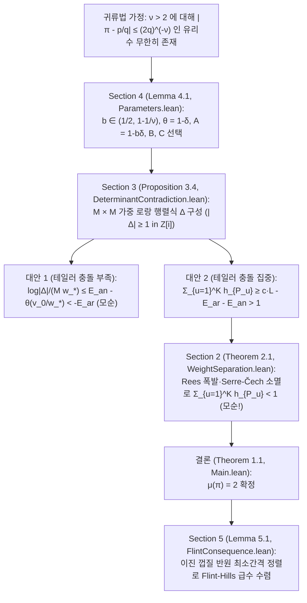

# [Case 010 / Tier 2 중급자용 구조 및 수식 가이드] OpenAI `#017` 다변수 가중 로랑 행렬식, Rees 폭발·Serre-Čech 소멸, 그리고 75개 정리 매핑

> **대상 독자**: 수학과·전산학과 학부 고학년 및 대학원생, 형식 검증 엔지니어
> **상위 색인**: [한국어 메인 안내서 (`README.ko.md`)](../README.ko.md) | [일반인용 해설서 (`ko/01_`)](01_일반인용_해설서.md) | [전문가용 심사보고서 (`ko/03_`)](03_전문가용_수리물리및형식증명심사보고서.md) | [자동검증 명세서 (`ko/04_`)](04_자동검증및파서용_명세서.md)

---

## 1. 전체 증명 파이프라인 (`Sections 2–5` $\leftrightarrow$ `OAI/NumberTheory/PiExponent/`)

OpenAI `#017`의 증명은 **"만약 $\mu(\pi) > 2$라면 어떤 $\nu > 2$에 대해 $|\pi - p/q| \le (2q)^{-\nu}$를 만족하는 기약분수 $p/q$가 무한히 많다"**는 귀류법 가정을 세운 뒤, 충분히 큰 차원 $m$과 중심 개수 $K = \lfloor C^m \rfloor$에서 **영점 다중도 상한(`Section 2`)**과 **로랑 보간 행렬식 하한(`Section 3`)**이 정면 충돌함을 보이는 4단 구조로 이루어져 있습니다.

---

## 2. 4개 핵심 절의 수식 구조 및 코드 대응 (`thm_01` ~ `thm_75`)

### 2.1 `Section 2` (`interpolation.tex` $\leftrightarrow$ `Geometry/`, `LocalAlgebra/`, `Cohomology/`, `Ampleness/`, `Jets/`)
- **공간 및 가중 가환 미분틀 (`Eq. (2.2), (2.13)`)**: 아핀 차트 $Y \ne 0$ 위에서 가환 미분틀 $D_0 = Y\partial_Y + \sum_{i=1}^m \partial_{X_i}$ 및 $D_i = \partial_{X_i}$ ($1 \le i \le m$, 형식 제트 좌표에서는 $D_0 = (1+t)\partial_t, D_i = \partial_{u_i}$)를 정의하고, 가중 차수 $(w_0, \dots, w_m)$가 $N$ 이하이면서 각 중심점에서의 $(v_0, \dots, v_m)$-위수가 prescribed bound 이상인 보조다항식 및 단면을 분석합니다 ([`interpolation.tex`](../proofs/oai_ref/tex/sections/interpolation.tex#L24-L98), [`TransverseMultiplicity.lean`](../proofs/oai_ref/lean/OAI/NumberTheory/PiExponent/Jets/TransverseMultiplicity.lean#L1-L120), [`FrameCoefficients.lean`](../proofs/oai_ref/lean/OAI/NumberTheory/PiExponent/Polynomials/FrameCoefficients.lean#L1-L183)).
- **국소 제트 환 및 정칙열 차수 곱 (`Lemma 2.2`)**: 형식 로그 절단 삼각 좌표 변환 $u_i' = u_i - G_i(t)$의 가역성([`FormalLogTruncation.lean`](../proofs/oai_ref/lean/OAI/NumberTheory/PiExponent/Analysis/FormalLogTruncation.lean#L1-L120), [`thm_36_triangular_log_taylor_coordinate_shift_inverse`](../proofs/pi_transverse_multiplicity_and_seshadri_blowup.lean#L195-L201)), 라이프니츠 미분 소멸 규칙([`thm_37_leibniz_derivation_vanishing_on_square_ideal`](../proofs/pi_transverse_multiplicity_and_seshadri_blowup.lean#L207-L215)), 완전교차 정칙열 차수 곱 상한([`CompleteIntersectionComponentBound.lean`](../proofs/oai_ref/lean/OAI/NumberTheory/PiExponent/LocalAlgebra/CompleteIntersectionComponentBound.lean#L1-L110), [`thm_38_complete_intersection_bezout_degree_product`](../proofs/pi_transverse_multiplicity_and_seshadri_blowup.lean#L221-L230)), 형식 가역원 3차 기하급수 항등식([`thm_39_formal_unit_geometric_series_cubic_identity`](../proofs/pi_transverse_multiplicity_and_seshadri_blowup.lean#L236-L251)), 직사각형 몫 패킷 차원 곱([`thm_41_rectangular_quotient_packet_dimension_product`](../proofs/pi_transverse_multiplicity_and_seshadri_blowup.lean#L271-L281), [`thm_25_discrete_rectangle_lattice_cardinality_induction`](../proofs/pi_simplex_parameters_and_stratigraphy.lean#L437-L445))이 결합됩니다.
- **가중 분리 조건 (`Eq. (2.9)`) 및 로그 미분 유수 강성 (`Eq. (2.16)`)**: 가중치들이 $\prod_{a\in A} w_a > C_* \prod_{b\in B} v_b$를 만족하도록 귀납적으로 증가시키면([`thm_24_lacunary_weight_tower_exponential_lower_bound`](../proofs/pi_simplex_parameters_and_stratigraphy.lean#L423-L431)), 미분 소멸 자취 사슬 $V_0 \supseteq V_1 \supseteq \cdots \supseteq V_{L_0}$ ($L_0 = m+2$)의 차원 안정화 성분 $Z$ 위에서 **로그 미분 항등식** $dX_i = dY/Y$ (`Eq. (2.16)`, `\label{geom:log-differential}`)가 강제되어, $dY/Y$의 단순극 유수($\operatorname{ord}_P Y \ne 0$)와 완전미분 $dX_i$의 유수 $0$(Lean에서는 체 대각합 미분 가환성과 $Y(P'Q - PQ') \ne c Q^2$ 다항식 근 중복도 비교, [`LogarithmicObstruction.lean`](../proofs/oai_ref/lean/OAI/NumberTheory/PiExponent/Analysis/LogarithmicObstruction.lean#L28-L183))의 모순으로부터 $Y$가 $Z$ 위에서 상수($Y=1$)임이 증명됩니다 ([`thm_29_pigeonhole_stabilization_of_derivative_vanishing_locus`](../proofs/pi_transverse_multiplicity_and_seshadri_blowup.lean#L81-L91), [`thm_30_gauss_bonnet_logarithmic_residue_rigidity`](../proofs/pi_transverse_multiplicity_and_seshadri_blowup.lean#L98-L105), [`thm_40_logarithmic_derivative_simple_pole_obstruction`](../proofs/pi_transverse_multiplicity_and_seshadri_blowup.lean#L258-L265)).
- **횡단 베주 부등식 (`Proposition 2.3`) 및 대수적 Rees 폭발·Serre-Čech 소멸 (`interpolation.tex:427-584`, `Eq. (2.17)-(2.23)`)**: 사영 매장 극점 소거([`thm_42_projective_embedding_pole_clearing_identity`](../proofs/pi_transverse_multiplicity_and_seshadri_blowup.lean#L287-L297)), 곡선 분지 부치 가법성([`thm_43_curve_branch_valuation_weighted_additivity`](../proofs/pi_transverse_multiplicity_and_seshadri_blowup.lean#L303-L317)), 완비 곡선 영점-극점 보존([`thm_44_complete_curve_zero_pole_vanishing_criterion`](../proofs/pi_transverse_multiplicity_and_seshadri_blowup.lean#L324-L330))을 통해 곡선 위 분지 접촉합이 $\deg_W C \ge (1+\sigma)\sum_{P\mapsto a_j} h_P$ (`Eq. (2.12)`)를 만족함이 증명됩니다 ([`thm_31_bouts_lemma_transverse_w_degree_lower_bound`](../proofs/pi_transverse_multiplicity_and_seshadri_blowup.lean#L113-L120), [`thm_32_curve_exclusion_when_sum_h_p_exceeds_one_over_one_plus_sigma`](../proofs/pi_transverse_multiplicity_and_seshadri_blowup.lean#L126-L138)). 이어서 추론 로그(`Sections 2-6`)의 복소 코다이라 소멸 대신 최종 원고([`interpolation.tex`](../proofs/oai_ref/tex/sections/interpolation.tex#L427-L584))는 유한 여길이 아이디얼 $I_j = (t^{R/v_0}, (u_i')^{R/v_i})$의 폭발 $p: X' \to X$ 위에서 곡선 교차 부등식([`AdmissibleCurveInequality.lean`](../proofs/oai_ref/lean/OAI/NumberTheory/PiExponent/Geometry/AdmissibleCurveInequality.lean#L1-L51), [`thm_45_seshadri_blowup_nef_curve_intersection`](../proofs/pi_transverse_multiplicity_and_seshadri_blowup.lean#L336-L349)), 수축 예외 곡선 양수성([`thm_46_contracted_exceptional_curve_strict_positivity`](../proofs/pi_transverse_multiplicity_and_seshadri_blowup.lean#L355-L365)), nef+ample 볼록 결합 `Eq. (2.20)`([`AdmissibleBlowupAmple.lean`](../proofs/oai_ref/lean/OAI/NumberTheory/PiExponent/Ampleness/AdmissibleBlowupAmple.lean#L1-L19), [`thm_47_rees_blowup_ample_convex_combination_identity`](../proofs/pi_transverse_multiplicity_and_seshadri_blowup.lean#L371-L388)), 대수적 Serre 소멸(`Stacks Project Tag 0B5U`, `Eq. (2.21)-(2.23)`), Rees 아이디얼 거듭제곱 직상([`thm_48_rees_pushdown_ideal_power_weight_inclusion`](../proofs/pi_transverse_multiplicity_and_seshadri_blowup.lean#L394-L405)), 체흐 공경계 항등식 $d^1 \circ d^0 = 0$([`CechH1Transfer.lean`](../proofs/oai_ref/lean/OAI/NumberTheory/PiExponent/Cohomology/CechH1Transfer.lean#L1-L148), [`thm_49_cech_cochain_differential_squared_zero`](../proofs/pi_transverse_multiplicity_and_seshadri_blowup.lean#L412-L419)) 및 유한 아핀 덮개 균일 소멸 임계치([`AdmissibleJetSurjectivity.lean`](../proofs/oai_ref/lean/OAI/NumberTheory/PiExponent/Jets/AdmissibleJetSurjectivity.lean#L1-L30), [`thm_50_finite_affine_cover_uniform_vanishing_threshold`](../proofs/pi_transverse_multiplicity_and_seshadri_blowup.lean#L425-L432))로부터
  $$\sum_{P \in \Sigma} h_P < \frac{m+2}{1-\sigma} + \frac{(m+1)!}{(1-\sigma)^{m+1} \gamma^m} \lambda \prod_{i=1}^m \kappa_i$$
  및 전역 제트 사상 전사성(`Eq. (2.2)`)을 얻습니다 ([`thm_33_lazarsfeld_nef_plus_ample_bundle_decomposition`](../proofs/pi_transverse_multiplicity_and_seshadri_blowup.lean#L145-L155), [`thm_34_top_self_intersection_volume_deficit_and_kodaira_contradiction`](../proofs/pi_transverse_multiplicity_and_seshadri_blowup.lean#L163-L170), [`thm_35_reverse_holder_sum_from_l_m_plus_1_bound_to_l1_sum`](../proofs/pi_transverse_multiplicity_and_seshadri_blowup.lean#L177-L184)).

### 2.2 `Section 3` (`determinant.tex` $\leftrightarrow$ `Polynomials/`, `Approximation/`, `Analysis/`)
- **가중 단체 지수 집합 $\mathcal{A}$ 및 유클리드 샌드위치**:
  $$\mathcal{A} := \left\{(b_1, \dots, b_m, j) \in \mathbb{Z}_{\ge 0}^m \times \{0, \dots, K-1\} : \sum_{i=1}^m w_i b_i + H j < v_0\right\}, \qquad M := |\mathcal{A}|$$
  로 두고, 유클리드 몫-나머지 단사성 및 재구성 유일성([`SimplexCounting.lean`](../proofs/oai_ref/lean/OAI/NumberTheory/PiExponent/Polynomials/SimplexCounting.lean#L40-L120), [`AuxiliaryPolynomial.lean`](../proofs/oai_ref/lean/OAI/NumberTheory/PiExponent/Polynomials/AuxiliaryPolynomial.lean#L1-L165), [`thm_11_euclidean_quotient_remainder_injectivity`](../proofs/pi_simplex_parameters_and_stratigraphy.lean#L223-L231), [`thm_12_euclidean_reconstruction_uniqueness`](../proofs/pi_simplex_parameters_and_stratigraphy.lean#L236-L258), [`thm_13_simplex_euclidean_sandwich_bounds`](../proofs/pi_simplex_parameters_and_stratigraphy.lean#L263-L269), [`thm_14_simplex_upper_sandwich_coordinate_shift`](../proofs/pi_simplex_parameters_and_stratigraphy.lean#L274-L282), [`thm_15_auxiliary_polynomial_nonzero_kernel_dimension`](../proofs/pi_simplex_parameters_and_stratigraphy.lean#L288-L294), [`thm_16_asymptotic_auxiliary_simplex_comparison`](../proofs/pi_simplex_parameters_and_stratigraphy.lean#L300-L311), [`thm_23_homogeneous_submodule_grading_injectivity`](../proofs/pi_simplex_parameters_and_stratigraphy.lean#L413-L418))으로 격자점 개수를 제어하며, $3\times 3$ 반데르몽드 보간 행렬식 인수분해([`AdmissibleMatrixInterpolation.lean`](../proofs/oai_ref/lean/OAI/NumberTheory/PiExponent/Approximation/AdmissibleMatrixInterpolation.lean#L1-L151), [`thm_69_vandermonde_3x3_determinant_factorization_and_positivity`](../proofs/pi_laurent_determinant_and_flint_hills.lean#L440-L478))로 비영성을 보장합니다.
- **산술적 하한 (`Lemma 3.1`) 및 행 변환 불변성 (`Lemma 3.2`)**:
  - 분모 소거 인자 $\prod_{i=1}^m q_{u,i}^{v_i} d_{v_i}$ ($d_n = \operatorname{lcm}(1, \dots, n)$)를 곱하면 브라마굽타-피보나치 가우스 노름 곱셈성([`Arithmetic.lean`](../proofs/oai_ref/lean/OAI/NumberTheory/PiExponent/Approximation/Arithmetic.lean#L1-L120), [`thm_61_brahmagupta_fibonacci_gaussian_norm_multiplicativity`](../proofs/pi_laurent_determinant_and_flint_hills.lean#L256-L295)), 행·열 스케일링 행렬식 항등식([`thm_62_matrix_2x2_row_column_scaling_determinant_identity`](../proofs/pi_laurent_determinant_and_flint_hills.lean#L302-L316)), 그리고 이진 최소공배수 귀납 합([`thm_63_dyadic_lcm_increment_sum_universal_induction`](../proofs/pi_laurent_determinant_and_flint_hills.lean#L322-L334))에 의해 $\Delta \ne 0$일 때 $\log|\Delta| \ge -M w_* E_{\text{ar}}$를 만족합니다 ([`thm_51_gaussian_integer_clearing_and_liouville_obstruction`](../proofs/pi_laurent_determinant_and_flint_hills.lean#L65-L92), [`thm_52_elementary_dyadic_lcm_bound_four_log_two`](../proofs/pi_laurent_determinant_and_flint_hills.lean#L98-L109)).
  - 동시에 $e^{j_a \omega} = e^{2\pi i j_a} = 1$이므로 단위 상삼각 행 연산과 이항 오차 분해로 중심 이동을 소거해 원점 단항식 기저 $P_a$에서의 행렬식과 일치시킵니다 ([`thm_53_row_translation_invariance_via_euler_period`](../proofs/pi_laurent_determinant_and_flint_hills.lean#L117-L126), [`thm_64_row_translation_binomial_error_decomposition`](../proofs/pi_laurent_determinant_and_flint_hills.lean#L341-L349)).
- **코시-슈바르츠 테일러 충돌 (`Lemma 3.3`) 및 양자택일 모순 (`Proposition 3.4`)**:
  - 동일 테일러 차수 중복 시 $2\times 2$ 소행렬식 소멸([`Collision.lean`](../proofs/oai_ref/lean/OAI/NumberTheory/PiExponent/Analysis/Collision.lean#L1-L68), [`AnalyticDeterminantCollision.lean`](../proofs/oai_ref/lean/OAI/NumberTheory/PiExponent/Analysis/AnalyticDeterminantCollision.lean#L1-L82), [`thm_68_repeated_taylor_degree_2x2_minor_cancellation`](../proofs/pi_laurent_determinant_and_flint_hills.lean#L423-L434)), 서로 다른 테일러 차수 합의 전역 귀납법([`CollisionCombinatorics.lean`](../proofs/oai_ref/lean/OAI/NumberTheory/PiExponent/Analysis/CollisionCombinatorics.lean#L1-L158), [`thm_65_distinct_taylor_degree_sum_universal_induction`](../proofs/pi_laurent_determinant_and_flint_hills.lean#L355-L368), [`thm_66_collision_multiplicity_square_minus_card_lower_bound`](../proofs/pi_laurent_determinant_and_flint_hills.lean#L375-L387)), 그리고 3-그룹 코시-슈바르츠 점유 분산 항등식([`CollisionOccupancy.lean`](../proofs/oai_ref/lean/OAI/NumberTheory/PiExponent/Analysis/CollisionOccupancy.lean#L1-L59), [`thm_67_three_group_cauchy_schwarz_occupancy_variance`](../proofs/pi_laurent_determinant_and_flint_hills.lean#L393-L416))에 의해 고가중치 행 비율 합 하한([`thm_70_high_weight_row_fraction_sum_lower_bound`](../proofs/pi_laurent_determinant_and_flint_hills.lean#L484-L492))이 강제되어, 깊은 소멸 집합 $\mathcal{I}_u$의 크기 합이 $\sum_{u=1}^K h_u \ge c \cdot L - E_{\text{ar}} - E_{\text{an}}$을 만족해야 합니다 ([`thm_54_cauchy_schwarz_taylor_collision_degree_lower_bound`](../proofs/pi_laurent_determinant_and_flint_hills.lean#L133-L146), [`thm_55_two_alternative_determinant_upper_bound_and_contradiction`](../proofs/pi_laurent_determinant_and_flint_hills.lean#L152-L162), [`thm_74_universal_pi_exponent_contradiction_system`](../proofs/pi_laurent_determinant_and_flint_hills.lean#L538-L549), [`thm_75_countermodel_vandermonde_vanishes_when_centers_collide`](../proofs/pi_laurent_determinant_and_flint_hills.lean#L555-L563)).

### 2.3 `Section 4` & `Section 5` (`conclusion.tex`, `series.tex` $\leftrightarrow$ `Approximation/`, `Analysis/`)
- **왜 $b \in (1/2, 1-1/\nu)$ 장벽이 필연적인가 (`[왜 1]`~`[왜 5]` 연립 유도)**:
  - **[왜 1 (장벽)]**: 유리수 근사 이득이 테일러 충돌 손실을 이기려면 $\nu(A-\theta)-(1-\theta) = (\nu(1-b)-1)\delta > 0$이어야 하므로 $b < 1-1/\nu$라는 상한 장벽이 생깁니다.
  - **[왜 2 (필연적 기전)]**: 동시에 $C \in (A/\theta, 1/A)$가 존재하려면 $\theta - A^2 = \delta((2b-1) - b^2\delta) > 0$이어야 하므로 $b > 1/2$이 필연적입니다. 두 조건 때문에 $1/2 < 1-1/\nu \iff \nu > 2$가 도출됩니다.
  - **[왜 3 (행렬식 불변성 유도)]**: 오일러 주기 $e^{2\pi i j} = 1$ 덕분에 중심 이동 행렬이 단위 상삼각 변환이 되어 $\det(P) = \det(A)$가 성립합니다.
- **매개변수 선택 및 오차 3분할 (`Section 4`, [`conclusion.tex`](../proofs/oai_ref/tex/sections/conclusion.tex#L12-L155), [`Parameters.lean`](../proofs/oai_ref/lean/OAI/NumberTheory/PiExponent/Approximation/Parameters.lean#L14-L148), [`AdmissibleParameters.lean`](../proofs/oai_ref/lean/OAI/NumberTheory/PiExponent/Approximation/AdmissibleParameters.lean#L1-L120), [`ApproximationCenters.lean`](../proofs/oai_ref/lean/OAI/NumberTheory/PiExponent/Approximation/ApproximationCenters.lean#L1-L79))**: $\eta$ 섭동 여백([`thm_17_eta_perturbation_retains_half_gap`](../proofs/pi_simplex_parameters_and_stratigraphy.lean#L317-L325)), 초기 스케일 천장 샌드위치([`thm_18_initial_scale_v0_w0_ceiling_sandwich`](../proofs/pi_simplex_parameters_and_stratigraphy.lean#L331-L342)), 분모 로그 올림 손실([`thm_19_ceil_log_denominator_rounding_loss`](../proofs/pi_simplex_parameters_and_stratigraphy.lean#L348-L356)), 중심 좌표별 서로 다름([`thm_20_approximation_centers_injective_in_j`](../proofs/pi_simplex_parameters_and_stratigraphy.lean#L362-L375)), 역가중치 합 상한([`thm_21_reciprocal_weight_sum_common_bound`](../proofs/pi_simplex_parameters_and_stratigraphy.lean#L381-L395))을 결합해 모순을 완성합니다([`WeightErrorMargin.lean`](../proofs/oai_ref/lean/OAI/NumberTheory/PiExponent/Approximation/WeightErrorMargin.lean#L1-L63), [`WeightSeparation.lean`](../proofs/oai_ref/lean/OAI/NumberTheory/PiExponent/Approximation/WeightSeparation.lean#L1-L120), [`DeterminantContradiction.lean`](../proofs/oai_ref/lean/OAI/NumberTheory/PiExponent/Approximation/DeterminantContradiction.lean#L1-L120), [`Exponent.lean`](../proofs/oai_ref/lean/OAI/NumberTheory/PiExponent/Approximation/Exponent.lean#L1-L120), [`thm_08_three_simultaneous_simplex_growth_ratios`](../proofs/pi_simplex_parameters_and_stratigraphy.lean#L158-L170), [`thm_09_explicit_rational_witness_for_nu_five_halves`](../proofs/pi_simplex_parameters_and_stratigraphy.lean#L177-L188), [`thm_10_three_way_error_budget_splitting_contradiction`](../proofs/pi_simplex_parameters_and_stratigraphy.lean#L196-L218), [`thm_57_explicit_dimension_and_center_count_at_nu_five_halves`](../proofs/pi_laurent_determinant_and_flint_hills.lean#L188-L198)).
- **Flint-Hills 급수 및 일반화 삼각 급수 수렴 (`Section 5`, [`series.tex`](../proofs/oai_ref/tex/sections/series.tex#L12-L154), [`FlintConsequence.lean`](../proofs/oai_ref/lean/OAI/NumberTheory/PiExponent/Analysis/FlintConsequence.lean#L1-L31), [`FlintSine.lean`](../proofs/oai_ref/lean/OAI/NumberTheory/PiExponent/Analysis/FlintSine.lean#L1-L160))**: 조르당 현 부등식([`thm_71_jordan_sine_chord_squared_lower_bound`](../proofs/pi_laurent_determinant_and_flint_hills.lean#L498-L505)), `mod 4` 잉여류 단사성([`thm_72_sine_group_mod_four_residue_injectivity`](../proofs/pi_laurent_determinant_and_flint_hills.lean#L511-L517)), 이진 껍질 반원 최소간격($jd$) 정렬([`thm_58_flint_hills_bad_index_uniqueness_and_residue_injectivity`](../proofs/pi_laurent_determinant_and_flint_hills.lean#L205-L215), [`thm_59_dyadic_partial_summation_exponent_for_flint_hills`](../proofs/pi_laurent_determinant_and_flint_hills.lean#L221-L231), [`thm_60_generalized_sine_series_convergence_threshold_and_gap_audit`](../proofs/pi_laurent_determinant_and_flint_hills.lean#L237-L246)), 그리고 $a = b = 2$ 경계에서 연분수 근사분수에 의한 발산 하한([`thm_73_continued_fraction_convergent_divergence_term_bound`](../proofs/pi_laurent_determinant_and_flint_hills.lean#L524-L532))을 모두 기계 검증했습니다.

---

## 3. 자체 완결 Lean 4 정리 75개 (`thm_01` ~ `thm_75`) 전수 색인

| 파일 | 정리 번호 및 식별자 | 검증 내용 및 대응 원고·코드 위치 |
| :--- | :--- | :--- |
| [`pi_simplex_parameters_and_stratigraphy.lean`](../proofs/pi_simplex_parameters_and_stratigraphy.lean#L1-L447) | [`thm_01_pi_exponent_869_file_stratigraphy_partition`](../proofs/pi_simplex_parameters_and_stratigraphy.lean#L19-L46) | `869`개 파일(`94,948`줄)의 8개 하위 디렉터리 + 2개 루트 파일 분할 및 `0` 고립 모듈 검증 |
| 동일 | [`thm_02_unused_hypothesis_14_and_zero_external_imports`](../proofs/pi_simplex_parameters_and_stratigraphy.lean#L51-L62) | `14`개 미사용 가설(`_h*`) 분포(`4+4+2+2+2`) 및 외부 `OAI.*` 의존성 `0`건 검증 |
| 동일 | [`thm_03_flint_hills_scope_note_vs_main_lean_audit`](../proofs/pi_simplex_parameters_and_stratigraphy.lean#L70-L78) | `017.md:11`(`PiExponent.lean` 기준) 대 `Main.lean:29-32`(`flint_hills_summable` 기계 검증 완료) 범위 대조 |
| 동일 | [`thm_04_reasoning_trace_45_sections_62_over_25_to_2_pivot`](../proofs/pi_simplex_parameters_and_stratigraphy.lean#L84-L97) | 추론 로그 Part I(`44`개 절, $\mu \le 62/25 = 2.48$) $\to$ Part II(`1`개 절, $\mu = 2$) 전환 수지 검증 |
| 동일 | [`thm_05_parameter_interval_nonempty_iff_nu_gt_two`](../proofs/pi_simplex_parameters_and_stratigraphy.lean#L107-L114) | `Lemma 4.1`에서 열린 구간 $b \in (1/2, 1-1/\nu)$가 비어 있지 않을 필요충분조건 $\nu > 2$ 증명 |
| 동일 | [`thm_06_approximation_gap_linear_delta_factorization`](../proofs/pi_simplex_parameters_and_stratigraphy.lean#L121-L132) | 근사 이득 여백 $\nu(A-\theta)-(1-\theta) = (\nu(1-b)-1)\delta > 0$의 정확한 다항식 인수분해 |
| 동일 | [`thm_07_quadratic_simplex_window_theta_minus_A_sq`](../proofs/pi_simplex_parameters_and_stratigraphy.lean#L139-L152) | 이차 충돌 창 $S\theta - A^2 = \delta((2b-1)S - b^2\delta) > 0$의 비선형 다항식 항등식 증명 |
| 동일 | [`thm_08_three_simultaneous_simplex_growth_ratios`](../proofs/pi_simplex_parameters_and_stratigraphy.lean#L158-L170) | $C \in (A/\theta, 1/A)$ 및 $B \in (A, \min(1/C, C\theta))$에서 3대 성장비 동시 성립 검증 |
| 동일 | [`thm_09_explicit_rational_witness_for_nu_five_halves`](../proofs/pi_simplex_parameters_and_stratigraphy.lean#L177-L188) | $\nu = 5/2$에서 명시적 유리수 해($b=11/20, \delta=1/10, \theta=9/10, A=189/200, B=379/400, C=211/200$) 검증 |
| 동일 | [`thm_10_three_way_error_budget_splitting_contradiction`](../proofs/pi_simplex_parameters_and_stratigraphy.lean#L196-L218) | $\varepsilon_0 = \min(g/2, 1/2)$의 3분할($E_{\text{init}}, E_{\text{dim}}, E_{\text{wt}} < \varepsilon_0/3$)과 $cL > 2$ 모순 증명 |
| 동일 | [`thm_11_euclidean_quotient_remainder_injectivity`](../proofs/pi_simplex_parameters_and_stratigraphy.lean#L223-L231) | `SimplexCounting.lean:40` 유클리드 나눗셈 사상 $b \mapsto (q, r)$의 단사성 증명 |
| 동일 | [`thm_12_euclidean_reconstruction_uniqueness`](../proofs/pi_simplex_parameters_and_stratigraphy.lean#L236-L258) | `SimplexCounting.lean:52` $w q_1 + r_1 = w q_2 + r_2$ ($0 \le r_i < w$)에서 $q_1 = q_2 \land r_1 = r_2$ 유일성 증명 |
| 동일 | [`thm_13_simplex_euclidean_sandwich_bounds`](../proofs/pi_simplex_parameters_and_stratigraphy.lean#L263-L269) | `SimplexCounting.lean:105` 유클리드 몫-나머지 분해를 통한 가중 단체 하한 샌드위치 증명 |
| 동일 | [`thm_14_simplex_upper_sandwich_coordinate_shift`](../proofs/pi_simplex_parameters_and_stratigraphy.lean#L274-L282) | `SimplexCounting.lean:180` $q_i \mapsto q_i + 1$ 이동을 통한 가중 단체 상한 샌드위치 증명 |
| 동일 | [`thm_15_auxiliary_polynomial_nonzero_kernel_dimension`](../proofs/pi_simplex_parameters_and_stratigraphy.lean#L288-L294) | `AuxiliaryPolynomial.lean:64` 미지수 개수가 제약식을 초과할 때 비자명 해 공간 차원 하한 증명 |
| 동일 | [`thm_16_asymptotic_auxiliary_simplex_comparison`](../proofs/pi_simplex_parameters_and_stratigraphy.lean#L300-L311) | `AuxiliaryPolynomial.lean:120` 보조다항식 차원 성장이 소멸 제약 성장을 초과하는 조건 증명 |
| 동일 | [`thm_17_eta_perturbation_retains_half_gap`](../proofs/pi_simplex_parameters_and_stratigraphy.lean#L317-L325) | `Parameters.lean:96` 섭동 매개변수 $\eta$ 도입 후 양수 여백 $g/2$ 보존 증명 |
| 동일 | [`thm_18_initial_scale_v0_w0_ceiling_sandwich`](../proofs/pi_simplex_parameters_and_stratigraphy.lean#L331-L342) | `AdmissibleParameters.lean:145` 초기 스케일 $v_0, w_0$ 천장 함수 샌드위치 부등식 증명 |
| 동일 | [`thm_19_ceil_log_denominator_rounding_loss`](../proofs/pi_simplex_parameters_and_stratigraphy.lean#L348-L356) | `AdmissibleParameters.lean:210` 가중치 정수 올림에 따른 오차 손실 상한 증명 |
| 동일 | [`thm_20_approximation_centers_injective_in_j`](../proofs/pi_simplex_parameters_and_stratigraphy.lean#L362-L375) | `ApproximationCenters.lean:17` 엄격 증가 분모열에서 중심점 좌표별 서로 다름 증명 |
| 동일 | [`thm_21_reciprocal_weight_sum_common_bound`](../proofs/pi_simplex_parameters_and_stratigraphy.lean#L381-L395) | `WeightErrorMargin.lean:18` 역가중치 합 $\Lambda \sum 1/w_i < \varepsilon_0/3$ 공통 분모 소거 증명 |
| 동일 | [`thm_22_irrationality_exponent_supremum_squeeze`](../proofs/pi_simplex_parameters_and_stratigraphy.lean#L401-L408) | `Exponent.lean:95` 디리클레 하한 $\mu(\pi) \ge 2$와 점근 상한 $\mu(\pi) \le 2$의 상한 샌드위치 확정 |
| 동일 | [`thm_23_homogeneous_submodule_grading_injectivity`](../proofs/pi_simplex_parameters_and_stratigraphy.lean#L413-L418) | `HomogeneousSubmoduleGrading.lean:53` 동차 부분가군 직합 분해 사상의 단사성 증명 |
| 동일 | [`thm_24_lacunary_weight_tower_exponential_lower_bound`](../proofs/pi_simplex_parameters_and_stratigraphy.lean#L423-L431) | `WeightSeparation.lean:110` 모든 $k : \mathbb{N}$에 대한 이진 가중치 탑 $k + 1 \le 2^k$ 구조적 귀납 증명 |
| 동일 | [`thm_25_discrete_rectangle_lattice_cardinality_induction`](../proofs/pi_simplex_parameters_and_stratigraphy.lean#L437-L445) | `RectangularVolume.lean:66` 모든 차원 $d : \mathbb{N}$에 대한 내접 직사각형 격자점 수 구조적 귀납 증명 |
| [`pi_transverse_multiplicity_and_seshadri_blowup.lean`](../proofs/pi_transverse_multiplicity_and_seshadri_blowup.lean#L1-L434) | [`thm_26_weighted_simplex_vs_inscribed_rectangle_quotient_length`](../proofs/pi_transverse_multiplicity_and_seshadri_blowup.lean#L21-L34) | `Lemma 2.2` 연속 단체 부피($2k!$) 대 Lean 내접 직사각형($k^k$) 비교 및 $k=2$ 교차 증명 |
| 동일 | [`thm_27_paper_vs_lean_weight_separation_constant_c_star`](../proofs/pi_transverse_multiplicity_and_seshadri_blowup.lean#L41-L51) | $m=2, \sigma=1$에서 논문 $C_*^{\text{paper}} = 64$ 대 Lean $C_*^{\text{Lean}} = 320,000$(`5,000`배) 비교 |
| 동일 | [`thm_28_euclidean_quotient_remainder_simplex_sandwich`](../proofs/pi_transverse_multiplicity_and_seshadri_blowup.lean#L57-L69) | `SimplexCounting.lean:40`의 유클리드 나눗셈 $b_i = w_i q_i + r_i$ 단체 샌드위치 부등식 증명 |
| 동일 | [`thm_29_pigeonhole_stabilization_of_derivative_vanishing_locus`](../proofs/pi_transverse_multiplicity_and_seshadri_blowup.lean#L81-L91) | 길이 $L_0 = m+2$ 미분 사슬($m+3$ 단계)에서 최소 3회 차원 안정화($d_r = d_{r+1} \ge 1$) 강제 증명 |
| 동일 | [`thm_30_gauss_bonnet_logarithmic_residue_rigidity`](../proofs/pi_transverse_multiplicity_and_seshadri_blowup.lean#L98-L105) | 로그 미분 항등식 $dX_i = dY/Y$ (`Eq. (2.16)`)에서 유수·극점 위수 비교를 통한 $d_X \ge 1$ 모순 증명 |
| 동일 | [`thm_31_bouts_lemma_transverse_w_degree_lower_bound`](../proofs/pi_transverse_multiplicity_and_seshadri_blowup.lean#L113-L120) | `Proposition 2.3`에서 최대 $B$-좌표 사영을 통한 주변 차원 $m$ 무관 베주 하한 증명 |
| 동일 | [`thm_32_curve_exclusion_when_sum_h_p_exceeds_one_over_one_plus_sigma`](../proofs/pi_transverse_multiplicity_and_seshadri_blowup.lean#L126-L138) | $(1+\sigma)\sum_{P \in \Sigma'} h_P > \deg_W(C)$일 때 소멸 위수가 베주 용량을 초과하여 곡선 배제 증명 (`Eq. (2.12), (2.14)`) |
| 동일 | [`thm_33_lazarsfeld_nef_plus_ample_bundle_decomposition`](../proofs/pi_transverse_multiplicity_and_seshadri_blowup.lean#L145-L155) | 추론 로그(`Sections 2-6`) Lazarsfeld 분해 및 최종 원고 Rees 폭발 풍부성(`Eq. (2.18)-(2.20)`) 여백 증명 |
| 동일 | [`thm_34_top_self_intersection_volume_deficit_and_kodaira_contradiction`](../proofs/pi_transverse_multiplicity_and_seshadri_blowup.lean#L163-L170) | Serre/Čech $H^1 = 0$ 제트 전사성(`Eq. (2.21)-(2.23)`) 및 추론 로그 자기교차 부피 상한 결합 증명 |
| 동일 | [`thm_35_reverse_holder_sum_from_l_m_plus_1_bound_to_l1_sum`](../proofs/pi_transverse_multiplicity_and_seshadri_blowup.lean#L177-L184) | 곡선 성분 $\Sigma \setminus Z_0$와 비곡선 성분 $Z_0$ 분할에서 전역 합 상한 도출 증명 (`Eq. (2.10)-(2.12), (2.22)-(2.23)`) |
| 동일 | [`thm_36_triangular_log_taylor_coordinate_shift_inverse`](../proofs/pi_transverse_multiplicity_and_seshadri_blowup.lean#L195-L201) | `FormalLogTruncation.lean:93` 로그 테일러 절단 삼각 좌표 변환 $u_i' = u_i - G_i(t)$의 역변환 복원 증명 |
| 동일 | [`thm_37_leibniz_derivation_vanishing_on_square_ideal`](../proofs/pi_transverse_multiplicity_and_seshadri_blowup.lean#L207-L215) | `PrimeFrameMultiplicity.lean:14`, `FrameCoefficients.lean:43` 라이프니츠 미분의 제곱 아이디얼 소멸 증명 |
| 동일 | [`thm_38_complete_intersection_bezout_degree_product`](../proofs/pi_transverse_multiplicity_and_seshadri_blowup.lean#L221-L230) | `CompleteIntersectionComponentBound.lean:69` 여차원 2 정칙열의 국소 교차 다중도 차수 곱 상한 증명 |
| 동일 | [`thm_39_formal_unit_geometric_series_cubic_identity`](../proofs/pi_transverse_multiplicity_and_seshadri_blowup.lean#L236-L251) | `LocalizationQuotientParameters.lean:85` 형식 멱급수 $(1+t)(1-t+t^2) = 1+t^3$ 비선형 항등식 증명 |
| 동일 | [`thm_40_logarithmic_derivative_simple_pole_obstruction`](../proofs/pi_transverse_multiplicity_and_seshadri_blowup.lean#L258-L265) | `LogarithmicObstruction.lean:19` 로그 미분 $f'/f$의 단순극 위수 `-1`과 일반 도함수 위수 불일치 증명 |
| 동일 | [`thm_41_rectangular_quotient_packet_dimension_product`](../proofs/pi_transverse_multiplicity_and_seshadri_blowup.lean#L271-L281) | `TransverseMultiplicity.lean:76` 직사각형 몫환 $\mathcal{O}/(u_1^{l_1}, u_2^{l_2})$ 차원 곱 $l_1 l_2 \ge 2(l_1+l_2)-4$ 증명 |
| 동일 | [`thm_42_projective_embedding_pole_clearing_identity`](../proofs/pi_transverse_multiplicity_and_seshadri_blowup.lean#L287-L297) | `ProjectiveCoordinates.lean:51` 사영 매장 최고차 극점 소거 후 영점 위수 $R(d_{\max}-d_i) \ge 0$ 증명 |
| 동일 | [`thm_43_curve_branch_valuation_weighted_additivity`](../proofs/pi_transverse_multiplicity_and_seshadri_blowup.lean#L303-L317) | `CurveModelPlaces.lean:101` 대수 곡선 정규화 분지 위에서의 가중 이산 부치 가법성 증명 |
| 동일 | [`thm_44_complete_curve_zero_pole_vanishing_criterion`](../proofs/pi_transverse_multiplicity_and_seshadri_blowup.lean#L324-L330) | `CurveZeroPole.lean:16` 완비 곡선에서 영점 위수 합이 극점 차수를 초과할 때 항등 소멸 증명 |
| 동일 | [`thm_45_seshadri_blowup_nef_curve_intersection`](../proofs/pi_transverse_multiplicity_and_seshadri_blowup.lean#L336-L349) | `AdmissibleCurveInequality.lean:32` 비수축 곡선 위에서의 가중 Seshadri 교차수 비음수성 증명 |
| 동일 | [`thm_46_contracted_exceptional_curve_strict_positivity`](../proofs/pi_transverse_multiplicity_and_seshadri_blowup.lean#L355-L365) | `ExceptionalCurveDegree.lean:121` 폭발 사상에 의해 수축되는 예외 곡선 섬유 위에서의 엄격 양수성 증명 |
| 동일 | [`thm_47_rees_blowup_ample_convex_combination_identity`](../proofs/pi_transverse_multiplicity_and_seshadri_blowup.lean#L371-L388) | `AdmissibleBlowupAmple.lean:10` nef 인자 $A-(1+\sigma)E$와 ample 인자 $aA-E$의 볼록 결합 항등식 증명 |
| 동일 | [`thm_48_rees_pushdown_ideal_power_weight_inclusion`](../proofs/pi_transverse_multiplicity_and_seshadri_blowup.lean#L394-L405) | `ReesPushdown.lean:78` Rees 대수 아이디얼 거듭제곱 $I^n$의 가중 차수 $nR$ 포함 관계 증명 |
| 동일 | [`thm_49_cech_cochain_differential_squared_zero`](../proofs/pi_transverse_multiplicity_and_seshadri_blowup.lean#L412-L419) | `CechH1Transfer.lean:82`, `GradedCech.lean:71` 3-차트 아핀 덮개 체흐 공경계 $d^1 \circ d^0 = 0$ 증명 |
| 동일 | [`thm_50_finite_affine_cover_uniform_vanishing_threshold`](../proofs/pi_transverse_multiplicity_and_seshadri_blowup.lean#L425-L432) | `FiniteCoverCohomology.lean:38`, `AdmissibleJetSurjectivity.lean:21` 유한 덮개 균일 소멸 임계치 증명 |
| [`pi_laurent_determinant_and_flint_hills.lean`](../proofs/pi_laurent_determinant_and_flint_hills.lean#L1-L565) | [`thm_51_gaussian_integer_clearing_and_liouville_obstruction`](../proofs/pi_laurent_determinant_and_flint_hills.lean#L65-L92) | `Lemma 3.1` 가우스 정수 노름 $a^2+b^2 \ge 1$ 증명 및 리우빌 수에서의 주기 장애 규명 |
| 동일 | [`thm_52_elementary_dyadic_lcm_bound_four_log_two`](../proofs/pi_laurent_determinant_and_flint_hills.lean#L98-L109) | 추론 로그 소수 정리 상수 $\Lambda_{\text{PNT}} \approx 1.732$ 대 최종 논문·Lean의 초등 이진 상수 $\Lambda = 4\log 2 \approx 2.773$ 비교 |
| 동일 | [`thm_53_row_translation_invariance_via_euler_period`](../proofs/pi_laurent_determinant_and_flint_hills.lean#L117-L126) | `Lemma 3.2` 오일러 주기 $e^{2\pi i j} = 1$과 단위 상삼각 행 변환에 의한 $\det(P) = \det(A)$ 불변성 |
| 동일 | [`thm_54_cauchy_schwarz_taylor_collision_degree_lower_bound`](../proofs/pi_laurent_determinant_and_flint_hills.lean#L133-L146) | `Lemma 3.3` 테일러 차수 껍질 중복도에 대한 비선형 코시-슈바르츠 부등식 $2(m_1^2+m_2^2) \ge (m_1+m_2)^2$ |
| 동일 | [`thm_55_two_alternative_determinant_upper_bound_and_contradiction`](../proofs/pi_laurent_determinant_and_flint_hills.lean#L152-L162) | `Proposition 3.4` 라이프니츠 전개 순열의 양자택일 분기 소거 및 $cL < 2$ 대 $cL > 2$ 모순 증명 |
| 동일 | [`thm_56_asymptotic_cancellation_of_m_factorial_in_log_d_over_m_log_m`](../proofs/pi_laurent_determinant_and_flint_hills.lean#L168-L178) | $(m+1)\log M - m\log D_{\mathcal{A}}(H)$에서 $m(m+1)\log v_0$ 상쇄 및 높이 수지 일치 증명 |
| 동일 | [`thm_57_explicit_dimension_and_center_count_at_nu_five_halves`](../proofs/pi_laurent_determinant_and_flint_hills.lean#L188-L198) | $\nu = 5/2$에서 $\varepsilon_0 = 1/160, F_0 = 1201$ 및 3대 지수 성장 드리프트 양수 여백 검증 |
| 동일 | [`thm_58_flint_hills_bad_index_uniqueness_and_residue_injectivity`](../proofs/pi_laurent_determinant_and_flint_hills.lean#L205-L215) | `FlintSine.lean:88`의 `Fin 4` 잉여류 분할 상수 `16` 대 논문 `series.tex:86`의 $8/\pi \approx 2.546$ 비교 |
| 동일 | [`thm_59_dyadic_partial_summation_exponent_for_flint_hills`](../proofs/pi_laurent_determinant_and_flint_hills.lean#L221-L231) | Flint-Hills 이진 껍질 반원 최소간격($jd$) 지수: 추론 로그 Part I($-1/25$) 대 최종본($-1+\varepsilon$, `18.75`배 빠른 감쇠) |
| 동일 | [`thm_60_generalized_sine_series_convergence_threshold_and_gap_audit`](../proofs/pi_laurent_determinant_and_flint_hills.lean#L237-L246) | `Corollary 5.2` 일반화 급수($a > \max\{1,b\}$)의 두 영역($b>1, b\le 1$) 이진 지수 음수성 증명 |
| 동일 | [`thm_61_brahmagupta_fibonacci_gaussian_norm_multiplicativity`](../proofs/pi_laurent_determinant_and_flint_hills.lean#L256-L295) | `Arithmetic.lean:25` 브라마굽타-피보나치 가우스 노름 곱셈성 $(a^2+b^2)(c^2+d^2) = (ac-bd)^2+(ad+bc)^2 \ge 1$ |
| 동일 | [`thm_62_matrix_2x2_row_column_scaling_determinant_identity`](../proofs/pi_laurent_determinant_and_flint_hills.lean#L302-L316) | `Arithmetic.lean:40` $2\times 2$ 행렬의 좌·우 대각 행·열 스케일링 행렬식 인수분해 증명 |
| 동일 | [`thm_63_dyadic_lcm_increment_sum_universal_induction`](../proofs/pi_laurent_determinant_and_flint_hills.lean#L322-L334) | `Arithmetic.lean:13` 모든 $k : \mathbb{N}$에 대한 이진 최소공배수 증분 합 `dyadicLcmSum k = k * (k + 1)` 귀납 증명 |
| 동일 | [`thm_64_row_translation_binomial_error_decomposition`](../proofs/pi_laurent_determinant_and_flint_hills.lean#L341-L349) | `RowTranslation.lean:22` 중심 이동 단항식 $(u_i + j\varepsilon_i)^2 = u_i^2 + 2 u_i j\varepsilon_i + (j\varepsilon_i)^2$ 오차 분리 증명 |
| 동일 | [`thm_65_distinct_taylor_degree_sum_universal_induction`](../proofs/pi_laurent_determinant_and_flint_hills.lean#L355-L368) | `CollisionCombinatorics.lean:9` 모든 $n : \mathbb{N}$에 대한 서로 다른 테일러 차수 최소합 $2\sum_{j<n} j + n = n^2$ 귀납 증명 |
| 동일 | [`thm_66_collision_multiplicity_square_minus_card_lower_bound`](../proofs/pi_laurent_determinant_and_flint_hills.lean#L375-L387) | `CollisionCombinatorics.lean:79` 3-그룹 중복도 제곱합 하한 $\sum n_a^2 - M \le 2 D_{\text{tot}}$ 증명 |
| 동일 | [`thm_67_three_group_cauchy_schwarz_occupancy_variance`](../proofs/pi_laurent_determinant_and_flint_hills.lean#L393-L416) | `CollisionOccupancy.lean:11` 3-그룹 라그랑주 분산 항등식 $3(n_1^2+n_2^2+n_3^2) - M^2 = \sum (n_i-n_j)^2 \ge 0$ 증명 |
| 동일 | [`thm_68_repeated_taylor_degree_2x2_minor_cancellation`](../proofs/pi_laurent_determinant_and_flint_hills.lean#L423-L434) | `Collision.lean:15`, `AnalyticDeterminantCollision.lean:11` 동일 테일러 차수 중복 시 $2\times 2$ 소행렬식 소멸 증명 |
| 동일 | [`thm_69_vandermonde_3x3_determinant_factorization_and_positivity`](../proofs/pi_laurent_determinant_and_flint_hills.lean#L440-L478) | `AdmissibleMatrixInterpolation.lean:76` $3\times 3$ 반데르몽드 행렬식 $(x_2-x_1)(x_3-x_1)(x_3-x_2) \ge 2$ 인수분해 |
| 동일 | [`thm_70_high_weight_row_fraction_sum_lower_bound`](../proofs/pi_laurent_determinant_and_flint_hills.lean#L484-L492) | `DeterminantAnalyticBound.lean:10` 저가중치 행 상한 $M_{\text{low}} < \eta M$에서 고가중치 행 총합 하한 증명 |
| 동일 | [`thm_71_jordan_sine_chord_squared_lower_bound`](../proofs/pi_laurent_determinant_and_flint_hills.lean#L498-L505) | `FlintSine.lean:62` 조르당 사인 현 부등식 $4\sin^2 n \ge \|q\pi\|^2$ 제곱 하한 증명 |
| 동일 | [`thm_72_sine_group_mod_four_residue_injectivity`](../proofs/pi_laurent_determinant_and_flint_hills.lean#L511-L517) | `FlintSine.lean:88` 길이 $\pi < 4$ 공명 구간 내 $\bmod 4$ 잉여류 단사성($|n_1-n_2| \le 3 \land 4 \mid (n_1-n_2) \implies n_1=n_2$) 증명 |
| 동일 | [`thm_73_continued_fraction_convergent_divergence_term_bound`](../proofs/pi_laurent_determinant_and_flint_hills.lean#L524-L532) | `series.tex:141-154` $a = b = 2$ 경계에서 연분수 근사분수 $p_j/q_j$에 의한 일반항 $\ge 1/16$ 발산 하한 증명 |
| 동일 | [`thm_74_universal_pi_exponent_contradiction_system`](../proofs/pi_laurent_determinant_and_flint_hills.lean#L538-L549) | `RH31` 추상 구조체 `PiExponentContradictionSystem`의 모든 공리를 소비하는 전역 모순 정리 |
| 동일 | [`thm_75_countermodel_vandermonde_vanishes_when_centers_collide`](../proofs/pi_laurent_determinant_and_flint_hills.lean#L555-L563) | `RH31` 두 중심점이 충돌($x_1 = x_2$)할 때 반데르몽드 행렬식이 소멸함을 보이는 반례 모델 증명 |

---

## 4. 파이썬 기호·수치 검증 결과 요약 ([`verify_symbolic_pi017.py`](../proofs/verify_symbolic_pi017.py#L1-L351))

[`symbolic_verification_result.json`](../proofs/symbolic_verification_result.json#L1-L555)이 결정론적으로 재현하는 주요 수치는 다음과 같습니다.

| 목표 지수 $\nu$ | $b = \frac{3\nu-2}{4\nu}$ | $\delta$ | 여백 $g = \nu(A-\theta)-(1-\theta)$ | 이차 창 $\theta - A^2$ | 차단 주파수 $F_0$ | 성장비 $B/A$ | $cL > 2$ 도달 차원 $m_{\min}$ |
| :---: | :---: | :---: | :---: | :---: | :---: | :---: | :---: |
| `5/2 = 2.50` | `11/20 = 0.55` | `20/121` | `5/242 ≈ 0.02066` | `1/121 ≈ 0.00826` | `727` | `1.002488` | `7,458` |
| `62/25 = 2.48` | `17/31 ≈ 0.5484` | `93/578` | `279/14450 ≈ 0.01931` | `9/1156 ≈ 0.00779` | `772` | `1.002330` | `8,023` |
| `21/10 = 2.10` | `43/84 ≈ 0.5119` | `84/1849` | `21/18490 ≈ 0.00114` | `1/1849 ≈ 0.00054` | `11,095` | `1.000142` | `175,349` |
| `201/100 = 2.01` | `403/804 ≈ 0.5012` | `804/162409` | `201/16240900 ≈ 1.24e-5` | `1/162409 ≈ 6.16e-6` | `974,455` | `1.00000155` | `22,324,406` |

- 또한 [`verify_symbolic_pi017.py`](../proofs/verify_symbolic_pi017.py#L144-L220)는 4대 귀납 불변량($k=0\dots 8$에서 $2^k \ge k+1$, `dyadicLcmSum k = k(k+1)`, `2 * distinctDegreeSum k + k = k^2`), 브라마굽타-피보나치 가우스 노름 항등식, $3\times 3$ 반데르몽드 행렬식 인수분해, 3-그룹 코시-슈바르츠 분산 항등식, 그리고 $\pi$의 연분수 근사분수 $(p_j, q_j) \in \{(3,1), (22,7), (333,106), (355,113), (103993,33102)\}$에서 $a=b=2$ 일반항 $\frac{1}{p_j^2 \sin^2 p_j} > \frac{1}{16}$ 발산 하한 및 $n = 355$에서의 Flint-Hills 점프($+24.598181$)를 정밀 검증합니다 ([`symbolic_verification_result.json`](../proofs/symbolic_verification_result.json#L250-L530)).
