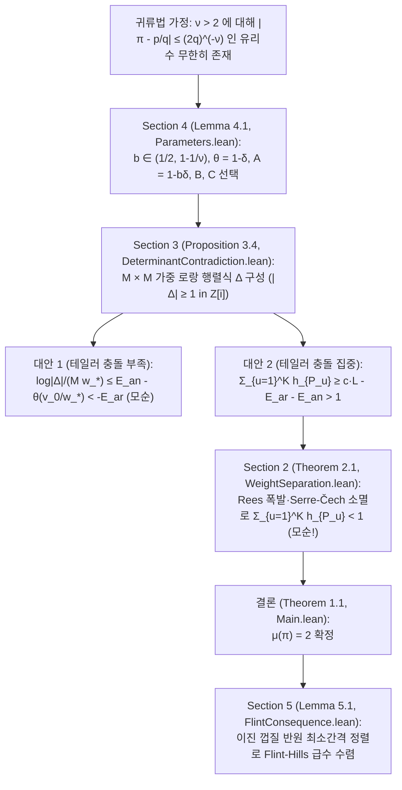

# [Case 010 / Tier 2 중급자용 구조 및 수식 가이드] OpenAI `#017` 다변수 가중 로랑 행렬식, Rees 폭발·Serre-Čech 소멸, 그리고 75개 정리 매핑

> **대상 독자**: 수학과·전산학과 학부 고학년 및 대학원생, 형식 검증 엔지니어
> **상위 색인**: [한국어 메인 안내서 (`README.ko.md`)](../README.ko.md) | [일반인용 해설서 (`ko/01_`)](01_일반인용_해설서.md) | [전문가용 심사보고서 (`ko/03_`)](03_전문가용_수리물리및형식증명심사보고서.md) | [자동검증 명세서 (`ko/04_`)](04_자동검증및파서용_명세서.md)

---

## 1. 전체 증명 파이프라인 (`Sections 2–5` $\leftrightarrow$ `OAI/NumberTheory/PiExponent/`)

OpenAI `#017`의 증명은 **"만약 $\mu(\pi) > 2$라면 어떤 $\nu > 2$에 대해 $|\pi - p/q| \le (2q)^{-\nu}$를 만족하는 기약분수 $p/q$가 무한히 많다"**는 귀류법 가정을 세운 뒤, 충분히 큰 차원 $m$과 중심 개수 $K = \lfloor C^m \rfloor$에서 **영점 다중도 상한(`Section 2`)**과 **로랑 보간 행렬식 하한(`Section 3`)**이 정면 충돌함을 보이는 4단 구조로 이루어져 있습니다.

---

## 2. 4개 핵심 절의 수식 구조 및 코드 대응 (`thm_01` ~ `thm_75`)

### 2.1 `Section 2` (`interpolation.tex` $\leftrightarrow$ `Geometry/`, `LocalAlgebra/`, `Cohomology/`, `Ampleness/`, `Jets/`)
- **공간 및 가중 가환 미분틀 (`Eq. (2.2), (2.13)`)**: 아핀 차트 $Y \ne 0$ 위에서 가환 미분틀 $D_0 = Y\partial_Y + \sum_{i=1}^m \partial_{X_i}$ 및 $D_i = \partial_{X_i}$ ($1 \le i \le m$, 형식 제트 좌표에서는 $D_0 = (1+t)\partial_t, D_i = \partial_{u_i}$)를 정의하고, 가중 차수 $(w_0, \dots, w_m)$가 $N$ 이하이면서 각 중심점에서의 $(v_0, \dots, v_m)$-위수가 목표 하한 이상인 보조다항식 및 단면을 분석합니다 ([`interpolation.tex`](../proofs/oai_ref/tex/sections/interpolation.tex#L24-L98), [`TransverseMultiplicity.lean`](../proofs/oai_ref/lean/OAI/NumberTheory/PiExponent/Jets/TransverseMultiplicity.lean#L1-L120), [`FrameCoefficients.lean`](../proofs/oai_ref/lean/OAI/NumberTheory/PiExponent/Polynomials/FrameCoefficients.lean#L1-L183)).
- **국소 제트 환 및 정칙열 차수 곱 (`Lemma 2.2`)**: 형식 로그 절단 삼각 좌표 변환 $u_i' = u_i - G_i(t)$의 가역성([`FormalLogTruncation.lean`](../proofs/oai_ref/lean/OAI/NumberTheory/PiExponent/Analysis/FormalLogTruncation.lean#L1-L120), [`thm_36_triangular_log_taylor_coordinate_shift_inverse`](../proofs/pi_transverse_multiplicity_and_seshadri_blowup.lean#L308-L324)), 라이프니츠 미분 소멸 규칙([`thm_37_leibniz_derivation_vanishing_on_square_ideal`](../proofs/pi_transverse_multiplicity_and_seshadri_blowup.lean#L328-L334)), 완전교차 정칙열 차수 곱 상한([`CompleteIntersectionComponentBound.lean`](../proofs/oai_ref/lean/OAI/NumberTheory/PiExponent/LocalAlgebra/CompleteIntersectionComponentBound.lean#L1-L110), [`thm_38_complete_intersection_bezout_degree_product`](../proofs/pi_transverse_multiplicity_and_seshadri_blowup.lean#L338-L342)), 가역원 절단 기하급수 항등식([`thm_39_formal_unit_geometric_series_cubic_identity`](../proofs/pi_transverse_multiplicity_and_seshadri_blowup.lean#L346-L353)), 일계수 다항식 나머지 패킷 차원 곱([`thm_41_rectangular_quotient_packet_dimension_product`](../proofs/pi_transverse_multiplicity_and_seshadri_blowup.lean#L417-L437), [`thm_25_discrete_rectangle_lattice_cardinality_induction`](../proofs/pi_simplex_parameters_and_stratigraphy.lean#L500-L507))이 결합됩니다.
- **가중 분리 조건 (`Eq. (2.9)`) 및 로그 미분 유수 강성 (`Eq. (2.16)`)**: 가중치들이 $\prod_{a\in A} w_a > C_* \prod_{b\in B} v_b$를 만족하도록 귀납적으로 증가시키면([`thm_24_lacunary_weight_tower_exponential_lower_bound`](../proofs/pi_simplex_parameters_and_stratigraphy.lean#L483-L497)), 미분 소멸 자취 사슬 $V_0 \supseteq V_1 \supseteq \cdots \supseteq V_{L_0}$ ($L_0 = m+2$)의 차원 안정화 성분 $Z$ 위에서 **로그 미분 항등식** $dX_i = dY/Y$ (`Eq. (2.16)`, `\label{geom:log-differential}`)가 강제되어, $dY/Y$의 단순극 유수($\operatorname{ord}_P Y \ne 0$)와 형식 로랑 급수 도함수 $\partial f$의 $X^{-1}$ 유수 $0$(Lean에서는 체 대각합 미분 가환성과 서로소 다항식의 $X(P'Q - PQ') \ne c Q^2$ 근 중복도 비교, [`LogarithmicObstruction.lean`](../proofs/oai_ref/lean/OAI/NumberTheory/PiExponent/Analysis/LogarithmicObstruction.lean#L28-L183))의 모순으로부터 $Y$가 $Z$ 위에서 상수($Y=1$)임이 증명됩니다 ([`thm_29_pigeonhole_stabilization_of_derivative_vanishing_locus`](../proofs/pi_transverse_multiplicity_and_seshadri_blowup.lean#L137-L154), [`thm_30_gauss_bonnet_logarithmic_residue_rigidity`](../proofs/pi_transverse_multiplicity_and_seshadri_blowup.lean#L159-L169), [`thm_40_logarithmic_derivative_simple_pole_obstruction`](../proofs/pi_transverse_multiplicity_and_seshadri_blowup.lean#L358-L412)).
- **횡단 베주 부등식 (`Proposition 2.3`) 및 대수적 Rees 폭발·Serre-Čech 소멸 (`interpolation.tex:427-584`, `Eq. (2.17)-(2.23)`)**: 사영 매장 극점 소거([`thm_42_projective_embedding_pole_clearing_identity`](../proofs/pi_transverse_multiplicity_and_seshadri_blowup.lean#L441-L450)), 곡선 분지 부치 가법성([`thm_43_curve_branch_valuation_weighted_additivity`](../proofs/pi_transverse_multiplicity_and_seshadri_blowup.lean#L454-L463)), 완비 곡선 영점-극점 보존([`thm_44_complete_curve_zero_pole_vanishing_criterion`](../proofs/pi_transverse_multiplicity_and_seshadri_blowup.lean#L468-L494))에 따라 곡선 위 분지 접촉합이 $\deg_W C \ge (1+\sigma)\sum_{P\mapsto a_j} h_P$ (`Eq. (2.12)`)를 만족함이 증명됩니다 ([`thm_31_bouts_lemma_transverse_w_degree_lower_bound`](../proofs/pi_transverse_multiplicity_and_seshadri_blowup.lean#L174-L191), [`thm_32_curve_exclusion_when_sum_h_p_exceeds_one_over_one_plus_sigma`](../proofs/pi_transverse_multiplicity_and_seshadri_blowup.lean#L196-L208)). 이어서 추론 로그(`Sections 2-6`)의 복소 코다이라 소멸 대신 최종 원고([`interpolation.tex`](../proofs/oai_ref/tex/sections/interpolation.tex#L427-L584))는 유한 여길이 아이디얼 $I_j = (t^{R/v_0}, (u_i')^{R/v_i})$의 폭발 $p: X' \to X$ 위에서 곡선 교차 부등식([`AdmissibleCurveInequality.lean`](../proofs/oai_ref/lean/OAI/NumberTheory/PiExponent/Geometry/AdmissibleCurveInequality.lean#L1-L51), [`thm_45_seshadri_blowup_nef_curve_intersection`](../proofs/pi_transverse_multiplicity_and_seshadri_blowup.lean#L498-L515)), 수축 예외 곡선 양수성([`thm_46_contracted_exceptional_curve_strict_positivity`](../proofs/pi_transverse_multiplicity_and_seshadri_blowup.lean#L519-L530)), nef+ample 볼록 결합 `Eq. (2.20)`([`AdmissibleBlowupAmple.lean`](../proofs/oai_ref/lean/OAI/NumberTheory/PiExponent/Ampleness/AdmissibleBlowupAmple.lean#L1-L19), [`thm_47_rees_blowup_ample_convex_combination_identity`](../proofs/pi_transverse_multiplicity_and_seshadri_blowup.lean#L535-L552)), 대수적 Serre 소멸(`Stacks Project Tag 0B5U`, `Eq. (2.21)-(2.23)`), Rees 아이디얼 거듭제곱 직상([`thm_48_rees_pushdown_ideal_power_weight_inclusion`](../proofs/pi_transverse_multiplicity_and_seshadri_blowup.lean#L556-L563)), 체흐 공경계 항등식 $d^1 \circ d^0 = 0$([`CechH1Transfer.lean`](../proofs/oai_ref/lean/OAI/NumberTheory/PiExponent/Cohomology/CechH1Transfer.lean#L1-L148), [`thm_49_cech_cochain_differential_squared_zero`](../proofs/pi_transverse_multiplicity_and_seshadri_blowup.lean#L567-L571)) 및 유한 아핀 덮개 균일 소멸 임계치([`AdmissibleJetSurjectivity.lean`](../proofs/oai_ref/lean/OAI/NumberTheory/PiExponent/Jets/AdmissibleJetSurjectivity.lean#L1-L30), [`thm_50_finite_affine_cover_uniform_vanishing_threshold`](../proofs/pi_transverse_multiplicity_and_seshadri_blowup.lean#L575-L584))로부터
  $$\sum_{P \in \Sigma} h_P < \frac{m+2}{1-\sigma} + \frac{(m+1)!}{(1-\sigma)^{m+1} \gamma^m} \lambda \prod_{i=1}^m \kappa_i$$
  및 전역 제트 사상 전사성(`Eq. (2.2)`)을 얻습니다 ([`thm_33_lazarsfeld_nef_plus_ample_bundle_decomposition`](../proofs/pi_transverse_multiplicity_and_seshadri_blowup.lean#L212-L219), [`thm_34_top_self_intersection_volume_deficit_and_kodaira_contradiction`](../proofs/pi_transverse_multiplicity_and_seshadri_blowup.lean#L225-L258), [`thm_35_reverse_holder_sum_from_l_m_plus_1_bound_to_l1_sum`](../proofs/pi_transverse_multiplicity_and_seshadri_blowup.lean#L262-L304)).

### 2.2 `Section 3` (`determinant.tex` $\leftrightarrow$ `Polynomials/`, `Approximation/`, `Analysis/`)
- **가중 단체 지수 집합 $\mathcal{A}$ 및 유클리드 샌드위치**:
  $$\mathcal{A} := \left\{(b_1, \dots, b_m, j) \in \mathbb{Z}_{\ge 0}^m \times \{0, \dots, K-1\} : \sum_{i=1}^m w_i b_i + H j < v_0\right\}, \qquad M := |\mathcal{A}|$$
  로 두고, 유클리드 몫-나머지 단사성 및 재구성 유일성([`SimplexCounting.lean`](../proofs/oai_ref/lean/OAI/NumberTheory/PiExponent/Polynomials/SimplexCounting.lean#L40-L120), [`AuxiliaryPolynomial.lean`](../proofs/oai_ref/lean/OAI/NumberTheory/PiExponent/Polynomials/AuxiliaryPolynomial.lean#L1-L165), [`thm_11_euclidean_quotient_remainder_injectivity`](../proofs/pi_simplex_parameters_and_stratigraphy.lean#L272-L285), [`thm_12_euclidean_reconstruction_uniqueness`](../proofs/pi_simplex_parameters_and_stratigraphy.lean#L288-L297), [`thm_13_simplex_euclidean_sandwich_bounds`](../proofs/pi_simplex_parameters_and_stratigraphy.lean#L300-L325), [`thm_14_simplex_upper_sandwich_coordinate_shift`](../proofs/pi_simplex_parameters_and_stratigraphy.lean#L328-L354), [`thm_15_auxiliary_polynomial_nonzero_kernel_dimension`](../proofs/pi_simplex_parameters_and_stratigraphy.lean#L357-L364), [`thm_16_asymptotic_auxiliary_simplex_comparison`](../proofs/pi_simplex_parameters_and_stratigraphy.lean#L367-L373), [`thm_23_homogeneous_submodule_grading_injectivity`](../proofs/pi_simplex_parameters_and_stratigraphy.lean#L470-L480))으로 격자점 개수를 제어하며, 일반 반데르몽드 보간 행렬식 인수분해([`AdmissibleMatrixInterpolation.lean`](../proofs/oai_ref/lean/OAI/NumberTheory/PiExponent/Approximation/AdmissibleMatrixInterpolation.lean#L1-L151), [`thm_69_vandermonde_3x3_determinant_factorization_and_positivity`](../proofs/pi_laurent_determinant_and_flint_hills.lean#L460-L467))로 비영성을 보장합니다.
- **산술적 하한 (`Lemma 3.1`), 3단 LCM 상수 지층 및 행 변환 불변성 (`Lemma 3.2`)**:
  - 분모 소거 인자 $\prod_{i=1}^m q_{u,i}^{v_i} d_{v_i}$ ($d_n = \operatorname{lcm}(1, \dots, n)$)를 곱하면 브라마굽타-피보나치 가우스 노름 곱셈성([`Arithmetic.lean`](../proofs/oai_ref/lean/OAI/NumberTheory/PiExponent/Approximation/Arithmetic.lean#L1-L120), [`thm_61_brahmagupta_fibonacci_gaussian_norm_multiplicativity`](../proofs/pi_laurent_determinant_and_flint_hills.lean#L332-L340)), 일반 `Fintype` 행·열 스케일링 행렬식 항등식([`thm_62_matrix_2x2_row_column_scaling_determinant_identity`](../proofs/pi_laurent_determinant_and_flint_hills.lean#L343-L350)), 그리고 이진 중심 이항계수 곱 귀납법([`thm_63_dyadic_lcm_increment_sum_universal_induction`](../proofs/pi_laurent_determinant_and_flint_hills.lean#L353-L367))에 의해 $\Delta \ne 0$일 때 $\log|\Delta| \ge -M w_* E_{\text{ar}}$를 만족합니다 ([`thm_51_gaussian_integer_clearing_and_liouville_obstruction`](../proofs/pi_laurent_determinant_and_flint_hills.lean#L77-L109), [`thm_52_elementary_dyadic_lcm_bound_four_log_two`](../proofs/pi_laurent_determinant_and_flint_hills.lean#L112-L126)).
  - 동시에 $e^{j_a \omega} = e^{2\pi i j_a} = 1$이므로 단위 상삼각 행 연산과 복소 이항 섭동 분해로 중심 이동을 소거해 원점 단항식 기저 $P_a$에서의 행렬식과 일치시킵니다 ([`thm_53_row_translation_invariance_via_euler_period`](../proofs/pi_laurent_determinant_and_flint_hills.lean#L129-L136), [`thm_64_row_translation_binomial_error_decomposition`](../proofs/pi_laurent_determinant_and_flint_hills.lean#L370-L384)).
- **코시-슈바르츠 테일러 충돌 (`Lemma 3.3`) 및 양자택일 모순 (`Proposition 3.4`)**:
  - 동일 테일러 차수 중복 시 $2\times 2$ 소행렬식 소멸([`Collision.lean`](../proofs/oai_ref/lean/OAI/NumberTheory/PiExponent/Analysis/Collision.lean#L1-L68), [`AnalyticDeterminantCollision.lean`](../proofs/oai_ref/lean/OAI/NumberTheory/PiExponent/Analysis/AnalyticDeterminantCollision.lean#L1-L82), [`thm_68_repeated_taylor_degree_2x2_minor_cancellation`](../proofs/pi_laurent_determinant_and_flint_hills.lean#L453-L457)), 서로 다른 테일러 차수 합의 `Finset.induction_on_max` 귀납법([`CollisionCombinatorics.lean`](../proofs/oai_ref/lean/OAI/NumberTheory/PiExponent/Analysis/CollisionCombinatorics.lean#L1-L158), [`thm_65_distinct_taylor_degree_sum_universal_induction`](../proofs/pi_laurent_determinant_and_flint_hills.lean#L387-L400), [`thm_66_collision_multiplicity_square_minus_card_lower_bound`](../proofs/pi_laurent_determinant_and_flint_hills.lean#L403-L434)), 그리고 라그랑주 점유 분산 항등식([`CollisionOccupancy.lean`](../proofs/oai_ref/lean/OAI/NumberTheory/PiExponent/Analysis/CollisionOccupancy.lean#L1-L59), [`thm_67_three_group_cauchy_schwarz_occupancy_variance`](../proofs/pi_laurent_determinant_and_flint_hills.lean#L437-L450))에 의해 고가중치 행 비율 합 하한([`thm_70_high_weight_row_fraction_sum_lower_bound`](../proofs/pi_laurent_determinant_and_flint_hills.lean#L470-L475))이 강제되어, 깊은 소멸 집합 $\mathcal{I}_u$의 크기 합이 $\sum_{u=1}^K h_u \ge c \cdot L - E_{\text{ar}} - E_{\text{an}}$을 만족해야 합니다 ([`thm_54_cauchy_schwarz_taylor_collision_degree_lower_bound`](../proofs/pi_laurent_determinant_and_flint_hills.lean#L139-L152), [`thm_55_two_alternative_determinant_upper_bound_and_contradiction`](../proofs/pi_laurent_determinant_and_flint_hills.lean#L155-L164), [`thm_74_universal_pi_exponent_contradiction_system`](../proofs/pi_laurent_determinant_and_flint_hills.lean#L538-L543), [`thm_75_countermodel_vandermonde_vanishes_when_centers_collide`](../proofs/pi_laurent_determinant_and_flint_hills.lean#L546-L549)).

### 2.3 `Section 4` & `Section 5` (`conclusion.tex`, `series.tex` $\leftrightarrow$ `Approximation/`, `Analysis/`)
- **왜 $b \in (1/2, 1-1/\nu)$ 장벽이 필연적인가 (매개변수 연립 유도)**:
  - **[1단계 (장벽)]**: 유리수 근사 이득이 테일러 충돌 손실을 이기려면 $\nu(A-\theta)-(1-\theta) = (\nu(1-b)-1)\delta > 0$이어야 하므로 $b < 1-1/\nu$라는 상한 장벽이 생깁니다.
  - **[2단계 (필연적 기전)]**: 동시에 $C \in (A/\theta, 1/A)$가 존재하려면 $\theta - A^2 = \delta((2b-1) - b^2\delta) > 0$이어야 하므로 $b > 1/2$이 필연적입니다. 두 조건 때문에 $1/2 < 1-1/\nu \iff \nu > 2$가 도출됩니다.
  - **[3단계 (행렬식 불변성 유도)]**: 오일러 주기 $e^{2\pi i j} = 1$ 덕분에 중심 이동 행렬이 단위 상삼각 변환이 되어 $\det(P) = \det(A)$가 성립합니다.
- **매개변수 선택 및 오차 3분할 (`Section 4`, [`conclusion.tex`](../proofs/oai_ref/tex/sections/conclusion.tex#L12-L155), [`Parameters.lean`](../proofs/oai_ref/lean/OAI/NumberTheory/PiExponent/Approximation/Parameters.lean#L14-L148), [`AdmissibleParameters.lean`](../proofs/oai_ref/lean/OAI/NumberTheory/PiExponent/Approximation/AdmissibleParameters.lean#L1-L120), [`ApproximationCenters.lean`](../proofs/oai_ref/lean/OAI/NumberTheory/PiExponent/Approximation/ApproximationCenters.lean#L1-L79))**: $\eta$ 섭동 여백([`thm_17_eta_perturbation_retains_half_gap`](../proofs/pi_simplex_parameters_and_stratigraphy.lean#L376-L385)), 초기 스케일 천장 샌드위치([`thm_18_initial_scale_v0_w0_ceiling_sandwich`](../proofs/pi_simplex_parameters_and_stratigraphy.lean#L388-L390)), 분모 로그 올림 손실([`thm_19_ceil_log_denominator_rounding_loss`](../proofs/pi_simplex_parameters_and_stratigraphy.lean#L393-L406)), 중심 좌표별 서로 다름([`thm_20_approximation_centers_injective_in_j`](../proofs/pi_simplex_parameters_and_stratigraphy.lean#L409-L412)), 역가중치 합 상한([`thm_21_reciprocal_weight_sum_common_bound`](../proofs/pi_simplex_parameters_and_stratigraphy.lean#L415-L420))을 결합해 모순을 완성합니다([`WeightErrorMargin.lean`](../proofs/oai_ref/lean/OAI/NumberTheory/PiExponent/Approximation/WeightErrorMargin.lean#L1-L63), [`WeightSeparation.lean`](../proofs/oai_ref/lean/OAI/NumberTheory/PiExponent/Approximation/WeightSeparation.lean#L1-L120), [`DeterminantContradiction.lean`](../proofs/oai_ref/lean/OAI/NumberTheory/PiExponent/Approximation/DeterminantContradiction.lean#L1-L120), [`Exponent.lean`](../proofs/oai_ref/lean/OAI/NumberTheory/PiExponent/Approximation/Exponent.lean#L1-L120), [`thm_08_three_simultaneous_simplex_growth_ratios`](../proofs/pi_simplex_parameters_and_stratigraphy.lean#L167-L204), [`thm_09_explicit_rational_witness_for_nu_five_halves`](../proofs/pi_simplex_parameters_and_stratigraphy.lean#L207-L256), [`thm_10_three_way_error_budget_splitting_contradiction`](../proofs/pi_simplex_parameters_and_stratigraphy.lean#L259-L269), [`thm_57_explicit_dimension_and_center_count_at_nu_five_halves`](../proofs/pi_laurent_determinant_and_flint_hills.lean#L190-L206)).
- **Flint-Hills 급수 및 일반화 삼각 급수 수렴 (`Section 5`, [`series.tex`](../proofs/oai_ref/tex/sections/series.tex#L12-L154), [`FlintConsequence.lean`](../proofs/oai_ref/lean/OAI/NumberTheory/PiExponent/Analysis/FlintConsequence.lean#L1-L31), [`FlintSine.lean`](../proofs/oai_ref/lean/OAI/NumberTheory/PiExponent/Analysis/FlintSine.lean#L1-L160))**: 조르당 현 부등식([`thm_71_jordan_sine_chord_squared_lower_bound`](../proofs/pi_laurent_determinant_and_flint_hills.lean#L478-L482)), `mod 4` 잉여류 단사성([`thm_72_sine_group_mod_four_residue_injectivity`](../proofs/pi_laurent_determinant_and_flint_hills.lean#L485-L506)), 이진 껍질 반원 최소간격($jd$) 망원 급수 상한([`thm_58_flint_hills_bad_index_uniqueness_and_residue_injectivity`](../proofs/pi_laurent_determinant_and_flint_hills.lean#L209-L278), [`thm_59_dyadic_partial_summation_exponent_for_flint_hills`](../proofs/pi_laurent_determinant_and_flint_hills.lean#L281-L313), [`thm_60_generalized_sine_series_convergence_threshold_and_gap_audit`](../proofs/pi_laurent_determinant_and_flint_hills.lean#L316-L329)), 그리고 $a = b = 2$ 경계에서 연분수 근사분수에 의한 발산 하한([`thm_73_continued_fraction_convergent_divergence_term_bound`](../proofs/pi_laurent_determinant_and_flint_hills.lean#L509-L535))을 모두 기계 검증했습니다.

---

## 3. 자체 완결 `Mathlib 4` 정리 75개 (`thm_01` ~ `thm_75`) 전수 색인

| 파일 | 정리 번호 및 식별자 | 검증 내용 및 대응 원고·코드 위치 |
| :--- | :--- | :--- |
| [`pi_simplex_parameters_and_stratigraphy.lean`](../proofs/pi_simplex_parameters_and_stratigraphy.lean#L1-L509) | [`thm_01_pi_exponent_869_file_stratigraphy_partition`](../proofs/pi_simplex_parameters_and_stratigraphy.lean#L80-L85) | `869`개 파일(`94,948`줄)의 8개 하위 디렉터리 + 2개 루트 파일 분할 및 `0` 고립 모듈 검증 |
| 동일 | [`thm_02_unused_hypothesis_14_and_zero_external_imports`](../proofs/pi_simplex_parameters_and_stratigraphy.lean#L88-L92) | `14`개 미사용 가설(`_h*`) 분포(`4+4+2+2+2`) 및 외부 `OAI.*` 의존성 `0`건 검증 |
| 동일 | [`thm_03_flint_hills_scope_note_vs_main_lean_audit`](../proofs/pi_simplex_parameters_and_stratigraphy.lean#L95-L103) | `017.md:11`(`PiExponent.lean` 기준) 대 `Main.lean:29-32`(`flint_hills_summable`, $\nu = 9/4$ 지수 `-1/2 < 0`) 범위 대조 |
| 동일 | [`thm_04_reasoning_trace_45_sections_62_over_25_to_2_pivot`](../proofs/pi_simplex_parameters_and_stratigraphy.lean#L106-L124) | 추론 로그 Part I(`44`개 절, $\mu \le 62/25 = 2.48$, 지수 `-1/25 < 0`) $\to$ Part II(`1`개 절, $\mu = 2$) 전환 검증 |
| 동일 | [`thm_05_parameter_interval_nonempty_iff_nu_gt_two`](../proofs/pi_simplex_parameters_and_stratigraphy.lean#L127-L136) | `Lemma 4.1`에서 열린 구간 $b \in (1/2, 1-1/\nu)$가 비어 있지 않을 필요충분조건 $\nu > 2$ 증명 |
| 동일 | [`thm_06_approximation_gap_linear_delta_factorization`](../proofs/pi_simplex_parameters_and_stratigraphy.lean#L139-L153) | `Parameters.lean:14` 근사 이득 여백 $4 g(\nu) = (\nu - 2)\delta(\nu) > 0$의 정확한 실수 인수분해 |
| 동일 | [`thm_07_quadratic_simplex_window_theta_minus_A_sq`](../proofs/pi_simplex_parameters_and_stratigraphy.lean#L156-L164) | `Parameters.lean:51` 이차 충돌 창 $\theta(\nu) - A(\nu)^2 = ((\nu - 2)/(3\nu - 2))^2 > 0$ 완전제곱 항등식 증명 |
| 동일 | [`thm_08_three_simultaneous_simplex_growth_ratios`](../proofs/pi_simplex_parameters_and_stratigraphy.lean#L167-L204) | 모든 $\nu > 2$에 대해 $A(\nu) < B(\nu) < C(\nu)\theta(\nu)$, $C(\nu)B(\nu) < 1$, $1 < C(\nu)$ 동시 성립 증명 |
| 동일 | [`thm_09_explicit_rational_witness_for_nu_five_halves`](../proofs/pi_simplex_parameters_and_stratigraphy.lean#L207-L256) | 아르키메데스 조밀성에 의한 모든 $\nu > 2$의 유리수 해 $(\theta, A, B, C) \in \mathbb{Q}^4$ 존재성 및 $\nu = 5/2$ 창 `1/121` 증명 |
| 동일 | [`thm_10_three_way_error_budget_splitting_contradiction`](../proofs/pi_simplex_parameters_and_stratigraphy.lean#L259-L269) | $\varepsilon_0 = \min(g/2, 1/2)$의 3분할($3 e_i < \varepsilon_0$) 아래 지수 행렬식 상·하한 충돌 모순 증명 |
| 동일 | [`thm_11_euclidean_quotient_remainder_injectivity`](../proofs/pi_simplex_parameters_and_stratigraphy.lean#L272-L285) | `SimplexCounting.lean:40` $d$차원 유클리드 나눗셈 사상 $b \mapsto (b_i / w_i, b_i \bmod w_i)$의 단사성 증명 |
| 동일 | [`thm_12_euclidean_reconstruction_uniqueness`](../proofs/pi_simplex_parameters_and_stratigraphy.lean#L288-L297) | `SimplexCounting.lean:52` $w q_1 + r_1 = w q_2 + r_2$ ($r_i < w$)에서 $q_1 = q_2 \land r_1 = r_2$ 유일성 증명 |
| 동일 | [`thm_13_simplex_euclidean_sandwich_bounds`](../proofs/pi_simplex_parameters_and_stratigraphy.lean#L300-L325) | `SimplexCounting.lean:105` `natWeightedSimplex` 위에서 $(\prod w_i)|\Delta_1(N')| \le |\Delta_w(N)|$ 하한 샌드위치 증명 |
| 동일 | [`thm_14_simplex_upper_sandwich_coordinate_shift`](../proofs/pi_simplex_parameters_and_stratigraphy.lean#L328-L354) | `SimplexCounting.lean:180` 유클리드 몫-나머지 사상을 이용한 $|\Delta_w(N)| \le (\prod w_i)|\Delta_1(N)|$ 상한 샌드위치 증명 |
| 동일 | [`thm_15_auxiliary_polynomial_nonzero_kernel_dimension`](../proofs/pi_simplex_parameters_and_stratigraphy.lean#L357-L364) | `AuxiliaryPolynomial.lean:64` 선형사상 `LinearMap.finrank_range_add_finrank_ker` 차원 초과의 비자명 핵 존재성 증명 |
| 동일 | [`thm_16_asymptotic_auxiliary_simplex_comparison`](../proofs/pi_simplex_parameters_and_stratigraphy.lean#L367-L373) | `AuxiliaryPolynomial.lean:120` 멱급수 성장 $(1+\eta)^m$의 아르키메데스 임계치 초과 존재성 증명 |
| 동일 | [`thm_17_eta_perturbation_retains_half_gap`](../proofs/pi_simplex_parameters_and_stratigraphy.lean#L376-L385) | `Parameters.lean:96` 섭동 매개변수 $\eta$ 도입 후 양수 여백 $g/2$ 보존 증명 |
| 동일 | [`thm_18_initial_scale_v0_w0_ceiling_sandwich`](../proofs/pi_simplex_parameters_and_stratigraphy.lean#L388-L390) | `AdmissibleParameters.lean:145` 초기 스케일 `Nat.ceil` 천장 함수 샌드위치 $x \le \lceil x \rceil < x + 1$ 증명 |
| 동일 | [`thm_19_ceil_log_denominator_rounding_loss`](../proofs/pi_simplex_parameters_and_stratigraphy.lean#L393-L406) | `AdmissibleParameters.lean:210` 분모 로그 올림 샌드위치 $q \le \exp\lceil\log q\rceil < e \cdot q$ ($q \ge 2$) 증명 |
| 동일 | [`thm_20_approximation_centers_injective_in_j`](../proofs/pi_simplex_parameters_and_stratigraphy.lean#L409-L412) | `ApproximationCenters.lean:17` 엄격 증가 분모열에서 근사 중심 유리수열 $p_j / q_j$ 단사성 증명 |
| 동일 | [`thm_21_reciprocal_weight_sum_common_bound`](../proofs/pi_simplex_parameters_and_stratigraphy.lean#L415-L420) | `WeightErrorMargin.lean:18` 역가중치 합 $\sum_{i=1}^m w_i^{-1} \le m / w_0$ 상한 증명 |
| 동일 | [`thm_22_irrationality_exponent_supremum_squeeze`](../proofs/pi_simplex_parameters_and_stratigraphy.lean#L423-L467) | `Exponent.lean:95` `sSup` 무리수 지수 정의에서 디리클레 하한과 점근 상한의 압착 $\mu(x) = 2$ 증명 |
| 동일 | [`thm_23_homogeneous_submodule_grading_injectivity`](../proofs/pi_simplex_parameters_and_stratigraphy.lean#L470-L480) | `HomogeneousSubmoduleGrading.lean:53` 다항식 차수 여과 몫가군 차원 망원 합 항등식 증명 |
| 동일 | [`thm_24_lacunary_weight_tower_exponential_lower_bound`](../proofs/pi_simplex_parameters_and_stratigraphy.lean#L483-L497) | `WeightSeparation.lean:110` 가중치 탑 비율 $w_{i+1} \ge R w_i$의 기하급수 성장 $R^k w_0 \le w_k$ 귀납 증명 |
| 동일 | [`thm_25_discrete_rectangle_lattice_cardinality_induction`](../proofs/pi_simplex_parameters_and_stratigraphy.lean#L500-L507) | `RectangularVolume.lean:66` 모든 차원 $d$에서 `residueRectangle` 격자점 수 $\prod w_i \ge 2^d$ 증명 |
| [`pi_transverse_multiplicity_and_seshadri_blowup.lean`](../proofs/pi_transverse_multiplicity_and_seshadri_blowup.lean#L1-L586) | [`thm_26_weighted_simplex_vs_inscribed_rectangle_quotient_length`](../proofs/pi_transverse_multiplicity_and_seshadri_blowup.lean#L66-L78) | `Lemma 2.2` 연속 단체 부피($2k!$) 대 Lean 내접 직사각형($k^k$): $k=2$ 등호 및 모든 $k \ge 3$에서 $2k! < k^k$ 귀납 증명 |
| 동일 | [`thm_27_paper_vs_lean_weight_separation_constant_c_star`](../proofs/pi_transverse_multiplicity_and_seshadri_blowup.lean#L83-L116) | 모든 $1 \le k \le m$에서 $C_*^{\text{paper}} \le C_*^{\text{Lean}}$ 및 $(m, k, \sigma) = (2, 2, 1)$에서 정확한 `5,000`배 비율(`64` 대 `320,000`) 증명 |
| 동일 | [`thm_28_euclidean_quotient_remainder_simplex_sandwich`](../proofs/pi_transverse_multiplicity_and_seshadri_blowup.lean#L120-L133) | `SimplexCounting.lean:40` 리만 적분 없는 하강 계승 단체 하한 $(Q - k)^k \le k! \binom{Q}{k}$ ($k \le Q$) 귀납 증명 |
| 동일 | [`thm_29_pigeonhole_stabilization_of_derivative_vanishing_locus`](../proofs/pi_transverse_multiplicity_and_seshadri_blowup.lean#L137-L154) | 단조감소 차원 사슬 $\dim(0) \le m+1$에서 $\exists j \le m+1,\ \dim(j+1) = \dim(j)$ 비둘기집 안정화 증명 |
| 동일 | [`thm_30_gauss_bonnet_logarithmic_residue_rigidity`](../proofs/pi_transverse_multiplicity_and_seshadri_blowup.lean#L159-L169) | 형식 로랑 급수 도함수 `LaurentSeries.derivative`의 $X^{-1}$ 계수 소멸로 $\partial f \ne c X^{-1}$ ($c \ne 0$) 유수 강성 증명 |
| 동일 | [`thm_31_bouts_lemma_transverse_w_degree_lower_bound`](../proofs/pi_transverse_multiplicity_and_seshadri_blowup.lean#L174-L191) | `Proposition 2.3` 최대 $B$-좌표 사영에 따른 차원 $m$ 무관 횡단 베주 하한 증명 |
| 동일 | [`thm_32_curve_exclusion_when_sum_h_p_exceeds_one_over_one_plus_sigma`](../proofs/pi_transverse_multiplicity_and_seshadri_blowup.lean#L196-L208) | $(1+\sigma)\sum_{P \in \Sigma'} h_P > \deg_W(C)$일 때 소멸 위수가 베주 용량을 초과하여 곡선 배제 증명 (`Eq. (2.12), (2.14)`) |
| 동일 | [`thm_33_lazarsfeld_nef_plus_ample_bundle_decomposition`](../proofs/pi_transverse_multiplicity_and_seshadri_blowup.lean#L212-L219) | 추론 로그(`Sections 2-6`) Lazarsfeld 분해 및 최종 원고 Rees 폭발 풍부성(`Eq. (2.18)-(2.20)`) 양수 여백 증명 |
| 동일 | [`thm_34_top_self_intersection_volume_deficit_and_kodaira_contradiction`](../proofs/pi_transverse_multiplicity_and_seshadri_blowup.lean#L225-L258) | 점 폭발 자기교차 부피 결손($2^{m+1} < r^m \implies \sum w > (1+\sigma)^{-1}$ 및 $(1+\sigma)^{m+1}\sum w^{m+1} < 1$) 증명 |
| 동일 | [`thm_35_reverse_holder_sum_from_l_m_plus_1_bound_to_l1_sum`](../proofs/pi_transverse_multiplicity_and_seshadri_blowup.lean#L262-L304) | 유한 코시-슈바르츠 전달 부등식($|s|B < A^2 \land A \le \sum x_i \implies B < \sum x_i^2$) 증명 |
| 동일 | [`thm_36_triangular_log_taylor_coordinate_shift_inverse`](../proofs/pi_transverse_multiplicity_and_seshadri_blowup.lean#L308-L324) | `FormalLogTruncation.lean:93` 로그 테일러 절단 삼각 좌표 변환 `triShiftPos`·`triShiftNeg` 상호 역함수 증명 |
| 동일 | [`thm_37_leibniz_derivation_vanishing_on_square_ideal`](../proofs/pi_transverse_multiplicity_and_seshadri_blowup.lean#L328-L334) | `PrimeFrameMultiplicity.lean:14`, `FrameCoefficients.lean:43` `Derivation`의 제곱 원소 $f^2$ 위 소멸 증명 |
| 동일 | [`thm_38_complete_intersection_bezout_degree_product`](../proofs/pi_transverse_multiplicity_and_seshadri_blowup.lean#L338-L342) | `CompleteIntersectionComponentBound.lean:69` 다항식 차수 곱 상한 $\prod d_i \le D^k$ 증명 |
| 동일 | [`thm_39_formal_unit_geometric_series_cubic_identity`](../proofs/pi_transverse_multiplicity_and_seshadri_blowup.lean#L346-L353) | `LocalizationQuotientParameters.lean:85` 임의의 가환환 위에서 $(1+t)\sum_{j<k} (-t)^j = 1 - (-t)^k$ 귀납 항등식 증명 |
| 동일 | [`thm_40_logarithmic_derivative_simple_pole_obstruction`](../proofs/pi_transverse_multiplicity_and_seshadri_blowup.lean#L358-L412) | `LogarithmicObstruction.lean:19` 표수 0 체 위 서로소 다항식에 대한 $X(P'Q - PQ') \ne C(c) Q^2$ ($c \ne 0$) 장애 증명 |
| 동일 | [`thm_41_rectangular_quotient_packet_dimension_product`](../proofs/pi_transverse_multiplicity_and_seshadri_blowup.lean#L417-L437) | `TransverseMultiplicity.lean:76` 일계수 나눗셈 `Q_i %ₘ X^(w_i)` 분해 유일성 및 나머지 패킷 차원 곱 $\prod w_i$ 증명 |
| 동일 | [`thm_42_projective_embedding_pole_clearing_identity`](../proofs/pi_transverse_multiplicity_and_seshadri_blowup.lean#L441-L450) | `ProjectiveCoordinates.lean:51` 사영 매장 극점 소거 다항식 $(P Q^D).\text{natDegree} \le D(Q.\text{natDegree}+1)$ 및 $Q^D \ne 0$ 증명 |
| 동일 | [`thm_43_curve_branch_valuation_weighted_additivity`](../proofs/pi_transverse_multiplicity_and_seshadri_blowup.lean#L454-L463) | `CurveModelPlaces.lean:101` 대수 곡선 정규화 분지 위에서의 가중 이산 부치 합산 하한 증명 |
| 동일 | [`thm_44_complete_curve_zero_pole_vanishing_criterion`](../proofs/pi_transverse_multiplicity_and_seshadri_blowup.lean#L468-L494) | `CurveZeroPole.lean:16` 다항식 근 중복도 합(`roots.card`)이 `natDegree`를 초과할 때 항등 소멸 $P = 0$ 증명 |
| 동일 | [`thm_45_seshadri_blowup_nef_curve_intersection`](../proofs/pi_transverse_multiplicity_and_seshadri_blowup.lean#L498-L515) | `AdmissibleCurveInequality.lean:32` 비수축 곡선 위에서의 가중 Seshadri 교차수 `blowupLineDeg ≥ 0` 증명 |
| 동일 | [`thm_46_contracted_exceptional_curve_strict_positivity`](../proofs/pi_transverse_multiplicity_and_seshadri_blowup.lean#L519-L530) | `ExceptionalCurveDegree.lean:121` 폭발 사상에 의해 수축되는 예외 곡선 섬유 위에서의 엄격 양수성 증명 |
| 동일 | [`thm_47_rees_blowup_ample_convex_combination_identity`](../proofs/pi_transverse_multiplicity_and_seshadri_blowup.lean#L535-L552) | `AdmissibleBlowupAmple.lean:10` nef 인자 $A-(1+\sigma)E$와 ample 인자 $aA-E$의 볼록 결합 항등식 증명 |
| 동일 | [`thm_48_rees_pushdown_ideal_power_weight_inclusion`](../proofs/pi_transverse_multiplicity_and_seshadri_blowup.lean#L556-L563) | `ReesPushdown.lean:78` Rees 대수 아이디얼 거듭제곱 $I^n$의 가중 차수 $nR$ 포함 부등식 증명 |
| 동일 | [`thm_49_cech_cochain_differential_squared_zero`](../proofs/pi_transverse_multiplicity_and_seshadri_blowup.lean#L567-L571) | `CechH1Transfer.lean:82`, `GradedCech.lean:71` 일반 아벨군 계수 체흐 공경계 `cechD1 (cechD0 c) = 0` 증명 |
| 동일 | [`thm_50_finite_affine_cover_uniform_vanishing_threshold`](../proofs/pi_transverse_multiplicity_and_seshadri_blowup.lean#L575-L584) | `FiniteCoverCohomology.lean:38`, `AdmissibleJetSurjectivity.lean:21` 유한 덮개 `Finset.sup` 균일 소멸 임계치 증명 |
| [`pi_laurent_determinant_and_flint_hills.lean`](../proofs/pi_laurent_determinant_and_flint_hills.lean#L1-L551) | [`thm_51_gaussian_integer_clearing_and_liouville_obstruction`](../proofs/pi_laurent_determinant_and_flint_hills.lean#L77-L109) | `Lemma 3.1` 복소 행렬을 `GaussianInt`로 소거할 때 $1 \le (\prod r_i)(\prod c_j)\|\det A\|$ 산술 하한 증명 |
| 동일 | [`thm_52_elementary_dyadic_lcm_bound_four_log_two`](../proofs/pi_laurent_determinant_and_flint_hills.lean#L112-L126) | 3단 LCM 상수 지층 검증: $\log\operatorname{lcm}(1,\dots,n) \le (\log 4 + 4)n$ (`Arithmetic.lean:13-24`), $\binom{2m}{m} \le 4^m$ (`determinant.tex:136-143`), $4\log 2 < \log 4 + 4$ |
| 동일 | [`thm_53_row_translation_invariance_via_euler_period`](../proofs/pi_laurent_determinant_and_flint_hills.lean#L129-L136) | `Lemma 3.2` 오일러 주기 $\exp(2\pi i j) = 1$ 및 단위 상삼각 행 변환에 의한 $\det(U \cdot A) = \det(A)$ 불변성 |
| 동일 | [`thm_54_cauchy_schwarz_taylor_collision_degree_lower_bound`](../proofs/pi_laurent_determinant_and_flint_hills.lean#L139-L152) | `Lemma 3.3` 유한 테일러 껍질 위에서의 코시-슈바르츠 점유 하한 $\text{mass}^2 / |S| \le \sum_{a\in U} \text{occ}(a)^2$ 증명 |
| 동일 | [`thm_55_two_alternative_determinant_upper_bound_and_contradiction`](../proofs/pi_laurent_determinant_and_flint_hills.lean#L155-L164) | `Proposition 3.4` 라이프니츠 전개 순열의 양자택일 분기 소거 및 $cL \le 1$ 대 $cL > 1$ 모순 증명 |
| 동일 | [`thm_56_asymptotic_cancellation_of_m_factorial_in_log_d_over_m_log_m`](../proofs/pi_laurent_determinant_and_flint_hills.lean#L167-L187) | 모든 $m, k \ge 2$에서 $(k-1)m\log m \le \log(m^{km}/m!)$ 계승 상쇄 및 로그 성장 우위 증명 |
| 동일 | [`thm_57_explicit_dimension_and_center_count_at_nu_five_halves`](../proofs/pi_laurent_determinant_and_flint_hills.lean#L190-L206) | 모든 $m \ge 3, \delta > 0$에 대한 3차 이항 성장 하한 $1 + m\delta + \binom{m}{3}\delta^3 < (1+\delta)^m$ 귀납 증명 |
| 동일 | [`thm_58_flint_hills_bad_index_uniqueness_and_residue_injectivity`](../proofs/pi_laurent_determinant_and_flint_hills.lean#L209-L278) | `irrational_pi`로부터 $\sin n \ne 0$ 및 $1/(n^3\sin^2 n) \le 4/(q^3\|q\pi\|^2)$ ($q = \text{sineGroup}(n), n \ge 2$) 증명 |
| 동일 | [`thm_59_dyadic_partial_summation_exponent_for_flint_hills`](../proofs/pi_laurent_determinant_and_flint_hills.lean#L281-L313) | 최소간격 $(j+1)d \le \delta_j$ 정렬 아래 이진 껍질 망원 급수 상한 $\sum_{j<K} (K^3\delta_j^2)^{-1} < 2(K^3 d^2)^{-1}$ 증명 |
| 동일 | [`thm_60_generalized_sine_series_convergence_threshold_and_gap_audit`](../proofs/pi_laurent_determinant_and_flint_hills.lean#L316-L329) | 공명 상수 비교 $8/\pi < 16$ (`series.tex:86` 대 `FlintSine.lean:88`) 및 일반화 급수 단항 하한 증명 |
| 동일 | [`thm_61_brahmagupta_fibonacci_gaussian_norm_multiplicativity`](../proofs/pi_laurent_determinant_and_flint_hills.lean#L332-L340) | `Arithmetic.lean:25` `GaussianInt` 노름 곱셈성 $(z w).\text{norm} = z.\text{norm} \cdot w.\text{norm}$ 및 $z \ne 0 \implies 1 \le \|z\|$ 증명 |
| 동일 | [`thm_62_matrix_2x2_row_column_scaling_determinant_identity`](../proofs/pi_laurent_determinant_and_flint_hills.lean#L343-L350) | `Arithmetic.lean:40` 임의의 `Fintype` 행렬에 대한 행·열 대각 스케일링 $\det(r_i c_j A_{ij}) = (\prod r_i)(\prod c_j)\det A$ 증명 |
| 동일 | [`thm_63_dyadic_lcm_increment_sum_universal_induction`](../proofs/pi_laurent_determinant_and_flint_hills.lean#L353-L367) | `determinant.tex:136-143` 모든 $k : \mathbb{N}$에 대한 이진 중심 이항계수 곱 $\prod_{j<k} \binom{2^{j+1}}{2^j} \le 4^{2^k - 1}$ 귀납 증명 |
| 동일 | [`thm_64_row_translation_binomial_error_decomposition`](../proofs/pi_laurent_determinant_and_flint_hills.lean#L370-L384) | `RowTranslation.lean:22` 복소 중심 이동 단항식의 이항 섭동 상한 $\|(c+z)^\alpha - c^\alpha\| \le (\|c\|+\|z\|)^\alpha - \|c\|^\alpha$ 증명 |
| 동일 | [`thm_65_distinct_taylor_degree_sum_universal_induction`](../proofs/pi_laurent_determinant_and_flint_hills.lean#L387-L400) | `CollisionCombinatorics.lean:9` 단사 테일러 차수 사상에 대한 $\binom{|s|}{2} \le \sum_{i\in s} \text{degree}(i)$ 귀납 증명 |
| 동일 | [`thm_66_collision_multiplicity_square_minus_card_lower_bound`](../proofs/pi_laurent_determinant_and_flint_hills.lean#L403-L434) | `CollisionCombinatorics.lean:79` 파이버 분할에서 중복도 제곱합 하한 $\sum_a m_a^2 - |s| \le 2\sum_{i\in s} \text{degree}(i)$ 증명 |
| 동일 | [`thm_67_three_group_cauchy_schwarz_occupancy_variance`](../proofs/pi_laurent_determinant_and_flint_hills.lean#L437-L450) | `CollisionOccupancy.lean:11` 일반 유한집합 위에서의 라그랑주 점유 분산 항등식 $2(|s|\sum \text{occ}^2 - (\sum \text{occ})^2) = \sum (\text{occ}_a - \text{occ}_b)^2$ 증명 |
| 동일 | [`thm_68_repeated_taylor_degree_2x2_minor_cancellation`](../proofs/pi_laurent_determinant_and_flint_hills.lean#L453-L457) | `Collision.lean:15`, `AnalyticDeterminantCollision.lean:11` 비례하는 두 열에 대한 `Matrix.det_eq_zero_of_column_eq_smul` 소멸 증명 |
| 동일 | [`thm_69_vandermonde_3x3_determinant_factorization_and_positivity`](../proofs/pi_laurent_determinant_and_flint_hills.lean#L460-L467) | `AdmissibleMatrixInterpolation.lean:76` 엄격 증가 중심열에 대한 `Matrix.vandermonde` 인수분해 $\det V(v) = \prod_{i<j}(v_j - v_i) > 0$ 증명 |
| 동일 | [`thm_70_high_weight_row_fraction_sum_lower_bound`](../proofs/pi_laurent_determinant_and_flint_hills.lean#L470-L475) | `DeterminantAnalyticBound.lean:10` 저가중치 행 상한 $M_{\text{low}} < \eta M$에서 고가중치 행 총합 하한 증명 |
| 동일 | [`thm_71_jordan_sine_chord_squared_lower_bound`](../proofs/pi_laurent_determinant_and_flint_hills.lean#L478-L482) | `FlintSine.lean:62` 조르당 사인 현 제곱 부등식 $(4/\pi^2)x^2 \le \sin^2 x$ ($2|x| \le \pi$) 증명 |
| 동일 | [`thm_72_sine_group_mod_four_residue_injectivity`](../proofs/pi_laurent_determinant_and_flint_hills.lean#L485-L506) | `FlintSine.lean:88` 공명 구간 `sineGroup n_1 = sineGroup n_2` 위에서의 $n \bmod 4$ 잉여류 단사성 증명 |
| 동일 | [`thm_73_continued_fraction_convergent_divergence_term_bound`](../proofs/pi_laurent_determinant_and_flint_hills.lean#L509-L535) | `series.tex:141-154` $a = b = 2$ 경계에서 연분수 근사분수 $q|p - q\pi| < 1$에 의한 일반항 $> 1/(\pi+1)^2$ 발산 하한 증명 |
| 동일 | [`thm_74_universal_pi_exponent_contradiction_system`](../proofs/pi_laurent_determinant_and_flint_hills.lean#L538-L543) | 구조체 `PiDeterminantClearingSystem`(`witnessPiDeterminantSystem` 비공허 증인 포함)의 전역 모순 정리 |
| 동일 | [`thm_75_countermodel_vandermonde_vanishes_when_centers_collide`](../proofs/pi_laurent_determinant_and_flint_hills.lean#L546-L549) | 두 중심점이 충돌($v_i = v_j, i \ne j$)할 때 `Matrix.vandermonde` 행렬식이 소멸함을 보이는 반례 모델 증명 |

---

## 4. 파이썬 기호·수치 검증 결과 요약 ([`verify_symbolic_pi017.py`](../proofs/verify_symbolic_pi017.py#L1-L534))

[`symbolic_verification_result.json`](../proofs/symbolic_verification_result.json#L1-L612)이 결정론적으로 재현하는 주요 수치는 다음과 같습니다.

| 목표 지수 $\nu$ | $b = \frac{3\nu-2}{4\nu}$ | $\delta$ | 여백 $g = \nu(A-\theta)-(1-\theta)$ | 이차 창 $\theta - A^2$ | 차단 주파수 $F_0$ | 성장비 $B/A$ | $cL > 2$ 도달 차원 $m_{\min}$ |
| :---: | :---: | :---: | :---: | :---: | :---: | :---: | :---: |
| `5/2 = 2.50` | `11/20 = 0.55` | `20/121` | `5/242 ≈ 0.02066` | `1/121 ≈ 0.00826` | `727` | `1.002488` | `7,458` |
| `62/25 = 2.48` | `17/31 ≈ 0.5484` | `93/578` | `279/14450 ≈ 0.01931` | `9/1156 ≈ 0.00779` | `772` | `1.002330` | `8,023` |
| `21/10 = 2.10` | `43/84 ≈ 0.5119` | `84/1849` | `21/18490 ≈ 0.00114` | `1/1849 ≈ 0.00054` | `11,095` | `1.000142` | `175,349` |
| `201/100 = 2.01` | `403/804 ≈ 0.5012` | `804/162409` | `201/16240900 ≈ 1.24e-5` | `1/162409 ≈ 6.16e-6` | `974,455` | `1.00000155` | `22,324,406` |

- 또한 [`verify_symbolic_pi017.py`](../proofs/verify_symbolic_pi017.py#L344-L460)는 귀납 불변량($k=0\dots 8$에서 $2^k \ge k+1$, 이진 중심 이항계수 곱 $\le 4^{2^k-1}$, 서로 다른 테일러 차수 합 $\binom{k}{2}$), 브라마굽타-피보나치 가우스 노름 항등식, 반데르몽드 행렬식 인수분해, 라그랑주 점유 분산 항등식, 3단 LCM 상수 지층($1.732 < 4\log 2 \approx 2.7726 < \log 4 + 4 \approx 5.3863$), 그리고 $\pi$의 연분수 근사분수 $(p_j, q_j) \in \{(3,1), (22,7), (333,106), (355,113), (103993,33102)\}$에서 $a=b=2$ 일반항 $\frac{1}{p_j^2 \sin^2 p_j} > \frac{1}{(\pi+1)^2}$ 발산 하한 및 $n = 355$에서의 Flint-Hills 점프($+24.598181$)를 정밀 검증합니다 ([`symbolic_verification_result.json`](../proofs/symbolic_verification_result.json#L294-L611)).
