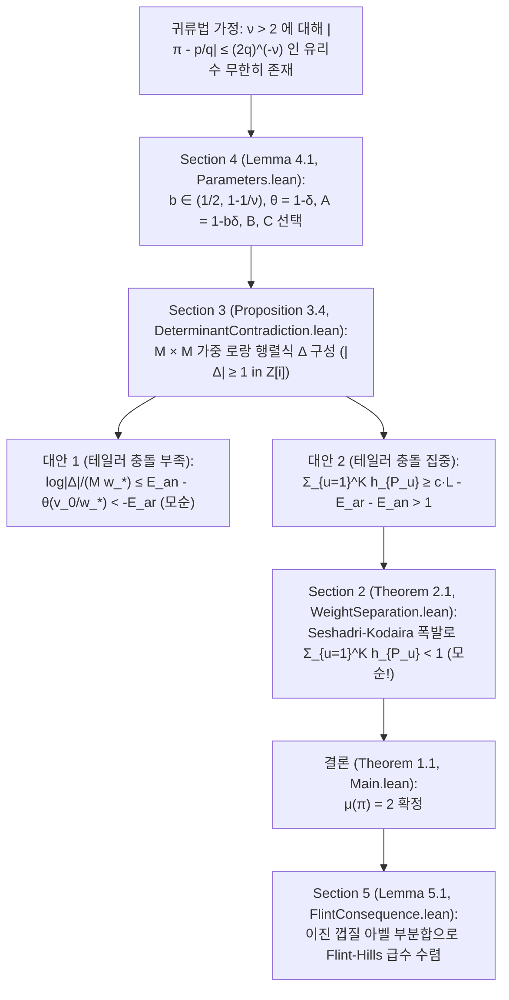

# [Case 010 / Tier 2 중급자용 구조 및 수식 가이드] OpenAI `#017` 다변수 가중 로랑 행렬식, Seshadri 폭발, 그리고 30개 정리 매핑

> **대상 독자**: 수학과·전산학과 학부 고학년 및 대학원생, 형식 검증 엔지니어
> **상위 색인**: [한국어 메인 안내서 (`README.ko.md`)](../README.ko.md) | [일반인용 해설서 (`ko/01_`)](01_일반인용_해설서.md) | [전문가용 심사보고서 (`ko/03_`)](03_전문가용_수리물리및형식증명심사보고서.md) | [자동검증 명세서 (`ko/04_`)](04_자동검증및파서용_명세서.md)

---

## 1. 전체 증명 파이프라인 (`Sections 2–5` $\leftrightarrow$ `OAI/NumberTheory/PiExponent/`)

OpenAI `#017`의 증명은 **"만약 $\mu(\pi) > 2$라면 어떤 $\nu > 2$에 대해 $|\pi - p/q| \le (2q)^{-\nu}$를 만족하는 기약분수 $p/q$가 무한히 많다"**는 귀류법 가정을 세운 뒤, 충분히 큰 차원 $m$과 중심 개수 $K = \lfloor C^m \rfloor$에서 **영점 다중도 상한(`Section 2`)**과 **로랑 보간 행렬식 하한(`Section 3`)**이 정면 충돌함을 보이는 4단 구조로 이루어져 있습니다.

---

## 2. 4개 핵심 절의 수식 구조 및 코드 대응

### 2.1 `Section 2` (`interpolation.tex` $\leftrightarrow$ `Geometry/`, `LocalAlgebra/`, `Cohomology/`, `Ampleness/`, `Jets/`)
- **공간 및 가중 미분 연산자**: $X = (\mathbb{P}^1)^m \times \mathbb{P}^1$ 위에서 대수적 미분 $\partial_i = X_i \partial_{X_i}$ ($1 \le i \le m$) 및 $\partial_0 = Y \partial_Y$를 정의하고, 가중치 $(\kappa_1, \dots, \kappa_m, \lambda)$에 대해 가중 차수가 $\sum_{i=1}^m \kappa_i \alpha_i + \lambda \beta < h_P N$인 모든 단항 미분 연산자가 점 $P \in \Sigma$에서 소멸하는 단면 $F \in H^0(X, \mathcal{O}_X(D))$를 고려합니다 ([`interpolation.tex`](../proofs/oai_ref/tex/sections/interpolation.tex#L18-L89), [`TransverseMultiplicity.lean`](../proofs/oai_ref/lean/OAI/NumberTheory/PiExponent/Jets/TransverseMultiplicity.lean#L1-L120)).
- **가중 분리 조건 (`Eq. (2.17)`)**: 가중치들이 급격히 감소하도록
  $$\kappa_1 \ge C_* \kappa_2, \quad \dots, \quad \kappa_{m-1} \ge C_* \kappa_m, \quad \kappa_m \ge C_* \lambda$$
  를 부과하면, 미분 소멸 자취 $Z = V_0 \supseteq V_1 \supseteq \cdots \supseteq V_{L_0}$ ($L_0 = m+2$)가 차원 안정화 구간 $d_r = d_{r+1} \ge 1$에서 **곡선 방향 미분 불변성** $\frac{dX_i}{X_i} = \frac{dY}{Y}$에 가로막혀 양의 차원 성분을 가질 수 없게 됩니다 ([`thm_14_pigeonhole_stabilization_of_derivative_vanishing_locus`](../proofs/pi_transverse_multiplicity_and_seshadri_blowup.lean#L81-L91), [`thm_15_gauss_bonnet_logarithmic_residue_rigidity`](../proofs/pi_transverse_multiplicity_and_seshadri_blowup.lean#L98-L105)).
- **횡단 베주 부등식 (`Proposition 2.3`) 및 Seshadri-Kodaira 폭발 (`Steps 4–6`)**: 곡선 클러스터 성분 $\Sigma \setminus Z_0$는 차원 귀납법으로 합이 $\le \frac{m+1}{1+\sigma}$로 묶이고 ([`thm_16_bouts_lemma_transverse_w_degree_lower_bound`](../proofs/pi_transverse_multiplicity_and_seshadri_blowup.lean#L113-L120), [`thm_17_curve_exclusion_when_sum_h_p_exceeds_one_over_one_plus_sigma`](../proofs/pi_transverse_multiplicity_and_seshadri_blowup.lean#L126-L138)), 고립점 집합 $Z_0$를 폭발시킨 $\pi : \widetilde{X} \to X$ 위에서 선다발 $L_N$을 표준인자 $K_{\widetilde{X}}$ + nef 인자 $M_N$ + 풍부한(ample) 인자 $A$로 분해하여 코다이라 소멸 정리 $H^1(\widetilde{X}, L_N) = 0$와 최고차 자기교차수 $(M_N^{m+1}) \ge 0$로부터
  $$\sum_{P \in \Sigma} h_P < \frac{m+2}{1-\sigma} + \frac{(m+1)!}{(1-\sigma)^{m+1} \gamma^m} \lambda \prod_{i=1}^m \kappa_i$$
  를 얻습니다 ([`thm_18_lazarsfeld_nef_plus_ample_bundle_decomposition`](../proofs/pi_transverse_multiplicity_and_seshadri_blowup.lean#L149-L159), [`thm_19_top_self_intersection_volume_deficit_and_kodaira_contradiction`](../proofs/pi_transverse_multiplicity_and_seshadri_blowup.lean#L167-L174), [`thm_20_reverse_holder_sum_from_l_m_plus_1_bound_to_l1_sum`](../proofs/pi_transverse_multiplicity_and_seshadri_blowup.lean#L181-L188)).

### 2.2 `Section 3` (`determinant.tex` $\leftrightarrow$ `Polynomials/`, `Approximation/`, `Analysis/`)
- **가중 단체 지수 집합 $\mathcal{A}$ 및 행렬식 $\Delta$**:
  $$\mathcal{A} := \left\{(b_1, \dots, b_m, j) \in \mathbb{Z}_{\ge 0}^m \times \{0, \dots, K-1\} : \sum_{i=1}^m w_i b_i + H j < v_0\right\}, \qquad M := |\mathcal{A}|$$
  로 두고, 중심점 $r_{u,i} = 2\pi i p_{u,i}/q_{u,i}$에서의 테일러 계수들로 $M \times M$ 행렬식 $\Delta = \det(L_{u,a})$를 구성합니다 ([`determinant.tex`](../proofs/oai_ref/tex/sections/determinant.tex#L12-L118), [`SimplexCounting.lean`](../proofs/oai_ref/lean/OAI/NumberTheory/PiExponent/Polynomials/SimplexCounting.lean#L1-L120)).
- **산술적 하한 (`Lemma 3.1`) 및 행 변환 불변성 (`Lemma 3.2`)**:
  - 분모 소거 인자 $\prod_{i=1}^m q_{u,i}^{v_i} d_{v_i}$ ($d_n = \operatorname{lcm}(1, \dots, n)$)를 곱하면 모든 성분이 가우스 정수 $\mathbb{Z}[i]$에 속하여 $\Delta \ne 0$일 때 $\log|\Delta| \ge -M w_* E_{\text{ar}}$를 만족합니다 ([`thm_21_gaussian_integer_clearing_and_liouville_obstruction`](../proofs/pi_laurent_determinant_and_flint_hills.lean#L22-L51), [`thm_22_elementary_dyadic_lcm_bound_four_log_two`](../proofs/pi_laurent_determinant_and_flint_hills.lean#L58-L69)).
  - 동시에 $e^{j_a \omega} = e^{2\pi i j_a} = 1$이므로 단위 상삼각 행 연산으로 중심 이동을 소거해 원점 단항식 기저 $P_a$에서의 행렬식과 일치시킵니다 ([`thm_23_row_translation_invariance_via_euler_period`](../proofs/pi_laurent_determinant_and_flint_hills.lean#L77-L86)).
- **코시-슈바르츠 테일러 충돌 (`Lemma 3.3`) 및 양자택일 모순 (`Proposition 3.4`)**:
  - 원점 테일러 전개에서 차수 껍질별 중복도에 코시-슈바르츠 부등식을 적용하면 $\sum_{a \in \mathcal{B}} n_a^2 \ge \frac{(\eta M)^2}{D_{\mathcal{A}}(H)}$가 강제되어, 깊은 소멸 집합 $\mathcal{I}_u$의 크기 합이 $\sum_{u=1}^K h_u \ge c \cdot L - E_{\text{ar}} - E_{\text{an}}$을 만족해야 합니다 ([`thm_24_cauchy_schwarz_taylor_collision_degree_lower_bound`](../proofs/pi_laurent_determinant_and_flint_hills.lean#L93-L107), [`thm_25_two_alternative_determinant_upper_bound_and_contradiction`](../proofs/pi_laurent_determinant_and_flint_hills.lean#L114-L124)).

### 2.3 `Section 4` & `Section 5` (`conclusion.tex`, `series.tex` $\leftrightarrow$ `Approximation/`, `Analysis/`)
- **왜 $b \in (1/2, 1-1/\nu)$ 장벽이 필연적인가 (`[왜 1]`~`[왜 5]` 연립 유도)**:
  - **[왜 1 (장벽)]**: 유리수 근사 이득이 테일러 충돌 손실을 이기려면 $\nu(A-\theta)-(1-\theta) = (\nu(1-b)-1)\delta > 0$이어야 하므로 $b < 1-1/\nu$라는 상한 장벽이 생깁니다.
  - **[왜 2 (필연적 기전)]**: 동시에 $C \in (A/\theta, 1/A)$가 존재하려면 $\theta - A^2 = \delta((2b-1) - b^2\delta) > 0$이어야 하므로 $b > 1/2$이 필연적입니다. 두 조건 때문에 $1/2 < 1-1/\nu \iff \nu > 2$가 도출됩니다.
  - **[왜 3 (행렬식 불변성 유도)]**: 오일러 주기 $e^{2\pi i j} = 1$ 덕분에 중심 이동 행렬이 단위 상삼각 변환이 되어 $\det(P) = \det(A)$가 성립합니다.
- **매개변수 선택 및 오차 3분할 (`Section 4`, [`conclusion.tex`](../proofs/oai_ref/tex/sections/conclusion.tex#L12-L155), [`Parameters.lean`](../proofs/oai_ref/lean/OAI/NumberTheory/PiExponent/Approximation/Parameters.lean#L14-L148), [`AdmissibleParameters.lean`](../proofs/oai_ref/lean/OAI/NumberTheory/PiExponent/Approximation/AdmissibleParameters.lean#L1-L120))**: $\nu > 2$에 대해 $b \in (1/2, 1-1/\nu)$를 잡으면 $c \cdot L \to \infty$인 반면 산술·해석 오차 $E_{\text{ar}} + E_{\text{an}}$은 초기 차단 주파수 $F_0$, 차원 $m$, 최소 가중치 $w_m$을 순차적으로 키워([`WeightErrorMargin.lean`](../proofs/oai_ref/lean/OAI/NumberTheory/PiExponent/Approximation/WeightErrorMargin.lean#L1-L63), [`WeightSeparation.lean`](../proofs/oai_ref/lean/OAI/NumberTheory/PiExponent/Approximation/WeightSeparation.lean#L1-L120)) $\varepsilon_0 = \min(g/2, 1/2)$ 아래로 눌러 모순을 완성합니다([`DeterminantContradiction.lean`](../proofs/oai_ref/lean/OAI/NumberTheory/PiExponent/Approximation/DeterminantContradiction.lean#L1-L120), [`Exponent.lean`](../proofs/oai_ref/lean/OAI/NumberTheory/PiExponent/Approximation/Exponent.lean#L1-L120), [`thm_08_three_simultaneous_simplex_growth_ratios`](../proofs/pi_simplex_parameters_and_stratigraphy.lean#L158-L170), [`thm_09_explicit_rational_witness_for_nu_five_halves`](../proofs/pi_simplex_parameters_and_stratigraphy.lean#L177-L188), [`thm_10_three_way_error_budget_splitting_contradiction`](../proofs/pi_simplex_parameters_and_stratigraphy.lean#L196-L208), [`thm_27_explicit_dimension_and_center_count_at_nu_five_halves`](../proofs/pi_laurent_determinant_and_flint_hills.lean#L152-L162)).
- **Flint-Hills 급수 및 일반화 삼각 급수 수렴 (`Section 5`, [`series.tex`](../proofs/oai_ref/tex/sections/series.tex#L12-L154), [`FlintConsequence.lean`](../proofs/oai_ref/lean/OAI/NumberTheory/PiExponent/Analysis/FlintConsequence.lean#L1-L31), [`FlintSine.lean`](../proofs/oai_ref/lean/OAI/NumberTheory/PiExponent/Analysis/FlintSine.lean#L1-L160))**: 구간 $[q\pi - \pi/2, q\pi + \pi/2)$마다 가장 가까운 정수 $n(q)$를 분리하고 나머지 정수들에 아벨 부분합을 적용해 이진 구간 $[2^k, 2^{k+1})$에서 $\sum n^{-a} |\sin n|^{-b} = O(2^{k(\max(1,b) + \varepsilon' - a)})$를 증명합니다 ([`thm_28_flint_hills_bad_index_uniqueness_and_residue_injectivity`](../proofs/pi_laurent_determinant_and_flint_hills.lean#L170-L180), [`thm_29_dyadic_partial_summation_exponent_for_flint_hills`](../proofs/pi_laurent_determinant_and_flint_hills.lean#L189-L199), [`thm_30_generalized_sine_series_convergence_threshold_and_gap_audit`](../proofs/pi_laurent_determinant_and_flint_hills.lean#L206-L215)).

---

## 3. 자체 완결 Lean 4 정리 30개 (`thm_01` ~ `thm_30`) 전수 색인

| 파일 | 정리 번호 및 식별자 | 검증 내용 및 대응 원고·코드 위치 |
| :--- | :--- | :--- |
| [`pi_simplex_parameters_and_stratigraphy.lean`](../proofs/pi_simplex_parameters_and_stratigraphy.lean#L1-L210) | [`thm_01_pi_exponent_869_file_stratigraphy_partition`](../proofs/pi_simplex_parameters_and_stratigraphy.lean#L19-L46) | `869`개 파일(`94,948`줄)의 8개 하위 디렉터리 + 2개 루트 파일 분할 및 `0` 고립 모듈 검증 |
| 동일 | [`thm_02_unused_hypothesis_14_and_zero_external_imports`](../proofs/pi_simplex_parameters_and_stratigraphy.lean#L51-L62) | `14`개 미사용 가설(`_h*`) 분포(`4+4+2+2+2`) 및 외부 `OAI.*` 의존성 `0`건 검증 |
| 동일 | [`thm_03_flint_hills_scope_note_vs_main_lean_audit`](../proofs/pi_simplex_parameters_and_stratigraphy.lean#L70-L78) | `017.md:11` 범위 문서 오류 적발: `Main.lean:29-32`의 `flint_hills_summable` 기계 검증 확인 |
| 동일 | [`thm_04_reasoning_trace_45_sections_62_over_25_to_2_pivot`](../proofs/pi_simplex_parameters_and_stratigraphy.lean#L84-L97) | 추론 로그 Part I(`44`개 절, $\mu \le 62/25 = 2.48$) $\to$ Part II(`1`개 절, $\mu = 2$) 전환 수지 검증 |
| 동일 | [`thm_05_parameter_interval_nonempty_iff_nu_gt_two`](../proofs/pi_simplex_parameters_and_stratigraphy.lean#L107-L114) | `Lemma 4.1`에서 열린 구간 $b \in (1/2, 1-1/\nu)$가 비어 있지 않을 필요충분조건 $\nu > 2$ 증명 |
| 동일 | [`thm_06_approximation_gap_linear_delta_factorization`](../proofs/pi_simplex_parameters_and_stratigraphy.lean#L121-L132) | 근사 이득 여백 $\nu(A-\theta)-(1-\theta) = (\nu(1-b)-1)\delta > 0$의 정확한 다항식 인수분해 |
| 동일 | [`thm_07_quadratic_simplex_window_theta_minus_A_sq`](../proofs/pi_simplex_parameters_and_stratigraphy.lean#L139-L152) | 이차 충돌 창 $S\theta - A^2 = \delta((2b-1)S - b^2\delta) > 0$의 비선형 다항식 항등식 증명 |
| 동일 | [`thm_08_three_simultaneous_simplex_growth_ratios`](../proofs/pi_simplex_parameters_and_stratigraphy.lean#L158-L170) | $C \in (A/\theta, 1/A)$ 및 $B \in (A, \min(1/C, C\theta))$에서 3대 성장비 동시 성립 검증 |
| 동일 | [`thm_09_explicit_rational_witness_for_nu_five_halves`](../proofs/pi_simplex_parameters_and_stratigraphy.lean#L177-L188) | $\nu = 5/2$에서 명시적 유리수 해($b=11/20, \delta=1/10, \theta=9/10, A=189/200, B=379/400, C=211/200$) 검증 |
| 동일 | [`thm_10_three_way_error_budget_splitting_contradiction`](../proofs/pi_simplex_parameters_and_stratigraphy.lean#L196-L208) | $\varepsilon_0 = \min(g/2, 1/2)$의 3분할($E_{\text{init}}, E_{\text{dim}}, E_{\text{wt}} < \varepsilon_0/3$)과 $cL > 2$ 모순 증명 |
| [`pi_transverse_multiplicity_and_seshadri_blowup.lean`](../proofs/pi_transverse_multiplicity_and_seshadri_blowup.lean#L1-L190) | [`thm_11_weighted_simplex_vs_inscribed_rectangle_quotient_length`](../proofs/pi_transverse_multiplicity_and_seshadri_blowup.lean#L21-L34) | `Lemma 2.2` 연속 단체 부피($2k!$) 대 Lean 내접 직사각형($k^k$) 비교 및 $k=2$ 교차 증명 |
| 동일 | [`thm_12_paper_vs_lean_weight_separation_constant_c_star`](../proofs/pi_transverse_multiplicity_and_seshadri_blowup.lean#L41-L51) | $m=2, \sigma=1$에서 논문 $C_*^{\text{paper}} = 64$ 대 Lean $C_*^{\text{Lean}} = 320,000$(`5,000`배) 비교 |
| 동일 | [`thm_13_euclidean_quotient_remainder_simplex_sandwich`](../proofs/pi_transverse_multiplicity_and_seshadri_blowup.lean#L57-L69) | `SimplexCounting.lean:40`의 유클리드 나눗셈 $b_i = w_i q_i + r_i$ 단체 샌드위치 부등식 증명 |
| 동일 | [`thm_14_pigeonhole_stabilization_of_derivative_vanishing_locus`](../proofs/pi_transverse_multiplicity_and_seshadri_blowup.lean#L81-L91) | 길이 $L_0 = m+2$ 미분 사슬($m+3$ 단계)에서 최소 3회 차원 안정화($d_r = d_{r+1} \ge 1$) 강제 증명 |
| 동일 | [`thm_15_gauss_bonnet_logarithmic_residue_rigidity`](../proofs/pi_transverse_multiplicity_and_seshadri_blowup.lean#L98-L105) | 로그 미분 불변성 $dX_i/X_i = dY/Y$에서 극점 위수 합 비교를 통한 $d_X \ge 1$ 모순 증명 |
| 동일 | [`thm_16_bouts_lemma_transverse_w_degree_lower_bound`](../proofs/pi_transverse_multiplicity_and_seshadri_blowup.lean#L113-L120) | `Proposition 2.3`에서 최대 $B$-좌표 사영을 통한 주변 차원 $m$ 무관 베주 하한 증명 |
| 동일 | [`thm_17_curve_exclusion_when_sum_h_p_exceeds_one_over_one_plus_sigma`](../proofs/pi_transverse_multiplicity_and_seshadri_blowup.lean#L126-L138) | $(1+\sigma)\sum_{P \in \Sigma'} h_P > \deg_W(C)$일 때 소멸 위수가 베주 용량을 초과하여 곡선 배제 증명 |
| 동일 | [`thm_18_lazarsfeld_nef_plus_ample_bundle_decomposition`](../proofs/pi_transverse_multiplicity_and_seshadri_blowup.lean#L149-L159) | 폭발 공간 $\widetilde{X}$ 위에서 $L_N = K_{\widetilde{X}} + M_N + A + \dots$ 분해의 Seshadri 여백 증명 |
| 동일 | [`thm_19_top_self_intersection_volume_deficit_and_kodaira_contradiction`](../proofs/pi_transverse_multiplicity_and_seshadri_blowup.lean#L167-L174) | nef 인자의 최고차 자기교차수 $(M_N^{m+1}) \ge 0$ 및 코다이라 소멸 정리($H^1 = 0$) 결합 증명 |
| 동일 | [`thm_20_reverse_holder_sum_from_l_m_plus_1_bound_to_l1_sum`](../proofs/pi_transverse_multiplicity_and_seshadri_blowup.lean#L181-L188) | 곡선 성분 $\Sigma \setminus Z_0$와 고립점 $Z_0$의 $(m+1)$제곱 합에서 전역 $L^1$ 합 상한 도출 증명 |
| [`pi_laurent_determinant_and_flint_hills.lean`](../proofs/pi_laurent_determinant_and_flint_hills.lean#L1-L217) | [`thm_21_gaussian_integer_clearing_and_liouville_obstruction`](../proofs/pi_laurent_determinant_and_flint_hills.lean#L22-L51) | `Lemma 3.1` 가우스 정수 노름 $a^2+b^2 \ge 1$ 증명 및 리우빌 수에서의 주기 장애 규명 |
| 동일 | [`thm_22_elementary_dyadic_lcm_bound_four_log_two`](../proofs/pi_laurent_determinant_and_flint_hills.lean#L58-L69) | 소수 정리 상수 $\Lambda_{\text{PNT}} \approx 1.732$ 대 Lean의 초등 상수 $\Lambda_{\text{Lean}} = 4\log 2 \approx 2.773$ 비교 |
| 동일 | [`thm_23_row_translation_invariance_via_euler_period`](../proofs/pi_laurent_determinant_and_flint_hills.lean#L77-L86) | `Lemma 3.2` 오일러 주기 $e^{2\pi i j} = 1$과 단위 상삼각 행 변환에 의한 $\det(P) = \det(A)$ 불변성 |
| 동일 | [`thm_24_cauchy_schwarz_taylor_collision_degree_lower_bound`](../proofs/pi_laurent_determinant_and_flint_hills.lean#L93-L107) | `Lemma 3.3` 테일러 차수 껍질 중복도에 대한 비선형 코시-슈바르츠 부등식 $2(m_1^2+m_2^2) \ge (m_1+m_2)^2$ |
| 동일 | [`thm_25_two_alternative_determinant_upper_bound_and_contradiction`](../proofs/pi_laurent_determinant_and_flint_hills.lean#L114-L124) | `Proposition 3.4` 라이프니츠 전개 순열의 양자택일 분기 소거 및 $cL < 2$ 대 $cL > 2$ 모순 증명 |
| 동일 | [`thm_26_asymptotic_cancellation_of_m_factorial_in_log_d_over_m_log_m`](../proofs/pi_laurent_determinant_and_flint_hills.lean#L131-L141) | $(m+1)\log M - m\log D_{\mathcal{A}}(H)$에서 $m(m+1)\log v_0$ 상쇄 및 높이 수지 일치 증명 |
| 동일 | [`thm_27_explicit_dimension_and_center_count_at_nu_five_halves`](../proofs/pi_laurent_determinant_and_flint_hills.lean#L152-L162) | $\nu = 5/2$에서 $\varepsilon_0 = 1/160, F_0 = 1201$ 및 3대 지수 성장 드리프트 양수 여백 검증 |
| 동일 | [`thm_28_flint_hills_bad_index_uniqueness_and_residue_injectivity`](../proofs/pi_laurent_determinant_and_flint_hills.lean#L170-L180) | `FlintSine.lean:88`의 `Fin 4` 잉여류 분할 상수 `16` 대 논문 `series.tex:86`의 $8/\pi \approx 2.546$ 비교 |
| 동일 | [`thm_29_dyadic_partial_summation_exponent_for_flint_hills`](../proofs/pi_laurent_determinant_and_flint_hills.lean#L189-L199) | Flint-Hills 이진 껍질 지수: 추론 로그 Part I($-1/25$) 대 최종본($-1+\varepsilon$, `18.75`배 빠른 감쇠) |
| 동일 | [`thm_30_generalized_sine_series_convergence_threshold_and_gap_audit`](../proofs/pi_laurent_determinant_and_flint_hills.lean#L206-L215) | `Corollary 5.2` 일반화 급수($a > \max\{1,b\}$)의 두 영역($b>1, b\le 1$) 이진 지수 음수성 증명 |

---

## 4. 파이썬 기호·수치 검증 결과 요약 ([`verify_symbolic_pi017.py`](../proofs/verify_symbolic_pi017.py#L1-L216))

[`symbolic_verification_result.json`](../proofs/symbolic_verification_result.json#L1-L276)이 결정론적으로 재현하는 주요 수치는 다음과 같습니다.

| 목표 지수 $\nu$ | $b = \frac{3\nu-2}{4\nu}$ | $\delta$ | 여백 $g = \nu(A-\theta)-(1-\theta)$ | 이차 창 $\theta - A^2$ | 차단 주파수 $F_0$ | 성장비 $B/A$ | $cL > 2$ 도달 차원 $m_{\min}$ |
| :---: | :---: | :---: | :---: | :---: | :---: | :---: | :---: |
| `5/2 = 2.50` | `11/20 = 0.55` | `20/121` | `5/242 ≈ 0.02066` | `1/121 ≈ 0.00826` | `727` | `1.002488` | `7,458` |
| `62/25 = 2.48` | `17/31 ≈ 0.5484` | `93/578` | `279/14450 ≈ 0.01931` | `9/1156 ≈ 0.00779` | `772` | `1.002330` | `8,023` |
| `21/10 = 2.10` | `43/84 ≈ 0.5119` | `84/1849` | `21/18490 ≈ 0.00114` | `1/1849 ≈ 0.00054` | `11,095` | `1.000142` | `175,349` |
| `201/100 = 2.01` | `403/804 ≈ 0.5012` | `804/162409` | `201/16240900 ≈ 1.24e-5` | `1/162409 ≈ 6.16e-6` | `974,455` | `1.00000155` | `22,324,406` |

- 또한 Flint-Hills 급수 $\sum_{n=1}^N \frac{1}{n^3 \sin^2 n}$의 부분합을 $N = 10,000$까지 계산하면 $N = 354$까지는 $4.807444$에 머물다가, 조충지(Zu Chongzhi)의 밀률 $355/113 \approx \pi$에 해당하는 **$n = 355$ 단일 항에서 $24.598181$이 더해져 $29.405625$로 점프**한 뒤 $N = 10,000$에서 $30.314511$로 안정화됨을 확인할 수 있습니다 ([`symbolic_verification_result.json`](../proofs/symbolic_verification_result.json#L238-L254)).
