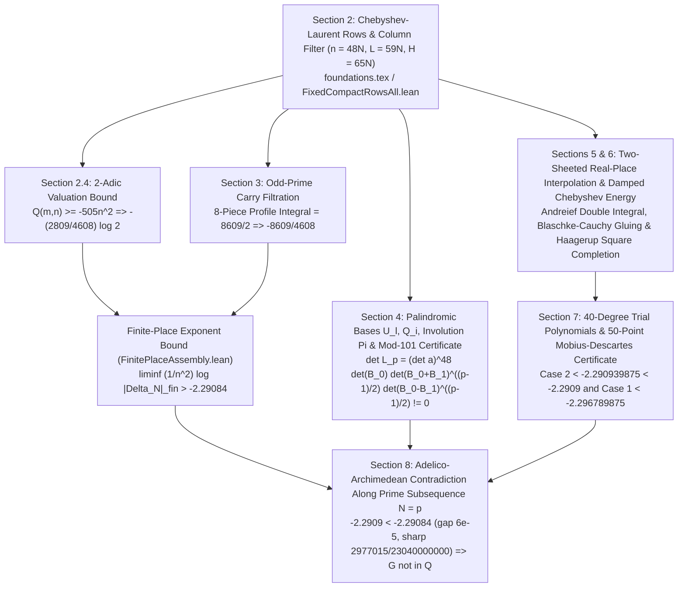

# [Case 011 / Tier 2 Intermediate Math & Code Guide] OpenAI `#005`: Step-by-Step Mathematical Architecture & 75 Machine-Checked Lean 4 Theorems

> **Target Audience**: Mathematicians, graduate students in analytic/transcendental number theory, and Lean 4 formalizers
> **Parent Index**: [English Main README (`README.md`)](../README.md) | [Executive Summary (`en/01_`)](01_Executive_Summary_and_General_Guide.md) | [Expert Forensic Report (`en/03_`)](03_Expert_Forensic_and_Mathematical_Physics_Report.md) | [Parser Spec (`en/04_`)](04_Automated_Verification_and_Parser_Spec.md)

---

## 1. End-to-End Architecture of the Irrationality Proof

The proof of `theorem catalan_irrational : Irrational (∑' j : ℕ, (-1 : ℝ) ^ j / ((2 * j + 1 : ℕ) : ℝ) ^ 2)` (`change Irrational catalan`; [`Challenge_Catalan.lean`](../proofs/oai_ref/lean/Challenge_Catalan.lean#L7-L9), [`Conclusions.lean`](../proofs/oai_ref/lean/Conclusions.lean#L11-L24), [`Catalan.lean`](../proofs/oai_ref/lean/Catalan.lean#L1-L11), [`Main.lean`](../proofs/oai_ref/lean/Main.lean#L1-L30)) constructs a sequence of $n \times n$ determinants $\Delta_N$ at $n = 48N$ ($N \ge 1$) whose entries are rational linear forms $a_{r,k} G - b_{r,k}$ in Catalan's constant $G = \sum_{m=0}^\infty (-1)^m/(2m+1)^2$:

- **Step 1 (Barrier)**: Single-series Padé approximants fail because their denominator growth $\text{lcm}(1, \dots, n)^2 \approx e^{2n}$ exceeds the single-row remainder decay.
- **Step 2 (Mechanism)**: Forming an $n \times n$ determinant of Chebyshev-Laurent rows with $4$-step finite-difference columns creates pairwise Vandermonde repulsion across all $n = 48N$ rows and columns.
- **Step 3 (Derivation)**: Completing the square in the 2-adic valuation yields $-(2809/4608)\log 2$, while the 8-piece odd-prime carry filtration yields $-8609/4608$ (`>-2.29084`).
- **Step 4 (Collision / Non-vanishing)**: Because zero determinants carry no rationality obstruction, prime-scale specialization $N = p$, palindromic reflection $\Pi$, and a mod-$101$ certificate (`det = 27, 50, 74`) force $\Delta_p \ne 0$, colliding with the two-sheeted real-place barrier `<-2.2909`.
- **Step 5 (Formalization)**: Every rational identity, quadratic lower bound, and 50-point Möbius-Descartes bracket is reduced to exact integer arithmetic in Lean 4.

---

## 2. Pillar I: Chebyshev-Laurent Rows, $\zeta(2)$ Contact Cancellation, 2-Adic Completion of the Square, and 8-Piece Odd-Prime Filtration (`Theorems 1–25`)

Verified in [`catalan_rows_two_adic_and_odd_primes.lean`](../proofs/catalan_rows_two_adic_and_odd_primes.lean#L1-L446) (`446` lines, `25` theorems, `144/144` hypothesis mutations caught):

1. **Row Parameters & $\zeta(2)$ Contact Cancellation (`Theorems 1–5`)**:
   - [`thm_01_catalan_row_parameter_scaling_hierarchy`](../proofs/catalan_rows_two_adic_and_odd_primes.lean#L20-L34) verifies the exact integer scaling hierarchy $n = 48N$, $a = 11N$, $b = 7N$, $q = g = 4N$, $h = 2N$, $L = n+a = n+b+q = 59N$, $C = L+g = 63N$, $H = C+h = 65N$, and $A = a+2g = 19N$ ([`foundations.tex`](../proofs/oai_ref/tex/foundations.tex#L10-L15), [`FixedCompactRowsAll.lean`](../proofs/oai_ref/lean/FixedCompactRowsAll.lean#L1-L40)).
   - [`thm_02_chebyshev_row_degree_support_window`](../proofs/catalan_rows_two_adic_and_odd_primes.lean#L40-L51) proves that for $0 \le r < 48N$ and $d = |r-g| \le 44N-1$, the polynomial $P_r(t) = (1-t)^h t^{C-1} T_d(1/t)$ is supported on degrees $[A, H-1] = [19N, 65N-1]$ ([`foundations.tex`](../proofs/oai_ref/tex/foundations.tex#L44-L48)).
   - [`thm_03_taylor_contact_order_cancels_zeta_two`](../proofs/catalan_rows_two_adic_and_odd_primes.lean#L57-L68) and [`thm_04_integer_column_filter_support_in_contact_window`](../proofs/catalan_rows_two_adic_and_odd_primes.lean#L74-L85) prove that the Taylor contact order $\operatorname{ord}_{t=0}(t P_r/f - D_r) = C+r-g \ge 59N = L$ strictly exceeds every active raw column index $b \le j \le b+(n-1)+q = 59N-1 < L$ of the $q$-fold binomial column filter $T_{j,k} = (-1)^{j-b-k}\binom{q}{j-b-k}$, annihilating the $\frac{3}{2}\zeta(2)$ period identically ([`foundations.tex`](../proofs/oai_ref/tex/foundations.tex#L83-L91)).
   - [`thm_05_moment_recurrence_telescoping_step`](../proofs/catalan_rows_two_adic_and_odd_primes.lean#L91-L101) formalizes the beta-integral telescoping recurrence $(d+u+1)I_{u+1} = (u+1)I_u \implies d I_{u+1} = (u+1)(I_u - I_{u+1})$ ([`foundations.tex`](../proofs/oai_ref/tex/foundations.tex#L113-L133)).
2. **2-Adic Valuation Minimization (`Theorems 6–8, 23–25`)**:
   - [`thm_06_two_adic_quadratic_completion_of_square`](../proofs/catalan_rows_two_adic_and_odd_primes.lean#L108-L119) proves the nonlinear completion of the square $4608\left(\frac{n^2}{2} - \frac{53}{24}nm + 2m^2\right) = 2(96m - 53n)^2 - 505n^2 \ge -505n^2$ (`Proposition 2.2`, [`foundations.tex`](../proofs/oai_ref/tex/foundations.tex#L423-L434)), with dual-witness evaluations at $(n,m) = (96,53)$ and $(96,48)$ in [`thm_23_two_adic_quadratic_dual_witness_evaluation`](../proofs/catalan_rows_two_adic_and_odd_primes.lean#L408-L416).
   - [`thm_07_two_adic_l_variable_boundary_monotonicity`](../proofs/catalan_rows_two_adic_and_odd_primes.lean#L126-L135) and [`thm_08_two_adic_smoothing_tail_valuation_bound`](../proofs/catalan_rows_two_adic_and_odd_primes.lean#L140-L146) prove boundary minimization at $l = n-m$ and the 2-adic tail valuation lower bound $v_2 \ge i - 2\lfloor\log_2 H\rfloor - 1$, while [`thm_24_column_degree_triangular_sum_induction`](../proofs/catalan_rows_two_adic_and_odd_primes.lean#L421-L432) and [`thm_25_column_degree_sum_linear_lower_bound`](../proofs/catalan_rows_two_adic_and_odd_primes.lean#L436-L444) prove $\sum_{u=0}^{k-1}(2u+1) = k^2 \ge k$ by structural induction on `k : Nat`.
3. **Odd-Prime Carry Filtration, 8-Piece Integral `8609/2`, and Repaired Profile Theorems (`Theorems 9–22`)**:
   - [`thm_09_kummer_odd_digit_single_carry_identity`](../proofs/catalan_rows_two_adic_and_odd_primes.lean#L156-L171) and [`thm_10_odd_prime_reduced_index_strictly_below_p`](../proofs/catalan_rows_two_adic_and_odd_primes.lean#L176-L192) prove Kummer's single-carry identity for odd base-$p$ digits and the reduced-index bound $4j' < p$ for $p > 2\sqrt{H}$ ([`odd-primes.tex`](../proofs/oai_ref/tex/odd-primes.tex#L48-L88), [`OddPrimeExtractionIndices.lean`](../proofs/oai_ref/lean/OddPrimeExtractionIndices.lean#L1-L161)).
   - [`thm_11_lower_pair_range_loss_profile`](../proofs/catalan_rows_two_adic_and_odd_primes.lean#L199-L209), [`thm_12_local_elimination_retained_columns_40_to_52`](../proofs/catalan_rows_two_adic_and_odd_primes.lean#L215-L230), [`thm_13_repaired_oddUpperProfiles_without_vacuous_hlo`](../proofs/catalan_rows_two_adic_and_odd_primes.lean#L237-L249), and [`thm_14_odd_loss_breakpoint_switch_at_69_halves`](../proofs/catalan_rows_two_adic_and_odd_primes.lean#L255-L264) verify the piecewise-linear odd-prime loss function $d(x)$ and repair the vacuous `(hlo : 65 / 2 ≤ x)` hypothesis (`have _ := hlo`) in [`OddLowerPairPool.lean`](../proofs/oai_ref/lean/OddLowerPairPool.lean#L230-L235).
   - [`thm_15_eight_piece_odd_loss_integral_8609_halves`](../proofs/catalan_rows_two_adic_and_odd_primes.lean#L269-L281) and [`thm_16_finite_place_rational_lower_bound_certificate`](../proofs/catalan_rows_two_adic_and_odd_primes.lean#L289-L300) verify $2\int_0^{65} d(x)\,dx = 4800+736+616+344+803+1260+14+36 = 8609$ and $-\frac{8609}{4608} - \frac{2809}{4608}\log 2 > -2.29084$ ([`FinitePlaceAssembly.lean`](../proofs/oai_ref/lean/FinitePlaceAssembly.lean#L1485-L1514), [`FinitePlaceNumerics.lean`](../proofs/oai_ref/lean/FinitePlaceNumerics.lean#L13-L31)).
   - [`thm_17_repaired_zero_tail_without_vacuous_cutoff`](../proofs/catalan_rows_two_adic_and_odd_primes.lean#L307-L313) and [`thm_18_active_tree_ten_hypothesis_defects_accounting`](../proofs/catalan_rows_two_adic_and_odd_primes.lean#L319-L330) repair the unused cutoff hypotheses in [`FixedCompactRowsAll.lean`](../proofs/oai_ref/lean/FixedCompactRowsAll.lean#L120-L185) and [`BarrierCaseTwoBracketYGroup0.lean`](../proofs/oai_ref/lean/BarrierCaseTwoBracketYGroup0.lean#L135-L145), while [`thm_19_two_layer_minor_valuation_three_bounds`](../proofs/catalan_rows_two_adic_and_odd_primes.lean#L346-L356) through [`thm_22_small_prime_error_quadratic_negligibility`](../proofs/catalan_rows_two_adic_and_odd_primes.lean#L390-L403) formalize Cauchy–Binet two-layer minor valuation, rank-nullity central elimination ([`OddPrimeCentralZetaContraction.lean`](../proofs/oai_ref/lean/OddPrimeCentralZetaContraction.lean#L340-L380)), weighted PNT step bounds ([`ContinuousWeightedPNT.lean`](../proofs/oai_ref/lean/ContinuousWeightedPNT.lean#L1-L134), [`ImportedPNTCoreBridge.lean`](../proofs/oai_ref/lean/ImportedPNTCoreBridge.lean#L1-L43)), and small-prime error negligibility ([`OddPrimeLossNormalization.lean`](../proofs/oai_ref/lean/OddPrimeLossNormalization.lean#L200-L259)).

---

## 3. Pillar II: Palindromic Bases $U_\ell, Q_i$, Reflection Involution $\Pi$, Frobenius Block Extraction, Mod-101 Certificate, and `981`-File Stratigraphy (`Theorems 26–50`)

Verified in [`catalan_palindromic_frobenius_and_modular.lean`](../proofs/catalan_palindromic_frobenius_and_modular.lean#L1-L454) (`454` lines, `25` theorems, `153/153` hypothesis mutations caught):

1. **Palindromic Bases $U_\ell, Q_i$, Transition Determinant $\det U = 2^{p(p-1)/2}$, and Shifted Reflection Involution $\Pi$ (`Theorems 26–33, 43, 49–50`)**:
   - [`thm_26_palindromic_space_dimension_p`](../proofs/catalan_palindromic_frobenius_and_modular.lean#L21-L29), [`thm_27_palindromic_basis_U_lowest_and_highest_degree`](../proofs/catalan_palindromic_frobenius_and_modular.lean#L35-L45), [`thm_28_palindromic_basis_Q_lowest_and_highest_degree`](../proofs/catalan_palindromic_frobenius_and_modular.lean#L51-L61), [`thm_29_palindromic_transition_triangular_exponent_sum`](../proofs/catalan_palindromic_frobenius_and_modular.lean#L68-L80), and [`thm_30_complementary_palindromic_sum_term_count`](../proofs/catalan_palindromic_frobenius_and_modular.lean#L86-L96) formalize the palindromic polynomial space $\mathcal{P}_p$ of dimension $p$, the bases $U_\ell(w) = (2w)^\ell(1+w^2)^{p-1-\ell}$ and $Q_i(w) = w^i \sum_{j=0}^{p-1-i} w^{2j}$, the lower-triangular transition determinant $\det U = 2^{p(p-1)/2}$, and the complementary sum $Q_i(w) + w^p Q'_i(w) = w^i(1-w^2)^{p-1}$ ([`nonvanishing.tex`](../proofs/oai_ref/tex/nonvanishing.tex#L47-L91), [`PalindromicCoefficientMatrices.lean`](../proofs/oai_ref/lean/PalindromicCoefficientMatrices.lean#L1-L128)).
   - [`thm_31_shifted_reflection_involution_on_nonzero_indices`](../proofs/catalan_palindromic_frobenius_and_modular.lean#L102-L110), [`thm_32_reflection_operator_eigenvalue_multiplicities`](../proofs/catalan_palindromic_frobenius_and_modular.lean#L117-L127), and [`thm_33_kronecker_block_determinant_dimension_partition`](../proofs/catalan_palindromic_frobenius_and_modular.lean#L134-L143) formalize the shifted reflection involution $\Pi(e_i) = e_{p-i}$ ($1 \le i < p$, $\Pi(e_0) = 0$) with eigenvalue multiplicities $(1, \frac{p-1}{2}, \frac{p-1}{2})$ and the Kronecker block determinant decomposition $\det \mathcal{L}_p = (\det \mathbf{a})^{48} \det(\mathcal{B}_0) \det(\mathcal{B}_0 + \mathcal{B}_1)^{(p-1)/2} \det(\mathcal{B}_0 - \mathcal{B}_1)^{(p-1)/2}$ across $48 + 48m + 48m = 48p$ rows ([`nonvanishing.tex`](../proofs/oai_ref/tex/nonvanishing.tex#L254-L281), [`PalindromicOriginalDeterminantFactorization.lean`](../proofs/oai_ref/lean/PalindromicOriginalDeterminantFactorization.lean#L13-L120)).
   - [`thm_43_palindromic_transition_determinant_dual_prime_witness`](../proofs/catalan_palindromic_frobenius_and_modular.lean#L336-L350), [`thm_49_palindromic_exponent_sum_triangular_identity`](../proofs/catalan_palindromic_frobenius_and_modular.lean#L429-L440), and [`thm_50_palindromic_exponent_sum_monotonicity`](../proofs/catalan_palindromic_frobenius_and_modular.lean#L444-L452) verify dual-witness evaluations at $p = 3, 5$ and universal structural induction (`∀ k : Nat`) on `palindromicDoubleExponentSum`.
2. **Frobenius Row Extraction Shifts, Auxiliary Row `48`, and Exact Prime-Scale Valuation `v_p(\Delta_p) = -96p` (`Theorems 34–38, 44–46`)**:
   - [`thm_34_frobenius_row_extraction_shift_alignment`](../proofs/catalan_palindromic_frobenius_and_modular.lean#L154-L167), [`thm_35_auxiliary_row_48_minimum_degree_and_contact_order`](../proofs/catalan_palindromic_frobenius_and_modular.lean#L174-L185), [`thm_36_last_block_successor_starting_degree_20p_minus_i`](../proofs/catalan_palindromic_frobenius_and_modular.lean#L192-L206), and [`thm_37_frobenius_column_filter_residue_preservation`](../proofs/catalan_palindromic_frobenius_and_modular.lean#L213-L236) verify the $t^p$ Frobenius shift alignment between $P_r$ and $D_r$, the auxiliary row $r_0+1=48$ minimum degrees $(18, 19)$ and contact order $107$, the cancellation of forbidden degree-$18$ terms in the last block $r = 47p+i$ starting at $20p-i$, and the residue-preserving 4-fold column difference filter ([`nonvanishing.tex`](../proofs/oai_ref/tex/nonvanishing.tex#L104-L242), [`PalindromicPolynomialFrobenius.lean`](../proofs/oai_ref/lean/PalindromicPolynomialFrobenius.lean#L1-L124)).
   - [`thm_38_exact_prime_scale_determinant_valuation_minus_96p`](../proofs/catalan_palindromic_frobenius_and_modular.lean#L243-L250) and [`thm_44_prime_scale_valuation_dual_witness_263_and_269`](../proofs/catalan_palindromic_frobenius_and_modular.lean#L355-L361) prove $v_p(\Delta_p) = -2n = -96p$ for $p > 260$ outside $E$ (`Proposition 4.1`, [`nonvanishing.tex`](../proofs/oai_ref/tex/nonvanishing.tex#L391-L413), [`PrimeNonvanishing.lean`](../proofs/oai_ref/lean/PrimeNonvanishing.lean#L1-L325)), while [`thm_45_repaired_pre_colon_large_prime_threshold`](../proofs/catalan_palindromic_frobenius_and_modular.lean#L368-L375) and [`thm_46_rational_base_matrix_construction_dimension_chain`](../proofs/catalan_palindromic_frobenius_and_modular.lean#L381-L391) formalize the pre-colon threshold repair for [`OddPrimeLossNormalization.lean`](../proofs/oai_ref/lean/OddPrimeLossNormalization.lean#L210-L213) and the $65 \times 59 \to 49 \times 48$ rational base matrix dimension chain ([`FixedCanonicalBaseModAll.lean`](../proofs/oai_ref/lean/FixedCanonicalBaseModAll.lean#L1-L117)).
3. **Stratigraphy, Mod-101 Certificate, and Duplicate/Binder Repairs (`Theorems 39–42, 47–48`)**:
   - [`thm_39_thirteen_duplicate_namespace_collisions_accounting`](../proofs/catalan_palindromic_frobenius_and_modular.lean#L257-L264) and [`thm_48_six_active_files_nine_unused_binder_and_dummy_defects`](../proofs/catalan_palindromic_frobenius_and_modular.lean#L413-L424) audit the `13` duplicate `private theorem` declarations (`barrier_T_3..8` in [`BarrierCaseTwoPointX0.lean`](../proofs/oai_ref/lean/BarrierCaseTwoPointX0.lean#L15-L37) vs [`BarrierCaseOnePointY1.lean`](../proofs/oai_ref/lean/BarrierCaseOnePointY1.lean#L12-L34), and `barrier_case2_U_3..9` in [`BarrierCaseTwoXExplicitGroup7.lean`](../proofs/oai_ref/lean/BarrierCaseTwoXExplicitGroup7.lean#L490-L516) vs [`BarrierCaseTwoXBaseProductCoefficientsData.lean`](../proofs/oai_ref/lean/BarrierCaseTwoXBaseProductCoefficientsData.lean#L355-L381)) and `9` unused-binder/dummy-binding defects across `6` active files.
   - [`thm_40_catalan_981_file_stratigraphy_and_ghost_ledger`](../proofs/catalan_palindromic_frobenius_and_modular.lean#L270-L283), [`thm_41_mod_101_gaussian_and_right_inverse_determinant_residues`](../proofs/catalan_palindromic_frobenius_and_modular.lean#L290-L303), [`thm_42_scaling_constant_64_digit_prime_support_below_101`](../proofs/catalan_palindromic_frobenius_and_modular.lean#L310-L320), and [`thm_47_gaussian_plus_even_swap_parity_sign_preservation`](../proofs/catalan_palindromic_frobenius_and_modular.lean#L397-L404) verify the `473` active vs `508` unreachable file split, the $\mathbb{F}_{101}$ determinant residues `27, 50, 74`, the 64-digit scaling constant $S_{\mathrm{scale}} \equiv 62 \pmod{101}$, and the `2` row swaps `(30, 31), (45, 46)` in [`FixedGaussianPivots.lean`](../proofs/oai_ref/lean/FixedGaussianPivots.lean#L52-L231) and [`FixedDeterminantsNonzero.lean`](../proofs/oai_ref/lean/FixedDeterminantsNonzero.lean#L1-L523).

---

## 4. Pillar III: Two-Sheeted Real-Place Interpolation, Damped Chebyshev Energy Duality, 50-Point Möbius-Descartes Certificate, and Global Contradiction (`Theorems 51–75`)

Verified in [`catalan_real_place_energy_and_contradiction.lean`](../proofs/catalan_real_place_energy_and_contradiction.lean#L1-L433) (`433` lines, `25` theorems, `135/135` hypothesis mutations caught):

1. **Two-Sheeted Real-Place Interpolation & Damped Chebyshev Energy Duality (`Theorems 51–60`)**:
   - [`thm_51_real_place_normalized_parameters_and_D_star`](../proofs/catalan_real_place_energy_and_contradiction.lean#L21-L32), [`thm_52_two_sheet_weights_and_interpolation_ratio`](../proofs/catalan_real_place_energy_and_contradiction.lean#L39-L49), [`thm_53_blaschke_cauchy_contour_gluing_cancellation`](../proofs/catalan_real_place_energy_and_contradiction.lean#L55-L63), and [`thm_54_hilbert_space_compression_determinant_exponent`](../proofs/catalan_real_place_energy_and_contradiction.lean#L70-L78) formalize the normalized parameters $(\alpha, \beta, \gamma, \eta) = (11/48, 7/48, 4/48, 2/48)$, the two-sheet degree gap $D_* = n - 1 - 2g = 40N - 1$, the two-sheeted measure $\mu = \xi_{\mathrm{f}}\,dx + \xi_{\mathrm{n}}\,dy$, the Blaschke-Cauchy gluing jump $c_- - c_+ = 6$, and the Vandermonde exponent $\kappa \in \{1, 2\}$ ([`real-place.tex`](../proofs/oai_ref/tex/real-place.tex#L1-L420), [`FirstSheetHilbertDeterminant.lean`](../proofs/oai_ref/lean/FirstSheetHilbertDeterminant.lean#L1-L45)).
   - [`thm_55_energy_field_origin_exponent_cancellation`](../proofs/catalan_real_place_energy_and_contradiction.lean#L84-L94) through [`thm_60_andreief_vandermonde_pair_count_plus_diagonal`](../proofs/catalan_real_place_energy_and_contradiction.lean#L167-L178) formalize the exact constant-part cancellation $(C - 1) + g - (n - 1) = 63N + 4N - 48N = 19N = a + 2g$ of the $|x_i|$ exponent at the origin, the scale-$48$ log field coefficients $(19, 4, 65, 41, -33)$ ($48(\alpha+2\gamma)=19$, $48(2\eta)=4$, $48(\kappa/2+\alpha+\eta+\gamma)=65(\kappa=2)\cdot 41(\kappa=1)$, $48(-1+\alpha+\gamma)=-33$), the Haagerup-Chebyshev square completion $-a^2 \le b^2 - 2ab$, the damping perturbation bound, the manuscript-to-Lean discrepancy $(n!)^2 \ge 1$ in [`RealDeterminantUpper.lean`](../proofs/oai_ref/lean/RealDeterminantUpper.lean#L39-L50), and Andréief's pair count ([`energy.tex`](../proofs/oai_ref/tex/energy.tex#L1-L288)).
2. **50-Point Möbius-Descartes Certificate & Adelico-Archimedean Contradiction (`Theorems 61–75`)**:
   - [`thm_61_derivative_numerator_polynomial_degrees`](../proofs/catalan_real_place_energy_and_contradiction.lean#L188-L198) through [`thm_65_case_1_certified_upper_bound_minus_2_296789875`](../proofs/catalan_real_place_energy_and_contradiction.lean#L263-L274) and [`thm_74_descartes_sign_variation_step_lower_bound`](../proofs/catalan_real_place_energy_and_contradiction.lean#L410-L418) through [`thm_75_descartes_variation_strict_positivity`](../proofs/catalan_real_place_energy_and_contradiction.lean#L423-L431) verify the four derivative numerator degrees $(36, 24, 13, 9)$, the `43 + 7 = 50` Möbius-Descartes candidate evaluations (`Descartes1637`), the MVT allowance $0.000024$, the Case 2 upper bound $-2.290939875 < -2.2909$, and the Case 1 upper bound $-2.296789875$ ([`certificate.tex`](../proofs/oai_ref/tex/certificate.tex#L172-L471), [`RealDeterminantUpper.lean`](../proofs/oai_ref/lean/RealDeterminantUpper.lean#L280-L383), [`BarrierAtanArgument.lean`](../proofs/oai_ref/lean/BarrierAtanArgument.lean#L1-L150), [`BarrierCaseTwoBracketHeight.lean`](../proofs/oai_ref/lean/BarrierCaseTwoBracketHeight.lean#L1-L332), [`BarrierCaseTwoMaxReduction.lean`](../proofs/oai_ref/lean/BarrierCaseTwoMaxReduction.lean#L1-L150)).
   - [`thm_66_gaussian_trace_vs_modular_101_line_reduction`](../proofs/catalan_real_place_energy_and_contradiction.lean#L280-L289) through [`thm_68_manuscript_citation_concentration_and_missing_primaries`](../proofs/catalan_real_place_energy_and_contradiction.lean#L317-L328) verify the `376,475`-line Gaussian-trace reduction (`523` lines vs `376,998` lines, `720.8×`), the `1/29` active cone vs `28/29 (96.6%)` unreachable imports (`24` `Manuscript*` + `4` non-`Manuscript` wrappers) in `Main.lean` plus external `ZetaFive`/`PrimeNumberTheoremAnd-lean4341.patch` files (`473 + 7 + 14 = 494` custom active files), and the `30/37` vs `7/37` citation concentration across `28/28` `.bib` keys.
   - [`thm_69_product_formula_nonzero_rational_determinant_identity`](../proofs/catalan_real_place_energy_and_contradiction.lean#L344-L349) through [`thm_73_hyperbolic_three_manifold_volume_rational_multiples`](../proofs/catalan_real_place_energy_and_contradiction.lean#L398-L405) verify the product-formula identity, the coarse contradiction gap $6\times 10^{-5}$, the sharp rational contradiction gap $2977015 / 23040000000$, the global irrationality contradiction, and the Agol/Voight hyperbolic volume corollaries $4G$ and $G/3$ ([`conclusion.tex`](../proofs/oai_ref/tex/conclusion.tex#L1-L51), [`Conclusions.lean`](../proofs/oai_ref/lean/Conclusions.lean#L11-L24)).

---

## 5. Symbolic Solver Verification Table ([`verify_symbolic_catalan005.py`](../proofs/verify_symbolic_catalan005.py#L1-L631))

The deterministic Python verifier [`verify_symbolic_catalan005.py`](../proofs/verify_symbolic_catalan005.py#L1-L631) reproduces [`symbolic_verification_result.json`](../proofs/symbolic_verification_result.json#L1-L226) byte-for-byte across six functions:

| Subsystem Check (`verify_symbolic_catalan005.py`) | Function & Line Range | Exact Verified Invariant / Output |
| :--- | :--- | :--- |
| **1. 2-Adic Quadratic Minimization** | [`verify_two_adic_and_parameters()`](../proofs/verify_symbolic_catalan005.py#L39-L98) | $c_2(\delta) = \frac{1}{2} + \frac{(2+\delta)^2}{8} - \frac{3+\delta}{2}$ achieves its minimum at $\delta_0 = \frac{5}{24}$, giving $c_2(\frac{5}{24}) = -\frac{505}{4608}$ and total 2-adic coefficient $-\frac{2809}{4608} \approx -0.609592$ |
| **2. 8-Piece Odd-Prime Loss Integral** | [`verify_odd_prime_loss_profile()`](../proofs/verify_symbolic_catalan005.py#L101-L164) | Piecewise trapezoid sum over $[0,25], [25,29], [29,32.5], [32.5,34.5], [34.5,40], [40,52], [52,59], [59,65]$ equals $\frac{8609}{2}$, giving $-\frac{8609}{4608} - \frac{2809}{4608}\log 2 > -2.29084$ |
| **3. $49 \times 48$ Base Matrix & Mod-`101` Certificate** | [`verify_nonvanishing_and_mod101()`](../proofs/verify_symbolic_catalan005.py#L167-L351) | Constructs the exact $49 \times 48$ rational base matrix $\mathcal{B}$ from the recurrence in [`nonvanishing.tex`](../proofs/oai_ref/tex/nonvanishing.tex#L283-L337), verifies all $3 \times 48 = 144$ Gaussian pivots and swaps `(30, 31), (45, 46)` against [`FixedGaussianPivots.lean`](../proofs/oai_ref/lean/FixedGaussianPivots.lean#L52-L231), and confirms $S_{\text{scale}} \equiv 62 \pmod{101}$ and $\det(\mathcal{B}_0 + \sigma\mathcal{B}_1) \equiv 27, 50, 74 \pmod{101}$ |
| **4. Section 7 Real-Place Margin** | [`verify_real_place_and_certificate()`](../proofs/verify_symbolic_catalan005.py#L354-L439) | Derivative numerator degrees $(36, 24, 13, 9)$, `43` root brackets + `7` division points = `50` Table 2 points, Case 2 bound $-\frac{18327519}{8000000} = -2.290939875 < -2.2909$, Case 1 bound $-\frac{18374319}{8000000} = -2.296789875$, and sharp gap $\frac{2977015}{23040000000}$ |
| **5. `981`-File & Citation Stratigraphy** | [`verify_forensic_stratigraphy()`](../proofs/verify_symbolic_catalan005.py#L442-L611) | `473/981 (48.2%)` active (`124,449/573,816 = 21.7%` lines) vs `508/981 (51.8%)` unreachable (`449,367/573,816 = 78.3%` lines), `1/29` active cone vs `28/29` unreachable imports (`24` `Manuscript*` + `4` wrappers) in `Main.lean`, Terence Tao's `PrimeNumberTheoremAnd` `.patch` smuggling (`14` files `5,367` lines) and `ZetaFive` borrowing (`7` files `1,086` lines), `13` duplicate declarations, `10` active defects, and `30/37 (81.1%)` vs `7/37 (18.9%)` citations across `28/28` `.bib` keys |
| **6. JSON Output & Serialization** | [`main()`](../proofs/verify_symbolic_catalan005.py#L614-L631) | Executes all five verification modules and writes [`symbolic_verification_result.json`](../proofs/symbolic_verification_result.json#L1-L226) deterministically |

---

## 6. 1:1 Mapping Table of the 9 LaTeX Manuscript Sections and `references.bib`

| Manuscript Section & Lean 4 Theorems (`thm_01`–`thm_75`) | LaTeX Manuscript File & Line Range | Exact Verified Invariant / Identity |
| :--- | :--- | :--- |
| **1. Row Parameter Scaling (`thm_01`)** | [`foundations.tex`](../proofs/oai_ref/tex/foundations.tex#L10-L15) | $n=48N, a=11N, b=7N, q=g=4N, h=2N \implies L=59N, C=63N, H=65N, A=19N$ |
| **2. Degree Support Window (`thm_02`)** | [`foundations.tex`](../proofs/oai_ref/tex/foundations.tex#L44-L48) | $\deg_{\min}(P_r) = C-1-d \ge 19N = A$, $\deg_{\max}(P_r) = C-1+h = 65N-1 = H-1$ |
| **3. $\zeta(2)$ Contact Order (`thm_03`, `thm_04`)** | [`foundations.tex`](../proofs/oai_ref/tex/foundations.tex#L83-L91) | $\operatorname{ord}_{t=0}(t P_r/f - D_r) = C+r-g \ge 59N = L > j$ for all $7N \le j \le 59N-1$ |
| **4. Kummer Carry & Local Elimination (`thm_09`, `thm_12`)** | [`odd-primes.tex`](../proofs/oai_ref/tex/odd-primes.tex#L77-L88) | Odd base-$p$ digit carry $= 1$; on $[40N, 52N]$, $R_0 = J = 65N-p$ and $S = 52N-p$ |
| **5. Palindromic Bases & Involution (`thm_26`–`thm_33`)** | [`nonvanishing.tex`](../proofs/oai_ref/tex/nonvanishing.tex#L47-L91) | $\det U = 2^{p(p-1)/2}$; $\Pi(e_i) = e_{p-i}$ has eigenvalues $(0, +1, -1)$ with multiplicities $(1, \frac{p-1}{2}, \frac{p-1}{2})$ |
| **6. Frobenius Shifts & Row 48 (`thm_34`–`thm_38`)** | [`nonvanishing.tex`](../proofs/oai_ref/tex/nonvanishing.tex#L104-L242) | Auxiliary row $48$ has minimum degrees $(18, 19)$ and contact order $107$; $v_p(\Delta_p) = -96p$ |
| **7. Two-Sheeted Energy & Square Completion (`thm_51`–`thm_59`)** | [`energy.tex`](../proofs/oai_ref/tex/energy.tex#L44-L215) | $D_* = 40N-1$, Blaschke jump $c_- - c_+ = 6$, origin constant cancellation $63N+4N-48N=19N$, scale-$48$ coefficients $(19,4,65,41,-33)$ |
| **8. 50-Point Möbius-Descartes Certificate (`thm_61`–`thm_65`)** | [`certificate.tex`](../proofs/oai_ref/tex/certificate.tex#L172-L471) | Derivative numerator degrees $(36, 24, 13, 9)$ isolated on `43` brackets + `7` division points = `50` points |
| **9. Global Irrationality Contradiction (`thm_69`–`thm_73`)** | [`conclusion.tex`](../proofs/oai_ref/tex/conclusion.tex#L1-L51) | $-2.290939875 < -2.2909 < -2.29084 \implies G \notin \mathbb{Q}$, $4G \notin \mathbb{Q}$, and $G/3 \notin \mathbb{Q}$ |
