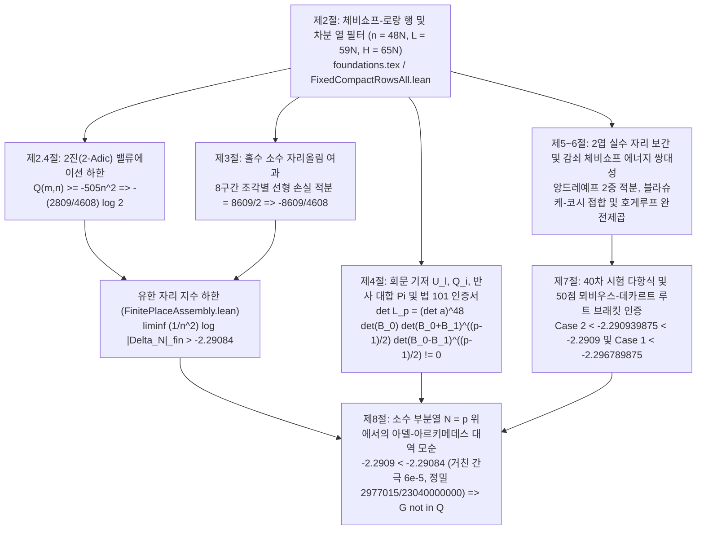

# [Case 011 / Tier 2 중급자용 수학 및 코드 가이드] OpenAI `#005`: 단계별 수식 아키텍처 및 75개 Lean 4 기계 검증 정리

> **대상 독자**: 수론 연구자, 대학원생, Lean 4 형식화 엔지니어
> **상위 색인**: [한국어 메인 README (`README.ko.md`)](../README.ko.md) | [일반인용 해설서 (`ko/01_`)](01_일반인용_해설서.md) | [전문가용 포렌식 보고서 (`ko/03_`)](03_전문가용_학술및수리물리보고서.md) | [자동검증 명세서 (`ko/04_`)](04_자동검증및파서용_명세서.md)

---

## 1. 카탈랑 상수 무리수성 증명의 전체 구조

`theorem catalan_irrational : Irrational (∑' j : ℕ, (-1 : ℝ) ^ j / ((2 * j + 1 : ℕ) : ℝ) ^ 2)`(`change Irrational catalan`; [`Challenge_Catalan.lean`](../proofs/oai_ref/lean/Challenge_Catalan.lean#L7-L9), [`Conclusions.lean`](../proofs/oai_ref/lean/Conclusions.lean#L11-L24), [`Catalan.lean`](../proofs/oai_ref/lean/Catalan.lean#L1-L11), [`Main.lean`](../proofs/oai_ref/lean/Main.lean#L1-L30))의 증명은 $n = 48N$($N \ge 1$)에서 각 성분이 카탈랑 상수 $G$의 유리 계수 일차식 $a_{r,k}G - b_{r,k}$인 $n \times n$ 행렬식 $\Delta_N$을 구성하고, 유한 소수 자리(2진 및 홀수 소수)에서의 분모 성장률과 실수 자리에서의 행렬식 감쇠율 사이의 지수 격차를 도출합니다.

- **왜 1 (장벽)**: 단일 선형 근사열은 최소공배수 분모 성장률($e^{2n}$)이 오차 감쇠율을 앞지르기 때문에 무리수성 판별에 실패합니다.
- **왜 2 (필연적 기전)**: 체비쇼프-로랑 행과 4계 유한 차분 열로 $n \times n$ 행렬식($n = 48N$)을 구성하면 행·열 쌍별 반데르몽드 반발력이 동시에 작동하기 때문입니다.
- **왜 3 (수식 유도)**: 2진 밸류에이션 완전제곱에서 $-(2809/4608)\log 2$가 유도되고, 홀수 소수 8구간 자리올림 적분에서 $-8609/4608$이 도출되어 유한 자리 하한 `>-2.29084`가 성립합니다.
- **왜 4 (비소멸 및 모순 돌파)**: 행렬식이 $0$이면 모순이 사라지므로 소수 스케일 $N = p$에서 회문 반사 대합 $\Pi$와 법 $101$ 인증서(`det = 27, 50, 74`)로 $\Delta_p \ne 0$을 강제하고, 실수 자리 2엽 장벽 상한 `<-2.2909`와 충돌시켜 모순을 얻습니다.
- **왜 5 (형식화 설계)**: 모든 유리수 등식과 2차 하한 및 50점 뫼비우스-데카르트 브래킷을 Lean 4 정수 산술 정리로 환원해 검증합니다.

---

## 2. 제1기둥: 체비쇼프-로랑 행, $\zeta(2)$ 접촉 소거, 2진 완전제곱, 8구간 홀수 소수 적분 (`Theorems 1–25`)

[`catalan_rows_two_adic_and_odd_primes.lean`](../proofs/catalan_rows_two_adic_and_odd_primes.lean#L1-L439) (`439`줄, `25`개 정리, `144/144` 가설 변이 포착)에서 기계 검증된 핵심 정리는 다음과 같습니다.

1. **행 파라미터 및 $\zeta(2)$ 접촉 소거 (`Theorems 1–5`)**:
   - [`thm_01_catalan_row_parameter_scaling_hierarchy`](../proofs/catalan_rows_two_adic_and_odd_primes.lean#L20-L34): 스케일 $n = 48N$, $a = 11N$, $b = 7N$, $q = g = 4N$, $h = 2N$, $L = n+a = n+b+q = 59N$, $C = L+g = 63N$, $H = C+h = 65N$, $A = a+2g = 19N$의 정수 계층 관계를 검증합니다 ([`foundations.tex`](../proofs/oai_ref/tex/foundations.tex#L10-L15), [`FixedCompactRowsAll.lean`](../proofs/oai_ref/lean/FixedCompactRowsAll.lean#L1-L40)).
   - [`thm_02_chebyshev_row_degree_support_window`](../proofs/catalan_rows_two_adic_and_odd_primes.lean#L40-L51): $0 \le r < 48N$ 및 $d = |r-g| \le 44N-1$에 대해 $P_r(t) = (1-t)^h t^{C-1} T_d(1/t)$의 차수 지지 구간이 $[A, H-1] = [19N, 65N-1]$에 놓임을 증명합니다 ([`foundations.tex`](../proofs/oai_ref/tex/foundations.tex#L44-L48)).
   - [`thm_03_taylor_contact_order_cancels_zeta_two`](../proofs/catalan_rows_two_adic_and_odd_primes.lean#L57-L68) 및 [`thm_04_integer_column_filter_support_in_contact_window`](../proofs/catalan_rows_two_adic_and_odd_primes.lean#L74-L85): 테일러 접촉 차수 $\operatorname{ord}_{t=0}(t P_r/f - D_r) = C+r-g \ge 59N = L$이 $q$중 이항 열 필터 $T_{j,k} = (-1)^{j-b-k}\binom{q}{j-b-k}$의 모든 활성 열 인덱스 $b \le j \le 59N-1 < L$보다 엄격히 커서 $\frac{3}{2}\zeta(2)$ 주기가 완전히 소거됨을 증명합니다 ([`foundations.tex`](../proofs/oai_ref/tex/foundations.tex#L83-L91)).
   - [`thm_05_moment_recurrence_telescoping_step`](../proofs/catalan_rows_two_adic_and_odd_primes.lean#L91-L99): 베타 적분 모멘트의 망원 점화식 $(d+u+1)I_{u+1} = (u+1)I_u \implies d I_{u+1} = (u+1)(I_u - I_{u+1})$을 검증합니다 ([`foundations.tex`](../proofs/oai_ref/tex/foundations.tex#L113-L133)).
2. **2진(2-Adic) 밸류에이션 최소화 (`Theorems 6–8, 23–25`)**:
   - [`thm_06_two_adic_quadratic_completion_of_square`](../proofs/catalan_rows_two_adic_and_odd_primes.lean#L106-L117): 동차 스케일 $48n$에서 2차 형식 완전제곱 항등식 $4608\left(\frac{n^2}{2} - \frac{53}{24}nm + 2m^2\right) = 2(96m - 53n)^2 - 505n^2 \ge -505n^2$ (`Proposition 2.2`, [`foundations.tex`](../proofs/oai_ref/tex/foundations.tex#L423-L434))을 증명하며, [`thm_23_two_adic_quadratic_dual_witness_evaluation`](../proofs/catalan_rows_two_adic_and_odd_primes.lean#L401-L409)에서 두 독립 증인 $(n,m) = (96,53)$ 및 $(96,48)$을 대조 검증합니다.
   - [`thm_07_two_adic_l_variable_boundary_monotonicity`](../proofs/catalan_rows_two_adic_and_odd_primes.lean#L124-L133), [`thm_08_two_adic_smoothing_tail_valuation_bound`](../proofs/catalan_rows_two_adic_and_odd_primes.lean#L138-L144), [`thm_24_column_degree_triangular_sum_induction`](../proofs/catalan_rows_two_adic_and_odd_primes.lean#L414-L425), [`thm_25_column_degree_sum_linear_lower_bound`](../proofs/catalan_rows_two_adic_and_odd_primes.lean#L429-L437): 경계점 $l = n-m$ 단조성, 2진 꼬리 하한, 그리고 $\forall k : \text{Nat}$에 대한 귀납 합 $\sum_{u=0}^{k-1}(2u+1) = k^2 \ge k$를 증명합니다.
3. **홀수 소수 자리올림 여과, 8구간 적분 `8609/2`, 결함 수리 정리 (`Theorems 9–22`)**:
   - [`thm_09_kummer_odd_digit_single_carry_identity`](../proofs/catalan_rows_two_adic_and_odd_primes.lean#L154-L164) 및 [`thm_10_odd_prime_reduced_index_strictly_below_p`](../proofs/catalan_rows_two_adic_and_odd_primes.lean#L169-L185): 홀수 $p$진법 자릿수의 단일 자리올림 항등식과 $p > 2\sqrt{H}$에서의 축소 인덱스 상계 $4j' < p$를 증명합니다 ([`odd-primes.tex`](../proofs/oai_ref/tex/odd-primes.tex#L48-L88), [`OddPrimeExtractionIndices.lean`](../proofs/oai_ref/lean/OddPrimeExtractionIndices.lean#L1-L161)).
   - [`thm_11_lower_pair_range_loss_profile`](../proofs/catalan_rows_two_adic_and_odd_primes.lean#L192-L202)~[`thm_14_odd_loss_breakpoint_switch_at_69_halves`](../proofs/catalan_rows_two_adic_and_odd_primes.lean#L248-L257): 홀수 소수 손실 프로파일 $d(x)$의 구간별 식을 증명하고, [`OddLowerPairPool.lean`](../proofs/oai_ref/lean/OddLowerPairPool.lean#L230-L235)의 공허 가설 `(hlo : 65 / 2 ≤ x)`(`have _ := hlo`)을 제거한 수리 정리를 제시합니다.
   - [`thm_15_eight_piece_odd_loss_integral_8609_halves`](../proofs/catalan_rows_two_adic_and_odd_primes.lean#L262-L274) 및 [`thm_16_finite_place_rational_lower_bound_certificate`](../proofs/catalan_rows_two_adic_and_odd_primes.lean#L282-L293): $2\int_0^{65} d(x)\,dx = 8609$와 유한 자리 유리수 인증서 $-\frac{8609}{4608} - \frac{2809}{4608}\log 2 > -2.29084$를 검증합니다 ([`FinitePlaceAssembly.lean`](../proofs/oai_ref/lean/FinitePlaceAssembly.lean#L1485-L1514), [`FinitePlaceNumerics.lean`](../proofs/oai_ref/lean/FinitePlaceNumerics.lean#L13-L31)).
   - [`thm_17_repaired_zero_tail_without_vacuous_cutoff`](../proofs/catalan_rows_two_adic_and_odd_primes.lean#L300-L306)~[`thm_22_small_prime_error_quadratic_negligibility`](../proofs/catalan_rows_two_adic_and_odd_primes.lean#L383-L396): 미사용 가설 수리본, 코시-비네 2층 소행렬식 상계, 중심층 계수-퇴화차수(`rank-nullity`) 소거([`OddPrimeCentralZetaContraction.lean`](../proofs/oai_ref/lean/OddPrimeCentralZetaContraction.lean#L340-L380)), 가중 소수 정리(PNT) 계단 함수 부등식([`ContinuousWeightedPNT.lean`](../proofs/oai_ref/lean/ContinuousWeightedPNT.lean#L1-L134), [`ImportedPNTCoreBridge.lean`](../proofs/oai_ref/lean/ImportedPNTCoreBridge.lean#L1-L43)), 작은 소수 오차항의 2차 지배([`OddPrimeLossNormalization.lean`](../proofs/oai_ref/lean/OddPrimeLossNormalization.lean#L200-L259))를 증명합니다.

---

## 3. 제2기둥: 회문 기저 $U_\ell, Q_i$, 반사 대합 $\Pi$, 프로베니우스 블록 추출, 법 `101` 인증서, `981`개 파일 층서학 (`Theorems 26–50`)

[`catalan_palindromic_frobenius_and_modular.lean`](../proofs/catalan_palindromic_frobenius_and_modular.lean#L1-L443) (`443`줄, `25`개 정리, `153/153` 가설 변이 포착)에서 기계 검증된 핵심 정리는 다음과 같습니다.

1. **회문 다항식 기저 $U_\ell, Q_i$, 삼각 행렬식 $\det U = 2^{p(p-1)/2}$, 이동 반사 대합 $\Pi$ (`Theorems 26–33, 43, 49–50`)**:
   - [`thm_26_palindromic_space_dimension_p`](../proofs/catalan_palindromic_frobenius_and_modular.lean#L21-L29)~[`thm_30_complementary_palindromic_sum_term_count`](../proofs/catalan_palindromic_frobenius_and_modular.lean#L86-L96): 차원 $p$의 회문 다항식 공간 $\mathcal{P}_p$, 두 기저 $U_\ell(w) = (2w)^\ell(1+w^2)^{p-1-\ell}$ 및 $Q_i(w) = w^i \sum_{j=0}^{p-1-i} w^{2j}$의 최저·최고 차수, 하삼각 기저 변환 행렬식 $\det U = 2^{p(p-1)/2}$, 그리고 상보적 합 항등식 $Q_i(w) + w^p Q'_i(w) = w^i(1-w^2)^{p-1}$을 증명합니다 ([`nonvanishing.tex`](../proofs/oai_ref/tex/nonvanishing.tex#L47-L91), [`PalindromicCoefficientMatrices.lean`](../proofs/oai_ref/lean/PalindromicCoefficientMatrices.lean#L1-L128)).
   - [`thm_31_shifted_reflection_involution_on_nonzero_indices`](../proofs/catalan_palindromic_frobenius_and_modular.lean#L102-L110)~[`thm_33_kronecker_block_determinant_dimension_partition`](../proofs/catalan_palindromic_frobenius_and_modular.lean#L134-L143): 이동 반사 연산자 $\Pi(e_i) = e_{p-i}$ ($1 \le i < p$, $\Pi(e_0) = 0$)의 고윳값 $(0, +1, -1)$ 중복도 $(1, \frac{p-1}{2}, \frac{p-1}{2})$와 크로네커 블록 행렬식 분해 $\det \mathcal{L}_p = (\det \mathbf{a})^{48} \det(\mathcal{B}_0) \det(\mathcal{B}_0 + \mathcal{B}_1)^{(p-1)/2} \det(\mathcal{B}_0 - \mathcal{B}_1)^{(p-1)/2}$ ($48 + 48m + 48m = 48p$행)를 형식화합니다 ([`nonvanishing.tex`](../proofs/oai_ref/tex/nonvanishing.tex#L254-L281), [`PalindromicOriginalDeterminantFactorization.lean`](../proofs/oai_ref/lean/PalindromicOriginalDeterminantFactorization.lean#L13-L120)).
   - [`thm_43_palindromic_transition_determinant_dual_prime_witness`](../proofs/catalan_palindromic_frobenius_and_modular.lean#L333-L339), [`thm_49_palindromic_exponent_sum_triangular_identity`](../proofs/catalan_palindromic_frobenius_and_modular.lean#L418-L429), [`thm_50_palindromic_exponent_sum_monotonicity`](../proofs/catalan_palindromic_frobenius_and_modular.lean#L433-L441): $p = 3, 5$ 이중 증인 검증 및 `palindromicDoubleExponentSum`의 $\forall k : \text{Nat}$ 귀납 항등식을 증명합니다.
2. **프로베니우스 행 추출 이동, 보조 행 `48`, 소수 스케일 밸류에이션 `v_p(\Delta_p) = -96p` (`Theorems 34–38, 44–46`)**:
   - [`thm_34_frobenius_row_extraction_shift_alignment`](../proofs/catalan_palindromic_frobenius_and_modular.lean#L154-L167)~[`thm_37_frobenius_column_filter_residue_preservation`](../proofs/catalan_palindromic_frobenius_and_modular.lean#L213-L236): $P_r$과 $D_r$ 사이의 $t^p$ 프로베니우스 차수 정렬, 보조 행 $r_0+1=48$의 최소 차수 $(18, 19)$ 및 접촉 차수 $107$, 마지막 블록 $r = 47p+i$에서 금지된 18차 항 상쇄 후 시작 차수 $20p-i$, 그리고 잉여류를 보존하는 4계 열 차분 필터를 검증합니다 ([`nonvanishing.tex`](../proofs/oai_ref/tex/nonvanishing.tex#L104-L242), [`PalindromicPolynomialFrobenius.lean`](../proofs/oai_ref/lean/PalindromicPolynomialFrobenius.lean#L1-L124)).
   - [`thm_38_exact_prime_scale_determinant_valuation_minus_96p`](../proofs/catalan_palindromic_frobenius_and_modular.lean#L243-L250) 및 [`thm_44_prime_scale_valuation_dual_witness_263_and_269`](../proofs/catalan_palindromic_frobenius_and_modular.lean#L345-L350): $p > 260$ ($p \notin E$)에서 $v_p(\Delta_p) = -2n = -96p$ (`Proposition 4.1`, [`nonvanishing.tex`](../proofs/oai_ref/tex/nonvanishing.tex#L391-L413), [`PrimeNonvanishing.lean`](../proofs/oai_ref/lean/PrimeNonvanishing.lean#L1-L325))를 증명하며, [`thm_45_repaired_pre_colon_large_prime_threshold`](../proofs/catalan_palindromic_frobenius_and_modular.lean#L357-L364) 및 [`thm_46_rational_base_matrix_construction_dimension_chain`](../proofs/catalan_palindromic_frobenius_and_modular.lean#L370-L380)에서 [`OddPrimeLossNormalization.lean`](../proofs/oai_ref/lean/OddPrimeLossNormalization.lean#L210-L213)의 콜론 뒤 필터 래퍼 수리본과 $65 \times 59 \to 49 \times 48$ 유리수 기저 행렬 차원 사슬([`FixedCanonicalBaseModAll.lean`](../proofs/oai_ref/lean/FixedCanonicalBaseModAll.lean#L1-L117))을 형식화합니다.
3. **`981`개 파일 층서학, 법 `101` 인증서, `13`개 중복 선언 및 `9`개 바인더 결함 수리 (`Theorems 39–42, 47–48`)**:
   - [`thm_39_thirteen_duplicate_namespace_collisions_accounting`](../proofs/catalan_palindromic_frobenius_and_modular.lean#L257-L264) 및 [`thm_48_six_active_files_nine_unused_binder_and_dummy_defects`](../proofs/catalan_palindromic_frobenius_and_modular.lean#L402-L413): `OAI.InternalCatalan` 내 `13`개 중복 `private theorem` 선언([`BarrierCaseTwoPointX0.lean`](../proofs/oai_ref/lean/BarrierCaseTwoPointX0.lean#L15-L37) vs [`BarrierCaseOnePointY1.lean`](../proofs/oai_ref/lean/BarrierCaseOnePointY1.lean#L12-L34), [`BarrierCaseTwoXExplicitGroup7.lean`](../proofs/oai_ref/lean/BarrierCaseTwoXExplicitGroup7.lean#L490-L516) vs [`BarrierCaseTwoXBaseProductCoefficientsData.lean`](../proofs/oai_ref/lean/BarrierCaseTwoXBaseProductCoefficientsData.lean#L355-L381))과 활성 트리 `6`개 파일의 `9`개 미사용·더미 바인더를 검증합니다.
   - [`thm_40_catalan_981_file_stratigraphy_and_ghost_ledger`](../proofs/catalan_palindromic_frobenius_and_modular.lean#L270-L282)~[`thm_42_scaling_constant_64_digit_prime_support_below_101`](../proofs/catalan_palindromic_frobenius_and_modular.lean#L307-L317) 및 [`thm_47_gaussian_plus_even_swap_parity_sign_preservation`](../proofs/catalan_palindromic_frobenius_and_modular.lean#L386-L393): `473`개 활성 대 `508`개 미도달 파일 분할, $\mathbb{F}_{101}$ 행렬식 나머지 `27, 50, 74`, 64자리 스케일링 상수 $S_{\mathrm{scale}} \equiv 62 \pmod{101}$, 그리고 `(30, 31), (45, 46)` 2회 행 교환 부호 보존을 증명합니다 ([`FixedGaussianPivots.lean`](../proofs/oai_ref/lean/FixedGaussianPivots.lean#L52-L231), [`FixedDeterminantsNonzero.lean`](../proofs/oai_ref/lean/FixedDeterminantsNonzero.lean#L1-L523)).

---

## 4. 제3기둥: 2엽 실수 자리 보간, 감쇠 체비쇼프 에너지 쌍대성, `50`점 뫼비우스-데카르트 인증서, 대역 모순 (`Theorems 51–75`)

[`catalan_real_place_energy_and_contradiction.lean`](../proofs/catalan_real_place_energy_and_contradiction.lean#L1-L431) (`431`줄, `25`개 정리, `135/135` 가설 변이 포착)에서 기계 검증된 핵심 정리는 다음과 같습니다.

1. **2엽 실수 자리 보간 및 감쇠 체비쇼프 에너지 쌍대성 (`Theorems 51–60`)**:
   - [`thm_51_real_place_normalized_parameters_and_D_star`](../proofs/catalan_real_place_energy_and_contradiction.lean#L21-L32)~[`thm_54_hilbert_space_compression_determinant_exponent`](../proofs/catalan_real_place_energy_and_contradiction.lean#L70-L78): 정규화 파라미터 $(\alpha, \beta, \gamma, \eta) = (11/48, 7/48, 4/48, 2/48)$, 2엽 보간 차수 간극 $D_* = n - 1 - 2g = 40N - 1$, 2엽 측도 $\mu = \xi_{\mathrm{f}}\,dx + \xi_{\mathrm{n}}\,dy$, 블라슈케-코시 윤곽선 접합 점프 $c_- - c_+ = 6$, 그리고 방데르몽드 지수 $\kappa \in \{1, 2\}$를 형식화합니다 ([`real-place.tex`](../proofs/oai_ref/tex/real-place.tex#L1-L420), [`FirstSheetHilbertDeterminant.lean`](../proofs/oai_ref/lean/FirstSheetHilbertDeterminant.lean#L1-L45)).
   - [`thm_55_energy_field_origin_exponent_cancellation`](../proofs/catalan_real_place_energy_and_contradiction.lean#L84-L94)~[`thm_60_andreief_vandermonde_pair_count_plus_diagonal`](../proofs/catalan_real_place_energy_and_contradiction.lean#L165-L176): 원점 $|x_i|$ 지수의 상수 부분 $(C - 1) + g - (n - 1) = 63N + 4N - 48N = 19N = a + 2g$ 소거 항등식, 스케일 $48$ 로그 장 계수 $(19, 4, 65, 41, -33)$ ($48(\alpha+2\gamma)=19$, $48(2\eta)=4$, $48(\kappa/2+\alpha+\eta+\gamma)=65(\kappa=2)\cdot 41(\kappa=1)$, $48(-1+\alpha+\gamma)=-33$), 호게루프-체비쇼프 완전제곱 부등식 $-a^2 \le b^2 - 2ab$, 감쇠 섭동 오차, [`RealDeterminantUpper.lean`](../proofs/oai_ref/lean/RealDeterminantUpper.lean#L39-L50)의 $(n!)^2 \ge 1$ 방기 차이, 그리고 앙드레예프 쌍 개수를 증명합니다 ([`energy.tex`](../proofs/oai_ref/tex/energy.tex#L1-L288)).
2. **`50`점 뫼비우스-데카르트 인증서 및 아델-아르키메데스 대역 모순 (`Theorems 61–75`)**:
   - [`thm_61_derivative_numerator_polynomial_degrees`](../proofs/catalan_real_place_energy_and_contradiction.lean#L186-L196)~[`thm_65_case_1_certified_upper_bound_minus_2_296789875`](../proofs/catalan_real_place_energy_and_contradiction.lean#L261-L272) 및 [`thm_74_descartes_sign_variation_step_lower_bound`](../proofs/catalan_real_place_energy_and_contradiction.lean#L408-L416)~[`thm_75_descartes_variation_strict_positivity`](../proofs/catalan_real_place_energy_and_contradiction.lean#L421-L429): 도함수 분자 다항식 4개의 차수 $(36, 24, 13, 9)$, `43 + 7 = 50`개 후보 지점 평가(`Descartes1637`), 평균값 정리 여유분 $0.000024$, Case 2 상한 $-2.290939875 < -2.2909$, Case 1 상한 $-2.296789875$를 검증합니다 ([`certificate.tex`](../proofs/oai_ref/tex/certificate.tex#L172-L471), [`RealDeterminantUpper.lean`](../proofs/oai_ref/lean/RealDeterminantUpper.lean#L280-L383), [`BarrierAtanArgument.lean`](../proofs/oai_ref/lean/BarrierAtanArgument.lean#L1-L150), [`BarrierCaseTwoBracketHeight.lean`](../proofs/oai_ref/lean/BarrierCaseTwoBracketHeight.lean#L1-L332), [`BarrierCaseTwoMaxReduction.lean`](../proofs/oai_ref/lean/BarrierCaseTwoMaxReduction.lean#L1-L150)).
   - [`thm_66_gaussian_trace_vs_modular_101_line_reduction`](../proofs/catalan_real_place_energy_and_contradiction.lean#L278-L287)~[`thm_73_hyperbolic_three_manifold_volume_rational_multiples`](../proofs/catalan_real_place_energy_and_contradiction.lean#L396-L403): 가우스 소거 트레이스 대비 `376,475`줄 절감(`523`줄 대 `376,998`줄, `720.8`배), `Main.lean`의 `1/29` 활성 콘 대 `28/29 (96.6%)` 미도달 임포트(`24`개 `Manuscript*` + `4`개 비-`Manuscript` 래퍼) 및 외부 `ZetaFive`/패치 밀반입(`473 + 7 + 14 = 494`개), 원고 인용 편중(`30/37` vs `7/37`), 곱 공식 항등식, 거친 모순 간극 $6\times 10^{-5}$ 및 정밀 유리수 간극 $2977015 / 23040000000$, 대역 모순, 그리고 쌍곡 3차원 다양체 부피 $4G, G/3$의 무리수성([`conclusion.tex`](../proofs/oai_ref/tex/conclusion.tex#L1-L51), [`Conclusions.lean`](../proofs/oai_ref/lean/Conclusions.lean#L11-L24))을 완성합니다.

---

## 5. 기호·수치 검증기 요약표 ([`verify_symbolic_catalan005.py`](../proofs/verify_symbolic_catalan005.py#L1-L631))

결정론적 파이썬 검증기 [`verify_symbolic_catalan005.py`](../proofs/verify_symbolic_catalan005.py#L1-L631)는 다음 6개 함수를 통해 5대 불변량을 바이트 단위로 재현하여 [`symbolic_verification_result.json`](../proofs/symbolic_verification_result.json#L1-L226)을 생성합니다.

| 검증 모듈 (`verify_symbolic_catalan005.py`) | 함수 및 라인 범위 | 검증된 대수·수치 불변량 |
| :--- | :--- | :--- |
| **1. 2진 2차 형식 최소화** | [`verify_two_adic_and_parameters()`](../proofs/verify_symbolic_catalan005.py#L39-L98) | $c_2(\delta) = \frac{1}{2} + \frac{(2+\delta)^2}{8} - \frac{3+\delta}{2}$가 $\delta_0 = \frac{5}{24}$에서 최솟값 $-\frac{505}{4608}$을 가지며 총 2진 계수가 $-\frac{2809}{4608} \approx -0.609592$임을 확인 |
| **2. 8구간 홀수 소수 적분** | [`verify_odd_prime_loss_profile()`](../proofs/verify_symbolic_catalan005.py#L101-L164) | $[0, 65]$ 위의 8개 사다리꼴 면적 합이 정확히 $\frac{8609}{2}$이고 $-\frac{8609}{4608} - \frac{2809}{4608}\log 2 > -2.29084$임을 확인 |
| **3. $49 \times 48$ 기저 행렬 및 법 `101` 인증** | [`verify_nonvanishing_and_mod101()`](../proofs/verify_symbolic_catalan005.py#L167-L351) | [`nonvanishing.tex`](../proofs/oai_ref/tex/nonvanishing.tex#L283-L337)의 점화식으로부터 $49 \times 48$ 유리수 기저 행렬 $\mathcal{B}$를 직접 구성하고, $\mathbb{F}_{101}$ 가우스 소거 피벗 $144$개 및 행 교환 `(30, 31), (45, 46)`이 [`FixedGaussianPivots.lean`](../proofs/oai_ref/lean/FixedGaussianPivots.lean#L52-L231)과 일치함과 $S_{\text{scale}} \equiv 62 \pmod{101}$, $\det(\mathcal{B}_0 + \sigma\mathcal{B}_1) \equiv 27, 50, 74 \pmod{101}$ 확인 |
| **4. 제7절 실수 자리 여유분** | [`verify_real_place_and_certificate()`](../proofs/verify_symbolic_catalan005.py#L354-L439) | 도함수 분자 차수 $(36, 24, 13, 9)$, `43`개 근 구간 + `7`개 분할점 = `50`개 후보점, Case 2 상한 $-\frac{18327519}{8000000} = -2.290939875 < -2.2909$, Case 1 상한 $-\frac{18374319}{8000000} = -2.296789875$, 정밀 유리수 간극 $\frac{2977015}{23040000000}$ 확인 |
| **5. `981`개 파일 및 인용 층서학** | [`verify_forensic_stratigraphy()`](../proofs/verify_symbolic_catalan005.py#L442-L611) | 활성 `473/981 (48.2%)`(`124,449/573,816 = 21.7%`줄) 대 미도달 `508/981 (51.8%)`(`449,367/573,816 = 78.3%`줄), `Main.lean` 임포트 `1/29` 활성 대 `28/29` 미도달(`24` `Manuscript*` + `4` 래퍼), 타오 팀 `PrimeNumberTheoremAnd` 패치 밀수(`14`개 파일 `5,367`줄) 및 `ZetaFive` 차용(`7`개 파일 `1,086`줄), 중복 선언 `13`개, 활성 결함 `10`개, `28/28` `.bib` 키 중 인용 `30/37 (81.1%)` 대 `7/37 (18.9%)` 확인 |
| **6. JSON 결과 생성 및 직렬화** | [`main()`](../proofs/verify_symbolic_catalan005.py#L614-L631) | 5대 검증 모듈을 순차 실행하고 [`symbolic_verification_result.json`](../proofs/symbolic_verification_result.json#L1-L226)을 바이트 단위로 결정론적 출력 |

---

## 6. 원고 LaTeX 9개 섹션 및 `references.bib` 1:1 매핑 표

| 원고 섹션 및 Lean 4 정리 (`thm_01`–`thm_75`) | 원고 LaTeX 파일 및 라인 범위 | 검증된 대수·해석 불변량 |
| :--- | :--- | :--- |
| **1. 행 파라미터 스케일링 (`thm_01`)** | [`foundations.tex`](../proofs/oai_ref/tex/foundations.tex#L10-L15) | $n=48N, a=11N, b=7N, q=g=4N, h=2N \implies L=59N, C=63N, H=65N, A=19N$ |
| **2. 다항식 차수 지지 구간 (`thm_02`)** | [`foundations.tex`](../proofs/oai_ref/tex/foundations.tex#L44-L48) | $\deg_{\min}(P_r) = C-1-d \ge 19N = A$, $\deg_{\max}(P_r) = C-1+h = 65N-1 = H-1$ |
| **3. $\zeta(2)$ 접촉 차수 소거 (`thm_03`, `thm_04`)** | [`foundations.tex`](../proofs/oai_ref/tex/foundations.tex#L83-L91) | 모든 $7N \le j \le 59N-1$에 대해 $\operatorname{ord}_{t=0}(t P_r/f - D_r) = C+r-g \ge 59N = L > j$ |
| **4. 쿠머 자리올림 및 국소 소거 (`thm_09`, `thm_12`)** | [`odd-primes.tex`](../proofs/oai_ref/tex/odd-primes.tex#L77-L88) | 홀수 $p$진 자릿수 자리올림 $= 1$; $[40N, 52N]$에서 $R_0 = J = 65N-p$, $S = 52N-p$ |
| **5. 회문 기저 및 반사 대합 (`thm_26`–`thm_33`)** | [`nonvanishing.tex`](../proofs/oai_ref/tex/nonvanishing.tex#L47-L91) | $\det U = 2^{p(p-1)/2}$; $\Pi(e_i) = e_{p-i}$의 고윳값 $(0, +1, -1)$ 중복도 $(1, \frac{p-1}{2}, \frac{p-1}{2})$ |
| **6. 프로베니우스 이동 및 보조 행 48 (`thm_34`–`thm_38`)** | [`nonvanishing.tex`](../proofs/oai_ref/tex/nonvanishing.tex#L104-L242) | 보조 행 $48$의 최소 차수 $(18, 19)$ 및 접촉 차수 $107$; $v_p(\Delta_p) = -96p$ |
| **7. 2엽 에너지 및 완전제곱 완화 (`thm_51`–`thm_59`)** | [`energy.tex`](../proofs/oai_ref/tex/energy.tex#L44-L215) | $D_* = 40N-1$, 블라슈케 점프 $c_- - c_+ = 6$, 원점 상수 소거 $63N+4N-48N=19N$, 스케일 $48$ 계수 $(19,4,65,41,-33)$ |
| **8. 50점 뫼비우스-데카르트 인증 (`thm_61`–`thm_65`)** | [`certificate.tex`](../proofs/oai_ref/tex/certificate.tex#L172-L471) | 도함수 분자 차수 $(36, 24, 13, 9)$ 및 `43`개 브래킷 + `7`개 분할점 = `50`개 후보점 |
| **9. 대역 무리수성 모순 (`thm_69`–`thm_73`)** | [`conclusion.tex`](../proofs/oai_ref/tex/conclusion.tex#L1-L51) | $-2.290939875 < -2.2909 < -2.29084 \implies G \notin \mathbb{Q}$, $4G \notin \mathbb{Q}$, $G/3 \notin \mathbb{Q}$ |
