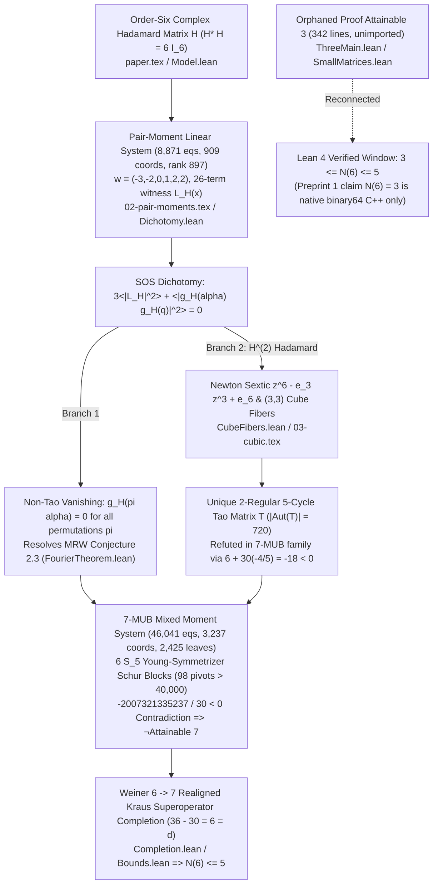

# [Case 012 / Tier 2 Intermediate Math & Code Guide] OpenAI `#266`: Three-Pillar Mathematical Architecture & 75 Lean 4 Theorems

> **Target Audience**: Quantum information & harmonic analysis researchers, graduate students, Lean 4 engineers
> **Navigation**: [English Main README (`README.md`)](../README.md) | [Executive Summary (`en/01_`)](01_Executive_Summary_and_General_Guide.md) | [Expert Forensic Report (`en/03_`)](03_Expert_Forensic_and_Mathematical_Physics_Report.md) | [Automated Spec (`en/04_`)](04_Automated_Verification_and_Parser_Spec.md)

---

## 1. End-to-End Architecture of Family `#266`

OpenAI `#266`'s Lean 4 formalization targets two comparator challenges -- [`MUBSix.lean`](../proofs/oai_ref/challenges/MUBSix.lean#L56-L66) (`fourier_and_family_bound`) and [`HadamardCubeFiber.lean`](../proofs/oai_ref/challenges/HadamardCubeFiber.lean#L28-L37) (`rowRatio_cubeFiber_sum_zero`) -- while leaving Preprint 1's `binary64` C++ search ($N(6) = 3$) unformalized ([`266.md`](../proofs/oai_ref/docs/266.md#L1-L23)).

- **Stage 1 (Algebraic Obstacle)**: Because $d = 6 = 2 \times 3$ lacks a finite field, Weyl phase-space constructions stop at `3` bases, while continuous complex Hadamard families defeat naive discrete enumeration.
- **Stage 2 (Invariant Projection)**: Quotienting out row/column phase multiplication and coordinate permutations requires projecting onto balanced character sums $g_H(\alpha)$ and symmetric moment rings.
- **Stage 3 (Algebraic Derivation)**: The pair identity $3\langle|L_H|^2\rangle + \langle|g_H(\alpha)g_H(q)|^2\rangle = 0$ splits order-six Hadamard matrices into MRW vanishing ($g_H(\pi\alpha) = 0$) versus $z^6 - e_3 z^3 + e_6$ cube fibers (`5`-cycle $T$), while $p(5)-1 = 6$ Young-symmetrizer Schur blocks (`98` pivots $> 40,000$) force $-\frac{2007321335237}{30} < 0$ on `7` MUBs.
- **Stage 4 (Completion & Rigidity)**: Excluding `7` MUBs yields $N(6) \le 5$ because at $k = 6$ Weiner's realigned Kraus complement has dimension $36 - 30 = 6 = d$ (maximal abelian saturation), whereas at $k = 5$ the complement jumps to $36 - 25 = 11 > 6$.
- **Stage 5 (Formalization Design)**: Clearing rational denominators by `37,623,398,400 = 6,480 * 5,806,080` across a `2,425`-leaf depth-`12` binary tree and rational $U^T D U$ certificates reduces the entire proof to exact arithmetic in Lean 4.

---

## 2. Pillar 1: Cube-Fiber Cancellation, Pair-Moment SOS, & `5`-Cycle Classification (`Theorems 1–25`)

Verified in [`mub6_hadamard_fourier_and_cubic_fibers.lean`](../proofs/mub6_hadamard_fourier_and_cubic_fibers.lean#L1-L429) (`429` lines, `25` theorems, `103/103` hypothesis mutations caught, `nonlin: 7`):

1. **Kronecker `N(6) >= 3` Lower Bound, Balanced Charges, & Pair SOS Dichotomy (`Theorems 1–9`)**:
   - [`thm_01_kronecker_mub_lower_bound_scale`](../proofs/mub6_hadamard_fourier_and_cubic_fibers.lean#L22-L33) and [`thm_02_qutrit_gauss_sum_eisenstein_norm`](../proofs/mub6_hadamard_fourier_and_cubic_fibers.lean#L42-L61): Formalize the prime-power Kronecker bound $\min(2+1, 3+1) = 3$ and Eisenstein norm-squared $(a-c)^2 + (b-c)^2 - (a-c)(b-c) = 3$ underlying $|(G_3^* H_3)_{ij}|^2 = 3$ ([`SmallMatrices.lean`](../proofs/oai_ref/lean/SmallMatrices.lean#L14-L90), [`Tensor.lean`](../proofs/oai_ref/lean/Tensor.lean#L1-L100)).
   - [`thm_03_balanced_charge_phase_cancellation`](../proofs/mub6_hadamard_fourier_and_cubic_fibers.lean#L67-L73)..[`thm_05_falling_factorial_six_cutoff`](../proofs/mub6_hadamard_fourier_and_cubic_fibers.lean#L96-L105): Prove balanced-charge column-phase invariance ($\sum_{i=0}^5 a_i = 0$), orthogonal row contraction $6 \cdot 1 - 6 = 0$, and falling-factorial cutoff $6! = 720$ vs $0$ at $r = 7$ ([`01-preliminaries.tex`](../proofs/oai_ref/tex_fourier/01-preliminaries.tex#L1-L33), [`PairInterpretation.lean`](../proofs/oai_ref/lean/PairInterpretation.lean#L1-L100)).
   - [`thm_06_pair_certificate_charge_conservation`](../proofs/mub6_hadamard_fourier_and_cubic_fibers.lean#L111-L119)..[`thm_09_pair_table_rank_nullity_margin`](../proofs/mub6_hadamard_fourier_and_cubic_fibers.lean#L161-L170): Verify charge weight $w = (-3,-2,0,1,2,2)$ ($\sum w_i = 0$, $\sum w_i^2 = 22$), SOS vanishing $3 L_2 + G_2 = 0 \implies L_2 = G_2 = 0$, the dichotomy ($g_H(\alpha) = 0$ or $H^{\circ 2}$ Hadamard), and pair-table rank-nullity (`8,871` equations, `909` coordinates, rank `897`, nullity `12`; [`02-pair-moments.tex`](../proofs/oai_ref/tex_fourier/02-pair-moments.tex#L180-L305), [`Dichotomy.lean`](../proofs/oai_ref/lean/Dichotomy.lean#L1-L69)).
2. **Newton Sextic, `(3,3)` Cube Fibers, `5`-Cycle Uniqueness, & `SmallPartitions` Repairs (`Theorems 10–25`)**:
   - [`thm_10_newton_sextic_power_sum_collapse`](../proofs/mub6_hadamard_fourier_and_cubic_fibers.lean#L181-L195)..[`thm_13_cube_fiber_sum_zero_challenge`](../proofs/mub6_hadamard_fourier_and_cubic_fibers.lean#L240-L253) and [`thm_20_cube_fiber_axioms_force_three_three`](../proofs/mub6_hadamard_fourier_and_cubic_fibers.lean#L370-L375)..[`thm_21_cube_fiber_degenerate_equal_roots_counter_model`](../proofs/mub6_hadamard_fourier_and_cubic_fibers.lean#L379-L385): Prove $p_1 = p_2 = 0 \implies e_1 = e_2 = e_4 = e_5 = 0$, $(3,3)$ cube-fiber multiplicities, the second comparator challenge $(a - b)S_a = 0 \implies S_a = S_b = 0$ ([`HadamardCubeFiber.lean`](../proofs/oai_ref/challenges/HadamardCubeFiber.lean#L18-L37), [`Polynomials.lean`](../proofs/oai_ref/hadamard/Polynomials.lean#L1-L213), [`CubeFibers.lean`](../proofs/oai_ref/hadamard/CubeFibers.lean#L150-L182)), and the degenerate $a = b$ counter-model.
   - [`thm_14_support_intersection_multiplicity_clash`](../proofs/mub6_hadamard_fourier_and_cubic_fibers.lean#L260-L270)..[`thm_19_tao_complete_family_orbit_contradiction`](../proofs/mub6_hadamard_fourier_and_cubic_fibers.lean#L333-L343): Establish support-intersection clash $\{2,4\} \ne \{3,3\}$ for $k \in \{1,2\}$, $\mathbb{C}^3$ subspace overflow $2 + 2 = 4 > 3$, collinear rank clash $2 < 3$, `2`-regular `5`-vertex connected graph uniqueness (`5`-cycle), automorphism order $36 \times 2 \times 10 = 720$, and complete-family cubic norm contradiction $6 + 30(-4/5) = -18 < 0$ ([`03-cubic.tex`](../proofs/oai_ref/tex_fourier/03-cubic.tex#L48-L165), [`CubicBlock.lean`](../proofs/oai_ref/lean/CubicBlock.lean#L1-L73), [`FiveCycle.lean`](../proofs/oai_ref/lean/FiveCycle.lean#L1-L45), [`TaoCompleteFamily.lean`](../proofs/oai_ref/lean/TaoCompleteFamily.lean#L1-L46)).
   - [`thm_22_repaired_small_partitions_pattern3_0`](../proofs/mub6_hadamard_fourier_and_cubic_fibers.lean#L389-L394)..[`thm_25_small_partitions_redundancy_accounting`](../proofs/mub6_hadamard_fourier_and_cubic_fibers.lean#L419-L429): Eliminate all `40` redundant transitive-equality `_h*` premises detected in [`SmallPartitions.lean`](../proofs/oai_ref/lean/SmallPartitions.lean#L77-L307).

---

## 3. Pillar 2: Weiner Kraus Rigidity, `6` Schur Blocks, & `22`-Digit Positivstellensatz (`Theorems 26–50`)

Verified in [`mub6_weiner_completion_and_gram_sos.lean`](../proofs/mub6_weiner_completion_and_gram_sos.lean#L1-L416) (`416` lines, `25` theorems, `113/113` hypothesis mutations caught, `nonlin: 4`):

1. **Cartan-Killing Orthogonality & Weiner Realigned Kraus Dimension Rigidity (`Theorems 26–31, 48–50`)**:
   - [`thm_26_cartan_killing_hilbert_schmidt_orthogonality`](../proofs/mub6_weiner_completion_and_gram_sos.lean#L22-L29)..[`thm_29_realigned_kraus_maximal_abelian_saturation`](../proofs/mub6_weiner_completion_and_gram_sos.lean#L65-L71): Prove $\operatorname{Tr}(P_{r,a} P_{s,b}) = 0$, the classical bound $n \le d + 1$, and exact complement saturation $36 - 30 = 6 = d$ at $k = 6, d = 6$ ([`Completion.lean`](../proofs/oai_ref/lean/Completion.lean#L1-L96), [`Superoperator.lean`](../proofs/oai_ref/lean/Superoperator.lean#L1-L202)).
   - [`thm_30_weiner_no_go_obstruction_below_six_bases`](../proofs/mub6_weiner_completion_and_gram_sos.lean#L78-L85), [`thm_31_weiner_abelian_dimension_lock_general_d`](../proofs/mub6_weiner_completion_and_gram_sos.lean#L91-L103), [`thm_49_weiner_completion_axioms_lock_k_eq_d`](../proofs/mub6_weiner_completion_and_gram_sos.lean#L398-L404), and [`thm_50_weiner_completion_k5_counter_model`](../proofs/mub6_weiner_completion_and_gram_sos.lean#L407-L416): Prove the general nonlinear rigidity theorem $d^2 - k(d-1) = d \iff (d-k)(d-1) = 0 \iff k = d$ for all $d \ge 2$, and exhibit the $k = 5$ (`11 > 6`, excess `5`) non-commuting counter-model (**Structural Discovery B**).
2. **`S_5` Young-Symmetrizer `6` Schur Blocks (`98` Pivots) & `Block0` Sylvester Minor (`Theorems 32–39`)**:
   - [`thm_32_shared_column_gram_expectation_split`](../proofs/mub6_weiner_completion_and_gram_sos.lean#L109-L119)..[`thm_36_gram_decimal_exponent_integer_weights`](../proofs/mub6_weiner_completion_and_gram_sos.lean#L168-L174): Formalize the shared-column Gram split `36 = 6 + 30`, singleton-label order-`2` reduction, the $p(5)-1 = 6$ non-singleton partitions of `5`, dimension sum $5 + 21 + 11 + 27 + 22 + 12 = 98$ Schur pivots (`1,021` lower-triangle entries), and $10^{-15}$ alignment weights ([`04-mixed.tex`](../proofs/oai_ref/tex_fourier/04-mixed.tex#L185-L275), [`GramNonnegative.lean`](../proofs/oai_ref/lean/GramNonnegative.lean#L1-L98)).
   - [`thm_37_schur_complement_pivot_floor_40000`](../proofs/mub6_weiner_completion_and_gram_sos.lean#L179-L185)..[`thm_39_block0_leading_minor_sylvester_positivity`](../proofs/mub6_weiner_completion_and_gram_sos.lean#L213-L224): Prove positivity from Schur pivots $> 40,000$, Hermitian-to-real quadratic splitting, and the exact leading $2 \times 2$ Sylvester minor $7856995 \times 5486181 - (-2793048)^2 = 35,303,779,555,791 > 0$ of [`Block0.lean`](../proofs/oai_ref/lean/Block0.lean#L14-L20).
3. **Balanced Binary Combination Tree & `37,623,398,400` Denominator Bridge (`Theorems 40–48`)**:
   - [`thm_40_mixed_table_rank_and_retained_coordinates`](../proofs/mub6_weiner_completion_and_gram_sos.lean#L230-L240)..[`thm_42_l1_residual_bound_under_bounded_moments`](../proofs/mub6_weiner_completion_and_gram_sos.lean#L259-L275): Verify `46,041` equations in `3,429` coordinates (`Fin 3237` retained, `192` pruned), `2,425` leaves packed into depth `12` (`2,413` recursion frames saved), and bounded-moment $L^1$ residual upper bounds ([`Expression.lean`](../proofs/oai_ref/lean/Expression.lean#L1-L30), [`Algebra.lean`](../proofs/oai_ref/lean/Algebra.lean#L105-L194)).
   - [`thm_43_exact_rational_mixed_certificate_margin`](../proofs/mub6_weiner_completion_and_gram_sos.lean#L284-L294)..[`thm_48_weiner_contrapositive_family_size_le_five`](../proofs/mub6_weiner_completion_and_gram_sos.lean#L364-L372): Bridge paper denominator `6,480` to Lean denominator `37,623,398,400 = 6,480 * 5,806,080`, sum all `6` literal tail bounds in [`MixedResidual.lean`](../proofs/oai_ref/lean/MixedResidual.lean#L10-L78) (`1,043,476,762,179,621,611,520`) against head `-3,560,885,105,927,675,258,880` to get `-2,517,408,343,748,053,647,360 < 0` (`-2007321335237 / 30 < 0`), repair the uncalled `contradiction_of_residual` lemma in [`Algebra.lean`](../proofs/oai_ref/lean/Algebra.lean#L131-L139), and deduce $n \le 5$ ([`MixedObstruction.lean`](../proofs/oai_ref/lean/MixedObstruction.lean#L1-L38), [`Bounds.lean`](../proofs/oai_ref/lean/Bounds.lean#L35-L45)).

---

## 4. Pillar 3: `2.835M`-Line Stratigraphy, Orphaned `Attainable 3`, & `binary64` Audit (`Theorems 51–75`)

Verified in [`mub6_stratigraphy_and_binary64_audit.lean`](../proofs/mub6_stratigraphy_and_binary64_audit.lean#L1-L404) (`404` lines, `25` theorems, `142/142` hypothesis mutations caught, `nonlin: 3`):

1. **`3,386 + 9`-File Stratigraphy, Orphaned `Attainable 3`, & Reflected Compression (`Theorems 51–59`)**:
   - [`thm_51_mutually_unbiased_file_and_line_stratigraphy`](../proofs/mub6_stratigraphy_and_binary64_audit.lean#L22-L30)..[`thm_54_hadamard_cube_fiber_orphan_split`](../proofs/mub6_stratigraphy_and_binary64_audit.lean#L66-L74): Partition `MutuallyUnbiased/` into `3,365` active files (`2,804,944` lines) + `16` umbrella-waste files (`29,683` lines, `15/16 = 93.75%` unused imports in `Main.lean`) + `5` unimported orphans (`404` lines: `342`-line `Attainable 3` chain + `62`-line `TaoSymmetry.lean`), and `Hadamard/` into `5 + 1 + 3 = 9` files (`863 + 117 + 349 = 1,329` lines).
   - [`thm_55_unrolled_semantics_dominates_codebase`](../proofs/mub6_stratigraphy_and_binary64_audit.lean#L81-L90)..[`thm_59_inductive_unrolled_vs_reflected_savings`](../proofs/mub6_stratigraphy_and_binary64_audit.lean#L145-L156): Quantify unrolled data (`2,803,076 / 2,835,031 = 98.87%`), `62,767` vacuous `_h*` binders (`48,742 + 7,792 + 6,233`), `4,921.9x` inflation over `verify.py` (`576` lines), and prove by `∀ k : Nat` induction that reflected canonicalization shrinks `2,073,150` lines to `57,627` lines, saving **`2,015,523` lines (`71.1%`)** (**Structural Discovery A**).
2. **Preprint 1 Stage A/B/C Conservation, `binary64` FMA Hazard, & Scope Gap (`Theorems 60–75`)**:
   - [`thm_60_nine_phase_seed_combinatorial_bounds`](../proofs/mub6_stratigraphy_and_binary64_audit.lean#L166-L175)..[`thm_67_binary64_fma_contraction_soundness_hazard`](../proofs/mub6_stratigraphy_and_binary64_audit.lean#L266-L272): Verify $\binom{116}{5} = 160,389,488 < 2^{31}-1$, Stage A `4`-shard conservation (`249,878` centers $\to$ `3,083` records), Stage B `88`-batch radius enlargement (`87 * 256 + 107 = 22,379`), Stage C `163`-record cap fallback to `1,127` (`100` native runs), `Record` byte layout `356 + 288k`, `30 + 36 = 66` bipartite clique edge budget, `U(2)` kernel compression (`2,097,152` grid cap), and FMA contraction drift invalidating unguarded `binary64` margins ([`execution.tex`](../proofs/oai_ref/tex_mub/execution.tex#L48-L350), [`rounding.tex`](../proofs/oai_ref/tex_mub/rounding.tex#L20-L268)).
   - [`thm_68_citation_concentration_both_preprints`](../proofs/mub6_stratigraphy_and_binary64_audit.lean#L283-L289)..[`thm_75_family_266_grand_anatomy_ledger`](../proofs/mub6_stratigraphy_and_binary64_audit.lean#L392-L404): Formalize front-loaded citations (`20/33`, `24/41`), the $3 \le N(6) \le 5$ vs $N(6) = 3$ gap (`n = 4` or `n = 5` unruled-out in Lean), `nanoda` disabled on `2/2` challenges, inductive Schur pivot trace bounds, $1 + (d+1)(d-1) = d^2$, dual witnesses for `CertifiedCoverContract`, and the grand `2,836,360`-line ledger.

---

## 5. Symbolic & Forensic Verifier Summary ([`verify_symbolic_mub266.py`](../proofs/verify_symbolic_mub266.py#L1-L439))

| Verifier Module (`verify_symbolic_mub266.py`) | Function & AST Line Span | Verified Algebraic, Spectral, & Forensic Invariants |
| :--- | :--- | :--- |
| **1. Kronecker `3`-MUB Construction** | [`verify_kronecker_three_mubs`](../proofs/verify_symbolic_mub266.py#L26-L65) | Constructs `3` exact orthonormal bases on $\mathbb{C}^2 \otimes \mathbb{C}^3$ over $\mathbb{Q}(i, \omega)$ and checks all `3 * 36 = 108` cross inner products satisfy $\lvert\langle u,v\rangle\rvert^2 = 1/6$ |
| **2. Cube Fibers & Tao `5`-Cycle** | [`verify_newton_cube_fibers_and_tao`](../proofs/verify_symbolic_mub266.py#L68-L109) | Verifies $z^6 - (a+b)z^3 + ab$, $T^* T = 6I_6$, $(T^{\circ 2})^*(T^{\circ 2}) = 6I_6$, $\lvert g_T(\pi\alpha)\rvert^2 = 1/4$ on all `20` balanced permutations, and $6 + 30(-4/5) = -18 < 0$ |
| **3. Pair Table & Weiner Rigidity** | [`verify_pair_table_and_weiner_rigidity`](../proofs/verify_symbolic_mub266.py#L112-L141) | Checks pair-table dimensions (`8,871 / 909 / 897`), $w = (-3,-2,0,1,2,2)$, and complement dimensions $36 - 5k \in \{21, 16, 11, 6, 1\}$ vs maximal abelian bound `6` ($k=6$ unique) |
| **4. `6` Schur Blocks & `Block0` $U^T D U$** | [`verify_gram_schur_blocks_and_block0`](../proofs/verify_symbolic_mub266.py#L152-L193) | Parses [`Z`](../proofs/oai_ref/lean/Block0.lean#L14-L21), [`entries`](../proofs/oai_ref/lean/Block0.lean#L22-L29), and [`D`](../proofs/oai_ref/lean/Block0.lean#L30-L31) from `Block0.lean` and verifies exact rational $U^T D U = Z$ across all `25` cells, $\det_2 = 35,303,779,555,791$, and `98` total pivots |
| **5. `22`-Digit Denominator Bridge** | [`verify_mixed_positivstellensatz_bridge`](../proofs/verify_symbolic_mub266.py#L196-L241) | Parses [`Expression.lean`](../proofs/oai_ref/lean/Expression.lean#L8-L12) and [`MixedResidual.lean`](../proofs/oai_ref/lean/MixedResidual.lean#L10-L76) to verify `37,623,398,400 = 6,480 * 5,806,080`, `2,425` leaves, and net margin `-2,517,408,343,748,053,647,360` |
| **6. Preprint 1 Stage A/B/C Audit** | [`verify_preprint1_stage_abc_and_abi`](../proofs/verify_symbolic_mub266.py#L244-L282) | Parses [`execution.tex`](../proofs/oai_ref/tex_mub/execution.tex#L48-L350) and [`introduction.tex`](../proofs/oai_ref/tex_mub/introduction.tex#L155-L160) for `100`-run conservation, `MXCSR 0x1f80`, `6035` disassembly, and unauthenticated Sept 7 disclosure |
| **7. Stratigraphy & Citation Parser** | [`verify_forensic_stratigraphy`](../proofs/verify_symbolic_mub266.py#L285-L363) | Live-parses `enable_nanoda = false`, `Main.lean` (`16` imports: `1` active / `15` unused), `SmallPartitions.lean` (`40` `_h*`), orphaned `Attainable 3` (`342`L), and both `.bib` files (`27`, `26` keys) |
| **8. C++, Derived Checker, & `run.py`** | [`verify_cpp_and_verifier_sources`](../proofs/verify_symbolic_mub266.py#L366-L416) | Verifies all `69` `oai_ref/` files, per-arity `SmallPartitions.lean` (`4 + 36 = 40`, `0` `pattern5_*`), `7` `.cpp` `SHA-256`s in `extraction.json`, missing `checkcpu()` in `covout.cpp`, derived `check_records.py` scope, and `run.py` checksum |
| **9. Deterministic JSON Writer** | [`main`](../proofs/verify_symbolic_mub266.py#L419-L435) | Executes all 8 modules and writes byte-identical [`symbolic_verification_result.json`](../proofs/symbolic_verification_result.json#L1-L180) |

---

## 6. 1-to-1 Mapping Across Both LaTeX Manuscripts and Upstream Lean (`16` Rows)

| Proof Stage & Package Theorems (`thm_01`..`thm_75`) | Upstream LaTeX / Lean Reference & Line Span | Verified Mathematical & Forensic Invariant |
| :--- | :--- | :--- |
| **1. Kronecker Tensor `3`-MUB Lower Bound (`thm_01`, `thm_02`, `thm_53`)** | [`SmallMatrices.lean`](../proofs/oai_ref/lean/SmallMatrices.lean#L14-L90), [`ThreeMain.lean`](../proofs/oai_ref/lean/ThreeMain.lean#L1-L18) | `Attainable 3` on $\mathbb{C}^2 \otimes \mathbb{C}^3$ (`342` lines `0 sorry`, left completely unimported upstream) |
| **2. Balanced Character Sums & Pair Basis (`thm_03`..`thm_05`)** | [`paper.tex`](../proofs/oai_ref/tex_fourier/paper.tex#L28-L44), [`01-preliminaries.tex`](../proofs/oai_ref/tex_fourier/01-preliminaries.tex#L1-L33) | $\alpha = (1,1,1,-1,-1,-1)$, $\sum a_i = 0$ phase invariance, and $6! = 720$ cutoff |
| **3. Pair Table Rank & `26`-Term $L_H$ (`thm_06`..`thm_09`)** | [`02-pair-moments.tex`](../proofs/oai_ref/tex_fourier/02-pair-moments.tex#L180-L305), [`Dichotomy.lean`](../proofs/oai_ref/lean/Dichotomy.lean#L1-L69) | `8,871` equations, `909` coords, rank `897`; $3\langle \lvert L_H\rvert^2 \rangle + \langle \lvert g_H(\alpha)g_H(q)\rvert^2 \rangle = 0$ |
| **4. Newton Sextic & `(3,3)` Cube Fibers (`thm_10`..`thm_13`, `thm_20`, `thm_21`)** | [`Polynomials.lean`](../proofs/oai_ref/hadamard/Polynomials.lean#L1-L213), [`CubeFibers.lean`](../proofs/oai_ref/hadamard/CubeFibers.lean#L150-L182) | $p_1=p_2=0 \implies z^6 - e_3 z^3 + e_6$, $(a - b)S_a = 0 \implies S_a = S_b = 0$ |
| **5. Support Intersection & Block Exclusion (`thm_14`..`thm_16`)** | [`03-cubic.tex`](../proofs/oai_ref/tex_fourier/03-cubic.tex#L48-L135), [`CubicBlock.lean`](../proofs/oai_ref/lean/CubicBlock.lean#L1-L73) | $k \in \{1,2\} \implies \{2,4\} \ne \{3,3\}$; $\mathbb{C}^3$ subspace overflow $2 + 2 = 4 > 3$ |
| **6. `5`-Cycle Uniqueness & $\lvert\operatorname{Aut}(T)\rvert = 720$ (`thm_17`, `thm_18`)** | [`FiveCycle.lean`](../proofs/oai_ref/lean/FiveCycle.lean#L1-L45), [`CubicClassification.lean`](../proofs/oai_ref/lean/CubicClassification.lean#L1-L41) | `2`-regular connected `5`-vertex graph = unique `5`-cycle $T$; $\lvert g_T(\pi\alpha)\rvert^2 = 1/4$ |
| **7. Complete-Family Tao Exclusion (`thm_19`)** | [`03-complete-family.tex`](../proofs/oai_ref/tex_fourier/03-complete-family.tex#L240-L315), [`TaoCompleteFamily.lean`](../proofs/oai_ref/lean/TaoCompleteFamily.lean#L1-L46) | $S_3=S_7=1/10, S_6=S_8=-1/20 \implies S_0 = -4/5 \implies 6 + 30S_0 = -18 < 0$ |
| **8. `SmallPartitions` Premise Repairs (`thm_22`..`thm_25`)** | [`SmallPartitions.lean`](../proofs/oai_ref/lean/SmallPartitions.lean#L77-L307) | Repairs all `40` redundant transitive-equality `_h*` premises |
| **9. Cartan Orthogonality & Weiner Completion (`thm_26`..`thm_29`)** | [`Completion.lean`](../proofs/oai_ref/lean/Completion.lean#L1-L96), [`Superoperator.lean`](../proofs/oai_ref/lean/Superoperator.lean#L1-L202) | $\operatorname{dim}\mathfrak{su}(6) = 35$; at $k=6$, complement dimension $36 - 30 = 6 = d$ |
| **10. Weiner Dimension-Rigidity Barrier (`thm_30`, `thm_31`, `thm_49`, `thm_50`)** | [`Superoperator.lean`](../proofs/oai_ref/lean/Superoperator.lean#L120-L202) | $d^2 - k(d-1) = d \iff (d-k)(d-1)=0 \iff k=d$; fails at $k=5$ (`11 > 6`) |
| **11. `S_5` Young-Symmetrizer `6` Schur Blocks (`thm_32`..`thm_39`, `thm_71`)** | [`04-mixed.tex`](../proofs/oai_ref/tex_fourier/04-mixed.tex#L185-L275), [`Block0.lean`](../proofs/oai_ref/lean/Block0.lean#L14-L45) | Sizes `(5,21,11,27,22,12)` totaling `98` Schur pivots $> 40,000$; $\det_2(Z_0) = 35,303,779,555,791$ |
| **12. Binary Tree & `22`-Digit Residual (`thm_40`..`thm_48`)** | [`Expression.lean`](../proofs/oai_ref/lean/Expression.lean#L8-L30), [`MixedResidual.lean`](../proofs/oai_ref/lean/MixedResidual.lean#L10-L78) | `37,623,398,400 = 6,480 * 5,806,080`; margin `-2,517,408,343,748,053,647,360 < 0 => N(6) <= 5` |
| **13. `2.835M`-Line Unrolling & Reflection (`thm_51`, `thm_52`, `thm_55`..`thm_59`)** | [`Main.lean`](../proofs/oai_ref/lean/Main.lean#L1-L33), [`Canonical0.lean`](../proofs/oai_ref/lean/Canonical0.lean#L1-L120), [`verify.py`](../proofs/oai_ref/tex_fourier/verify.py#L1-L576) | `15/16` unused imports, `62,767` `_h*` binders, reflected canonicalizer saves `2,015,523` lines |
| **14. Preprint 1 Seed & Stage A/B/C Flow (`thm_60`..`thm_66`)** | [`seed.tex`](../proofs/oai_ref/tex_mub/seed.tex#L449-L490), [`execution.tex`](../proofs/oai_ref/tex_mub/execution.tex#L48-L350) | `249,878 -> 3,083 -> 22,379 -> 163 -> 1,127 -> 0` (`100` runs, `356 + 288k` bytes) |
| **15. `binary64` FMA Hazard & ABI Contract (`thm_67`, `thm_73`, `thm_74`)** | [`rounding.tex`](../proofs/oai_ref/tex_mub/rounding.tex#L20-L268), [`execution.tex`](../proofs/oai_ref/tex_mub/execution.tex#L72-L105) | `MXCSR 0x1f80`, `-ffp-contract=off`, `6035..608b` disassembly, unauthenticated Sept 7 run |
| **16. Formal Gap, Disabled `nanoda`, & Citations (`thm_68`..`thm_70`, `thm_72`, `thm_75`)** | [`266.md`](../proofs/oai_ref/docs/266.md#L10-L17), [`MUBSix.json`](../proofs/oai_ref/challenges/MUBSix.json#L1-L7) | Lean proves `3 <= N(6) <= 5` vs `binary64` `N(6) = 3`; front-loaded cites `20/33`, `24/41` |
