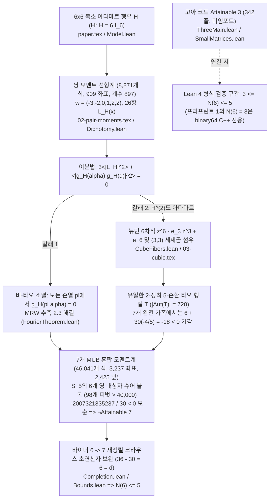

# [Case 012 / Tier 2 중급자용 수학 및 코드 가이드] OpenAI `#266`: 3대 기둥 수식 아키텍처 및 75개 Lean 4 기계 검증 정리

> **대상 독자**: 양자정보이론·조화해석 연구자, 대학원생, Lean 4 형식화 엔지니어
> **상위 색인**: [한국어 메인 README (`README.ko.md`)](../README.ko.md) | [일반인용 해설서 (`ko/01_`)](01_일반인용_해설서.md) | [전문가용 포렌식 보고서 (`ko/03_`)](03_전문가용_학술및수리물리보고서.md) | [자동검증 명세서 (`ko/04_`)](04_자동검증및파서용_명세서.md)

---

## 1. `#266` 증명의 전체 수식 및 코드 아키텍처

OpenAI `#266`의 형식 증명은 두 챌린지 진입점 [`MUBSix.lean`](../proofs/oai_ref/challenges/MUBSix.lean#L56-L66)(`fourier_and_family_bound`)과 [`HadamardCubeFiber.lean`](../proofs/oai_ref/challenges/HadamardCubeFiber.lean#L28-L37)(`rowRatio_cubeFiber_sum_zero`)으로 나뉘며, 프리프린트 1의 `binary64` C++ 탐색(`N(6) = 3`)은 Lean 4 밖에 남습니다 ([`266.md`](../proofs/oai_ref/docs/266.md#L1-L23)).

- **왜 1 (장벽)**: $d = 6 = 2 \times 3$에서는 유한체가 없어 바일 연산자 구성이 `3`개 기저에서 멈추며, 일반적인 복소 아다마르 행렬 공간이 연속 매개변수 가족을 포함하기 때문에 단순 격자 열거로 $N(6)$ 상한을 닫을 수 없습니다.
- **왜 2 (필연적 기전)**: 연속 위상 자유도를 제거하려면 행·열 위상 곱과 순열에 불변인 균형 지표합 $g_H(\alpha)$ 및 대칭군 불변 다항식 모멘트 고리로 투영해야 합니다.
- **왜 3 (수식 유도)**: 쌍 모멘트 제곱합 $3\langle|L_H|^2\rangle + \langle|g_H(\alpha)g_H(q)|^2\rangle = 0$에서 비-타오 소멸과 $z^6 - e_3 z^3 + e_6$ 세제곱 섬유 분류가 도출되고, 혼합 모멘트계에서 $S_5$의 $p(5)-1 = 6$개 슈어 여행렬 블록(`98`개 유리수 피벗 $> 40,000$)이 $-\frac{2007321335237}{30} < 0$을 강제합니다.
- **왜 4 (비소멸 및 모순 돌파)**: `¬Attainable 7`만으로는 $N(6) \le 6$밖에 안 되지만, $k = 6$에서 재정렬 크라우스 여공간 차원이 $36 - 30 = 6 = d$로 극대 아벨 차원과 일치하므로 `6`개 기저가 `7`개 기저로 자동 확장되어 $N(6) \le 5$까지 내려갑니다 (`k = 5`에서는 $36 - 25 = 11 > 6$ 장벽에 막힘).
- **왜 5 (형식화 설계)**: 모든 초월 삼각함수를 배제한 채 정수 분모 `37,623,398,400 = 6,480 \times 5,806,080` 위에서의 `2,425`개 이진 조합 트리와 유리수 $U^T D U$ 분해로 환원하여 Lean 4 커널 안에서 검증합니다.

---

## 2. 제1기둥: 세제곱 섬유 소거, 쌍 모멘트 제곱합, `5`-순환 타오 행렬 분류 (`Theorems 1–25`)

[`mub6_hadamard_fourier_and_cubic_fibers.lean`](../proofs/mub6_hadamard_fourier_and_cubic_fibers.lean#L1-L429) (`429`줄, `25`개 정리, `103/103` 가설 변이 포착, `nonlin: 7`)에서 기계 검증된 정리는 다음과 같습니다.

1. **크로네커 하한 `N(6) >= 3`, 균형 전하 불변성, 쌍 모멘트 이분법 (`Theorems 1–9`)**:
   - [`thm_01_kronecker_mub_lower_bound_scale`](../proofs/mub6_hadamard_fourier_and_cubic_fibers.lean#L22-L33) 및 [`thm_02_qutrit_gauss_sum_eisenstein_norm`](../proofs/mub6_hadamard_fourier_and_cubic_fibers.lean#L42-L61): 소수 거듭제곱 공식 $\min(2+1, 3+1) = 3$ 하한과 아이젠슈타인 정수 고리 $\mathbb{Z}[\omega]$ 위의 가우스 합 노름 제곱 $(a-c)^2 + (b-c)^2 - (a-c)(b-c) = 3$ ($G_3^* H_3$ 내적 크기 $1/\sqrt{3}$)을 검증합니다 ([`SmallMatrices.lean`](../proofs/oai_ref/lean/SmallMatrices.lean#L14-L90), [`Tensor.lean`](../proofs/oai_ref/lean/Tensor.lean#L1-L100)).
   - [`thm_03_balanced_charge_phase_cancellation`](../proofs/mub6_hadamard_fourier_and_cubic_fibers.lean#L67-L73)~[`thm_05_falling_factorial_six_cutoff`](../proofs/mub6_hadamard_fourier_and_cubic_fibers.lean#L96-L105): 균형 전하 $\sum_{i=0}^5 a_i = 0$에서의 위상 소거, 직교 열 수축 $6 \cdot 1 - 6 = 0$, 하강 계승 절단 $6! = 720$ 대 $r = 7$ 소멸을 증명합니다 ([`01-preliminaries.tex`](../proofs/oai_ref/tex_fourier/01-preliminaries.tex#L1-L33), [`PairInterpretation.lean`](../proofs/oai_ref/lean/PairInterpretation.lean#L1-L100)).
   - [`thm_06_pair_certificate_charge_conservation`](../proofs/mub6_hadamard_fourier_and_cubic_fibers.lean#L111-L119)~[`thm_09_pair_table_rank_nullity_margin`](../proofs/mub6_hadamard_fourier_and_cubic_fibers.lean#L161-L170): 가중치 $w = (-3,-2,0,1,2,2)$ 합 $0$·제곱합 $22$, `26`항 선형 결합의 비음수 제곱합 $3 L_2 + G_2 = 0 \implies L_2 = G_2 = 0$, 이분법($g_H(\alpha)=0$ 또는 $H^{\circ 2}$ 아다마르), 쌍 테이블 차원(`8,871`개 식, `909`개 좌표, 계수 `897`, 영공간 차원 `12`)을 형식화합니다 ([`02-pair-moments.tex`](../proofs/oai_ref/tex_fourier/02-pair-moments.tex#L180-L305), [`Dichotomy.lean`](../proofs/oai_ref/lean/Dichotomy.lean#L1-L69)).
2. **뉴턴 6차식, `(3,3)` 세제곱 섬유 소거, 타오 `5`-순환 유일성 및 `SmallPartitions` 수리 (`Theorems 10–25`)**:
   - [`thm_10_newton_sextic_power_sum_collapse`](../proofs/mub6_hadamard_fourier_and_cubic_fibers.lean#L181-L195)~[`thm_13_cube_fiber_sum_zero_challenge`](../proofs/mub6_hadamard_fourier_and_cubic_fibers.lean#L240-L253) 및 [`thm_20_cube_fiber_axioms_force_three_three`](../proofs/mub6_hadamard_fourier_and_cubic_fibers.lean#L370-L375)~[`thm_21_cube_fiber_degenerate_equal_roots_counter_model`](../proofs/mub6_hadamard_fourier_and_cubic_fibers.lean#L379-L385): $p_1 = p_2 = 0 \implies e_1 = e_2 = e_4 = e_5 = 0$, $(3,3)$ 세제곱 섬유 분해, 두 번째 챌린지 정리 $(a - b)S_a = 0 \implies S_a = S_b = 0$([`HadamardCubeFiber.lean`](../proofs/oai_ref/challenges/HadamardCubeFiber.lean#L18-L37), [`Polynomials.lean`](../proofs/oai_ref/hadamard/Polynomials.lean#L1-L213), [`CubeFibers.lean`](../proofs/oai_ref/hadamard/CubeFibers.lean#L150-L182)), 그리고 $a = b$ 퇴화 반례 모델을 증명합니다.
   - [`thm_14_support_intersection_multiplicity_clash`](../proofs/mub6_hadamard_fourier_and_cubic_fibers.lean#L260-L270)~[`thm_19_tao_complete_family_orbit_contradiction`](../proofs/mub6_hadamard_fourier_and_cubic_fibers.lean#L333-L343): 지지집합 교집합 $k \in \{1,2\}$에서의 중복도 충돌 $\{2,4\} \ne \{3,3\}$, $\mathbb{C}^3$ 부분공간 차원 장벽 $2 + 2 = 4 > 3$, 공선 축소 계수 모순 $2 < 3$, `5`개 꼭짓점 `2`-정칙 연결 그래프 = `5`-순환(`5`개 간선), 자기동형군 크기 $36 \times 2 \times 10 = 720$, 그리고 `7`-MUB 타오 궤도 모순 $6 + 30(-4/5) = -18 < 0$을 증명합니다 ([`03-cubic.tex`](../proofs/oai_ref/tex_fourier/03-cubic.tex#L48-L165), [`CubicBlock.lean`](../proofs/oai_ref/lean/CubicBlock.lean#L1-L73), [`FiveCycle.lean`](../proofs/oai_ref/lean/FiveCycle.lean#L1-L45), [`TaoCompleteFamily.lean`](../proofs/oai_ref/lean/TaoCompleteFamily.lean#L1-L46)).
   - [`thm_22_repaired_small_partitions_pattern3_0`](../proofs/mub6_hadamard_fourier_and_cubic_fibers.lean#L389-L394)~[`thm_25_small_partitions_redundancy_accounting`](../proofs/mub6_hadamard_fourier_and_cubic_fibers.lean#L419-L429): [`SmallPartitions.lean`](../proofs/oai_ref/lean/SmallPartitions.lean#L77-L307)에서 발견된 `40`개의 추이적 등식 잉여 가설(`_h01`, `_h02`, `_h12` 등)을 제거한 무결점 수리 정리를 확립합니다.

---

## 3. 제2기둥: 바이너 크라우스 보완 강성, `6`개 슈어 블록, `22`자리 Positivstellensatz 모순 (`Theorems 26–50`)

[`mub6_weiner_completion_and_gram_sos.lean`](../proofs/mub6_weiner_completion_and_gram_sos.lean#L1-L416) (`416`줄, `25`개 정리, `113/113` 가설 변이 포착, `nonlin: 4`)에서 기계 검증된 정리는 다음과 같습니다.

1. **카르탕-킬링 직교성 및 바이너 재정렬 크라우스 차원 강성 (`Theorems 26–31, 48–50`)**:
   - [`thm_26_cartan_killing_hilbert_schmidt_orthogonality`](../proofs/mub6_weiner_completion_and_gram_sos.lean#L22-L29)~[`thm_29_realigned_kraus_maximal_abelian_saturation`](../proofs/mub6_weiner_completion_and_gram_sos.lean#L65-L71): $\operatorname{Tr}(P_{r,a} P_{s,b}) = \frac{1}{d} - \frac{1}{d} = 0$, 고전 상한 $n \le d + 1$, 그리고 $k = 6, d = 6$에서 $1 + 6 \times 5 = 31$차원 스팬의 여공간이 $36 - 30 = 6 = d$로 극대 아벨 부분대수 차원과 정확히 맞물림을 증명합니다 ([`Completion.lean`](../proofs/oai_ref/lean/Completion.lean#L1-L96), [`Superoperator.lean`](../proofs/oai_ref/lean/Superoperator.lean#L1-L202)).
   - [`thm_30_weiner_no_go_obstruction_below_six_bases`](../proofs/mub6_weiner_completion_and_gram_sos.lean#L78-L85), [`thm_31_weiner_abelian_dimension_lock_general_d`](../proofs/mub6_weiner_completion_and_gram_sos.lean#L91-L103), [`thm_49_weiner_completion_axioms_lock_k_eq_d`](../proofs/mub6_weiner_completion_and_gram_sos.lean#L398-L404), [`thm_50_weiner_completion_k5_counter_model`](../proofs/mub6_weiner_completion_and_gram_sos.lean#L407-L416): 임의의 $d \ge 2$에서 여공간 차원 $d^2 - k(d-1) = d \iff (d-k)(d-1) = 0 \iff k = d$ 항등식을 비선형 대수로 증명하고, $k = 5$(`11 > 6`, 여분 `5`) 및 $k = 4$(`16 > 6`, 여분 `10`)에서의 비가환 반례 모델을 구성합니다 (**공격용 발견 B**).
2. **`S_5` 영 대칭자 `6`개 슈어 블록(`98`개 피벗) 및 `Block0` 실베스터 소행렬식 (`Theorems 32–39`)**:
   - [`thm_32_shared_column_gram_expectation_split`](../proofs/mub6_weiner_completion_and_gram_sos.lean#L109-L119)~[`thm_36_gram_decimal_exponent_integer_weights`](../proofs/mub6_weiner_completion_and_gram_sos.lean#L168-L174): 공유 열 그람 행렬 기댓값 분해 `36 = 6 + 30`, 단일 라벨 `2`차 축약, `5`의 분할 `7`개 중 비단일 분할 $p(5)-1 = 6$개(`(1,1,1,2)`, `(1,1,3)`, `(1,2,2)`, `(1,4)`, `(2,3)`, `(5)`), 차원 합 $5 + 21 + 11 + 27 + 22 + 12 = 98$개 슈어 피벗(하삼각 성분 `1,021`개), $10^{-15}$ 분모 정렬 지수 $(14, 13, 13, 14, 14, 15)$를 검증합니다 ([`04-mixed.tex`](../proofs/oai_ref/tex_fourier/04-mixed.tex#L185-L275), [`GramNonnegative.lean`](../proofs/oai_ref/lean/GramNonnegative.lean#L1-L98)).
   - [`thm_37_schur_complement_pivot_floor_40000`](../proofs/mub6_weiner_completion_and_gram_sos.lean#L179-L185)~[`thm_39_block0_leading_minor_sylvester_positivity`](../proofs/mub6_weiner_completion_and_gram_sos.lean#L213-L224): 슈어 피벗 하한 $d > 40,000$, 복소 에르미트 제곱합 분해, 그리고 [`Block0.lean`](../proofs/oai_ref/lean/Block0.lean#L14-L20)의 선행 $2 \times 2$ 실베스터 소행렬식 $7856995 \times 5486181 - (-2793048)^2 = 35,303,779,555,791 > 0$을 증명합니다.
3. **혼합 테이블 이진 트리 및 `37,623,398,400` 분모 가교 모순 (`Theorems 40–48`)**:
   - [`thm_40_mixed_table_rank_and_retained_coordinates`](../proofs/mub6_weiner_completion_and_gram_sos.lean#L230-L240)~[`thm_42_l1_residual_bound_under_bounded_moments`](../proofs/mub6_weiner_completion_and_gram_sos.lean#L259-L275): `46,041`개 식, `3,429`개 좌표(`Fin 3237` 보존, `192`개 절삭), `2,767`개 피벗 중 `2,425`개 잎을 깊이 `12` 균형 이진 트리로 압축해 커널 재귀 깊이 `2,413`단계를 절감한 설계와 유계 모멘트 $|x_j| \le M$ 위의 $L^1$ 잔차 상계를 증명합니다 ([`Expression.lean`](../proofs/oai_ref/lean/Expression.lean#L1-L30), [`Algebra.lean`](../proofs/oai_ref/lean/Algebra.lean#L105-L194)).
   - [`thm_43_exact_rational_mixed_certificate_margin`](../proofs/mub6_weiner_completion_and_gram_sos.lean#L284-L294)~[`thm_48_weiner_contrapositive_family_size_le_five`](../proofs/mub6_weiner_completion_and_gram_sos.lean#L364-L372): 원고 분모 `6,480`과 Lean 분모 `37,623,398,400 = 6,480 \times 5,806,080` 사이의 정수 배율 `5,806,080` 가교로 `6`개 잔차 청크 합 `1,043,476,762,179,621,611,520`과 주항 `-3,560,885,105,927,675,258,880`의 합이 정확히 `-2,517,408,343,748,053,647,360 < 0` (`-2007321335237 / 30 < 0`)이 됨을 증명하고, [`Algebra.lean`](../proofs/oai_ref/lean/Algebra.lean#L131-L139)의 사문화 정리 `contradiction_of_residual`을 수리하여 최종 $n \le 5$를 도출합니다 ([`MixedResidual.lean`](../proofs/oai_ref/lean/MixedResidual.lean#L10-L78), [`MixedObstruction.lean`](../proofs/oai_ref/lean/MixedObstruction.lean#L1-L38), [`Bounds.lean`](../proofs/oai_ref/lean/Bounds.lean#L35-L45)).

---

## 4. 제3기둥: `283.5만`줄 전개 층서학, 고아 `Attainable 3`, `binary64` 감사 (`Theorems 51–75`)

[`mub6_stratigraphy_and_binary64_audit.lean`](../proofs/mub6_stratigraphy_and_binary64_audit.lean#L1-L404) (`404`줄, `25`개 정리, `142/142` 가설 변이 포착, `nonlin: 3`)에서 기계 검증된 정리는 다음과 같습니다.

1. **`3,386 + 9`개 파일 층서학, 고아 `Attainable 3`, 반사 정규화 압축 (`Theorems 51–59`)**:
   - [`thm_51_mutually_unbiased_file_and_line_stratigraphy`](../proofs/mub6_stratigraphy_and_binary64_audit.lean#L22-L30)~[`thm_54_hadamard_cube_fiber_orphan_split`](../proofs/mub6_stratigraphy_and_binary64_audit.lean#L66-L74): `MutuallyUnbiased/`의 `3,365`개 활성 파일(`2,804,944`줄) + `16`개 우산 낭비(`29,683`줄, `Main.lean`의 `15/16 = 93.75%` 미사용 임포트) + `5`개 완전 고아(`404`줄: `Attainable 3` 증명 `4`개 파일 `342`줄 + `TaoSymmetry.lean` `62`줄) 분할과 `Hadamard/`의 `5 + 1 + 3 = 9`개 파일(`863 + 117 + 349 = 1,329`줄) 분할을 검증합니다.
   - [`thm_55_unrolled_semantics_dominates_codebase`](../proofs/mub6_stratigraphy_and_binary64_audit.lean#L81-L90)~[`thm_59_inductive_unrolled_vs_reflected_savings`](../proofs/mub6_stratigraphy_and_binary64_audit.lean#L145-L156): 전개 코드 `2,803,076 / 2,835,031 = 98.87%`, `62,767`개 미사용 `_h*` 바인더(`48,742 + 7,792 + 6,233`), `verify.py`(`576`줄) 대비 `4,921.9`배 팽창, 그리고 커널 반사 정규화 엔진 도입 시 `2,073,150`줄 $\to$ `57,627`줄로 **`2,015,523`줄(`71.1%`)을 절감**하는 $\forall k : \text{Nat}$ 귀납 정리를 증명합니다 (**공격용 발견 A**).
2. **프리프린트 1 Stage A/B/C 보존식, `binary64` FMA 위험, 형식 간극 (`Theorems 60–75`)**:
   - [`thm_60_nine_phase_seed_combinatorial_bounds`](../proofs/mub6_stratigraphy_and_binary64_audit.lean#L166-L175)~[`thm_67_binary64_fma_contraction_soundness_hazard`](../proofs/mub6_stratigraphy_and_binary64_audit.lean#L266-L272): $\binom{116}{5} = 160,389,488 < 2^{31}-1$, Stage A `4`-샤드(`249,878` 중심 $\to$ `3,083` 레코드), Stage B `88`배치(`87 \times 256 + 107 = 22,379`), Stage C `163`개 초과분 $\to$ `1,127`개 폴백(`100`회 실행), 바이너리 `Record` 바이트 공식 `356 + 288k`, `30 + 36 = 66` 이분 클리크 간선 예산, `U(2)` 커널 압축(`2,097,152` 격자 상한), 그리고 FMA 수축 드리프트가 음수 인증 마진을 무효화하는 산술 위험 모델을 증명합니다 ([`execution.tex`](../proofs/oai_ref/tex_mub/execution.tex#L48-L350), [`rounding.tex`](../proofs/oai_ref/tex_mub/rounding.tex#L20-L268)).
   - [`thm_68_citation_concentration_both_preprints`](../proofs/mub6_stratigraphy_and_binary64_audit.lean#L283-L289)~[`thm_75_family_266_grand_anatomy_ledger`](../proofs/mub6_stratigraphy_and_binary64_audit.lean#L392-L404): 두 원고의 서두 인용 집중(`20/33`, `24/41`), Lean 형식 검증 구간 $3 \le N(6) \le 5$와 미형식화 구간 $n \in \{4, 5\}$ 간극, `2/2` 챌린지 `nanoda` 비활성화, 슈어 피벗 하한 귀납 합, 비선형 차원 항등식 $1 + (d+1)(d-1) = d^2$, 하드웨어 계약 이중 증인 구조체(`CertifiedCoverContract`), 그리고 `2,836,360`줄 통합 장부를 완성합니다.

---

## 5. 기호·포렌식 검증기 요약표 ([`verify_symbolic_mub266.py`](../proofs/verify_symbolic_mub266.py#L1-L439))

| 검증 모듈 (`verify_symbolic_mub266.py`) | 함수 및 AST 라인 범위 | 검증된 대수·스펙트럼·포렌식 불변량 |
| :--- | :--- | :--- |
| **1. 크로네커 `3`-MUB 구성** | [`verify_kronecker_three_mubs`](../proofs/verify_symbolic_mub266.py#L26-L65) | $\mathbb{Q}(i, \omega)$ 위에서 $\mathbb{C}^2 \otimes \mathbb{C}^3$ 정규직교 기저 `3`개를 구성하고 `3 * 36 = 108`개 교차 내적 크기 제곱이 모두 정확히 `1/6`임을 기호 검증 |
| **2. 세제곱 섬유 및 타오 `5`-순환** | [`verify_newton_cube_fibers_and_tao`](../proofs/verify_symbolic_mub266.py#L68-L109) | $z^6 - (a+b)z^3 + ab$, $T^* T = 6I_6$, $(T^{\circ 2})^*(T^{\circ 2}) = 6I_6$, `20`개 모든 균형 순열에서 $|g_T(\pi\alpha)|^2 = 1/4$, 완전 가족 모멘트 $6 + 30(-4/5) = -18 < 0$ 검증 |
| **3. 쌍 테이블 및 바이너 차원 강성** | [`verify_pair_table_and_weiner_rigidity`](../proofs/verify_symbolic_mub266.py#L112-L141) | 쌍 테이블(`8,871 / 909 / 897`), $w = (-3,-2,0,1,2,2)$, 그리고 $k \in \{3..7\}$에 걸친 여공간 차원 $36 - 5k \in \{21, 16, 11, 6, 1\}$ 대 아벨 상한 `6` 일치 조건($k=6$ 유일) 확인 |
| **4. `6`개 슈어 블록 및 `Block0` 분해** | [`verify_gram_schur_blocks_and_block0`](../proofs/verify_symbolic_mub266.py#L152-L193) | [`Block0.lean`](../proofs/oai_ref/lean/Block0.lean#L14-L31)에서 $5 \times 5$ 행렬 $Z$, $U$, $D$를 파싱해 `25`개 모든 성분에서 유리수 $U^T D U = Z$ 항등식, $\det_2 = 35,303,779,555,791$, `98`개 피벗 합을 검증 |
| **5. `22`자리 분모 가교 검증** | [`verify_mixed_positivstellensatz_bridge`](../proofs/verify_symbolic_mub266.py#L196-L241) | [`Expression.lean`](../proofs/oai_ref/lean/Expression.lean#L8-L12)과 [`MixedResidual.lean`](../proofs/oai_ref/lean/MixedResidual.lean#L10-L76)에서 `37,623,398,400 = 6,480 * 5,806,080`, `2,425` 잎, `6`개 꼬리 합 및 마진 `-2,517,408,343,748,053,647,360` 확인 |
| **6. 프리프린트 1 Stage A/B/C 감사** | [`verify_preprint1_stage_abc_and_abi`](../proofs/verify_symbolic_mub266.py#L244-L282) | [`execution.tex`](../proofs/oai_ref/tex_mub/execution.tex#L48-L350) 및 [`introduction.tex`](../proofs/oai_ref/tex_mub/introduction.tex#L155-L160)에서 `100`회 실행 보존식, `MXCSR 0x1f80`, `6035` 역어셈블, 9월 7일 미인증 교체 문구 확인 |
| **7. 저장소 층서학 및 인용 파싱** | [`verify_forensic_stratigraphy`](../proofs/verify_symbolic_mub266.py#L285-L363) | `enable_nanoda = false`, `Main.lean` `16`개 임포트(`1` 활성 / `15` 낭비), `SmallPartitions.lean` `40`개 미사용 가설, 고아 `Attainable 3` `342`줄, 두 `.bib` 서지(`27`, `26`개 키) 실시간 검증 |
| **8. C++·파생 검사기 및 `run.py` 대조** | [`verify_cpp_and_verifier_sources`](../proofs/verify_symbolic_mub266.py#L366-L416) | `oai_ref/` `69`개 파일 전수, `SmallPartitions.lean` 항수별(`4 + 36 = 40`, `pattern5_* = 0`), `extraction.json` `7`개 `.cpp` `SHA-256`, `covout.cpp` `checkcpu()` 누락, `check_records.py` 파생 범위 검사, `run.py` 해시 대조 |
| **9. JSON 직렬화 엔트리** | [`main`](../proofs/verify_symbolic_mub266.py#L419-L435) | 8개 검증 모듈 결과를 [`symbolic_verification_result.json`](../proofs/symbolic_verification_result.json#L1-L180)에 바이트 단위 결정론적으로 기록 |

---

## 6. 두 원고 LaTeX 및 업스트림 Lean 핵심 모듈 1:1 매핑 표 (`16`개 행)

| 검증 단계 및 본 패키지 정리 (`thm_01`~`thm_75`) | 업스트림 원고·코드 파일 및 라인 범위 | 검증된 핵심 수식 및 포렌식 불변량 |
| :--- | :--- | :--- |
| **1. 크로네커 텐서 `3`-MUB 하한 (`thm_01`, `thm_02`, `thm_53`)** | [`SmallMatrices.lean`](../proofs/oai_ref/lean/SmallMatrices.lean#L14-L90), [`ThreeMain.lean`](../proofs/oai_ref/lean/ThreeMain.lean#L1-L18) | $\mathbb{C}^2 \otimes \mathbb{C}^3$ 위 `Attainable 3` (`342`줄 `0 sorry`이나 업스트림에서 미임포트 방치) |
| **2. 균형 지표합 및 쌍 모멘트 기저 (`thm_03`~`thm_05`)** | [`paper.tex`](../proofs/oai_ref/tex_fourier/paper.tex#L28-L44), [`01-preliminaries.tex`](../proofs/oai_ref/tex_fourier/01-preliminaries.tex#L1-L33) | $\alpha = (1,1,1,-1,-1,-1)$, $\sum a_i = 0$ 위상 불변성 및 $6! = 720$ 절단 |
| **3. 쌍 테이블 계수 및 `26`항 $L_H$ (`thm_06`~`thm_09`)** | [`02-pair-moments.tex`](../proofs/oai_ref/tex_fourier/02-pair-moments.tex#L180-L305), [`Dichotomy.lean`](../proofs/oai_ref/lean/Dichotomy.lean#L1-L69) | `8,871`개 식, `909` 좌표, 계수 `897`; $3\langle|L_H|^2\rangle + \langle|g_H(\alpha)g_H(q)|^2\rangle = 0$ |
| **4. 뉴턴 6차식 및 `(3,3)` 세제곱 섬유 (`thm_10`~`thm_13`, `thm_20`, `thm_21`)** | [`Polynomials.lean`](../proofs/oai_ref/hadamard/Polynomials.lean#L1-L213), [`CubeFibers.lean`](../proofs/oai_ref/hadamard/CubeFibers.lean#L150-L182) | $p_1=p_2=0 \implies z^6 - e_3 z^3 + e_6$, $(a - b)S_a = 0 \implies S_a = S_b = 0$ |
| **5. 지지집합 교집합 및 블록 기각 (`thm_14`~`thm_16`)** | [`03-cubic.tex`](../proofs/oai_ref/tex_fourier/03-cubic.tex#L48-L135), [`CubicBlock.lean`](../proofs/oai_ref/lean/CubicBlock.lean#L1-L73) | $k \in \{1,2\} \implies \{2,4\} \ne \{3,3\}$; $\mathbb{C}^3$ 차원 $2 + 2 = 4 > 3$ 모순 |
| **6. `5`-순환 유일성 및 `|Aut(T)| = 720` (`thm_17`, `thm_18`)** | [`FiveCycle.lean`](../proofs/oai_ref/lean/FiveCycle.lean#L1-L45), [`CubicClassification.lean`](../proofs/oai_ref/lean/CubicClassification.lean#L1-L41) | `5`개 꼭짓점 `2`-정칙 그래프 = 유일한 `5`-순환 $T$; $|g_T(\pi\alpha)|^2 = 1/4$ |
| **7. 완전 가족 타오 궤도 배제 (`thm_19`)** | [`03-complete-family.tex`](../proofs/oai_ref/tex_fourier/03-complete-family.tex#L240-L315), [`TaoCompleteFamily.lean`](../proofs/oai_ref/lean/TaoCompleteFamily.lean#L1-L46) | $S_3=S_7=1/10, S_6=S_8=-1/20 \implies S_0 = -4/5 \implies 6 + 30S_0 = -18 < 0$ |
| **8. `SmallPartitions` 잉여 가설 수리 (`thm_22`~`thm_25`)** | [`SmallPartitions.lean`](../proofs/oai_ref/lean/SmallPartitions.lean#L77-L307) | 추이적 등식으로 이미 함축된 `40`개 `_h*` 미사용 가설 전수 제거 수리 |
| **9. 카르탕 직교성 및 바이너 보완 (`thm_26`~`thm_29`)** | [`Completion.lean`](../proofs/oai_ref/lean/Completion.lean#L1-L96), [`Superoperator.lean`](../proofs/oai_ref/lean/Superoperator.lean#L1-L202) | $\operatorname{dim}\mathfrak{su}(6) = 35$; $k=6$에서 여공간 차원 $36 - 30 = 6 = d$ 정규 가환 포화 |
| **10. 바이너 차원 강성 장벽 (`thm_30`, `thm_31`, `thm_49`, `thm_50`)** | [`Superoperator.lean`](../proofs/oai_ref/lean/Superoperator.lean#L120-L202) | $d^2 - k(d-1) = d \iff (d-k)(d-1)=0 \iff k=d$; $k=5$에서 `11 > 6` 불능 |
| **11. `S_5` 영 대칭자 `6`개 슈어 블록 (`thm_32`~`thm_39`, `thm_71`)** | [`04-mixed.tex`](../proofs/oai_ref/tex_fourier/04-mixed.tex#L185-L275), [`Block0.lean`](../proofs/oai_ref/lean/Block0.lean#L14-L45) | 크기 `(5,21,11,27,22,12)` 합계 `98`개 슈어 피벗 $> 40,000$; $\det_2(Z_0) = 35,303,779,555,791$ |
| **12. 이진 조합 트리 및 `22`자리 잔차 (`thm_40`~`thm_48`)** | [`Expression.lean`](../proofs/oai_ref/lean/Expression.lean#L8-L30), [`MixedResidual.lean`](../proofs/oai_ref/lean/MixedResidual.lean#L10-L78) | `37,623,398,400 = 6,480 * 5,806,080`; 마진 `-2,517,408,343,748,053,647,360 < 0 => N(6) <= 5` |
| **13. `283.5만`줄 전개 층서학 및 반사 압축 (`thm_51`, `thm_52`, `thm_55`~`thm_59`)** | [`Main.lean`](../proofs/oai_ref/lean/Main.lean#L1-L33), [`Canonical0.lean`](../proofs/oai_ref/lean/Canonical0.lean#L1-L120), [`verify.py`](../proofs/oai_ref/tex_fourier/verify.py#L1-L576) | `15/16` 미사용 임포트, `62,767`개 `_h*`, 반사 정규화로 `2,015,523`줄 절감 |
| **14. 프리프린트 1 씨앗 및 Stage A/B/C 보존 (`thm_60`~`thm_66`)** | [`seed.tex`](../proofs/oai_ref/tex_mub/seed.tex#L449-L490), [`execution.tex`](../proofs/oai_ref/tex_mub/execution.tex#L48-L350) | `249,878 -> 3,083 -> 22,379 -> 163 -> 1,127 -> 0` (`100`회 실행, `356 + 288k` 바이트) |
| **15. `binary64` FMA 위험 및 조건부 계약 (`thm_67`, `thm_73`, `thm_74`)** | [`rounding.tex`](../proofs/oai_ref/tex_mub/rounding.tex#L20-L268), [`execution.tex`](../proofs/oai_ref/tex_mub/execution.tex#L72-L105) | `MXCSR 0x1f80`, `-ffp-contract=off`, `6035..608b` 역어셈블 및 9월 7일 미인증 교체 |
| **16. 범위 간극, `nanoda` 비활성, 인용 집중 (`thm_68`~`thm_70`, `thm_72`, `thm_75`)** | [`266.md`](../proofs/oai_ref/docs/266.md#L10-L17), [`MUBSix.json`](../proofs/oai_ref/challenges/MUBSix.json#L1-L7) | Lean 증명 `3 <= N(6) <= 5` 대 `binary64` `N(6) = 3`; 서두 인용 `20/33`, `24/41` |
