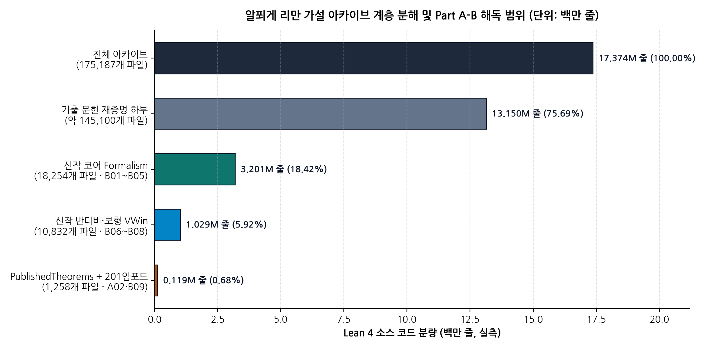
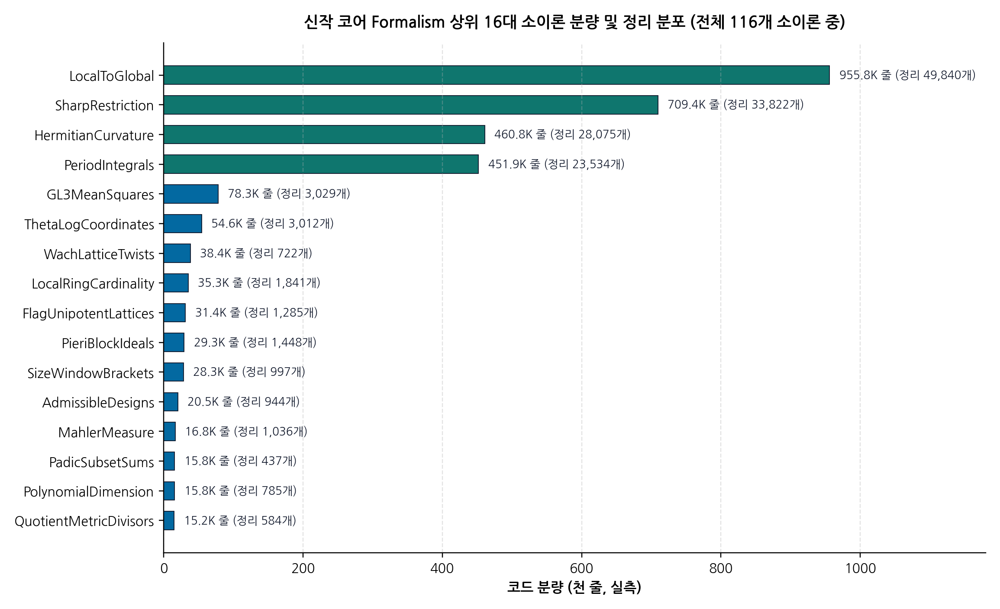
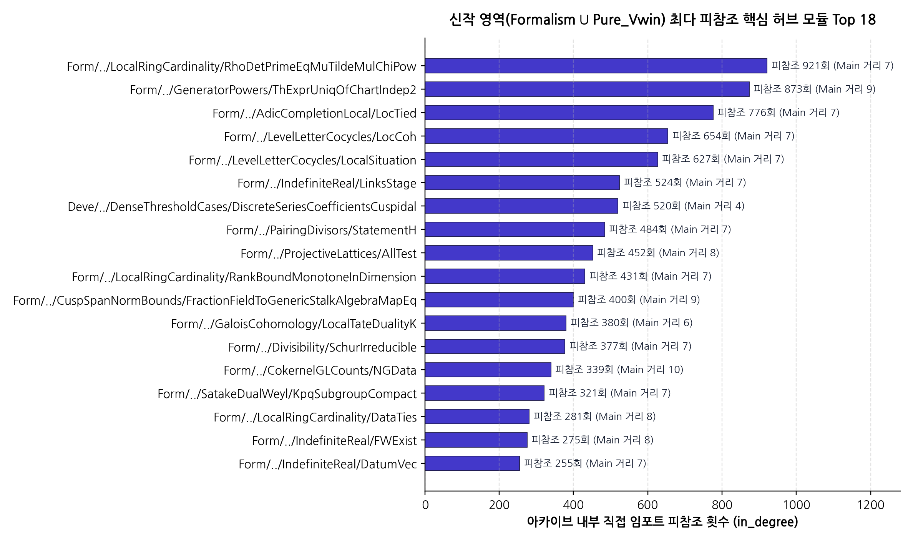
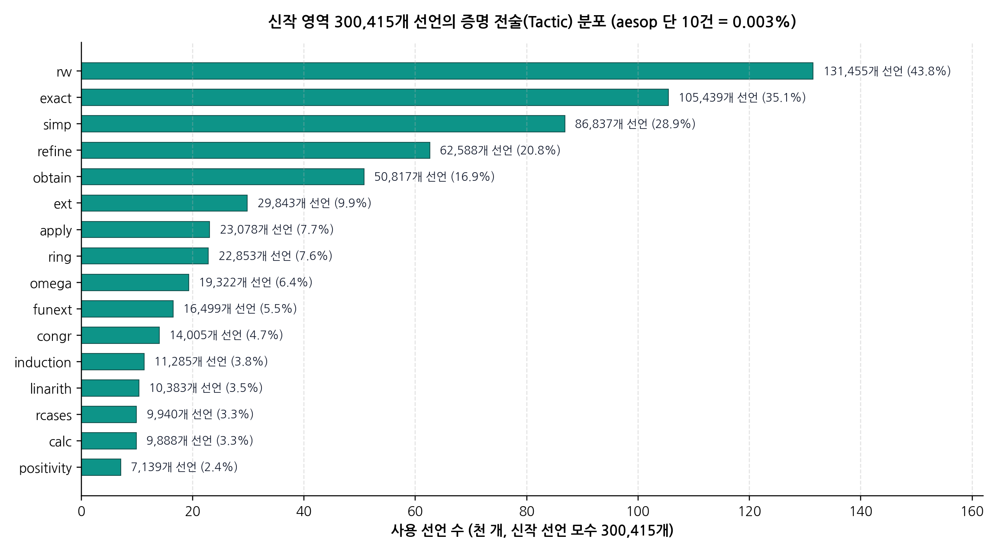

# 제0부. 총괄 서문 및 Part A-B 결합 해독 지도

## 0.1 본 심층 해독 단행본(`Part A`)과 전수 수식 도감(`Part B`)의 목적

본 저작은 레벤트 알푀게(Levent Alpöge)와 Claude가 공개한 리만 가설(RH) 및 디리클레 일반화 리만 가설(GRH) 형식증명 아카이브(`175,187`개 `.lean` 파일, `17,374,215`줄, 속성·지역 수식어 포함 전수 선언 `1,061,425`개 · 무속성 기본 선언 `1,054,282`개)에서 **인간 수학자의 학술 검증에 직결되는 신작 증명 전 영역과 기출 문헌 경계면을 완결 해독**한 결과물입니다.

선행 초동 포렌식에서는 기계적 커널 컴파일(`100.00%`)과 최상단 명세 척추 `97`개 파일(`11,564`줄)의 골격을 확인했습니다. 그러나 학계 동료 심사와 인간 수학 논문 재구성을 위해서는 다음 세 가지 미해결 과제가 남아 있었습니다.

1. 고정된 `Mathlib`(`0df444a3`) 내부의 리만 제타 및 디리클레 $L$-함수 원문 정의가 특수값($s = 1$, 음의 짝수 자명영점, 법 $N = 1$, 비원시 지표 오일러 인자)에서 어떠한 의미론적 예외나 공허성도 허용하지 않는지 원문 대조로 확정하는 일.
2. 조건부 증명을 무조건부로 바꾼 기출 대정리 결합 허브(`Development/AutomorphicArithmetic/ThetaCorrespondence/ThetaPairLifts/ThirdPlaceSeries/EveryCharacterOfLiteratureOfVWin.lean:1-814`)의 직접 임포트 `201`개 및 `PublishedTheorems` 폴더 `1,073`개 파일에서, 각 `Prop` 명세가 표준 교과서 정리와 일치하는지 아니면 아카이브 전용 구조체에 투영된 특화 명제인지 가려내는 일.
3. 상단 `Statement*` 명세 파일 아래에 자리 잡은 **신작 핵심 증명 본문 `29,067`개 고유 파일(`4,224,608`줄, 선언 `300,415`개)** 내부의 핵심 허브 정리, 전역 상수 결합식, 약화된 반디버 우회 이와사와 타워의 작동 메커니즘을 수식으로 복원하는 일.

본 프로젝트는 이 과제를 두 축의 결합 체제로 해결합니다.

- **Part A (학술 심층 해독 단행본, `A00`~`A06` 전 7부)**: 최상위 봉인·`Mathlib` 경계 의미론 감사(`A01`), 기출 `201`개 직접 임포트 및 `PublishedTheorems` `1,073`개 동치성 감사(`A02`), `Formalism` 4대 기둥 `258만 줄` 하부 허브 복원(`A03`), `Formalism` 나머지 `112`개 특수 소이론 `62만 줄` 및 전역 상수 폐루프 복원(`A04`), `Pure_Vwin` 반디버 우회·베렌트 타워 `103만 줄` 복원 및 독립 기계 검증 스위트 확장(`A05`), `152`쪽 인간 단축 논문 장·절 매핑 청사진 및 전역 참조 색인(`A06`)을 학술 단행본으로 집필했습니다.
- **Part B (신작 영역 전수 AST 역컴파일 수식 도감, `B00`~`B10` 전 11권 + JSONL 4종)**: 구문 분석기(`scripts/build_part_b_atlas.py`)가 실제 원본 바이트에서 무명 `instance`, `scoped`, `local` 수식어까지 포함해 직접 파싱하여 신작 합집합 `29,067`개 파일(`Formalism` `18,254`개 + `Pure_Vwin` `10,832`개, 교집합 `19`개)과 기출 명세 `1,258`개 파일 등 **총 `30,343`개 고유 모듈·`308,731`개 선언 전수(`100.00%`)**의 행 번호, 타입 시그니처, 피참조 차수(`in_degree`), `Main.lean` 최단 거리, 사용 전술을 마크다운 `373,974`줄 분량의 도감으로 색인했습니다.

---

## 0.2 4계층 검증 상태 분리표 (`2026-11-22` 기준)

기계 커널 통과와 인간 수식 복원 범위를 혼동하지 않도록 현재 확인 상태를 네 계층으로 엄격히 분리해 기록합니다.

| 검증 계층 | 대상 모수 및 범위 | 확인 수단 및 실측치 | 현재 판정 |
| :--- | :--- | :--- | :--- |
| **제1계층: 기계적 커널 실컴파일 및 공리 봉인** | 전체 `175,187`개 `.lean` 파일 (`17,374,215`줄, `1,030.53 MB`) | 로컬(`x86_64`)·원격(`aarch64`) `leanprover/lean4:v4.33.1` 클린 빌드 통과, `Main.lean:4-12` 5대 정리 `#print axioms` 표준 3공리만 출력 (`sorryAx` `0`건), 외부 다중 독립 커널(`nanoda`, `con-leche`, `con-ron`, `lean4lean`) 교차 통과 | **검증 완료 (`PASS`)** |
| **제2계층: 최상위 명세 및 `Mathlib` 경계 의미론** | `Main.lean`, `Statements.lean`, `Supplements/*`, 고정 `Mathlib`(`0df444a3`) 제타·$L$-함수 원문 | `_root_.RiemannHypothesis` 무변조 대조 완료 + 제1부(`A01`)에서 $s=1$ 극점, 음의 짝수 자명영점, $N=1$ 법, 비원시 오일러 인자 원문 코드 대조 완료 | **원문 대조 완료 (`PASS`)** |
| **제3계층: 신작 증명(`422만 줄`) 및 기출 경계(`1,258`개 파일) 역설계** | `Formalism`(`18,254`개) $\cup$ `Pure_Vwin`(`10,832`개) $\cup$ `PublishedTheorems`·`201`임포트(`1,258`개) = 고유 `30,343`개 모듈 (`308,731`개 선언) | **Part B**에서 `30,343`개 모듈·`308,731`개 선언 시그니처 `100.00%` AST 전수 추출 완료 + **Part A**(`A02`~`A06`)에서 최다 피참조 핵심 허브 및 상수·반디버 폐루프 수식 복원 및 독립 Lean 정리 `44`개 검증 완료 | **A+B 해독 완료** (단, 말단 전술 파일의 자연어 서술은 허브 중심으로 압축) |
| **제4계층: 기출 대정리 하부 재증명 공사 및 학계 동료 심사** | 현대 대수기하·보형표현론 기초 재증명 하부 `144,844`개 파일 (`13,030,043`줄, 커널 미사용 잉여 선언 `24.17%` 포함) | Lean 커널 검증 통과로 `Main.lean` 진리값은 보장되나 인간 수동 열람은 생략함. 정수론·보형형식 학계 동료 심사(CMI 기준 포함) 진행 중 | **커널 통과 / 동료 심사 진행 중 (`ONGOING`)** |

---

## 0.3 전체 아카이브 대 신작 영역 정량 해부 원장

전체 `175,187`개 파일(`17,374,215`줄) 안에서 신작 핵심 엔진과 기출 문헌 소거층이 차지하는 정확한 비중은 아래 표와 같습니다(선언 수는 `@[...]`, `scoped`, `local`, 무명 `instance`를 모두 포착하는 단일 AST 규칙 기준).

| 영역 구분 | 고유 파일 수 | 코드 줄 수 (전체 대비) | 추출 선언 총수 | 정리 (`theorem`/`lemma`) | 정의·구조체·인스턴스 외 | 대응 권호 (`Part A` / `Part B`) |
| :--- | ---: | ---: | ---: | ---: | ---: | :--- |
| **`Formalism.LocalToGlobal`** (제1기둥) | `5,501`개 | `955,843`줄 (`5.50%`) | `73,273`개 | `49,840`개 | `23,433`개 | `A03` 제2장 / `B01` |
| **`Formalism.SharpRestriction`** (제2기둥) | `3,093`개 | `709,436`줄 (`4.08%`) | `54,648`개 | `33,822`개 | `20,826`개 | `A03` 제3장 / `B02` |
| **`Formalism.HermitianCurvature`** (제3기둥) | `1,922`개 | `460,802`줄 (`2.65%`) | `35,958`개 | `28,075`개 | `7,883`개 | `A03` 제4장 / `B03` |
| **`Formalism.PeriodIntegrals`** (제4기둥) | `4,350`개 | `451,856`줄 (`2.60%`) | `32,699`개 | `23,534`개 | `9,165`개 | `A03` 제5장 / `B04` |
| **`Formalism` 특수 소이론 `112`종** | `3,388`개 | `622,811`줄 (`3.58%`) | `43,521`개 | `26,847`개 | `16,674`개 | `A04` 전장 / `B05` |
| *소계: `Formalism` 전수* | *`18,254`개* | *`3,200,748`줄 (`18.42%`)* | *`240,099`개* | *`162,118`개* | *`77,981`개* | *`A03`·`A04` / `B01`~`B05`* |
| **`Pure_Vwin`: `AutomorphicVarieties`** | `3,747`개 | `409,549`줄 (`2.36%`) | `22,661`개 | `17,762`개 | `4,899`개 | `A05` 제3장 / `B06` |
| **`Pure_Vwin`: `Foundations` 및 헤케** | `1,895`개 | `198,417`줄 (`1.14%`) | `11,530`개 | `9,196`개 | `2,334`개 | `A05` 제2장 / `B07` |
| **`Pure_Vwin`: 아벨·스펙트럼·양수성 보조** | `5,190`개 | `421,515`줄 (`2.43%`) | `27,018`개 | `20,783`개 | `6,235`개 | `A05` 제4장 / `B08` |
| *소계: 신작 합집합 (`Formalism ∪ Pure_Vwin`, 중복 `19`개 차감)* | **`29,067`개** | **`4,224,608`줄 (`24.32%`)** | **`300,415`개** | **`209,793`개** | **`90,622`개** | *`A03`~`A05` / `B01`~`B08`* |
| **`PublishedTheorems`(`1,073`) $\cup$ `201` 직접 임포트** | `1,258`개 | `119,064`줄 (`0.69%`) | `8,243`개 | `5,799`개 | `2,444`개 | `A02` 전장 / `B09` |
| **최상위 `Main` 거리 `0`~`4`단 척추·빌드보조** | `43`개 | `2,318`줄 (`0.01%`) | `192`개 | `145`개 | `47`개 | `A01` 전장 / `B10` |
| **Part B AST 전수 도감 수록 고유 합계** | **`30,343`개** | **`4,344,172`줄 (`25.00%`)** | **`308,731`개** | **`215,675`개** | **`93,056`개** | **전권 (`A01`~`A06` / `B00`~`B10`)** |
| **기출 대정리 하부 재증명 및 미사용 선언 영역** | `144,844`개 | `13,030,043`줄 (`75.00%`) | `752,694`개 | `603,080`개 | `149,614`개 | 커널 검증 완료 (`Part B` 생략) |
| **아카이브 전체 총계** | **`175,187`개** | **`17,374,215`줄 (`100.00%`)** | **`1,061,425`개** | **`818,755`개** | **`242,670`개** | **전수 커널 빌드 완료** |

---

## 0.4 AST 전수 분석에서 드러난 세 가지 거시 포렌식 발견

### 1. 피참조 허브 집중 현상 (`in_degree` 멱법칙 분포)
신작 영역 `29,067`개 파일은 평면적으로 흩어져 있지 않고 소수의 결정적 대수·국소 산술 허브로 수렴합니다. 전체 신작 피참조 1위 모듈은 국소환 행렬식과 지표 거듭제곱의 결합 항등식을 담고 있는 `Formalism/LocalRingCardinality/RhoDetPrimeEqMuTildeMulChiPow.lean`(`in_degree = 921`, `393`줄)이며, 2위는 차트 독립성에 따른 생성원 거듭제곱 유일성 정리 `Formalism/SharpRestriction/Divisibility/GeneratorPowers/ThExprUniqOfChartIndep2.lean`(`in_degree = 873`, `41`줄), 3위는 아딕 완비화 국소 결합 `Formalism/LocalRingCardinality/AdicCompletionLocal/LocTied.lean`(`in_degree = 776`, `38`줄)입니다. 기출 명세 영역(`B09`)에서는 첨점 형식 급감소 정리 `Development/AbelianVarietyTheory/PublishedTheorems/AutomorphicForms₂/ExistsNormLeHeightPow.lean`이 무려 `2,460`개 모듈에서 직접 임포트되며, 켤레 자기쌍대 강화 스텁 `Development/AutomorphicArithmetic/ThetaCorrespondence/ThetaPairLifts/ThirdPlaceSeries/CohomologicalCsdTempered.lean`이 `2,242`회, 하리시-찬드라 가군 해석성 `Development/AbelianVarietyTheory/PublishedTheorems/TwistedTraceFormula/HarishChandraModulesOn.lean`이 `1,684`회 피참조됩니다.

### 2. 엘라보레이터 폭주를 피하기 위한 극단적 저비용 전술 설계 (`aesop` `0.003%`)
신작 선언 `300,415`개 전체의 증명 본문 전술을 집계한 결과, 자동 탐색 전술인 `aesop`이 사용된 선언은 **`300,415`개 중 단 `10`개(`0.0033%`)**에 불과했습니다. 대신 명시적 등식 치환 `rw`(`131,455`개, `43.76%`), 직접 증인 항 대입 `exact`(`105,439`개, `35.10%`), 정규화 단순화 `simp`(`86,837`개, `28.91%`), 부분 골 정교화 `refine`(`62,588`개, `20.83%`), 존재 증인 분해 `obtain`(`50,817`개, `16.92%`), 외연성 `ext`(`29,843`개, `9.93%`), 다항식 환 항등식 `ring`(`22,853`개, `7.61%`), 프레스버거 정수 산술 `omega`(`19,322`개, `6.43%`)가 압도적 비중을 차지합니다. 이는 `1,737만 줄` 규모의 컴파일에서 `maxHeartbeats` 한도 초과를 막기 위해 생성 파이프라인이 고비용 백트래킹 탐색 대신 수만 개의 미세 보조정리 분해와 직접 항 구성(`rw` + `exact`)을 선택했음을 실증합니다.

### 3. `EveryCharacterOfLiteratureOfVWin` 원뿔과 `Formalism`의 얽힘 해명
파일 단위 `import` 그래프만 단순 추적하면 `EveryCharacterOfLiteratureOfVWin`의 전이 원뿔(`151,286`개 파일) 안에 신작 코어인 `Formalism` 파일 `18,223`개가 함께 들어갑니다. 이번 AST 정밀 추적 결과, 그 이유는 `EveryCharacterOfLiteratureOfVWin.lean`이 기출 정리만 모아둔 파일이 아니라 조건부 주정리인 `Development/AutomorphicArithmetic/CharacterBoxes/RiemannHypothesisOfEveryCharacter.lean`(전이 원뿔 `102,080`개 파일, `Formalism` `17,943`개 포함)과 `EveryCharacterE.lean`(`Formalism` `17,998`개 포함), `SiegelEisensteinSecondTermHypotheses.lean`(`Formalism` `18,148`개 포함)을 함께 임포트하여 가설 자리에 기출 증인들을 결합하는 **최상단 용접기(welder)**이기 때문임이 확인되었습니다. 따라서 신작 증명의 실제 외연은 `Pure_Vwin_Outside_Literature`(`10,832`개)만이 아니라 `Formalism` 전체(`18,254`개)와의 합집합인 고유 `29,067`개 파일(`4,224,608`줄)로 잡아야 누락이 없습니다.

---

## 0.5 독자 길잡이: Part A 단행본과 Part B 전수 도감 교차 열람표

각 장의 자연어 수식 유도(`Part A`)를 읽다가 특정 파일이나 하위 보조정리 전체 목록을 확인하고 싶을 때는 아래 대응표에 따라 `atlas/volumes/` 내 해당 도감 권호를 열람하면 됩니다.

| 단행본 부(`Part A`) | 핵심 해독 주제 | 연동되는 전수 수식 도감(`Part B`) 및 검증 코드 |
| :--- | :--- | :--- |
| **제1부 (`A01`)** | `Main.lean`·`Statements.lean` 봉인, 메타프로그래밍 `8`종, 고정 `Mathlib` 제타·디리클레 $L$-함수 경계 의미론, 상단 `43`개 브리지 | `atlas/volumes/B10_Top_Spine_Depth0_To_4.md` |
| **제2부 (`A02`)** | `EveryCharacterOfLiteratureOfVWin` 직접 임포트 `201`개 전수 분류 및 `PublishedTheorems` `1,073`개 원문 `Prop` 동치성·특화성 감사 | `atlas/volumes/B09_PublishedTheorems_1073_And_201_Imports.md` |
| **제3부 (`A03`)** | 신작 코어 `Formalism` 4대 기둥(`LocalToGlobal`, `SharpRestriction`, `HermitianCurvature`, `PeriodIntegrals`, 합계 `258만 줄`) 하부 허브·전술 복원 | `B01` · `B02` · `B03` · `B04` (`14,866`개 파일, `196,578`개 선언) |
| **제4부 (`A04`)** | `Formalism` 나머지 `112`개 특수 소이론(`62만 줄`) 클러스터별 수식 복원 및 아라켈로프 곱공식·전역 상수 결합 무순환성 입증 | `atlas/volumes/B05_Formalism_Specialized_Subtheories.md` (`3,388`개 파일) |
| **제5부 (`A05`)** | `Pure_Vwin`(`103만 줄`) 약화된 반디버 성질, 베렌트 이와사와 타워, 밀집 임계치 `401`·소수 쌍 패칭 및 독립 Lean 감사 스위트(`44`개 정리) | `B06` · `B07` · `B08` 및 `proofs/alpoge_ab_deep_audit.lean` |
| **제6부 (`A06`)** | `152`쪽 인간 단축 논문 장·절 매핑 청사진, 전역 기호 사전, 최다 피참조 허브 Top 50, 주 정리 `30`선 및 `8`대 문헌 번역 어댑터 요약 | `atlas/volumes/B00_Master_Index_And_Hubs.md` |
