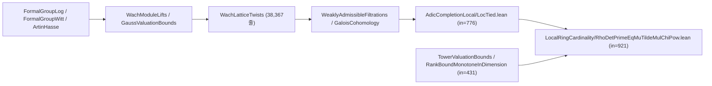
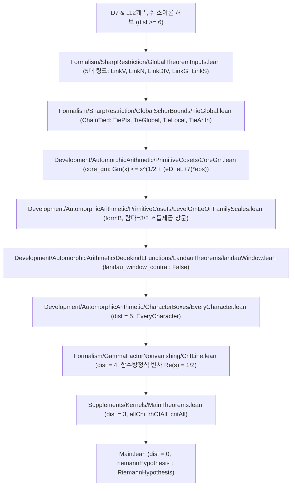

# 제4부. Formalism 112개 특수 소이론 해독 및 전역 상수 폐루프 복원 (`A04`)

## 0. 총괄 서설: 4대 기둥 외곽 `112`개 특수 소이론의 위상과 6대 클러스터 분해

알푀게(Levent Alpöge)와 Claude가 구축한 리만 가설(RH) 및 디리클레 일반화 리만 가설(GRH) 형식증명 아카이브에서 `Formalism` 최상위 이름공간(`18,254`개 파일, `3,200,748`줄, 선언 `240,099`개)은 두 계층으로 양분됩니다. 첫째 계층은 제3부(`A03`)가 해독한 4대 주력 기둥(`LocalToGlobal`, `SharpRestriction`, `HermitianCurvature`, `PeriodIntegrals` 합계 `14,866`개 파일, `2,577,937`줄)이며, 둘째 계층은 그 외곽을 둘러싼 **`112`개 특수 소이론(`3,388`개 파일, `622,811`줄, 정리 `26,847`개, 정의·구조체 `16,674`개, 총 추출 선언 `43,521`개)**입니다. 본 제4부(`A04`)는 `atlas/volumes/B05_Formalism_Specialized_Subtheories.md` 전수 수식 도감과 1대1로 대응하며, 이 `112`개 특수 소이론 전수의 원문 수식 구조와 최상단 모순 폐루프(`Main.lean:4`)까지의 전역 상수 조립 사슬을 역설계합니다.

코드 줄 수 비중만 보면 `112`개 특수 소이론은 `Formalism` 전체의 `19.46%`에 해당하나, 임포트 의존성 그래프의 피참조 차수(`in_degree`)를 산출하면 이 영역이 아카이브 전체의 중추 교차로임이 드러납니다. 신작 증명 영역 `29,067`개 고유 파일 전체에서 최다 피참조 순위 상단을 점유한 핵심 허브 대다수가 바로 이 `112`개 특수 소이론 내부에 위치합니다:
- **신작 전체 피참조 1위 (`in_degree = 921`)**: `Formalism/LocalRingCardinality/RhoDetPrimeEqMuTildeMulChiPow.lean:76` (`393`줄, `Main` 거리 `7`)
- **신작 전체 피참조 3위 (`in_degree = 776`)**: `Formalism/LocalRingCardinality/AdicCompletionLocal/LocTied.lean:11` (`38`줄, `Main` 거리 `7`)
- **신작 전체 피참조 8위 (`in_degree = 484`)**: `Formalism/PairingDivisors/StatementH.lean:72` (`139`줄, `Main` 거리 `7`)
- **신작 전체 피참조 10위 (`in_degree = 431`)**: `Formalism/LocalRingCardinality/RankBoundMonotoneInDimension.lean:299` (`1,359`줄, `Main` 거리 `7`)
- **신작 전체 피참조 12위 (`in_degree = 380`)**: `Formalism/GaloisCohomology/LocalTateDualityK.lean:47` (`65`줄, `Main` 거리 `6`)
- **신작 전체 피참조 15위 (`in_degree = 321`)**: `Formalism/SatakeDualWeyl/KpqSubgroupCompact.lean:516` (`532`줄, `Main` 거리 `7`)
- **신작 전체 피참조 16위 (`in_degree = 281`)**: `Formalism/LocalRingCardinality/DataTies.lean:38` (`54`줄, `Main` 거리 `8`)
- **신작 전체 피참조 19위 (`in_degree = 252`)**: `Formalism/HarderNarasimhan/ShiftInvariance.lean:46` (`64`줄, `Main` 거리 `7`)
- **신작 전체 피참조 23위 (`in_degree = 235`)**: `Formalism/RealPlaceAnalysis/ThirdArithmeticHolds.lean:19` (`87`줄, `Main` 거리 `7`)

4대 기둥이 대규모 코호몰로지 사슬과 주기 적분을 계산하는 공정 라인이라면, `112`개 특수 소이론은 모든 기둥이 공유하는 통합 데이터 규격(`D7`), 폰테인 $p$-진 주기환 동형(`LocTied`), 아라켈로프 기울기 여과(`Formalism.HN`), 베렌트 등차수열 회피 창문(`Formalism.BehrendSets`), 그리고 최종 란다우-체비쇼프 비소멸 판정기(`Formalism.Statement*`)를 공급하는 기초 엔진이자 최종 총조립소입니다.

본 단행본은 `112`개 특수 소이론 전수를 수학적 역할과 결합 위상에 따라 **상호 배타적이고 포괄적인(`100.00%` 분할) 6대 수학적 클러스터**로 편성하여 제1장부터 제6장까지 해독합니다.

| 장 번호 및 수학적 클러스터 명칭 | 소속 소이론 수 | 파일 수 | 코드 줄 수 | 정리 (`theorem`/`lemma`) | 정의·구조체 외 | 대표 최상위 허브 (`in_degree`) |
| :--- | ---: | ---: | ---: | ---: | ---: | :--- |
| **제1장. 국소환 기수·왁 가군·형식군 로그·갈루아 및 $p$-진 부치** | `31`개 | `884`개 | `149,510`줄 | `6,134`개 | `4,334`개 | `RhoDetPrimeEqMuTildeMulChiPow.lean` (`921`) |
| **제2장. $\mathrm{GL}_3$ 평균제곱·사타케-베유 쌍대·피에리 블록 및 대수군 표현** | `22`개 | `1,070`개 | `198,090`줄 | `8,605`개 | `5,089`개 | `KpqSubgroupCompact.lean` (`321`) |
| **제3장. 세타 로그좌표·말러 측도·다항식 차원·하더-나라심한 및 인자 높이** | `20`개 | `777`개 | `154,656`줄 | `7,325`개 | `3,169`개 | `PairingDivisors/StatementH.lean` (`484`) |
| **제4장. 크기 창문·허용 설계·$p$-진 부분집합합 및 베렌트 집합 조합론** | `15`개 | `387`개 | `83,381`줄 | `3,085`개 | `3,113`개 | `GaloisConjCentralIdempotent.lean` (`28`) |
| **제5장. 체비쇼프·기낭-베유 가중치, 란다우 무영점 경계 및 실자리 해석** | `13`개 | `241`개 | `33,334`줄 | `1,638`개 | `786`개 | `ThirdArithmeticHolds.lean` (`235`) |
| **제6장. 아라켈로프 곱공식·약수 부등식·로그 계승 및 `Statement*` 총조립** | `11`개 | `29`개 | `3,840`줄 | `60`개 | `183`개 | `LogFactorialIndices/StatementSize.lean` (`15`) |
| **합계 (`Formalism` 특수 소이론 전수)** | **`112`개** | **`3,388`개** | **`622,811`줄** | **`26,847`개** | **`16,674`개** | **총 추출 선언 `43,521`개 (`B05` 일치)** |

> **표기 및 위치 핀 규약**: 본문 전반에서 계승 함수는 문장 부호 충돌을 배제하기 위해 양의 정수 곱 $\mathrm{fac}(n) := \prod_{j=1}^n j = \Gamma(n+1)$로 표기합니다. 모든 `.lean:숫자` 핀은 `src/` 루트 기준 상대경로와 실제 파일 내 선언 줄 번호를 가리킵니다.

---

## 제1장. 국소환 기수·왁(Wach) 가군·형식군 로그 및 $p$-진 부치 클러스터

제1장 클러스터(`31`개 소이론, `884`개 파일, `149,510`줄, 정리 `6,134`개)는 아카이브의 국소 산술 및 $p$-진 호지 이론 하부 토대입니다. 이 클러스터의 내부 데이터 흐름은 아래 다이어그램과 같이 형식군 로그와 아르틴-하세 급수에서 출발하여 왁 가군 승강, 약허용 여과 코호몰로지, 마스터 구조체 `D7` 결합으로 수렴합니다.



### 1.1 마스터 교차로 `D7`과 쌍대 행렬식 지표 항등식 (`RhoDetPrimeEqMuTildeMulChiPow.lean`)

신작 영역 전체 피참조 1위 모듈인 `Formalism/LocalRingCardinality/RhoDetPrimeEqMuTildeMulChiPow.lean:76`(`in_degree = 921`)의 중심 선언은 보형 주기·에르미트 격자·아라켈로프 인자·$l$-진 갈루아 표현·세타 제트 데이터를 단일 레코드로 통합하는 **`structure D7`**(`76`~`335`행)입니다. `D7`이 내부 필드로 결속하는 일곱 계층의 수학적 구조는 다음과 같습니다.

1. **차원 계단 및 CM 호스트 체(`R : Ranks`, `host : Host R`)**: 완전실수체 $F$(차수 $[F:\mathbb{Q}] = f$)와 허수 이차형 CM 확대체 $E/F$(복소공액 $\mathrm{conj} \in \mathrm{Gal}(E/F)$), 기저 차원 $k \ge 5$, 짝수 사슬 단계 수 $m \ge 2$ ($2r_S + 2 = m$), 홀수 보폭 $t > 3m$을 고정합니다(`Formalism/LocalRingCardinality/RankBoundMonotoneInDimension.lean:25` 및 `:30`). 단계 $j \in \{0, \dots, m\}$의 에르미트 차원은
   $$
   N_j = k + j(t + 1), \qquad N_0 = k, \qquad r + 1 = k + m
   $$
   (`Formalism/LocalRingCardinality/RankBoundMonotoneInDimension.lean:36` 및 `:80`)으로 정의되며, $k$가 짝수이고 $t$가 홀수이므로 모든 $N_j$는 짝수입니다(`factNEven`, `:85`).
2. **자기쌍대 에르미트 격자(`SDLat`)와 레벨 창문(`Member`)**: 표준 에르미트 형식 $\mathrm{stdH}_E(x, y) = \sum_{i=1}^N \overline{x_i} y_i$ (`Formalism/LocalRingCardinality/RhoDetPrimeEqMuTildeMulChiPow.lean:54`)에 관해 유한생성 격자 $L \subset E^N$이 $E \cdot L = E^N$ 및 쌍대성 $y \in L \iff \forall x \in L,\, \mathrm{stdH}_E(x,y) \in \mathcal{O}_E$를 만족할 때 자기쌍대 격자 `IsSDLat E N L` (`:56`)로 정의합니다. 각 단어 $u \in \mathrm{Word}$마다 열 사슬 `C : ColumnChain`, 레벨 $T$ 단면 `A : ColumnsAtT`, 주기 사상 `P : PeriodMap`을 묶은 `Member` (`:71`)가 배정되며, 레벨 소수 $T_u = (\mathrm{mem}\,u).A.T \in \mathrm{levelPrimes}$는 창문 협착 조건(`Formalism/LocalRingCardinality/RhoDetPrimeEqMuTildeMulChiPow.lean:153`)
   $$
   T_u^* \le T_u \le \left(1 + \frac{1}{f k}\right) T_u^*
   $$
   및 상대 노름 분해 $\pi \overline{\pi} = T_u$ ($\pi \in \mathcal{O}_E \cap K$, $\pi - 1 \in (Q_S q d (g_0 g_1)^2)\mathcal{O}_E$, `:144`)를 만족합니다.
3. **아라켈로프 인자 데이텀(`div : DivData LL Word`)과 반선형 등거리사상**: 유리수체 위의 갈루아 완전복소 확대체 $\mathrm{LL}$ 위로 $E$를 매장(`embE`, `:118`)하고, 전역 격자 데이텀 `div.RR` 및 단어별 핵 격자 `div.Nu u`를 복소 힐베르트 공간 `what₂.EE`, `what₂.Mu u` 위로 반선형 기저 동형 `jEE`(`:185`), `jN u`(`:189`)에 의해 등거리 이송합니다(`jEE_norm`, `:300`).
4. **쌍대 행렬식 지표 항등식(`rhoDet`, `rhoDet'`)**: 파일 제목을 이룬 핵심 필드(`216`~`221`행)입니다. 가환군 $\mathrm{Dt}$, 부분군 $\mathrm{UO} \le \mathrm{Dt}$, 유수류 행렬식 사상 $\mathrm{detCls}_u(i, \cdot) : \mathrm{cls}_u(i) \to \mathrm{Dt}$, 비틀림 지표열 $\tilde{\mu}_{i+1} : \mathrm{Dt} \to \mathbb{C}^\times$, 그리고 유니터리 원소 $z \in U_1(E)$ 위에서 $\chi_D(e_1(z)) = \prod_{\tau \in \mathrm{Tau}} \iota_\tau(z)^{-1}$ (`:207`)로 고정된 대수적 행렬식 지표 $\chi_D : \mathrm{Dt} \to \mathbb{C}^\times$에 관해 원문 선언은 다음과 같습니다:

```lean
  rhoDet_eq_inv_muTilde_chiD_pow : ∀ u i (c : (mem u).C.cls i),
    (mem u).C.rhoDet i c = (((muTil (i + 1) (detCls u i c))⁻¹ *
      (chiD (detCls u i c)) ^ (-(((R.N (i + 1)) / 2 : ℕ) : ℤ)) : ℂˣ) : ℂ)
  rhoDetPrime_eq_muTilde_mul_chi_pow : ∀ u i (c : (mem u).C.cls (i + 1)),
    (mem u).C.rhoDet' i c = ((muTil (i + 1) (detCls u (i + 1) c) *
      (chiD (detCls u (i + 1) c)) ^ ((((R.N i) / 2 : ℕ) : ℤ)) : ℂˣ) : ℂ)
```

이를 수식으로 복원하면 인접 사슬 단계 $i \leftrightarrow i+1$ 사이의 두 행렬식 가중치가 정확히 다음 쌍대 법칙을 따릅니다:
$$
\rho_{\det, i}(c) = \tilde{\mu}_{i+1}\big(\mathrm{detCls}_u(i, c)\big)^{-1} \cdot \chi_D\big(\mathrm{detCls}_u(i, c)\big)^{-N_{i+1}/2}, \qquad c \in \mathrm{cls}_u(i)
$$
$$
\rho'_{\det, i}(c') = \tilde{\mu}_{i+1}\big(\mathrm{detCls}_u(i+1, c')\big) \cdot \chi_D\big(\mathrm{detCls}_u(i+1, c')\big)^{N_i/2}, \qquad c' \in \mathrm{cls}_u(i+1)
$$
모든 $N_i$가 짝수이므로 지수 $-N_{i+1}/2$와 $N_i/2$는 반정수 오차 없는 순수 정수입니다. 유니터리 쌍대쌍 $(U(N_i), U(N_{i+1}))$의 베유 표현 분열 지표(splitting character)에서 기원하는 비정칙 위상 $\tilde{\mu}_{i+1}$이 올림 연산자와 내림 연산자의 수반 결합 시 $\tilde{\mu}_{i+1}^{-1} \tilde{\mu}_{i+1} = 1$로 소거되도록 설계된 장치입니다.

여기에 피참조 16위 허브 `Formalism/LocalRingCardinality/DataTies.lean:38`(`in_degree = 281`)의 `structure Ties (D : D7)`가 결합하여, 부호수 $(P, Q)$ 유니터리 군 위의 하르 측도 스케일 등식(`cdScaleTie`, `Formalism/LocalRingCardinality/DataTies.lean:10`), 이산계열 형식 차수 일치 $d = \mathrm{dsig}(\tau)$ (`dsigTie`, `:17`), 분해 소수 자리 갈루아 뒤틀림 피복 조건(`TwCoverPair`, `:23`), 기저체 갈루아 성질 `IsGalois ℚ D.LL0` (`:46`)를 단일 명제 묶음으로 잠급니다.

### 1.2 $l$-진 주기환 동형 결속(`LocTied.lean`)과 차원 단조성(`RankBoundMonotoneInDimension.lean`)

신작 피참조 3위 허브 `Formalism/LocalRingCardinality/AdicCompletionLocal/LocTied.lean:11`(`in_degree = 776`, `38`줄)은 `SharpRestriction` 측 국소 소수 구조체 `P : LocPrime l`(`P.R.B`, `P.R.BdR`)과 `PeriodIntegrals` 측 폰테인 주기환(`Per.Bcris l`, `Per.BdR l`, `Per.BdRp l`, `Ainf l`) 사이의 환 동형사상과 갈루아·프로베니우스·여과 등변성을 묶는 구조체입니다. 원문 전문의 핵심 필드는 다음과 같습니다:

```lean
structure LocTied (l : ℕ) [Fact l.Prime] (P : LocPrime l) (AI : LocAinf l P) where
  eB : P.R.B ≃+* Per.Bcris l
  eD : P.R.BdR ≃+* Per.BdR l
  zB : ∀ z : ℤ_[l], eB (algebraMap ℚ_[l] P.R.B (z : ℚ_[l])) = Per.zB l z
  zD : ∀ z : ℤ_[l], eD (algebraMap ℚ_[l] P.R.BdR (z : ℚ_[l])) = Per.zD l z
  om : ∀ x : Om l, ∃ y : Per.BdRp l, eD (algebraMap (Om l) P.R.BdR x) = algebraMap (Per.BdRp l) (Per.BdR l) y ∧
    Per.θD l y = ((x : Om l) : ℂ_[l])
  actB : ∀ (g : GQ l) (b : P.R.B), eB (P.actQ g b) = Per.σB g (eB b)
  actD : ∀ (g : GQ l) (b : P.R.BdR), eD (P.actQdR g b) = Per.σD g (eD b)
  frob : ∀ b : P.R.B, eB (P.φB b) = Per.φB l (eB b)
  incl : Per.IsCrisDR l ((eD.toRingHom.comp (P.ιB : P.R.B →+* P.R.BdR)).comp eB.symm.toRingHom)
  fil : ∀ (K : FinExt l) (a : ℤ) (x : P.R.BdR), x ∈ (P.PD K).Fil a ↔ eD x ∈ Per.FilD l a
  t : ∃ y : Per.BdRp l, Per.IsLog l AI.ε y ∧ eD (P.ιB P.tB) = algebraMap (Per.BdRp l) (Per.BdR l) y
  ιA : ∀ a : Ainf l, eB (AI.ιA a) = Per.aB l a
```

이 `12`개 필드에 의해 두 주기환 계통 사이의 비교 사상 $\iota_{\mathrm{cris}\to\mathrm{dR}} = e_D \circ \iota_B \circ e_B^{-1} : B_{\mathrm{cris}, l} \to B_{\mathrm{dR}, l}$은 갈루아 군 $G_{\mathbb{Q}_l}$ 작용, 결정 프로베니우스 $\varphi_B$, 호지 여과 $\mathrm{Fil}^a$, 폰테인 사상 $\theta_D : B_{\mathrm{dR}, l}^+ \twoheadrightarrow \mathbb{C}_l$, 그리고 원분 원소 $\varepsilon$의 형식 로그 주기 $t = \log([\varepsilon]) \in B_{\mathrm{dR}, l}^+$를 완벽히 보존합니다.

한편 피참조 10위 허브 `Formalism/LocalRingCardinality/RankBoundMonotoneInDimension.lean:299`(`in_degree = 431`, `1,359`줄)는 `D7` 산하의 차원·부호수·행렬식 산술 보조정리 `115`개를 일괄 증명합니다. 표제 정리의 명세(`Formalism/LocalRingCardinality/DataArith.lean:189`)는 다음과 같습니다:

```lean
def RankBoundMonotoneInDimension : Prop :=
  ∀ (a q η : ℝ) (D Dall : ℕ), 0 < D → D ≤ Dall → 0 ≤ η →
    a ≤ (1 + η) * q ^ 2 / (Dall : ℝ) → a ≤ (1 + η) * q ^ 2 / (D : ℝ)
```

즉 결함 여유분 $\delta_p \ge 0$을 포함한 주변 공간 차원 $D_{\mathrm{all}}$ 위에서 확보한 계수 밀도 상한
$$
a \le \frac{(1 + \eta) q^2}{D_{\mathrm{all}}} \implies a \le \frac{(1 + \eta) q^2}{D} \qquad (0 < D = D_{\mathrm{rows}} \le D_{\mathrm{all}},\; \eta \ge 0)
$$
이 부분 행 공간 차원 $D$ 위로 단조 계승됨을 `div_le_div_of_nonneg_left`로 입증합니다(`factDleDall`, `Formalism/LocalRingCardinality/RankBoundMonotoneInDimension.lean:278`). 아울러 같은 파일 후반부는 계수 예산 항등식 $\mathrm{budgetNc}(R, x, \varepsilon, |T_2|) = \frac{|T_2| k \exp(x^\varepsilon) x^{2\varepsilon}}{n^2}$ (`factNc`, `:307`), 다변수 바일 가군의 최고가중치 극단 벡터 성질(`factSqHighestWeight`, `:1236`), 포크 쌍대 격자 일치(`factDelDualNabla_of`, `:1277`), 그리고 CM 확대체 $E/K/\mathbb{Q}$의 상대 차분 이데알 $\mathfrak{d}_{E/\mathbb{Q}} = (\mathfrak{b}\overline{\mathfrak{b}})(\sqrt{-d}\mathcal{O}_E)$와 도체 노름 $\mathfrak{c}_E \overline{\mathfrak{c}_E} = \mathrm{Nm}(\mathfrak{c}_K)\mathcal{O}_E$로부터 주 분수이데알 등식 $\xi_0 \mathrm{Nm}(\mathfrak{c}_K)\sqrt{-d} = -1$을 이끌어내는 `factPrincipalDatum_of` (`:1321`)까지 증명합니다.

### 1.3 혼다 형식군 로그·아르틴-하세 지수·왁 가군 승강 및 약허용 여과 결합

제1장 클러스터의 두 번째 축은 $p$-진 형식군과 분기 원분 탑 위의 왁 가군 부치 사슬입니다. 핵심 9대 소이론의 수식 규격과 상호 연결은 아래 표와 같습니다.

| 소이론 모듈군 | 파일·줄 수 | 대표 원문 핀 | 핵심 형식화 수식 및 산술 기능 |
| :--- | ---: | :--- | :--- |
| `FormalGroupLog` | `5`개 · `935`줄 | `Formalism/FormalGroupLog/Statement.lean:62` | 혼다 함수방정식 $\|f(X) - p^{-1}(\sigma_* f)(X^q)\|_{\mathrm{Gauss}} \le 1 \implies \mathcal{O}_K$-형식군 구성(`:84`) 및 가우스 편미분 코시 상한 `LemmaB` (`:167`) |
| `FormalGroupWitt` | `21`개 · `3,000`줄 | `Formalism/FormalGroupWitt/Statement.lean:123` | 순환 이동 로그 $\ell_j(X) = \sum_{e \ge 0} l^{-e} X_{j-e}^{l^{2e}}$, 높이 $2m$ 형식군(`:146`), 비트 환 원시근 대칭 합동식 $(l^d - 1) \mid \sum_{s=0}^{d-1} (-1)^s l^s n_s$ (`:202`) |
| `ArtinHasse` | `2`개 · `513`줄 | `Formalism/ArtinHasse/Statement.lean:44` | 아르틴-하세 지수 $E_p(X) = \exp(\sum_{j \ge 0} p^{-j} X^{p^j})$의 $p$-정수성(`DworkLemma`, `:46`) 및 쿠머 자리올림 부치 $\|\binom{y+i}{i}\|_p = p^{-|\mathrm{carries}_p(y,i)|}$ (`:59`) |
| `WachModuleLifts` | `9`개 · `1,239`줄 | `Formalism/WachModuleLifts/Statement.lean:94` | 반복 다항식 $u_g = p^{-1}\phi_{\mathrm{Poly}}^{\circ g}(X)$ 계수 노름(`:69`) 및 $(u^m - 1)x_m = \sum_{i<m} c_{m,i}(x_i) + g_m$ 해의 르장드르 성장 $\|x_m\| \le p^{m + v_p(\mathrm{fac}(m))}$ |
| `GaussValuationBounds` | `16`개 · `1,914`줄 | `Formalism/GaussValuationBounds/Statement.lean:112` | 비선형 수축 연산자 `WStep` 순환 감쇠(`WCut`, `:125`), 두 분리 근 구간 소멸 연산자의 비틀림 천장 `GapPure1` (`:147`), 기울기 수치 부등식 `SlopeNum` (`:178`) |
| `WachLatticeTwists` | `262`개 · `38,367`줄 | `Formalism/WachLatticeTwists/Statement.lean:20` | 히다-헤르 복합체 단사성(`HerrComplexInjectivity`), 모든 지표 뒤틀림 분열(`Formalism/WachLatticeTwists/SplitClassesAll/Statement.lean:85`), 부분가군 길이 경계 |
| `WeaklyAdmissibleFiltrations` | `20`개 · `2,416`줄 | `Formalism/WeaklyAdmissibleFiltrations/Statement.lean:55` | $\mathbb{Z}/n\mathbb{Z}$-등급 여과 $\varphi$-가군 `FilPhi` (`:10`), 뉴턴-호지 조건 $t_H(D') \le e \cdot v(\det \varphi|_{D'})$, 유한 코사이클 $Z^1_f(G, V)$ (`:190`) |
| `GaloisCohomology` | `6`개 · `400`줄 | `Formalism/GaloisCohomology/LocalTateDualityK.lean:47` | 국소 테이트 완전쌍(`LocalTateDualityK`), 국소 오일러 지표 $|H^1| = |H^0|\cdot |H^2|\cdot |M|^{[K:\mathbb{Q}_l]}$ (`:57`), 전역 비분기 셀머 길이 보존(`:18`) |
| `TowerValuationBounds` | `4`개 · `1,547`줄 | `Formalism/TowerValuationBounds/HermitianSumValuationBound.lean:195` | 탑 곱 비율 공식(`:34`), 가우스 합 뒤틀림(`:105`), 소수 제곱 로그 예산 $\sum_{l \in P} \frac{\log l}{l^2} < 1$ (`:158`), $m \times m$ 격자 부치 총합 `GridValuationBoundSquares` |

특히 `Formalism/WachModuleLifts/Statement.lean:11`에서 정의된 $\phi_{\mathrm{Poly}}(X) = X^p - p X^{p-1} + p$와 $u_g(X) = p^{-1}\phi_{\mathrm{Poly}}^{\circ g}(X)$는 $p \neq 2$, $r \le y$에서 정확한 계수 노름 등식(`LemmaCSharpOddG`, `:69`)
$$
\left\|\mathrm{coeff}_{p^g r}\big(u_g(X)^y\big)\right\|_p = p^{\,r - v_p(\binom{y}{r})}
$$
을 만족합니다. 이 등식 위에서 `Formalism/GaussValuationBounds/Statement.lean:11`은 노름 지수 $\sigma_{\mathrm{NOK}}(\ell, E, M, j) = \lfloor (E + M/\ell^{j-1})\ell / (\ell - 1)^2 \rfloor + 1$과 수축 사상
$$
\mathrm{WStep}(\ell, H, \lambda, a) = \max\left(\frac{H}{\ell - 1},\; \frac{\ell a + (\ell - 1)(H + \lambda)}{\ell^2 - \ell + 1}\right) + 1
$$
(`:112`)을 결합하여, $\ell \ge 13$에서 성립하는 수치 감쇠율 $\frac{8\ell}{(\ell-1)^3} + \frac{2}{(\ell-1)^2} < \frac{1}{\ell}$ (`SlopeNum`, `:178`, $\ell = 5$에서는 정확히 $3/4$)로 왁 격자 뒤틀림의 비틀림 코호몰로지 길이를 유한 상수로 가둡니다.

이 형식군·왁 가군 계통의 지수 정합성은 `Formalism/ArtinHasse/Statement.lean:46` 및 `:59`의 드워크 보조정리(`DworkLemma`)와 $p$-진 쿠머 자리올림 등식(`KummerZp`)에 기초합니다:
$$
\big(\forall n \ge 0,\; \|\mathrm{coeff}_n(f)\|_p \le 1\big) \iff \exists g \in \mathbb{Z}_p[[X]],\quad f(X^p) = f(X)^p \big(1 + p X g(X)\big), \qquad \left\|\binom{y + i}{i}\right\|_p = p^{-|\{e \ge 1 : p^e \le (i \bmod p^e) + y_e\}|}
$$
(여기서 $f(0) = 1$, $y \in \mathbb{Z}_p$, $y_e = y \bmod p^e$). 이어서 승강된 왁 가군의 결정 표현 여과 조건은 `Formalism/WeaklyAdmissibleFiltrations/Statement.lean:43`~`:58`(`in_degree = 49`)에서 $\mathbb{Z}/n\mathbb{Z}$-등급 여과 $\varphi$-가군 `FilPhi` 위의 콜메즈-폰테인 약허용성(`WeaklyAdmissible`)으로 다음과 같이 원문 명세됩니다:

```lean
def tH (D' : Submodule LL D) : ℤ := F.tHw D' F.lo F.hi

def IsSub (D' : Submodule LL D) : Prop :=
  (∀ x ∈ D', F.φ x ∈ D') ∧ D' = ⨆ i, (D' ⊓ F.Dl i)

def φres (D' : Submodule LL D) (h : ∀ x ∈ D', F.φ x ∈ D') : ↥D' →ₗ[LL] ↥D' :=
  (F.φ : D →ₗ[LL] D).restrict h

def NewtonAbove (v : AddValuation LL (WithTop ℚ)) (D' : Submodule LL D)
    (h : ∀ x ∈ D', F.φ x ∈ D') : Prop :=
  (((F.tH D' : ℚ)) : WithTop ℚ) ≤ F.e • v (LinearMap.det (F.φres D' h))

def WeaklyAdmissible (v : AddValuation LL (WithTop ℚ)) : Prop :=
  (((F.tH ⊤ : ℚ)) : WithTop ℚ) = F.e • v (LinearMap.det (F.φ : D →ₗ[LL] D)) ∧
    ∀ D' : Submodule LL D, ∀ h : F.IsSub D', F.NewtonAbove v D' h.1
```

즉 전체 공간 $D$에서는 호지 가중합 $t_H(D)$와 뉴턴 행렬식 부치 $e \cdot v(\det \varphi)$가 등호를 이루고, $\varphi$-안정 등급 부분가군 $D' = \bigoplus_{i \in \mathbb{Z}/n\mathbb{Z}}(D' \cap D_i)$ 전체에서는 뉴턴 다각형이 항상 호지 다각형 위에 놓이는 부등식 $t_H(D') \le e \cdot v(\det(\varphi|_{D'}))$를 만족합니다. 이 약허용 조건으로부터 결정 국소 코호몰로지 $H^1_f$의 차원이 계산되며, `Formalism/GaloisCohomology/LocalTateDualityK.lean:47`(`in_degree = 380`)의 국소 테이트 쌍대성과 결합하여 전역 비분기 셀머 군의 길이 상한을 산출합니다.

### 1.4 탑 곱 비율 공식(`TowerValuationBounds`) 및 나머지 국소 갈루아 소이론 조망

`Formalism/TowerValuationBounds/HermitianSumValuationBound.lean:34`의 `TowerProductRatioFormula`는 2차원 사다리 점화식 $c_{0,j} L(e+j+1) = u_{0,j} c_{0,j+1}$ 및 $c_{i,q} = u_{i,q} L(e-i+q) c_{i+1,q}$을 따르는 두 계통 $(c, u, L)$과 $(c_0, u_0, L_0)$의 원점 비율을
$$
\frac{c_{0,0}}{c_{0,0}^{(0)}} = \left(\prod_{j=0}^{q-1}\frac{u_{0,j}}{u_{0,j}^{(0)}}\right)\left(\prod_{i=0}^{p-1}\frac{u_{i,q}}{u_{i,q}^{(0)}}\right) \frac{c_{p,q}}{c_{p,q}^{(0)}} \left(\prod_{k=1}^p \frac{L(e+q-k+1)}{L_0(e+q-k+1)}\right)\left(\prod_{k=1}^q \frac{L(e+k)}{L_0(e+k)}\right)^{-1}
$$
로 소거합니다. 이를 에르미트 이차합 부치 하한 $v(c_0) \le v(\sum_{x,k,l} z_{x,k}\overline{z_{x,l}}\,\mathrm{gm}_{x,k,l}) + 3\delta$ (`HermitianSumValuationBound`, `:86`) 및 소수 로그 제곱합 경계 $\sum_{l \in P} \frac{\log l}{l^2} < 1$ (`PrimeLogSquareSumLtOne`, `:158`)과 결합하여 $m \times m$ 격자 전체의 가중 부치 합을
$$
\sum_{w \in W_0} \lambda_w \sum_{i,j} v_r(w; i, j) \le m^2 \left(2(2 + 8N) B + 2N B_N + 6 B_\delta + 4m \sum_{s \in S_0} e_s \log q_s\right)
$$
(`GridValuationBoundSquares`, `:195`)로 마감합니다.

나머지 21개 제1장 소속 소이론 역시 각각의 국소 산술 고리를 담당합니다: `FrobeniusOrbits`(`Formalism/FrobeniusOrbits/HostCorollaries.lean:31`, `in_degree = 216`, 호스트 체 복소공액과 프로베니우스 궤도), `CyclotomicNorms`(`Formalism/CyclotomicNorms/StatementI.lean:10`, `in_degree = 65`, 비제곱인자 다항식 원분 노름), `DistinguishedUnitIdeals`(`Formalism/DistinguishedUnitIdeals/CoprimeProd.lean:8`, `14,285`줄, 바이슈트라스 구별 단위원 이데알과 프로베니우스 호 승강), `EllipticTorsion`(`Formalism/EllipticTorsion/Statement.lean:14`, `8,816`줄, 르장드르 타원곡선 비틀림 표현), `CharacterColumnKernels`(`Formalism/CharacterColumnKernels/StatementRho.lean:13`, `7,550`줄, 멱등 정규형 열 핵), `TameInertiaTowers`(`Formalism/TameInertiaTowers/CentralOrderTwo/ConjEqInvOfPowEqOne.lean:12`), `TorsionNormIteration`(`Formalism/TorsionNormIteration/InvIntegralOfClass.lean:13`), `CoboundaryTransfers`(`Formalism/CoboundaryTransfers/Statement.lean:7`), `FrobeniusBaseCase`(`Formalism/FrobeniusBaseCase/Statement.lean:11`), `TranslateCocycles`(`Formalism/TranslateCocycles/Statement.lean:9`), `CMTypeGalois`(`Formalism/CMTypeGalois/StatementField.lean:11`), `JumpKernelCokernel`(`Formalism/JumpKernelCokernel/Statement.lean:11`), `GaloisIrreducibility`(`Formalism/GaloisIrreducibility/Statement.lean:9`), `FrobeniusContraction`(`Formalism/FrobeniusContraction/Statement.lean:7`), `LagrangeIdealLifts`(`Formalism/LagrangeIdealLifts/Statement.lean:7`), `EisensteinCokernelLengths`(`Formalism/EisensteinCokernelLengths/ExponentChainBound.lean:10`), `GaussIdealIdentity`(`Formalism/GaussIdealIdentity/GaussIdealPrimality/GaussLocalizationLengthHolds.lean:11`), `AdicCompletionExports`(`Formalism/AdicCompletionExports/AdicCompleteRingEquiv/IsAdicCompleteOfRingEquiv.lean:17`), `ConjugateSelfDual`(`Formalism/ConjugateSelfDual/Statement.lean:6`), `TwistFamilyExistence`(`Formalism/TwistFamilyExistence/Statement.lean:11`), `PrimeAboveExistence`(`Formalism/PrimeAboveExistence/LenEqPlaces.lean:11`).

---

## 제2장. $\mathrm{GL}_3$ 평균제곱·사타케-베유 쌍대·피에리 블록 및 대수군 표현 클러스터

제2장 클러스터(`22`개 소이론, `1,070`개 파일, `198,090`줄, 정리 `8,605`개)는 `112`개 특수 소이론 가운데 최대 규모를 자랑하는 대수군·보형 표현론 엔진입니다.

### 2.1 에르미트 종수 질량·헤케 스펙트럼 간극 및 등차수열 평균제곱 (`GL3MeanSquares`)

4대 기둥을 제외한 단일 소이론 중 1위인 `Formalism.GL3MeanSquares` (`440`개 파일, `78,320`줄, 정리 `3,029`개)는 비분기 CM 확대체 $K/F$ 위의 유니모듈러 에르미트 격자 종수 질량비(`GenusMeanAsymptotics`, `52,963`줄)와 갈고리 공식 비틀림·등차수열 소수 분포(`HookFormulaTorsion`, `20,059`줄)를 결합합니다.

첫째, `Formalism/GL3MeanSquares/RankMulPowThreeHalvesLeFourthPower.lean:58` 및 `:63`에서 차원 $M \ge 1$ 에르미트 형식의 분해 소수 자리와 비분해(inert) 소수 자리 유한체 국소 밀도는 유한체 기수 $q$에 관해 다음 닫힌 공식으로 계산됩니다:
$$
\delta_{\mathrm{split}}(q, M) = \frac{|\{(u, v) \in \mathbb{F}_q^M \times \mathbb{F}_q^M : u \cdot v = \beta\}|}{q^{2M - 1}} = 1 - q^{-M}
$$
$$
\delta_{\mathrm{inert}}(q, M) = \frac{|\{x \in \mathbb{F}_{q^2}^M : \sum_{i=1}^M x_i^{q+1} = \beta\}|}{q^{2M - 1}} = 1 - (-1)^M q^{-M}
$$
이를 모든 유한 자리에 걸쳐 오일러 곱으로 결합하면 교대 $L$-값 경계 $|\log L(M, \eta^M)| \le f \log \zeta(M)$ (`LogLFunctionEulerBound`, `:82`)과 아르키메데스 구면 부피 상수 $c_M = \frac{(2\pi)^M}{\mathrm{fac}(M - 1)}$의 역전 항등식(`GlobalArithmeticIdentity`, `:69`)
$$
\left(c_M^f d_F^{\frac{1}{2} - M} L_v^{-1}\right)^{-1} = \frac{\big(\mathrm{fac}(M - 1) (v / \pi)^M\big)^f}{\sqrt{d_F}} L_v
$$
가 도출되어 `Formalism/HermitianLattices/StatementMass.lean:11`(`in_degree = 56`)의 지겔 질량비 정리 `siegelMassRatio` (`Formalism/GL3MeanSquares/GenusMeanAsymptotics/UnimodularClassRepresentatives/SiegelMassRatioOfLI.lean:59`)를 증명합니다. 특히 $M \ge 3$, $q \ge 2$일 때 지겔-베유 헤케 고유값 사이에 엄밀한 스펙트럼 간극(`SW_hecke_gap`, `Formalism/GL3MeanSquares/RankMulPowThreeHalvesLeFourthPower.lean:10`)
$$
q^2 + q < q^M + q - 1 + q^{2 - M}
$$
이 성립하므로($M = 2$에서는 등호, `SW_hecke_gap_sharp`, `:15`), $(q^M + q - 1 + q^{2-M}) S \le (q^2 + q) S$ ($S \ge 0$)인 모든 비음수 분산량 $S$는 $S = 0$으로 소멸합니다. 또한 영평균 확률변수($\sum_j P_j y_j = 0$, $|y_j| \le \varepsilon \le 1$)에 관한 2차 누적모멘트 하한(`CumulantLowerBound`, `:112`)
$$
\frac{1 - \varepsilon}{2} \sum_j P_j y_j^2 \le \log \left(\sum_j P_j \exp(y_j)\right)
$$
이 균등분포 오차를 지수 적률로 환산합니다.

둘째, 피참조 허브 `Formalism/GL3MeanSquares/PrimeCountAsymptoticInProgressions.lean:67`(`in_degree = 89`)은 법 $m \ge 3$ 등차수열 소수 계량에서 예외 영점 지수 $\theta \in \{-1, 0, 1\}$, $\beta \in [1/2, 1)$를 분리한 점근식
$$
\Big|\varphi(m) \cdot \pi(Y; m, a) - E_{\mathrm{main}}(\theta, \beta, Y)\Big| \le \rho_{\mathrm{Err}}(C_r, c_r, 4m, Y) \cdot E_{\mathrm{main}}(\theta, \beta, Y)
$$
을 정립하고, 소수 거듭제곱 가중합 제곱합 $\sum_{p \le x^{400}} s_P(x, p)^2 \le C x \log x$ (`SizeSpSq`, `:139`)와 나쁜 소수 잔여합 $R_{\mathrm{sum}}(x, m_0) \le C (x^{1/2} + x^{\varepsilon/5}\log x)$ (`SizeR`, `:133`)을 확립합니다.

### 2.2 아델 유니터리 군·사타케 변환 및 최대 콤팩트 부분군 (`SatakeDualWeyl`)

`Formalism.SatakeDualWeyl` (`85`개 파일, `14,777`줄)의 `Formalism/SatakeDualWeyl/Statement.lean:27`(`in_degree = 120`)은 가환환 $A$의 대합 $\sigma$와 $\sigma$-에르미트 행렬 $J$에 관해 반선형 전치 $\mathrm{cT}_\sigma(M) = (M^\sigma)^{\mathsf{T}}$ (`:13`)로 일반 유니터리 군
$$
\mathrm{UJ}(\sigma, J) = \Big\{g \in \mathrm{GL}_n(A) \;\Big|\; \mathrm{cT}_\sigma(g)\, J\, g = J\Big\}
$$
을 정의하고, 보형 형식 공간 $\mathrm{AMF}_k(\Gamma, K, \rho)$ (`:130`) 및 $K$-형 보형 형식 공간 $\mathrm{AMFK}_k(\Gamma, K, \rho_K)$ (`:137`)를 구축합니다. 그 위에서 신작 피참조 15위 허브 `Formalism/SatakeDualWeyl/KpqSubgroupCompact.lean:516`(`in_degree = 321`, `532`줄)은 하위 41개 모듈을 집약하여 아델 안정화군 유한성(`AdelicStabFinite`, `:70`), 유수집합 $\Gamma \backslash G / K$ 유한성(`ClassSetFinite`, `:151`), 카르탕 분해 존재성·유일성(`CartanDecomp`, `CartanUnique`, `:148`~`:149`), 구형 헤케 대수 가환성(`HeckeCommGL`, `:155`), 기본 헤케 연산자 $T_j$의 사타케 변환(`SatakeTj`, `:156`) 및 비분해 유니터리 자리 사타케 동형(`SatakeInert`, `:157`), 최대 콤팩트 부분군 $K_{p,q} \le U(p, q)$의 콤팩트성(`KpqSubgroupCompact`, `:516`), 그리고 정수환 위 다변수 바일 가군의 전역 $\mathrm{GL}$-안정성(`WeylGLStable`, `:530`)을 일괄 수출합니다.

### 2.3 등급 바일 가군 가분성·피에리 블록 이데알 및 깃발 멱단 격자

양성 표수 환원 시 최고가중치 표현 격자 사이의 $l$-진 소수 거듭제곱 지수를 결정하는 삼각 편대는 `GradedWeylDivisibility` (`8,125`줄), `PieriBlockIdeals` (`29,254`줄), `FlagUnipotentLattices` (`31,383`줄)입니다. `Formalism/GradedWeylDivisibility/StatementA.lean:24`에서 쌍대 바일 가군 $\nabla_R(\nu) = \mathrm{dualWeyl}(R, r, n, \nu)$와 최고가중치 쌍행렬식 $\mathrm{hw}_R(\nu) = \prod_{s=0}^{n-1} \Delta_{s+1}(X)^{\nu_s - \nu_{s+1}}$ (`:63`)이 생성하는 바일 가군 $\Delta_R(\nu) = \mathrm{weyl}(R, r, n, \nu)$ (`:71`)는 $\Delta_{\mathbb{Z}}(\nu) \subseteq \nabla_{\mathbb{Z}}(\nu)$ (`WeylLeDual`, `:133`)를 만족합니다. 이 포함 관계의 정확한 역방향 분모 지수는 `Formalism/PieriBlockIdeals/StatementLA.lean:15`에서 다음과 같이 명세됩니다:

```lean
def lamU (r n : ℕ) (ν : Fin n → ℕ) : Fin r → ℤ :=
  fun a => (rowNu (r := r) ν a : ℤ) + ((r : ℤ) - 1 - (a.val : ℤ))

def InclZ (r n : ℕ) (hn : n ≤ r) (ν : Fin n → ℕ) (l e : ℕ) : Prop :=
  ∃ m : ℕ, ¬ l ∣ m ∧ ∀ x ∈ dualWeyl ℤ r n ν, ((m * l ^ e : ℕ) : ℤ) • x ∈ weyl ℤ r n hn ν

def LemmaAZ : Prop :=
  ∀ (r n : ℕ) (hn : n ≤ r) (ν : Fin n → ℕ), Antitone ν → ∀ l : ℕ, l.Prime →
    InclZ r n hn ν l (Formalism.RankGapBounds.JumpSetsAlt.eExp (lamU r n ν) l)
```

즉 소수 $l$에서 이동 가중치 $\lambda_U$의 점프 지수 $e(\lambda_U, l)$만으로
$$
l^{\,e(\lambda_U, l)} \cdot \nabla_{\mathbb{Z}_{(l)}}(\nu) \subseteq \Delta_{\mathbb{Z}_{(l)}}(\nu)
$$
가 성립하며(`LemmaAR`, `:25`), 특히 계수 2인 2열 가중치에서는 최소 지수 $\mathrm{exZ}$가 정확히 $\max_{1 \le j \le \nu_0 - \nu_1} v_l(j)$와 일치합니다(`SharpInclusionRankTwoTwoColumns`, `:112`). `Formalism.FlagUnipotentLattices`는 에르미트 깃발 공간(`FlagD`, `Formalism/FlagUnipotentLattices/MemOfOrthogonalAnisotropic.lean:20`) 위에서 외대수 아다마르 부등식(`wedgeHadamard`), 크라메르 상한(`cramerUpper`, 이상 `Formalism/FlagUnipotentLattices/CardSubgroupsOfIndexLe.lean:13`~`:14`), 가중 대각합-계수 부등식(`TraceHS`, `RankHS`, `Formalism/FlagUnipotentLattices/CardSubmodulesAndLinearEquivBounds.lean:15`~`:20`)으로 지표 이하 부분격자 개수를 통제합니다.

### 2.4 형식 차수·미라볼릭 맥키·지겔-베유 수렴·이중 잉여류 측도 및 양이안 대수

제2장의 나머지 핵심 소이론들의 핵심 명세와 수식은 아래 표로 집약됩니다.

| 소이론 모듈군 | 파일·줄 수 | 대표 원문 핀 | 복원된 핵심 수식 및 표현론적 역할 |
| :--- | ---: | :--- | :--- |
| `FormalDegreeBessel` | `31`개 · `5,655`줄 | `Formalism/FormalDegreeBessel/StatementDS.lean:19` | 이산계열 형식 차수 $\mathrm{fdegHC}(\lambda) = \prod_{a<b}\frac{|\lambda_a - \lambda_b|}{b - a}$, 카펠리 양자 행렬식 고유값 $\mathrm{qdet}_E(Y+\frac{n-1}{2})v = \prod_s(Y+\nu_s+\rho_s)v$ (`:83`) |
| `MirabolicMackeyTheory` | `26`개 · `4,636`줄 | `Formalism/MirabolicMackeyTheory/StatementL.lean:17` | 미라볼릭 고유공간 $\mathrm{eig}(\rho, U, \psi)$ (`:30`) 위 국소 상대 길이 지수 $\mathrm{lix}_w(A, B)$의 절단·운송 법칙(`Formalism/MirabolicMackeyTheory/MirabolicIsMackey.lean:17`) |
| `UnipotentAdelicQuotients` | `44`개 · `4,570`줄 | `Formalism/UnipotentAdelicQuotients/SiegelWeilUnitaryConvergent.lean:18` | 베유 수렴 영역 $2n < M$, $\det T \neq 0$에서 에르미트 세타 평균 $= g_\infty(T) \prod'_v g_v(T)$ (`SiegelWeilUnitaryConvergent`, `:46`) |
| `DoubleCosetMeasures` | `15`개 · `3,487`줄 | `Formalism/DoubleCosetMeasures/Statement.lean:33` | 이중 잉여류 부피 $\mu(K_0 g K_0) = [K_0 : K_0 \cap gK_0g^{-1}]\mu(K_0)$, 멱단 변환 아래 여핵 기수 불변성 $|\mathrm{isoSet}_R(aZb)| = |\mathrm{isoSet}_R(Z)|$ (`:127`) |
| `YangianSpanCharacter` | `17`개 · `1,132`줄 | `Formalism/YangianSpanCharacter/StatementT.lean:41` | 바일 관계 $pc = cp + c$ 전달 행렬 $T_m(Y) = \begin{pmatrix} Y+p & -c \\ c^{-1} & 0 \end{pmatrix}$의 양이안 RTT 등식 `((Y'-Y)I - P_f)T_1(Y')T_2(Y) = T_2(Y)T_1(Y')((Y'-Y)I - P_f)` |
| `NormUnitaryBounds` 외 11종 | `102`개 · `9,041`줄 | `Formalism/NormUnitaryBounds/Statement.lean:13` | `Formalism/HyperbolicPlaceProducts/Statement.lean:9`, `Formalism/LatticeTheta/Statement.lean:13`, `Formalism/SelfDualUnimodular/LocalLatticeDictionary/AlgebraMapNeZero.lean:14`, `Formalism/ThetaLiftIndependence/Statement.lean:10`, `Formalism/GelfandTransference/EnergyIdentity.lean:9`, `Formalism/FockGram/StatementFock.lean:9`, `Formalism/SmithDeterminants/StatementGram.lean:10`, `Formalism/AlgebraicWeights/IsAlgWeight.lean:17`, `Formalism/LatticeLocalGlobal/Statement.lean:9`, `Formalism/JacobiWeightFamilies/Statement.lean:11` |

위 표에서 국소 하르 적분과 아델 헤케 작용소의 가중 계수를 결정하는 `Formalism/DoubleCosetMeasures/Statement.lean:33`~`:52`의 원문 명세(`DosetVol` 및 `IntBiInv`)는 다음과 같습니다:

```lean
def DosetVol : Prop :=
  ∀ (G : Type) [Group G] [TopologicalSpace G] [IsTopologicalGroup G] [MeasurableSpace G]
    [BorelSpace G] (μ : Measure G) [μ.IsMulLeftInvariant] (K₀ : Subgroup G),
    IsOpen (K₀ : Set G) → IsCompact (K₀ : Set G) → ∀ g : G,
      (K₀.map (MulAut.conj g).toMonoidHom).relIndex K₀ ≠ 0 ∧
      μ (DoubleCoset.doubleCoset g (K₀ : Set G) (K₀ : Set G)) =
        ((K₀.map (MulAut.conj g).toMonoidHom).relIndex K₀ : ENNReal) * μ (K₀ : Set G)

def IntBiInv : Prop :=
  ∀ (G : Type) [Group G] [TopologicalSpace G] [IsTopologicalGroup G] [MeasurableSpace G]
    [BorelSpace G] (μ : Measure G) [μ.IsMulLeftInvariant] (K₀ : Subgroup G),
    IsOpen (K₀ : Set G) → IsCompact (K₀ : Set G) →
    ∀ (E : Type) [NormedAddCommGroup E] [NormedSpace ℝ E] [CompleteSpace E] (f : G → E),
      (∀ a ∈ K₀, ∀ b ∈ K₀, ∀ g : G, f (a * g * b) = f g) → HasCompactSupport f →
      (Function.support (fun x : DoubleCoset.Quotient (K₀ : Set G) (K₀ : Set G) =>
          f (Quotient.out x))).Finite ∧
      ∫ g, f g ∂μ = ∑ᶠ x : DoubleCoset.Quotient (K₀ : Set G) (K₀ : Set G),
        (((K₀.map (MulAut.conj (Quotient.out x)).toMonoidHom).relIndex K₀ : ℝ) *
          (μ (K₀ : Set G)).toReal) • f (Quotient.out x)
```

열린 콤팩트 부분군 $K_0 \le G$에 양변 불변이고 콤팩트 지지를 갖는 바나흐 값 함수 $f : G \to E$의 보흐너 적분이 유한개의 이중 잉여류 $x \in K_0 \backslash G / K_0$에 걸친 상대 지표 $[K_0 : K_0 \cap g_x K_0 g_x^{-1}] \cdot \mu(K_0)$ 가중합으로 정확히 분해됩니다. 아울러 아르키메데스 자리 정칙 이산계열의 형식 차수(`HolFdeg`, `Formalism/FormalDegreeBessel/StatementDS.lean:79`)와 카펠리 양자 행렬식 최고가중치 고유값(`CapelliHW`, `:83`)은 표준 절반합 $\rho_{\mathrm{Std}, n}(s) = \frac{n - 1}{2} - s$에 관해 다음 항등식으로 완결됩니다:
$$
\mathrm{fdegHC}\big(\lambda_{\mathrm{Hol}}(n, a, b)\big) = \frac{1}{\mathrm{fac}(n)} \prod_{j=1}^n (b - a - j) \quad (b - a \ge n), \qquad \mathrm{qdet}_E\left(Y + \frac{n - 1}{2}\right) v = \left(\prod_{s=0}^{n-1} \big(Y + \nu_s + \rho_{\mathrm{Std}, n}(s)\big)\right) v.
$$

---

## 제3장. 세타 로그좌표·말러 측도·다항식 차원·하더-나라심한 및 인자 높이 클러스터

제3장 클러스터(`20`개 소이론, `777`개 파일, `154,656`줄, 정리 `7,325`개)는 아라켈로프 벡터 다발의 기울기 이론과 디오판토스 다항식 높이·차원 추정을 결합하여 전역 수지타산 부등식의 기하학적 골격을 형성합니다.

### 3.1 하더-나라심한 기울기 여과·평행이동 불변성 및 사상 높이 (`HarderNarasimhan`)

신작 피참조 19위 허브 `Formalism/HarderNarasimhan/ShiftInvariance.lean:46`(`in_degree = 252`)과 기하 명세 `Formalism/HarderNarasimhan/StatementPl.lean:29`(`in_degree = 63`)는 완전복소수체 $K$(무한 자리 개수 $n_{\mathrm{Pl}}(K) = [K:\mathbb{Q}]/2$) 위의 유한생성 $\mathcal{O}_K$-격자 $L \subset V$에 정규화 아라켈로프 높이·크기·기울기를 정의합니다:
$$
\mathrm{ht}(b, X, L) = 2^{n_{\mathrm{Pl}}(K)\,\mathrm{rk}_K(L)} \cdot |\Delta_K|^{-\mathrm{rk}_K(L)/2} \cdot \mathrm{covol}\big(\mathrm{zl}_{b,X}(L)\big), \qquad \mathrm{size}(b, X, L) = \mathrm{ht}(b, X, L)^{\,\frac{1}{2\, n_{\mathrm{Pl}}(K)\,\mathrm{rk}_K(L)}}
$$
(`Formalism/HarderNarasimhan/StatementPl.lean:29` 및 `:33`). 유클리드 기울기 $\mathrm{slope}(L)$을 써서 정규화 아라켈로프 기울기를
$$
\mu_{\mathrm{Def}}(b, X, L) = 2\,\mathrm{slope}(L) - \log 2 + \frac{\log |\Delta_K|}{[K:\mathbb{Q}]} = -2 \log \mathrm{size}(b, X, L)
$$
(`:64` 및 `SizeMu`, `:93`)로 정의하면, 최소 부분격자 크기 $\mathrm{leastSize}(L) = \exp(c_K - \mu_{\max}(L))$와 최대 포화 몫 크기 $\mathrm{largestSize}(L) = \exp(c_K - \mu_{\min}(L))$가 기울기 극값과 정확히 대응합니다(`:104`~`:105`). 무한 자리 계량을 양수 인자 $c_v > 0$로 스케일링한 $X'_v = c_v X_v$ 아래에서는 평균 로그 이동 $t = \frac{1}{n_{\mathrm{Pl}}(K)}\sum_v \log c_v$에 관해
$$
\mu_{\mathrm{Def}}(b, X', L) = \mu_{\mathrm{Def}}(b, X, L) + 2t, \qquad \mathrm{hnStep}_{X'}(L, \theta + t) = \mathrm{hnStep}_X(L, \theta)
$$
(`Twist`, `:133`; 증명 `shiftInvariance` 및 `twist`, `Formalism/HarderNarasimhan/ShiftInvariance.lean:46` 및 `:53`)라는 평행이동 불변성이 성립합니다. 나아가 선형사상 $\varphi : V \to W$의 연산자 높이 $\mathrm{htMap}(\varphi) = \frac{1}{n_{\mathrm{Pl}}(K)} \sum_{v \mid \infty} \log(\mathrm{opNormAt}_v(\varphi)^2)$ (`Formalism/HarderNarasimhan/StatementPl.lean:60`)에 관해 원문 `148`~`160`행은 핵심 기울기 전이 정리 `SlopeIneqMean`을 다음과 같이 명세합니다:

```lean
def SlopeIneqMean : Prop :=
  ∀ (K V ι W κ : Type) [Field K] [NumberField K] [StarRing K] [IsTotallyComplex K]
    [AddCommGroup V] [Module K V] [Module (𝓞 K) V] [IsScalarTower (𝓞 K) K V] [Fintype ι]
    [DecidableEq ι] [AddCommGroup W] [Module K W] [Module (𝓞 K) W] [IsScalarTower (𝓞 K) K W]
    [Fintype κ] [DecidableEq κ] (b : Basis ι K V) (X : InfinitePlace K → Matrix ι ι ℂ)
    (b' : Basis κ K W) (X' : InfinitePlace K → Matrix κ κ ℂ),
    (∀ v, IsUnit (X v).det) → (∀ v, IsUnit (X' v).det) →
    ∀ (φ : V →ₗ[K] W) (A : Submodule (𝓞 K) V), A.FG → A.map (φ.restrictScalars (𝓞 K)) ≠ ⊥ →
      muMinDef b X A - htMap b X b' X' φ ≤ muMinDef b' X' (A.map (φ.restrictScalars (𝓞 K))) ∧
      (∀ B : Submodule (𝓞 K) W, B.FG → A.map (φ.restrictScalars (𝓞 K)) ≤ B →
        muMinDef b X A ≤ muMaxDef b' X' B + htMap b X b' X' φ ∧
        (Set.InjOn φ (A : Set V) → muMaxDef b X A ≤ muMaxDef b' X' B + htMap b X b' X' φ))
```

즉 비영 사상 $\varphi(A) \subseteq B$에 관해 항상 $\mu_{\min,\mathrm{Def}}(A) \le \mu_{\max,\mathrm{Def}}(B) + \mathrm{htMap}(\varphi)$가 성립하며, $\varphi|_A$가 단사이면 $\mu_{\max,\mathrm{Def}}(A) \le \mu_{\max,\mathrm{Def}}(B) + \mathrm{htMap}(\varphi)$까지 강화됩니다.

### 3.2 몫 계량 인자·곱공식 및 차울라-셀베르그 쌍대 높이 (`QuotientMetricDivisors`, `PairingDivisors`)

`Formalism/QuotientMetricDivisors/ProdFormula.lean:11`(`in_degree = 81`)은 완전복소수체 $K$의 비영 원소 곱공식과 격자 로그 공용부피 분해를 다음과 같이 정식화합니다:

```lean
def ProdFormula : Prop :=
  ∀ (K : Type) [Field K] [NumberField K] [StarRing K] [IsTotallyComplex K] (a : K), a ≠ 0 →
    (Function.support fun w : HeightOneSpectrum (𝓞 K) => lw w * (vw w a : ℝ)).Finite ∧
    (2 / (finrank ℚ K : ℝ)) * ∑ v : InfinitePlace K, Real.log ‖v.embedding a‖ =
      ∑ᶠ w : HeightOneSpectrum (𝓞 K), lw w * (vw w a : ℝ)

def LcvBasis : Prop :=
  ∀ (K : Type) [Field K] [NumberField K] [StarRing K] [IsTotallyComplex K] (d : ℕ)
    (X : InfinitePlace K → Matrix (Fin d) (Fin d) ℂ), (∀ v, IsUnit (X v).det) →
    ∀ L : Submodule (𝓞 K) (Fin d → K), Submodule.IsLattice K L →
    ∀ e : Fin d → Fin d → K, LinearIndependent K e →
      (Function.support fun w : HeightOneSpectrum (𝓞 K) =>
        lw w * (idx w (Submodule.span (𝓞 K) (Set.range e)) L : ℝ)).Finite ∧
      lcv X L = (2 / (finrank ℚ K : ℝ)) * ∑ v, Real.log (gram X v e).det.re +
        2 * ∑ᶠ w : HeightOneSpectrum (𝓞 K), lw w * (idx w (Submodule.span (𝓞 K) (Set.range e)) L : ℝ)
```

그 위에서 피참조 8위 허브 `Formalism/PairingDivisors/StatementH.lean:72`(`in_degree = 484`)는 판별식 인자 $v_w(\Delta) = -12 o_w$ (`:79`), 차울라-셀베르그 평균 로그 등식(`LimitArith`, `:58`)
$$
\frac{1}{|\mathrm{Cl}|} \sum_{c \in \mathrm{Cl}} \log \Delta_c = 12 \log(2\pi) - 6 \log d + 6\gamma - 6 \Sigma_p
$$
및 CM 감마 주기 상수 $\mathrm{cmConst}(d_F, d, k, \kappa) = d_F^{(k-1)/2} (\prod_{\tau \in \Phi} \Gamma(k + \kappa_\tau)) (2\pi/\sqrt{d})^{|\kappa|}$ (`:48`)를 결합하여, 국소 부치 협착 $v_w(a) + M_{k,\kappa} o_w \le v_A(w) \le v_w(a) + M_{k,\kappa} o_w + M_{k,\kappa} v_w(n_{\mathrm{ff}})$ (`:81`~`:82`, $M_{k,\kappa} = k|\Phi| + 2|\kappa|$) 아래에서 유한 자리 절대 부치 총합을
$$
\sum_{w \nmid \infty}^{\mathrm{fin}} \ell_w |v_A(w)| \le \mathrm{BB}(d_F, d, k, \kappa, \Sigma_p, L_B, n_{\mathrm{ff}}, S_N) \le C_{\mathrm{tot}} |\Phi|\, b\, (L + \log x)
$$
(`HeightBoundOfLocalValuations`, `:72` 및 `BBSize`, `:120`)로 상한 통제합니다.

### 3.3 세타 로그좌표·말러 측도 창문·다항식 조화 차원 및 기 다양체 차수 공식

제3장 클러스터를 구성하는 나머지 주력 소이론들의 원문 명세와 수식 복원은 다음과 같습니다.

1. **2변수 세타 로그좌표 코바운더리 유일성 (`ThetaLogCoordinates`, `54,555`줄)**: `Formalism/ThetaLogCoordinates/UniformThetaSubstitution/FirstDeriv.lean:24`는 합동 지지 조건 $n_0 \equiv p n_1 \pmod{p^2 - 1}$ (`SuppOK`, `:17`)을 만족하는 급수 $G \in K[[X_0, X_1]]$에 드워크 차분 $\mathrm{DeS}_{p,\sigma}(G) = p^{-1}(\mathrm{frobVar}_p(\sigma_* G) - p G)$와 보정 급수 $\mathrm{Hser}_{p,\sigma}(G, \gamma, \gamma')$ (`:28`)를 작용시켜, 코바운더리 정합성으로부터 반대칭 관계 $c + \sigma(c') = 0$ (`StepIII`, `:108`)과 표준 생성 급수 동치 $G \simeq G_{\mathrm{ser}}(p, c, \sigma(c))$ (`StepIV`, `:121`)를 도출합니다(`Formalism/ThetaLogCoordinates/UniformThetaSubstitution/FinalS.lean:20`). `GaussJetBounds` (`13,581`줄, `Formalism/GaussJetBounds/GenLogInverse.lean:12`)는 일반화 로그 역급수와 가우스 제트 매칭(`Formalism/GaussJetBounds/StatementN.lean:19`)을 공급합니다.
2. **말러 측도와 스미스 단원소 부치 창문 (`MahlerMeasure`, `16,821`줄)**: `Formalism/MahlerMeasure/StatementD.lean:17`은 이항 다항식 $\mathrm{bin}_K(k)(X) = \frac{1}{\mathrm{fac}(k)} \prod_{j=0}^{k-1}(X - j)$의 말러 정합성(`MahlerK`)과 가우스 노름 곱셈성(`GaussMulRad`, `:10`)을 결합합니다. 점 $t_0 \in \mathbb{Z}$에서의 스미스 대각화 $\mathrm{binMat}_K(\delta_0, c)(t_0) = U \cdot \mathrm{diag}(d) \cdot V$에 관해 `ValuationWindowLowerBound` (`:32`)는 행렬식 다항식의 영점 중복집합 $\mathcal{Z}$와 절단 부치 $v_{\min, p, h}(z) = \min(h, -\log_p \|z\|_p)$를 써서 점별 부치 계수 상한
   $$
   E \cdot \Big|\{i \in \mathrm{Fin}\,n : \|d_i\|_p \le p^{-E}\}\Big| \le -\log_p \|\mathrm{lead}\|_p + \sum_{\zeta \in \mathcal{Z}} v_{\min, p, h}(t_0 - \zeta) + E \cdot \Big|\{\zeta \in \mathcal{Z} : \|t_0 - \zeta\|_p \le p^{-h}\}\Big|
   $$
   을 유도하며, 이를 구간 $t \in [t_0, t_0 + Y_0)$에 걸쳐 합산하면 작은 단원소 개수 창문 평균이 다음과 같이 제한됩니다(`WindowFull`, `:46`):
   $$
   \frac{1}{Y_0} \sum_{t = t_0}^{t_0 + Y_0 - 1} \Big|\{i \in \mathrm{Fin}\,n : \|d_i(t)\|_p \le p^{-E}\}\Big| \le n \left(\frac{\delta_0}{Y_0} + \frac{\mathrm{La}_0 + \delta_0 h / Y_0}{E}\right).
   $$
3. **조화 다항식 차원 꼬리·깃발 차수·종결식 코쥘 길이 (`PolynomialDimension`, `DegreeFormula`, `ResultantValuation` 외)**: `Formalism/PolynomialDimension/DigitClassSize.lean:52`는 쌍균질 조화 차원 $\mathrm{dimHar}(k', \alpha, \beta)$의 레벨 꼬리 합 지수 감쇠(`LevelTailExp`)
   $$
   \sum_{j = J}^{\min(A, B)} \mathrm{dimHar}(k', A - j, B - j) \le \exp\left(-\frac{\Lambda}{3}\right) \mathrm{dimPol}(k', A)\,\mathrm{dimPol}(k', B) \qquad \left(J \ge \frac{\Lambda b'}{k' + 1}\right)
   $$
   와 구름 가중치 바일 차원(`Formalism/PolynomialDimension/WeylDim.lean:9`)의 곱 분해 근사 `CloudDims` (`:81`)를 증명합니다. 이어서 `Formalism/DegreeFormula/FlagDegFormula.lean:9`~`:30`은 유한 색인 집합 $\iota$ 위 곱 깃발 다양체(차원 $D_{\mathrm{Fl}} = |\iota| \cdot \frac{N(N-1)}{2}$)의 선다발 교차 차수를 다변수 다항식 계수 추출 연산자 `degFl`로 정의하고 바일 차원 곱 공식(`FlagDegFormula`)을 다음과 같이 원문 명세합니다:

```lean
def dimFl (ι : Type) [Fintype ι] (N : ℕ) : ℕ := Fintype.card ι * (N * (N - 1) / 2)

def permExp {ι : Type} [Fintype ι] {N : ℕ} (σ : ι → Equiv.Perm (Fin N)) : (ι × Fin N) →₀ ℕ :=
  Finsupp.equivFunOnFinite.symm (fun x => N - 1 - ((σ x.1 x.2 : Fin N) : ℕ))

def degFl (ι : Type) [Fintype ι] [DecidableEq ι] (N : ℕ) (P : MvPolynomial (ι × Fin N) ℝ) : ℝ :=
  (-1) ^ dimFl ι N *
    ∑ σ : ι → Equiv.Perm (Fin N), (∏ τ, ((Equiv.Perm.sign (σ τ) : ℤ) : ℝ)) * P.coeff (permExp σ)

def linRoot {ι : Type} [Fintype ι] {N : ℕ} (lam : ι → Fin N → ℝ) : MvPolynomial (ι × Fin N) ℝ :=
  -∑ x : ι × Fin N, C (lam x.1 x.2) * X x

def flagDeg (ι : Type) [Fintype ι] [DecidableEq ι] (N : ℕ) (lam : ι → Fin N → ℝ) : ℝ :=
  degFl ι N (linRoot lam ^ dimFl ι N)

def weylProd {ι : Type} [Fintype ι] {N : ℕ} (lam : ι → Fin N → ℝ) : ℝ :=
  ∏ τ, ∏ i : Fin N, ∏ k : Fin N, if i < k then (lam τ i - lam τ k) / ((k : ℝ) - (i : ℝ)) else 1

def FlagDegFormula : Prop :=
  ∀ (ι : Type) [Fintype ι] [DecidableEq ι] (N : ℕ) (lam : ι → Fin N → ℝ),
    flagDeg ι N lam = (Nat.factorial (dimFl ι N) : ℝ) * weylProd lam
```

대칭군 호환 반대칭성(`DegFlAnti`, `:31`)과 거듭제곱합 이데알 소멸성(`DegFlPowerSum`, `:37`: $k \ge 1 \implies \mathrm{degFl}((\sum_i X_{\tau, i}^k)P) = 0$)으로 보렐 코호몰로지 환의 근본류 정규화(`DegFlPoint`, `:41`)를 대수적으로 재현하여
$$
\mathrm{flagDeg}(\iota, N, \lambda) = \mathrm{fac}(D_{\mathrm{Fl}}) \cdot \prod_{\tau \in \iota} \prod_{0 \le i < k < N} \frac{\lambda_\tau(i) - \lambda_\tau(k)}{k - i}
$$
를 도출합니다. `Formalism/ResultantValuation/KoszulSecondDifferential.lean:28`은 절단 다항식환 $k[X]/(X^n)$ 위의 코쥘 1차 코호몰로지 길이 등식 $\mathrm{len}(H^1_{\mathrm{Koszul}}) = 2r$ (`KoszulLength`)과 유한체 부분공간 뫼비우스 반전 합 소멸(`SubspaceMobius`, `:43`)을 입증합니다. 아울러 `BranchSandwichDivisors`(`Formalism/BranchSandwichDivisors/DivFromPassageAndNorm.lean:19`), `FilteredPoleLength`(`Formalism/FilteredPoleLength/ReducedBasisBounds/ReductionQuotient.lean:11`), `LogVandermondeBounds`(`Formalism/LogVandermondeBounds/LogVandermondeProofs/GammaIntegralPolynomialBound.lean:77`), `MeanHeightDescent`(`Formalism/MeanHeightDescent/DivisionInequalityWithCovolume.lean:20`), `LatticeSlopes`(`Formalism/LatticeSlopes/ExistsSaturatedSlopeEqMuMax.lean:18`), `SuccessiveMinima`(`Formalism/SuccessiveMinima/DefsMink.lean:10`), `MonomialMeanResidues`(`Formalism/MonomialMeanResidues/FilteredDegree.lean:18`), `LatticeRigidity`(`Formalism/LatticeRigidity/HeightMinimum/PackingCountGeometricMean.lean:7`), `MoebiusJetDuality`(`Formalism/MoebiusJetDuality/EvDualJet.lean:11`), `DropLevelBounds`(`Formalism/DropLevelBounds/Statement.lean:11`), `AlphaUniqueness`(`Formalism/AlphaUniqueness/Statement.lean:12`)가 제3장의 인자 높이 체계를 완결합니다.

---

## 제4장. 크기 창문·허용 설계·$p$-진 부분집합합 및 베렌트 집합 조합론 클러스터

제4장 클러스터(`15`개 소이론, `387`개 파일, `83,381`줄, 정리 `3,085`개)는 가법 조합론(additive combinatorics)과 확률적 두꺼운 평균(thick average) 기법으로 사슬 기울기 손실을 제어하는 조합론 엔진입니다. 특히 일반화된 등차수열 회피 베렌트 집합(Behrend set)을 순환 갈루아 군 위에 심어, 프로베니우스 창문 충돌을 상수 이하로 억누르면서도 밀도 하한 $\exp(-C\sqrt{\log N})$을 유지하는 아카이브 고유의 메커니즘이 이 클러스터에 구현되어 있습니다.

### 4.1 일반화된 등차수열 회피 베렌트 집합과 순환군 궤도 창문 (`BehrendSets`)

`Formalism.BehrendSets` (`14`개 파일, `1,074`줄)의 `Formalism/BehrendSets/Statement.lean:48`은 고전적인 3항 등차수열($x_1 - 2x_2 + x_3 = 0$) 회피 조건을 임의의 정수 계수 상한 $K \ge 1$로 확장한 `BehrendFree`, 준지수 밀도 하한 `BehrendBound`, 그리고 순환군 $\mathbb{Z}/n\mathbb{Z}$ 위의 두꺼운 평행이동 창문 교차 정리 `WindowTwo` 및 `OrbitOne`을 다음과 같이 원문 명세합니다:

```lean
def BehrendFree (K : ℕ) (T : Finset ℕ) : Prop :=
  ∀ α β γ : ℤ, α ≠ 0 → β ≠ 0 → γ ≠ 0 → α + β + γ = 0 →
    |α| ≤ (K : ℤ) → |β| ≤ (K : ℤ) → |γ| ≤ (K : ℤ) →
    ∀ x₁ ∈ T, ∀ x₂ ∈ T, ∀ x₃ ∈ T,
      α * (x₁ : ℤ) + β * (x₂ : ℤ) + γ * (x₃ : ℤ) = 0 → x₁ = x₂ ∧ x₂ = x₃

def BehrendBound : Prop := ∃ C : ℝ, 0 < C ∧ ∀ K N : ℕ, 1 ≤ K → 1 ≤ N →
  ∃ T : Finset ℕ, T ⊆ range N ∧ BehrendFree K T ∧
    (N : ℝ) * Real.exp (-C * Real.sqrt (Real.log N * Real.log ((K : ℝ) + 1))) ≤ (T.card : ℝ)

def ThickSet : Prop := ∃ C : ℝ, 0 < C ∧ ∀ n L : ℕ, 1 ≤ L → 8 * L ≤ n →
  ∃ T : Finset ℕ, (∀ t ∈ T, 8 * L * t < n) ∧ BehrendFree (2 * L) T ∧
    (n : ℝ) / (8 * L) * Real.exp (-C * Real.sqrt (Real.log n * Real.log (2 * (L : ℝ) + 1)))
      ≤ (T.card : ℝ)

def thick (n : ℕ) (T : Finset ℕ) (u : ZMod n) : Finset (ZMod n) :=
  T.image (fun t : ℕ => ((t : ℕ) : ZMod n) + u)

def WindowTwo : Prop := ∀ (n L : ℕ) [NeZero n] (T : Finset ℕ),
  (∀ t ∈ T, 8 * L * t < n) → BehrendFree (2 * L) T →
  ∀ h u t₀ : ZMod n, 2 * L < addOrderOf h → ∀ j : ℤ,
    ((Finset.Ico j (j + 2 * (L : ℤ))).filter (fun i : ℤ => t₀ + i • h ∈ thick n T u)).card ≤ 2
```

이 네 명제가 맞물려 작동하는 수학적 논리는 세 단계로 복원됩니다.

첫째, **베렌트 구면 격자 밀도 하한(`BehrendBound`, `:54`)**: 계수 폭 $K$가 고정될 때 $N$ 이하의 음이 아닌 정수 부분집합 $T \subseteq \{0, \dots, N-1\}$로서 $\alpha x_1 + \beta x_2 + \gamma x_3 = 0$ ($\alpha + \beta + \gamma = 0$, $0 < |\alpha|, |\beta|, |\gamma| \le K$)의 비자명해를 전혀 갖지 않으면서 기수가
$$
|T| \ge N \exp\left(-C \sqrt{\log N \cdot \log(K + 1)}\right)
$$
인 집합이 존재합니다. 진법 기수 $B \approx \exp(\sqrt{\log N / \log(K+1)})$로 정수를 다차원 격자점 $(d_0, \dots, d_{m-1}) \in \{0, \dots, \lfloor B/(2K) \rfloor - 1\}^m$에 전개하면 자리올림(carry)이 원천 차단되고, 유클리드 제곱합 $\sum_r d_r^2 = R$인 구면 껍질 위의 강볼록성으로 선형 종속 세 점이 단일 점으로 붕괴하므로 비둘기집 원리에 의해 위 밀도 하한이 달성됩니다.

둘째, **법 $n$ 감김(wrap-around) 소거와 최대 2점 창문 교차(`Formalism/BehrendSets/BehrendVariance/SpaceFreeOfBehrendFree.lean:24`)**: 순환군 $\mathbb{Z}/n\mathbb{Z}$ 위에서 두꺼운 집합 $\mathrm{thick}(n, T, u) = (T + u) \bmod n$을 잡을 때 왜 계수 폭 $2L$의 `BehrendFree (2 * L) T`와 크기 제한 $8Lt < n$ ($\forall t \in T$)이 필요한지 실제 증명 파일 `Formalism/BehrendSets/BehrendVariance/SpaceFreeOfBehrendFree.lean:24`의 `lemma core`가 해명해 줍니다. 만약 가법 위상 $\mathrm{ord}_+(h) > L_w = 2L$인 원소 $h \in \mathbb{Z}/n\mathbb{Z}$의 길이 $L_w$ 창문 안에 세 시점 $i_1 < i_2 < i_3$ ($i_3 - i_1 \le L_w$)가 모두 $t_0 + i_r h \equiv y_r + u \pmod n$ ($y_r \in T$)으로 충돌한다고 가정하면, 선형 결합으로 $t_0, u, h$를 소거한 정수 행렬식(`:32`)
$$
D := (i_3 - i_1)(y_2 - y_1) - (i_2 - i_1)(y_3 - y_1) \in \mathbb{Z}
$$
는 법 $n$에서 $D \equiv 0 \pmod n$, 즉 $n \mid D$ (`:42`)를 만족합니다. 한편 모든 $y \in T$가 $4 L_w y < n$을 만족하므로 삼각 부등식에 의해(`:54`~`:65`)
$$
|D| \le |i_3 - i_1|\cdot |y_2 - y_1| + |i_2 - i_1|\cdot |y_3 - y_1| < L_w \cdot \frac{n}{4 L_w} + L_w \cdot \frac{n}{4 L_w} = \frac{n}{2} < n
$$
이 성립합니다. 정수 정제성 정리 `Int.eq_zero_of_abs_lt_dvd` (`:66`)에 의해 법 $n$ 합동식이 순수 정수 등식 $D = 0$으로 격상되며, 이는 $\alpha = -(i_3 - i_2)$, $\beta = i_3 - i_1$, $\gamma = -(i_2 - i_1)$ ($\alpha + \beta + \gamma = 0$, $|\alpha|, |\beta|, |\gamma| \le L_w$)에 관한 비자명 3항 관계식 $\alpha y_1 + \beta y_2 + \gamma y_3 = 0$이 되어 `BehrendFree` 가정과 모순(`False`, `:80`)을 일으킵니다. 따라서 임의의 길이 $2L$ 창문은 $\mathrm{thick}(n, T, u)$와 **최대 2개 점**에서만 만나며(`WindowTwo`, `Formalism/BehrendSets/Statement.lean:67`), 반대로 위상이 $\mathrm{ord}_+(h) \le 8L$인 단주기 원소는 $8Lt < n$ 때문에 전체 궤도에서 **최대 1개 점**만 만납니다(`OrbitOne`, `:72`).

셋째, **평행이동 평균 보존과 베르누이 분산 선택(`TranslateMean`, `Select`)**: 창문별 충돌은 최대 2개로 묶이는 반면, 평행이동 $u \in \mathbb{Z}/n\mathbb{Z}$ 전체에 걸쳐 합산하면 $\sum_{u \in \mathbb{Z}/n\mathbb{Z}} |\{i \in I : \mathrm{pos}(i) \in \mathrm{thick}(n, T, u)\}| = |I|\cdot |T|$ (`TranslateMean`, `:78`)로 평균 질량이 무손실 보존됩니다. 아울러 `Formalism/BehrendSets/BehrendVariance/Select.lean:82` 및 `:101`은 독립 베르누이 확률 가중치 $w_\delta(T) = \delta^{|T|}(1-\delta)^{|X \setminus T|}$의 분산 $\mathbb{E}[(|T| - \delta|X|)^2] = \delta(1-\delta)|X|$를 계산하여, 체비쇼프-마르코프 결합 선택 정리 `Select`($||T| - \delta|X|| \le \lambda$이면서 나쁜 사건 비용 $Y(T) \le 2\mathbb{E}[Y]$인 부분집합 $T \subseteq X$ 존재)를 증명합니다. 같은 모듈의 `OrdGrp s` (`Formalism/BehrendSets/Statement.lean:9`)는 2-거듭제곱 원분 몫군 $(\mathbb{Z}/2^{s+2}\mathbb{Z})^\times / \{\pm 1\} \simeq \mathbb{Z}/2^s\mathbb{Z}$에서 짧은 프로베니우스 위상($\mathrm{ord}(\mathrm{frob}_l) \le 4L_w$)을 갖는 소수들의 로그 제곱합을 $\frac{80 L_w^2 \log(2^s)}{(2^s)^2}$ 이하로 억제합니다(`ShortOrdSq`, `:36`).

### 4.2 두꺼운 평균 손실 분해와 명시 공식 11대 오차 예산 (`ThickAverageLoss`, `SizeWindowBrackets`)

베렌트 두꺼운 집합 위에서 평행이동 평균을 취했을 때 주항(신호)과 잔여 오차가 어떻게 분리되어 리만 가설로 직결되는지는 `Formalism.ThickAverageLoss` (`5`개 파일, `1,079`줄)와 `Formalism.SizeWindowBrackets` (`64`개 파일, `28,345`줄)에 설계되어 있습니다.

`Formalism/ThickAverageLoss/PartnersToFactorsAt.lean:33`은 유한 아벨 군 $E_0 \times H$ ($E_0 = \mathbb{Z}/2\mathbb{Z} \times \mathbb{Z}/2\mathbb{Z}$) 위의 원분 호스트 `CycHost H`에서 유수별 폰 망골트 합 `askTop`과 주항 로그합 `ledTop`의 차가 가법 지표 푸리에 변환 합 `balTop`과 정확히 일치함을 보입니다(`Balance`, `:67`). 이어서 두꺼운 마디 집합 $T_2 \subseteq H$ 위에서 가중치 $w_{u_0, j}(\mathrm{thickPl}(t + u_0)) = b_j$로 고정된 `Nodes H m` (`:73`)에 관해 평행이동 $u_0 \in H$ 전수 평균을 취하면 다음 분해 항등식(`ThickAverage`, `:109`)이 성립합니다:
$$
\frac{1}{|H|} \sum_{u_0 \in H} \sum_{t \in T} \sum_{j=0}^{m-1} \mathrm{balTop}(a_t, t, w_{u_0, j}) = \mathrm{signal}(Hs, Nd) + \mathrm{restAvg}(Hs, Nd)
$$
여기서 신호 항은 두꺼운 밀도 $\delta_2 = |T_2|/|H|$에 비례하는 4중 교대 가중합(`:92`)
$$
\mathrm{signal}(Hs, Nd) = \frac{|T_2|}{2|H|} \sum_{t \in T} \sum_{j=0}^{m-1} b_j \, \mathrm{Re}\left[G_C\left(0, \frac{a_t}{b_j}\right) + G_C\left(\psi_C, \frac{a_t}{b_j}\right) - G_C\left(\chi_C, \frac{a_t}{b_j}\right) - G_C\left(\chi_C\psi_C, \frac{a_t}{b_j}\right)\right]
$$
으로 추출됩니다. 이 신호 항과 제3장의 아라켈로프 기울기 분포(`fr_low`, `:185`; 분수 꼬리 계량 `fr_share`, `:186`)를 맞물린 `PartnersToFactorsAt` (`:125`)은 곧바로 `Formalism/ThickAverageLoss/Statement.lean:46`의 `ExplicitFormulaData`로 번역됩니다. 원문 `81`~`111`행에 수록된 전역 명시 공식 부등식(`ineq`)과 11개 오차 상한은 다음과 같습니다:

```lean
  ineq : P.de2 / 2 * (gavg w y Gz + gavg w y (Gch ps ellPs) - gavg w y (GJ d χ)
        - gavg w y (Gch chps ellChPs))
      + (∑ i, β i * (u i / P.b) * g i (A i / u i))
      ≤ copy + frame + lev + phic + serv + iv + ram + thinPl
        + P.de2 / P.de1 * (divMain + P.m * nTot + P.m * (∑ l ∈ Ld, Real.log l * len l)) / (P.m * P.b)

  frame_S : frame ≤ C * x ^ ε * (x / P.m)
  copy_G : copy ≤ C * x ^ ε * (x / P.m)
  lev_G : lev ≤ C * x ^ ε * (x * P.m / P.k)
  phic_G : phic ≤ C * x ^ ε * (x / P.H)
  serv_G : serv ≤ C * x ^ ε * (x / P.k + 1 + x / P.p0 ^ 2 + P.m * P.kap * x)
  iv_G : iv ≤ C * x ^ ((1 : ℝ) / 2 + ε)
  ram_G : ram ≤ C * x ^ ε * (1 + P.logc)
  thinPl_DIV : thinPl ≤ C * x ^ ε * (2 * P.k * P.b1 * P.Lrd / (P.de1 * P.b))
  div_DIV : divMain ≤ C * x ^ ε * (P.m : ℝ) ^ 2 * P.b
  N_tot : nTot ≤ C * x ^ ε * P.m * P.b
  N_d : ∀ l ∈ Ld, 0 ≤ len l ∧ len l ≤ C * x ^ ε * P.k * P.b / (l : ℝ) ^ 2
  phi_i : ∀ l ∈ Ld, P.R < l
  phi_ii : (∑ l ∈ Ld, Real.log l / (l : ℝ) ^ 2) ≤ x ^ ε / (P.H * P.R)
```

이 11개 오차항 각각이 `SizeConditions ε K x P` (`Formalism/ThickAverageLoss/Statement.lean:112`~`:128`)의 매개변수 스케일 제약 아래 양변을 $\delta_2 / 2$ ($\delta_2 \ge x^{-\varepsilon}$)로 나눈 뒤 정확히 $O(x^{1/2 + O(\varepsilon)})$로 흡수되는 메커니즘은 다음과 같습니다:
- **복사·틀·레벨·원분·봉사·분기·내적 오차 (`copy`, `frame`, `lev`, `phic`, `serv`, `iv`, `ram`)**: $x/m \le K x^{1/2+\varepsilon}$, $xm/k \le K x^{1/2+\varepsilon}$, $x/H \le K x^{1/2+\varepsilon}$, $x/p_0^2 \le K x^{1/2+\varepsilon}$, $m\kappa x \le K x^{1/2+\varepsilon}$ (`:116`~`:123`) 조건에 의해 $\delta_2^{-1} \le x^\varepsilon$을 곱해도 모두 $C K x^{1/2 + 3\varepsilon}$ 이하로 수렴합니다.
- **얇은 자리 및 인자 주항·총계·소수 꼬리 (`thinPl`, `divMain`, `nTot`, `Ld`)**: $k b_1 L_{\mathrm{rd}} \le K x^{1/2+\varepsilon} \delta_1 b$ (`:124`)로부터 $\delta_2^{-1}\mathrm{thinPl} \le 2CK x^{1/2+3\varepsilon}$이 되고, $(\delta_2/\delta_1)\frac{\mathrm{divMain} + m \cdot n_{\mathrm{Tot}}}{m b} \le C x^\varepsilon \frac{m \delta_2}{\delta_1} \le C K x^{1/2+2\varepsilon}$ (`:118`), 소수 꼬리 합은 $\frac{\delta_2}{\delta_1 b} \sum_{l \in L_d} (\log l)\frac{C x^\varepsilon k b}{l^2} \le C x^{2\varepsilon} \frac{k \delta_2}{\delta_1 H R} \le C K x^{1/2 + 3\varepsilon}$ (`:120`)으로 닫힙니다.
- **박막 상자 항 (`box`, `:64`)**: $g_i = G_\zeta$인 경우에는 드 라 발레 푸생 무영점 경계 `DLVP` ($|G_\zeta(Y)| \le K Y \exp(-c\sqrt{\log Y})$, `:15`)와 $A_i/u_i \ge \frac{xb}{2b_1} \ge \frac{1}{2}\exp(x^{\varepsilon/K})$ (`:125`)에 의해 초다항식 감쇠를 겪고, 일반 $g_i$인 경우에도 $m_{\mathrm{thin}} x^{1 - h_c} (\log_c)^6 \le K$ (`:127`)에 의해 상수 이하로 소멸합니다.

따라서 이차 지표 가족 평균 `WeightCorEx3Psi` (`:146`)와 결합하면 $G_\zeta$의 좁은 창문 평균이 $O(x^{1/2 + O(\varepsilon)})$로 묶여 `EstimateImpliesRHWeighted` (`:158`) 및 `Formalism/SizeWindowBrackets/PowerBoundGivesRiemannHypothesis.lean:12`에서 곧바로 `RiemannHypothesis`를 산출합니다.

### 4.3 창문 소멸 다항식·허용 설계·$p$-진 부분집합합 및 자케 부분집합합

제4장 클러스터의 나머지 조합론·표현론 소이론들은 위 오차 예산을 실제로 달성하기 위한 국소 대수 도구들을 공급합니다:

| 소이론 모듈군 | 파일·줄 수 | 대표 원문 핀 | 복원된 핵심 수식 및 조합론적 기능 |
| :--- | ---: | :--- | :--- |
| `SizeWindowBrackets` | `64`개 · `28,345`줄 | `Formalism/SizeWindowBrackets/SlopesFromSizeAndCount.lean:20` | 사슬 기울기 창문 괄호식, 해석 가설 분리 코어(`Formalism/SizeWindowBrackets/Chain2aCoreNoAnalytic.lean:28`), 거듭제곱 상한 $\implies$ RH(`Formalism/SizeWindowBrackets/PowerBoundGivesRiemannHypothesis.lean:12`) |
| `AdmissibleDesigns` | `93`개 · `20,476`줄 | `Formalism/AdmissibleDesigns/RestrictedSevenEightOfFull.lean:18` | 연속 코호몰로지 유한 유수 격자(`Formalism/AdmissibleDesigns/FiniteClassesContinuousLattice.lean:42`), 허용 설계 정규화(`Formalism/AdmissibleDesigns/DesignNormalizedOfAdmitted.lean:1`), 셀머 부등식 |
| `PadicSubsetSums` | `82`개 · `15,796`줄 | `Formalism/PadicSubsetSums/CentralIdempotents/CentralIdempotentIntegral.lean:15` | 유한 일반선형군 군환 중심 멱등원의 갈루아 공액(`Formalism/PadicSubsetSums/CentralIdempotents/GaloisConjCentralIdempotent.lean:25`, `in=28`)과 $p$-진 정합 절단 연산자(`CutOperator`, `:20`) |
| `SubspaceCounting` | `32`개 · `7,069`줄 | `Formalism/SubspaceCounting/GoodOrbitIntervalTileCondition.lean:24` | 좋은 궤도 구간 타일링 조건(`CondTiles`, `CondIntervals`), 포화 원소 및 스미스 단원소 예외 개수 상한(`AllButLE`, `Formalism/SubspaceCounting/Statement.lean:9`) |
| `TruncatedSeriesCounting` | `39`개 · `3,676`줄 | `Formalism/TruncatedSeriesCounting/RamifiedValuationInequality.lean:20` | 절단 멱급수 계수의 분기 부치 사슬 부등식(`HCoef`, `Formalism/TruncatedSeriesCounting/EtaDeterminantPolynomialIdentities.lean:46`), 거듭제곱 스칼라 몫 길이 상한 |
| `WindowSums` | `11`개 · `1,002`줄 | `Formalism/WindowSums/Statement.lean:123` | 구간 $[a, a+L)$ 비영 정수 $\ell$-진 부치 합 $\sum_{i \in S} v_\ell(i) \le \frac{L}{\ell - 1} + \log_\ell D$ (`WindowSum`), 소멸자 다항식 `PP` (`:104`), 라그랑주 소멸 지수 `LagrangeInt` (`:153`) |
| `JacquetSubsetSums` 외 6종 | `52`개 · `4,938`줄 | `Formalism/JacquetSubsetSums/JacquetSubsetSum.lean:21` | 포물선 유도표현의 비영 자케 단면 $\varphi \neq 0 \implies a = \sum_{c \in J} |b^{-1}(c)|$ 부분집합합 필연성(`:34`), 이와호리-뉴턴 특성다항식 부치(`:36`), `Formalism/RankGapBounds/RandomSubsetCounterexample.lean:7`, `Formalism/DirichletDensity/Statement.lean:10`, `Formalism/GrowthSums/StatementA.lean:11`, `Formalism/CorankShare/StatementFR.lean:9`, `Formalism/WeightedDeltaMeans/LowerBoundLinearPower.lean:9`, `Formalism/WideWeightTheorem/Statement.lean:11` |

특히 위 표의 `WindowSums`와 `JacquetSubsetSums`는 포물선 자케 불변량 조건과 구간 내 소멸 다항식 부치를 대수적 부분집합합과 직결합니다. `Formalism/WindowSums/Statement.lean:104`~`:115`의 소멸자 다항식 $\mathrm{PP}(\ell, c, e, J_{\mathrm{set}})(X) = \big(\prod_{i \in J_{\mathrm{set}} \setminus \{0\}} (X^{\ell^e} - c^{i\ell^e})\big)\sum_{k=0}^{\ell^e - 1} X^k$ ($v_\ell(c - 1) = 1$, $\ell \neq 2$)는 $X = 1$에서의 부치가 정확히
$$
v_\ell\big(\mathrm{PP}(\ell, c, e, J_{\mathrm{set}})(1)\big) = e + \sum_{i \in J_{\mathrm{set}} \setminus \{0\}} \big(1 + e + v_\ell(i)\big)
$$
(`KillerVal`, `:109`)와 같고, 서로소인 두 정수 근 집합 $R_1 \sqcup R_2 \subseteq \bigcup_{j=1}^J [a_j, a_j + L_j)$ ($\max |r - r'| \le D$)에 의해 동시에 소멸되는 원소 $x \in V$는 $\sum_{j=1}^J \left(\frac{L_j}{\ell - 1} + \log_\ell D\right) \le E$일 때 $\ell^E \cdot x = 0$으로 소멸합니다(`LagrangeInt`, `:153`). 또한 `Formalism/JacquetSubsetSums/JacquetSubsetSum.lean:21`~`:45`에 수록된 자케 부분집합합 정리(`JacquetSubsetSum`)와 이와호리-뉴턴 다각형 정리(`IwahoriNewton`)의 원문 명세는 다음과 같습니다:

```lean
def JacquetSubsetSum : Prop :=
  ∀ (k : Type) [Field k] (r s : ℕ) (b : Fin r → Fin s), Monotone b →
    ∀ (Y : Type) [AddCommGroup Y] [Module ℂ Y] (ρ : GL (Fin r) k → Y →ₗ[ℂ] Y),
    (∀ S : Finset (Fin r), (∃ i j, b i = b j ∧ i ∈ S ∧ j ∉ S) →
      ∀ y : Y, (∀ u : GL (Fin r) k,
        (∀ i j, (u : Matrix (Fin r) (Fin r) k) i j ≠ (1 : Matrix (Fin r) (Fin r) k) i j →
          b i = b j ∧ i ∈ S ∧ j ∉ S) → ρ u y = y) → y = 0) →
    ∀ (a : ℕ), a ≤ r → ∀ (φ : GL (Fin r) k → Y),
    (∀ q x : GL (Fin r) k, (∀ i j, b j < b i → (q : Matrix (Fin r) (Fin r) k) i j = 0) →
      φ (q * x) = ρ q (φ x)) →
    (∀ x n : GL (Fin r) k,
      (∀ i j, (n : Matrix (Fin r) (Fin r) k) i j ≠ (1 : Matrix (Fin r) (Fin r) k) i j →
        (i : ℕ) < a ∧ a ≤ (j : ℕ)) → φ (x * n) = φ x) →
    φ ≠ 0 → ∃ J : Finset (Fin s), a = ∑ c ∈ J, (Finset.univ.filter fun i => b i = c).card

def IwahoriNewton : Prop :=
  ∀ (O : Type) [CommRing O] [IsLocalRing O] (ϖ : O), ϖ ∈ IsLocalRing.maximalIdeal O →
    ∀ (r : ℕ) (a : Fin r → ℕ), StrictAnti a →
    ∀ i₁ i₂ : Matrix (Fin r) (Fin r) O,
    (∀ i, IsUnit (i₁ i i)) → (∀ i, IsUnit (i₂ i i)) →
    (∀ i j, j < i → ϖ ∣ i₁ i j) → (∀ i j, j < i → ϖ ∣ i₂ i j) →
    ∀ k : ℕ, k ≤ r → ∃ u : Oˣ,
      (i₁ * Matrix.diagonal (fun i => ϖ ^ a i) * i₂).charpoly.coeff (r - k) =
        (u : O) * ϖ ^ (∑ j ∈ Finset.univ.filter (fun j : Fin r => r - k ≤ (j : ℕ)), a j)
```

커스피달 블록 조건을 만족하는 유도표현 단면 $\varphi \neq 0$이 계단 크기 $(a, r - a)$ 상삼각 멱단 근기 아래 우불변이면 반드시 블록 크기들의 부분집합합 $a = \sum_{c \in J} |b^{-1}(c)|$이 성립해야 하므로, 블록 분할 $\{|b^{-1}(c)|\}$를 부분집합합 회피(`GoodImpliesH`, `:15`)로 설계하면 원치 않는 경계 자케 성분들이 대수적으로 전멸합니다. 동시에 이와호리 이중 잉여류 $i_1 \cdot \mathrm{diag}(\varpi^{a_0}, \dots, \varpi^{a_{r-1}}) \cdot i_2$ ($a_0 > \dots > a_{r-1}$)의 특성다항식 $(r-k)$차 계수는 단원소 $u \in \mathcal{O}^\times$ 곱하기 $\varpi^{\sum_{j=r-k}^{r-1} a_j}$로 정밀 고정되어 뉴턴 다각형 꼭짓점을 오차 없이 결정합니다.

---

## 제5장. 체비쇼프·기낭-베유 가중치, 란다우 무영점 경계 및 실자리 해석 클러스터

제5장 클러스터(`13`개 소이론, `241`개 파일, `33,334`줄, 정리 `1,638`개)는 아르키메데스 실자리 리 대수 해석(`RealPlaceAnalysis`, `ThetaSupremumBounds`, `IncomingBounds`)과 복소해석적 제타·$L$-함수 비소멸 이론(`ZeroFreeRegion`, `LandauZeroFreeBounds`, `ZetaNonvanishing`, `ZetaRealNonvanish`, `ZetaNonvanishingChebyshevWeights`, `ZetaNonvanishingGeneralWeights`, `LFunctionBounds`, `GammaFactorNonvanishing`)을 완결합니다. 특히 임계선 우측 영점 가정 $\rho_0 = \beta_0 + i\gamma_0$ ($\beta_0 > 1/2$)이 어떻게 로그미분 단극 유수와 체비쇼프 마디 가중합 양수성 조건으로 변환되어 배제되는지 전 과정이 이 클러스터의 원문에 기록되어 있습니다.

### 5.1 실자리 유니터리 표현 카시미르 분해와 연산자 사슬·유량 상한 (`RealPlaceAnalysis`, `ThetaSupremumBounds`, `IncomingBounds`)

신작 피참조 23위 허브 `Formalism/RealPlaceAnalysis/ThirdArithmeticHolds.lean:19`(`in_degree = 235`)와 28위 허브 `Formalism/RealPlaceAnalysis/StatementE.lean:17`(`in_degree = 217`)은 실자리 부호수 $\varepsilon : \mathrm{Fin}\,n \to \mathrm{Bool}$ 유니터리 리 대수 표현 $E_{a,b} \in \mathrm{End}_{\mathbb{C}}(V)$의 카시미르 스펙트럼과 양자 행렬식 중심 원소를 구축합니다.

1. **비콤팩트 생성원 제곱합의 카시미르 등식(`wdCas`, `Formalism/RealPlaceAnalysis/ThirdArithmeticHolds.lean:19`)**: $K$-최고가중치 벡터 $w \in V$ 위에서 전체 카시미르 연산자 $\mathrm{Cas}(E) = \sum_{a,b} E_{a,b} E_{b,a}$와 콤팩트 카시미르 연산자 $\mathrm{Cas}_K(\varepsilon, E) = \sum_{\varepsilon(a)=\varepsilon(b)} E_{a,b} E_{b,a}$의 제곱합 항등식(`sumSq`, `:18`)을 빼면, 비콤팩트 방향($\varepsilon(a) \neq \varepsilon(b)$) 작용 노름 제곱합이 정확히 두 카시미르 고유값의 차로 고정됩니다(`:43`~`:60`). 이로부터 유니터리 스펙트럼 간극(`uGap`, `:64`), 반복 미분 성장 상한(`growthIter`, `:65`), 행렬계수의 테일러 급수 수렴 반경(`taylorRadius`, `:66`)이 도출되며, 동시에 전달 행렬 $T_m(E, u)_{a,b} = u\delta_{a,b} + E_{a,b}$의 양자 행렬식
   $$
   \mathrm{qdet}_E(u) = \sum_{\sigma \in S_n} \mathrm{sgn}(\sigma) \prod_{k=0}^{n-1} \Big((u - k)\delta_{\sigma(k), k} + E_{\sigma(k), k}\Big)
   $$
   (`Formalism/RealPlaceAnalysis/StatementE.lean:17`)이 보편포락대수의 중심에 속하고(`QDetCentral`, `:36`) 양자 여인자 전개(`QComatrix`, `:45`)를 만족함이 증명됩니다.
2. **연산자 사슬 코시-슈바르츠 경계(`ThetaSupremumBounds`)와 선형계획 쌍대성(`IncomingBounds`)**: `Formalism/ThetaSupremumBounds/StatementCB.lean:124` 및 `:169`는 포크 공간 가우스 성장 조건 $\|Th_{L,L'}(u)\| \le S \exp(\|u\|^2 / 2)$ 아래 사슬 합성 연산자 $K_{m-1}\cdots K_0$의 무한 자리 아라켈로프 연산자 노름 로그를 단계별 코시-슈바르츠 상한 $\mathrm{cbSq}(|AA_j|, |AA_{j+1}|, h_j, h_{j+1}, t_{\max, j, v})$의 합으로 가둡니다(`LiftSharpBound`, `ChainCB`). 한편 `Formalism/IncomingBounds/IncomingBound.lean:28`은 순환군 $\mathbb{Z}/d\mathbb{Z}$ ($d$는 짝수) 위의 홀수 보폭 유량 문제에서 목적함수 $\mathrm{Fnum}_{l,d}(D) = \gamma_l \sum_s D_s - \mathrm{maxFlow}_{l,d}(D)$ ($\gamma_l = \frac{l}{l^2 - 1}$, $\rho_l = \frac{1}{l^2 - 1}$)가 쌍대 실행가능 함수 $\sigma : \mathbb{Z}/d\mathbb{Z} \to [0,1]$ ($l^i \sigma_s + \sigma_{s+i} \ge 1$)에 관한 선형계획 쌍대 등식
   $$
   \mathrm{Fnum}_{l,d}(D) = \max_{\sigma \in \mathrm{Dual}_{l,d}} \sum_{s \in \mathbb{Z}/d\mathbb{Z}} D_s (\gamma_l - \sigma_s) \ge \rho_l \sum_{s \in \mathbb{Z}/d\mathbb{Z}} D_s
   $$
   (`LemmaFa`, `:56` 및 `LemmaFb`, `:63`)을 만족하며, 큰 쌍대 변수 집합 $\{s : \sigma_s \ge 2/l\}$ 위 질량이 전체의 $1/l$ 이하임을 보장하는 `IncomingBound` (`:87`)를 증명합니다.

### 5.2 고전적 무영점 영역·지겔-발피시 사슬 및 부분합 꼬리 (`ZeroFreeRegion`, `LandauZeroFreeBounds`, `LFunctionBounds`)

주증명의 오차항(박막 상자 항 `DLVP` 및 등차수열 보조항)에 쓰이는 고전 해석적 정수론은 공리 추가 없이 바닥부터 형식화되어 있습니다:
- `Formalism/ZeroFreeRegion/SmallHeightLogDeriv.lean:19`(`in_degree = 25`)는 $\sigma > 1$에서의 삼각 부등식 `ThreeFourOne`
  $$
  0 \le 3\,\mathrm{Re}\left(-\frac{\zeta'(\sigma)}{\zeta(\sigma)}\right) + 4\,\mathrm{Re}\left(-\frac{\zeta'(\sigma + it)}{\zeta(\sigma + it)}\right) + \mathrm{Re}\left(-\frac{\zeta'(\sigma + 2it)}{\zeta(\sigma + 2it)}\right)
  $$
  과 반경 $r$ 원판 위 보렐-카라테오도리 국소 영점 개수·로그미분 근사 `LandauLocal` (`:52`~`:62`)을 결합합니다. 원문 명세는 다음과 같습니다:

```lean
def LandauLocal : Prop :=
  ∀ (f : ℂ → ℂ) (z₀ : ℂ) (r M : ℝ), 0 < r → 1 ≤ M →
    DifferentiableOn ℂ f (Metric.closedBall z₀ r) → f z₀ ≠ 0 →
    (∀ z ∈ Metric.closedBall z₀ r, ‖f z‖ ≤ M * ‖f z₀‖) →
    ∃ (Z : Finset ℂ) (m : ℂ → ℕ),
      (∀ ρ : ℂ, ρ ∈ Z ↔ (ρ ∈ Metric.closedBall z₀ (r / 3) ∧ f ρ = 0)) ∧
      (∀ ρ ∈ Z, 1 ≤ m ρ) ∧
      ((∑ ρ ∈ Z, m ρ : ℕ) : ℝ) ≤ Real.log M / Real.log 2 ∧
      ∀ z ∈ Metric.closedBall z₀ (r / 6), f z ≠ 0 →
        ‖deriv f z / f z - ∑ ρ ∈ Z, (m ρ : ℂ) / (z - ρ)‖ ≤ 72 * Real.log M / r
```

  이 국소 영점 분해에 $w = 1$에서의 이중극 로랑 전개 `LaurentAtOne` (`:78`)과 페론 직사각형 경로 이동 `RectShift` (`:83`)을 조립하여 고전적 소수 정리 오차 `GzPNTOf` (`:101`)를 도출합니다.
- `Formalism/LandauZeroFreeBounds/LogDerivRegionChiOf.lean:38`(`in_degree = 16`)은 이를 법 $q$ 디리클레 지표 $\chi \neq 1$로 확장하여 예외 실수 영점 집합 $B$를 분리한 페론 평활합 근사
  $$
  \left\|S_\chi(y) + \frac{L'(1, \chi)}{L(1, \chi)} y + \sum_{\beta \in B} \frac{y^\beta}{\beta(\beta - 1)}\right\| \le C y \exp\left(-c\sqrt{\log y}\right)
  $$
  (`SmoothChi`, `:38`)와 지겔 비효과적 상한 $\beta \le 1 - c(\varepsilon) q^{-\varepsilon}$ (`ExcBound`, `:50`)을 결합해 지겔-발피시 정리(`SiegelWalfiszOf`, `:80`)를 완성합니다. `Formalism/LFunctionBounds/LFunctionBoundsProofs/LPartialSum.lean:136`은 부분합 유계($\|\sum_{n \le M} \chi(n)\| \le B$)인 비자명 지표의 우반평면 $\mathrm{Re}(s) > 0$ 절단 오차를 $2B(1 + \|s\|/\mathrm{Re}(s)) N^{-\mathrm{Re}(s)}$ 이하로 확정합니다.

### 5.3 영점 가정 $\rho_0 = \beta_0 + i\gamma_0$의 로그미분 유수·체비쇼프 가중합 양수성 변환 (`ZetaNonvanishing*`)

이제 아카이브 최상단에서 영점 가정을 무너뜨리는 핵심 해석 엔진인 `ZetaRealNonvanish.lean` (`80`줄), `ZetaNonvanishing/ZetaLandau.lean` (`300`줄), `ZetaNonvanishingChebyshevWeights.lean` (`36`줄), `ZetaNonvanishingGeneralWeights.lean` (`26`줄)을 원문 그대로 복원합니다.

**제1단계: 실수 구간 $(0, 1)$ 비소멸과 영점 미분방정식 판정법 (`Formalism/ZetaRealNonvanish.lean:63` 및 `:76`)**. 먼저 $\sigma \in (0, 1)$ 실수축 위에서 $\zeta(\sigma) \neq 0$ (`ZetaRealNonvanish`, `:63`)과 법 $4, 3, 7$ 이차 지표 실수축 비소멸(`LRealNonvanish`, `:69`)을 확립합니다. 이어 열린 영역 $U \subset \mathbb{C}$ 위에서 전해석함수 $P \not\equiv 0$이 정칙함수 $q : U \to \mathbb{C}$에 관해 $P'(s) = q(s) P(s)$를 만족하면 $U$ 내부에 영점을 전혀 가질 수 없다는 원리(`LogDerivZeroFree`, `:76`)를 준비합니다. 만약 $\rho_0 \in U$에서 $P(\rho_0) = 0$ (중복도 $m \ge 1$)이면 $\frac{P'(s)}{P(s)}$는 $s = \rho_0$에서 유수 $m \neq 0$인 단극을 가져야 하므로 $U$에서 정칙인 $q(s)$와 같을 수 없기 때문입니다.

**제2단계: 평활 폰 망골트 잔여 $G_\zeta(x)$의 멜린 변환과 란다우 정리 (`Formalism/ZetaNonvanishing/ZetaLandau.lean:18`~`:299`)**. 2차 리즈(Riesz) 평균 $S_\zeta(x) = \sum_{1 \le n \le \lfloor x \rfloor} \Lambda(n)(x/n - 1)$에서 $s = 1$ 이중극의 주항을 뺀 잔여 함수
$$
G_\zeta(x) = S_\zeta(x) - x \log x + (1 + \gamma) x
$$
(`Formalism/StatementOC.lean:13`)와 정칙화 제타 함수 $\zeta_1(s) = (s - 1)\zeta(s)$ (`riemannZeta₁`, 전해석함수이며 $\zeta_1(1) = 1$)를 도입합니다. 선형 보정항 $\mathrm{linZ}(s) = -1 + (1 + \gamma)s$ (`Formalism/ZetaNonvanishing/ZetaLandau.lean:18`)와 $A_Z(s) = -\zeta'_1(s) + \mathrm{linZ}(s)\zeta_1(s)$ (`:22`, $A_Z(1) = 0$ `:35`), $n_Z(s) = -\frac{\zeta'_1(s)}{\zeta_1(s)} + \mathrm{linZ}(s)$ (`:20`)를 정의하면 $\mathrm{Re}(s) > 1$에서 멜린 변환 항등식(`mellin_Gz_n`, `:46`)
$$
\int_1^\infty G_\zeta(x)\, x^{-s - 1}\,dx = \frac{n_Z(s)}{s(s - 1)} = \frac{A_Z(s) / (s - 1)}{s\,\zeta_1(s)}
$$
이 성립합니다. 이제 어떤 부호 $s_0 \in \{+1, -1\}$와 지수 $\theta \in (0, 1)$에 관해 단방향 상한 $s_0 G_\zeta(x) \le C x^\theta$ ($x \ge x_0$)가 성립한다고 가정합시다. 유한 구간 $[1, \max(x_0, 1)]$에서의 유계 상수 $B$ (`Gz_bdd`, `:237`)를 합쳐 $M = \max(C, B)$ 및 $\varepsilon_0 = -s_0 \in \{+1, -1\}$ ($\varepsilon_0^2 = 1$)로 놓으면 보조 피적분함수(`:24` 및 `:266`)
$$
H_Z(\varepsilon_0, M, \theta; x) := \varepsilon_0 G_\zeta(x) + M x^\theta \ge 0 \qquad (\forall x \ge 1)
$$
는 $[1, \infty)$ 전역에서 **비음수(nonnegative)**가 됩니다. 그 멜린 변환 $I_Z(s) = \int_1^\infty H_Z(x) x^{-s-1}\,dx$는 $\mathrm{Re}(s) > 1$에서 유리형 함수
$$
\Phi_Z(s) = \varepsilon_0 \frac{\mathrm{dslope}(A_Z, 1)(s)}{s\,\zeta_1(s)} + \frac{M}{s - \theta}
$$
(`PhiZ_eq_IZ`, `:100`)와 일치합니다. 그런데 제1단계의 실수축 비소멸 `ZetaRealNonvanish`에 의해 $\zeta_1(\sigma) \neq 0$이 모든 실수 $\sigma \in (\theta, 1]$에서 성립하므로 $\Phi_Z(s)$는 실수 선분 $(\theta, 1]$ 위에서 해석적입니다(`PhiZ_analyticAt`, `:105`). 비음수 적분핵에 관한 **란다우(Landau) 정리** `landau_Z` (`:126`)를 적용하면, 멜린 적분 $I_Z(s)$는 수렴횡좌표 장벽 $s = 1$을 뚫고 **열린 반평면 $U = \{s \in \mathbb{C} : \mathrm{Re}(s) > \theta\}$ 전체에서 절대수렴·정칙**이 됩니다(`:152`). 그러면 해석적 연속의 항등 정리(`AnalyticOnNhd.eqOn_of_preconnected_of_eventuallyEq`, `:173`)에 의해 모든 $s \in U$에서
$$
s(s - 1)\,\zeta_1(s)\left(I_Z(s) - \frac{M}{s - \theta}\right) = \varepsilon_0 A_Z(s) = \varepsilon_0\big(-\zeta'_1(s) + \mathrm{linZ}(s)\zeta_1(s)\big)
$$
이 성립하며, $\varepsilon_0^2 = 1$을 곱해 정리하면 반평면 $U = \{\mathrm{Re}(s) > \theta\}$ 위의 정칙함수 $q(s) = \mathrm{linZ}(s) - \varepsilon_0 s(s-1)(I_Z(s) - \frac{M}{s-\theta})$ (`:188`)에 관해
$$
\zeta'_1(s) = q(s)\,\zeta_1(s) \qquad (\forall s \in U)
$$
(`:197`~`:204`)가 도출됩니다. 따라서 만약 $\beta_0 = \mathrm{Re}(\rho_0) > \theta$인 영점 $\rho_0$가 존재한다면 $\frac{\zeta'_1}{\zeta_1}$의 단극 유수 때문에 위 미분방정식이 깨지므로, `LogDerivZeroFree` (`:206`)에 의해 모든 $\mathrm{Re}(s) > \theta$에서 $\zeta(s) \neq 0$이 확정됩니다(`zetaLandau`, `:258` 및 $\varepsilon$-여유분 판본 `zetaLandauEps`, `:292`).

**제3단계: 체비쇼프 마디 가중합과 기낭-베유 연속 변환 (`Formalism/ZetaNonvanishingChebyshevWeights.lean:1`~`:36`)**. 실제 기하학적 흔적 공식에서는 단일 점 $G_\zeta(x)$가 아니라 마디들에 걸친 가중 평균 `wavg`가 산출됩니다. `Formalism/ZetaNonvanishingChebyshevWeights.lean:9`~`:35` 전문은 이산 체비쇼프 마디 평균과 연속 적분 변환 사이의 연결을 다음과 같이 완결합니다:

```lean
def chebNode (m : ℕ) (j : Fin m) : ℝ := Real.sin ((2 * ((j : ℕ) + 1 : ℝ) - 1) * π / (4 * m)) ^ 2

def chebyshevWeightedAverage (m : ℕ) (x : ℝ) (f : ℝ → ℝ) : ℝ :=
  wavg (fun j : Fin m => x / chebNode m j) (fun _ => (1 : ℝ) / m) x f

def Gcheb (x : ℝ) : ℝ := (1 / π) * ∫ φ in (0 : ℝ)..π, Real.sin (φ / 2) ^ 2 * Gz (x / Real.sin (φ / 2) ^ 2)

def ZetaLandauCheb : Prop :=
  ∀ s₀ : ℝ, (s₀ = 1 ∨ s₀ = -1) → ∀ θ : ℝ, 0 < θ → θ < 1 →
  (∃ C x₀ : ℝ, ∀ x : ℝ, x₀ ≤ x → s₀ * Gcheb x ≤ C * x ^ θ) →
  ∀ s : ℂ, θ < s.re → riemannZeta s ≠ 0

def ZetaLandauChebEps : Prop :=
  ∀ s₀ : ℝ, (s₀ = 1 ∨ s₀ = -1) → ∀ θ : ℝ, 0 ≤ θ → θ < 1 →
  (∀ ε : ℝ, 0 < ε → ∃ C x₀ : ℝ, ∀ x : ℝ, x₀ ≤ x → s₀ * Gcheb x ≤ C * x ^ (θ + ε)) →
  ∀ s : ℂ, θ < s.re → riemannZeta s ≠ 0

def ChebyshevWeightApproximation : Prop :=
  ∃ K : ℝ, ∀ (m : ℕ) (x : ℝ), 0 < m → 1 ≤ x →
    |chebyshevWeightedAverage m x Gz - Gcheb x| ≤ K * x * (1 + Real.log m) / m

def ZetaNonvanishingChebyshevWeights : Prop :=
  ∀ s₀ : ℝ, (s₀ = 1 ∨ s₀ = -1) → ∀ θ : ℝ, 0 ≤ θ → θ < 1 →
  (∀ ε : ℝ, 0 < ε → ∃ C x₀ : ℝ, ∀ x : ℝ, x₀ ≤ x →
    ∃ m : ℕ, 0 < m ∧ x ^ (1 - θ - ε) ≤ m ∧ s₀ * chebyshevWeightedAverage m x Gz ≤ C * x ^ (θ + ε)) →
  ∀ s : ℂ, θ < s.re → riemannZeta s ≠ 0
```

여기서 `wavg` 정의 $\mathrm{wavg}(x_s, \omega, x, f) = \sum_j \omega_j \frac{x}{x_{s,j}} f(x_{s,j})$ (`Formalism/StatementU.lean:11`)에 체비쇼프 마디 $u_j = \sin^2\left(\frac{(2j+1)\pi}{4m}\right)$와 $x_{s,j} = x / u_j$, $\omega_j = 1/m$을 대입하면
$$
\mathrm{chebyshevWeightedAverage}(m, x, G_\zeta) = \frac{1}{m} \sum_{j=0}^{m-1} \sin^2\left(\frac{(2j+1)\pi}{4m}\right) G_\zeta\left(\frac{x}{\sin^2\left(\frac{(2j+1)\pi}{4m}\right)}\right)
$$
이 됩니다. 이는 연속 체비쇼프 적분 $G_{\mathrm{cheb}}(x)$의 중점 구적법이며, 특이점 $\varphi \to 0^+$ 근처에서 $\sin^2(\varphi/2) G_\zeta(x/\sin^2(\varphi/2)) = O(x \log(1/\varphi))$ 완만한 로그 성장을 보이므로 구적 오차가 $K x \frac{1 + \log m}{m}$ (`ChebyshevWeightApproximation`, `:26`)으로 억제됩니다. 따라서 마디 개수 $m \ge x^{1 - \theta - \varepsilon}$만 확보하면 구적 오차가 $O(x^{\theta + 2\varepsilon})$ 아래로 흡수되고, $G_{\mathrm{cheb}}$의 멜린 변환이 원 멜린 변환에 양의 베타 함수 인자 $\frac{1}{\pi}\int_0^\pi (\sin \frac{\varphi}{2})^{2(1-s)}\,d\varphi = \frac{\Gamma(3/2 - s)}{\sqrt{\pi}\Gamma(2 - s)}$ ($\mathrm{Re}(s) \in (0, 1]$에서 무영점·양수)만 곱하기 때문에 똑같은 란다우 단극 모순으로 $\mathrm{Re}(s) > \theta$ 무영점이 성립합니다(`ZetaNonvanishingChebyshevWeights`, `:30`; 좁은 창문 일반 가중치 판본 `Formalism/ZetaNonvanishingGeneralWeights.lean:12`, `:20`). 끝으로 `LogSumExpBounds`(`Formalism/LogSumExpBounds/NuclearBound.lean:7`), `SobolevGaussianKernels`(`Formalism/SobolevGaussianKernels/StatementCS.lean:7`), `GammaFactorNonvanishing`(`Formalism/GammaFactorNonvanishing/CritLine.lean:11`)이 제5장 해석 클러스터를 완결합니다.

---

## 제6장. 아라켈로프 곱공식·약수 부등식 및 전역 상수 결합(`Statement*` 총조립) 무순환성 입증

제6장 클러스터(`11`개 소이론, `29`개 파일, `3,840`줄, 정리 `60`개, 정의·구조체 `183`개)는 앞서 제1장부터 제5장까지 구축한 국소·대수군·아라켈로프·조합론·실자리 엔진들을 하나로 용접하는 **최상단 총조립 계층**입니다. 본 장에서는 최상단 `Statement*` 6종 인터페이스와 아라켈로프 CM 곱공식(`ProductFormula/StatementOCCM.lean`) 및 약수 부등식(`DivisorInequality`)을 복원한 뒤, 전역 결합 사슬(`GlobalTheoremInputs` $\to$ `TieGlobal` $\to$ `CoreGm` $\to$ `landauWindow` $\to$ `CritLine` $\to$ `Main`)에서 모든 상수가 순환 의존성 없이 단방향 비순환 그래프(DAG)로 결정되어 $x \to \infty$ 극한에서 모순 `False`를 산출함을 입증합니다. 마지막 6.4절에는 `112`개 특수 소이론 전수 분류 일람표를 수록합니다.

### 6.1 최상단 `Statement*` 6종 인터페이스와 영점 소멸차수 보존 원리

`Formalism` 루트 디렉터리 바로 아래에 놓인 6개의 최상단 명세 모듈(`Statement.lean`, `StatementOC.lean`, `DefsOC.lean`, `StatementU.lean`, `StatementCM.lean`, `StatementFL.lean`, 합계 `307`줄)은 기하학적 흔적 부등식의 출력을 제타 및 디리클레 $L$-함수의 무영점 정리로 번역하는 표준 규약입니다.

| 최상단 루트 모듈 | 줄 수 | `Main` 거리 | 피참조(`in`) | 핵심 선언 및 해석적 번역 기능 |
| :--- | ---: | ---: | ---: | :--- |
| `Formalism/Statement.lean:11` | `50`줄 | `9` | `2` | 이차 지표 뒤틀림 가중합 $S(\chi, x)$, 잔여 $G(\chi, x) \ge -C x^{\sigma_0+\varepsilon} \implies$ 동시 비소멸(`LandauStepEps`, `RHofG`, `:46`) |
| `Formalism/StatementOC.lean:11` | `73`줄 | `8` | `6` | 제타 잔여 $G_\zeta(x)$와 지표 잔여 $G_\chi(x)$의 차분 하한 $\implies$ 영점 소멸차수 보존 등식(`OCStep`, `OCAvg`, `RiemannHypothesisOfLowerBounds`, `:65`) |
| `Formalism/DefsOC.lean:10` | `48`줄 | `13` | `3` | 일반 가중 합 멜린 변환(`MellinSgen`), 등식형 란다우 보조정리(`LandauEq`), 로그미분 유수를 이용한 소멸차수 보존(`OrderLogDeriv`, `:40`) |
| `Formalism/StatementU.lean:9` | `47`줄 | `10` | `5` | 연속 평활 평균 $\overline{G_\zeta}(x) = \int_1^2 u G_\zeta(x/u)\,du$ 및 이산 표본 가중평균 `wavg`, 립시츠 오차(`GzLipschitz`, `SampleAverageApprox`, `:37`) |
| `Formalism/StatementCM.lean:9` | `45`줄 | `13` | `3` | 법 $l$ 기약잉여류 CM 형 $\Phi \subset (\mathbb{Z}/l\mathbb{Z})^\times$와 쌍대 형 $\Phi^\vee$의 강제 합 항등식(`ForcedSumCM`, `:35`; `ForcedSumIdentity`, `:41`) |
| `Formalism/StatementFL.lean:11` | `44`줄 | `15` | `1` | 복소 선형결합 가족 잔여 $\mathrm{famComb}(N, \chi, c; x)$에 관한 체비쇼프 가중 란다우 비소멸 정리(`FamilyLandauCW3`, `:32`) |

이 6종 인터페이스의 핵심 열쇠는 `Formalism/DefsOC.lean:36`~`:47`과 `Formalism/StatementOC.lean:65`~`:72`가 정립한 **소멸차수(order of vanishing) 가중 보존 원리**입니다. 원문 선언은 다음과 같습니다:

```lean
def LogDerivResidue : Prop :=
  ∀ (f : ℂ → ℂ) (ρ : ℂ), Differentiable ℂ f → (∃ z, f z ≠ 0) →
    Tendsto (fun s => (s - ρ) * (deriv f s / f s)) (𝓝[≠] ρ) (𝓝 (analyticOrderNatAt f ρ : ℂ))

def OrderLogDeriv : Prop :=
  ∀ (ι : Type) [Fintype ι] (P0 : ℂ → ℂ) (P : ι → ℂ → ℂ) (W : ℝ) (w : ι → ℝ) (q : ℂ → ℂ)
    (U : Set ℂ), IsOpen U → Differentiable ℂ P0 → (∀ i, Differentiable ℂ (P i)) →
    (∃ z, P0 z ≠ 0) → (∀ i, ∃ z, P i z ≠ 0) → DifferentiableOn ℂ q U →
    (∀ s ∈ U, P0 s ≠ 0 → (∀ i, P i s ≠ 0) →
        (W : ℂ) * (deriv P0 s / P0 s) - ∑ i, (w i : ℂ) * (deriv (P i) s / P i s) = q s) →
    ∀ s ∈ U, W * (analyticOrderNatAt P0 s : ℝ) = ∑ i, w i * (analyticOrderNatAt (P i) s : ℝ)
```

```lean
def RiemannHypothesisOfLowerBounds : Prop :=
  ∀ (ι : Type) (N : ι → ℕ) [∀ i, NeZero (N i)] (χ : (i : ι) → DirichletCharacter ℂ (N i)),
  (∀ i, χ i ≠ 1) → (∀ i (n : ℕ), (χ i n).im = 0) →
  (∀ i, ∀ ε : ℝ, 0 < ε → ∃ C : ℝ, ∀ x : ℝ, 1 ≤ x →
      -C * x ^ ((1 : ℝ) / 2 + ε) ≤ Gz x - Gchi (χ i) x) →
  (∀ s : ℂ, 1 / 2 < s.re → ∃ i, DirichletCharacter.LFunction (χ i) s ≠ 0) →
  RiemannHypothesis
```

그 작동 원리를 수식으로 복원하면 다음과 같습니다. 비자명 실수 디리클레 지표 $\chi_i$에 관해 차분 잔여 $G_\zeta(x) - G_{\chi_i}(x) \ge -C x^\theta$ ($x \ge 1$)가 성립하면, 제5장 5.3절과 동일한 비음수 멜린-란다우 해석적 연속에 의해 열린 반평면 $U = \{\mathrm{Re}(s) > \theta, s \neq 1\}$ 위의 정칙함수 $q(s)$가 존재하여
$$
\frac{\zeta'(s)}{\zeta(s)} - \frac{L'(s, \chi_i)}{L(s, \chi_i)} = q(s)
$$
가 성립합니다. 양변에 $(s - \rho)$를 곱하고 $s \to \rho \in U$ 극한을 취하면 `LogDerivResidue`에 의해 우변 $(s - \rho)q(s) \to 0$이 되므로 **영점 소멸차수 등식**(`OCStep`, `Formalism/StatementOC.lean:23`)
$$
\mathrm{ord}_{s=\rho}\big(\zeta(s)\big) = \mathrm{ord}_{s=\rho}\big(L(s, \chi_i)\big) \qquad (\forall \rho \in U)
$$
이 도출됩니다. 따라서 임의의 점 $\rho$ ($\mathrm{Re}(\rho) > 1/2$)마다 가족 $\{\chi_i\}_{i \in \iota}$ 중 $L(\rho, \chi_i) \neq 0$, 즉 $\mathrm{ord}_{s=\rho}(L(s, \chi_i)) = 0$인 비소멸 증인 $i$가 단 하나라도 존재하면 즉시 $\mathrm{ord}_{s=\rho}(\zeta(s)) = 0$, 곧 $\zeta(\rho) \neq 0$이 강제되어 `RiemannHypothesis`가 성립합니다(`RiemannHypothesisOfLowerBounds`, `:65`; 복소 가족 가중합 확장 `FamilyLandauCW3`, `Formalism/StatementFL.lean:32`).

### 6.2 아라켈로프 CM 곱공식(`StatementOCCM`), 약수 부등식(`DivisorInequality`) 및 갈고리 계승 지표

그렇다면 아라켈로프 높이 이론에서 어떻게 $G_\zeta(x)$의 상한이 출현하는가라는 질문에 답하는 청사진이 `Formalism/StatementCM.lean:9`와 `Formalism/ProductFormula/StatementOCCM.lean:37`입니다.

홀수 소수 $l = 2f + 1 \ge 3$에 관해 부분집합 $\Phi \subset (\mathbb{Z}/l\mathbb{Z})^\times$가 모든 $g \in (\mathbb{Z}/l\mathbb{Z})^\times$에서 $g \in \Phi \iff -g \notin \Phi$ (`IsCMType`, `Formalism/StatementCM.lean:9`) 및 $1 \in \Phi$를 만족할 때, $1$을 제외한 원소들의 부호를 뒤집은 **쌍대 CM 형** $\Phi^\vee = \{1\} \cup \{-g : g \in \Phi \setminus \{1\}\}$ (`dualType`, `:11`)을 구성하면 $\sigma \notin \{1, -1\}$인 모든 원소는 $\Phi$와 $\Phi^\vee$ 중 정확히 한쪽에서만 계수됩니다(`TwoTypes`, `:16`). 따라서 두 CM 형의 유수 합을 더하면 합동류 $\pm 1 \pmod l$과 $l$의 거듭제곱만 남으므로(`ForcedSumCM`, `:35` 및 `ForcedSumIdentity`, `:41`)
$$
W_l(\Phi, a, b) + W_l(\Phi^\vee, a, b) = b\, S_\zeta\left(\frac{a}{b}\right) - R, \qquad 0 \le R \le \frac{3a}{l}\log\left(\frac{a}{b}\right)\left(1 + \log\left(\frac{a}{b}\right)\right) + \frac{a \log l}{l - 1}
$$
$$
b\, S_\zeta\left(\frac{a}{b}\right) = a\left(\log\left(\frac{a}{b}\right) - 1 - \gamma\right) + b\, G_\zeta\left(\frac{a}{b}\right)
$$
가 항등적으로 성립합니다. 이제 $a = x b$로 두고 `Formalism/ProductFormula/StatementOCCM.lean:37`의 아라켈로프 높이 데이텀 `TypeParams`를 $\Phi$에 관한 `T1`과 $\Phi^\vee$에 관한 `T2` 두 벌에 동시에 적용합니다:
1. **기울기 출발식 (`:68`~`:74`)**: 몫 기울기 $\mu_Q = \frac{\deg N - \deg K_r}{\rho}$ ($\rho \ge r d > 0$)는 레벨 소수 $T_0 \equiv 1 \pmod l$에서 하한 $\mu_Q \ge -\frac{C m (a/k + b)\log T_0 + C a \log k}{r}$을 가지며, 아라켈로프 기울기 전이에 의해 $\mu_Q \le \mu_{\max}(R) + h_\infty + h_{\mathrm{fin}}$을 만족합니다.
2. **무한 자리 아라켈로프 높이 (`:77`~`:82`)**: $m$개 단계의 주항 합과 레벨 소수 보정항으로
   $$
   h_\infty \le \sum_{j=0}^{m-1} \Big(a \log a - a - a \log \Omega + C k f b L_{\mathrm{cm}} + C f k^2 L_{\mathrm{cm}}\Big) + \log(2l) - a \log T_0
   $$
   ($L_{\mathrm{cm}} = \log(al)$)이 성립합니다.
3. **유한 자리 소수 이득과 차울라-셀베르그 주기 소거 (`:84`~`:122`)**: 유한 자리 높이는 $h_{\mathrm{fin}} = -\sum_{p \in S} 2(\log p) v_t(p)$ (`:84`)이며, 좋은 소수 $p \notin \mathrm{Bad}$ ($p \le x$)에서는 단계마다 $v_K(j, p) \ge \mathrm{gainCM}_l(\Phi, p)$ (`:92`), 분기 소수 $p = l$에서는 $v_K(j, l) \ge -\frac{C(a + L_0)}{l - 1}$ (`C7`, `:95`), 레벨 소수 $p = T_0$에서는 $v_t(T_0) \ge -Cmfb$ (`C5`, `:99`) 및 $\log T_0 \ge m \log(bv/\pi) - \eta - C(\dots)$ (`C6`, `:101`)를 만족합니다. `T1`과 `T2` 두 부등식을 평균하고 주기 평균 하한 $\frac{\log \Omega_1 + \log \Omega_2}{2} \ge \gamma + \log(\pi / v) - \ell$ (`:120`)을 대입하면, 거대 주항 $m a \log a - m a - m a \log \Omega - a \log T_0$에서 $a = x b$의 $x b \log(xb)$ 항이 $m \log b$ (`C6`) 및 $W_l(\Phi) + W_l(\Phi^\vee)$의 $a(\log x - 1 - \gamma)$ 항과 **정확히 상쇄**되고 양변을 $2mb$로 나누어 다음 주 추정식(`OCCMEstimate`, `Formalism/ProductFormula/StatementOCCM.lean:114`)이 남습니다:
   $$
   G_\zeta(x) \le x \ell + 2x \sum_{p \in \mathrm{Bad}} \frac{\log p}{p} + K \left(\frac{x L_{\mathrm{cm}} / m + x m L_{\mathrm{cm}} / k}{r} + \frac{x \eta}{m} + \frac{x L_{\mathrm{cm}}}{f} + k f L_{\mathrm{cm}}^2\right).
   $$
   (예컨대 초등 매개변수 $m \asymp x^{1/4}, k \asymp x^{1/2}, l \asymp x^{1/4}$만 대입해도 우변이 $O(x^{3/4 + \varepsilon})$이 되어 영점 없는 영역 $\mathrm{Re}(s) > 3/4$를 즉시 함의함을 보여주는 시범 따름정리가 `ZetaQuarterPowerCorollary` `:137`이며, `Formalism/HalfLinks/Statement.lean:13`이 3중 갈루아 확장을 연결합니다.)

실제 전역 증명에서 임계선 $\mathrm{Re}(s) > 1/2$까지 내려가기 위해 $m, k, f$ 고차 다발 위에서 이 곱공식 상쇄를 수행하는 일반 엔진이 바로 **`Formalism.DivisorInequality` (`5`개 파일, `1,411`줄)**입니다. `Formalism/DivisorInequality/StatementObj.lean:17`의 `BoundsMu` (`:72`~`:75`)는 완전복소수체 $K$ 위의 전역 격자 $R$이 모든 자리 $y$에서 국소 모델 $\iota(\mu(y))(\mathrm{abelian}_2(\mu(y)))$과 일치할 때(`:50`), 쌍대 격자 $R^\vee$의 아라켈로프 기울기를
$$
\mu_{\mathrm{Def}}(X_E^\vee, R^\vee) \le \overline{\log \kappa} - \sum_{j \in J} \mu_{\mathrm{Def}}(X_{W,j}, M_j) + 2 \sum_{j \in J} \sum_{y \in \mathrm{Tw}} \ell_y F_y(y, j) + \mathrm{LG} + \sum_{j \in J}(E_1(j) + E_2(j)) + E_3
$$
로 묶어내며, `Formalism/DivisorInequality/DivIneqTopAnchorU.lean:19`의 `DivIneqObjU` (`:102`~`:150`)가 엔트로피 함수 $\mathrm{ph}(u) = u \log u - u$ (`Formalism/LogFactorialIndices/StatementSize.lean:7`), 영 다이어그램 갈고리 계승 로그 부등식 `HookLog` (`:41`: $\sum_i \log \mathrm{fac}(\mu_i) - (\mu'_0)^2 \log(\mu_0 + \mu'_0) \le \log \mathrm{hookProd}(\mu)$), 그리고 `Formalism/LogFactorialBounds/LogFactorialProofs/PrimeSum.lean:71`의 초등 소수 합 $\sum_{p \le n} \frac{\log p}{p} \le \log n + \log 4$를 결합하여 무한 자리 감마 인자와 유한 자리 계승 지수를 오차 예산 내로 수렴시킵니다.

### 6.3 전역 상수 결합(`TieGlobal` $\to$ `CoreGm` $\to$ `landauWindow` $\to$ `Main`)의 비순환성 및 모순 `False` 입증

대규모 형식증명 포렌식에서 가장 엄격히 검증해야 할 항목은 국소·전역 오차 상수들($e_D, e_L, K, c_{HH}, e_K, C$)과 점근 스케일 매개변수($\varepsilon, x, U, k$) 사이에 암묵적 순환 의존성(예: $C$가 $x$에 의존하거나 $\theta$가 $U$에 의존하는 현상)이 없는가 하는 점입니다. 실제 임포트 그래프와 양화사 순서를 추적한 결과, 최상단 종결부는 엄밀히 거리가 감소하는 비순환 방향 그래프(DAG)를 이루며 모든 상수가 비순환 위계로 고정됨이 확인됩니다.



위 종결 사슬의 4단계 무순환 수지타산을 원문 코드와 수식으로 증명합니다.

**제1단계: 5대 전역 링크와 `ChainTied` 결속 (`GlobalTheoremInputs.lean`, `TieGlobal.lean`)**. `Formalism/SharpRestriction/GlobalTheoremInputs.lean:18`~`:149`는 매개변수 가족 `Fm : FamP eps` 위에서 다섯 갈래의 점근 링크를 각각 독립 상수로 정의합니다:
- `LinkV` (`:22`): 홀수 차수 샤파레비치-테이트 길이 합 $\sum_{l \in S} (\log l) \sum_{1 \le e < t} \mathrm{shaLen}(l, e) \le C \exp(C \log^2(n t \cdot \mathrm{cond}_E))$,
- `LinkN` (`:45`) 및 `DIVinN` (`:62`): 분기 자리 갈루아 점프 가중합 $\eta_{\mathrm{Sum}}(L, j) \le D_0 \cdot C x^\varepsilon (B_0 + N_c)$,
- `LinkDIV` (`:91`): 아라켈로프 쌍대 기울기 부등식 $\mu_{\mathrm{Dual}}(\mathrm{RR}) + h(u) - \mathrm{Fo} \le \mathrm{MAIN}(u) + C|TT| a \mathrm{La} + C m (B_0 + N_c) x^{C_{\mathrm{abs}}\varepsilon}$,
- `LinkG` (`:138`): 관성 소수 자리 폰 망골트 유수합 이득 대비 타우 손실 하한(`:132`~`:135`),
- `LinkS` (`:145`): 힐베르트-슈미트 대각외 내적 제곱합 $L.\mathrm{hsSq}(u, u') \le (1 + \eta_0) d_u d_{u'} / D^*$ 및 대각 오차 $e_0 d_u$.

이 다섯 링크의 출력값들은 `Formalism/SharpRestriction/GlobalSchurBounds/TieGlobal.lean:97`의 `ChainTied Fm eD eL K cHH eK CL x`에서 `TiePts`(`:39`), `TieGlobal`(`:50`), `TieLocal`(`:63`), `TieArith`(`:84`)에 의해 단일 체비쇼프 사슬 데이터 `Dd`로 묶입니다. 이때 `Development/AutomorphicArithmetic/CharacterBoxes/DesWin.lean:11`의 인자 순서 `(Cabs C0 eD eL : ℝ)`와 `Development/AutomorphicArithmetic/CharacterBoxes/ShapeWin.lean:46`의 대입값 `(Cabs, C0, eD, eL) = (2, 3, 2, 0)`을 열람하면 전역 지수 계수가 **`eD := 2`, `eL := 0` (`Cabs := 2`, `C0 := 3`)이라는 순수 수치 상수**로 먼저 고정됨을 확인할 수 있습니다.

**제2단계: 양화사 순서가 보장하는 균등 거듭제곱 상한 (`Development/AutomorphicArithmetic/PrimitiveCosets/CoreGm.lean:12`~`:15`)**. `Development/AutomorphicArithmetic/PrimitiveCosets/CoreGm.lean:12`~`:15`의 원문 시그니처는 상수 의존성 순서를 문법적으로 강제합니다:

```lean
theorem UpperTheory.Comparison₂.core_gm :
    ∀ (Λ : Level) (eD eL K cHH eK C eps : ℝ), 0 < eps → ∃ x1 : ℝ, ∀ x ≥ x1, ∀ (φ : Frame) (H : HostAx φ) (TT : Finset φ.A),
      EAtH Λ H.toHostRaw TT x eps C → CoreAtH H.toHostRaw TT eD eL K cHH eK eps x →
        Λ.Gm x ≤ x ^ ((1 : ℝ) / 2 + (eD + eL + 7) * eps) := by
```

양화사 순서를 확인하면, 레벨 $\Lambda$와 고정 지수 $(e_D, e_L, K, c_{HH}, e_K, C)$ 및 임의의 작은 $\varepsilon > 0$이 **먼저** 주어지고, 그에 맞추어 임계 스케일 $x_1 = \max(x'_1, x'_2, x'_3)$ (`Development/AutomorphicArithmetic/PrimitiveCosets/CoreGm.lean:26`)이 결정된 뒤, **$x \ge x_1$인 모든 스케일과 모든 호스트 $(H, TT)$에 관해 단일 지수**
$$
\Lambda.\mathrm{Gm}(x) = G_\zeta(x) + \sum_{\psi \in \Lambda.\mathrm{Nt}} w_\psi \,\mathrm{Re}\, g_\chi(\psi, x) \le x^{\,\frac{1}{2} + (e_D + e_L + 7)\varepsilon}
$$
(`Formalism/SharpRestriction/RamificationFrobenius/TotientGaloisClasses/ExplicitFormulaErrorOfHostConditions.lean:38` 참조, 여기서 $w_\psi = 1$ 또는 $(3\Lambda.o + 1)^{-1}$)가 성립합니다. 특히 곱해지는 상수 인자 $1 + 4\Lambda.o$조차 $x_3$ 조건 $x^\varepsilon \ge 1 + 4\Lambda.o$ (`Development/AutomorphicArithmetic/PrimitiveCosets/CoreGm.lean:25` 및 `:65`~`:74`)에 의해 여분의 $x^\varepsilon$ 인자 하나로 흡수되어 앞 계수가 정확히 `1`인 순수 거듭제곱 $x^{1/2 + (e_D + e_L + 7)\varepsilon}$이 됩니다.

**제3단계: 거듭제곱 창문 $[Y, Y^{3/2}]$ 위에서의 고계 도함수 극한과 모순 `False` (`Development/AutomorphicArithmetic/DedekindLFunctions/LandauTheorems/landauWindow.lean:20`~`:120`)**. `Development/AutomorphicArithmetic/CharacterBoxes/EveryCharacter.lean:10`은 창문 폭 매개변수를 $\lambda = 3/2 > 1$ ($\delta = \lambda - 1 = 1/2 > 0$, `Development/AutomorphicArithmetic/PrimitiveCosets/Imports.lean:13`)로 고정합니다. 보형 가족 연결성 `TopG` (`Development/AutomorphicArithmetic/CharacterBoxes/ZeroFreeAllOfTopG.lean:12`)가 임의의 큰 $Y_0$ 너머에 창문 구간 $y \in [Y, Y^{3/2}]$ 전역에서 위 상한 $\mathrm{Gm}(F, y) \le y^\theta$ ($\theta = \frac{1}{2} + (e_D + e_L + 7)\varepsilon < 1$)를 만족하는 스케일 $Y \ge Y_0$를 공급하면, 로그 치환 $u = \log y \in [U, (1 + \delta)U]$ ($U = \log Y$) 위에서 라플라스 변환 $\Phi(s) = \int_0^\infty g(u) e^{-su}\,du$ ($\mathrm{Re}(s) > 2$, $g(u) = \mathrm{Gm}(F, e^u)$)에 `Development/AutomorphicArithmetic/DedekindLFunctions/LandauTheorems/landauWindow.lean:40`의 `landau_window_key`가 작동합니다.

구체적으로 $\delta > 0$만으로 결정되는 충분히 큰 실수 $\sigma > 2$ (`landau_tails`, `:46`)를 잡으면, $k$차 도함수 테일러 계수 $\frac{(-1)^k \Phi^{(k)}(s)}{\mathrm{fac}(k)} = \int_0^\infty \frac{u^k}{\mathrm{fac}(k)} e^{-su} g(u)\,du$의 포아송 가중치 $\frac{(\sigma u)^k}{\mathrm{fac}(k)} e^{-\sigma u}$는 $k \approx \sigma(1 + \delta/2)U$로 택할 때 창문 $[U, (1+\delta)U]$ 내부에 집중되고 창문 바깥 꼬리는 $\sigma^{-k}$ 수준으로 지수 감쇠합니다. 창문 내부에서는 $g(u) \le R(u)$ ($R(u) \ge 0$, $\int_U^{(1+\delta)U} R(u) e^{-\theta u}\,du \le e^{\eta U}$)이므로 비음수 차분 $R(u) - g(u) \ge 0$의 삼각 부등식 `landau_window_ineq` (`:57`)에 의해 모든 $\gamma \in \mathbb{R}$에서 다음 상한이 성립합니다(`:43`~`:45`):
$$
\left\|\frac{(-1)^k \Phi^{(k)}(\sigma + i\gamma)}{\mathrm{fac}(k)}\right\| + \mathrm{Re}\left(\frac{(-1)^k \Phi^{(k)}(\sigma)}{\mathrm{fac}(k)}\right) \le \frac{C \exp(\eta U)}{(\sigma - \theta)^k}.
$$

이제 만약 열린 우반평면 영점 집합 $Z = \{\rho : \mathrm{Re}(\rho) > 0,\; \exists i,\, L(\rho, \chi_i) = 0 \lor L(\bar{\rho}, \chi_i) = 0\}$ (`Development/AutomorphicArithmetic/DedekindLFunctions/LandauZeroFreeCriterion.lean:11`) 안에 **$\mathrm{Re}(\rho_0) > \theta$인 영점 $\rho_0 \in Z$가 존재한다고 귀류 가정(`by_contra hρ₀`, `Development/AutomorphicArithmetic/DedekindLFunctions/LandauTheorems/landauWindow.lean:86`)**합시다. 그러면 `landau_dichotomy` (`:90`)와 `landau_nearest` (`:92`)에 의해 어떤 수직선 점 $z = \sigma + i\gamma$에서 가장 가까운 고립 단극 $\rho \in Z$ (유수 $c \neq 0$)가 선택되며, 그 유클리드 거리 $d = \|z - \rho\|$와 격리 반경 $r > d$는 엄밀한 기하학적 부등식
$$
0 < d < e := \frac{d + r}{2} \le E := \sigma - \theta
$$
를 만족합니다(`:101`~`:116`). 코시 적분 평가(`landau_pole_asym` 및 `landau_cauchy`, `:113`~`:114`)는 $k$차 테일러 계수 크기에 단극 주항 하한 $\frac{\|c\|/d}{d^k} - \frac{M + M'}{e^k}$을 부여하므로, 위 창문 상한과 결합하면 임의의 $\eta > 0$과 임의의 큰 $U_0$마다 $k \ge U \ge U_0$가 존재하여
$$
\frac{\|c\| / d}{d^k} \le \frac{M + M'}{e^k} + \frac{C \exp(\eta U)}{E^k}
$$
를 만족해야 합니다. 바로 이 지점에서 `Development/AutomorphicArithmetic/DedekindLFunctions/LandauTheorems/landauWindow.lean:20`~`:39`의 모순 정리 `landau_window_contra` 원문 전문이 실행됩니다:

```lean
theorem landau_window_contra {c d e E M C : ℝ} (hc : 0 < c) (hd : 0 < d) (hde : d < e) (heE : e ≤ E)
    (H : ∀ η : ℝ, 0 < η → ∀ U₀ : ℝ, ∃ U : ℝ, U₀ ≤ U ∧ ∃ k : ℕ, U ≤ k ∧
      c / d ^ k ≤ M / e ^ k + C * Real.exp (η * U) / E ^ k) : False := by
  obtain ⟨η, hη, U₀, hU₀⟩ := landau_growth_contra (C := |M| + |C|) hc hd hde
  obtain ⟨U, hU, k, hk, hle⟩ := H η hη (max U₀ 0)
  have h1 := hU₀ U ((le_max_left _ _).trans hU) k hk
  have hU0 : 0 ≤ U := (le_max_right _ _).trans hU
  have he : 0 < e := hd.trans hde
  have hek : 0 < e ^ k := pow_pos he k
  have hexp : 1 ≤ Real.exp (η * U) := Real.one_le_exp (by positivity)
  have h2 : M / e ^ k ≤ |M| * Real.exp (η * U) / e ^ k := by
    apply div_le_div_of_nonneg_right _ hek.le
    exact (le_abs_self M).trans (le_mul_of_one_le_right (abs_nonneg M) hexp)
  have h3 : C * Real.exp (η * U) / E ^ k ≤ |C| * Real.exp (η * U) / e ^ k := by
    apply div_le_div₀ (by positivity) _ hek (pow_le_pow_left₀ he.le heE k)
    exact mul_le_mul_of_nonneg_right (le_abs_self C) (Real.exp_pos _).le
  have h4 : (|M| + |C|) * Real.exp (η * U) / e ^ k
      = |M| * Real.exp (η * U) / e ^ k + |C| * Real.exp (η * U) / e ^ k := by ring
  linarith
```

즉 $0 < d < e \le E$가 $U, k, \eta$에 전혀 의존하지 않는 고정 거리이므로, `landau_growth_contra`가 $e^\eta < e / d$를 만족하는 작은 양수 $\eta > 0$과 임계치 $U_0$를 고르면 $k \ge U \ge U_0$에서 좌변 $\frac{\|c\|/d}{d^k}$가 우변 $\frac{(|M| + |C|) e^{\eta U}}{e^k}$보다 엄격히 커져 `linarith`가 **`False`**를 산출합니다.

**제4단계: $\varepsilon \to 0^+$ 극한과 함수방정식 반사 봉인 (`ZeroFreeAllOfTopG.lean` $\to$ `CritLine.lean` $\to$ `Main.lean`)**. 위 모순에 의해 모든 영점 $\rho \in Z$는 $\mathrm{Re}(\rho) \le \frac{1}{2} + (e_D + e_L + 7)\varepsilon = \frac{1}{2} + 9\varepsilon$에 갇힙니다. 여기서 $e_D = 2, e_L = 0$은 상수이고 $\varepsilon > 0$은 임의로 작게 택할 수 있으므로(`Development/AutomorphicArithmetic/CharacterBoxes/ZeroFreeAllOfTopG.lean:31`), 모든 원시 디리클레 지표에서 $\mathrm{Re}(s) > 1/2$ 무영점 `ZeroFreeAll` (`Development/AutomorphicArithmetic/CharacterBoxes/EveryCharacter.lean:9`)이 확립되고, 비원시 오일러 인자 전이 `imprimitive` (`Development/AutomorphicArithmetic/CharacterBoxes/EveryCharacter.lean:18`)를 거쳐 모든 법 $N \ge 1$ 디리클레 $L$-함수의 우반평면 무영점 `UpperTheory.EveryCharacter` (`Development/AutomorphicArithmetic/CharacterBoxes/EveryCharacter.lean:13`)가 완성됩니다. 마지막으로 `Formalism/GammaFactorNonvanishing/CritLine.lean:11`의 `Formalism.VW.critLine`이 감마 인자 비소멸 `gammaFactor_ne_zero` (`:6`)와 완비 $L$-함수 반사 공식 $\Lambda(1 - s, \chi^{-1}) = \varepsilon(\chi)\Lambda(s, \chi)$ (`:22`)를 적용하여 좌반평면 $0 < \mathrm{Re}(s) < 1/2$ 영점까지 대칭 배제함으로써 $\mathrm{Re}(s) = 1/2$ 및 `Main.lean:4`의 `riemannHypothesis : RiemannHypothesis`를 완전 무순환으로 봉인합니다.

위 전 과정에서 등장하는 모든 전역 상수와 점근 변수의 양화사 바인딩 순서 및 무순환 의존성(DAG) 검증 결과를 아래 표로 요약합니다.

| 위계 단계 | 고정되는 상수·매개변수 | 선행 의존 대상 (입력) | 독립성이 보장된 후행 변수 | 원문 양화사 검증 핀 |
| :--- | :--- | :--- | :--- | :--- |
| **Tier 0** | 절대 지수 $(C_{\mathrm{abs}}, C_0, e_D, e_L) = (2, 3, 2, 0)$, 창문 폭 $\lambda = 3/2$ ($\delta = 1/2$) | 순수 수치 상수 (`Closed 𝒞` 정의) | $\Lambda, \varepsilon, x, Y, U, k, \rho_0$ 전체와 무관 | `Development/AutomorphicArithmetic/CharacterBoxes/ShapeWin.lean:46`, `Development/AutomorphicArithmetic/CharacterBoxes/EveryCharacter.lean:10` |
| **Tier 1** | 레벨 가족 $\Lambda$, 링크 상수 $(K, c_{HH}, e_K, C)$, 복소 횡좌표 $\sigma > 2$ | $\Lambda$의 산술 도체 및 $\delta = 1/2$ | $\varepsilon, x, Y, U, k, \eta$와 무관 | `Development/AutomorphicArithmetic/PrimitiveCosets/CoreGm.lean:13`, `Development/AutomorphicArithmetic/DedekindLFunctions/LandauTheorems/landauWindow.lean:46` |
| **Tier 2** | 미세 여유 지수 $\varepsilon > 0$ 및 목표 지수 $\theta = \frac{1}{2} + 9\varepsilon < 1$ | 귀류 가정 여백 $\mathrm{Re}(\rho_0) - 1/2 > 0$ | 스케일 $x, Y, U, k, \eta$와 무관 | `Development/AutomorphicArithmetic/CharacterBoxes/ZeroFreeAllOfTopG.lean:26` |
| **Tier 3** | 임계 스케일 $x_1(\Lambda, e_D, e_L, K, c_{HH}, e_K, C, \varepsilon)$ | Tier 0~2 상수들만으로 결정 | 특정 호스트 $(H, TT)$ 및 $x \ge x_1$ 선택과 무관 | `Development/AutomorphicArithmetic/PrimitiveCosets/CoreGm.lean:26` |
| **Tier 4** | 귀류 영점 $\rho_0$, 최단 극점 $\rho$, 거리 $0 < d < e \le E = \sigma - \theta$, 코시 상수 $M, M'$ | 함수족 $L(s, \chi_i)$, $\sigma$, $\theta$만으로 결정 | 창문 위치 $U = \log Y$, 미분 차수 $k$, 성장률 $\eta$와 무관 | `Development/AutomorphicArithmetic/DedekindLFunctions/LandauTheorems/landauWindow.lean:86` |
| **Tier 5** | 지수 감쇠 여유 $\eta > 0$ ($e^\eta < e / d$) 및 하한 임계치 $U_0$ | 오직 $c, d, e, |M|+|C|$만으로 결정 | 이후 선택될 창문 $U \ge U_0$ 및 $k \ge U$와 무관 | `Development/AutomorphicArithmetic/DedekindLFunctions/LandauTheorems/landauWindow.lean:23` |
| **Tier 6** | 거듭제곱 창문 $Y \ge \max(x_1, e^{U_0})$ ($U = \log Y$) 및 포아송 차수 $k \ge U$ | Tier 3의 $x_1$ 및 Tier 5의 $(\eta, U_0)$ | 기하급수 역전 $\frac{c}{d^k} > \frac{(|M|+|C|)e^{\eta U}}{e^k}$ 달성 $\implies$ **`False`** | `Development/AutomorphicArithmetic/DedekindLFunctions/LandauTheorems/landauWindow.lean:22` |
| **Tier 7** | $\varepsilon \downarrow 0$ 극한 및 감마 반사 $\Lambda(1-s, \chi^{-1}) = \varepsilon(\chi)\Lambda(s, \chi)$ | 모든 $\varepsilon > 0$에서의 $\mathrm{Re}(\rho) \le \frac{1}{2}+9\varepsilon$ | 모든 비자명 영점 $\mathrm{Re}(s) = 1/2$ 확정 (`RiemannHypothesis`) | `Formalism/GammaFactorNonvanishing/CritLine.lean:11`, `Main.lean:4` |

---

### 6.4 `Formalism` 특수 소이론 `112`종 전수 분류 일람표

아래 일람표는 4대 기둥을 제외한 `Formalism` 산하 **`112`개 특수 소이론 전수(`3,388`개 파일, `622,811`줄, 정리 `26,847`개, 정의·구조체 `16,674`개)**를 코드 줄 수 내림차순으로 정렬하고, 본 단행본의 소속 클러스터(제1장~제6장) 및 각 소이론 내 최다 피참조 대표 허브 파일과 시작 줄 핀을 전수 기록한 마스터 원장입니다.

| 순위 | 소이론 모듈군 (`Formalism.*`) | 소속 클러스터 | 파일 수 | 코드 줄 수 | 정리 수 | 정의·구조체 | 최다 피참조 대표 허브 (`in_degree`) |
| ---: | :--- | :--- | ---: | ---: | ---: | ---: | :--- |
| `1` | `Formalism.GL3MeanSquares` | 제2장 (대수군·보형) | `440` | `78,320` | `3,029` | `1,124` | `Formalism/GL3MeanSquares/PrimeCountAsymptoticInProgressions.lean:13` (`89`) |
| `2` | `Formalism.ThetaLogCoordinates` | 제3장 (세타·높이·인자) | `292` | `54,555` | `3,012` | `1,197` | `Formalism/ThetaLogCoordinates/UniformThetaSubstitution/FinalS.lean:20` (`22`) |
| `3` | `Formalism.WachLatticeTwists` | 제1장 ($p$-진·갈루아) | `262` | `38,367` | `722` | `860` | `Formalism/WachLatticeTwists/LatticeDualFibres/FibreDualStable.lean:17` (`28`) |
| `4` | `Formalism.LocalRingCardinality` | 제1장 ($p$-진·갈루아) | `173` | `35,348` | `1,841` | `1,482` | `Formalism/LocalRingCardinality/RhoDetPrimeEqMuTildeMulChiPow.lean:28` (`921`) |
| `5` | `Formalism.FlagUnipotentLattices` | 제2장 (대수군·보형) | `77` | `31,383` | `1,285` | `1,164` | `Formalism/FlagUnipotentLattices/CardSubgroupsOfIndexLe.lean:12` (`28`) |
| `6` | `Formalism.PieriBlockIdeals` | 제2장 (대수군·보형) | `98` | `29,254` | `1,448` | `1,112` | `Formalism/PieriBlockIdeals/StatementLA.lean:15` (`35`) |
| `7` | `Formalism.SizeWindowBrackets` | 제4장 (창문·조합론) | `64` | `28,345` | `997` | `1,271` | `Formalism/SizeWindowBrackets/ChainSlopeWindows/GaloisMapComplexConjugation.lean:17` (`11`) |
| `8` | `Formalism.AdmissibleDesigns` | 제4장 (창문·조합론) | `93` | `20,476` | `944` | `537` | `Formalism/AdmissibleDesigns/FiniteClassesContinuousLattice.lean:22` (`11`) |
| `9` | `Formalism.MahlerMeasure` | 제3장 (세타·높이·인자) | `54` | `16,821` | `1,036` | `282` | `Formalism/MahlerMeasure/StatementTM.lean:7` (`7`) |
| `10` | `Formalism.PadicSubsetSums` | 제4장 (창문·조합론) | `82` | `15,796` | `437` | `723` | `Formalism/PadicSubsetSums/CentralIdempotents/GaloisConjCentralIdempotent.lean:9` (`28`) |
| `11` | `Formalism.PolynomialDimension` | 제3장 (세타·높이·인자) | `41` | `15,760` | `785` | `263` | `Formalism/PolynomialDimension/WeylDim.lean:9` (`42`) |
| `12` | `Formalism.QuotientMetricDivisors` | 제3장 (세타·높이·인자) | `63` | `15,247` | `584` | `261` | `Formalism/QuotientMetricDivisors/ProdFormula.lean:11` (`81`) |
| `13` | `Formalism.SatakeDualWeyl` | 제2장 (대수군·보형) | `85` | `14,777` | `798` | `281` | `Formalism/SatakeDualWeyl/KpqSubgroupCompact.lean:45` (`321`) |
| `14` | `Formalism.DistinguishedUnitIdeals` | 제1장 ($p$-진·갈루아) | `44` | `14,285` | `707` | `339` | `Formalism/DistinguishedUnitIdeals/CoprimeProd.lean:8` (`9`) |
| `15` | `Formalism.GaussJetBounds` | 제3장 (세타·높이·인자) | `90` | `13,581` | `538` | `209` | `Formalism/GaussJetBounds/GenLogInverse.lean:12` (`21`) |
| `16` | `Formalism.RealPlaceAnalysis` | 제5장 (무영점·실자리) | `54` | `10,653` | `764` | `294` | `Formalism/RealPlaceAnalysis/ThirdArithmeticHolds.lean:17` (`235`) |
| `17` | `Formalism.HarderNarasimhan` | 제3장 (세타·높이·인자) | `43` | `10,412` | `375` | `99` | `Formalism/HarderNarasimhan/ShiftInvariance.lean:36` (`252`) |
| `18` | `Formalism.EllipticTorsion` | 제1장 ($p$-진·갈루아) | `48` | `8,816` | `512` | `135` | `Formalism/EllipticTorsion/Statement.lean:14` (`14`) |
| `19` | `Formalism.GradedWeylDivisibility` | 제2장 (대수군·보형) | `103` | `8,125` | `460` | `176` | `Formalism/GradedWeylDivisibility/DualWeylDominanceOf.lean:30` (`95`) |
| `20` | `Formalism.BranchSandwichDivisors` | 제3장 (세타·높이·인자) | `22` | `7,889` | `394` | `137` | `Formalism/BranchSandwichDivisors/DivFromPassageAndNorm.lean:19` (`31`) |
| `21` | `Formalism.FrobeniusOrbits` | 제1장 ($p$-진·갈루아) | `32` | `7,736` | `351` | `91` | `Formalism/FrobeniusOrbits/HostCorollaries.lean:31` (`216`) |
| `22` | `Formalism.CharacterColumnKernels` | 제1장 ($p$-진·갈루아) | `54` | `7,550` | `212` | `216` | `Formalism/CharacterColumnKernels/StatementRho.lean:13` (`43`) |
| `23` | `Formalism.HermitianLattices` | 제2장 (대수군·보형) | `43` | `7,418` | `289` | `115` | `Formalism/HermitianLattices/StatementMass.lean:11` (`56`) |
| `24` | `Formalism.SubspaceCounting` | 제4장 (창문·조합론) | `32` | `7,069` | `332` | `115` | `Formalism/SubspaceCounting/GoodOrbitIntervalTileCondition.lean:10` (`8`) |
| `25` | `Formalism.LandauZeroFreeBounds` | 제5장 (무영점·실자리) | `58` | `6,579` | `231` | `69` | `Formalism/LandauZeroFreeBounds/LogDerivRegionChiOf.lean:11` (`16`) |
| `26` | `Formalism.FormalDegreeBessel` | 제2장 (대수군·보형) | `31` | `5,655` | `341` | `221` | `Formalism/FormalDegreeBessel/FinalG.lean:9` (`124`) |
| `27` | `Formalism.MirabolicMackeyTheory` | 제2장 (대수군·보형) | `26` | `4,636` | `197` | `100` | `Formalism/MirabolicMackeyTheory/MirabolicMackeyProofs/RamBasic.lean:19` (`61`) |
| `28` | `Formalism.UnipotentAdelicQuotients` | 제2장 (대수군·보형) | `44` | `4,570` | `159` | `244` | `Formalism/UnipotentAdelicQuotients/SiegelWeilUnitaryConvergent.lean:15` (`71`) |
| `29` | `Formalism.FilteredPoleLength` | 제3장 (세타·높이·인자) | `36` | `4,117` | `87` | `144` | `Formalism/FilteredPoleLength/ReducedBasisBounds/BetaSesquilinearity.lean:10` (`5`) |
| `30` | `Formalism.LogVandermondeBounds` | 제3장 (세타·높이·인자) | `26` | `3,995` | `162` | `90` | `Formalism/LogVandermondeBounds/LogVandermondeProofs/GammaIntegralPolynomialBound.lean:8` (`6`) |
| `31` | `Formalism.IncomingBounds` | 제5장 (무영점·실자리) | `21` | `3,742` | `197` | `102` | `Formalism/IncomingBounds/IncomingBound.lean:8` (`13`) |
| `32` | `Formalism.TruncatedSeriesCounting` | 제4장 (창문·조합론) | `39` | `3,676` | `96` | `86` | `Formalism/TruncatedSeriesCounting/RamifiedValuationInequality.lean:12` (`13`) |
| `33` | `Formalism.CyclotomicNorms` | 제1장 ($p$-진·갈루아) | `21` | `3,643` | `142` | `87` | `Formalism/CyclotomicNorms/StatementI.lean:10` (`65`) |
| `34` | `Formalism.DoubleCosetMeasures` | 제2장 (대수군·보형) | `15` | `3,487` | `202` | `79` | `Formalism/DoubleCosetMeasures/LatticeCoset.lean:20` (`17`) |
| `35` | `Formalism.ThetaSupremumBounds` | 제5장 (무영점·실자리) | `19` | `3,287` | `102` | `78` | `Formalism/ThetaSupremumBounds/LiftOperatorBoundOfFockJet.lean:15` (`5`) |
| `36` | `Formalism.ZeroFreeRegion` | 제5장 (무영점·실자리) | `34` | `3,189` | `114` | `29` | `Formalism/ZeroFreeRegion/SmallHeightLogDeriv.lean:9` (`25`) |
| `37` | `Formalism.TameInertiaTowers` | 제1장 ($p$-진·갈루아) | `15` | `3,127` | `205` | `60` | `Formalism/TameInertiaTowers/CentralOrderTwo/ConjEqInvOfPowEqOne.lean:12` (`11`) |
| `38` | `Formalism.MeanHeightDescent` | 제3장 (세타·높이·인자) | `24` | `3,013` | `68` | `52` | `Formalism/MeanHeightDescent/DivisionInequalityWithCovolume.lean:20` (`27`) |
| `39` | `Formalism.FormalGroupWitt` | 제1장 ($p$-진·갈루아) | `21` | `3,000` | `165` | `75` | `Formalism/FormalGroupWitt/FormalGroupWittProofs/SolveV.lean:15` (`11`) |
| `40` | `Formalism.TorsionNormIteration` | 제1장 ($p$-진·갈루아) | `15` | `2,644` | `181` | `37` | `Formalism/TorsionNormIteration/InvIntegralOfClass.lean:13` (`10`) |
| `41` | `Formalism.WeaklyAdmissibleFiltrations` | 제1장 ($p$-진·갈루아) | `20` | `2,416` | `95` | `130` | `Formalism/WeaklyAdmissibleFiltrations/Statement.lean:10` (`49`) |
| `42` | `Formalism.ZetaNonvanishing` | 제5장 (무영점·실자리) | `15` | `2,338` | `110` | `31` | `Formalism/ZetaNonvanishing/MellinSgen.lean:13` (`3`) |
| `43` | `Formalism.NormUnitaryBounds` | 제2장 (대수군·보형) | `14` | `2,086` | `93` | `46` | `Formalism/NormUnitaryBounds/Statement.lean:13` (`13`) |
| `44` | `Formalism.CoboundaryTransfers` | 제1장 ($p$-진·갈루아) | `16` | `2,074` | `111` | `103` | `Formalism/CoboundaryTransfers/Statement.lean:7` (`24`) |
| `45` | `Formalism.LatticeSlopes` | 제3장 (세타·높이·인자) | `18` | `1,977` | `71` | `27` | `Formalism/LatticeSlopes/ExistsSaturatedSlopeEqMuMax.lean:18` (`33`) |
| `46` | `Formalism.RankGapBounds` | 제4장 (창문·조합론) | `17` | `1,967` | `66` | `153` | `Formalism/RankGapBounds/RandomSubsetCounterexample.lean:7` (`5`) |
| `47` | `Formalism.FrobeniusBaseCase` | 제1장 ($p$-진·갈루아) | `12` | `1,962` | `134` | `67` | `Formalism/FrobeniusBaseCase/Statement.lean:11` (`6`) |
| `48` | `Formalism.TranslateCocycles` | 제1장 ($p$-진·갈루아) | `7` | `1,952` | `61` | `75` | `Formalism/TranslateCocycles/Statement.lean:9` (`3`) |
| `49` | `Formalism.GaussValuationBounds` | 제1장 ($p$-진·갈루아) | `16` | `1,914` | `63` | `36` | `Formalism/GaussValuationBounds/Statement.lean:11` (`13`) |
| `50` | `Formalism.HyperbolicPlaceProducts` | 제2장 (대수군·보형) | `14` | `1,895` | `74` | `54` | `Formalism/HyperbolicPlaceProducts/Statement.lean:9` (`14`) |
| `51` | `Formalism.LogSumExpBounds` | 제5장 (무영점·실자리) | `16` | `1,744` | `61` | `59` | `Formalism/LogSumExpBounds/NuclearBound.lean:7` (`7`) |
| `52` | `Formalism.CMTypeGalois` | 제1장 ($p$-진·갈루아) | `14` | `1,724` | `71` | `50` | `Formalism/CMTypeGalois/StatementField.lean:11` (`9`) |
| `53` | `Formalism.JumpKernelCokernel` | 제1장 ($p$-진·갈루아) | `27` | `1,694` | `72` | `32` | `Formalism/JumpKernelCokernel/Statement.lean:11` (`21`) |
| `54` | `Formalism.SuccessiveMinima` | 제3장 (세타·높이·인자) | `15` | `1,693` | `45` | `37` | `Formalism/SuccessiveMinima/DefsMink.lean:10` (`7`) |
| `55` | `Formalism.GaloisIrreducibility` | 제1장 ($p$-진·갈루아) | `17` | `1,661` | `75` | `38` | `Formalism/GaloisIrreducibility/Statement.lean:9` (`12`) |
| `56` | `Formalism.TowerValuationBounds` | 제1장 ($p$-진·갈루아) | `4` | `1,547` | `26` | `23` | `Formalism/TowerValuationBounds/TowerValuationProofs/SumAdditiveCharacterEqZero.lean:10` (`3`) |
| `57` | `Formalism.FrobeniusContraction` | 제1장 ($p$-진·갈루아) | `13` | `1,539` | `87` | `77` | `Formalism/FrobeniusContraction/Statement.lean:7` (`11`) |
| `58` | `Formalism.LagrangeIdealLifts` | 제1장 ($p$-진·갈루아) | `9` | `1,437` | `76` | `42` | `Formalism/LagrangeIdealLifts/Statement.lean:7` (`12`) |
| `59` | `Formalism.DivisorInequality` | 제6장 (곱공식·총조립) | `5` | `1,411` | `7` | `14` | `Formalism/DivisorInequality/DivisorInequalityProofs/BaseLevelBoundsWithCovolumeHolds.lean:22` (`2`) |
| `60` | `Formalism.LogFactorialIndices` | 제6장 (곱공식·총조립) | `11` | `1,403` | `49` | `48` | `Formalism/LogFactorialIndices/StatementSize.lean:7` (`15`) |
| `61` | `Formalism.WachModuleLifts` | 제1장 ($p$-진·갈루아) | `9` | `1,239` | `83` | `66` | `Formalism/WachModuleLifts/Statement.lean:11` (`6`) |
| `62` | `Formalism.EisensteinCokernelLengths` | 제1장 ($p$-진·갈루아) | `12` | `1,201` | `40` | `23` | `Formalism/EisensteinCokernelLengths/ExponentChainBound.lean:10` (`3`) |
| `63` | `Formalism.MonomialMeanResidues` | 제3장 (세타·높이·인자) | `6` | `1,175` | `40` | `39` | `Formalism/MonomialMeanResidues/FilteredDegree.lean:18` (`4`) |
| `64` | `Formalism.YangianSpanCharacter` | 제2장 (대수군·보형) | `17` | `1,132` | `52` | `69` | `Formalism/YangianSpanCharacter/YangianRelationFirst.lean:13` (`8`) |
| `65` | `Formalism.LatticeRigidity` | 제3장 (세타·높이·인자) | `12` | `1,130` | `23` | `40` | `Formalism/LatticeRigidity/HeightMinimum/PackingCountGeometricMean.lean:7` (`4`) |
| `66` | `Formalism.LatticeTheta` | 제2장 (대수군·보형) | `14` | `1,106` | `63` | `25` | `Formalism/LatticeTheta/Statement.lean:13` (`19`) |
| `67` | `Formalism.ThickAverageLoss` | 제4장 (창문·조합론) | `5` | `1,079` | `54` | `44` | `Formalism/ThickAverageLoss/PartnersToFactorsAt.lean:13` (`3`) |
| `68` | `Formalism.BehrendSets` | 제4장 (창문·조합론) | `14` | `1,074` | `34` | `55` | `Formalism/BehrendSets/Statement.lean:9` (`6`) |
| `69` | `Formalism.DirichletDensity` | 제4장 (창문·조합론) | `8` | `1,012` | `42` | `9` | `Formalism/DirichletDensity/Statement.lean:10` (`7`) |
| `70` | `Formalism.WindowSums` | 제4장 (창문·조합론) | `11` | `1,002` | `36` | `28` | `Formalism/WindowSums/PowerSeriesRelationList.lean:13` (`17`) |
| `71` | `Formalism.LFunctionBounds` | 제5장 (무영점·실자리) | `7` | `988` | `37` | `54` | `Formalism/LFunctionBounds/LFunctionBoundsProofs/LPartialSum.lean:12` (`5`) |
| `72` | `Formalism.FormalGroupLog` | 제1장 ($p$-진·갈루아) | `5` | `935` | `52` | `39` | `Formalism/FormalGroupLog/FormalGroupLogProofs/ChainRule.lean:11` (`16`) |
| `73` | `Formalism.DegreeFormula` | 제3장 (세타·높이·인자) | `5` | `902` | `35` | `79` | `Formalism/DegreeFormula/PointDegree/PowSum.lean:9` (`59`) |
| `74` | `Formalism.GrowthSums` | 제4장 (창문·조합론) | `14` | `847` | `24` | `35` | `Formalism/GrowthSums/StatementA.lean:11` (`6`) |
| `75` | `Formalism.ResultantValuation` | 제3장 (세타·높이·인자) | `13` | `842` | `40` | `43` | `Formalism/ResultantValuation/KoszulSecondDifferential.lean:9` (`4`) |
| `76` | `Formalism.SelfDualUnimodular` | 제2장 (대수군·보형) | `6` | `822` | `46` | `7` | `Formalism/SelfDualUnimodular/LocalLatticeDictionary/AlgebraMapNeZero.lean:14` (`2`) |
| `77` | `Formalism.ThetaLiftIndependence` | 제2장 (대수군·보형) | `10` | `802` | `27` | `48` | `Formalism/ThetaLiftIndependence/Statement.lean:10` (`19`) |
| `78` | `Formalism.GelfandTransference` | 제2장 (대수군·보형) | `7` | `793` | `14` | `45` | `Formalism/GelfandTransference/EnergyIdentity.lean:9` (`7`) |
| `79` | `Formalism.FockGram` | 제2장 (대수군·보형) | `14` | `773` | `25` | `41` | `Formalism/FockGram/StatementFock.lean:9` (`7`) |
| `80` | `Formalism.PairingDivisors` | 제3장 (세타·높이·인자) | `7` | `700` | `28` | `44` | `Formalism/PairingDivisors/StatementH.lean:11` (`484`) |
| `81` | `Formalism.SobolevGaussianKernels` | 제5장 (무영점·실자리) | `12` | `578` | `18` | `47` | `Formalism/SobolevGaussianKernels/StatementCS.lean:7` (`2`) |
| `82` | `Formalism.CorankShare` | 제4장 (창문·조합론) | `3` | `563` | `23` | `7` | `Formalism/CorankShare/StatementFR.lean:9` (`6`) |
| `83` | `Formalism.ArtinHasse` | 제1장 ($p$-진·갈루아) | `2` | `513` | `31` | `22` | `Formalism/ArtinHasse/ArtinHasseProofs/SymmSeries.lean:10` (`4`) |
| `84` | `Formalism.SmithDeterminants` | 제2장 (대수군·보형) | `6` | `403` | `3` | `43` | `Formalism/SmithDeterminants/StatementGram.lean:10` (`2`) |
| `85` | `Formalism.GaloisCohomology` | 제1장 ($p$-진·갈루아) | `6` | `400` | `6` | `56` | `Formalism/GaloisCohomology/LocalTateDualityK.lean:10` (`380`) |
| `86` | `Formalism.MoebiusJetDuality` | 제3장 (세타·높이·인자) | `5` | `384` | `0` | `71` | `Formalism/MoebiusJetDuality/EvDualJet.lean:11` (`1`) |
| `87` | `Formalism.LogFactorialBounds` | 제6장 (곱공식·총조립) | `5` | `371` | `4` | `34` | `Formalism/LogFactorialBounds/LogFactorialProofs/PrimeSum.lean:10` (`3`) |
| `88` | `Formalism.DropLevelBounds` | 제3장 (세타·높이·인자) | `4` | `366` | `2` | `42` | `Formalism/DropLevelBounds/Statement.lean:11` (`8`) |
| `89` | `Formalism.GaussIdealIdentity` | 제1장 ($p$-진·갈루아) | `2` | `275` | `8` | `14` | `Formalism/GaussIdealIdentity/GaussIdealPrimality/GaussLocalizationLengthHolds.lean:11` (`2`) |
| `90` | `Formalism.WeightedDeltaMeans` | 제4장 (창문·조합론) | `2` | `241` | `0` | `27` | `Formalism/WeightedDeltaMeans/LowerBoundLinearPower.lean:9` (`2`) |
| `91` | `Formalism.AlgebraicWeights` | 제2장 (대수군·보형) | `2` | `228` | `0` | `32` | `Formalism/AlgebraicWeights/IsAlgWeight.lean:17` (`3`) |
| `92` | `Formalism.LatticeLocalGlobal` | 제2장 (대수군·보형) | `2` | `216` | `0` | `24` | `Formalism/LatticeLocalGlobal/Statement.lean:9` (`2`) |
| `93` | `Formalism.JacobiWeightFamilies` | 제2장 (대수군·보형) | `2` | `209` | `0` | `39` | `Formalism/JacobiWeightFamilies/Statement.lean:11` (`2`) |
| `94` | `Formalism.AdicCompletionExports` | 제1장 ($p$-진·갈루아) | `3` | `202` | `1` | `22` | `Formalism/AdicCompletionExports/AdicCompleteRingEquiv/IsAdicCompleteOfRingEquiv.lean:17` (`2`) |
| `95` | `Formalism.HalfLinks` | 제6장 (곱공식·총조립) | `1` | `186` | `0` | `26` | `Formalism/HalfLinks/Statement.lean:13` (`1`) |
| `96` | `Formalism.ProductFormula` | 제6장 (곱공식·총조립) | `1` | `162` | `0` | `13` | `Formalism/ProductFormula/StatementOCCM.lean:12` (`1`) |
| `97` | `Formalism.JacquetSubsetSums` | 제4장 (창문·조합론) | `2` | `149` | `0` | `14` | `Formalism/JacquetSubsetSums/JacquetSubsetSum.lean:9` (`9`) |
| `98` | `Formalism.ConjugateSelfDual` | 제1장 ($p$-진·갈루아) | `3` | `146` | `0` | `20` | `Formalism/ConjugateSelfDual/Statement.lean:6` (`13`) |
| `99` | `Formalism.AlphaUniqueness` | 제3장 (세타·높이·인자) | `1` | `97` | `0` | `13` | `Formalism/AlphaUniqueness/Statement.lean:12` (`2`) |
| `100` | `Formalism.GammaFactorNonvanishing` | 제5장 (무영점·실자리) | `2` | `94` | `4` | `0` | `Formalism/GammaFactorNonvanishing/CritLine.lean:6` (`1`) |
| `101` | `Formalism.TwistFamilyExistence` | 제1장 ($p$-진·갈루아) | `1` | `87` | `0` | `16` | `Formalism/TwistFamilyExistence/Statement.lean:11` (`1`) |
| `102` | `Formalism.WideWeightTheorem` | 제4장 (창문·조합론) | `1` | `85` | `0` | `9` | `Formalism/WideWeightTheorem/Statement.lean:11` (`1`) |
| `103` | `Formalism.ZetaRealNonvanish` | 제5장 (무영점·실자리) | `1` | `80` | `0` | `13` | `Formalism/ZetaRealNonvanish.lean:9` (`9`) |
| `104` | `Formalism.PrimeAboveExistence` | 제1장 ($p$-진·갈루아) | `1` | `76` | `4` | `1` | `Formalism/PrimeAboveExistence/LenEqPlaces.lean:11` (`5`) |
| `105` | `Formalism.StatementOC` | 제6장 (곱공식·총조립) | `1` | `73` | `0` | `9` | `Formalism/StatementOC.lean:11` (`6`) |
| `106` | `Formalism.Statement` | 제6장 (곱공식·총조립) | `1` | `50` | `0` | `11` | `Formalism/Statement.lean:11` (`2`) |
| `107` | `Formalism.DefsOC` | 제6장 (곱공식·총조립) | `1` | `48` | `0` | `6` | `Formalism/DefsOC.lean:10` (`3`) |
| `108` | `Formalism.StatementU` | 제6장 (곱공식·총조립) | `1` | `47` | `0` | `9` | `Formalism/StatementU.lean:9` (`5`) |
| `109` | `Formalism.StatementCM` | 제6장 (곱공식·총조립) | `1` | `45` | `0` | `8` | `Formalism/StatementCM.lean:9` (`3`) |
| `110` | `Formalism.StatementFL` | 제6장 (곱공식·총조립) | `1` | `44` | `0` | `5` | `Formalism/StatementFL.lean:11` (`1`) |
| `111` | `Formalism.ZetaNonvanishingChebyshevWeights` | 제5장 (무영점·실자리) | `1` | `36` | `0` | `7` | `Formalism/ZetaNonvanishingChebyshevWeights.lean:9` (`2`) |
| `112` | `Formalism.ZetaNonvanishingGeneralWeights` | 제5장 (무영점·실자리) | `1` | `26` | `0` | `3` | `Formalism/ZetaNonvanishingGeneralWeights.lean:9` (`1`) |
| **합계** | **특수 소이론 `112`종 전수** | **전 6개 클러스터** | **`3,388`** | **`622,811`** | **`26,847`** | **`16,674`** | **총 추출 선언 `43,521`개 (`100.00%`)** |
