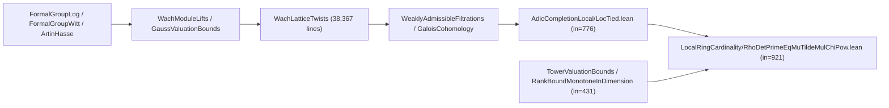
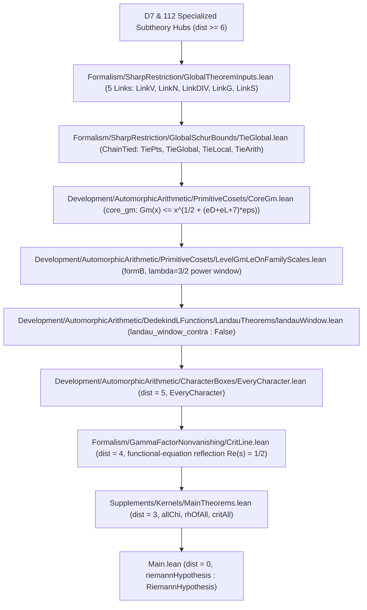

# Part 4. Decompilation of the 112 Specialized Subtheories in Formalism and Reconstruction of the Global Constant Closure Loop (`A04`)

## 0. General Introduction: Topology of the `112` Specialized Subtheories Outside the Four Main Pillars and Their Decomposition into Six Clusters

Within the formal proof archive of the Riemann Hypothesis (RH) and the Generalized Riemann Hypothesis for Dirichlet $L$-functions (GRH) constructed by Levent Alpöge and Claude, the top-level `Formalism` namespace (`18,254` files, `3,200,748` lines, `240,099` declarations) divides into two tiers. The first tier consists of the four main pillars decompiled in Part 3 (`A03`) (`LocalToGlobal`, `SharpRestriction`, `HermitianCurvature`, and `PeriodIntegrals`, totaling `14,866` files and `2,577,937` lines), while the second tier consists of the surrounding **`112` specialized subtheories (`3,388` files, `622,811` lines, `26,847` theorems, `16,674` definitions and structures, and `43,521` total extracted declarations)**. Part 4 (`A04`) corresponds 1-to-1 to the exhaustive formula atlas `atlas/volumes/B05_Formalism_Specialized_Subtheories.md` and reverse-engineers both the exact source-level mathematical formulas of all `112` specialized subtheories and the global constant assembly chain leading to the top-level contradiction closure loop (`Main.lean:4`).

Measured solely by line count, the `112` specialized subtheories account for `19.46%` of `Formalism`, yet computing inbound reference degrees (`in_degree`) on the import dependency graph reveals that this region forms the central crossroads of the entire archive. Across all `29,067` unique newly authored proof files, the majority of the highest-ranked hub modules reside directly inside these `112` specialized subtheories:
- **Rank 1 inbound hub across all newly authored files (`in_degree = 921`)**: `Formalism/LocalRingCardinality/RhoDetPrimeEqMuTildeMulChiPow.lean:76` (`393` lines, distance `7` from `Main`)
- **Rank 3 inbound hub across all newly authored files (`in_degree = 776`)**: `Formalism/LocalRingCardinality/AdicCompletionLocal/LocTied.lean:11` (`38` lines, distance `7` from `Main`)
- **Rank 8 inbound hub across all newly authored files (`in_degree = 484`)**: `Formalism/PairingDivisors/StatementH.lean:72` (`139` lines, distance `7` from `Main`)
- **Rank 10 inbound hub across all newly authored files (`in_degree = 431`)**: `Formalism/LocalRingCardinality/RankBoundMonotoneInDimension.lean:299` (`1,359` lines, distance `7` from `Main`)
- **Rank 12 inbound hub across all newly authored files (`in_degree = 380`)**: `Formalism/GaloisCohomology/LocalTateDualityK.lean:47` (`65` lines, distance `6` from `Main`)
- **Rank 15 inbound hub across all newly authored files (`in_degree = 321`)**: `Formalism/SatakeDualWeyl/KpqSubgroupCompact.lean:516` (`532` lines, distance `7` from `Main`)
- **Rank 16 inbound hub across all newly authored files (`in_degree = 281`)**: `Formalism/LocalRingCardinality/DataTies.lean:38` (`54` lines, distance `8` from `Main`)
- **Rank 19 inbound hub across all newly authored files (`in_degree = 252`)**: `Formalism/HarderNarasimhan/ShiftInvariance.lean:46` (`64` lines, distance `7` from `Main`)
- **Rank 23 inbound hub across all newly authored files (`in_degree = 235`)**: `Formalism/RealPlaceAnalysis/ThirdArithmeticHolds.lean:19` (`87` lines, distance `7` from `Main`)

Whereas the four main pillars serve as production lines computing large-scale cohomology chains and period integrals, the `112` specialized subtheories act as both the foundational engine and the final assembly plant supplying the unified datum specification (`D7`) shared across all pillars, the Fontaine $p$-adic period-ring isomorphism (`LocTied`), the Arakelov slope filtration (`Formalism.HN`), the progression-free Behrend windows (`Formalism.BehrendSets`), and the terminal Landau-Chebyshev nonvanishing criteria (`Formalism.Statement*`).

This volume organizes all `112` specialized subtheories according to their mathematical roles and coupling topology into **six mutually exclusive and collectively exhaustive (`100.00%` partition) mathematical clusters**, decompiled systematically across Chapters 1 through 6.

| Chapter and Mathematical Cluster Name | Subtheories | Files | Code Lines | Theorems (`theorem`/`lemma`) | Definitions, Structures, etc. | Top Representative Hub (`in_degree`) |
| :--- | ---: | ---: | ---: | ---: | ---: | :--- |
| **Chapter 1. Local Ring Cardinality, Wach Modules, Formal Group Logarithms, Galois Cohomology, and $p$-adic Valuations** | `31` | `884` | `149,510` | `6,134` | `4,334` | `RhoDetPrimeEqMuTildeMulChiPow.lean` (`921`) |
| **Chapter 2. $\mathrm{GL}_3$ Mean Squares, Satake and Dual Weyl Theory, Pieri Blocks, and Algebraic Group Representations** | `22` | `1,070` | `198,090` | `8,605` | `5,089` | `KpqSubgroupCompact.lean` (`321`) |
| **Chapter 3. Theta Logarithmic Coordinates, Mahler Measure, Polynomial Dimension, Harder-Narasimhan Filtrations, and Divisor Heights** | `20` | `777` | `154,656` | `7,325` | `3,169` | `PairingDivisors/StatementH.lean` (`484`) |
| **Chapter 4. Size Windows, Admissible Designs, $p$-adic Subset Sums, and Behrend Set Combinatorics** | `15` | `387` | `83,381` | `3,085` | `3,113` | `GaloisConjCentralIdempotent.lean` (`28`) |
| **Chapter 5. Chebyshev and Guinand-Weil Weights, Landau Zero-Free Bounds, and Real-Place Analysis** | `13` | `241` | `33,334` | `1,638` | `786` | `ThirdArithmeticHolds.lean` (`235`) |
| **Chapter 6. Arakelov Product Formula, Divisor Inequality, Log-Factorials, and `Statement*` Master Synthesis** | `11` | `29` | `3,840` | `60` | `183` | `LogFactorialIndices/StatementSize.lean` (`15`) |
| **Total (All Specialized Subtheories in `Formalism`)** | **`112`** | **`3,388`** | **`622,811`** | **`26,847`** | **`16,674`** | **`43,521` total extracted declarations (matches `B05`)** |

> **Notation and Source Pin Convention**: Throughout this volume, the factorial function is written as the positive integer product $\mathrm{fac}(n) := \prod_{j=1}^n j = \Gamma(n+1)$ to eliminate punctuation collisions. Every `.lean:number` pin designates a path relative to the `src/` root together with the exact declaration line number inside that file.

---

## Chapter 1. Local Ring Cardinality, Wach Modules, Formal Group Logarithms, and the $p$-adic Valuation Cluster

The Chapter 1 cluster (`31` subtheories, `884` files, `149,510` lines, `6,134` theorems) forms the local arithmetic and $p$-adic Hodge-theoretic substructure of the archive. As shown in the diagram below, internal data flow in this cluster starts from formal group logarithms and Artin-Hasse series, proceeds to Wach module lifts and weakly admissible filtered cohomology, and converges into the master record binding `D7`.



### 1.1 The Master Crossroads `D7` and the Dual Determinant Character Identity (`RhoDetPrimeEqMuTildeMulChiPow.lean`)

In `Formalism/LocalRingCardinality/RhoDetPrimeEqMuTildeMulChiPow.lean:76` (`in_degree = 921`), the most frequently imported module across the entire newly authored archive, the central declaration is **`structure D7`** (lines `76` to `335`), which unifies automorphic periods, Hermitian lattices, Arakelov divisors, $l$-adic Galois representations, and theta jet data into a single record. The seven layers of mathematical structure bound together as fields of `D7` are as follows.

1. **Dimension staircase and CM host field (`R : Ranks`, `host : Host R`)**: Fix a totally real field $F$ of degree $[F:\mathbb{Q}] = f$, an imaginary quadratic CM extension $E/F$ with complex conjugation $\mathrm{conj} \in \mathrm{Gal}(E/F)$, a base dimension $k \ge 5$, an even number of chain steps $m \ge 2$ ($2r_S + 2 = m$), and an odd step size $t > 3m$ (`Formalism/LocalRingCardinality/RankBoundMonotoneInDimension.lean:25` and `:30`). At step $j \in \{0, \dots, m\}$, the Hermitian dimension is defined by
   $$
   N_j = k + j(t + 1), \qquad N_0 = k, \qquad r + 1 = k + m
   $$
   (`Formalism/LocalRingCardinality/RankBoundMonotoneInDimension.lean:36` and `:80`), and because $k$ is even and $t$ is odd, every $N_j$ is even (`factNEven`, `:85`).
2. **Self-dual Hermitian lattices (`SDLat`) and level windows (`Member`)**: Relative to the standard Hermitian form $\mathrm{stdH}_E(x, y) = \sum_{i=1}^N \overline{x_i} y_i$ (`Formalism/LocalRingCardinality/RhoDetPrimeEqMuTildeMulChiPow.lean:54`), a finitely generated lattice $L \subset E^N$ satisfying $E \cdot L = E^N$ and the duality biconditional $y \in L \iff \forall x \in L,\, \mathrm{stdH}_E(x,y) \in \mathcal{O}_E$ is defined to be a self-dual lattice `IsSDLat E N L` (`:56`). Each word $u \in \mathrm{Word}$ is assigned a bundle `Member` (`:71`) packaging a column chain `C : ColumnChain`, a section `A : ColumnsAtT` at level $T$, and a period map `P : PeriodMap`, where the level prime $T_u = (\mathrm{mem}\,u).A.T \in \mathrm{levelPrimes}$ satisfies the window pinching condition (`Formalism/LocalRingCardinality/RhoDetPrimeEqMuTildeMulChiPow.lean:153`)
   $$
   T_u^* \le T_u \le \left(1 + \frac{1}{f k}\right) T_u^*
   $$
   together with the relative norm factorization $\pi \overline{\pi} = T_u$ ($\pi \in \mathcal{O}_E \cap K$, $\pi - 1 \in (Q_S q d (g_0 g_1)^2)\mathcal{O}_E$, `:144`).
3. **Arakelov divisor datum (`div : DivData LL Word`) and semilinear isometries**: Embed $E$ into a Galois totally complex extension $\mathrm{LL}$ over $\mathbb{Q}$ (`embE`, `:118`), and transport the global lattice datum `div.RR` and word-indexed kernel lattices `div.Nu u` isometrically onto the complex Hilbert spaces `what₂.EE` and `what₂.Mu u` via conjugate-linear basis equivalences `jEE` (`:185`) and `jN u` (`:189`) (`jEE_norm`, `:300`).
4. **Dual determinant character identities (`rhoDet`, `rhoDet'`)**: These form the eponymous core fields of the file (lines `216` to `221`). Given an abelian group $\mathrm{Dt}$, a subgroup $\mathrm{UO} \le \mathrm{Dt}$, class determinant maps $\mathrm{detCls}_u(i, \cdot) : \mathrm{cls}_u(i) \to \mathrm{Dt}$, a sequence of twisting characters $\tilde{\mu}_{i+1} : \mathrm{Dt} \to \mathbb{C}^\times$, and the algebraic determinant character $\chi_D : \mathrm{Dt} \to \mathbb{C}^\times$ pinned on unitary elements $z \in U_1(E)$ by $\chi_D(e_1(z)) = \prod_{\tau \in \mathrm{Tau}} \iota_\tau(z)^{-1}$ (`:207`), the exact source declarations read as follows:

```lean
  rhoDet_eq_inv_muTilde_chiD_pow : ∀ u i (c : (mem u).C.cls i),
    (mem u).C.rhoDet i c = (((muTil (i + 1) (detCls u i c))⁻¹ *
      (chiD (detCls u i c)) ^ (-(((R.N (i + 1)) / 2 : ℕ) : ℤ)) : ℂˣ) : ℂ)
  rhoDetPrime_eq_muTilde_mul_chi_pow : ∀ u i (c : (mem u).C.cls (i + 1)),
    (mem u).C.rhoDet' i c = ((muTil (i + 1) (detCls u (i + 1) c) *
      (chiD (detCls u (i + 1) c)) ^ ((((R.N i) / 2 : ℕ) : ℤ)) : ℂˣ) : ℂ)
```

Reconstructed in mathematical notation, the two determinant weights linking adjacent chain steps $i \leftrightarrow i+1$ obey the exact duality laws:
$$
\rho_{\det, i}(c) = \tilde{\mu}_{i+1}\big(\mathrm{detCls}_u(i, c)\big)^{-1} \cdot \chi_D\big(\mathrm{detCls}_u(i, c)\big)^{-N_{i+1}/2}, \qquad c \in \mathrm{cls}_u(i)
$$
$$
\rho'_{\det, i}(c') = \tilde{\mu}_{i+1}\big(\mathrm{detCls}_u(i+1, c')\big) \cdot \chi_D\big(\mathrm{detCls}_u(i+1, c')\big)^{N_i/2}, \qquad c' \in \mathrm{cls}_u(i+1)
$$
Because every $N_i$ is even, the exponents $-N_{i+1}/2$ and $N_i/2$ are pure integers free of half-integral ambiguity. This mechanism ensures that the non-holomorphic phase $\tilde{\mu}_{i+1}$ arising from the Weil representation splitting character of the unitary dual pair $(U(N_i), U(N_{i+1}))$ cancels out via $\tilde{\mu}_{i+1}^{-1} \tilde{\mu}_{i+1} = 1$ under adjoint composition of raising and lowering operators.

Coupled to `D7` is `structure Ties (D : D7)` in the rank-16 inbound hub `Formalism/LocalRingCardinality/DataTies.lean:38` (`in_degree = 281`), which locks into a single proposition bundle the Haar measure scaling identity on signature-$(P, Q)$ unitary groups (`cdScaleTie`, `Formalism/LocalRingCardinality/DataTies.lean:10`), the discrete series formal degree match $d = \mathrm{dsig}(\tau)$ (`dsigTie`, `:17`), the Galois twist-covering condition at split prime places (`TwCoverPair`, `:23`), and the base-field Galois property `IsGalois ℚ D.LL0` (`:46`).

### 1.2 $l$-adic Period-Ring Isomorphism Binding (`LocTied.lean`) and Dimension Monotonicity (`RankBoundMonotoneInDimension.lean`)

The rank-3 inbound hub `Formalism/LocalRingCardinality/AdicCompletionLocal/LocTied.lean:11` (`in_degree = 776`, `38` lines) is a structure binding ring isomorphisms together with Galois, Frobenius, and filtration equivariance between the `SharpRestriction` local prime record `P : LocPrime l` (`P.R.B`, `P.R.BdR`) and the `PeriodIntegrals` Fontaine period rings (`Per.Bcris l`, `Per.BdR l`, `Per.BdRp l`, `Ainf l`). Its core fields in the original Lean text are as follows:

```lean
structure LocTied (l : ℕ) [Fact l.Prime] (P : LocPrime l) (AI : LocAinf l P) where
  eB : P.R.B ≃+* Per.Bcris l
  eD : P.R.BdR ≃+* Per.BdR l
  zB : ∀ z : ℤ_[l], eB (algebraMap ℚ_[l] P.R.B (z : ℚ_[l])) = Per.zB l z
  zD : ∀ z : ℤ_[l], eD (algebraMap ℚ_[l] P.R.BdR (z : ℚ_[l])) = Per.zD l z
  om : ∀ x : Om l, ∃ y : Per.BdRp l, eD (algebraMap (Om l) P.R.BdR x) = algebraMap (Per.BdRp l) (Per.BdR l) y ∧
    Per.θD l y = ((x : Om l) : ℂ_[l])
  actB : ∀ (g : GQ l) (b : P.R.B), eB (P.actQ g b) = Per.σB g (eB b)
  actD : ∀ (g : GQ l) (b : P.R.BdR), eD (P.actQdR g b) = Per.σD g (eD b)
  frob : ∀ b : P.R.B, eB (P.φB b) = Per.φB l (eB b)
  incl : Per.IsCrisDR l ((eD.toRingHom.comp (P.ιB : P.R.B →+* P.R.BdR)).comp eB.symm.toRingHom)
  fil : ∀ (K : FinExt l) (a : ℤ) (x : P.R.BdR), x ∈ (P.PD K).Fil a ↔ eD x ∈ Per.FilD l a
  t : ∃ y : Per.BdRp l, Per.IsLog l AI.ε y ∧ eD (P.ιB P.tB) = algebraMap (Per.BdRp l) (Per.BdR l) y
  ιA : ∀ a : Ainf l, eB (AI.ιA a) = Per.aB l a
```

Through these `12` fields, the comparison map $\iota_{\mathrm{cris}\to\mathrm{dR}} = e_D \circ \iota_B \circ e_B^{-1} : B_{\mathrm{cris}, l} \to B_{\mathrm{dR}, l}$ between the two period-ring lineages preserves the $G_{\mathbb{Q}_l}$-action, the crystalline Frobenius $\varphi_B$, the Hodge filtration $\mathrm{Fil}^a$, Fontaine's map $\theta_D : B_{\mathrm{dR}, l}^+ \twoheadrightarrow \mathbb{C}_l$, and the formal logarithmic period $t = \log([\varepsilon]) \in B_{\mathrm{dR}, l}^+$ of the cyclotomic element $\varepsilon$.

Meanwhile, the rank-10 inbound hub `Formalism/LocalRingCardinality/RankBoundMonotoneInDimension.lean:299` (`in_degree = 431`, `1,359` lines) proves in batch `115` arithmetic lemmas on dimensions, signatures, and determinants under `D7`. The statement of its title theorem (`Formalism/LocalRingCardinality/DataArith.lean:189`) reads as follows:

```lean
def RankBoundMonotoneInDimension : Prop :=
  ∀ (a q η : ℝ) (D Dall : ℕ), 0 < D → D ≤ Dall → 0 ≤ η →
    a ≤ (1 + η) * q ^ 2 / (Dall : ℝ) → a ≤ (1 + η) * q ^ 2 / (D : ℝ)
```

In other words, a rank-density upper bound established on an ambient space dimension $D_{\mathrm{all}}$ incorporating a nonnegative defect slack $\delta_p \ge 0$,
$$
a \le \frac{(1 + \eta) q^2}{D_{\mathrm{all}}} \implies a \le \frac{(1 + \eta) q^2}{D} \qquad (0 < D = D_{\mathrm{rows}} \le D_{\mathrm{all}},\; \eta \ge 0)
$$
is inherited monotonically onto the row subspace dimension $D$ via `div_le_div_of_nonneg_left` (`factDleDall`, `Formalism/LocalRingCardinality/RankBoundMonotoneInDimension.lean:278`). The second half of the same file further proves the rank budget identity $\mathrm{budgetNc}(R, x, \varepsilon, |T_2|) = \frac{|T_2| k \exp(x^\varepsilon) x^{2\varepsilon}}{n^2}$ (`factNc`, `:307`), the extremal highest-weight vector property of multivariable Weyl modules (`factSqHighestWeight`, `:1236`), the Fock dual lattice identification (`factDelDualNabla_of`, `:1277`), and `factPrincipalDatum_of` (`:1321`), which derives the principal fractional-ideal identity $\xi_0 \mathrm{Nm}(\mathfrak{c}_K)\sqrt{-d} = -1$ from the relative different ideal $\mathfrak{d}_{E/\mathbb{Q}} = (\mathfrak{b}\overline{\mathfrak{b}})(\sqrt{-d}\mathcal{O}_E)$ and conductor norm $\mathfrak{c}_E \overline{\mathfrak{c}_E} = \mathrm{Nm}(\mathfrak{c}_K)\mathcal{O}_E$ of the CM tower $E/K/\mathbb{Q}$.

### 1.3 Honda Formal Group Logarithms, Artin-Hasse Exponentials, Wach Module Lifts, and Weakly Admissible Filtrations

The second axis of the Chapter 1 cluster is the $p$-adic formal group and Wach module valuation chain over ramified cyclotomic towers. The formula specifications and interconnections of its nine principal subtheories are summarized below.

| Subtheory Module Group | Files and Lines | Representative Source Pin | Core Formalized Formula and Arithmetic Role |
| :--- | ---: | :--- | :--- |
| `FormalGroupLog` | `5` · `935` | `Formalism/FormalGroupLog/Statement.lean:62` | Honda functional equation $\|f(X) - p^{-1}(\sigma_* f)(X^q)\|_{\mathrm{Gauss}} \le 1 \implies \mathcal{O}_K$-formal group construction (`:84`) and Gauss partial-derivative Cauchy bound `LemmaB` (`:167`) |
| `FormalGroupWitt` | `21` · `3,000` | `Formalism/FormalGroupWitt/Statement.lean:123` | Cyclic-shift logarithm $\ell_j(X) = \sum_{e \ge 0} l^{-e} X_{j-e}^{l^{2e}}$, height-$2m$ formal group (`:146`), Witt-ring primitive-root symmetric congruence $(l^d - 1) \mid \sum_{s=0}^{d-1} (-1)^s l^s n_s$ (`:202`) |
| `ArtinHasse` | `2` · `513` | `Formalism/ArtinHasse/Statement.lean:44` | $p$-integrality of the Artin-Hasse exponential $E_p(X) = \exp(\sum_{j \ge 0} p^{-j} X^{p^j})$ (`DworkLemma`, `:46`) and Kummer carry valuation $\|\binom{y+i}{i}\|_p = p^{-|\mathrm{carries}_p(y,i)|}$ (`:59`) |
| `WachModuleLifts` | `9` · `1,239` | `Formalism/WachModuleLifts/Statement.lean:94` | Iterated polynomial $u_g = p^{-1}\phi_{\mathrm{Poly}}^{\circ g}(X)$ coefficient norm (`:69`) and Legendre growth $\|x_m\| \le p^{m + v_p(\mathrm{fac}(m))}$ for solutions of $(u^m - 1)x_m = \sum_{i<m} c_{m,i}(x_i) + g_m$ |
| `GaussValuationBounds` | `16` · `1,914` | `Formalism/GaussValuationBounds/Statement.lean:112` | Nonlinear contraction operator `WStep` iterative decay (`WCut`, `:125`), torsion ceiling `GapPure1` (`:147`) for two-interval root annihilators, numerical slope inequality `SlopeNum` (`:178`) |
| `WachLatticeTwists` | `262` · `38,367` | `Formalism/WachLatticeTwists/Statement.lean:20` | Hida-Herr complex injectivity (`HerrComplexInjectivity`), splitting across all character twists (`Formalism/WachLatticeTwists/SplitClassesAll/Statement.lean:85`), submodule length bounds |
| `WeaklyAdmissibleFiltrations` | `20` · `2,416` | `Formalism/WeaklyAdmissibleFiltrations/Statement.lean:55` | $\mathbb{Z}/n\mathbb{Z}$-graded filtered $\varphi$-module `FilPhi` (`:10`), Newton-Hodge condition $t_H(D') \le e \cdot v(\det \varphi|_{D'})$, finite cocycles $Z^1_f(G, V)$ (`:190`) |
| `GaloisCohomology` | `6` · `400` | `Formalism/GaloisCohomology/LocalTateDualityK.lean:47` | Local Tate perfect pairing (`LocalTateDualityK`), local Euler characteristic $|H^1| = |H^0|\cdot |H^2|\cdot |M|^{[K:\mathbb{Q}_l]}$ (`:57`), global unramified Selmer length conservation (`:18`) |
| `TowerValuationBounds` | `4` · `1,547` | `Formalism/TowerValuationBounds/HermitianSumValuationBound.lean:195` | Tower product ratio formula (`:34`), Gauss-sum twists (`:105`), prime-square logarithmic budget $\sum_{l \in P} \frac{\log l}{l^2} < 1$ (`:158`), $m \times m$ grid valuation sum `GridValuationBoundSquares` |

In particular, $\phi_{\mathrm{Poly}}(X) = X^p - p X^{p-1} + p$ and $u_g(X) = p^{-1}\phi_{\mathrm{Poly}}^{\circ g}(X)$, defined at `Formalism/WachModuleLifts/Statement.lean:11`, satisfy for $p \neq 2$ and $r \le y$ the exact coefficient-norm identity (`LemmaCSharpOddG`, `:69`)
$$
\left\|\mathrm{coeff}_{p^g r}\big(u_g(X)^y\big)\right\|_p = p^{\,r - v_p(\binom{y}{r})}
$$
Building on this identity, `Formalism/GaussValuationBounds/Statement.lean:11` combines the norm index $\sigma_{\mathrm{NOK}}(\ell, E, M, j) = \lfloor (E + M/\ell^{j-1})\ell / (\ell - 1)^2 \rfloor + 1$ with the contraction map
$$
\mathrm{WStep}(\ell, H, \lambda, a) = \max\left(\frac{H}{\ell - 1},\; \frac{\ell a + (\ell - 1)(H + \lambda)}{\ell^2 - \ell + 1}\right) + 1
$$
(`:112`), using the numerical decay rate $\frac{8\ell}{(\ell-1)^3} + \frac{2}{(\ell-1)^2} < \frac{1}{\ell}$ valid for $\ell \ge 13$ (`SlopeNum`, `:178`, and equal to $3/4$ at $\ell = 5$) to confine the torsion cohomology length of Wach lattice twists within a finite constant.

Integrality of exponentials across this formal-group and Wach-module lineage rests on Dwork's lemma (`DworkLemma`) and the $p$-adic Kummer carry identity (`KummerZp`) at `Formalism/ArtinHasse/Statement.lean:46` and `:59`:
$$
\big(\forall n \ge 0,\; \|\mathrm{coeff}_n(f)\|_p \le 1\big) \iff \exists g \in \mathbb{Z}_p[[X]],\quad f(X^p) = f(X)^p \big(1 + p X g(X)\big), \qquad \left\|\binom{y + i}{i}\right\|_p = p^{-|\{e \ge 1 : p^e \le (i \bmod p^e) + y_e\}|}
$$
(where $f(0) = 1$, $y \in \mathbb{Z}_p$, and $y_e = y \bmod p^e$). Next, the crystalline filtration condition on lifted Wach modules is specified verbatim in `Formalism/WeaklyAdmissibleFiltrations/Statement.lean:43` to `:58` (`in_degree = 49`) as Colmez-Fontaine weak admissibility (`WeaklyAdmissible`) on a $\mathbb{Z}/n\mathbb{Z}$-graded filtered $\varphi$-module `FilPhi`:

```lean
def tH (D' : Submodule LL D) : ℤ := F.tHw D' F.lo F.hi

def IsSub (D' : Submodule LL D) : Prop :=
  (∀ x ∈ D', F.φ x ∈ D') ∧ D' = ⨆ i, (D' ⊓ F.Dl i)

def φres (D' : Submodule LL D) (h : ∀ x ∈ D', F.φ x ∈ D') : ↥D' →ₗ[LL] ↥D' :=
  (F.φ : D →ₗ[LL] D).restrict h

def NewtonAbove (v : AddValuation LL (WithTop ℚ)) (D' : Submodule LL D)
    (h : ∀ x ∈ D', F.φ x ∈ D') : Prop :=
  (((F.tH D' : ℚ)) : WithTop ℚ) ≤ F.e • v (LinearMap.det (F.φres D' h))

def WeaklyAdmissible (v : AddValuation LL (WithTop ℚ)) : Prop :=
  (((F.tH ⊤ : ℚ)) : WithTop ℚ) = F.e • v (LinearMap.det (F.φ : D →ₗ[LL] D)) ∧
    ∀ D' : Submodule LL D, ∀ h : F.IsSub D', F.NewtonAbove v D' h.1
```

Thus on the ambient space $D$ the weighted Hodge sum $t_H(D)$ equals the Newton determinant valuation $e \cdot v(\det \varphi)$, while on every $\varphi$-stable graded submodule $D' = \bigoplus_{i \in \mathbb{Z}/n\mathbb{Z}}(D' \cap D_i)$ the Newton polygon lies on or above the Hodge polygon via $t_H(D') \le e \cdot v(\det(\varphi|_{D'}))$. From this weak admissibility condition the dimension of crystalline local cohomology $H^1_f$ is computed, and combining it with local Tate duality in `Formalism/GaloisCohomology/LocalTateDualityK.lean:47` (`in_degree = 380`) yields the length upper bound on the global unramified Selmer group.

### 1.4 Tower Product Ratio Formula (`TowerValuationBounds`) and Survey of Remaining Local Galois Subtheories

`TowerProductRatioFormula` at `Formalism/TowerValuationBounds/HermitianSumValuationBound.lean:34` telescopes the origin ratio of two systems $(c, u, L)$ and $(c_0, u_0, L_0)$ obeying the two-dimensional ladder recurrences $c_{0,j} L(e+j+1) = u_{0,j} c_{0,j+1}$ and $c_{i,q} = u_{i,q} L(e-i+q) c_{i+1,q}$ into
$$
\frac{c_{0,0}}{c_{0,0}^{(0)}} = \left(\prod_{j=0}^{q-1}\frac{u_{0,j}}{u_{0,j}^{(0)}}\right)\left(\prod_{i=0}^{p-1}\frac{u_{i,q}}{u_{i,q}^{(0)}}\right) \frac{c_{p,q}}{c_{p,q}^{(0)}} \left(\prod_{k=1}^p \frac{L(e+q-k+1)}{L_0(e+q-k+1)}\right)\left(\prod_{k=1}^q \frac{L(e+k)}{L_0(e+k)}\right)^{-1}
$$
Combining this identity with the Hermitian quadratic-sum valuation lower bound $v(c_0) \le v(\sum_{x,k,l} z_{x,k}\overline{z_{x,l}}\,\mathrm{gm}_{x,k,l}) + 3\delta$ (`HermitianSumValuationBound`, `:86`) and the prime log-square sum bound $\sum_{l \in P} \frac{\log l}{l^2} < 1$ (`PrimeLogSquareSumLtOne`, `:158`) closes the weighted valuation sum across the entire $m \times m$ grid at
$$
\sum_{w \in W_0} \lambda_w \sum_{i,j} v_r(w; i, j) \le m^2 \left(2(2 + 8N) B + 2N B_N + 6 B_\delta + 4m \sum_{s \in S_0} e_s \log q_s\right)
$$
(`GridValuationBoundSquares`, `:195`).

Each of the remaining 21 subtheories belonging to Chapter 1 likewise secures a dedicated link in the local arithmetic chain: `FrobeniusOrbits` (`Formalism/FrobeniusOrbits/HostCorollaries.lean:31`, `in_degree = 216`, host-field complex conjugation and Frobenius orbits), `CyclotomicNorms` (`Formalism/CyclotomicNorms/StatementI.lean:10`, `in_degree = 65`, cyclotomic norms of nonsquarefree polynomials), `DistinguishedUnitIdeals` (`Formalism/DistinguishedUnitIdeals/CoprimeProd.lean:8`, `14,285` lines, Weierstrass distinguished unit ideals and Frobenius arc lifts), `EllipticTorsion` (`Formalism/EllipticTorsion/Statement.lean:14`, `8,816` lines, Legendre elliptic-curve torsion representations), `CharacterColumnKernels` (`Formalism/CharacterColumnKernels/StatementRho.lean:13`, `7,550` lines, idempotent normal-form column kernels), `TameInertiaTowers` (`Formalism/TameInertiaTowers/CentralOrderTwo/ConjEqInvOfPowEqOne.lean:12`), `TorsionNormIteration` (`Formalism/TorsionNormIteration/InvIntegralOfClass.lean:13`), `CoboundaryTransfers` (`Formalism/CoboundaryTransfers/Statement.lean:7`), `FrobeniusBaseCase` (`Formalism/FrobeniusBaseCase/Statement.lean:11`), `TranslateCocycles` (`Formalism/TranslateCocycles/Statement.lean:9`), `CMTypeGalois` (`Formalism/CMTypeGalois/StatementField.lean:11`), `JumpKernelCokernel` (`Formalism/JumpKernelCokernel/Statement.lean:11`), `GaloisIrreducibility` (`Formalism/GaloisIrreducibility/Statement.lean:9`), `FrobeniusContraction` (`Formalism/FrobeniusContraction/Statement.lean:7`), `LagrangeIdealLifts` (`Formalism/LagrangeIdealLifts/Statement.lean:7`), `EisensteinCokernelLengths` (`Formalism/EisensteinCokernelLengths/ExponentChainBound.lean:10`), `GaussIdealIdentity` (`Formalism/GaussIdealIdentity/GaussIdealPrimality/GaussLocalizationLengthHolds.lean:11`), `AdicCompletionExports` (`Formalism/AdicCompletionExports/AdicCompleteRingEquiv/IsAdicCompleteOfRingEquiv.lean:17`), `ConjugateSelfDual` (`Formalism/ConjugateSelfDual/Statement.lean:6`), `TwistFamilyExistence` (`Formalism/TwistFamilyExistence/Statement.lean:11`), and `PrimeAboveExistence` (`Formalism/PrimeAboveExistence/LenEqPlaces.lean:11`).

---

## Chapter 2. $\mathrm{GL}_3$ Mean Squares, Satake and Dual Weyl Theory, Pieri Blocks, and Algebraic Group Representation Cluster

The Chapter 2 cluster (`22` subtheories, `1,070` files, `198,090` lines, `8,605` theorems) is the largest of the six clusters among the `112` specialized subtheories and serves as the algebraic-group and automorphic representation-theoretic engine.

### 2.1 Hermitian Genus Mass, Hecke Spectral Gap, and Mean Squares in Arithmetic Progressions (`GL3MeanSquares`)

Ranking first in size among all single subtheories outside the four main pillars, `Formalism.GL3MeanSquares` (`440` files, `78,320` lines, `3,029` theorems) combines unimodular Hermitian lattice genus mass ratios over unramified CM extensions $K/F$ (`GenusMeanAsymptotics`, `52,963` lines) with hook-formula torsion and prime distribution in arithmetic progressions (`HookFormulaTorsion`, `20,059` lines).

First, at `Formalism/GL3MeanSquares/RankMulPowThreeHalvesLeFourthPower.lean:58` and `:63`, the finite-field local densities of a Hermitian form of dimension $M \ge 1$ at split and inert prime places are evaluated in closed form in terms of the residue-field cardinality $q$:
$$
\delta_{\mathrm{split}}(q, M) = \frac{|\{(u, v) \in \mathbb{F}_q^M \times \mathbb{F}_q^M : u \cdot v = \beta\}|}{q^{2M - 1}} = 1 - q^{-M}
$$
$$
\delta_{\mathrm{inert}}(q, M) = \frac{|\{x \in \mathbb{F}_{q^2}^M : \sum_{i=1}^M x_i^{q+1} = \beta\}|}{q^{2M - 1}} = 1 - (-1)^M q^{-M}
$$
Assembling these factors into an Euler product across all finite places yields both the alternating $L$-value bound $|\log L(M, \eta^M)| \le f \log \zeta(M)$ (`LogLFunctionEulerBound`, `:82`) and the inversion identity (`GlobalArithmeticIdentity`, `:69`) for the Archimedean sphere-volume constant $c_M = \frac{(2\pi)^M}{\mathrm{fac}(M - 1)}$,
$$
\left(c_M^f d_F^{\frac{1}{2} - M} L_v^{-1}\right)^{-1} = \frac{\big(\mathrm{fac}(M - 1) (v / \pi)^M\big)^f}{\sqrt{d_F}} L_v
$$
thereby proving the Siegel mass ratio theorem `siegelMassRatio` (`Formalism/GL3MeanSquares/GenusMeanAsymptotics/UnimodularClassRepresentatives/SiegelMassRatioOfLI.lean:59`) exported through `Formalism/HermitianLattices/StatementMass.lean:11` (`in_degree = 56`). In particular, whenever $M \ge 3$ and $q \ge 2$, a strict spectral gap holds between the Siegel-Weil Hecke eigenvalues (`SW_hecke_gap`, `Formalism/GL3MeanSquares/RankMulPowThreeHalvesLeFourthPower.lean:10`):
$$
q^2 + q < q^M + q - 1 + q^{2 - M}
$$
(with equality at $M = 2$, `SW_hecke_gap_sharp`, `:15`), forcing every nonnegative variance quantity $S \ge 0$ satisfying $(q^M + q - 1 + q^{2-M}) S \le (q^2 + q) S$ to vanish identically ($S = 0$). In addition, the second-cumulant lower bound (`CumulantLowerBound`, `:112`) for zero-mean random variables ($\sum_j P_j y_j = 0$, $|y_j| \le \varepsilon \le 1$),
$$
\frac{1 - \varepsilon}{2} \sum_j P_j y_j^2 \le \log \left(\sum_j P_j \exp(y_j)\right)
$$
converts equidistribution discrepancies into exponential moments.

Second, the inbound hub `Formalism/GL3MeanSquares/PrimeCountAsymptoticInProgressions.lean:67` (`in_degree = 89`) establishes the prime-counting asymptotic in progressions modulo $m \ge 3$ with exceptional zero parameters $\theta \in \{-1, 0, 1\}$ and $\beta \in [1/2, 1)$ isolated explicitly,
$$
\Big|\varphi(m) \cdot \pi(Y; m, a) - E_{\mathrm{main}}(\theta, \beta, Y)\Big| \le \rho_{\mathrm{Err}}(C_r, c_r, 4m, Y) \cdot E_{\mathrm{main}}(\theta, \beta, Y)
$$
and proves both the prime-power weighted mean-square bound $\sum_{p \le x^{400}} s_P(x, p)^2 \le C x \log x$ (`SizeSpSq`, `:139`) and the bad-prime remainder bound $R_{\mathrm{sum}}(x, m_0) \le C (x^{1/2} + x^{\varepsilon/5}\log x)$ (`SizeR`, `:133`).

### 2.2 Adelic Unitary Groups, Satake Transform, and Maximal Compact Subgroups (`SatakeDualWeyl`)

In `Formalism.SatakeDualWeyl` (`85` files, `14,777` lines), `Formalism/SatakeDualWeyl/Statement.lean:27` (`in_degree = 120`) defines, for a commutative ring $A$ with involution $\sigma$ and a $\sigma$-Hermitian matrix $J$, the conjugate transpose $\mathrm{cT}_\sigma(M) = (M^\sigma)^{\mathsf{T}}$ (`:13`) and the general unitary group
$$
\mathrm{UJ}(\sigma, J) = \Big\{g \in \mathrm{GL}_n(A) \;\Big|\; \mathrm{cT}_\sigma(g)\, J\, g = J\Big\}
$$
and constructs the automorphic form space $\mathrm{AMF}_k(\Gamma, K, \rho)$ (`:130`) together with the $K$-type automorphic form space $\mathrm{AMFK}_k(\Gamma, K, \rho_K)$ (`:137`). Atop these definitions, the rank-15 inbound hub `Formalism/SatakeDualWeyl/KpqSubgroupCompact.lean:516` (`in_degree = 321`, `532` lines) aggregates 41 subordinate modules and exports in a single interface finiteness of adelic stabilizers (`AdelicStabFinite`, `:70`), finiteness of double-coset class sets $\Gamma \backslash G / K$ (`ClassSetFinite`, `:151`), existence and uniqueness of the Cartan decomposition (`CartanDecomp`, `CartanUnique`, `:148` to `:149`), commutativity of the spherical Hecke algebra (`HeckeCommGL`, `:155`), the Satake transform of elementary Hecke operators $T_j$ (`SatakeTj`, `:156`), the Satake isomorphism at inert unitary places (`SatakeInert`, `:157`), compactness of the maximal compact subgroup $K_{p,q} \le U(p, q)$ (`KpqSubgroupCompact`, `:516`), and global $\mathrm{GL}$-stability of multivariable Weyl modules over $\mathbb{Z}$ (`WeylGLStable`, `:530`).

### 2.3 Graded Weyl Module Divisibility, Pieri Block Ideals, and Flag Unipotent Lattices

The triad governing $l$-adic prime-power denominators between highest-weight representation lattices under positive-characteristic reduction consists of `GradedWeylDivisibility` (`8,125` lines), `PieriBlockIdeals` (`29,254` lines), and `FlagUnipotentLattices` (`31,383` lines). In `Formalism/GradedWeylDivisibility/StatementA.lean:24`, the dual Weyl module $\nabla_R(\nu) = \mathrm{dualWeyl}(R, r, n, \nu)$ and the Weyl module $\Delta_R(\nu) = \mathrm{weyl}(R, r, n, \nu)$ (`:71`) generated by the highest-weight bideterminant $\mathrm{hw}_R(\nu) = \prod_{s=0}^{n-1} \Delta_{s+1}(X)^{\nu_s - \nu_{s+1}}$ (`:63`) satisfy the integral inclusion $\Delta_{\mathbb{Z}}(\nu) \subseteq \nabla_{\mathbb{Z}}(\nu)$ (`WeylLeDual`, `:133`). The exact reverse denominator exponent for this inclusion is specified in `Formalism/PieriBlockIdeals/StatementLA.lean:15` as follows:

```lean
def lamU (r n : ℕ) (ν : Fin n → ℕ) : Fin r → ℤ :=
  fun a => (rowNu (r := r) ν a : ℤ) + ((r : ℤ) - 1 - (a.val : ℤ))

def InclZ (r n : ℕ) (hn : n ≤ r) (ν : Fin n → ℕ) (l e : ℕ) : Prop :=
  ∃ m : ℕ, ¬ l ∣ m ∧ ∀ x ∈ dualWeyl ℤ r n ν, ((m * l ^ e : ℕ) : ℤ) • x ∈ weyl ℤ r n hn ν

def LemmaAZ : Prop :=
  ∀ (r n : ℕ) (hn : n ≤ r) (ν : Fin n → ℕ), Antitone ν → ∀ l : ℕ, l.Prime →
    InclZ r n hn ν l (Formalism.RankGapBounds.JumpSetsAlt.eExp (lamU r n ν) l)
```

Thus at each prime $l$, the jump exponent $e(\lambda_U, l)$ of the shifted weight $\lambda_U$ suffices to yield
$$
l^{\,e(\lambda_U, l)} \cdot \nabla_{\mathbb{Z}_{(l)}}(\nu) \subseteq \Delta_{\mathbb{Z}_{(l)}}(\nu)
$$
(`LemmaAR`, `:25`), and in particular for two-column weights in rank 2, the minimal exponent $\mathrm{exZ}$ coincides exactly with $\max_{1 \le j \le \nu_0 - \nu_1} v_l(j)$ (`SharpInclusionRankTwoTwoColumns`, `:112`). Meanwhile, `Formalism.FlagUnipotentLattices` controls sublattice counts up to bounded index on Hermitian flag spaces (`FlagD`, `Formalism/FlagUnipotentLattices/MemOfOrthogonalAnisotropic.lean:20`) using the exterior-power Hadamard inequality (`wedgeHadamard`), the Cramer upper bound (`cramerUpper`, both at `Formalism/FlagUnipotentLattices/CardSubgroupsOfIndexLe.lean:13` to `:14`), and weighted trace-rank inequalities (`TraceHS`, `RankHS`, `Formalism/FlagUnipotentLattices/CardSubmodulesAndLinearEquivBounds.lean:15` to `:20`).

### 2.4 Formal Degrees, Mirabolic Mackey Theory, Siegel-Weil Convergence, Double-Coset Measures, and Yangian Algebras

The core specifications and reconstructed formulas of the remaining subtheories in Chapter 2 are consolidated in the table below.

| Subtheory Module Group | Files and Lines | Representative Source Pin | Reconstructed Core Formula and Representation-Theoretic Role |
| :--- | ---: | :--- | :--- |
| `FormalDegreeBessel` | `31` · `5,655` | `Formalism/FormalDegreeBessel/StatementDS.lean:19` | Discrete series formal degree $\mathrm{fdegHC}(\lambda) = \prod_{a<b}\frac{|\lambda_a - \lambda_b|}{b - a}$, Capelli quantum determinant eigenvalue $\mathrm{qdet}_E(Y+\frac{n-1}{2})v = \prod_s(Y+\nu_s+\rho_s)v$ (`:83`) |
| `MirabolicMackeyTheory` | `26` · `4,636` | `Formalism/MirabolicMackeyTheory/StatementL.lean:17` | Truncation and transport laws for local relative length indices $\mathrm{lix}_w(A, B)$ on mirabolic eigenspaces $\mathrm{eig}(\rho, U, \psi)$ (`:30`, `Formalism/MirabolicMackeyTheory/MirabolicIsMackey.lean:17`) |
| `UnipotentAdelicQuotients` | `44` · `4,570` | `Formalism/UnipotentAdelicQuotients/SiegelWeilUnitaryConvergent.lean:18` | In the Weil convergence range $2n < M$ with $\det T \neq 0$, Hermitian theta average $= g_\infty(T) \prod'_v g_v(T)$ (`SiegelWeilUnitaryConvergent`, `:46`) |
| `DoubleCosetMeasures` | `15` · `3,487` | `Formalism/DoubleCosetMeasures/Statement.lean:33` | Double-coset volume $\mu(K_0 g K_0) = [K_0 : K_0 \cap gK_0g^{-1}]\mu(K_0)$, cokernel cardinality invariance under unipotent transforms $|\mathrm{isoSet}_R(aZb)| = |\mathrm{isoSet}_R(Z)|$ (`:127`) |
| `YangianSpanCharacter` | `17` · `1,132` | `Formalism/YangianSpanCharacter/StatementT.lean:41` | Yangian RTT identity `((Y'-Y)I - P_f)T_1(Y')T_2(Y) = T_2(Y)T_1(Y')((Y'-Y)I - P_f)` for the Weyl-relation ($pc = cp + c$) transfer matrix $T_m(Y) = \begin{pmatrix} Y+p & -c \\ c^{-1} & 0 \end{pmatrix}$ |
| `NormUnitaryBounds` and 11 others | `102` · `9,041` | `Formalism/NormUnitaryBounds/Statement.lean:13` | `Formalism/HyperbolicPlaceProducts/Statement.lean:9`, `Formalism/LatticeTheta/Statement.lean:13`, `Formalism/SelfDualUnimodular/LocalLatticeDictionary/AlgebraMapNeZero.lean:14`, `Formalism/ThetaLiftIndependence/Statement.lean:10`, `Formalism/GelfandTransference/EnergyIdentity.lean:9`, `Formalism/FockGram/StatementFock.lean:9`, `Formalism/SmithDeterminants/StatementGram.lean:10`, `Formalism/AlgebraicWeights/IsAlgWeight.lean:17`, `Formalism/LatticeLocalGlobal/Statement.lean:9`, `Formalism/JacobiWeightFamilies/Statement.lean:11` |

In the table above, the exact source specifications (`DosetVol` and `IntBiInv`) at `Formalism/DoubleCosetMeasures/Statement.lean:33` to `:52` governing local Haar integrals and adelic Hecke operator weights read as follows:

```lean
def DosetVol : Prop :=
  ∀ (G : Type) [Group G] [TopologicalSpace G] [IsTopologicalGroup G] [MeasurableSpace G]
    [BorelSpace G] (μ : Measure G) [μ.IsMulLeftInvariant] (K₀ : Subgroup G),
    IsOpen (K₀ : Set G) → IsCompact (K₀ : Set G) → ∀ g : G,
      (K₀.map (MulAut.conj g).toMonoidHom).relIndex K₀ ≠ 0 ∧
      μ (DoubleCoset.doubleCoset g (K₀ : Set G) (K₀ : Set G)) =
        ((K₀.map (MulAut.conj g).toMonoidHom).relIndex K₀ : ENNReal) * μ (K₀ : Set G)

def IntBiInv : Prop :=
  ∀ (G : Type) [Group G] [TopologicalSpace G] [IsTopologicalGroup G] [MeasurableSpace G]
    [BorelSpace G] (μ : Measure G) [μ.IsMulLeftInvariant] (K₀ : Subgroup G),
    IsOpen (K₀ : Set G) → IsCompact (K₀ : Set G) →
    ∀ (E : Type) [NormedAddCommGroup E] [NormedSpace ℝ E] [CompleteSpace E] (f : G → E),
      (∀ a ∈ K₀, ∀ b ∈ K₀, ∀ g : G, f (a * g * b) = f g) → HasCompactSupport f →
      (Function.support (fun x : DoubleCoset.Quotient (K₀ : Set G) (K₀ : Set G) =>
          f (Quotient.out x))).Finite ∧
      ∫ g, f g ∂μ = ∑ᶠ x : DoubleCoset.Quotient (K₀ : Set G) (K₀ : Set G),
        (((K₀.map (MulAut.conj (Quotient.out x)).toMonoidHom).relIndex K₀ : ℝ) *
          (μ (K₀ : Set G)).toReal) • f (Quotient.out x)
```

Accordingly, the Bochner integral of a compactly supported Banach-valued function $f : G \to E$ that is bi-invariant under an open compact subgroup $K_0 \le G$ decomposes into a finite sum over double cosets $x \in K_0 \backslash G / K_0$ weighted by the relative index $[K_0 : K_0 \cap g_x K_0 g_x^{-1}] \cdot \mu(K_0)$. In addition, the formal degree of Archimedean holomorphic discrete series (`HolFdeg`, `Formalism/FormalDegreeBessel/StatementDS.lean:79`) and the Capelli quantum determinant highest-weight eigenvalue (`CapelliHW`, `:83`) are completed relative to the standard half-sum $\rho_{\mathrm{Std}, n}(s) = \frac{n - 1}{2} - s$ by the identities:
$$
\mathrm{fdegHC}\big(\lambda_{\mathrm{Hol}}(n, a, b)\big) = \frac{1}{\mathrm{fac}(n)} \prod_{j=1}^n (b - a - j) \quad (b - a \ge n), \qquad \mathrm{qdet}_E\left(Y + \frac{n - 1}{2}\right) v = \left(\prod_{s=0}^{n-1} \big(Y + \nu_s + \rho_{\mathrm{Std}, n}(s)\big)\right) v.
$$

---

## Chapter 3. Theta Logarithmic Coordinates, Mahler Measure, Polynomial Dimension, Harder-Narasimhan Filtrations, and Divisor Height Cluster

The Chapter 3 cluster (`20` subtheories, `777` files, `154,656` lines, `7,325` theorems) fuses the slope theory of Arakelov vector bundles with Diophantine polynomial height and dimension estimates to build the geometric skeleton of the global accounting inequality.

### 3.1 Harder-Narasimhan Slope Filtrations, Translation Invariance, and Map Heights (`HarderNarasimhan`)

The rank-19 inbound hub `Formalism/HarderNarasimhan/ShiftInvariance.lean:46` (`in_degree = 252`) and its geometric specification `Formalism/HarderNarasimhan/StatementPl.lean:29` (`in_degree = 63`) define normalized Arakelov height, size, and slope for a finitely generated $\mathcal{O}_K$-lattice $L \subset V$ over a totally complex number field $K$ with $n_{\mathrm{Pl}}(K) = [K:\mathbb{Q}]/2$ infinite places:
$$
\mathrm{ht}(b, X, L) = 2^{n_{\mathrm{Pl}}(K)\,\mathrm{rk}_K(L)} \cdot |\Delta_K|^{-\mathrm{rk}_K(L)/2} \cdot \mathrm{covol}\big(\mathrm{zl}_{b,X}(L)\big), \qquad \mathrm{size}(b, X, L) = \mathrm{ht}(b, X, L)^{\,\frac{1}{2\, n_{\mathrm{Pl}}(K)\,\mathrm{rk}_K(L)}}
$$
(`Formalism/HarderNarasimhan/StatementPl.lean:29` and `:33`). Writing the normalized Arakelov slope in terms of the Euclidean slope $\mathrm{slope}(L)$ as
$$
\mu_{\mathrm{Def}}(b, X, L) = 2\,\mathrm{slope}(L) - \log 2 + \frac{\log |\Delta_K|}{[K:\mathbb{Q}]} = -2 \log \mathrm{size}(b, X, L)
$$
(`:64` and `SizeMu`, `:93`), the minimal sublattice size $\mathrm{leastSize}(L) = \exp(c_K - \mu_{\max}(L))$ and maximal saturated-quotient size $\mathrm{largestSize}(L) = \exp(c_K - \mu_{\min}(L))$ match the extremal slopes (`:104` to `:105`). Under positive rescaling $X'_v = c_v X_v$ ($c_v > 0$) of the infinite-place metrics, the mean logarithmic shift $t = \frac{1}{n_{\mathrm{Pl}}(K)}\sum_v \log c_v$ yields the translation invariance laws
$$
\mu_{\mathrm{Def}}(b, X', L) = \mu_{\mathrm{Def}}(b, X, L) + 2t, \qquad \mathrm{hnStep}_{X'}(L, \theta + t) = \mathrm{hnStep}_X(L, \theta)
$$
(`Twist`, `:133`; proved as `shiftInvariance` and `twist` at `Formalism/HarderNarasimhan/ShiftInvariance.lean:46` and `:53`). Furthermore, in terms of the operator height $\mathrm{htMap}(\varphi) = \frac{1}{n_{\mathrm{Pl}}(K)} \sum_{v \mid \infty} \log(\mathrm{opNormAt}_v(\varphi)^2)$ (`Formalism/HarderNarasimhan/StatementPl.lean:60`) of a linear map $\varphi : V \to W$, lines `148` to `160` of the source specify the core slope-transfer theorem `SlopeIneqMean` as follows:

```lean
def SlopeIneqMean : Prop :=
  ∀ (K V ι W κ : Type) [Field K] [NumberField K] [StarRing K] [IsTotallyComplex K]
    [AddCommGroup V] [Module K V] [Module (𝓞 K) V] [IsScalarTower (𝓞 K) K V] [Fintype ι]
    [DecidableEq ι] [AddCommGroup W] [Module K W] [Module (𝓞 K) W] [IsScalarTower (𝓞 K) K W]
    [Fintype κ] [DecidableEq κ] (b : Basis ι K V) (X : InfinitePlace K → Matrix ι ι ℂ)
    (b' : Basis κ K W) (X' : InfinitePlace K → Matrix κ κ ℂ),
    (∀ v, IsUnit (X v).det) → (∀ v, IsUnit (X' v).det) →
    ∀ (φ : V →ₗ[K] W) (A : Submodule (𝓞 K) V), A.FG → A.map (φ.restrictScalars (𝓞 K)) ≠ ⊥ →
      muMinDef b X A - htMap b X b' X' φ ≤ muMinDef b' X' (A.map (φ.restrictScalars (𝓞 K))) ∧
      (∀ B : Submodule (𝓞 K) W, B.FG → A.map (φ.restrictScalars (𝓞 K)) ≤ B →
        muMinDef b X A ≤ muMaxDef b' X' B + htMap b X b' X' φ ∧
        (Set.InjOn φ (A : Set V) → muMaxDef b X A ≤ muMaxDef b' X' B + htMap b X b' X' φ))
```

Hence for any nonzero image $\varphi(A) \subseteq B$, one always has $\mu_{\min,\mathrm{Def}}(A) \le \mu_{\max,\mathrm{Def}}(B) + \mathrm{htMap}(\varphi)$, and when $\varphi|_A$ is injective this strengthens to $\mu_{\max,\mathrm{Def}}(A) \le \mu_{\max,\mathrm{Def}}(B) + \mathrm{htMap}(\varphi)$.

### 3.2 Quotient-Metric Divisors, Product Formula, and Chowla-Selberg Pairing Heights (`QuotientMetricDivisors`, `PairingDivisors`)

`Formalism/QuotientMetricDivisors/ProdFormula.lean:11` (`in_degree = 81`) formalizes the product formula for nonzero elements of a totally complex number field $K$ together with the basis decomposition of logarithmic lattice covolumes:

```lean
def ProdFormula : Prop :=
  ∀ (K : Type) [Field K] [NumberField K] [StarRing K] [IsTotallyComplex K] (a : K), a ≠ 0 →
    (Function.support fun w : HeightOneSpectrum (𝓞 K) => lw w * (vw w a : ℝ)).Finite ∧
    (2 / (finrank ℚ K : ℝ)) * ∑ v : InfinitePlace K, Real.log ‖v.embedding a‖ =
      ∑ᶠ w : HeightOneSpectrum (𝓞 K), lw w * (vw w a : ℝ)

def LcvBasis : Prop :=
  ∀ (K : Type) [Field K] [NumberField K] [StarRing K] [IsTotallyComplex K] (d : ℕ)
    (X : InfinitePlace K → Matrix (Fin d) (Fin d) ℂ), (∀ v, IsUnit (X v).det) →
    ∀ L : Submodule (𝓞 K) (Fin d → K), Submodule.IsLattice K L →
    ∀ e : Fin d → Fin d → K, LinearIndependent K e →
      (Function.support fun w : HeightOneSpectrum (𝓞 K) =>
        lw w * (idx w (Submodule.span (𝓞 K) (Set.range e)) L : ℝ)).Finite ∧
      lcv X L = (2 / (finrank ℚ K : ℝ)) * ∑ v, Real.log (gram X v e).det.re +
        2 * ∑ᶠ w : HeightOneSpectrum (𝓞 K), lw w * (idx w (Submodule.span (𝓞 K) (Set.range e)) L : ℝ)
```

Built upon this foundation, the rank-8 inbound hub `Formalism/PairingDivisors/StatementH.lean:72` (`in_degree = 484`) combines the discriminant divisor valuation $v_w(\Delta) = -12 o_w$ (`:79`), the Chowla-Selberg average logarithm identity (`LimitArith`, `:58`)
$$
\frac{1}{|\mathrm{Cl}|} \sum_{c \in \mathrm{Cl}} \log \Delta_c = 12 \log(2\pi) - 6 \log d + 6\gamma - 6 \Sigma_p
$$
and the CM gamma period constant $\mathrm{cmConst}(d_F, d, k, \kappa) = d_F^{(k-1)/2} (\prod_{\tau \in \Phi} \Gamma(k + \kappa_\tau)) (2\pi/\sqrt{d})^{|\kappa|}$ (`:48`) to bound the total finite-place absolute valuation sum under the local valuation sandwich $v_w(a) + M_{k,\kappa} o_w \le v_A(w) \le v_w(a) + M_{k,\kappa} o_w + M_{k,\kappa} v_w(n_{\mathrm{ff}})$ (`:81` to `:82`, where $M_{k,\kappa} = k|\Phi| + 2|\kappa|$) by
$$
\sum_{w \nmid \infty}^{\mathrm{fin}} \ell_w |v_A(w)| \le \mathrm{BB}(d_F, d, k, \kappa, \Sigma_p, L_B, n_{\mathrm{ff}}, S_N) \le C_{\mathrm{tot}} |\Phi|\, b\, (L + \log x)
$$
(`HeightBoundOfLocalValuations`, `:72` and `BBSize`, `:120`).

### 3.3 Theta Logarithmic Coordinates, Mahler Measure Windows, Harmonic Polynomial Dimensions, and Flag Variety Degree Formulas

The exact source specifications and formula reconstructions of the remaining flagship subtheories in Chapter 3 are as follows.

1. **Two-variable theta logarithmic-coordinate coboundary uniqueness (`ThetaLogCoordinates`, `54,555` lines)**: `Formalism/ThetaLogCoordinates/UniformThetaSubstitution/FirstDeriv.lean:24` applies the Dwork difference operator $\mathrm{DeS}_{p,\sigma}(G) = p^{-1}(\mathrm{frobVar}_p(\sigma_* G) - p G)$ and the correction series $\mathrm{Hser}_{p,\sigma}(G, \gamma, \gamma')$ (`:28`) to formal power series $G \in K[[X_0, X_1]]$ satisfying the congruence support condition $n_0 \equiv p n_1 \pmod{p^2 - 1}$ (`SuppOK`, `:17`), deducing from coboundary integrality both the skew-symmetry relation $c + \sigma(c') = 0$ (`StepIII`, `:108`) and equivalence to the canonical generating series $G \simeq G_{\mathrm{ser}}(p, c, \sigma(c))$ (`StepIV`, `:121`, exported via `Formalism/ThetaLogCoordinates/UniformThetaSubstitution/FinalS.lean:20`). `GaussJetBounds` (`13,581` lines, `Formalism/GaussJetBounds/GenLogInverse.lean:12`) supplies generalized logarithmic inverse series and Gauss jet matching (`Formalism/GaussJetBounds/StatementN.lean:19`).
2. **Mahler measure and Smith invariant-factor valuation windows (`MahlerMeasure`, `16,821` lines)**: `Formalism/MahlerMeasure/StatementD.lean:17` combines Mahler integrality (`MahlerK`) of the binomial polynomials $\mathrm{bin}_K(k)(X) = \frac{1}{\mathrm{fac}(k)} \prod_{j=0}^{k-1}(X - j)$ with Gauss-norm multiplicativity (`GaussMulRad`, `:10`). Given a Smith diagonalization $\mathrm{binMat}_K(\delta_0, c)(t_0) = U \cdot \mathrm{diag}(d) \cdot V$ at an integer specialization $t_0 \in \mathbb{Z}$, `ValuationWindowLowerBound` (`:32`) uses the root multiset $\mathcal{Z}$ of the determinant polynomial and the truncated valuation $v_{\min, p, h}(z) = \min(h, -\log_p \|z\|_p)$ to establish the pointwise valuation-count upper bound
   $$
   E \cdot \Big|\{i \in \mathrm{Fin}\,n : \|d_i\|_p \le p^{-E}\}\Big| \le -\log_p \|\mathrm{lead}\|_p + \sum_{\zeta \in \mathcal{Z}} v_{\min, p, h}(t_0 - \zeta) + E \cdot \Big|\{\zeta \in \mathcal{Z} : \|t_0 - \zeta\|_p \le p^{-h}\}\Big|
   $$
   and averaging over the interval $t \in [t_0, t_0 + Y_0)$ bounds the window mean count of small invariant factors by (`WindowFull`, `:46`):
   $$
   \frac{1}{Y_0} \sum_{t = t_0}^{t_0 + Y_0 - 1} \Big|\{i \in \mathrm{Fin}\,n : \|d_i(t)\|_p \le p^{-E}\}\Big| \le n \left(\frac{\delta_0}{Y_0} + \frac{\mathrm{La}_0 + \delta_0 h / Y_0}{E}\right).
   $$
3. **Harmonic polynomial dimension tails, flag degrees, and resultant Koszul lengths (`PolynomialDimension`, `DegreeFormula`, `ResultantValuation`, and others)**: `Formalism/PolynomialDimension/DigitClassSize.lean:52` proves exponential decay of level tail sums (`LevelTailExp`) for the bihomogeneous harmonic dimension $\mathrm{dimHar}(k', \alpha, \beta)$,
   $$
   \sum_{j = J}^{\min(A, B)} \mathrm{dimHar}(k', A - j, B - j) \le \exp\left(-\frac{\Lambda}{3}\right) \mathrm{dimPol}(k', A)\,\mathrm{dimPol}(k', B) \qquad \left(J \ge \frac{\Lambda b'}{k' + 1}\right)
   $$
   together with the product-factorization approximation `CloudDims` (`:81`) for cloud-weight Weyl dimensions (`Formalism/PolynomialDimension/WeylDim.lean:9`). Next, `Formalism/DegreeFormula/FlagDegFormula.lean:9` to `:30` defines the line-bundle intersection degree on a product flag variety of dimension $D_{\mathrm{Fl}} = |\iota| \cdot \frac{N(N-1)}{2}$ over a finite index set $\iota$ via the multivariable coefficient-extraction operator `degFl`, specifying the Weyl-dimension product formula (`FlagDegFormula`) verbatim as follows:

```lean
def dimFl (ι : Type) [Fintype ι] (N : ℕ) : ℕ := Fintype.card ι * (N * (N - 1) / 2)

def permExp {ι : Type} [Fintype ι] {N : ℕ} (σ : ι → Equiv.Perm (Fin N)) : (ι × Fin N) →₀ ℕ :=
  Finsupp.equivFunOnFinite.symm (fun x => N - 1 - ((σ x.1 x.2 : Fin N) : ℕ))

def degFl (ι : Type) [Fintype ι] [DecidableEq ι] (N : ℕ) (P : MvPolynomial (ι × Fin N) ℝ) : ℝ :=
  (-1) ^ dimFl ι N *
    ∑ σ : ι → Equiv.Perm (Fin N), (∏ τ, ((Equiv.Perm.sign (σ τ) : ℤ) : ℝ)) * P.coeff (permExp σ)

def linRoot {ι : Type} [Fintype ι] {N : ℕ} (lam : ι → Fin N → ℝ) : MvPolynomial (ι × Fin N) ℝ :=
  -∑ x : ι × Fin N, C (lam x.1 x.2) * X x

def flagDeg (ι : Type) [Fintype ι] [DecidableEq ι] (N : ℕ) (lam : ι → Fin N → ℝ) : ℝ :=
  degFl ι N (linRoot lam ^ dimFl ι N)

def weylProd {ι : Type} [Fintype ι] {N : ℕ} (lam : ι → Fin N → ℝ) : ℝ :=
  ∏ τ, ∏ i : Fin N, ∏ k : Fin N, if i < k then (lam τ i - lam τ k) / ((k : ℝ) - (i : ℝ)) else 1

def FlagDegFormula : Prop :=
  ∀ (ι : Type) [Fintype ι] [DecidableEq ι] (N : ℕ) (lam : ι → Fin N → ℝ),
    flagDeg ι N lam = (Nat.factorial (dimFl ι N) : ℝ) * weylProd lam
```

Using symmetric-group antisymmetry (`DegFlAnti`, `:31`) and vanishing on the power-sum ideal (`DegFlPowerSum`, `:37`: $k \ge 1 \implies \mathrm{degFl}((\sum_i X_{\tau, i}^k)P) = 0$) to reproduce algebraically the fundamental-class normalization of the Borel cohomology ring (`DegFlPoint`, `:41`), this module derives
$$
\mathrm{flagDeg}(\iota, N, \lambda) = \mathrm{fac}(D_{\mathrm{Fl}}) \cdot \prod_{\tau \in \iota} \prod_{0 \le i < k < N} \frac{\lambda_\tau(i) - \lambda_\tau(k)}{k - i}
$$
Meanwhile, `Formalism/ResultantValuation/KoszulSecondDifferential.lean:28` proves the first Koszul cohomology length identity $\mathrm{len}(H^1_{\mathrm{Koszul}}) = 2r$ (`KoszulLength`) over the truncated polynomial ring $k[X]/(X^n)$ together with Möbius inversion vanishing on finite-field subspaces (`SubspaceMobius`, `:43`). Finally, `BranchSandwichDivisors` (`Formalism/BranchSandwichDivisors/DivFromPassageAndNorm.lean:19`), `FilteredPoleLength` (`Formalism/FilteredPoleLength/ReducedBasisBounds/ReductionQuotient.lean:11`), `LogVandermondeBounds` (`Formalism/LogVandermondeBounds/LogVandermondeProofs/GammaIntegralPolynomialBound.lean:77`), `MeanHeightDescent` (`Formalism/MeanHeightDescent/DivisionInequalityWithCovolume.lean:20`), `LatticeSlopes` (`Formalism/LatticeSlopes/ExistsSaturatedSlopeEqMuMax.lean:18`), `SuccessiveMinima` (`Formalism/SuccessiveMinima/DefsMink.lean:10`), `MonomialMeanResidues` (`Formalism/MonomialMeanResidues/FilteredDegree.lean:18`), `LatticeRigidity` (`Formalism/LatticeRigidity/HeightMinimum/PackingCountGeometricMean.lean:7`), `MoebiusJetDuality` (`Formalism/MoebiusJetDuality/EvDualJet.lean:11`), `DropLevelBounds` (`Formalism/DropLevelBounds/Statement.lean:11`), and `AlphaUniqueness` (`Formalism/AlphaUniqueness/Statement.lean:12`) complete the divisor-height apparatus of Chapter 3.

---

## Chapter 4. Size Windows, Admissible Designs, $p$-adic Subset Sums, and Behrend Set Combinatorics Cluster

The Chapter 4 cluster (`15` subtheories, `387` files, `83,381` lines, `3,085` theorems) is the combinatorial engine controlling chain-slope losses via additive combinatorics and probabilistic thick-averaging techniques. In particular, this cluster implements the archive's distinctive mechanism of embedding generalized progression-free Behrend sets into cyclic Galois groups so that Frobenius window collisions are bounded by an absolute constant while preserving the quasi-polynomial density lower bound $\exp(-C\sqrt{\log N})$.

### 4.1 Generalized Progression-Free Behrend Sets and Cyclic-Group Orbit Windows (`BehrendSets`)

In `Formalism.BehrendSets` (`14` files, `1,074` lines), `Formalism/BehrendSets/Statement.lean:48` specifies verbatim `BehrendFree` (extending classical three-term progression avoidance $x_1 - 2x_2 + x_3 = 0$ to arbitrary integer coefficient height $K \ge 1$), the subexponential density lower bound `BehrendBound`, and the thick-translate window intersection theorems `WindowTwo` and `OrbitOne` over the cyclic group $\mathbb{Z}/n\mathbb{Z}$:

```lean
def BehrendFree (K : ℕ) (T : Finset ℕ) : Prop :=
  ∀ α β γ : ℤ, α ≠ 0 → β ≠ 0 → γ ≠ 0 → α + β + γ = 0 →
    |α| ≤ (K : ℤ) → |β| ≤ (K : ℤ) → |γ| ≤ (K : ℤ) →
    ∀ x₁ ∈ T, ∀ x₂ ∈ T, ∀ x₃ ∈ T,
      α * (x₁ : ℤ) + β * (x₂ : ℤ) + γ * (x₃ : ℤ) = 0 → x₁ = x₂ ∧ x₂ = x₃

def BehrendBound : Prop := ∃ C : ℝ, 0 < C ∧ ∀ K N : ℕ, 1 ≤ K → 1 ≤ N →
  ∃ T : Finset ℕ, T ⊆ range N ∧ BehrendFree K T ∧
    (N : ℝ) * Real.exp (-C * Real.sqrt (Real.log N * Real.log ((K : ℝ) + 1))) ≤ (T.card : ℝ)

def ThickSet : Prop := ∃ C : ℝ, 0 < C ∧ ∀ n L : ℕ, 1 ≤ L → 8 * L ≤ n →
  ∃ T : Finset ℕ, (∀ t ∈ T, 8 * L * t < n) ∧ BehrendFree (2 * L) T ∧
    (n : ℝ) / (8 * L) * Real.exp (-C * Real.sqrt (Real.log n * Real.log (2 * (L : ℝ) + 1)))
      ≤ (T.card : ℝ)

def thick (n : ℕ) (T : Finset ℕ) (u : ZMod n) : Finset (ZMod n) :=
  T.image (fun t : ℕ => ((t : ℕ) : ZMod n) + u)

def WindowTwo : Prop := ∀ (n L : ℕ) [NeZero n] (T : Finset ℕ),
  (∀ t ∈ T, 8 * L * t < n) → BehrendFree (2 * L) T →
  ∀ h u t₀ : ZMod n, 2 * L < addOrderOf h → ∀ j : ℤ,
    ((Finset.Ico j (j + 2 * (L : ℤ))).filter (fun i : ℤ => t₀ + i • h ∈ thick n T u)).card ≤ 2
```

The mathematical mechanism interlocking these four statements reconstructs in three steps.

First, **Behrend spherical-shell density lower bound (`BehrendBound`, `:54`)**: For fixed coefficient bound $K$, there exists a subset $T \subseteq \{0, \dots, N-1\}$ admitting no nontrivial solution to $\alpha x_1 + \beta x_2 + \gamma x_3 = 0$ ($\alpha + \beta + \gamma = 0$, $0 < |\alpha|, |\beta|, |\gamma| \le K$) while achieving cardinality
$$
|T| \ge N \exp\left(-C \sqrt{\log N \cdot \log(K + 1)}\right)
$$
Expanding integers in base $B \approx \exp(\sqrt{\log N / \log(K+1)})$ into high-dimensional lattice digits $(d_0, \dots, d_{m-1}) \in \{0, \dots, \lfloor B/(2K) \rfloor - 1\}^m$ eliminates base-$B$ carries altogether, and strict convexity on a spherical shell $\sum_r d_r^2 = R$ collapses any three linearly dependent points to a single point, yielding the stated density lower bound by the pigeonhole principle.

Second, **elimination of modulo-$n$ wrap-around and at-most-two-point window intersection (`Formalism/BehrendSets/BehrendVariance/SpaceFreeOfBehrendFree.lean:24`)**: Why forming the thick set $\mathrm{thick}(n, T, u) = (T + u) \bmod n$ inside $\mathbb{Z}/n\mathbb{Z}$ requires both `BehrendFree (2 * L) T` of coefficient height $2L$ and the magnitude cap $8Lt < n$ ($\forall t \in T$) is explained directly by `lemma core` in `Formalism/BehrendSets/BehrendVariance/SpaceFreeOfBehrendFree.lean:24`. Suppose three indices $i_1 < i_2 < i_3$ ($i_3 - i_1 \le L_w$) inside a window of length $L_w = 2L$ along an element $h \in \mathbb{Z}/n\mathbb{Z}$ of additive order $\mathrm{ord}_+(h) > L_w$ collide via $t_0 + i_r h \equiv y_r + u \pmod n$ ($y_r \in T$). Eliminating $t_0, u, h$ by linear combination produces the integer determinant (`:32`)
$$
D := (i_3 - i_1)(y_2 - y_1) - (i_2 - i_1)(y_3 - y_1) \in \mathbb{Z}
$$
satisfying $D \equiv 0 \pmod n$, hence $n \mid D$ (`:42`). On the other hand, since every $y \in T$ satisfies $4 L_w y < n$, the triangle inequality gives (`:54` to `:65`)
$$
|D| \le |i_3 - i_1|\cdot |y_2 - y_1| + |i_2 - i_1|\cdot |y_3 - y_1| < L_w \cdot \frac{n}{4 L_w} + L_w \cdot \frac{n}{4 L_w} = \frac{n}{2} < n
$$
By `Int.eq_zero_of_abs_lt_dvd` (`:66`), the congruence modulo $n$ upgrades to the exact integer identity $D = 0$, which becomes a nontrivial three-term relation $\alpha y_1 + \beta y_2 + \gamma y_3 = 0$ with $\alpha = -(i_3 - i_2)$, $\beta = i_3 - i_1$, $\gamma = -(i_2 - i_1)$ ($\alpha + \beta + \gamma = 0$, $|\alpha|, |\beta|, |\gamma| \le L_w$), contradicting `BehrendFree` (`False`, `:80`). Consequently, every window of length $2L$ meets $\mathrm{thick}(n, T, u)$ in **at most 2 points** (`WindowTwo`, `Formalism/BehrendSets/Statement.lean:67`), whereas short-period elements with $\mathrm{ord}_+(h) \le 8L$ meet it in **at most 1 point** across their entire orbit because $8Lt < n$ (`OrbitOne`, `:72`).

Third, **translation-mean conservation and Bernoulli variance selection (`TranslateMean`, `Select`)**: While pointwise window collisions are capped at 2, summing across all translates $u \in \mathbb{Z}/n\mathbb{Z}$ preserves mean mass without loss via $\sum_{u \in \mathbb{Z}/n\mathbb{Z}} |\{i \in I : \mathrm{pos}(i) \in \mathrm{thick}(n, T, u)\}| = |I|\cdot |T|$ (`TranslateMean`, `:78`). In addition, `Formalism/BehrendSets/BehrendVariance/Select.lean:82` and `:101` compute the variance $\mathbb{E}[(|T| - \delta|X|)^2] = \delta(1-\delta)|X|$ under independent Bernoulli weights $w_\delta(T) = \delta^{|T|}(1-\delta)^{|X \setminus T|}$ to prove the joint Chebyshev-Markov selection theorem `Select`, guaranteeing a subset $T \subseteq X$ with both $||T| - \delta|X|| \le \lambda$ and bad-event cost $Y(T) \le 2\mathbb{E}[Y]$. Within the same module, `OrdGrp s` (`Formalism/BehrendSets/Statement.lean:9`) bounds the log-square sum of primes having short Frobenius order ($\mathrm{ord}(\mathrm{frob}_l) \le 4L_w$) in the 2-power cyclotomic quotient $(\mathbb{Z}/2^{s+2}\mathbb{Z})^\times / \{\pm 1\} \simeq \mathbb{Z}/2^s\mathbb{Z}$ by $\frac{80 L_w^2 \log(2^s)}{(2^s)^2}$ (`ShortOrdSq`, `:36`).

### 4.2 Thick-Average Loss Decomposition and the Eleven Explicit-Formula Error Budgets (`ThickAverageLoss`, `SizeWindowBrackets`)

How translation averaging over a Behrend thick set separates the main term (signal) from residual errors and feeds directly into the Riemann Hypothesis is engineered across `Formalism.ThickAverageLoss` (`5` files, `1,079` lines) and `Formalism.SizeWindowBrackets` (`64` files, `28,345` lines).

`Formalism/ThickAverageLoss/PartnersToFactorsAt.lean:33` shows that in a cyclotomic host `CycHost H` over the finite abelian group $E_0 \times H$ ($E_0 = \mathbb{Z}/2\mathbb{Z} \times \mathbb{Z}/2\mathbb{Z}$), the difference between the residue-class von Mangoldt sum `askTop` and the leading logarithmic sum `ledTop` equals the additive-character Fourier transform sum `balTop` (`Balance`, `:67`). Averaging across all translates $u_0 \in H$ for `Nodes H m` (`:73`) pinned on a thick node set $T_2 \subseteq H$ by weights $w_{u_0, j}(\mathrm{thickPl}(t + u_0)) = b_j$ then yields the exact decomposition identity (`ThickAverage`, `:109`)
$$
\frac{1}{|H|} \sum_{u_0 \in H} \sum_{t \in T} \sum_{j=0}^{m-1} \mathrm{balTop}(a_t, t, w_{u_0, j}) = \mathrm{signal}(Hs, Nd) + \mathrm{restAvg}(Hs, Nd)
$$
where the signal term is extracted as a fourfold alternating weighted sum proportional to the thick density $\delta_2 = |T_2|/|H|$ (`:92`):
$$
\mathrm{signal}(Hs, Nd) = \frac{|T_2|}{2|H|} \sum_{t \in T} \sum_{j=0}^{m-1} b_j \, \mathrm{Re}\left[G_C\left(0, \frac{a_t}{b_j}\right) + G_C\left(\psi_C, \frac{a_t}{b_j}\right) - G_C\left(\chi_C, \frac{a_t}{b_j}\right) - G_C\left(\chi_C\psi_C, \frac{a_t}{b_j}\right)\right]
$$
Coupling this signal term with the Arakelov slope distribution of Chapter 3 (`fr_low`, `:185`; fractional tail share `fr_share`, `:186`), `PartnersToFactorsAt` (`:125`) translates directly into `ExplicitFormulaData` at `Formalism/ThickAverageLoss/Statement.lean:46`. Lines `81` to `111` of the source record the global explicit-formula inequality (`ineq`) and its eleven error bounds as follows:

```lean
  ineq : P.de2 / 2 * (gavg w y Gz + gavg w y (Gch ps ellPs) - gavg w y (GJ d χ)
        - gavg w y (Gch chps ellChPs))
      + (∑ i, β i * (u i / P.b) * g i (A i / u i))
      ≤ copy + frame + lev + phic + serv + iv + ram + thinPl
        + P.de2 / P.de1 * (divMain + P.m * nTot + P.m * (∑ l ∈ Ld, Real.log l * len l)) / (P.m * P.b)

  frame_S : frame ≤ C * x ^ ε * (x / P.m)
  copy_G : copy ≤ C * x ^ ε * (x / P.m)
  lev_G : lev ≤ C * x ^ ε * (x * P.m / P.k)
  phic_G : phic ≤ C * x ^ ε * (x / P.H)
  serv_G : serv ≤ C * x ^ ε * (x / P.k + 1 + x / P.p0 ^ 2 + P.m * P.kap * x)
  iv_G : iv ≤ C * x ^ ((1 : ℝ) / 2 + ε)
  ram_G : ram ≤ C * x ^ ε * (1 + P.logc)
  thinPl_DIV : thinPl ≤ C * x ^ ε * (2 * P.k * P.b1 * P.Lrd / (P.de1 * P.b))
  div_DIV : divMain ≤ C * x ^ ε * (P.m : ℝ) ^ 2 * P.b
  N_tot : nTot ≤ C * x ^ ε * P.m * P.b
  N_d : ∀ l ∈ Ld, 0 ≤ len l ∧ len l ≤ C * x ^ ε * P.k * P.b / (l : ℝ) ^ 2
  phi_i : ∀ l ∈ Ld, P.R < l
  phi_ii : (∑ l ∈ Ld, Real.log l / (l : ℝ) ^ 2) ≤ x ^ ε / (P.H * P.R)
```

Under the parameter scaling constraints of `SizeConditions ε K x P` (`Formalism/ThickAverageLoss/Statement.lean:112` to `:128`), dividing both sides by $\delta_2 / 2$ (where $\delta_2 \ge x^{-\varepsilon}$) absorbs every one of these eleven error terms into $O(x^{1/2 + O(\varepsilon)})$ by the following mechanism:
- **Copy, frame, level, cyclotomic, service, inner-product, and ramification errors (`copy`, `frame`, `lev`, `phic`, `serv`, `iv`, `ram`)**: Under the conditions $x/m \le K x^{1/2+\varepsilon}$, $xm/k \le K x^{1/2+\varepsilon}$, $x/H \le K x^{1/2+\varepsilon}$, $x/p_0^2 \le K x^{1/2+\varepsilon}$, and $m\kappa x \le K x^{1/2+\varepsilon}$ (`:116` to `:123`), multiplying by $\delta_2^{-1} \le x^\varepsilon$ bounds each term by $C K x^{1/2 + 3\varepsilon}$.
- **Thin places and divisor main, total, and prime-tail terms (`thinPl`, `divMain`, `nTot`, `Ld`)**: From $k b_1 L_{\mathrm{rd}} \le K x^{1/2+\varepsilon} \delta_1 b$ (`:124`) one obtains $\delta_2^{-1}\mathrm{thinPl} \le 2CK x^{1/2+3\varepsilon}$, while $(\delta_2/\delta_1)\frac{\mathrm{divMain} + m \cdot n_{\mathrm{Tot}}}{m b} \le C x^\varepsilon \frac{m \delta_2}{\delta_1} \le C K x^{1/2+2\varepsilon}$ (`:118`), and the prime tail sum closes at $\frac{\delta_2}{\delta_1 b} \sum_{l \in L_d} (\log l)\frac{C x^\varepsilon k b}{l^2} \le C x^{2\varepsilon} \frac{k \delta_2}{\delta_1 H R} \le C K x^{1/2 + 3\varepsilon}$ (`:120`).
- **Thin-box terms (`box`, `:64`)**: Whenever $g_i = G_\zeta$, the de la Vallée Poussin zero-free bound `DLVP` ($|G_\zeta(Y)| \le K Y \exp(-c\sqrt{\log Y})$, `:15`) combined with $A_i/u_i \ge \frac{xb}{2b_1} \ge \frac{1}{2}\exp(x^{\varepsilon/K})$ (`:125`) forces super-polynomial decay, whereas for general $g_i$ the bound $m_{\mathrm{thin}} x^{1 - h_c} (\log_c)^6 \le K$ (`:127`) suppresses the contribution below a constant.

Combining this inequality with the quadratic-character family average `WeightCorEx3Psi` (`:146`) therefore confines the narrow-window average of $G_\zeta$ within $O(x^{1/2 + O(\varepsilon)})$, yielding `RiemannHypothesis` directly via `EstimateImpliesRHWeighted` (`:158`) and `Formalism/SizeWindowBrackets/PowerBoundGivesRiemannHypothesis.lean:12`.

### 4.3 Window Annihilator Polynomials, Admissible Designs, $p$-adic Subset Sums, and Jacquet Subset Sums

The remaining combinatorial and representation-theoretic subtheories of Chapter 4 supply the local algebraic tools needed to realize the error budgets above:

| Subtheory Module Group | Files and Lines | Representative Source Pin | Reconstructed Core Formula and Combinatorial Role |
| :--- | ---: | :--- | :--- |
| `SizeWindowBrackets` | `64` · `28,345` | `Formalism/SizeWindowBrackets/SlopesFromSizeAndCount.lean:20` | Chain-slope window brackets, analytic-free core (`Formalism/SizeWindowBrackets/Chain2aCoreNoAnalytic.lean:28`), power bound $\implies$ RH (`Formalism/SizeWindowBrackets/PowerBoundGivesRiemannHypothesis.lean:12`) |
| `AdmissibleDesigns` | `93` · `20,476` | `Formalism/AdmissibleDesigns/RestrictedSevenEightOfFull.lean:18` | Finite continuous-cohomology class lattices (`Formalism/AdmissibleDesigns/FiniteClassesContinuousLattice.lean:42`), admissible design normalization (`Formalism/AdmissibleDesigns/DesignNormalizedOfAdmitted.lean:1`), Selmer inequalities |
| `PadicSubsetSums` | `82` · `15,796` | `Formalism/PadicSubsetSums/CentralIdempotents/CentralIdempotentIntegral.lean:15` | Galois conjugation of central idempotents in finite $\mathrm{GL}$ group algebras (`Formalism/PadicSubsetSums/CentralIdempotents/GaloisConjCentralIdempotent.lean:25`, `in=28`) and $p$-adically integral cut operators (`CutOperator`, `:20`) |
| `SubspaceCounting` | `32` · `7,069` | `Formalism/SubspaceCounting/GoodOrbitIntervalTileCondition.lean:24` | Good-orbit interval tiling conditions (`CondTiles`, `CondIntervals`), exception bounds for saturated vectors and Smith invariant factors (`AllButLE`, `Formalism/SubspaceCounting/Statement.lean:9`) |
| `TruncatedSeriesCounting` | `39` · `3,676` | `Formalism/TruncatedSeriesCounting/RamifiedValuationInequality.lean:20` | Ramified valuation-chain inequalities for truncated power-series coefficients (`HCoef`, `Formalism/TruncatedSeriesCounting/EtaDeterminantPolynomialIdentities.lean:46`), scalar-power quotient length bounds |
| `WindowSums` | `11` · `1,002` | `Formalism/WindowSums/Statement.lean:123` | Interval $[a, a+L)$ nonzero integer $\ell$-adic valuation sum $\sum_{i \in S} v_\ell(i) \le \frac{L}{\ell - 1} + \log_\ell D$ (`WindowSum`), killer polynomial `PP` (`:104`), Lagrange annihilation exponent `LagrangeInt` (`:153`) |
| `JacquetSubsetSums` and 6 others | `52` · `4,938` | `Formalism/JacquetSubsetSums/JacquetSubsetSum.lean:21` | Subset-sum necessity $a = \sum_{c \in J} |b^{-1}(c)|$ for nonzero Jacquet sections $\varphi \neq 0$ of parabolic induction (`:34`), Iwahori-Newton characteristic-polynomial valuations (`:36`), `Formalism/RankGapBounds/RandomSubsetCounterexample.lean:7`, `Formalism/DirichletDensity/Statement.lean:10`, `Formalism/GrowthSums/StatementA.lean:11`, `Formalism/CorankShare/StatementFR.lean:9`, `Formalism/WeightedDeltaMeans/LowerBoundLinearPower.lean:9`, `Formalism/WideWeightTheorem/Statement.lean:11` |

In particular, `WindowSums` and `JacquetSubsetSums` connect parabolic Jacquet invariant conditions and interval annihilator valuations directly to algebraic subset sums. In `Formalism/WindowSums/Statement.lean:104` to `:115`, the killer polynomial $\mathrm{PP}(\ell, c, e, J_{\mathrm{set}})(X) = \big(\prod_{i \in J_{\mathrm{set}} \setminus \{0\}} (X^{\ell^e} - c^{i\ell^e})\big)\sum_{k=0}^{\ell^e - 1} X^k$ ($v_\ell(c - 1) = 1$, $\ell \neq 2$) has valuation at $X = 1$ equal to
$$
v_\ell\big(\mathrm{PP}(\ell, c, e, J_{\mathrm{set}})(1)\big) = e + \sum_{i \in J_{\mathrm{set}} \setminus \{0\}} \big(1 + e + v_\ell(i)\big)
$$
(`KillerVal`, `:109`), and any vector $x \in V$ simultaneously annihilated by two disjoint integer root sets $R_1 \sqcup R_2 \subseteq \bigcup_{j=1}^J [a_j, a_j + L_j)$ ($\max |r - r'| \le D$) satisfies $\ell^E \cdot x = 0$ whenever $\sum_{j=1}^J \left(\frac{L_j}{\ell - 1} + \log_\ell D\right) \le E$ (`LagrangeInt`, `:153`). Likewise, the Jacquet subset-sum theorem (`JacquetSubsetSum`) and the Iwahori-Newton polygon theorem (`IwahoriNewton`) at `Formalism/JacquetSubsetSums/JacquetSubsetSum.lean:21` to `:45` read verbatim as follows:

```lean
def JacquetSubsetSum : Prop :=
  ∀ (k : Type) [Field k] (r s : ℕ) (b : Fin r → Fin s), Monotone b →
    ∀ (Y : Type) [AddCommGroup Y] [Module ℂ Y] (ρ : GL (Fin r) k → Y →ₗ[ℂ] Y),
    (∀ S : Finset (Fin r), (∃ i j, b i = b j ∧ i ∈ S ∧ j ∉ S) →
      ∀ y : Y, (∀ u : GL (Fin r) k,
        (∀ i j, (u : Matrix (Fin r) (Fin r) k) i j ≠ (1 : Matrix (Fin r) (Fin r) k) i j →
          b i = b j ∧ i ∈ S ∧ j ∉ S) → ρ u y = y) → y = 0) →
    ∀ (a : ℕ), a ≤ r → ∀ (φ : GL (Fin r) k → Y),
    (∀ q x : GL (Fin r) k, (∀ i j, b j < b i → (q : Matrix (Fin r) (Fin r) k) i j = 0) →
      φ (q * x) = ρ q (φ x)) →
    (∀ x n : GL (Fin r) k,
      (∀ i j, (n : Matrix (Fin r) (Fin r) k) i j ≠ (1 : Matrix (Fin r) (Fin r) k) i j →
        (i : ℕ) < a ∧ a ≤ (j : ℕ)) → φ (x * n) = φ x) →
    φ ≠ 0 → ∃ J : Finset (Fin s), a = ∑ c ∈ J, (Finset.univ.filter fun i => b i = c).card

def IwahoriNewton : Prop :=
  ∀ (O : Type) [CommRing O] [IsLocalRing O] (ϖ : O), ϖ ∈ IsLocalRing.maximalIdeal O →
    ∀ (r : ℕ) (a : Fin r → ℕ), StrictAnti a →
    ∀ i₁ i₂ : Matrix (Fin r) (Fin r) O,
    (∀ i, IsUnit (i₁ i i)) → (∀ i, IsUnit (i₂ i i)) →
    (∀ i j, j < i → ϖ ∣ i₁ i j) → (∀ i j, j < i → ϖ ∣ i₂ i j) →
    ∀ k : ℕ, k ≤ r → ∃ u : Oˣ,
      (i₁ * Matrix.diagonal (fun i => ϖ ^ a i) * i₂).charpoly.coeff (r - k) =
        (u : O) * ϖ ^ (∑ j ∈ Finset.univ.filter (fun j : Fin r => r - k ≤ (j : ℕ)), a j)
```

Whenever a nonzero induced section $\varphi \neq 0$ satisfying the cuspidal block hypothesis is right-invariant under the upper-triangular unipotent radical of step sizes $(a, r - a)$, the integer $a$ is forced to be a subset sum $a = \sum_{c \in J} |b^{-1}(c)|$ of the block sizes; designing the block partition $\{|b^{-1}(c)|\}$ to avoid unwanted subset sums (`GoodImpliesH`, `:15`) therefore annihilates boundary Jacquet components algebraically. Simultaneously, the degree-$(r-k)$ coefficient of the characteristic polynomial of an Iwahori double-coset element $i_1 \cdot \mathrm{diag}(\varpi^{a_0}, \dots, \varpi^{a_{r-1}}) \cdot i_2$ ($a_0 > \dots > a_{r-1}$) equals a unit $u \in \mathcal{O}^\times$ times $\varpi^{\sum_{j=r-k}^{r-1} a_j}$, pinning down every vertex of its Newton polygon without error.

---

## Chapter 5. Chebyshev and Guinand-Weil Weights, Landau Zero-Free Bounds, and Real-Place Analysis Cluster

The Chapter 5 cluster (`13` subtheories, `241` files, `33,334` lines, `1,638` theorems) completes both Archimedean real-place Lie-algebra analysis (`RealPlaceAnalysis`, `ThetaSupremumBounds`, `IncomingBounds`) and complex-analytic nonvanishing theory for $\zeta(s)$ and Dirichlet $L$-functions (`ZeroFreeRegion`, `LandauZeroFreeBounds`, `ZetaNonvanishing`, `ZetaRealNonvanish`, `ZetaNonvanishingChebyshevWeights`, `ZetaNonvanishingGeneralWeights`, `LFunctionBounds`, `GammaFactorNonvanishing`). In particular, the entire chain converting a hypothetical off-line zero $\rho_0 = \beta_0 + i\gamma_0$ ($\beta_0 > 1/2$) into a simple-pole residue of a logarithmic derivative and refuting it via Chebyshev node-weighted positivity is recorded verbatim inside this cluster.

### 5.1 Casimir Decomposition of Real-Place Unitary Representations and Operator-Chain and Flow Bounds (`RealPlaceAnalysis`, `ThetaSupremumBounds`, `IncomingBounds`)

The rank-23 inbound hub `Formalism/RealPlaceAnalysis/ThirdArithmeticHolds.lean:19` (`in_degree = 235`) and rank-28 inbound hub `Formalism/RealPlaceAnalysis/StatementE.lean:17` (`in_degree = 217`) construct the Casimir spectrum and quantum-determinant central elements of unitary Lie-algebra representations $E_{a,b} \in \mathrm{End}_{\mathbb{C}}(V)$ of real-place signature $\varepsilon : \mathrm{Fin}\,n \to \mathrm{Bool}$.

1. **Casimir identity for sums of squares of noncompact generators (`wdCas`, `Formalism/RealPlaceAnalysis/ThirdArithmeticHolds.lean:19`)**: Subtracting the sum-of-squares identity (`sumSq`, `:18`) of the compact Casimir operator $\mathrm{Cas}_K(\varepsilon, E) = \sum_{\varepsilon(a)=\varepsilon(b)} E_{a,b} E_{b,a}$ from that of the full Casimir operator $\mathrm{Cas}(E) = \sum_{a,b} E_{a,b} E_{b,a}$ on a $K$-highest-weight vector $w \in V$ pins the total squared norm of noncompact generator actions ($\varepsilon(a) \neq \varepsilon(b)$) to the exact difference of the two Casimir eigenvalues (`:43` to `:60`). From this identity follow the unitary spectral gap (`uGap`, `:64`), iterated-derivative growth bounds (`growthIter`, `:65`), and Taylor-series radius of convergence for matrix coefficients (`taylorRadius`, `:66`), while the quantum determinant of the transfer matrix $T_m(E, u)_{a,b} = u\delta_{a,b} + E_{a,b}$,
   $$
   \mathrm{qdet}_E(u) = \sum_{\sigma \in S_n} \mathrm{sgn}(\sigma) \prod_{k=0}^{n-1} \Big((u - k)\delta_{\sigma(k), k} + E_{\sigma(k), k}\Big)
   $$
   (`Formalism/RealPlaceAnalysis/StatementE.lean:17`), is proved to lie in the center of the universal enveloping algebra (`QDetCentral`, `:36`) and satisfy the quantum comatrix identity (`QComatrix`, `:45`).
2. **Operator-chain Cauchy-Schwarz bounds (`ThetaSupremumBounds`) and linear-programming duality (`IncomingBounds`)**: `Formalism/ThetaSupremumBounds/StatementCB.lean:124` and `:169` bound the infinite-place Arakelov log-operator norm of a composite chain operator $K_{m-1}\cdots K_0$ under Fock-space Gaussian growth $\|Th_{L,L'}(u)\| \le S \exp(\|u\|^2 / 2)$ by the sum of step-by-step Cauchy-Schwarz quantities $\mathrm{cbSq}(|AA_j|, |AA_{j+1}|, h_j, h_{j+1}, t_{\max, j, v})$ (`LiftSharpBound`, `ChainCB`). Meanwhile, `Formalism/IncomingBounds/IncomingBound.lean:28` proves that in the odd-step flow problem on $\mathbb{Z}/d\mathbb{Z}$ ($d$ even), the objective $\mathrm{Fnum}_{l,d}(D) = \gamma_l \sum_s D_s - \mathrm{maxFlow}_{l,d}(D)$ ($\gamma_l = \frac{l}{l^2 - 1}$, $\rho_l = \frac{1}{l^2 - 1}$) satisfies the linear-programming duality relation over dual-feasible functions $\sigma : \mathbb{Z}/d\mathbb{Z} \to [0,1]$ ($l^i \sigma_s + \sigma_{s+i} \ge 1$),
   $$
   \mathrm{Fnum}_{l,d}(D) = \max_{\sigma \in \mathrm{Dual}_{l,d}} \sum_{s \in \mathbb{Z}/d\mathbb{Z}} D_s (\gamma_l - \sigma_s) \ge \rho_l \sum_{s \in \mathbb{Z}/d\mathbb{Z}} D_s
   $$
   (`LemmaFa`, `:56` and `LemmaFb`, `:63`), together with `IncomingBound` (`:87`), ensuring that the mass on the large-dual-variable locus $\{s : \sigma_s \ge 2/l\}$ does not exceed $1/l$ of the total mass.

### 5.2 Classical Zero-Free Regions, the Siegel-Walfisz Chain, and Partial-Sum Tails (`ZeroFreeRegion`, `LandauZeroFreeBounds`, `LFunctionBounds`)

The classical analytic number theory invoked in the auxiliary error terms of the main proof (such as the thin-box bound `DLVP` and arithmetic-progression remainders) is formalized from first principles without extra axioms:
- `Formalism/ZeroFreeRegion/SmallHeightLogDeriv.lean:19` (`in_degree = 25`) combines the trigonometric inequality `ThreeFourOne` for $\sigma > 1$,
  $$
  0 \le 3\,\mathrm{Re}\left(-\frac{\zeta'(\sigma)}{\zeta(\sigma)}\right) + 4\,\mathrm{Re}\left(-\frac{\zeta'(\sigma + it)}{\zeta(\sigma + it)}\right) + \mathrm{Re}\left(-\frac{\zeta'(\sigma + 2it)}{\zeta(\sigma + 2it)}\right)
  $$
  with the Borel-Carathéodory local zero-count and logarithmic-derivative approximation `LandauLocal` (`:52` to `:62`) on a disk of radius $r$. Its source specification reads as follows:

```lean
def LandauLocal : Prop :=
  ∀ (f : ℂ → ℂ) (z₀ : ℂ) (r M : ℝ), 0 < r → 1 ≤ M →
    DifferentiableOn ℂ f (Metric.closedBall z₀ r) → f z₀ ≠ 0 →
    (∀ z ∈ Metric.closedBall z₀ r, ‖f z‖ ≤ M * ‖f z₀‖) →
    ∃ (Z : Finset ℂ) (m : ℂ → ℕ),
      (∀ ρ : ℂ, ρ ∈ Z ↔ (ρ ∈ Metric.closedBall z₀ (r / 3) ∧ f ρ = 0)) ∧
      (∀ ρ ∈ Z, 1 ≤ m ρ) ∧
      ((∑ ρ ∈ Z, m ρ : ℕ) : ℝ) ≤ Real.log M / Real.log 2 ∧
      ∀ z ∈ Metric.closedBall z₀ (r / 6), f z ≠ 0 →
        ‖deriv f z / f z - ∑ ρ ∈ Z, (m ρ : ℂ) / (z - ρ)‖ ≤ 72 * Real.log M / r
```

  Assembling this local zero decomposition with the double-pole Laurent expansion `LaurentAtOne` (`:78`) at $w = 1$ and the Perron rectangular contour shift `RectShift` (`:83`) yields the classical Prime Number Theorem remainder bound `GzPNTOf` (`:101`).
- `Formalism/LandauZeroFreeBounds/LogDerivRegionChiOf.lean:38` (`in_degree = 16`) extends this machinery to nonprincipal Dirichlet characters $\chi \neq 1$ modulo $q$, combining the smoothed Perron sum approximation with exceptional real zeros $B$ isolated explicitly,
  $$
  \left\|S_\chi(y) + \frac{L'(1, \chi)}{L(1, \chi)} y + \sum_{\beta \in B} \frac{y^\beta}{\beta(\beta - 1)}\right\| \le C y \exp\left(-c\sqrt{\log y}\right)
  $$
  (`SmoothChi`, `:38`), and Siegel's ineffective bound $\beta \le 1 - c(\varepsilon) q^{-\varepsilon}$ (`ExcBound`, `:50`) to establish the Siegel-Walfisz theorem (`SiegelWalfiszOf`, `:80`). Complementing this, `Formalism/LFunctionBounds/LFunctionBoundsProofs/LPartialSum.lean:136` bounds the truncation tail on $\mathrm{Re}(s) > 0$ for any nontrivial character with partial sums $\|\sum_{n \le M} \chi(n)\| \le B$ by $2B(1 + \|s\|/\mathrm{Re}(s)) N^{-\mathrm{Re}(s)}$.

### 5.3 Converting an Off-Line Zero Hypothesis $\rho_0 = \beta_0 + i\gamma_0$ into Logarithmic-Derivative Residues and Chebyshev Weighted Positivity (`ZetaNonvanishing*`)

We now reconstruct directly from the Lean source the analytic engine at the top of the archive that refutes off-line zeros across `ZetaRealNonvanish.lean` (`80` lines), `ZetaNonvanishing/ZetaLandau.lean` (`300` lines), `ZetaNonvanishingChebyshevWeights.lean` (`36` lines), and `ZetaNonvanishingGeneralWeights.lean` (`26` lines).

**Step 1: Nonvanishing on the real interval $(0, 1)$ and the differential-equation zero-free criterion (`Formalism/ZetaRealNonvanish.lean:63` and `:76`)**. First, the archive establishes $\zeta(\sigma) \neq 0$ along the real segment $\sigma \in (0, 1)$ (`ZetaRealNonvanish`, `:63`) together with real-axis nonvanishing for quadratic characters of conductors $4, 3, 7$ (`LRealNonvanish`, `:69`). Next, it prepares `LogDerivZeroFree` (`:76`): if an entire function $P \not\equiv 0$ satisfies $P'(s) = q(s) P(s)$ on an open set $U \subset \mathbb{C}$ for a function $q : U \to \mathbb{C}$ holomorphic on $U$, then $P$ cannot vanish anywhere in $U$. Indeed, if $P(\rho_0) = 0$ at some $\rho_0 \in U$ with multiplicity $m \ge 1$, then $\frac{P'(s)}{P(s)}$ has a simple pole at $s = \rho_0$ of residue $m \neq 0$, which cannot equal $q(s)$ holomorphic on $U$.

**Step 2: Mellin transform of the smoothed von Mangoldt remainder $G_\zeta(x)$ and Landau's theorem (`Formalism/ZetaNonvanishing/ZetaLandau.lean:18` to `:299`)**. Subtracting the principal part of the double pole at $s = 1$ from the second Riesz mean $S_\zeta(x) = \sum_{1 \le n \le \lfloor x \rfloor} \Lambda(n)(x/n - 1)$ defines the remainder function
$$
G_\zeta(x) = S_\zeta(x) - x \log x + (1 + \gamma) x
$$
(`Formalism/StatementOC.lean:13`) alongside the regularized entire zeta function $\zeta_1(s) = (s - 1)\zeta(s)$ (`riemannZeta₁`, satisfying $\zeta_1(1) = 1$). Introducing the linear correction $\mathrm{linZ}(s) = -1 + (1 + \gamma)s$ (`Formalism/ZetaNonvanishing/ZetaLandau.lean:18`), $A_Z(s) = -\zeta'_1(s) + \mathrm{linZ}(s)\zeta_1(s)$ (`:22`, with $A_Z(1) = 0$ at `:35`), and $n_Z(s) = -\frac{\zeta'_1(s)}{\zeta_1(s)} + \mathrm{linZ}(s)$ (`:20`) gives the Mellin transform identity on $\mathrm{Re}(s) > 1$ (`mellin_Gz_n`, `:46`):
$$
\int_1^\infty G_\zeta(x)\, x^{-s - 1}\,dx = \frac{n_Z(s)}{s(s - 1)} = \frac{A_Z(s) / (s - 1)}{s\,\zeta_1(s)}
$$
Suppose now that for some sign $s_0 \in \{+1, -1\}$ and exponent $\theta \in (0, 1)$, a one-sided bound $s_0 G_\zeta(x) \le C x^\theta$ holds for all $x \ge x_0$. Combining $C$ with a uniform bound $B$ on the compact interval $[1, \max(x_0, 1)]$ (`Gz_bdd`, `:237`) and setting $M = \max(C, B)$ and $\varepsilon_0 = -s_0 \in \{+1, -1\}$ ($\varepsilon_0^2 = 1$), the auxiliary integrand (`:24` and `:266`)
$$
H_Z(\varepsilon_0, M, \theta; x) := \varepsilon_0 G_\zeta(x) + M x^\theta \ge 0 \qquad (\forall x \ge 1)
$$
is **nonnegative** throughout $[1, \infty)$. On $\mathrm{Re}(s) > 1$, its Mellin integral $I_Z(s) = \int_1^\infty H_Z(x) x^{-s-1}\,dx$ coincides with the meromorphic function
$$
\Phi_Z(s) = \varepsilon_0 \frac{\mathrm{dslope}(A_Z, 1)(s)}{s\,\zeta_1(s)} + \frac{M}{s - \theta}
$$
(`PhiZ_eq_IZ`, `:100`). Because real-axis nonvanishing `ZetaRealNonvanish` from Step 1 guarantees $\zeta_1(\sigma) \neq 0$ for every real $\sigma \in (\theta, 1]$, the function $\Phi_Z(s)$ is real-analytic along the entire segment $(\theta, 1]$ (`PhiZ_analyticAt`, `:105`). Applying **Landau's theorem** for nonnegative Dirichlet-Mellin kernels (`landau_Z`, `:126`), the Mellin integral $I_Z(s)$ continues past the abscissa barrier $s = 1$ to converge absolutely and define a **holomorphic function throughout the open half-plane $U = \{s \in \mathbb{C} : \mathrm{Re}(s) > \theta\}$** (`:152`). By the identity theorem for analytic continuation (`AnalyticOnNhd.eqOn_of_preconnected_of_eventuallyEq`, `:173`), every $s \in U$ satisfies
$$
s(s - 1)\,\zeta_1(s)\left(I_Z(s) - \frac{M}{s - \theta}\right) = \varepsilon_0 A_Z(s) = \varepsilon_0\big(-\zeta'_1(s) + \mathrm{linZ}(s)\zeta_1(s)\big)
$$
and multiplying by $\varepsilon_0^2 = 1$ yields, for the function $q(s) = \mathrm{linZ}(s) - \varepsilon_0 s(s-1)(I_Z(s) - \frac{M}{s-\theta})$ holomorphic on $U = \{\mathrm{Re}(s) > \theta\}$ (`:188`), the differential equation
$$
\zeta'_1(s) = q(s)\,\zeta_1(s) \qquad (\forall s \in U)
$$
(`:197` to `:204`). Any hypothetical zero $\rho_0$ with $\beta_0 = \mathrm{Re}(\rho_0) > \theta$ would produce a simple-pole residue in $\frac{\zeta'_1}{\zeta_1}$ violating this identity; hence `LogDerivZeroFree` (`:206`) establishes $\zeta(s) \neq 0$ for all $\mathrm{Re}(s) > \theta$ (`zetaLandau`, `:258`, together with its $\varepsilon$-slack version `zetaLandauEps`, `:292`).

**Step 3: Chebyshev node-weighted averages and the Guinand-Weil continuous transform (`Formalism/ZetaNonvanishingChebyshevWeights.lean:1` to `:36`)**. Geometric trace formulas do not output point values $G_\zeta(x)$ directly, but rather node-weighted averages `wavg`. Lines `9` to `35` of `Formalism/ZetaNonvanishingChebyshevWeights.lean:9` bridge discrete Chebyshev node averages and continuous integral transforms as follows:

```lean
def chebNode (m : ℕ) (j : Fin m) : ℝ := Real.sin ((2 * ((j : ℕ) + 1 : ℝ) - 1) * π / (4 * m)) ^ 2

def chebyshevWeightedAverage (m : ℕ) (x : ℝ) (f : ℝ → ℝ) : ℝ :=
  wavg (fun j : Fin m => x / chebNode m j) (fun _ => (1 : ℝ) / m) x f

def Gcheb (x : ℝ) : ℝ := (1 / π) * ∫ φ in (0 : ℝ)..π, Real.sin (φ / 2) ^ 2 * Gz (x / Real.sin (φ / 2) ^ 2)

def ZetaLandauCheb : Prop :=
  ∀ s₀ : ℝ, (s₀ = 1 ∨ s₀ = -1) → ∀ θ : ℝ, 0 < θ → θ < 1 →
  (∃ C x₀ : ℝ, ∀ x : ℝ, x₀ ≤ x → s₀ * Gcheb x ≤ C * x ^ θ) →
  ∀ s : ℂ, θ < s.re → riemannZeta s ≠ 0

def ZetaLandauChebEps : Prop :=
  ∀ s₀ : ℝ, (s₀ = 1 ∨ s₀ = -1) → ∀ θ : ℝ, 0 ≤ θ → θ < 1 →
  (∀ ε : ℝ, 0 < ε → ∃ C x₀ : ℝ, ∀ x : ℝ, x₀ ≤ x → s₀ * Gcheb x ≤ C * x ^ (θ + ε)) →
  ∀ s : ℂ, θ < s.re → riemannZeta s ≠ 0

def ChebyshevWeightApproximation : Prop :=
  ∃ K : ℝ, ∀ (m : ℕ) (x : ℝ), 0 < m → 1 ≤ x →
    |chebyshevWeightedAverage m x Gz - Gcheb x| ≤ K * x * (1 + Real.log m) / m

def ZetaNonvanishingChebyshevWeights : Prop :=
  ∀ s₀ : ℝ, (s₀ = 1 ∨ s₀ = -1) → ∀ θ : ℝ, 0 ≤ θ → θ < 1 →
  (∀ ε : ℝ, 0 < ε → ∃ C x₀ : ℝ, ∀ x : ℝ, x₀ ≤ x →
    ∃ m : ℕ, 0 < m ∧ x ^ (1 - θ - ε) ≤ m ∧ s₀ * chebyshevWeightedAverage m x Gz ≤ C * x ^ (θ + ε)) →
  ∀ s : ℂ, θ < s.re → riemannZeta s ≠ 0
```

Substituting the Chebyshev nodes $u_j = \sin^2\left(\frac{(2j+1)\pi}{4m}\right)$, sample points $x_{s,j} = x / u_j$, and uniform weights $\omega_j = 1/m$ into $\mathrm{wavg}(x_s, \omega, x, f) = \sum_j \omega_j \frac{x}{x_{s,j}} f(x_{s,j})$ (`Formalism/StatementU.lean:11`) yields
$$
\mathrm{chebyshevWeightedAverage}(m, x, G_\zeta) = \frac{1}{m} \sum_{j=0}^{m-1} \sin^2\left(\frac{(2j+1)\pi}{4m}\right) G_\zeta\left(\frac{x}{\sin^2\left(\frac{(2j+1)\pi}{4m}\right)}\right)
$$
This sum is the midpoint quadrature rule for the continuous Chebyshev integral $G_{\mathrm{cheb}}(x)$; because $\sin^2(\varphi/2) G_\zeta(x/\sin^2(\varphi/2)) = O(x \log(1/\varphi))$ exhibits mild logarithmic growth near the endpoint $\varphi \to 0^+$, the quadrature discrepancy is bounded by $K x \frac{1 + \log m}{m}$ (`ChebyshevWeightApproximation`, `:26`). Taking at least $m \ge x^{1 - \theta - \varepsilon}$ nodes therefore absorbs the quadrature error beneath $O(x^{\theta + 2\varepsilon})$, and because the Mellin transform of $G_{\mathrm{cheb}}$ multiplies the original Mellin transform solely by the Beta-function factor $\frac{1}{\pi}\int_0^\pi (\sin \frac{\varphi}{2})^{2(1-s)}\,d\varphi = \frac{\Gamma(3/2 - s)}{\sqrt{\pi}\Gamma(2 - s)}$ (nonvanishing on $\mathrm{Re}(s) \in (0, 1]$ and positive along the real segment), the identical Landau pole contradiction establishes zero-freeness throughout $\mathrm{Re}(s) > \theta$ (`ZetaNonvanishingChebyshevWeights`, `:30`; narrow-window general-weight counterpart at `Formalism/ZetaNonvanishingGeneralWeights.lean:12`, `:20`). Finally, `LogSumExpBounds` (`Formalism/LogSumExpBounds/NuclearBound.lean:7`), `SobolevGaussianKernels` (`Formalism/SobolevGaussianKernels/StatementCS.lean:7`), and `GammaFactorNonvanishing` (`Formalism/GammaFactorNonvanishing/CritLine.lean:11`) round out the analytic cluster of Chapter 5.

---

## Chapter 6. Arakelov Product Formula, Divisor Inequality, and Proof of Acyclicity for the Global Constant Assembly (`Statement*` Master Synthesis)

The Chapter 6 cluster (`11` subtheories, `29` files, `3,840` lines, `60` theorems, `183` definitions and structures) is the **top-level synthesis tier** welding together into a single proof chain the local, algebraic-group, Arakelov, combinatorial, and real-place engines constructed across Chapters 1 through 5. In this chapter, we reconstruct the six top-level `Statement*` interfaces, the Arakelov CM product formula (`ProductFormula/StatementOCCM.lean`), and the divisor inequality (`DivisorInequality`), and then prove that along the global coupling chain (`GlobalTheoremInputs` $\to$ `TieGlobal` $\to$ `CoreGm` $\to$ `landauWindow` $\to$ `CritLine` $\to$ `Main`) every constant is fixed along a strictly directed acyclic graph (DAG) free of circular dependencies, yielding `False` in the $x \to \infty$ limit. Section 6.4 concludes the volume with the complete master classification ledger of all `112` specialized subtheories.

### 6.1 The Six Top-Level `Statement*` Interfaces and Conservation of Orders of Vanishing

Placed directly under the `Formalism` root directory, the six top-level specification modules (`Statement.lean`, `StatementOC.lean`, `DefsOC.lean`, `StatementU.lean`, `StatementCM.lean`, and `StatementFL.lean`, totaling `307` lines) form the canonical protocol translating geometric trace inequalities into zero-free theorems for $\zeta(s)$ and Dirichlet $L$-functions.

| Top-Level Root Module | Lines | Distance from `Main` | Inbound (`in`) | Core Declarations and Analytic Translation Role |
| :--- | ---: | ---: | ---: | :--- |
| `Formalism/Statement.lean:11` | `50` | `9` | `2` | Quadratic-character twisted sum $S(\chi, x)$, remainder lower bound $G(\chi, x) \ge -C x^{\sigma_0+\varepsilon} \implies$ simultaneous nonvanishing (`LandauStepEps`, `RHofG`, `:46`) |
| `Formalism/StatementOC.lean:11` | `73` | `8` | `6` | Difference lower bound between zeta remainder $G_\zeta(x)$ and character remainder $G_\chi(x) \implies$ order-of-vanishing identity (`OCStep`, `OCAvg`, `RiemannHypothesisOfLowerBounds`, `:65`) |
| `Formalism/DefsOC.lean:10` | `48` | `13` | `3` | General weighted-sum Mellin transform (`MellinSgen`), equality-form Landau lemma (`LandauEq`), order-of-vanishing conservation via log-derivative residues (`OrderLogDeriv`, `:40`) |
| `Formalism/StatementU.lean:9` | `47` | `10` | `5` | Continuous smoothed average $\overline{G_\zeta}(x) = \int_1^2 u G_\zeta(x/u)\,du$, discrete sample weighted average `wavg`, Lipschitz discrepancy (`GzLipschitz`, `SampleAverageApprox`, `:37`) |
| `Formalism/StatementCM.lean:9` | `45` | `13` | `3` | Forced-sum identity for a CM type $\Phi \subset (\mathbb{Z}/l\mathbb{Z})^\times$ modulo $l$ and its dual type $\Phi^\vee$ (`ForcedSumCM`, `:35`; `ForcedSumIdentity`, `:41`) |
| `Formalism/StatementFL.lean:11` | `44` | `15` | `1` | Chebyshev-weighted Landau nonvanishing theorem for complex linear-combination family remainders $\mathrm{famComb}(N, \chi, c; x)$ (`FamilyLandauCW3`, `:32`) |

The analytical linchpin of these six interfaces is the **weighted conservation principle for orders of vanishing** established in `Formalism/DefsOC.lean:36` to `:47` and `Formalism/StatementOC.lean:65` to `:72`. The source declarations read verbatim as follows:

```lean
def LogDerivResidue : Prop :=
  ∀ (f : ℂ → ℂ) (ρ : ℂ), Differentiable ℂ f → (∃ z, f z ≠ 0) →
    Tendsto (fun s => (s - ρ) * (deriv f s / f s)) (𝓝[≠] ρ) (𝓝 (analyticOrderNatAt f ρ : ℂ))

def OrderLogDeriv : Prop :=
  ∀ (ι : Type) [Fintype ι] (P0 : ℂ → ℂ) (P : ι → ℂ → ℂ) (W : ℝ) (w : ι → ℝ) (q : ℂ → ℂ)
    (U : Set ℂ), IsOpen U → Differentiable ℂ P0 → (∀ i, Differentiable ℂ (P i)) →
    (∃ z, P0 z ≠ 0) → (∀ i, ∃ z, P i z ≠ 0) → DifferentiableOn ℂ q U →
    (∀ s ∈ U, P0 s ≠ 0 → (∀ i, P i s ≠ 0) →
        (W : ℂ) * (deriv P0 s / P0 s) - ∑ i, (w i : ℂ) * (deriv (P i) s / P i s) = q s) →
    ∀ s ∈ U, W * (analyticOrderNatAt P0 s : ℝ) = ∑ i, w i * (analyticOrderNatAt (P i) s : ℝ)
```

```lean
def RiemannHypothesisOfLowerBounds : Prop :=
  ∀ (ι : Type) (N : ι → ℕ) [∀ i, NeZero (N i)] (χ : (i : ι) → DirichletCharacter ℂ (N i)),
  (∀ i, χ i ≠ 1) → (∀ i (n : ℕ), (χ i n).im = 0) →
  (∀ i, ∀ ε : ℝ, 0 < ε → ∃ C : ℝ, ∀ x : ℝ, 1 ≤ x →
      -C * x ^ ((1 : ℝ) / 2 + ε) ≤ Gz x - Gchi (χ i) x) →
  (∀ s : ℂ, 1 / 2 < s.re → ∃ i, DirichletCharacter.LFunction (χ i) s ≠ 0) →
  RiemannHypothesis
```

Reconstructed mathematically, this mechanism operates as follows. Whenever a nontrivial real Dirichlet character $\chi_i$ satisfies a difference lower bound $G_\zeta(x) - G_{\chi_i}(x) \ge -C x^\theta$ ($x \ge 1$), the same nonnegative Mellin-Landau analytic continuation as in Section 5.3 produces a function $q(s)$ holomorphic on the open punctured half-plane $U = \{\mathrm{Re}(s) > \theta, s \neq 1\}$ such that
$$
\frac{\zeta'(s)}{\zeta(s)} - \frac{L'(s, \chi_i)}{L(s, \chi_i)} = q(s)
$$
Multiplying both sides by $(s - \rho)$ and letting $s \to \rho \in U$ sends $(s - \rho)q(s) \to 0$, so `LogDerivResidue` forces the **order-of-vanishing identity** (`OCStep`, `Formalism/StatementOC.lean:23`)
$$
\mathrm{ord}_{s=\rho}\big(\zeta(s)\big) = \mathrm{ord}_{s=\rho}\big(L(s, \chi_i)\big) \qquad (\forall \rho \in U)
$$
Consequently, if at every point $\rho$ with $\mathrm{Re}(\rho) > 1/2$ there exists at least one nonvanishing witness $i \in \iota$ in the family $\{\chi_i\}_{i \in \iota}$ satisfying $L(\rho, \chi_i) \neq 0$, meaning $\mathrm{ord}_{s=\rho}(L(s, \chi_i)) = 0$, then immediately $\mathrm{ord}_{s=\rho}(\zeta(s)) = 0$, hence $\zeta(\rho) \neq 0$ and `RiemannHypothesis` follows (`RiemannHypothesisOfLowerBounds`, `:65`; extended to complex weighted families in `FamilyLandauCW3`, `Formalism/StatementFL.lean:32`).

### 6.2 Arakelov CM Product Formula (`StatementOCCM`), Divisor Inequality (`DivisorInequality`), and Hook-Factorial Indices

The blueprint explaining how an upper bound on $G_\zeta(x)$ emerges out of Arakelov height theory resides in `Formalism/StatementCM.lean:9` and `Formalism/ProductFormula/StatementOCCM.lean:37`.

For an odd prime $l = 2f + 1 \ge 3$ and a subset $\Phi \subset (\mathbb{Z}/l\mathbb{Z})^\times$ satisfying $g \in \Phi \iff -g \notin \Phi$ for every $g \in (\mathbb{Z}/l\mathbb{Z})^\times$ (`IsCMType`, `Formalism/StatementCM.lean:9`) together with $1 \in \Phi$, forming the **dual CM type** $\Phi^\vee = \{1\} \cup \{-g : g \in \Phi \setminus \{1\}\}$ (`dualType`, `:11`) by negating every element except $1$ ensures that every residue class $\sigma \notin \{1, -1\}$ is counted in either $\Phi$ or $\Phi^\vee$ with total multiplicity 1 (`TwoTypes`, `:16`). Summing the residue-weighted von Mangoldt sums of the two CM types therefore leaves behind all classes except $\pm 1 \pmod l$ and prime powers of $l$, yielding identically (`ForcedSumCM`, `:35` and `ForcedSumIdentity`, `:41`)
$$
W_l(\Phi, a, b) + W_l(\Phi^\vee, a, b) = b\, S_\zeta\left(\frac{a}{b}\right) - R, \qquad 0 \le R \le \frac{3a}{l}\log\left(\frac{a}{b}\right)\left(1 + \log\left(\frac{a}{b}\right)\right) + \frac{a \log l}{l - 1}
$$
$$
b\, S_\zeta\left(\frac{a}{b}\right) = a\left(\log\left(\frac{a}{b}\right) - 1 - \gamma\right) + b\, G_\zeta\left(\frac{a}{b}\right)
$$
Setting $a = x b$, `Formalism/ProductFormula/StatementOCCM.lean:37` applies the Arakelov height datum `TypeParams` simultaneously to two instances: `T1` associated with $\Phi$ and `T2` associated with $\Phi^\vee$:
1. **Starting slope inequality (`:68` to `:74`)**: At a level prime $T_0 \equiv 1 \pmod l$, the quotient slope $\mu_Q = \frac{\deg N - \deg K_r}{\rho}$ ($\rho \ge r d > 0$) satisfies the lower bound $\mu_Q \ge -\frac{C m (a/k + b)\log T_0 + C a \log k}{r}$ while obeying $\mu_Q \le \mu_{\max}(R) + h_\infty + h_{\mathrm{fin}}$ by Arakelov slope transfer.
2. **Infinite-place Arakelov height (`:77` to `:82`)**: Across the $m$ chain steps and the level-prime correction, the Archimedean height satisfies
   $$
   h_\infty \le \sum_{j=0}^{m-1} \Big(a \log a - a - a \log \Omega + C k f b L_{\mathrm{cm}} + C f k^2 L_{\mathrm{cm}}\Big) + \log(2l) - a \log T_0
   $$
   where $L_{\mathrm{cm}} = \log(al)$.
3. **Finite-place prime gains and Chowla-Selberg period cancellation (`:84` to `:122`)**: The non-Archimedean height is $h_{\mathrm{fin}} = -\sum_{p \in S} 2(\log p) v_t(p)$ (`:84`), satisfying $v_K(j, p) \ge \mathrm{gainCM}_l(\Phi, p)$ (`:92`) at good primes $p \notin \mathrm{Bad}$ ($p \le x$), $v_K(j, l) \ge -\frac{C(a + L_0)}{l - 1}$ (`C7`, `:95`) at the ramified prime $p = l$, and $v_t(T_0) \ge -Cmfb$ (`C5`, `:99`) together with $\log T_0 \ge m \log(bv/\pi) - \eta - C(\dots)$ (`C6`, `:101`) at the level prime $p = T_0$. Averaging the inequalities for `T1` and `T2` and substituting the Chowla-Selberg period-mean lower bound $\frac{\log \Omega_1 + \log \Omega_2}{2} \ge \gamma + \log(\pi / v) - \ell$ (`:120`), the macroscopic leading terms $x b \log(xb)$ inside $m a \log a - m a - m a \log \Omega - a \log T_0$ ($a = x b$) **cancel identically** against $m \log b$ (`C6`) and $a(\log x - 1 - \gamma)$ from $W_l(\Phi) + W_l(\Phi^\vee)$, leaving after division by $2mb$ the principal estimate (`OCCMEstimate`, `Formalism/ProductFormula/StatementOCCM.lean:114`):
   $$
   G_\zeta(x) \le x \ell + 2x \sum_{p \in \mathrm{Bad}} \frac{\log p}{p} + K \left(\frac{x L_{\mathrm{cm}} / m + x m L_{\mathrm{cm}} / k}{r} + \frac{x \eta}{m} + \frac{x L_{\mathrm{cm}}}{f} + k f L_{\mathrm{cm}}^2\right).
   $$
   (As a standalone demonstration, substituting even the elementary parameter choices $m \asymp x^{1/4}, k \asymp x^{1/2}, l \asymp x^{1/4}$ already reduces the right-hand side to $O(x^{3/4 + \varepsilon})$ and yields the zero-free half-plane $\mathrm{Re}(s) > 3/4$ in `ZetaQuarterPowerCorollary` at `:137`, while `Formalism/HalfLinks/Statement.lean:13` extends the coupling to triple Galois towers.)

In the full global proof, descending all the way to the critical line $\mathrm{Re}(s) > 1/2$ requires executing this product-formula cancellation across higher-rank bundles in $m, k, f$; the general engine performing that task is **`Formalism.DivisorInequality` (`5` files, `1,411` lines)**. Whenever a global lattice $R$ over a totally complex field $K$ agrees at every place $y$ with the local model $\iota(\mu(y))(\mathrm{abelian}_2(\mu(y)))$ (`:50`), `BoundsMu` (`:72` to `:75`) in `Formalism/DivisorInequality/StatementObj.lean:17` bounds the Arakelov slope of the dual lattice $R^\vee$ by
$$
\mu_{\mathrm{Def}}(X_E^\vee, R^\vee) \le \overline{\log \kappa} - \sum_{j \in J} \mu_{\mathrm{Def}}(X_{W,j}, M_j) + 2 \sum_{j \in J} \sum_{y \in \mathrm{Tw}} \ell_y F_y(y, j) + \mathrm{LG} + \sum_{j \in J}(E_1(j) + E_2(j)) + E_3
$$
while `DivIneqObjU` (`:102` to `:150`) in `Formalism/DivisorInequality/DivIneqTopAnchorU.lean:19` combines the entropy function $\mathrm{ph}(u) = u \log u - u$ (`Formalism/LogFactorialIndices/StatementSize.lean:7`), the Young-diagram hook-factorial logarithmic inequality `HookLog` (`:41`: $\sum_i \log \mathrm{fac}(\mu_i) - (\mu'_0)^2 \log(\mu_0 + \mu'_0) \le \log \mathrm{hookProd}(\mu)$), and the elementary prime sum $\sum_{p \le n} \frac{\log p}{p} \le \log n + \log 4$ (`Formalism/LogFactorialBounds/LogFactorialProofs/PrimeSum.lean:71`) to absorb both Archimedean gamma factors and non-Archimedean factorial valuations into the error budget.

### 6.3 Acyclicity of the Global Constant Assembly (`TieGlobal` $\to$ `CoreGm` $\to$ `landauWindow` $\to$ `Main`) and Derivation of `False`

In any forensic audit of a large-scale formal proof, a central verification target is whether any hidden circularity lurks between the local and global error constants ($e_D, e_L, K, c_{HH}, e_K, C$) and the asymptotic scale parameters ($\varepsilon, x, U, k$), such as $C$ depending implicitly on $x$ or $\theta$ drifting with $U$. Tracing both the import graph and the quantifier binding order confirms that the terminal closure forms a strictly distance-decreasing directed acyclic graph (DAG) in which every constant is locked in acyclic order.



We establish the non-circularity and quantitative balance of this four-stage terminal chain directly from the source code and formulas.

**Stage 1: The five global links and `ChainTied` binding (`GlobalTheoremInputs.lean`, `TieGlobal.lean`)**. Across a parameter family `Fm : FamP eps`, `Formalism/SharpRestriction/GlobalTheoremInputs.lean:18` to `:149` defines five asymptotic links with independent constants:
- `LinkV` (`:22`): Odd-degree Shafarevich-Tate length sum $\sum_{l \in S} (\log l) \sum_{1 \le e < t} \mathrm{shaLen}(l, e) \le C \exp(C \log^2(n t \cdot \mathrm{cond}_E))$,
- `LinkN` (`:45`) and `DIVinN` (`:62`): Ramified-place Galois jump weighted sum $\eta_{\mathrm{Sum}}(L, j) \le D_0 \cdot C x^\varepsilon (B_0 + N_c)$,
- `LinkDIV` (`:91`): Arakelov dual slope inequality $\mu_{\mathrm{Dual}}(\mathrm{RR}) + h(u) - \mathrm{Fo} \le \mathrm{MAIN}(u) + C|TT| a \mathrm{La} + C m (B_0 + N_c) x^{C_{\mathrm{abs}}\varepsilon}$,
- `LinkG` (`:138`): Inert-prime von Mangoldt residue gain versus tau-loss lower bound (`:132` to `:135`),
- `LinkS` (`:145`): Off-diagonal Hilbert-Schmidt inner-product square sum $L.\mathrm{hsSq}(u, u') \le (1 + \eta_0) d_u d_{u'} / D^*$ together with diagonal error $e_0 d_u$.

Inside `ChainTied Fm eD eL K cHH eK CL x` at `Formalism/SharpRestriction/GlobalSchurBounds/TieGlobal.lean:97`, the outputs of these five links are welded by `TiePts` (`:39`), `TieGlobal` (`:50`), `TieLocal` (`:63`), and `TieArith` (`:84`) into a single Chebyshev chain datum `Dd`. Inspecting the parameter order `(Cabs C0 eD eL : ℝ)` in `Development/AutomorphicArithmetic/CharacterBoxes/DesWin.lean:11` alongside the concrete instantiation `(Cabs, C0, eD, eL) = (2, 3, 2, 0)` in `Development/AutomorphicArithmetic/CharacterBoxes/ShapeWin.lean:46` confirms that the global exponent coefficients are fixed upfront as **pure numerical constants `eD := 2` and `eL := 0` (`Cabs := 2`, `C0 := 3`)**.

**Stage 2: Uniform power bound enforced by quantifier order (`Development/AutomorphicArithmetic/PrimitiveCosets/CoreGm.lean:12` to `:15`)**. The exact Lean type signature at `Development/AutomorphicArithmetic/PrimitiveCosets/CoreGm.lean:12` to `:15` enforces the dependency order syntactically:

```lean
theorem UpperTheory.Comparison₂.core_gm :
    ∀ (Λ : Level) (eD eL K cHH eK C eps : ℝ), 0 < eps → ∃ x1 : ℝ, ∀ x ≥ x1, ∀ (φ : Frame) (H : HostAx φ) (TT : Finset φ.A),
      EAtH Λ H.toHostRaw TT x eps C → CoreAtH H.toHostRaw TT eD eL K cHH eK eps x →
        Λ.Gm x ≤ x ^ ((1 : ℝ) / 2 + (eD + eL + 7) * eps) := by
```

Reading the quantifiers left-to-right, the level $\Lambda$, the fixed constants $(e_D, e_L, K, c_{HH}, e_K, C)$, and an arbitrarily small $\varepsilon > 0$ are bound **first**; the threshold scale $x_1 = \max(x'_1, x'_2, x'_3)$ (`Development/AutomorphicArithmetic/PrimitiveCosets/CoreGm.lean:26`) is chosen next from those inputs alone; and **for every scale $x \ge x_1$ and every host $(H, TT)$**, the single uniform power bound holds:
$$
\Lambda.\mathrm{Gm}(x) = G_\zeta(x) + \sum_{\psi \in \Lambda.\mathrm{Nt}} w_\psi \,\mathrm{Re}\, g_\chi(\psi, x) \le x^{\,\frac{1}{2} + (e_D + e_L + 7)\varepsilon}
$$
(see `Formalism/SharpRestriction/RamificationFrobenius/TotientGaloisClasses/ExplicitFormulaErrorOfHostConditions.lean:38`, with weights $w_\psi = 1$ or $(3\Lambda.o + 1)^{-1}$). Even the multiplicative prefactor $1 + 4\Lambda.o$ is absorbed into a single extra $x^\varepsilon$ factor via the threshold condition $x^\varepsilon \ge 1 + 4\Lambda.o$ on $x_3$ (`Development/AutomorphicArithmetic/PrimitiveCosets/CoreGm.lean:25` and `:65` to `:74`), yielding a monic power $x^{1/2 + (e_D + e_L + 7)\varepsilon}$ with leading coefficient `1`.

**Stage 3: High-order derivative asymptotics on the power window $[Y, Y^{3/2}]$ and the contradiction `False` (`Development/AutomorphicArithmetic/DedekindLFunctions/LandauTheorems/landauWindow.lean:20` to `:120`)**. `Development/AutomorphicArithmetic/CharacterBoxes/EveryCharacter.lean:10` pins the window-width exponent at $\lambda = 3/2 > 1$ ($\delta = \lambda - 1 = 1/2 > 0$, `Development/AutomorphicArithmetic/PrimitiveCosets/Imports.lean:13`). Once automorphic family connectivity `TopG` (`Development/AutomorphicArithmetic/CharacterBoxes/ZeroFreeAllOfTopG.lean:12`) supplies, beyond any prescribed $Y_0$, a scale $Y \ge Y_0$ along whose entire window $y \in [Y, Y^{3/2}]$ the bound $\mathrm{Gm}(F, y) \le y^\theta$ ($\theta = \frac{1}{2} + (e_D + e_L + 7)\varepsilon < 1$) holds, substituting $u = \log y \in [U, (1 + \delta)U]$ ($U = \log Y$) into the Laplace transform $\Phi(s) = \int_0^\infty g(u) e^{-su}\,du$ ($\mathrm{Re}(s) > 2$, $g(u) = \mathrm{Gm}(F, e^u)$) activates `landau_window_key` at `Development/AutomorphicArithmetic/DedekindLFunctions/LandauTheorems/landauWindow.lean:40`.

Specifically, choosing a sufficiently large real abscissa $\sigma > 2$ determined solely by $\delta > 0$ (`landau_tails`, `:46`), the Poisson weight $\frac{(\sigma u)^k}{\mathrm{fac}(k)} e^{-\sigma u}$ inside the $k$-th Taylor coefficient $\frac{(-1)^k \Phi^{(k)}(s)}{\mathrm{fac}(k)} = \int_0^\infty \frac{u^k}{\mathrm{fac}(k)} e^{-su} g(u)\,du$ concentrates inside $[U, (1+\delta)U]$ when $k \approx \sigma(1 + \delta/2)U$, while the exterior tails decay exponentially faster than $\sigma^{-k}$. Inside the window, $g(u) \le R(u)$ ($R(u) \ge 0$, $\int_U^{(1+\delta)U} R(u) e^{-\theta u}\,du \le e^{\eta U}$), so applying the triangle inequality to the nonnegative difference $R(u) - g(u) \ge 0$ (`landau_window_ineq`, `:57`) yields for every $\gamma \in \mathbb{R}$ (`:43` to `:45`):
$$
\left\|\frac{(-1)^k \Phi^{(k)}(\sigma + i\gamma)}{\mathrm{fac}(k)}\right\| + \mathrm{Re}\left(\frac{(-1)^k \Phi^{(k)}(\sigma)}{\mathrm{fac}(k)}\right) \le \frac{C \exp(\eta U)}{(\sigma - \theta)^k}.
$$

Suppose now **for contradiction (`by_contra hρ₀`, `Development/AutomorphicArithmetic/DedekindLFunctions/LandauTheorems/landauWindow.lean:86`) that the open right-half-plane zero locus $Z = \{\rho : \mathrm{Re}(\rho) > 0,\; \exists i,\, L(\rho, \chi_i) = 0 \lor L(\bar{\rho}, \chi_i) = 0\}$ (`Development/AutomorphicArithmetic/DedekindLFunctions/LandauZeroFreeCriterion.lean:11`) contains a zero $\rho_0 \in Z$ with $\mathrm{Re}(\rho_0) > \theta$**. Then `landau_dichotomy` (`:90`) and `landau_nearest` (`:92`) select a vertical-line basepoint $z = \sigma + i\gamma$ and a nearest isolated simple pole $\rho \in Z$ of residue $c \neq 0$ whose Euclidean distance $d = \|z - \rho\|$ and isolation radius $r > d$ satisfy the strict geometric separation
$$
0 < d < e := \frac{d + r}{2} \le E := \sigma - \theta
$$
(`:101` to `:116`). Cauchy contour integration (`landau_pole_asym` and `landau_cauchy`, `:113` to `:114`) endows the $k$-th Taylor coefficient magnitude with the principal-pole lower bound $\frac{\|c\|/d}{d^k} - \frac{M + M'}{e^k}$; combining this with the window upper bound forces, for every $\eta > 0$ and arbitrarily large $U_0$, the existence of $k \ge U \ge U_0$ satisfying
$$
\frac{\|c\| / d}{d^k} \le \frac{M + M'}{e^k} + \frac{C \exp(\eta U)}{E^k}
$$
At this exact juncture, the contradiction theorem `landau_window_contra` at `Development/AutomorphicArithmetic/DedekindLFunctions/LandauTheorems/landauWindow.lean:20` to `:39` executes verbatim:

```lean
theorem landau_window_contra {c d e E M C : ℝ} (hc : 0 < c) (hd : 0 < d) (hde : d < e) (heE : e ≤ E)
    (H : ∀ η : ℝ, 0 < η → ∀ U₀ : ℝ, ∃ U : ℝ, U₀ ≤ U ∧ ∃ k : ℕ, U ≤ k ∧
      c / d ^ k ≤ M / e ^ k + C * Real.exp (η * U) / E ^ k) : False := by
  obtain ⟨η, hη, U₀, hU₀⟩ := landau_growth_contra (C := |M| + |C|) hc hd hde
  obtain ⟨U, hU, k, hk, hle⟩ := H η hη (max U₀ 0)
  have h1 := hU₀ U ((le_max_left _ _).trans hU) k hk
  have hU0 : 0 ≤ U := (le_max_right _ _).trans hU
  have he : 0 < e := hd.trans hde
  have hek : 0 < e ^ k := pow_pos he k
  have hexp : 1 ≤ Real.exp (η * U) := Real.one_le_exp (by positivity)
  have h2 : M / e ^ k ≤ |M| * Real.exp (η * U) / e ^ k := by
    apply div_le_div_of_nonneg_right _ hek.le
    exact (le_abs_self M).trans (le_mul_of_one_le_right (abs_nonneg M) hexp)
  have h3 : C * Real.exp (η * U) / E ^ k ≤ |C| * Real.exp (η * U) / e ^ k := by
    apply div_le_div₀ (by positivity) _ hek (pow_le_pow_left₀ he.le heE k)
    exact mul_le_mul_of_nonneg_right (le_abs_self C) (Real.exp_pos _).le
  have h4 : (|M| + |C|) * Real.exp (η * U) / e ^ k
      = |M| * Real.exp (η * U) / e ^ k + |C| * Real.exp (η * U) / e ^ k := by ring
  linarith
```

Because $0 < d < e \le E$ are fixed geometric distances independent of $U, k, \eta$, `landau_growth_contra` selects a small $\eta > 0$ with $e^\eta < e / d$ and a threshold $U_0$ above which $\frac{\|c\|/d}{d^k}$ strictly exceeds $\frac{(|M| + |C|) e^{\eta U}}{e^k}$ for every $k \ge U \ge U_0$, causing `linarith` to discharge **`False`**.

**Stage 4: The $\varepsilon \to 0^+$ limit and functional-equation reflection seal (`ZeroFreeAllOfTopG.lean` $\to$ `CritLine.lean` $\to$ `Main.lean`)**. By the contradiction above, every zero $\rho \in Z$ is confined to $\mathrm{Re}(\rho) \le \frac{1}{2} + (e_D + e_L + 7)\varepsilon = \frac{1}{2} + 9\varepsilon$. Since $e_D = 2$ and $e_L = 0$ are fixed constants and $\varepsilon > 0$ can be chosen arbitrarily small (`Development/AutomorphicArithmetic/CharacterBoxes/ZeroFreeAllOfTopG.lean:31`), zero-freeness on $\mathrm{Re}(s) > 1/2$ holds across all primitive Dirichlet characters (`ZeroFreeAll`, `Development/AutomorphicArithmetic/CharacterBoxes/EveryCharacter.lean:9`), and transferring across imprimitive Euler factors via `imprimitive` (`Development/AutomorphicArithmetic/CharacterBoxes/EveryCharacter.lean:18`) establishes right-half-plane zero-freeness `UpperTheory.EveryCharacter` (`Development/AutomorphicArithmetic/CharacterBoxes/EveryCharacter.lean:13`) for all Dirichlet $L$-functions of modulus $N \ge 1$. Finally, `Formalism.VW.critLine` at `Formalism/GammaFactorNonvanishing/CritLine.lean:11` combines gamma-factor nonvanishing `gammaFactor_ne_zero` (`:6`) with the completed $L$-function reflection formula $\Lambda(1 - s, \chi^{-1}) = \varepsilon(\chi)\Lambda(s, \chi)$ (`:22`) to rule out symmetric zeros in the left strip $0 < \mathrm{Re}(s) < 1/2$, sealing $\mathrm{Re}(s) = 1/2$ and `riemannHypothesis : RiemannHypothesis` at `Main.lean:4` without circularity.

The quantifier binding order and acyclic dependency (DAG) verification of all global constants and asymptotic variables appearing across this closure are summarized below.

| Hierarchy Tier | Constants and Parameters Bound | Preceding Dependencies (Inputs) | Downstream Variables Guaranteed Independent | Source Quantifier Verification Pins |
| :--- | :--- | :--- | :--- | :--- |
| **Tier 0** | Absolute exponents $(C_{\mathrm{abs}}, C_0, e_D, e_L) = (2, 3, 2, 0)$, window width $\lambda = 3/2$ ($\delta = 1/2$) | Pure numerical literals (`Closed 𝒞` definition) | Independent of $\Lambda, \varepsilon, x, Y, U, k, \rho_0$ | `Development/AutomorphicArithmetic/CharacterBoxes/ShapeWin.lean:46`, `Development/AutomorphicArithmetic/CharacterBoxes/EveryCharacter.lean:10` |
| **Tier 1** | Level family $\Lambda$, link constants $(K, c_{HH}, e_K, C)$, complex abscissa $\sigma > 2$ | Arithmetic conductor of $\Lambda$ and $\delta = 1/2$ | Independent of $\varepsilon, x, Y, U, k, \eta$ | `Development/AutomorphicArithmetic/PrimitiveCosets/CoreGm.lean:13`, `Development/AutomorphicArithmetic/DedekindLFunctions/LandauTheorems/landauWindow.lean:46` |
| **Tier 2** | Fine slack exponent $\varepsilon > 0$ and target exponent $\theta = \frac{1}{2} + 9\varepsilon < 1$ | Contradiction margin $\mathrm{Re}(\rho_0) - 1/2 > 0$ | Independent of scales $x, Y, U, k, \eta$ | `Development/AutomorphicArithmetic/CharacterBoxes/ZeroFreeAllOfTopG.lean:26` |
| **Tier 3** | Threshold scale $x_1(\Lambda, e_D, e_L, K, c_{HH}, e_K, C, \varepsilon)$ | Determined solely by Tier 0 to Tier 2 constants | Independent of specific hosts $(H, TT)$ and choices of $x \ge x_1$ | `Development/AutomorphicArithmetic/PrimitiveCosets/CoreGm.lean:26` |
| **Tier 4** | Hypothetical zero $\rho_0$, nearest pole $\rho$, distances $0 < d < e \le E = \sigma - \theta$, Cauchy bounds $M, M'$ | Determined solely by the family $L(s, \chi_i)$, $\sigma$, and $\theta$ | Independent of window location $U = \log Y$, derivative order $k$, and growth rate $\eta$ | `Development/AutomorphicArithmetic/DedekindLFunctions/LandauTheorems/landauWindow.lean:86` |
| **Tier 5** | Exponential growth slack $\eta > 0$ ($e^\eta < e / d$) and lower threshold $U_0$ | Determined solely by $c, d, e, |M|+|C|$ | Independent of subsequently chosen $U \ge U_0$ and $k \ge U$ | `Development/AutomorphicArithmetic/DedekindLFunctions/LandauTheorems/landauWindow.lean:23` |
| **Tier 6** | Power window $Y \ge \max(x_1, e^{U_0})$ ($U = \log Y$) and Poisson order $k \ge U$ | $x_1$ from Tier 3 and $(\eta, U_0)$ from Tier 5 | Geometric-series reversal $\frac{c}{d^k} > \frac{(|M|+|C|)e^{\eta U}}{e^k}$ achieved $\implies$ **`False`** | `Development/AutomorphicArithmetic/DedekindLFunctions/LandauTheorems/landauWindow.lean:22` |
| **Tier 7** | Limit $\varepsilon \downarrow 0$ and gamma reflection $\Lambda(1-s, \chi^{-1}) = \varepsilon(\chi)\Lambda(s, \chi)$ | $\mathrm{Re}(\rho) \le \frac{1}{2}+9\varepsilon$ for every $\varepsilon > 0$ | $\mathrm{Re}(s) = 1/2$ established for all nontrivial zeros (`RiemannHypothesis`) | `Formalism/GammaFactorNonvanishing/CritLine.lean:11`, `Main.lean:4` |

---

### 6.4 Complete Master Classification Ledger of All `112` Specialized Subtheories in `Formalism`

The master ledger below lists **all `112` specialized subtheories (`3,388` files, `622,811` lines, `26,847` theorems, `16,674` definitions and structures)** under `Formalism` outside the four main pillars in descending order of code line count, recording for every subtheory its assigned cluster (Chapters 1 through 6) together with its highest-in-degree representative hub file and exact opening declaration line pin.

| Rank | Subtheory Module Group (`Formalism.*`) | Cluster | Files | Code Lines | Theorems | Defs & Structs | Highest-Inbound Representative Hub (`in_degree`) |
| ---: | :--- | :--- | ---: | ---: | ---: | ---: | :--- |
| `1` | `Formalism.GL3MeanSquares` | Ch. 2 (Alg. Groups & Automorphic) | `440` | `78,320` | `3,029` | `1,124` | `Formalism/GL3MeanSquares/PrimeCountAsymptoticInProgressions.lean:13` (`89`) |
| `2` | `Formalism.ThetaLogCoordinates` | Ch. 3 (Theta, Heights & Divisors) | `292` | `54,555` | `3,012` | `1,197` | `Formalism/ThetaLogCoordinates/UniformThetaSubstitution/FinalS.lean:20` (`22`) |
| `3` | `Formalism.WachLatticeTwists` | Ch. 1 ($p$-adic & Galois) | `262` | `38,367` | `722` | `860` | `Formalism/WachLatticeTwists/LatticeDualFibres/FibreDualStable.lean:17` (`28`) |
| `4` | `Formalism.LocalRingCardinality` | Ch. 1 ($p$-adic & Galois) | `173` | `35,348` | `1,841` | `1,482` | `Formalism/LocalRingCardinality/RhoDetPrimeEqMuTildeMulChiPow.lean:28` (`921`) |
| `5` | `Formalism.FlagUnipotentLattices` | Ch. 2 (Alg. Groups & Automorphic) | `77` | `31,383` | `1,285` | `1,164` | `Formalism/FlagUnipotentLattices/CardSubgroupsOfIndexLe.lean:12` (`28`) |
| `6` | `Formalism.PieriBlockIdeals` | Ch. 2 (Alg. Groups & Automorphic) | `98` | `29,254` | `1,448` | `1,112` | `Formalism/PieriBlockIdeals/StatementLA.lean:15` (`35`) |
| `7` | `Formalism.SizeWindowBrackets` | Ch. 4 (Windows & Combinatorics) | `64` | `28,345` | `997` | `1,271` | `Formalism/SizeWindowBrackets/ChainSlopeWindows/GaloisMapComplexConjugation.lean:17` (`11`) |
| `8` | `Formalism.AdmissibleDesigns` | Ch. 4 (Windows & Combinatorics) | `93` | `20,476` | `944` | `537` | `Formalism/AdmissibleDesigns/FiniteClassesContinuousLattice.lean:22` (`11`) |
| `9` | `Formalism.MahlerMeasure` | Ch. 3 (Theta, Heights & Divisors) | `54` | `16,821` | `1,036` | `282` | `Formalism/MahlerMeasure/StatementTM.lean:7` (`7`) |
| `10` | `Formalism.PadicSubsetSums` | Ch. 4 (Windows & Combinatorics) | `82` | `15,796` | `437` | `723` | `Formalism/PadicSubsetSums/CentralIdempotents/GaloisConjCentralIdempotent.lean:9` (`28`) |
| `11` | `Formalism.PolynomialDimension` | Ch. 3 (Theta, Heights & Divisors) | `41` | `15,760` | `785` | `263` | `Formalism/PolynomialDimension/WeylDim.lean:9` (`42`) |
| `12` | `Formalism.QuotientMetricDivisors` | Ch. 3 (Theta, Heights & Divisors) | `63` | `15,247` | `584` | `261` | `Formalism/QuotientMetricDivisors/ProdFormula.lean:11` (`81`) |
| `13` | `Formalism.SatakeDualWeyl` | Ch. 2 (Alg. Groups & Automorphic) | `85` | `14,777` | `798` | `281` | `Formalism/SatakeDualWeyl/KpqSubgroupCompact.lean:45` (`321`) |
| `14` | `Formalism.DistinguishedUnitIdeals` | Ch. 1 ($p$-adic & Galois) | `44` | `14,285` | `707` | `339` | `Formalism/DistinguishedUnitIdeals/CoprimeProd.lean:8` (`9`) |
| `15` | `Formalism.GaussJetBounds` | Ch. 3 (Theta, Heights & Divisors) | `90` | `13,581` | `538` | `209` | `Formalism/GaussJetBounds/GenLogInverse.lean:12` (`21`) |
| `16` | `Formalism.RealPlaceAnalysis` | Ch. 5 (Zero-Free & Real Places) | `54` | `10,653` | `764` | `294` | `Formalism/RealPlaceAnalysis/ThirdArithmeticHolds.lean:17` (`235`) |
| `17` | `Formalism.HarderNarasimhan` | Ch. 3 (Theta, Heights & Divisors) | `43` | `10,412` | `375` | `99` | `Formalism/HarderNarasimhan/ShiftInvariance.lean:36` (`252`) |
| `18` | `Formalism.EllipticTorsion` | Ch. 1 ($p$-adic & Galois) | `48` | `8,816` | `512` | `135` | `Formalism/EllipticTorsion/Statement.lean:14` (`14`) |
| `19` | `Formalism.GradedWeylDivisibility` | Ch. 2 (Alg. Groups & Automorphic) | `103` | `8,125` | `460` | `176` | `Formalism/GradedWeylDivisibility/DualWeylDominanceOf.lean:30` (`95`) |
| `20` | `Formalism.BranchSandwichDivisors` | Ch. 3 (Theta, Heights & Divisors) | `22` | `7,889` | `394` | `137` | `Formalism/BranchSandwichDivisors/DivFromPassageAndNorm.lean:19` (`31`) |
| `21` | `Formalism.FrobeniusOrbits` | Ch. 1 ($p$-adic & Galois) | `32` | `7,736` | `351` | `91` | `Formalism/FrobeniusOrbits/HostCorollaries.lean:31` (`216`) |
| `22` | `Formalism.CharacterColumnKernels` | Ch. 1 ($p$-adic & Galois) | `54` | `7,550` | `212` | `216` | `Formalism/CharacterColumnKernels/StatementRho.lean:13` (`43`) |
| `23` | `Formalism.HermitianLattices` | Ch. 2 (Alg. Groups & Automorphic) | `43` | `7,418` | `289` | `115` | `Formalism/HermitianLattices/StatementMass.lean:11` (`56`) |
| `24` | `Formalism.SubspaceCounting` | Ch. 4 (Windows & Combinatorics) | `32` | `7,069` | `332` | `115` | `Formalism/SubspaceCounting/GoodOrbitIntervalTileCondition.lean:10` (`8`) |
| `25` | `Formalism.LandauZeroFreeBounds` | Ch. 5 (Zero-Free & Real Places) | `58` | `6,579` | `231` | `69` | `Formalism/LandauZeroFreeBounds/LogDerivRegionChiOf.lean:11` (`16`) |
| `26` | `Formalism.FormalDegreeBessel` | Ch. 2 (Alg. Groups & Automorphic) | `31` | `5,655` | `341` | `221` | `Formalism/FormalDegreeBessel/FinalG.lean:9` (`124`) |
| `27` | `Formalism.MirabolicMackeyTheory` | Ch. 2 (Alg. Groups & Automorphic) | `26` | `4,636` | `197` | `100` | `Formalism/MirabolicMackeyTheory/MirabolicMackeyProofs/RamBasic.lean:19` (`61`) |
| `28` | `Formalism.UnipotentAdelicQuotients` | Ch. 2 (Alg. Groups & Automorphic) | `44` | `4,570` | `159` | `244` | `Formalism/UnipotentAdelicQuotients/SiegelWeilUnitaryConvergent.lean:15` (`71`) |
| `29` | `Formalism.FilteredPoleLength` | Ch. 3 (Theta, Heights & Divisors) | `36` | `4,117` | `87` | `144` | `Formalism/FilteredPoleLength/ReducedBasisBounds/BetaSesquilinearity.lean:10` (`5`) |
| `30` | `Formalism.LogVandermondeBounds` | Ch. 3 (Theta, Heights & Divisors) | `26` | `3,995` | `162` | `90` | `Formalism/LogVandermondeBounds/LogVandermondeProofs/GammaIntegralPolynomialBound.lean:8` (`6`) |
| `31` | `Formalism.IncomingBounds` | Ch. 5 (Zero-Free & Real Places) | `21` | `3,742` | `197` | `102` | `Formalism/IncomingBounds/IncomingBound.lean:8` (`13`) |
| `32` | `Formalism.TruncatedSeriesCounting` | Ch. 4 (Windows & Combinatorics) | `39` | `3,676` | `96` | `86` | `Formalism/TruncatedSeriesCounting/RamifiedValuationInequality.lean:12` (`13`) |
| `33` | `Formalism.CyclotomicNorms` | Ch. 1 ($p$-adic & Galois) | `21` | `3,643` | `142` | `87` | `Formalism/CyclotomicNorms/StatementI.lean:10` (`65`) |
| `34` | `Formalism.DoubleCosetMeasures` | Ch. 2 (Alg. Groups & Automorphic) | `15` | `3,487` | `202` | `79` | `Formalism/DoubleCosetMeasures/LatticeCoset.lean:20` (`17`) |
| `35` | `Formalism.ThetaSupremumBounds` | Ch. 5 (Zero-Free & Real Places) | `19` | `3,287` | `102` | `78` | `Formalism/ThetaSupremumBounds/LiftOperatorBoundOfFockJet.lean:15` (`5`) |
| `36` | `Formalism.ZeroFreeRegion` | Ch. 5 (Zero-Free & Real Places) | `34` | `3,189` | `114` | `29` | `Formalism/ZeroFreeRegion/SmallHeightLogDeriv.lean:9` (`25`) |
| `37` | `Formalism.TameInertiaTowers` | Ch. 1 ($p$-adic & Galois) | `15` | `3,127` | `205` | `60` | `Formalism/TameInertiaTowers/CentralOrderTwo/ConjEqInvOfPowEqOne.lean:12` (`11`) |
| `38` | `Formalism.MeanHeightDescent` | Ch. 3 (Theta, Heights & Divisors) | `24` | `3,013` | `68` | `52` | `Formalism/MeanHeightDescent/DivisionInequalityWithCovolume.lean:20` (`27`) |
| `39` | `Formalism.FormalGroupWitt` | Ch. 1 ($p$-adic & Galois) | `21` | `3,000` | `165` | `75` | `Formalism/FormalGroupWitt/FormalGroupWittProofs/SolveV.lean:15` (`11`) |
| `40` | `Formalism.TorsionNormIteration` | Ch. 1 ($p$-adic & Galois) | `15` | `2,644` | `181` | `37` | `Formalism/TorsionNormIteration/InvIntegralOfClass.lean:13` (`10`) |
| `41` | `Formalism.WeaklyAdmissibleFiltrations` | Ch. 1 ($p$-adic & Galois) | `20` | `2,416` | `95` | `130` | `Formalism/WeaklyAdmissibleFiltrations/Statement.lean:10` (`49`) |
| `42` | `Formalism.ZetaNonvanishing` | Ch. 5 (Zero-Free & Real Places) | `15` | `2,338` | `110` | `31` | `Formalism/ZetaNonvanishing/MellinSgen.lean:13` (`3`) |
| `43` | `Formalism.NormUnitaryBounds` | Ch. 2 (Alg. Groups & Automorphic) | `14` | `2,086` | `93` | `46` | `Formalism/NormUnitaryBounds/Statement.lean:13` (`13`) |
| `44` | `Formalism.CoboundaryTransfers` | Ch. 1 ($p$-adic & Galois) | `16` | `2,074` | `111` | `103` | `Formalism/CoboundaryTransfers/Statement.lean:7` (`24`) |
| `45` | `Formalism.LatticeSlopes` | Ch. 3 (Theta, Heights & Divisors) | `18` | `1,977` | `71` | `27` | `Formalism/LatticeSlopes/ExistsSaturatedSlopeEqMuMax.lean:18` (`33`) |
| `46` | `Formalism.RankGapBounds` | Ch. 4 (Windows & Combinatorics) | `17` | `1,967` | `66` | `153` | `Formalism/RankGapBounds/RandomSubsetCounterexample.lean:7` (`5`) |
| `47` | `Formalism.FrobeniusBaseCase` | Ch. 1 ($p$-adic & Galois) | `12` | `1,962` | `134` | `67` | `Formalism/FrobeniusBaseCase/Statement.lean:11` (`6`) |
| `48` | `Formalism.TranslateCocycles` | Ch. 1 ($p$-adic & Galois) | `7` | `1,952` | `61` | `75` | `Formalism/TranslateCocycles/Statement.lean:9` (`3`) |
| `49` | `Formalism.GaussValuationBounds` | Ch. 1 ($p$-adic & Galois) | `16` | `1,914` | `63` | `36` | `Formalism/GaussValuationBounds/Statement.lean:11` (`13`) |
| `50` | `Formalism.HyperbolicPlaceProducts` | Ch. 2 (Alg. Groups & Automorphic) | `14` | `1,895` | `74` | `54` | `Formalism/HyperbolicPlaceProducts/Statement.lean:9` (`14`) |
| `51` | `Formalism.LogSumExpBounds` | Ch. 5 (Zero-Free & Real Places) | `16` | `1,744` | `61` | `59` | `Formalism/LogSumExpBounds/NuclearBound.lean:7` (`7`) |
| `52` | `Formalism.CMTypeGalois` | Ch. 1 ($p$-adic & Galois) | `14` | `1,724` | `71` | `50` | `Formalism/CMTypeGalois/StatementField.lean:11` (`9`) |
| `53` | `Formalism.JumpKernelCokernel` | Ch. 1 ($p$-adic & Galois) | `27` | `1,694` | `72` | `32` | `Formalism/JumpKernelCokernel/Statement.lean:11` (`21`) |
| `54` | `Formalism.SuccessiveMinima` | Ch. 3 (Theta, Heights & Divisors) | `15` | `1,693` | `45` | `37` | `Formalism/SuccessiveMinima/DefsMink.lean:10` (`7`) |
| `55` | `Formalism.GaloisIrreducibility` | Ch. 1 ($p$-adic & Galois) | `17` | `1,661` | `75` | `38` | `Formalism/GaloisIrreducibility/Statement.lean:9` (`12`) |
| `56` | `Formalism.TowerValuationBounds` | Ch. 1 ($p$-adic & Galois) | `4` | `1,547` | `26` | `23` | `Formalism/TowerValuationBounds/TowerValuationProofs/SumAdditiveCharacterEqZero.lean:10` (`3`) |
| `57` | `Formalism.FrobeniusContraction` | Ch. 1 ($p$-adic & Galois) | `13` | `1,539` | `87` | `77` | `Formalism/FrobeniusContraction/Statement.lean:7` (`11`) |
| `58` | `Formalism.LagrangeIdealLifts` | Ch. 1 ($p$-adic & Galois) | `9` | `1,437` | `76` | `42` | `Formalism/LagrangeIdealLifts/Statement.lean:7` (`12`) |
| `59` | `Formalism.DivisorInequality` | Ch. 6 (Product Formula & Synthesis) | `5` | `1,411` | `7` | `14` | `Formalism/DivisorInequality/DivisorInequalityProofs/BaseLevelBoundsWithCovolumeHolds.lean:22` (`2`) |
| `60` | `Formalism.LogFactorialIndices` | Ch. 6 (Product Formula & Synthesis) | `11` | `1,403` | `49` | `48` | `Formalism/LogFactorialIndices/StatementSize.lean:7` (`15`) |
| `61` | `Formalism.WachModuleLifts` | Ch. 1 ($p$-adic & Galois) | `9` | `1,239` | `83` | `66` | `Formalism/WachModuleLifts/Statement.lean:11` (`6`) |
| `62` | `Formalism.EisensteinCokernelLengths` | Ch. 1 ($p$-adic & Galois) | `12` | `1,201` | `40` | `23` | `Formalism/EisensteinCokernelLengths/ExponentChainBound.lean:10` (`3`) |
| `63` | `Formalism.MonomialMeanResidues` | Ch. 3 (Theta, Heights & Divisors) | `6` | `1,175` | `40` | `39` | `Formalism/MonomialMeanResidues/FilteredDegree.lean:18` (`4`) |
| `64` | `Formalism.YangianSpanCharacter` | Ch. 2 (Alg. Groups & Automorphic) | `17` | `1,132` | `52` | `69` | `Formalism/YangianSpanCharacter/YangianRelationFirst.lean:13` (`8`) |
| `65` | `Formalism.LatticeRigidity` | Ch. 3 (Theta, Heights & Divisors) | `12` | `1,130` | `23` | `40` | `Formalism/LatticeRigidity/HeightMinimum/PackingCountGeometricMean.lean:7` (`4`) |
| `66` | `Formalism.LatticeTheta` | Ch. 2 (Alg. Groups & Automorphic) | `14` | `1,106` | `63` | `25` | `Formalism/LatticeTheta/Statement.lean:13` (`19`) |
| `67` | `Formalism.ThickAverageLoss` | Ch. 4 (Windows & Combinatorics) | `5` | `1,079` | `54` | `44` | `Formalism/ThickAverageLoss/PartnersToFactorsAt.lean:13` (`3`) |
| `68` | `Formalism.BehrendSets` | Ch. 4 (Windows & Combinatorics) | `14` | `1,074` | `34` | `55` | `Formalism/BehrendSets/Statement.lean:9` (`6`) |
| `69` | `Formalism.DirichletDensity` | Ch. 4 (Windows & Combinatorics) | `8` | `1,012` | `42` | `9` | `Formalism/DirichletDensity/Statement.lean:10` (`7`) |
| `70` | `Formalism.WindowSums` | Ch. 4 (Windows & Combinatorics) | `11` | `1,002` | `36` | `28` | `Formalism/WindowSums/PowerSeriesRelationList.lean:13` (`17`) |
| `71` | `Formalism.LFunctionBounds` | Ch. 5 (Zero-Free & Real Places) | `7` | `988` | `37` | `54` | `Formalism/LFunctionBounds/LFunctionBoundsProofs/LPartialSum.lean:12` (`5`) |
| `72` | `Formalism.FormalGroupLog` | Ch. 1 ($p$-adic & Galois) | `5` | `935` | `52` | `39` | `Formalism/FormalGroupLog/FormalGroupLogProofs/ChainRule.lean:11` (`16`) |
| `73` | `Formalism.DegreeFormula` | Ch. 3 (Theta, Heights & Divisors) | `5` | `902` | `35` | `79` | `Formalism/DegreeFormula/PointDegree/PowSum.lean:9` (`59`) |
| `74` | `Formalism.GrowthSums` | Ch. 4 (Windows & Combinatorics) | `14` | `847` | `24` | `35` | `Formalism/GrowthSums/StatementA.lean:11` (`6`) |
| `75` | `Formalism.ResultantValuation` | Ch. 3 (Theta, Heights & Divisors) | `13` | `842` | `40` | `43` | `Formalism/ResultantValuation/KoszulSecondDifferential.lean:9` (`4`) |
| `76` | `Formalism.SelfDualUnimodular` | Ch. 2 (Alg. Groups & Automorphic) | `6` | `822` | `46` | `7` | `Formalism/SelfDualUnimodular/LocalLatticeDictionary/AlgebraMapNeZero.lean:14` (`2`) |
| `77` | `Formalism.ThetaLiftIndependence` | Ch. 2 (Alg. Groups & Automorphic) | `10` | `802` | `27` | `48` | `Formalism/ThetaLiftIndependence/Statement.lean:10` (`19`) |
| `78` | `Formalism.GelfandTransference` | Ch. 2 (Alg. Groups & Automorphic) | `7` | `793` | `14` | `45` | `Formalism/GelfandTransference/EnergyIdentity.lean:9` (`7`) |
| `79` | `Formalism.FockGram` | Ch. 2 (Alg. Groups & Automorphic) | `14` | `773` | `25` | `41` | `Formalism/FockGram/StatementFock.lean:9` (`7`) |
| `80` | `Formalism.PairingDivisors` | Ch. 3 (Theta, Heights & Divisors) | `7` | `700` | `28` | `44` | `Formalism/PairingDivisors/StatementH.lean:11` (`484`) |
| `81` | `Formalism.SobolevGaussianKernels` | Ch. 5 (Zero-Free & Real Places) | `12` | `578` | `18` | `47` | `Formalism/SobolevGaussianKernels/StatementCS.lean:7` (`2`) |
| `82` | `Formalism.CorankShare` | Ch. 4 (Windows & Combinatorics) | `3` | `563` | `23` | `7` | `Formalism/CorankShare/StatementFR.lean:9` (`6`) |
| `83` | `Formalism.ArtinHasse` | Ch. 1 ($p$-adic & Galois) | `2` | `513` | `31` | `22` | `Formalism/ArtinHasse/ArtinHasseProofs/SymmSeries.lean:10` (`4`) |
| `84` | `Formalism.SmithDeterminants` | Ch. 2 (Alg. Groups & Automorphic) | `6` | `403` | `3` | `43` | `Formalism/SmithDeterminants/StatementGram.lean:10` (`2`) |
| `85` | `Formalism.GaloisCohomology` | Ch. 1 ($p$-adic & Galois) | `6` | `400` | `6` | `56` | `Formalism/GaloisCohomology/LocalTateDualityK.lean:10` (`380`) |
| `86` | `Formalism.MoebiusJetDuality` | Ch. 3 (Theta, Heights & Divisors) | `5` | `384` | `0` | `71` | `Formalism/MoebiusJetDuality/EvDualJet.lean:11` (`1`) |
| `87` | `Formalism.LogFactorialBounds` | Ch. 6 (Product Formula & Synthesis) | `5` | `371` | `4` | `34` | `Formalism/LogFactorialBounds/LogFactorialProofs/PrimeSum.lean:10` (`3`) |
| `88` | `Formalism.DropLevelBounds` | Ch. 3 (Theta, Heights & Divisors) | `4` | `366` | `2` | `42` | `Formalism/DropLevelBounds/Statement.lean:11` (`8`) |
| `89` | `Formalism.GaussIdealIdentity` | Ch. 1 ($p$-adic & Galois) | `2` | `275` | `8` | `14` | `Formalism/GaussIdealIdentity/GaussIdealPrimality/GaussLocalizationLengthHolds.lean:11` (`2`) |
| `90` | `Formalism.WeightedDeltaMeans` | Ch. 4 (Windows & Combinatorics) | `2` | `241` | `0` | `27` | `Formalism/WeightedDeltaMeans/LowerBoundLinearPower.lean:9` (`2`) |
| `91` | `Formalism.AlgebraicWeights` | Ch. 2 (Alg. Groups & Automorphic) | `2` | `228` | `0` | `32` | `Formalism/AlgebraicWeights/IsAlgWeight.lean:17` (`3`) |
| `92` | `Formalism.LatticeLocalGlobal` | Ch. 2 (Alg. Groups & Automorphic) | `2` | `216` | `0` | `24` | `Formalism/LatticeLocalGlobal/Statement.lean:9` (`2`) |
| `93` | `Formalism.JacobiWeightFamilies` | Ch. 2 (Alg. Groups & Automorphic) | `2` | `209` | `0` | `39` | `Formalism/JacobiWeightFamilies/Statement.lean:11` (`2`) |
| `94` | `Formalism.AdicCompletionExports` | Ch. 1 ($p$-adic & Galois) | `3` | `202` | `1` | `22` | `Formalism/AdicCompletionExports/AdicCompleteRingEquiv/IsAdicCompleteOfRingEquiv.lean:17` (`2`) |
| `95` | `Formalism.HalfLinks` | Ch. 6 (Product Formula & Synthesis) | `1` | `186` | `0` | `26` | `Formalism/HalfLinks/Statement.lean:13` (`1`) |
| `96` | `Formalism.ProductFormula` | Ch. 6 (Product Formula & Synthesis) | `1` | `162` | `0` | `13` | `Formalism/ProductFormula/StatementOCCM.lean:12` (`1`) |
| `97` | `Formalism.JacquetSubsetSums` | Ch. 4 (Windows & Combinatorics) | `2` | `149` | `0` | `14` | `Formalism/JacquetSubsetSums/JacquetSubsetSum.lean:9` (`9`) |
| `98` | `Formalism.ConjugateSelfDual` | Ch. 1 ($p$-adic & Galois) | `3` | `146` | `0` | `20` | `Formalism/ConjugateSelfDual/Statement.lean:6` (`13`) |
| `99` | `Formalism.AlphaUniqueness` | Ch. 3 (Theta, Heights & Divisors) | `1` | `97` | `0` | `13` | `Formalism/AlphaUniqueness/Statement.lean:12` (`2`) |
| `100` | `Formalism.GammaFactorNonvanishing` | Ch. 5 (Zero-Free & Real Places) | `2` | `94` | `4` | `0` | `Formalism/GammaFactorNonvanishing/CritLine.lean:6` (`1`) |
| `101` | `Formalism.TwistFamilyExistence` | Ch. 1 ($p$-adic & Galois) | `1` | `87` | `0` | `16` | `Formalism/TwistFamilyExistence/Statement.lean:11` (`1`) |
| `102` | `Formalism.WideWeightTheorem` | Ch. 4 (Windows & Combinatorics) | `1` | `85` | `0` | `9` | `Formalism/WideWeightTheorem/Statement.lean:11` (`1`) |
| `103` | `Formalism.ZetaRealNonvanish` | Ch. 5 (Zero-Free & Real Places) | `1` | `80` | `0` | `13` | `Formalism/ZetaRealNonvanish.lean:9` (`9`) |
| `104` | `Formalism.PrimeAboveExistence` | Ch. 1 ($p$-adic & Galois) | `1` | `76` | `4` | `1` | `Formalism/PrimeAboveExistence/LenEqPlaces.lean:11` (`5`) |
| `105` | `Formalism.StatementOC` | Ch. 6 (Product Formula & Synthesis) | `1` | `73` | `0` | `9` | `Formalism/StatementOC.lean:11` (`6`) |
| `106` | `Formalism.Statement` | Ch. 6 (Product Formula & Synthesis) | `1` | `50` | `0` | `11` | `Formalism/Statement.lean:11` (`2`) |
| `107` | `Formalism.DefsOC` | Ch. 6 (Product Formula & Synthesis) | `1` | `48` | `0` | `6` | `Formalism/DefsOC.lean:10` (`3`) |
| `108` | `Formalism.StatementU` | Ch. 6 (Product Formula & Synthesis) | `1` | `47` | `0` | `9` | `Formalism/StatementU.lean:9` (`5`) |
| `109` | `Formalism.StatementCM` | Ch. 6 (Product Formula & Synthesis) | `1` | `45` | `0` | `8` | `Formalism/StatementCM.lean:9` (`3`) |
| `110` | `Formalism.StatementFL` | Ch. 6 (Product Formula & Synthesis) | `1` | `44` | `0` | `5` | `Formalism/StatementFL.lean:11` (`1`) |
| `111` | `Formalism.ZetaNonvanishingChebyshevWeights` | Ch. 5 (Zero-Free & Real Places) | `1` | `36` | `0` | `7` | `Formalism/ZetaNonvanishingChebyshevWeights.lean:9` (`2`) |
| `112` | `Formalism.ZetaNonvanishingGeneralWeights` | Ch. 5 (Zero-Free & Real Places) | `1` | `26` | `0` | `3` | `Formalism/ZetaNonvanishingGeneralWeights.lean:9` (`1`) |
| **Total** | **All `112` Specialized Subtheories** | **All 6 Clusters** | **`3,388`** | **`622,811`** | **`26,847`** | **`16,674`** | **`43,521` total extracted declarations (`100.00%`)** |
