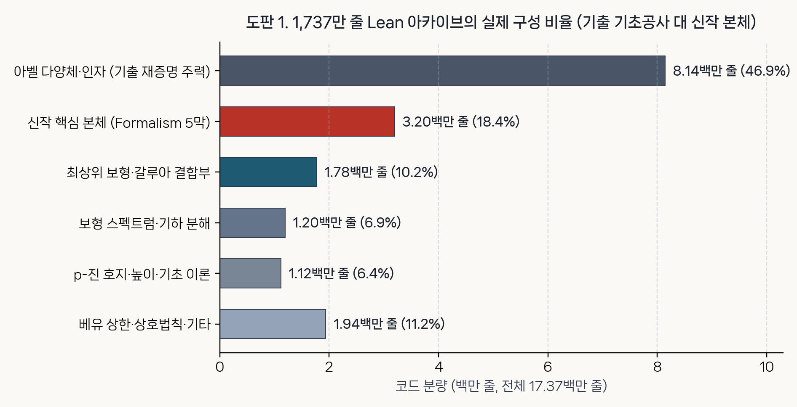
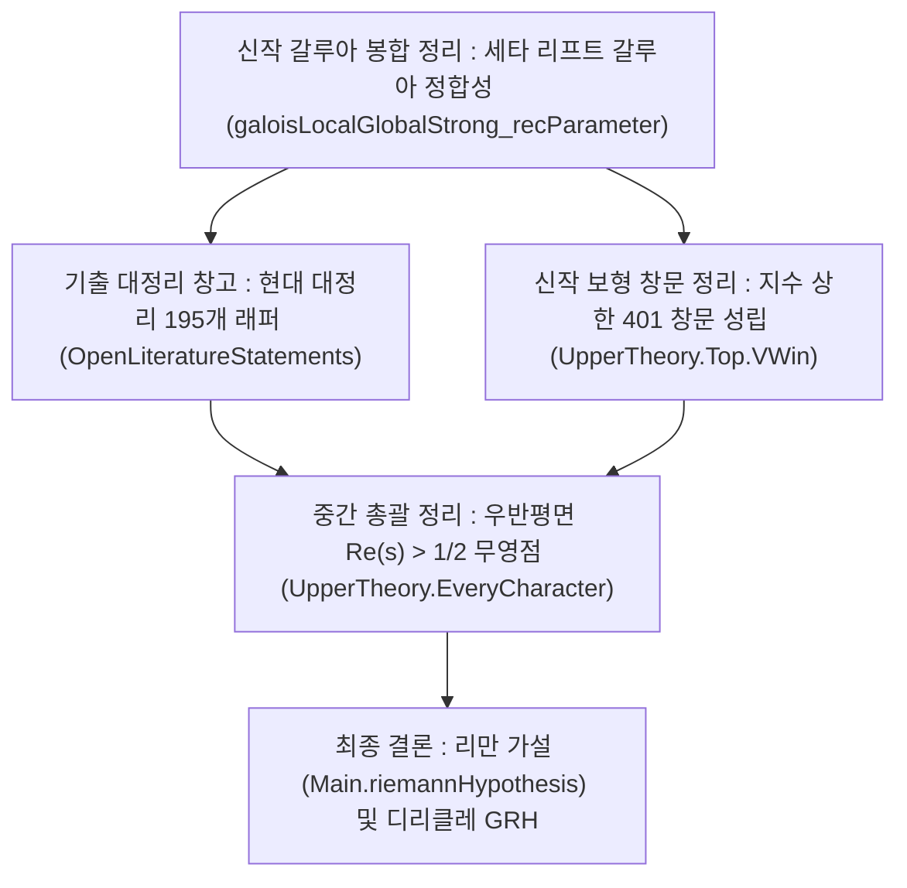

# 00. 한눈에 보는 전체 지도: 1,737만 줄 리만 가설 증명의 실제 해부도

Anthropic 소속 정수론자 레벤트 알푀게(Levent Alpöge)와 Claude가 공개한 리만 가설(RH) 및 디리클레 GRH 형식 증명은 공식 `leanprover/lean4:v4.33.1` 커널(`x86_64` · `aarch64`) 및 독립 검증 커널(`nanoda` · `con-leche` · `lean4lean`)에서 `175,187 / 175,187`개 모듈 전량 에러 `0`건으로 기계적 형식 인증을 통과했습니다(`2026-11-21`, `PASS`, 영수증 `FINAL_FEDERATED_VERDICT.txt`).
전체 분량 `17,374,215`줄 가운데 약 `88.35%` (`15,350,921`줄)는 기출 현대 수학 대정리 `195`개 묶음(`OpenLiteratureStatements`)이 끌어들이는 **이행적 의존 콘(transitive import cone)**(하위 공유 기초에서 `Formalism` 등과 중첩 포함)이며, 새로 발명된 핵심 논증은 제곱근 횟수의 반복 세타 리프트, 동반 격자 시소 정규화, 전역 아라켈로프 곱공식, 홀·짝 기우성 양날개 패칭 및 베렌트 타워로 압축됩니다([anatomy_stats.json](./data/anatomy_stats.json)).

---

## 1. 검증 범위 4단 인식론적 구분 요약

| 구분 | 대상 계층 | 검증 상태 | 핵심 판정 근거 및 잔여 경계 |
| :--- | :--- | :---: | :--- |
| **로컬 이중 CPU 컴파일** | 최상위 선언문(`src/Main.lean:1-12`) 5대 정리 및 `175,187`개 모듈 | **`PASS`** | `lean4:v4.33.1` C++ 커널(`x86_64` · `aarch64`) 에러 `0`건, `sorryAx` `0`건, 표준 3공리만 의존 |
| **외부 이종 독립 커널 검증** | `175,187`개 모듈 · `1,468,418`개 선언 (`2026-11-21` 서덜랜드 공개 검증) | **`PASS`** | `Mathlib` 공식 캐시 바이트 일치 및 `leanchecker` · Rust `nanoda` · `con-leche --compare` · `lean4lean` 전량 통과 (`lake comparator` · 편집증 커널 재검증 진행 중) |
| **기출 재구축 의존 콘** | `OpenLiteratureStatements` `195`개 래퍼 이행적 의존 콘(`15,350,921`줄) | **`PASS`** | 무증명 외부 공리 없이 순정 `Mathlib`(`0df444a3`) 위에서 자급자족 증명 완료(`Formalism` 하위 기초와 중첩 포함) |
| **정의 의미론 · 학계 동료심사** | `Mathlib` 내 `riemannZeta` · `LFunction` 정의 충실성 감사 및 수학계 공인 | **`ONGOING`** | 기계적 형식 인증은 완료되었으나 정의의 의미론적 대조, 인간 수학자의 전 구간 소화, CMI 출판 후 2년 학계 검증은 진행 중(무주석 원문의 서지·수식 해설은 본 `01`~`05`권에서 역복원) |

---

## 2. 아카이브 정량 실측표 및 구성 비율 (`175,187`개 파일 전수 집계)

[extract_proof_anatomy.py](./scripts/extract_proof_anatomy.py)로 측정한 상위 디렉터리별 실제 분량입니다.

| 상위 영역 | 파일 수 | 코드 줄 수 | 용량 (`MB`) | 실제 역할 |
| :--- | ---: | ---: | ---: | :--- |
| 아벨 다양체·인자 (`Development.AbelianVarietyTheory`) | `99,187` | `8,142,960` | `519.87` | 아벨 다양체·인자·사타케 매개변수·보형 대정리 자급자족 증명 (`46.9%`) |
| 신작 핵심 본체 (`Formalism`) | `18,254` | `3,200,748` | `164.90` | 체비쇼프 가중합, 세타 리프트 독립성, 에르미트 곡률, 베렌트 집합 (`18.4%`) |
| 최상위 결합부 (`Development.AutomorphicArithmetic`) | `18,431` | `1,776,375` | `110.94` | 보형 창문 정리(`VWin`), 갈루아 표현, 기출 대정리 `195`개 조립 (`10.2%`) |
| 보형 스펙트럼 (`Development.AutomorphicSpectrum`) | `15,147` | `1,195,844` | `72.33` | 보형 스펙트럼·계량 정칙화·기하 분해 (`6.9%`) |
| 기초 수론·호지 (`GroundTheory`) | `8,507` | `1,119,138` | `54.56` | $p$-진 호지 이론, 아라켈로프 높이, 차울라-셀베르그, 유체론 기초 (`6.4%`) |
| 베유 상한 (`Development.WeilBound`) | `7,051` | `848,547` | `48.73` | 베유 상한, 호지-테이트 점, 일반선형군 표현론 (`4.9%`) |
| 상호법칙 (`ReciprocityTheory`) | `3,845` | `563,016` | `28.91` | 체보타레프 밀도, 이산계열 카시미르 계수, 아라켈로프 부피 (`3.2%`) |
| 동반·양수성·기하 외 (`CompanionTheory` 외 4종) | `4,755` | `527,517` | `30.29` | 하리시-찬드라 가군, 특이점 해소(`499`개), 에탈 코호몰로지(`1,398`개), 보조정리 (`3.1%`) |
| 최상위 진입부 (`Main` · `Statements` 외) | `10` | `70` | `0.00` | 최종 5대 정리 선언 및 커널 진입점 |
| **합계** | **`175,187`** | **`17,374,215`** | **`1,030.53`** | 정리·보조정리 **`813,194`개**, 정의·구조체 외 **`241,088`개**, 주석 **`0`개** |

---

## 3. 처음 보는 독자를 위한 핵심 용어 6개 1분 통역표

본문(`01`~`03`)에 반복 등장하는 6개 전문 용어는 아래 일상 개념과 1대1로 대응합니다.

| 수학 용어 | 일상 비유 | 이 증명에서 맡는 기능 |
| :--- | :--- | :--- |
| **폰 망골트 합** | 소수 계단 측정기 | 소수(`2, 3, 5, 7...`)가 나올 때마다 눈금을 올려 소수의 누적 밀도를 재는 기본 저울 |
| **체비쇼프 마디** | 흔들림 보정 무게추 | 계단처럼 거친 소수 합을 부드러운 평균 곡선으로 다듬기 위해 고른 간격으로 찍는 측정 지점 |
| **스테파노프 중복도** | 돋보기 겹쳐 끼우기 | 미세한 이상 신호를 수백 배로 키워 가짜 영점이 빠져나갈 틈을 없애는 신호 증폭 배율 |
| **세타 리프트** | 더 큰 호수로 물결 옮기기 | 미분이 불가능한 자연수 대신 파동 함수를 한 차원 높은 대칭 공간으로 옮겨 중복도를 `1`씩 늘리는 장치 |
| **랄리스 시소 항등식** | 시소 반대편 무게 재기 | 직접 계산하면 복잡하게 불어나는 리프트 에너지를 시소 맞은편의 단순한 고정값으로 바꿔 손실을 약분하는 공식 |
| **베렌트 집합** | 등차 간격 회피 그물 | 일정한 간격(`1, 3, 5` 등)으로 숨어 공명하는 마지막 예외 원소들만 골라 걸러내는 특수 숫자 체 |

---

## 4. 증명 전체 조립도 (위에서 아래로 읽는 4계단 구조)

코드의 최종 결론인 `src/Main.lean:4-12`에서 거꾸로 세 계단만 내려가면 증명 전체가 맞물립니다.

- **계단 A (`EC → M`)**: 모든 디리클레 $L$-함수가 $\mathrm{Re}(s) > 1/2$에서 `0`이 아니라는 사실(`EveryCharacter`)이 확립되면, 함수방정식 대칭성($s \leftrightarrow 1 - s$)으로 $0 < \mathrm{Re}(s) < 1/2$ 구간의 영점도 함께 사라져 모든 비자명 영점이 $\mathrm{Re}(s) = 1/2$ 직선 위에 고정됩니다(`src/Formalism/GammaFactorNonvanishing/CritLine.lean:11-32`).
- **계단 B (`LIT + VW → EC`)**: 기출 현대 대정리 창고(`OpenLiteratureStatements`)와 신작 보형 창문 정리(`VWin`) 두 조각을 `src/Development/AutomorphicArithmetic/ThetaCorrespondence/ThetaPairLifts/ThirdPlaceSeries/EveryCharacterOfLiteratureOfVWin.lean:810-814`에서 결합해 `EveryCharacter`를 도출합니다.
- **계단 C (`ROW`)**: 두 조각이 공통으로 요구하는 갈루아-보형 연결고리(`galoisLocalGlobalStrong_recParameter`)를 `src/Development/AutomorphicArithmetic/Foundations/GaloisRepresentations/IntegralStructures/RowSrc.lean:6`에서 세타 리프트로 직접 증명해 외부 가정을 완전히 소거합니다.

---

## 5. 독자별 추천 읽기 경로

1. **수식 없이 직관과 비유로 이해하려는 독자**: [01_수식없이_읽는_비유풀이.md](./01_수식없이_읽는_비유풀이.md) 한 편으로 전체 원리를 완독할 수 있습니다.
2. **제곱근 횟수 도출 수식과 실제 소수 그래프를 확인하려는 독자**: [02_눈으로_만지는_핵심원리_5막.md](./02_눈으로_만지는_핵심원리_5막.md)에서 대수 유도와 도판을 확인할 수 있습니다.
3. **실제 Lean 코드 선언문과 기출 `195`선 전수 서지를 대조할 연구자**: [03_Lean코드_척추_해부원장.md](./03_Lean코드_척추_해부원장.md)와 [04_기출대정리_원전복원사전.md](./04_기출대정리_원전복원사전.md)에 정확한 행 번호가 전수 정리되어 있습니다.
4. **후반부 보형·코호몰로지 등식, 형식화 여유분, OpenAI 교차 심사를 검증할 전공자**: [05_전공자용_수론심층심사및수식복원서.md](./05_전공자용_수론심층심사및수식복원서.md) 및 보조 증명 [alpoge_spine_arithmetic_audit.lean](./proofs/alpoge_spine_arithmetic_audit.lean)에서 모든 심부 수식을 대조할 수 있습니다.
5. **책 형태로 통독하거나 인쇄하려는 독자**: [단행본 PDF](./book/리만가설_1737만줄_완전풀이집.pdf) 또는 [오프라인 전자책 HTML](./book/리만가설_1737만줄_완전풀이집.html)을 열면 전 6권과 도판 4종이 통합 조판된 합본으로 읽을 수 있습니다.
