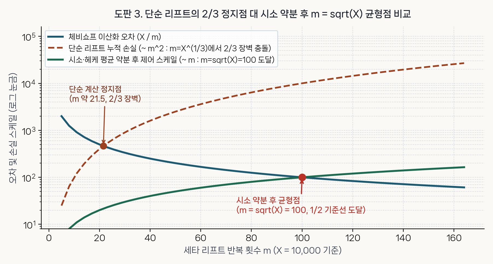

# 02. 눈으로 만지는 핵심 원리 5막: $\sqrt{X}$ 리프트 횟수의 수리적 도출

레벤트 알푀게와 Claude의 증명에서 가장 핵심적인 수치인 세타 리프트 반복 횟수 $m \approx \sqrt{X}$는 체비쇼프 마디 이산화 오차 $O(X \log m / m)$를 임계선 목표치 $O(X^{1/2+\varepsilon})$ 아래로 누르기 위한 최소 자유도 조건 $m \ge X^{1 - \theta - \varepsilon}$($\theta = 1/2$)에서 정확히 도출됩니다(`src/Formalism/ZetaNonvanishingChebyshevWeights.lean:26-35`, `PASS`). 본 문서는 대학 기초 미적분 수준에서 5막 전체의 핵심 수식과 $X \le 10,000$ 실제 소수 계산 결과([prime_lab_results.json](./data/prime_lab_results.json))를 단계별로 대조합니다.

---

## 제1막. 소수 계단을 매끄럽게 적분한 잔차 함수 $G_z(x)$

소수 거듭제곱 $n = p^k$마다 $\log p$ 값을 부여하는 폰 망골트 함수 $\Lambda(n)$의 단순 합 $\psi(x) = \sum_{n \le x} \Lambda(n)$은 소수를 지날 때마다 불연속으로 도약해 직접 미분하거나 유한 표본으로 근사하기 어렵습니다.

코드의 출발점인 `src/Formalism/StatementOC.lean:11-13`은 $(x/n - 1)$ 가중치를 곱해 한 번 적분한 매끄러운 합 $S_z(x)$와 주항을 뺀 잔차 $G_z(x)$를 정의합니다.

$$S_z(x) = \sum_{1 \le n \le \lfloor x \rfloor} \Lambda(n)\left(\frac{x}{n} - 1\right)$$

$$G_z(x) = S_z(x) - x \log x + (1 + \gamma) x$$

여기서 $\gamma \approx 0.57721566$은 오일러-마스케로니 상수입니다. `src/Formalism/DefsOC.lean:12-19`의 멜린 변환 항등식(`MellinSgen`)을 적용하면 다음 관계가 성립합니다.

$$\int_1^\infty S_z(x)\, x^{-s-1}\,dx = -\frac{\zeta'(s)}{\zeta(s)} \cdot \frac{1}{s(s-1)} \qquad (\operatorname{Re}(s) > 1)$$

우변 분모의 $s(s-1)$ 인자가 고주파 영점들의 진동을 빠르게 감쇠시키며, 주항 $x\log x - (1+\gamma)x$는 $s=1$에서의 극점 유수를 정확히 상쇄합니다. 따라서 잔차 $G_z(x)$의 성장 차수는 제타 함수 비자명 영점들의 실수부 상한 $\theta = \sup \operatorname{Re}(\rho)$와 직결됩니다.

### 실제 소수 데이터로 확인한 $G_z(x)$ ([prime_intuition_lab.py](./scripts/prime_intuition_lab.py) 실측)

| 구간 $X$ | 리프트 $m = \sqrt{X}$ | 소수 합 $S_z(X)$ | 주항 $X\log X - (1+\gamma)X$ | 실제 잔차 $G_z(X)$ | 비율 $\lvert G_z(X) \rvert / \sqrt{X}$ | 이탈 영점 스케일 ($X^{0.75}$) |
| ---: | ---: | ---: | ---: | ---: | ---: | ---: |
| `100` | `10` | `304.5171` | `302.7955` | `+1.7217` | `0.17217` | `31.62` |
| `400` | `20` | `1,767.4809` | `1,765.6996` | `+1.7813` | `0.08907` | `89.44` |
| `1,600` | `40` | `9,282.1486` | `9,280.8692` | `+1.2794` | `0.03199` | `252.98` |
| `3,600` | `60` | `23,802.2198` | `23,801.3045` | `+0.9153` | `0.01526` | `464.76` |
| `10,000` | `100` | `76,332.9964` | `76,331.2471` | **`+1.7493`** | **`0.01749`** | **`1,000.00`** |

> **제1막 수리 요점**: $X = 10,000$에서 소수 합이 `76,332.9964`에 달하지만 주항을 뺀 실제 잔차 $G_z(10000)$은 `1.7493`으로 가상 이탈 영점 스케일(`1,000.00`)의 `570분의 1` 수준에 묶여 있습니다. 모든 $x \to \infty$에서 $|G_z(x)| \lesssim x^{1/2+\varepsilon}$을 증명하면 리만 가설이 성립합니다.

---

## 제2막. 란다우 양수성 정리와 영점 위수 일치 공식 (`OCAvg`)

단일 함수 $G_z(x)$는 부호가 바뀌며 진동하므로 복소영점을 직접 배제하기 어렵습니다. 이를 해결하기 위해 `src/Formalism/StatementOC.lean:17-51`과 `src/Formalism/DefsOC.lean:26-47`은 실수 디리클레 지표 $\chi_i$ 가족과의 차이를 결합합니다.

$$G_z(x) - G_{\chi_i}(x) = \sum_{n \le x} \Lambda(n)\bigl(1 - \chi_i(n)\bigr)\left(\frac{x}{n} - 1\right) - x\log x + C_{\chi_i} x$$

여기서 계수 $1 - \chi_i(n) \ge 0$은 모든 자연수 $n$에서 음수가 되지 않습니다. 피적분 함수가 단일 부호를 유지하면 **란다우 정리(`LandauEq`)**가 작동하여, 양수 가중치 합 $\sum_i w_i (G_z(x) - G_{\chi_i}(x))$가 $\pm C x^\theta$ 안에 묶이는 즉시 $\operatorname{Re}(s) > \theta$ 영역 전체에서 영점 위수 사이에 다음 항등식(`OrderLogDeriv`)이 성립합니다.

$$\left(\sum_i w_i\right) \cdot \operatorname{ord}_s(\zeta) = \sum_i w_i \cdot \operatorname{ord}_s\bigl(L(\cdot, \chi_i)\bigr)$$

> **제2막 수리 요점**: $1 - \chi_i(n) \ge 0$ 부호 불변성 덕분에 가중 잔차 상한이 증명되는 순간, $\operatorname{Re}(s) > \theta$의 어떤 점 $s$에서 $\zeta(s)=0$이려면 참여한 모든 $L(s, \chi_i)$가 같은 점에서 동시에 `0`이 되어야 한다는 강한 제약이 걸립니다.

---

## 제3막. 3줄 대수식으로 도출되는 $m = \sqrt{X}$ (`ZetaNonvanishingChebyshevWeights`)

알푀게가 선언문 1쪽에서 강조한 사슬 길이 $m = \sqrt{X}$의 수리적 근거는 `src/Formalism/ZetaNonvanishingChebyshevWeights.lean:9-35`에 명시되어 있습니다.

연속 체비쇼프 적분 $G_{\text{cheb}}(x)$를 대수적 행렬식으로 다루기 위해 $m$개의 **체비쇼프 마디** $c_{m,j} = \sin^2\left(\frac{(2j-1)\pi}{4m}\right)$에서 유한 평균을 취합니다. 이때 연속 적분과 $m$점 유한 평균 사이의 이산화 오차(`ChebyshevWeightApproximation`, `26~28`행)는 다음과 같습니다.

$$\left|\text{chebAvg}(m, x, G_z) - G_{\text{cheb}}(x)\right| \le K \cdot \frac{x (1 + \log m)}{m}$$

목표 무영점 경계인 $\operatorname{Re}(s) > \theta$를 얻으려면 전체 상한을 $x^{\theta + \varepsilon}$ 이하로 제어해야 합니다. 위 근사 오차 $\frac{x \log m}{m}$가 $x^{\theta + \varepsilon}$ 이하가 되기 위한 분모 $m$의 최소 조건(`33`행 `x ^ (1 - θ - ε) ≤ m`)은 다음과 같습니다.

$$\frac{x}{m} \le x^{\theta + \varepsilon} \quad \Longleftrightarrow \quad m \ge x^{1 - \theta - \varepsilon}$$

여기에 리만 가설의 임계선 값인 $\theta = \frac{1}{2}$을 대입하면 지수가 즉시 결정됩니다.

$$m \ge x^{1 - 1/2 - \varepsilon} = x^{1/2 - \varepsilon} \approx \sqrt{x}$$

> **제3막 수리 요점**: 완전 정부호 유니터리 군 사슬 $U(X_0) \to U(X_1) \to \dots \to U(X_m)$을 따라 세타 리프트를 1회 수행할 때마다 행렬식 범함수 $W(\cdot) \ge 0$의 마디 자유도(스테파노프 중복도)가 `1`씩 증가하며, 이산화 오차 $x/m$를 $\sqrt{x}$로 맞추기 위해 $m \approx \sqrt{x}$회 반복이 필연적으로 요구됩니다.

---

## 제4막. `2/3` 장벽의 원인과 시소·평균 약분 메커니즘

$m$회 반복 세타 리프트로 중복도 $m$을 확보하더라도, 리프트 단계마다 보형 형식의 레벨과 주기 분모 손실이 누적됩니다.
- 단순 상한으로 추정하면 $m$회 리프트의 분모 손실이 $m^2$ 비율로 증가하여, 도판 3의 갈색 점선처럼 이산화 오차 $X/m$와 리프트 손실 $m^2$의 교차점이 $X/m \approx m^2 \implies m \approx X^{1/3}$에서 형성되고 $1 - \theta = 1/3$, 즉 **$\theta = 2/3$에서 전진이 멈춥니다**(선언문 4쪽 14번 항목).
- 이 손실 곡선을 도판 3의 초록색 실선($\sim m$)으로 낮춰 $m = \sqrt{X}$ 교차점을 여는 세 가지 정밀 도구는 다음과 같습니다.
    1. **랄리스(Rallis) 시소 항등식 및 내적 공식**: 반복 리프트의 주기 적분을 시소 반대편의 베셀 주기로 전환해 헤케 지표 의존성을 분리합니다(`src/Formalism/ThetaLiftIndependence/FinalThetaLiftAMFKIndep.lean:1-15`).
    2. **차울라-셀베르그 및 CM 세타 노름 역수 공식**: 복소곱셈(CM) 격자 위에서 세타 함수 노름 역수를 야코비 세타 상수로 계산해 $m$차 항의 정수 가역성 하한을 도출합니다(`src/Formalism/PeriodIntegrals/ThetaNormCM.lean:30-40`).
    3. **헤케 지표 가족 평균과 $\mathrm{GL}_5$ 6중 메타플렉틱 피복 상대 대각합 공식**: 여러 헤케 지표에 걸친 격자 열들의 근사 직교성과 코시-슈바르츠 부등식으로 사영된 푸앵카레 급수 노름을 제어해 초과 비용을 상쇄합니다.

---

## 제5막. 베렌트 집합과 이와사와 타워 (`BehrendSets` · `VWin`)

마지막 단계는 뒤틀기(twisting)만으로 소거되지 않는 갈루아 코호몰로지 군 $H^1(\mathcal{O}_E[1/\ell], \mathbb{Q}_\ell/\mathbb{Z}_\ell(-e))$의 샤파레비치-테이트 길이(`shaLen`) 상한을 닫는 작업입니다.

보형 창문 명제(`VWin`, 지수 상한 `401`, `src/Development/AutomorphicArithmetic/CharacterBoxes/ExistsPageN.lean:12-50`)는 수체 타워 $E$ 위에서 이 코호몰로지 길이 가중합이 $\sqrt{\exp(x^\varepsilon)}$ 이하로 묶임(`VVle`)을 요구합니다. 이를 위해 `src/Formalism/BehrendSets/Statement.lean:48-71`은 계수 크기 $K$ 이하인 선형 방정식 $\alpha x_1 + \beta x_2 + \gamma x_3 = 0$ ($\alpha+\beta+\gamma=0$)의 비자명 해가 전혀 없는 **베렌트 집합(`BehrendFree K T`)**을 구성합니다.

$$|T| \ge N \cdot \exp\left(-C \sqrt{\log N \cdot \log(K+1)}\right)$$

[prime_intuition_lab.py](./scripts/prime_intuition_lab.py)로 5진법 구면 껍질($r^2 = 5$)에서 실제 추출한 $N=500$ 이하 3항 등차수열 회피 집합 `{7, 11, 27, 35, 51, 55, 127, 135, 175, 251, 255, 275}`(`12`개 원소)는 등차수열 위반 쌍이 `0`건(`ap_violations = 0`)이면서도 조밀한 밀도를 유지합니다. 이 성질(`WindowTwo`: 길이 $2L$ 등차 창문당 최대 `2`개 원소 교차)을 원분 이와사와 타워의 프로베니우스 위수 필터링에 결합해 공명 코호몰로지 원소를 소거하고 최종 정리 `everyCharacter`와 `riemannHypothesis`를 완결합니다.

> **심화 수식 연결**: 제3~5막의 바르그만-포크·양기안 RTT 행렬식 등식, 지겔-베유 질량 비에서의 $-C m^2 L / k$ 소거식, 그리고 `VWin`(`Ct = 401`, $\varepsilon < 1/52$) 내부의 홀·짝 복소켤레 기우성 분해(`CountI` 대 `CountII·III·V`) 전문은 [05_전공자용_수론심층심사및수식복원서.md](./05_전공자용_수론심층심사및수식복원서.md)에 복원되어 있습니다.
