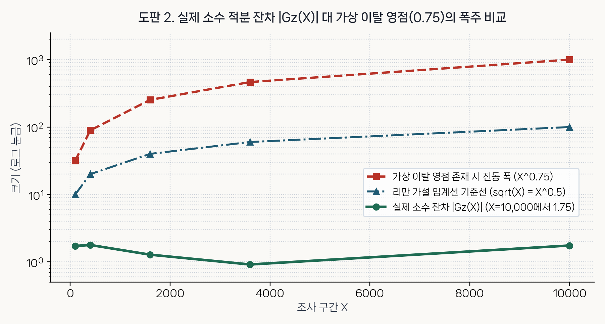

# 02. 눈으로 만지는 핵심 원리 5막: $\sqrt{X}$ 리프트 횟수의 수리적 도출

레벤트 알푀게와 Claude의 증명에서 가장 핵심적인 수치인 세타 리프트 반복 횟수 $m \approx \sqrt{X}$는 체비쇼프 마디 이산화 오차 $O(X \log m / m)$를 임계선 목표치 $O(X^{1/2+\varepsilon})$ 아래로 누르기 위한 최소 자유도 조건 $m \ge X^{1 - \theta - \varepsilon}$ ($\theta = 1/2$)에서 정확히 도출됩니다(`src/Formalism/ZetaNonvanishingChebyshevWeights.lean:26-35`, `PASS`). 본 문서는 대학 기초 미적분 수준에서 5막 전체의 핵심 수식과 $X \le 10,000$ 실제 소수 계산 결과([prime_lab_results.json](./data/prime_lab_results.json))를 단계별로 대조합니다.

---

## 제1막. 소수 계단을 매끄럽게 적분한 잔차 함수 $G_z(x)$

소수 거듭제곱 $n = p^k$마다 $\log p$ 값을 부여하는 폰 망골트 함수 $\Lambda(n)$의 단순 합 $\psi(x) = \sum_{n \le x} \Lambda(n)$은 소수를 지날 때마다 불연속으로 도약해 직접 미분하거나 유한 표본으로 근사하기 어렵습니다.

코드의 출발점인 `src/Formalism/StatementOC.lean:11-13`은 $(x/n - 1)$ 가중치를 곱해 한 번 적분한 매끄러운 합 $S_z(x)$와 주항을 뺀 잔차 $G_z(x)$를 정의합니다.

$$S_z(x) = \sum_{1 \le n \le \lfloor x \rfloor} \Lambda(n)\left(\frac{x}{n} - 1\right)$$

$$G_z(x) = S_z(x) - x \log x + (1 + \gamma) x$$

여기서 $\gamma \approx 0.57721566$은 오일러-마스케로니 상수입니다. `src/Formalism/DefsOC.lean:12-19`의 멜린 변환 항등식(`MellinSgen`)을 적용하면 다음 관계가 성립합니다.

$$\int_1^\infty S_z(x)\, x^{-s-1}\,dx = -\frac{\zeta'(s)}{\zeta(s)} \cdot \frac{1}{s(s-1)} \qquad (\mathrm{Re}(s) > 1)$$

우변 분모의 $s(s-1)$ 인자가 고주파 영점들의 진동을 빠르게 감쇠시키며, 주항 $x\log x - (1+\gamma)x$는 $s=1$에서의 극점 유수를 정확히 상쇄합니다. 따라서 잔차 $G_z(x)$의 성장 차수는 제타 함수 비자명 영점들의 실수부 상한 $\theta = \sup \mathrm{Re}(\rho)$와 직결됩니다.

### 실제 소수 데이터로 확인한 $G_z(x)$ ([prime_intuition_lab.py](./scripts/prime_intuition_lab.py) 실측)

| 구간 $X$ | 리프트 $m = \sqrt{X}$ | 소수 합 $S_z(X)$ | 주항 $X\log X - (1+\gamma)X$ | 실제 잔차 $G_z(X)$ | 비율 $\lvert G_z(X) \rvert / \sqrt{X}$ | 이탈 영점 스케일 ($X^{0.75}$) |
| ---: | ---: | ---: | ---: | ---: | ---: | ---: |
| `100` | `10` | `304.5171` | `302.7955` | `+1.7217` | `0.17217` | `31.62` |
| `400` | `20` | `1,767.4809` | `1,765.6996` | `+1.7813` | `0.08907` | `89.44` |
| `1,600` | `40` | `9,282.1486` | `9,280.8692` | `+1.2794` | `0.03199` | `252.98` |
| `3,600` | `60` | `23,802.2198` | `23,801.3045` | `+0.9153` | `0.01526` | `464.76` |
| `10,000` | `100` | `76,332.9964` | `76,331.2471` | **`+1.7493`** | **`0.01749`** | **`1,000.00`** |

> **제1막 수리 요점**: $X = 10,000$에서 소수 합이 `76,332.9964`에 달하지만 주항을 뺀 실제 잔차 $G_z(10000)$은 `1.7493`으로 가상 이탈 영점 스케일(`1,000.00`)의 `570분의 1` 수준에 묶여 있습니다. 모든 $x \to \infty$에서 $|G_z(x)| \lesssim x^{1/2+\varepsilon}$을 증명하면 리만 가설이 성립합니다.

---

## 제2막. 란다우 양수성 정리와 영점 위수 일치 공식 (`OCAvg`)

단일 함수 $G_z(x)$는 부호가 바뀌며 진동하므로 복소영점을 직접 배제하기 어렵습니다. 이를 해결하기 위해 `src/Formalism/StatementOC.lean:17-51`과 `src/Formalism/DefsOC.lean:26-47`은 실수 디리클레 지표 $\chi_i$ 가족과의 차이를 결합합니다.

$$G_z(x) - G_{\chi_i}(x) = \sum_{n \le x} \Lambda(n)\bigl(1 - \chi_i(n)\bigr)\left(\frac{x}{n} - 1\right) - x\log x + C_{\chi_i} x$$

여기서 계수 $1 - \chi_i(n) \ge 0$은 모든 자연수 $n$에서 음수가 되지 않습니다. 피적분 함수가 단일 부호를 유지하면 **란다우 정리(`LandauEq`)**가 작동하여, 양수 가중치 합 $\sum_i w_i (G_z(x) - G_{\chi_i}(x))$가 $\pm C x^\theta$ 안에 묶이는 즉시 $\mathrm{Re}(s) > \theta$ 영역 전체에서 영점 위수 사이에 다음 항등식(`OrderLogDeriv`)이 성립합니다.

$$\left(\sum_i w_i\right) \cdot \mathrm{ord}_s(\zeta) = \sum_i w_i \cdot \mathrm{ord}_s\bigl(L(\cdot, \chi_i)\bigr)$$

> **제2막 수리 요점**: $1 - \chi_i(n) \ge 0$ 부호 불변성 덕분에 가중 잔차 상한이 증명되는 순간, $\mathrm{Re}(s) > \theta$의 어떤 점 $s$에서 $\zeta(s)=0$이려면 참여한 모든 $L(s, \chi_i)$가 같은 점에서 동시에 `0`이 되어야 한다는 강한 제약이 걸립니다.

---

## 제3막. 3줄 대수식으로 도출되는 $m = \sqrt{X}$ (`ZetaNonvanishingChebyshevWeights`)

알푀게가 선언문 1쪽에서 강조한 사슬 길이 $m = \sqrt{X}$의 수리적 근거는 `src/Formalism/ZetaNonvanishingChebyshevWeights.lean:9-35`에 명시되어 있습니다.

연속 체비쇼프 적분 $G_{\text{cheb}}(x)$를 대수적 행렬식으로 다루기 위해 $m$개의 **체비쇼프 마디** $c_{m,j} = \sin^2\left(\frac{(2j-1)\pi}{4m}\right)$에서 유한 평균을 취합니다. 이때 연속 적분과 $m$점 유한 평균 사이의 이산화 오차(`ChebyshevWeightApproximation`, `26~28`행)는 다음과 같습니다.

$$\left|\text{chebAvg}(m, x, G_z) - G_{\text{cheb}}(x)\right| \le K \cdot \frac{x (1 + \log m)}{m}$$

목표 무영점 경계인 $\mathrm{Re}(s) > \theta$를 얻으려면 전체 상한을 $x^{\theta + \varepsilon}$ 이하로 제어해야 합니다. 위 근사 오차 $\frac{x \log m}{m}$가 $x^{\theta + \varepsilon}$ 이하가 되기 위한 분모 $m$의 최소 조건(`33`행 `x ^ (1 - θ - ε) ≤ m`)은 다음과 같습니다.

$$\frac{x}{m} \le x^{\theta + \varepsilon} \quad \Longleftrightarrow \quad m \ge x^{1 - \theta - \varepsilon}$$

여기에 리만 가설의 임계선 값인 $\theta = \frac{1}{2}$을 대입하면 지수가 즉시 결정됩니다.

$$m \ge x^{1 - 1/2 - \varepsilon} = x^{1/2 - \varepsilon} \approx \sqrt{x}$$

> **제3막 수리 요점**: 완전 정부호 유니터리 군 사슬 $U(X_0) \to U(X_1) \to \dots \to U(X_m)$을 따라 세타 리프트를 1회 수행할 때마다 행렬식 범함수 $W(\cdot) \ge 0$의 마디 자유도(스테파노프 중복도)가 `1`씩 증가하며, 이산화 오차 $x/m$를 $\sqrt{x}$로 맞추기 위해 $m \approx \sqrt{x}$회 반복이 필연적으로 요구됩니다.

---

## 제4막. `2/3` 장벽의 원인과 시소·평균 약분 메커니즘

$m$회 반복 세타 리프트로 중복도 $m$을 확보하더라도, 리프트 단계마다 보형 형식의 레벨과 주기 분모 손실이 누적됩니다.
- 단순 상한으로 추정하면 $m$회 리프트의 분모 손실이 $m^2$ 비율로 증가하여, 도판 3의 갈색 점선처럼 이산화 오차 $X/m$와 리프트 손실 $m^2$의 교차점이 $X/m \approx m^2 \implies m \approx X^{1/3}$에서 형성되고 $1 - \theta = 1/3$, 즉 **$\theta = 2/3$에서 전진이 멈춥니다**(선언문 4쪽 14번 항목).
- 이 손실 곡선을 도판 3의 초록색 실선($\sim m$)으로 낮춰 $m = \sqrt{X}$ 교차점을 여는 세 가지 정밀 도구는 다음과 같습니다.
    1. **랄리스(Rallis) 시소 항등식 및 내적 공식**: 반복 리프트의 주기 적분을 시소 반대편의 베셀 주기로 전환해 헤케 지표 의존성을 분리합니다(`src/Formalism/ThetaLiftIndependence/FinalThetaLiftAMFKIndep.lean:1-15`).
    2. **차울라-셀베르그 및 CM 세타 노름 역수 공식**: 복소곱셈(CM) 격자 위에서 세타 함수 노름 역수를 야코비 세타 상수로 계산해 $m$차 항의 정수 가역성 하한을 도출합니다(`src/Formalism/PeriodIntegrals/ThetaNormCM.lean:30-40`).
    3. **동반 격자 차원 나눗셈과 투영 푸앵카레 급수 평균**: 선언문(`remark.pdf` 4쪽 16번)의 $\mathrm{GL}_5$ 6중 피복 착안을 일반화해, 동반 격자($k \asymp x^{9/2+10\varepsilon}$) 나눗셈(`src/Formalism/GL3MeanSquares/MassLowerBoundClosed.lean:40`),
       레벨 투영 푸앵카레 급수(`src/Development/AutomorphicArithmetic/ThetaCorrespondence/RealBands/ExistsMultTEqPoin.lean:15-109`), 2유형 코시-슈바르츠 감쇠 $q^{-(k - 2r - 5)}$ (`src/Formalism/FlagUnipotentLattices/MinkowskiFactorialBounds/GaussSumCharacterAverageBound.lean:21-98`)로 이차 손실을 소거합니다.

### 학부 선형대수로 보는 유한차원 장난감 모형 (시소 전치와 차원 나눗셈)

보형형식 배경지식 없이 유한차원 행렬과 내적만으로도 제4막의 핵심 계산 두 가지를 그대로 확인할 수 있습니다.
- **시소 내적 이동 (`KerAdjoint`)**: $M \times N$ 전달 행렬 $K$와 두 벡터 $f \in \mathbb{C}^N$, $g \in \mathbb{C}^M$의 표준 내적은 켤레전치 행렬 $K^*$를 써서 반대편으로 즉시 넘어갑니다.

$$\langle K f,\, g \rangle = \langle f,\, K^* g \rangle$$

- 복잡한 출력 벡터 $K f$의 성분을 일일이 전개하는 대신 단순한 시험 벡터 $g$ 쪽으로 $K^*$를 넘기면, 평균 `0` 벡터 위에서 가우스 행렬 곱이 $K^* K v = |\mathbb{F}| \cdot v$처럼 지표와 무관한 상수배로 깔끔하게 축약됩니다(`src/Formalism/ThetaLiftIndependence/ThetaOrbitSums/GaussOp.lean:27-73`).
- **거대 동반 차원 나눗셈**: $m \approx X^{1/2}$번 리프트할 때 쌓이는 이차 로그 손실은 $m^2 \approx X$입니다. 사슬 전체를 차원 $k \approx X^{9/2}$인 훨씬 넓은 동반 격자에 심어 기저 차원당 평균 손실로 나누면 이차 항은 저절로 사라집니다.

$$\frac{m^2}{k} \approx \frac{X}{X^{9/2}} = X^{-\frac{7}{2}} \longrightarrow 0 \qquad (X \to \infty)$$

- 예를 들어 $X = 100$ ($m = 10$)일 때 원시 이차 손실은 $m^2 = 100$이지만, 동반 차원 $k = 100^{9/2} = 10^9$로 나눈 정규화 손실은 $10^{-7}$로 줄어들어 선형 주항만 남습니다.

---

## 제5막. 복소켤레 거울 기우성 양날개와 베렌트 체 (`VWin` · `BehrendSets`)

마지막 단계는 뒤틀기(twisting)만으로 소거되지 않는 갈루아 코호몰로지 군 $H^1(\mathcal{O}_E[1/\ell], \mathbb{Q}_\ell/\mathbb{Z}_\ell(-e))$의 샤파레비치-테이트 길이(`shaLen`) 합을 보형 창문 상한(`VWin`, 지수 `Ct = 401`, `src/Development/AutomorphicArithmetic/CharacterBoxes/ExistsPageN.lean:12-50`)인 $\sqrt{\exp(x^\varepsilon)}$ 아래로 묶는 작업입니다.

### 복소수 거울 대칭 장난감 모형: 왜 고전 도구만으로는 절반이 `0`이 되는가

제5막(`vwin_of_row`, `157,604`개 파일 · `1,609만 줄`)이 왜 거대한 현대 대수기하학 코드를 불러오는지는 고등학교 복소수 켤레 대칭 하나로 직관화됩니다. 복소수 $z = a + bi$에서 켤레복소수 $\overline{z} = a - bi$를 빼면 허수부(홀수 성분)만 남습니다.

$$z - \overline{z} = (a + bi) - (a - bi) = 2bi$$

그런데 허수부가 없는 순실수 $z = a$ ($b = 0$, 즉 $\overline{z} = z$인 **짝수 대칭 상태**)를 이 식에 넣으면 $a - a = 0$이 되어 측정값이 항등적으로 `0`이 됩니다. 고전 수론의 슈티켈베르거 원소가 바로 이 $z - \overline{z}$ 차이와 똑같은 홀수 사영 구조를 갖기 때문에, 코호몰로지 제어는 두 날개로 갈라집니다.

- **홀수(`minus`, `ShaMinus`) 날개 (`ThmBab K 401` + 베렌트 체 `ThmBcFree`)**: $z - \overline{z} \neq 0$인 홀수 성분에서는 슈티켈베르거 소멸(`stick_of`)과 페레로-워싱턴 정리($\mu = 0$)가 작동합니다. 여기에 원분 층 $e$ 사이의 선형 공명 $\alpha x_1 + \beta x_2 + \gamma x_3 = 0$ ($\alpha+\beta+\gamma=0$)을 차단하기 위해 `src/Formalism/BehrendSets/Statement.lean:48-71`의 **베렌트 집합(`BehrendFree K T`)**을 결합합니다.

$$|T| \ge N \cdot \exp\left(-C \sqrt{\log N \cdot \log(K+1)}\right)$$

- [prime_intuition_lab.py](./scripts/prime_intuition_lab.py)로 5진법 구면 껍질($r^2 = 5$)에서 추출한 $N=500$ 이하 집합 `{7, 11, 27, 35, 51, 55, 127, 135, 175, 251, 255, 275}` (`12`개 원소)는 3항 등차수열 위반이 `0`건(`ap_violations = 0`)이면서도 조밀한 밀도를 유지하며(`WindowTwo`), 홀수 날개의 공명 항을 걸러냅니다.
- **짝수(`PsiEven` · 반디버, `plusLen`) 날개 (`PointHV` 7분할 고차원 보형 패칭)**: 슈티켈베르거 원소가 `0`으로 무력화되는 짝수 반디버 공간($\psi(-1) = (-1)^e$)에서는 아벨 원분 도구만으로 코호몰로지 길이를 묶을 수 없습니다.
  알푀게와 Claude는 짝수 공간을 7개 분기(`CountI · CountII · CountIII · CountIV · CountV · CountVs · CountZ`)로 나누어 가토 $\mathrm{GL}_2$ 오일러 계 + $U(3)$ 강성(`rigIUE_alt` · `rigII_a_alt`), $\mathrm{GSp}_4$ (`sp4In0_alt`), $U(3)$ 히다 패칭(`THidaU`, `WindowBoundOfLiteratureLevel.lean:25-34`)을 동원했으며, 이 `103만 줄` 순수 신작 패칭 계층이 아벨 다양체(`814만 줄`)를 포함한 `1,506만 줄` 기출 재증명 콘을 불러들여 총 `1,609만 줄`(`157,604`개 파일)을 이룹니다.

---

## 전공자 문서(`03` · `05`) 진입용 핵심 용어 3개 직관 요약

심화 수식 감사서인 [05_전공자용_수론심층심사및수식복원서.md](./05_전공자용_수론심층심사및수식복원서.md)로 넘어가기 전에 세 가지 전문 용어만 위 장난감 모형과 연결해 두면 모든 등식이 곧바로 읽힙니다.
- **아라켈로프 · DVR 코커널 길이 (`StatementLA`)**: 행렬 나눗셈에서 발생하는 분모 손실을 소수 $\ell$마다 한 자리씩 세는 대수적 눈금으로, 몫격자 $L / L^\vee$의 길이를 재는 것과 같습니다.
- **지겔-베유 질량 비 (`D* / d*`)**: 바닥 차수 $k$ 격자와 상단 차수 $k - 1 + m$ 격자 사이의 부피·지표 비율로, 앞서 본 $-C m^2 L / k \to 0$ 차원 나눗셈이 실제로 일어나는 분수식입니다.
- **복소켤레 거울 기우성 (`minus` 대 `plus` / 반디버 날개)**: 복소켤레 대합 $c$에 따른 홀수 공간(`minus`, 슈티켈베르거 + 베렌트 체로 종결)과 짝수 공간(`plus`, 슈티켈베르거가 `0`이 되어 $\mathrm{GSp}_4 \cdot U(3)$ 패칭 투입)의 이원 분해입니다.
