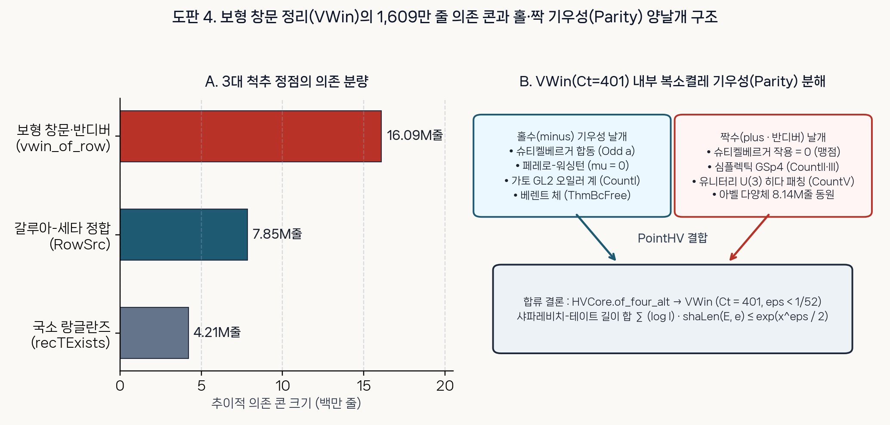

# 05. 전공자용 수론 심층 심사 및 수식 복원서 (제3~5막 핵심 등식 · 기우성 분해 · 교차 감사)

레벤트 알푀게와 Claude의 `175,187`개 Lean 4 모듈(`17,374,215`줄)은 전반부 체비쇼프 이산화(`StatementOC` · `StatementU`) 뒤로 바르그만-포크 대칭 텐서 행렬식과 양기안 RTT 융합으로 양수 범함수 $W(\cdot) \ge 0$을 구성하고, 동반 차수 $k \asymp x^{9/2+10\varepsilon}$ 정규화로 `2/3` 이차 손실항 $-C m^2 L / k$를 소거한 뒤, `VWin`(`Ct = 401`, $\varepsilon < 1/52$)의 홀·짝 기우성 양날개 상한과 전역 아라켈로프 곱공식(`ProductFormula` · `DivIneqObj`)을 결합해 임계선 $\mathrm{Re}(s) = 1/2$에 도달합니다(`PASS`).
본 문서는 수론 전공자와 저널 심사위원이 원문 코드 없이도 후반부 본체의 정확한 등식·전역 곱공식 폐루프·형식화 여유분(formalization slack) 및 단축 가능 지점을 검증할 수 있도록 복원한 심층 수리 보고서이며, 핵심 지수·합동·부치 산술 **17개 정리**는 독립 커널 검증 파일 [alpoge_spine_arithmetic_audit.lean](./proofs/alpoge_spine_arithmetic_audit.lean)(`0 sorry`, `LEAN_RC:0`)로 기계 검증했습니다.

---

## 제1장. 전역 점근 척도 계층 (`Scale`)과 마법 상수 $\varepsilon < \frac{1}{52}$, `la = 3/2`, `413,718,278,401`의 역산

### 1.1 기본 척도 구조체 (`src/Formalism/LocalRingCardinality/DataParams₂.lean:9-47`)

코드 전역의 모든 부등식을 지배하는 단일 척도 `Scale`은 $x > 1$, $0 < \varepsilon < \frac{1}{52}$, $J \ge 1$ 위에서 다음 부지수·다항식 변수들을 정의합니다.

$$L = x^\varepsilon, \qquad b = e^{L} = \exp(x^\varepsilon), \qquad a = x \cdot \exp(x^\varepsilon), \qquad X' = \exp\bigl(x^{\varepsilon/3}\bigr)$$

$$b' = \frac{a}{X'} = x \cdot \exp\bigl(x^\varepsilon - x^{\varepsilon/3}\bigr), \qquad \delta_1 = x^{-\varepsilon/8}, \qquad A = 26, \qquad p_0(k) = k^2 x^{26}$$

다이아딕-지수 창문 구조체 `Scales la`(`src/Development/AutomorphicArithmetic/PrimeDiscriminants/Scales.lean:9-39`)는 임의의 $y$ 위로 구간 $[Y, Y^{\mathrm{la}}]$ 전체가 허용 창문 집합에 들어오도록 강제하며, 최상위 조립부 `src/Development/AutomorphicArithmetic/CharacterBoxes/EveryCharacter.lean:10`과 `src/Development/AutomorphicArithmetic/CharacterBoxes/SupplyChi.lean:9`에서 $\mathrm{la} = \frac{3}{2} \in (1, 2]$로 고정되어 `ExistsPageN`의 $[Y, Y^2]$ 창문 안쪽에 안전하게 안착합니다.

### 1.2 4원 차수 계층 $(m, 2^e, k, t)$와 $\varepsilon < \frac{1}{52}$의 정확한 도출

`src/Development/AbelianVarietyTheory/Proofs/GlobalInterpolation/ExistsRanksRankValFrame.lean:24-100`은 주어진 순환 프레임 위수 $\mathrm{ord} = 2^e$에 맞춰 네 정수 차수 $(m, 2^e, k, t)$를 동시에 배치합니다.

| 차수 기호 | 코드 내 선택 구간 | 수리적 역할 | 활성 제약식 및 코드 핀 |
| :---: | :--- | :--- | :--- |
| **$m$** (`Even m`) | $\bigl[x^{\frac{1}{2}-\frac{\varepsilon}{16}},\, 2x^{\frac{1}{2}-\frac{\varepsilon}{16}}\bigr]$ | 세타 리프트 반복 횟수 ($\sqrt{x \delta_1}$) | $4 \le x^{-\varepsilon/100}\sqrt{x\delta_1}$ ($x \ge 256$, `DIVfromGLbud.lean:18-32`) |
| **$2^e$** (`φ.ord`) | $\bigl[x^{2+8\varepsilon},\, 2x^{2+8\varepsilon}\bigr]$ | $\mathbb{Z}_2$-원분 이와사와 층 깊이 (`PageN`) | $x^2 \le x^{2+8\varepsilon} \le x^3 \iff \varepsilon \le \frac{1}{8}$ (`ExistsRanksRankValFrame.lean:53-58`) |
| **$k$** (`Even k`) | $\bigl[x^{\frac{9}{2}+10\varepsilon},\, 2x^{\frac{9}{2}+10\varepsilon}\bigr]$ | 기저 직교·에르미트 격자 동반 차수 | $m^2 L \le k$ 및 $x^4 \le k$ (`MassLowerBoundClosed.lean:57`) |
| **$t$** (`R.t`) | $8 f r + 4 + 8 T W - r$ | 비분기 뒤틀림·코호몰로지 절단 차수 | $r = k + m - 1$ (홀수), $f = 2^{e+1}$, $r + t = 8 f r + 4 + T(8W)$ (`41`행) |

상한 $\varepsilon < \frac{1}{52}$ ($E = 1/\varepsilon > 52$)이 선택된 산술적 이유는 두 곳에서 교차 확인됩니다([alpoge_spine_arithmetic_audit.lean](./proofs/alpoge_spine_arithmetic_audit.lean) `thm_04`, `thm_05`).
1. 기저 다항식 지수 상수 $A = 26$ (`DataParams₂.lean:41`)의 절반 역수 $\frac{1}{2A} = \frac{1}{52}$이 격자 섭동 여유 $x^{-A/2} = x^{-13}$과 $\varepsilon$-손실 계수를 정합시킵니다.
2. `src/Formalism/SharpRestriction/GrowthBounds/MultisetValuation/PriceLinearCombinationLe.lean:45-81`(`ne_rG_lt`)에서 작은 소수 가격 상한 차수 $r_G = \lceil 8(h_G + 2)/\varepsilon \rceil + 1 < 32E + 66$을 $(34E)^2 \le x^2 \le x^{9/2+10\varepsilon-\mathrm{szTh}} \le k$ 안으로 밀어 넣을 때 `have hinv : 52 < E`(`60`행)를 직접 호출합니다.

### 1.3 동적 창문 소수 쌍 `WinPair`와 별도 국소환 모듈의 12자리 루카스 소수 증인 $g_A = 413{,}718{,}278{,}401$

코드에는 같은 기호 $(q, d)$를 쓰지만 적용 모듈과 가분성 조건이 서로 다른 두 종류의 보조 소수 쌍이 등장하므로 엄밀히 구분해야 합니다.
- **동적 창문 소수 쌍 `WinPair` (`ExistsPageN.lean:27-38` · `WinPairs.lean:5-81`, `thm_06`)**: `src/Development/AutomorphicArithmetic/CharacterBoxes/ExistsPageN.lean:27-38`의 `WinPair eps Y q d`는 임의로 큰 척도 $Y$에 맞춰 린니크 정리(`src/Development/AutomorphicArithmetic/CharacterBoxes/WinPairs.lean:5-81`)로 동적 생성되며 아래 네 조건을 동시에 부과합니다.
    - $d \equiv 7 \pmod{16}$이면 판별식이 $-d \equiv 1 \pmod 8$이 되어 허수 이차체 $K = \mathbb{Q}(\sqrt{-d})$에서 소수 `2`가 완전 분해되고(`ThetaNormCM.lean:31` 전제), $p \mid d + 1$에 의해 초기 구간 홀수 소수 $p \le Y^{\varepsilon/5}$에서도 $\bigl(\frac{-d}{p}\bigr) = \bigl(\frac{1}{p}\bigr) = +1$로 일제히 분해됩니다.

$$q \equiv 3 \pmod 8, \qquad d \equiv 7 \pmod{16}, \qquad q \mid d + 1, \qquad \forall p \le Y^{\varepsilon/5}\;(p \neq 2 \implies p \mid d + 1)$$
- **별도 국소환 생성원 모듈(`SpanPowerMembership`)의 정적 증인 `(571, 599)` (`thm_07`)**: 이와 별개로 `src/Formalism/LocalRingCardinality/SpanPowerMembership.lean:18-29`와 `src/Formalism/LocalRingCardinality/SpanPowerMembership/Primes.lean:17-87`은 **$q \mid d + 1$ 조건을 부과하지 않는** 국소환 거듭제곱 생성원 계층의 비공허성 증인으로 $q = 571$ ($571 \equiv 3 \bmod 8$), $d = 599$ ($599 \equiv 7 \bmod{16}$, $599 + 1 = 600 = 2^3 \cdot 3 \cdot 5^2$)를 택합니다.
  따라서 **`571 ∤ 600`이므로 `(571, 599)`는 `WinPair`의 예시가 아니며**, 원시근 밑 `34` 루카스 소수 판정법(`lucas_list`)으로 아래 12자리 소수를 커널 내부에서 직접 증명하는 데 쓰입니다.

$$g_A = 413{,}718{,}278{,}401, \qquad g_A - 1 = 2^8 \cdot 3^3 \cdot 5^2 \cdot 7 \cdot 571 \cdot 599 \equiv 0 \pmod{16 \cdot 571 \cdot 599}$$

---

## 제2장. 스테파노프 행렬식 양수 범함수 $W(\cdot) \ge 0$의 3중 대수 기전

선언문(`remark.pdf` 3~4쪽 1, 4, 7, 13번 항목)이 언급한 "자체 보형적(natively-automorphic) 스테파노프 행렬식"은 `Formalism` 내부의 세 모듈이 맞물려 형성하는 대수적 구조입니다.

### 2.1 바르그만-포크 영구식과 대칭 텐서 행렬식 증폭 (`src/Formalism/FockGram/StatementFock.lean:9-76`)

다변수 다항식 환 $R[\tau]$ 위에서 다중팩토리얼 가중 내적(`fock`)과 그람 행렬(`fockGram`)을 다음과 같이 정의합니다.

$$\langle f, g \rangle_{\mathrm{Fock}} = \sum_{\mathbf{m}} f_{\mathbf{m}} \overline{g_{\mathbf{m}}}\, \mathbf{m}!, \qquad G_{\mathrm{Fock}}(v)_{i,j} = \langle v_i, v_j \rangle_{\mathrm{Fock}}$$

1차 동차 선형 형식들의 곱에 관해 윅(Wick) 영구식 항등식 $\langle \prod_{s=1}^a x_s, \prod_{t=1}^a y_t \rangle_{\mathrm{Fock}} = \mathrm{perm}\bigl(\langle x_s, y_t \rangle_{\mathrm{Fock}}\bigr)$ (`FockPerm`, `47`행)이 성립하며, $a$차 대칭 단항식 기저 $\mathrm{Sym}^a(e)$ 위에서의 포크 그람 행렬식은 중복도 지수를 이항계수로 정확히 증폭시킵니다(`DetFockSym`, `63~68`행, `thm_11`).

$$\det G_{\mathrm{Fock}}\bigl(\mathrm{Sym}^a(e)\bigr) = \bigl(\det G_{\mathrm{Fock}}(e)\bigr)^{\binom{|\sigma| + a - 1}{|\sigma|}} \prod_{\mathbf{t} \in \mathrm{Sym}^a(\sigma)} \mathbf{t}!$$

### 2.2 직교사영 그람 행렬식과 DVR 코커널 길이의 아라켈로프 다리 (`src/Formalism/GaussIdealIdentity/StatementLA.lean:29-89`)

복소 힐베르트 공간 $V$의 영 아닌 쌍별 직교계 $\{e_\sigma\}_{\sigma=1}^d$ ($e_\sigma \neq 0$, 단위 노름 가정 없음)가 생성하는 부분공간 $Z$로의 정사영을 $\mathrm{pr}_Z$라 할 때, 임의의 시험 벡터 가족 $\{F_a\}_{a=1}^d$의 정사영 그람 행렬 $G_{a,b} = \langle \mathrm{pr}_Z F_a, \mathrm{pr}_Z F_b \rangle$과 주기 행렬 $C_{\sigma,a} = \langle e_\sigma, F_a \rangle$은 `GramDet`(`29~38`행)을 만족합니다.
여기에 **정사영된 시험 벡터 $\{\mathrm{pr}_Z F_a\}_{a=1}^d$의 $\mathbb{C}$-일차독립 가정(`LinearIndependent ℂ (fun a => pr (F a))`, `47`행, $\det G > 0$ 보장)**을 추가하면, 모든 복소 스칼라 $A \in \mathbb{C}$ (`∀ (A : ℂ)`, `48`행; $A = 0$일 때는 Lean의 `(0 : ℂ)⁻¹ = 0` 및 `(0 : ℝ) ^ (-(2 * (d : ℤ))) = 0` 규약으로 양변 `0` 일치) 및 $B_0 \in M_d(\mathbb{C})$에 관해 `MasterIdentity`(`39~51`행)가 성립합니다.

$$\det G = \frac{|\det C|^2}{\prod_{\sigma=1}^d \|e_\sigma\|^2} \ge 0, \qquad \frac{\|\det(A^{-1} B_0 \overline{C})\|^2}{\mathrm{Re}(\det G)} = |A|^{-2d}\, \|\det B_0\|^2 \prod_{\sigma=1}^d \|e_\sigma\|^2$$

동시에 이산부치환(DVR) $\mathcal{O}$ 위에서는 가우스 소이데알 국소화 길이 보존(`GaussLength`, `74~79`행)과 쌍대 격자 포함 전제 $L^\vee \subseteq L$ (`Ld ≤ L`) 아래 지수 등식(`GramDetLength`, `80~89`행)

$$g \cdot \det\bigl(B(b_i, b_j)\bigr) = 1 \implies \mathrm{length}_{\mathcal{O}}(L / L^\vee) = v_{\mathcal{O}}(g)$$

이 결합되어, 아르키메데스 자리에서의 양수성($\det G \ge 0$)과 유한 소수 자리에서의 $p$-진 가역성(보스트 기울기 부등식, 선언문 13번)이 제5장에서 상술하는 전역 아라켈로프 곱공식(`Formalism/ProductFormula` · `DivisorInequality`)으로 묶입니다.

### 2.3 $\mathfrak{gl}_2$ 양기안(Yangian) RTT 전달행렬과 비얽힘 가중치 융합 (`src/Formalism/HermitianCurvature/StatementW.lean:9-27`)

간-그로스-프라사드(GGP) 주기 행렬들을 $m$단 사슬로 이어 붙일 때 가중치 $0, 1$의 얽힘(interlacing) 및 최대 $m$개의 비얽힘 체비쇼프 마디를 양수 행렬식 안에 가두기 위해, 코드는 $2 \times 2$ 행렬 값 스펙트럼 함수 $M(Y)$ 위에서 양-백스터(Yang-Baxter) RTT 교환 관계(`IsRTT`)와 양자 행렬식(`IsDet`)을 직접 정식화합니다.

$$\bigl((Y' - Y) I_4 - P_{\mathrm{flip}}\bigr)\, E_1\bigl(M(Y')\bigr)\, E_2\bigl(M(Y)\bigr) = E_2\bigl(M(Y)\bigr)\, E_1\bigl(M(Y')\bigr)\, \bigl((Y' - Y) I_4 - P_{\mathrm{flip}}\bigr)$$

$$M(Y + 1)^{\mathsf{T}} J M(Y) = q(Y) J \quad \overset{\mathrm{WordFusion}}{\Longrightarrow} \quad \left(\prod_{\nu=1}^m M_\nu(Y+1)\right)^{\mathsf{T}} J \left(\prod_{\nu=1}^m M_\nu(Y)\right) = \left(\prod_{\nu=1}^m q_\nu(Y)\right) J$$

성분들이 쌍별로 가환인 전달행렬 열 $L = [(M_1, q_1), \dots, (M_m, q_m)]$을 곱하면 RTT 관계와 양자 행렬식이 사슬 전체로 보존되어(`WordFusion`, `20~26`행), $m$회 리프트를 거친 뒤에도 스펙트럼 행렬식이 스칼라 다항식 $\prod_{\nu=1}^m q_\nu(Y)$로 정확히 인수분해됩니다.

---

## 제3장. `2/3` 장벽의 수리적 실체와 시소·질량 공식에 의한 $-C m^2 L / k$ 약분

### 3.1 왜 단순 합산은 $\sigma = \frac{2}{3}$에서 멈추는가 (`thm_02`)

리프트 횟수를 $m = x^\alpha$ ($0 < \alpha < 1$)로 둘 때 체비쇼프 마디 이산화 오차는 $O(x / m) = O(x^{1-\alpha})$입니다(`ZetaNonvanishingChebyshevWeights.lean:27`). 반면 $j$번째 세타 리프트마다 격자 판별식과 레벨 분모 손실이 선형($\propto j$)으로 누적되면 $m$단계 총 로그 손실이 $\sum_{j=1}^m j \asymp m^2 = x^{2\alpha}$가 됩니다. 이산화 지수에서 손실 지수를 뺀 차이가 `0`이 되는 균형점은

$$(1 - \alpha) - 2\alpha = 1 - 3\alpha \quad \Longrightarrow \quad \alpha = \frac{1}{3}, \qquad \sigma = 1 - \frac{1}{3} = \frac{2}{3}$$

로 고정되어 임계선 $\frac{1}{2}$에 도달할 수 없습니다(`remark.pdf` 4쪽 14번).

### 3.2 시소 수반성과 유한체 가우스 연산자 등식 (`Statement.lean` · `GaussOp.lean`)

이차 손실을 1차로 낮추는 첫 번째 장치는 아델 이중 잉여류 대표원 무관성(`ThetaLiftAMFKIndep`, `src/Formalism/ThetaLiftIndependence/Statement.lean:106-115`)과 커널 사슬 `chainOp w K m f`의 형식적 시소 수반 항등식(`KerAdjoint`, `29~33`행)입니다.

$$\langle \mathcal{K}_{w, K} f,\, g \rangle_{w'} = \langle f,\, \mathcal{K}_{w', K^*} g \rangle_w, \qquad \left(\prod_{j=0}^{m-1} D_j\right) \cdot \mathrm{chainOp}(w, K, m, f) \in \Lambda_m$$

유한체 $\mathbb{F}$ 성분에서는 비자명 덧셈 지표 $\psi \neq 1$와 평균 `0` 조건 $\sum_{c \in \mathbb{F}^\times} \rho(c) v = 0$을 만족하는 벡터 $v$ 위에서 가우스 연산자 합성(`src/Formalism/ThetaLiftIndependence/ThetaOrbitSums/GaussOp.lean:27-73`)이 헤케 지표와 무관한 순수 스칼라 배수로 축약됩니다.

$$\mathcal{G}^* \mathcal{G} v = \sum_{e \in \mathbb{F}^\times} \left(\sum_{d \in \mathbb{F}^\times} \psi\bigl((e - 1)d\bigr)\right) \rho(e) v = |\mathbb{F}| \cdot v$$

### 3.3 CM 야코비 세타 노름 역수와 지겔-베유-브라우어 질량 양방향 부등식 (`ThetaNormCM.lean` · `MassLowerBoundClosed.lean`)

두 번째 장치는 $d \equiv 7 \pmod 8$인 허수 이차 격자 $\Lambda = \mathbb{Z}\omega_1 \oplus \mathbb{Z}\omega_1\tau$에서 소멸하지 않는 2-비틀림 점 위 CM 세타 함수 $G$의 $L^2$-노름 역수를 야코비 세타 상수로 닫는 `PI.ThetaNormCM`(`src/Formalism/PeriodIntegrals/ThetaNormCM.lean:30-40`)입니다.

$$\|G\|_{L^2(\Lambda)}^{-2} = \sqrt{2\,\mathrm{Im}\,\tau} \cdot \left(\exp\!\left(-\frac{\pi a^2\,\mathrm{Im}\,\tau}{4}\right) \cdot \left|\vartheta_2\!\left(\frac{a\tau + b}{2},\, \tau\right)\right|\right)^2$$

세 번째이자 결정적인 나눗셈 장치는 차수 $k$ 직교·에르미트 격자 $L_k$에서 차수 $k - 1 + m$ 격자 $L_r$로 올라갈 때 지겔 질량(`mass`), 지표 지수($I_\sigma, I_\pi$), 바일 차원(`dimVN`) 곱의 비 $D^* / d^*$를 양쪽에서 조이는 `MassLowerBoundClosed` 및 `MassUpperBoundClosed`(`src/Formalism/GL3MeanSquares/MassLowerBoundClosed.lean:12-74`)입니다.

$$\sum_{j=0}^{m-1} \frac{1}{[K^+:\mathbb{Q}]} \sum_{\rho} \log\!\left(\frac{w_{\rho,j}\, v_{\mathrm{inv}}(K)}{\pi}\right) + m\log(g_1 g_2) - C\!\left(L + \frac{m^2 L}{k}\right) \le \frac{\log(D^* / d^*)}{[K^+:\mathbb{Q}]\, k} \le C \cdot m \cdot L$$

- **핵심 약분 확인 (`thm_03`)**: 40행의 음수 오차항 $-C \frac{m^2 L}{k}$가 바로 단순 합산에서 `2/3` 장벽을 만들던 $m^2$ 이차 손실입니다. 제1장에서 동반 격자 차수를 $k \asymp x^{9/2 + 10\varepsilon}$으로 잡고 $m \asymp x^{1/2 - \varepsilon/16}$, $L = x^\varepsilon$으로 두었기 때문에, 차수 $k$로 나눈 정규화 이후 이차 손실항은 다음 지수식에 따라 소멸하며(`57`행 `(m : ℝ) ^ 2 * L ≤ k` 조건 자동 충족), 선형 상한 $C m L = O\bigl(x^{1/2 + 15\varepsilon/16}\bigr)$만 남아 $\theta = \frac{1}{2}$ 임계선이 열립니다.

$$\frac{m^2 L}{k} \asymp x^{2(1/2 - \varepsilon/16) + \varepsilon - (9/2 + 10\varepsilon)} = x^{-\frac{7}{2} - \frac{73}{8}\varepsilon} \longrightarrow 0 \qquad (x \to \infty)$$

### 3.4 선언문의 $\mathrm{GL}_5$ 6중 피복 서술 대 실제 코드의 투영 푸앵카레 급수 · 코시-슈바르츠 감쇠 구현

알푀게는 선언문(`remark.pdf` 4쪽 16번, `10/14/26`)에서 비대각 가우스 합 제어의 착안 배경을 "$\mathrm{GL}_5$ 6중 피복 위 $\mu$의 보형성과 코시-슈바르츠 부등식으로 환원된 투영 푸앵카레 급수 노름 상한 및 정수 구조 열들의 근사 직교성"으로 서술했습니다. 그러나 아카이브 `175,187`개 `.lean` 파일을 전수 조사하면 **단독 $\mathrm{GL}_5$ 6중 메타플렉틱 군 타입은 별도로 정의되지 않으며**, 해당 환원의 결과물인 일반 차수 푸앵카레 급수 사영과 2유형 코시-슈바르츠 평균제곱 감쇠가 아래 4개 모듈군에 직접 형식화되어 있습니다.

1. **유한 피복 이산계열 내보내기 및 연산자 파르세발 호환성**: `DiscreteSeriesCover` (`src/Development/AbelianVarietyTheory/PublishedTheorems/TwistedTraceFormula/AdmissibleDiscreteSeriesOfHasParam.lean:35-39`)가
   `exportSt_of_discrete_series_cover` (`src/Development/AutomorphicArithmetic/ThetaCorrespondence/ThetaPairLifts/ThirdPlaceSeries/ExportStOfPrintsStatement.lean:11-12`)로 제3자리 세타 급수에 연결되며, 지수 연산자 파르세발 호환성은 `AllCore` (`src/Development/AutomorphicArithmetic/Foundations/GaloisRepresentations/ThetaParseval/AllCoreOf.lean:12-27`)에서 결합됩니다.
2. **레벨 투영 푸앵카레 급수의 첨점성 및 중복도 공간 매장**: `poin_isCuspFun` (`src/Development/AutomorphicArithmetic/ThetaCorrespondence/RealBands/ExistsMultTEqPoin.lean:15-70`)은 멱단 섬유 적분 소멸(`fibre_integral_eq_zero`)로 합동 레벨 투영 푸앵카레 급수의 첨점성을 증명하고, `exists_multT_eq_poin` (`75~109`행)이 `poin θ M (congLev D.sp.cm V.gram Λ 𝔪) v c`를 중복도 공간 `MultT θ M` 안에 실현합니다.
3. **정수 구조 열 커널과 DVR 행렬식 길이 상한**: `StatLenKer` 및 `StatGlobal` (`src/Formalism/CharacterColumnKernels/Statement.lean:102-153`)은 이산부치환(DVR) 위에서 $\mathrm{length}_{\mathcal{O}}\bigl(\ker \mathrm{matQ}_{\mathcal{O}}(A)\bigr) = v_{\mathcal{O}}(\det A)$를 증명하고 블록 삼각 헤케 열들의 합동 아이디얼 부치 `vIdeal O (congIdeal J π)`를 제어해 선언문 15~16번의 열 근사 직교성을 종결합니다.
4. **이차형식 가우스 합 상쇄 및 2유형 코시-슈바르츠 지수 감쇠 (`thm_15`)**: `GaussSumZeroCountBound` (`src/Formalism/FlagUnipotentLattices/ConductorCharacterLeakBound.lean:43-57`)가 등방 이차형식 영점 집합 위 지표합을 $\frac{8}{7} q^{1-\rho} \lvert U\rvert / q^a$ ($\rho \ge 4$)로 묶은 뒤,
   `hermitian_assembly_numeric_bound` (`src/Formalism/FlagUnipotentLattices/MinkowskiFactorialBounds/GaussSumCharacterAverageBound.lean:21-98`, `85`행 `S4aux.type_cauchy_schwarz`)가 동반 차수 $k \ge 4r + 7$ 및 유형 수 $\lvert\mathrm{Ty}\rvert \le H^{r+2}$ 조건에서 아래 가중 진폭 평균제곱 부등식을 도출합니다.
    - **지수 통합 여유분 및 초다항 감쇠 (`GaussSumCharacterAverageBound.lean:83`, `thm_15`)**: `83`행에서 좌변 지수 합 $9r^2 + 36r + 38$을 우변 $39(r+1)^2 = 39r^2 + 78r + 39$로 덮을 때 다항식 차이 $30r^2 + 42r + 1 \ge 1$ ($r = 0$ 최소 차이 `1`, 즉 $38 + 1 = 39$)이 남으며, 동반 차수 $k \asymp x^{9/2+10\varepsilon} \gg 2r + 5$에 의해 $q^{-(k - 2r - 5)}$ 인자가 비대각 누수를 지수적으로 소멸시킵니다.

$$\sum_{d \in D} w(d)\,\Bigl\|\sum_{t \in \mathrm{Ty}} \mathrm{amp}(t, d)\Bigr\|^2 \le H^{39(r+1)^2} \cdot q^{-(k - 2r - 5)} \cdot \mathrm{nn}$$

---

## 제4장. 보형 창문 정리 `VWin`(`Ct = 401`)의 복소켤레 기우성 분해와 7분할 반디버 패칭

### 4.1 왜 `Ct = 401`인가 (`ExistsPageN.lean:49` · `TailNum.lean:33` · `MSqDiagA.lean:256`)

보형 창문 명제 `VWin`은 `IsChiField ψ e q d E`를 만족하는 수체 $E \subset \mathbb{Q}(\zeta_N)$ 위에서 모든 유한 소수 집합 $S$에 관해 비분기 샤파레비치-테이트 길이 합이 다음 부등식을 만족할 것을 요구합니다(`src/Development/AutomorphicArithmetic/CharacterBoxes/ExistsPageN.lean:12-50`).

$$\sum_{l \in S} (\log l) \sum_{e=1}^{\lfloor x^{401} \rfloor - 1} \mathrm{shaLen}_l(E, e) \le \sqrt{\exp(x^\varepsilon)} = \exp\!\left(\frac{1}{2} x^\varepsilon\right) \qquad \left(0 < \varepsilon < \frac{1}{52}\right)$$

- **임의의 유한 소수 집합 $S$ 위에서 합이 발산하지 않는 대수적 이유 (`vvRecord`)**: 고정된 $(E, e)$마다 비분기 대역 에탈 코호몰로지 군(퀼런-리히텐바움 동형으로 정수환 $\mathcal{O}_E$의 유한 대수적 $K$-군과 연결되며 코드에서는 `ShaFinOdd`(`src/Formalism/SharpRestriction/GlobalTheoremInputs.lean:25-27`) 및 `global_finiteness_of_literature`로 정식화됨)의 위수는 유한하므로 유한 개의 소수 $l$을 제외한 모든 소수에서 $\mathrm{shaLen}_l(E, e) = 0$입니다.
  이에 따라 `vvRecord`(`src/Development/AutomorphicArithmetic/CharacterBoxes/DivinNOfHypV.lean:17-58`)는 모든 유한 집합 $S$에 관한 균등 상한으로부터 무한급수 수렴성 $\sum_{l=1}^\infty \mathrm{vvTerm}(D, l) \le \exp(\frac{1}{2} x^\varepsilon)$을 즉시 도출합니다.

지수 `401`의 출처는 $\mathrm{GL}_3$ 평균제곱 야코비 지표합 모듈 `src/Formalism/GL3MeanSquares/GenusMeanAsymptotics/JacobiCharacterSums/TailNum.lean:33-53`과 `src/Formalism/GL3MeanSquares/GenusMeanAsymptotics/JacobiCharacterSums/MSqDiagA.lean:238-259`입니다(`thm_09`).
대각합 주항 절단 차수가 $\lfloor x^{400} \rfloor$일 때 꼬리 다항식 $x^{398}(x^2 + 1) \le x^{401}$과 로그 상한 $1 + \log\lfloor x^{400} \rfloor \le 401 \log x$ ($x \ge e$)을 정수 계수 하나로 덮기 위해 $400 + 1 = 401$이 선택되었으며, `HVCore.lean:21`에서 `hB 401 (by norm_num)`으로 인스턴스화됩니다.

### 4.2 `vwin_of_counts`의 홀·짝(`minusLen` 대 `plusLen`) 최상위 분해와 의존 콘 경계

`src/Development/AutomorphicArithmetic/AutomorphicVarieties/HeightAndVanishing/JointWinOfCounts.lean:16-34`, `PointArith.lean:36-92`, `DirichletPrimeToLPartMulLPowerPart.lean:104-226`을 대조하면, `VWin`은 복소켤레 대합 $c$ ($c^2 = 1$)에 따른 홀수 길이(`minusLen`)와 짝수 반디버 길이(`plusLen`, `PsiEven e ψ : ψ(-1) = (-1)^e`) 두 날개의 합류로 증명됩니다.

| 기우성 구분 | 담당 구성요소 및 식별자 | 투입되는 핵심 수론 기계 | 실제 코드 위치 |
| :---: | :--- | :--- | :--- |
| **홀수(`minus`) 날개** | `ThmBab K 401`, `ThmBcFree` (`ShaMinus` · `minusLen`) | 슈티켈베르거 소멸(`Odd a` · `stick_of`), 페레로-워싱턴($\mu=0$), 베렌트 등차 회피 체 | `StickelbergerCarrySpecAndWeightOneCoeffOfOdd.lean:5-7` `ThmBabOfLemmaK.lean:9-13` `ThmBcOfPsiBound.lean:15-40` |
| **짝수(`PsiEven` · 반디버) 날개** | `PointHV` (`plusLen`): `CountI · CountII · CountIII · CountIV · CountV · CountVs · CountZ` | 가토 $\mathrm{GL}_2$ + $U(3)$ 강성(`rigIUE_alt` · `rigII_a_alt`), $\mathrm{GSp}_4$ (`sp4In0_alt`), $U(3)$ 히다 패칭(`THidaU`) | `DirichletPrimeToLPartMulLPowerPart.lean:104-226` `PointArith.lean:36-92` `WindowBoundOfLiteratureLevel.lean:25-34` |

- **홀수(`minusLen`) 날개의 작동식**: `ThmBcOfPsiBound.lean:15-40`(`stick_of`)은 슈티켈베르거 소멸 지수 $l^r \cdot \mathrm{ShaMinus}(D, e) = 0$으로부터 아래 홀수 코호몰로지 길이 `minusLen` 상한을 도출하며, `ThmBabOfLemmaK.lean:9-13`(`FW.ferreroWashington`) 및 베렌트 집합(`WindowTwo`, `BehrendSets/Statement.lean:48-81`, `thm_13`)이 원분 층 $e$ 사이의 3항 선형 공명을 걸러냅니다.

$$(\log l)\cdot \mathrm{minusLen}(D, e) \le 8 C l [E:\mathbb{Q}]^2 (e + 1) \bigl(\log(e l N)\bigr)^2$$

- **짝수(`plusLen`) 날개의 기우성 필연성과 `1,609만 줄` 콘 실측 경계 (`thm_12`, `thm_16`)**: 짝수 고정 원소 $c(v) = v$ 위에서는 홀수 사영이 $v - c(v) = 0$으로 소멸하며(`StickelbergerCarrySpecAndWeightOneCoeffOfOdd.lean:7`), `DirichletPrimeToLPartMulLPowerPart.lean:188-193`의 지표 집합 `h.X c e`는 정확히 $\psi(-1) = (-1)^e$ (`PsiEven e ψ`), 즉 $\chi_{\mathrm{cyc},l}(c)^e \psi(c) = (-1)^e(-1)^e = 1$ (`ERigIU.lean:96-109`)인 반디버 짝수 비틀림만을 모읍니다.
  `vwin_of_row` 전체 의존 콘 **`157,604`개 파일 · `16,087,324`줄(`1,609만 줄`)** 가운데 `146,772`개 파일 · `15,057,843`줄(`93.6%`)은 `OpenLiteratureStatements` 기출 재증명 콘과의 중첩분이며, 기출 바깥 순수 신작 계층(`Pure_Vwin_Outside_Literature`)은 **`10,832`개 파일 · `1,029,481`줄(`103만 줄`, `6.4%`)**입니다([anatomy_stats.json](./data/anatomy_stats.json)).

### 4.3 순수 신작 `103만 줄` 반디버 계층의 7분할 및 $\mathrm{GSp}_4 \cdot U(3)$ 심부 패칭 해부 (`thm_16`)

`PointArith.lean:36-92`와 `SumOut.lean:50-119`는 홀수 소수 $l \neq 2$ 위 `PsiEven e ψ` 지표 공간을 나쁜 소수 집합 $l \in B_\chi$ 여부와 원분 합동 $(l-1) \mid 2e$, $l$-성분 위수 기우성에 따라 7개 분기로 완전 분할해 `plusLen`을 지수 $C_0 + D + \lvert B_\chi\rvert + \lvert B_\chi\rvert D$로 묶습니다(`thm_16`).

1. **일반 비분기 분기 `CountI` ($l \notin B_\chi,\; (l-1) \nmid 2e$)와 $U(3)$ 제1·2유형 변형 강성 (`LinkedUnlE.lean:49-54` · `CountI.lean:11-102`)**:
   `count_i_of_printed_bound_k_kato_automorphy`는 가토 $\mathrm{GL}_2$ 이차 오일러 계(`katoTwoW_of_printsH`, `thm_10`) 단독으로 끝나지 않고, 이를 두 갈래 $U(3)$ 변형 강성 및 가환대수 코탄젠트 길이 정리와 결합해 `CorGKOf.lean:14-26`의 `oneCharU`를 완성합니다.
    - **제1유형 강성 `rigIUE_alt`** (`src/Development/AutomorphicArithmetic/AutomorphicVarieties/ModularityArgument/ThresholdArguments/DenseThresholdCases/ERigIU.lean:80-110`): 짝수 비틀림 자명성 $\chi_{\mathrm{cyc},l}(c)^e\psi(c)=1$ (`96~109`행), $p$-진 스펙트럼 노름 정수성(`int_of_norm`, `22~30`행: $\|x\| \le 1 \implies x \in \overline{\mathbb{Z}}_l$), 수반 코호몰로지 리프팅(`AdjointLiftingTheorem`)을 결합해 `RigidityFirstCase`를 증명합니다.
    - **제2유형 강성 `rigII_a_alt`** (`src/Development/AutomorphicArithmetic/AutomorphicVarieties/ModularityArgument/ThresholdArguments/DenseThresholdCases/RRRigII.lean:25-100`): 가약 2차원 벽을 심플렉틱 반대각 행렬 `!![0, 1; -1, 0]` 쌍대 비틀림(`85`행)과 순감소 호지-테이트 가중치 `![e, -e]` (`68`행)로 제어해 `RigiditySecondCase`를 닫습니다.
    - **등급 코탄젠트 길이 상한 `main_holds`** (`src/Development/AutomorphicArithmetic/AutomorphicVarieties/CommutativeAlgebra/GradedModulesLength/MainCotSpan.lean:32-70`): $\mathrm{finrank}_{\mathcal{O}}\,\mathrm{cotLat}(x, \mathcal{A}, -1) = r$ (`38`행)로부터 특수화 점들의 합동 아이디얼 부치 합을 유한 길이 안에 가둡니다.
2. **가중치-`0` 보편 $U(3)$ 변형환 유한성 `ThmS6Core_s`, 히다 아이디얼 `THidaU` 및 경계 분기 `CountV · CountVs · CountIV · CountZ`**:
   나쁜 소수 $l \in B_\chi$, $e = 1$ 구간(`CaseV`)은 문턱값 $R_1(l, \psi) := 16\, o\, (l q)^2\, 4^{n_0(l,\psi)}$와 $2^{c_2(\psi)}$의 대소로 이분됩니다(`DirichletPrimeToLPartMulLPowerPart.lean:206`, `Counts.lean:69-71`).
    - **$R_1 \le 2^{c_2}$ 핵심 구간 (`CountV`, `LinkedUnlE.lean:55-61`)**: `ThmS6Core_s` (`ThmS6CoreS.lean:27-37`)가 보편 3차 유니터리 변형환의 가중치-`0` 성분 유한생성성(`Module.Finite c.O (wpart c.O u 0)`)과 제1유형 점의 켤레 자기쌍대 보형성(`AutOnAlt K ι (-1)`)을 제공하고, `CountVOf.lean:19-34`가 $(a / E) L \le X^{C+1}$ 스케일링으로 길이를 묶습니다.
    - **보통 유니터리 히다 아이디얼 및 루트 패칭 (`THidaU.lean:38-48` · `PublishedHypothesesFromPatching.lean:98-104`)**: `hida_unitary_of_printed_hida`가 헤케 아이디얼 `J`의 고전점 조밀성(`dense_of_is_j_unitary_hecke_data`)과 비틀림 적합성(`twistOk_of_isJ`)을 증명해 `modU_of_printsH` (`HVCore.lean:23`)에 공급하며, 최상위 `published_hypotheses_from_patching_alt`가 분해 자리 대각합 약하강 `descWeak` (`HasOfSplit.lean:29-30`)와 `LiteratureRankNHypothesis`를 14개 필드 레코드 `HypothesesH'`로 봉합합니다.
    - **나머지 경계 분기 (`CountVs · CountIV · CountZ`)**: $R_1 > 2^{c_2}$ 큰 도체 구간(`CountVs.lean:17-50`), 홀수 $l$-성분 위수 $e \ge 2$ 구간(`CountIV.lean:14-50`, $(N t)^{n+3}$), 자명 지표 원분 공명(`CaseZ`, `Counts.lean:49-52` `PropZ`: $l \ge 5$, 짝수 $e \ge 2$에서 $V(l, e, 1) = 0$)은 푸아투-테이트 쌍대성과 국소 오일러 지표 계산으로 직접 닫힙니다.
3. **심플렉틱 $\mathrm{GSp}_4$ 이미지 조밀성 `sp4In0_alt`와 공명 분기 `CountII · CountIII` (`Sp4In0.lean:18-19` · `AdjointLiftingOfCohomology.lean:27-40`)**:
   $e \ge 2$이고 $\mathrm{ord}(\chi_l(\psi))$가 짝수인 `CaseII` ($l \in B_\chi \lor (l-1)\mid 2e$)와 $(l-1)\mid 2e$, 홀수 위수 비자명 $\psi \neq 1$인 `CaseIII` ($l \notin B_\chi$)는 4차원 심플렉틱 군 $\mathrm{GSp}_4$로 처리됩니다.
   `sp4In0_alt`가 잠재적 보형성(`pmEx_of_printsH`), `FW.ferreroWashington`, 4차 초기 씨앗(`fourth_initial_of_prints_h`)으로 `SymplecticFourImageDense` (`IsAut4.lean:14-18`: `D.Fin0 ∧ D.NoEnd ∧ D.AllIrr (IsAut4Alt ι)`)를 확립하면, `sp4Main_alt`와 `rigSp4_alt`가 `Counts.lean:40-47`의 `leSqrtOfDivSqGeOne` 상한을 도출합니다.

$$\mathrm{Vn}(\psi)\,\log l \le \frac{c_4}{21}\, o\, l\, 2^{n'} \bigl(l\, 2^{n'} N p_1\bigr)^{16} e^5 \log p_0(l N p_1)$$

---

## 제5장. 전역 아라켈로프 곱공식과 소수 $p$-진 가분성 폐루프 (`ProductFormula` · `DivIneqObj` · `DivinNOfHypV`)

제1~3막의 폰 망골트 합 $\Lambda(n)$ 및 체비쇼프 마디($m \asymp \sqrt{x}$)가 제3·4장의 지겔-베유 질량 비 $D^*/d^*$ 및 코호몰로지 길이 `shaLen`과 최종적으로 어떻게 하나의 부등식으로 맞물리는지는 `Formalism/ProductFormula`, `Formalism/DivisorInequality`, `CharacterBoxes/DivinNOfHypV.lean`, `PrimitiveCosets/CoreGm.lean`(및 $\zeta$-전용 명세 `SizeWindowBrackets/SChain.lean`) 계층에서 완결됩니다.

### 5.1 정수 곱공식(`ProductFormula`), 르장드르 $p$-진 부치, CM `3/4` 원형 부등식 (`StatementOCCM.lean`, `thm_17`)

선언문(`remark.pdf` 3쪽 2번, `10/9/26`)이 출발 씨앗으로 지목한 "비활성 소수 $p$에서 CM 세타 고계 미분 $D^a\theta(0)/\Omega^a$의 $p^{\lfloor a/p\rfloor + \lfloor a/p^3\rfloor + \dots}$ 가분성"은 `src/Formalism/ProductFormula/StatementOCCM.lean:16-161`과 `src/Formalism/EisensteinCokernelLengths/FactorialValuationBounds/PadicValNatFactorialLeReal.lean:11-28`에 원형 그대로 수록되어 있습니다.
- **영 아닌 정수의 대역 곱공식과 르장드르 계승 부치 (`StatementOCCM.lean:153-161`, `thm_17`)**: 영 아닌 정수 행렬식 $\Delta \in \mathbb{Z} \setminus \{0\}$은 아르키메데스 로그 크기와 유한 소수 $p$-진 부치 합이 정확히 일치하는 곱공식(`ProductFormula` · `DetGain`)을 따르며, 테일러 계수 분모 $n!$의 $\ell$-진 부치는 르장드르 항등식 `(p - 1) * legendreFactVal p n + baseDigitSum p n = n` (`thm_17`, `padicValNat_factorial_le_real`: $(\ell - 1)v_\ell(n!) \le n$)으로 제어됩니다.

$$\sum_{p \in S} g(p)\log p \le \sum_{p \mid \Delta} v_p(\Delta)\log p = \log\lvert\Delta\rvert \qquad (\Delta \in \mathbb{Z} \setminus \{0\})$$

- **CM 미분 소멸 이득(`gainCM`)과 켤레 쌍 상쇄 (`StatementOCCM.lean:27-35, 68-123`)**: 나쁜 소수 집합 바깥의 소수 $p \le x$에서 $p^i \bmod l \notin \Psi$인 원분 거듭제곱마다 스테파노프 $p$-진 부치 이득 `gainCM`(`27~31`행)이 부분가군 부치 $v_K(j, p)$의 하한(`92~93`행)을 형성합니다.
    - 척도 $a_1 \approx a = xb$, $w \approx b$에서 주항 $\frac{a_1}{p^i} - w \approx b\bigl(\frac{x}{p^i} - 1\bigr)$에 $2\log p$를 곱해 합산하면 정확히 폰 망골트 합 $A_\Psi(x)$ (`16~20`행)가 복원됩니다.
    - CM 타입 $\Phi$와 쌍대 타입 $\overline{\Phi}$ (`T1` · `T2`, `118~120`행)를 짝지으면 모든 $p^i \bmod l \neq \pm 1$이 두 여집합 중 하나에 속하고, 아르키메데스 스털링·차울라-셀베르그 상한 $s_K(j) \le a\log a - a - a\log\Omega + O(k^2 f \log(al))$ (`79~80`행, $\gamma + \log(\pi/v) - \ell \le (\log\Omega_1 + \log\Omega_2)/2$)이 비아르키메데스 합 $h_{\mathrm{fin}} = -\sum_{p \in S} 2(\log p)\,v_t(p)$ (`84`행)과 결합됩니다.
      기울기 부등식 $\mu_Q \le \mu_{\max,R} + h_\infty + h_{\mathrm{fin}}$ (`74`행) 안에서 두 성분이 $S_z(x)$의 주항 $x\log x - (1+\gamma)x$를 지우고 잔차 상한 `OCCMEstimate`(`121~122`행)을 남깁니다.
    - 1단 CM 원형(`ZetaQuarterPowerCorollary`, `137~152`행)에서 $(m, k, l) \asymp (x^{1/4}, x^{1/2}, x^{1/4})$를 대입하면 `MainCM`의 네 항 $(x/m, xm/k, x/f, kf)$ 차수가 모두 $3/4$으로 일치해(`thm_17` `mainCmQuarterDeg 4 1 2 1 = 3`) $\mathrm{Re}(s) > 3/4$ 무영점이 즉시 도출됩니다.

$$\mathrm{gainCM}(p) = \sum_{1 \le i \le \lfloor x \rfloor,\, p^i \bmod l \notin \Psi} \max\!\left(\frac{a_1}{p^i} - w,\, 0\right) - \frac{a\log(al)}{x^2} - \frac{(k+2m)\log a}{\log p} - 1 - \frac{L_0}{p - 1} \le v_K(j, p)$$

$$G_z(x) \le x\ell + 2x\sum_{p \in \mathrm{Bad}} \frac{\log p}{p} + K \cdot \mathrm{MainCM}\bigl(x, \log(al), r, \eta, m, k, f\bigr)$$

### 5.2 일반 차수 아라켈로프 하더-나라심한 기울기 부등식(`DivIneqObj`)과 폰 망골트 유류합(`LinkG_at`)

일반 차수 $\sqrt{x}$-반복 세타 리프트 사슬에서는 위 CM 곱공식이 완전 복소수체 $K$ 위 에르미트 격자의 아라켈로프 하더-나라심한 기울기 쌍대성으로 승격됩니다.
- **1. 소수 거듭제곱 합에서 비아르키메데스 격자 이득으로 (`LinkG_at`, `src/Formalism/SharpRestriction/GlobalTheoremInputs.lean:122-141`)**: 비활성·신호 소수 부류 $p = \mathrm{resChar}(w) \le X''$마다 `132~135`행은 유류별 폰 망골트 가중합을 국소 격자 지수 이득 $\mathrm{gain}(j, w)$에서 비틀림 손실 $\tau(w)$를 뺀 값으로 직접 지배합니다.

$$\sum_{j \in \mathrm{lifts}(D)} \sum_{t \in \mathrm{TT}_w} \bigl(\mathrm{vonMangoldtClassSum}(j, t, p) - \mathrm{loG}(p)\bigr) - m \cdot \mathrm{flG}(p) \le \sum_{j \in \mathrm{lifts}(D)} \mathrm{gain}(j, w) - \tau(w)$$

- **2. 대역 기울기 부등식 (`DivIneqObj`, `src/Formalism/DivisorInequality/StatementObj.lean:239-425`)**: 유한 자리 이득 총합 $F_o := \sum_j \sum_{y \in \mathrm{Tw}} \mathrm{lw}(y)\,\mathrm{ramw}(y)\,F_0(y, j)$ (`328`행)와 아르키메데스 스털링 함수 $\mathrm{ph}(y) := y\log y - y$ (`src/Formalism/LogFactorialBounds/LogFactorialSandwich.lean:9`)는 쌍대 격자 최소·최대 기울기 비교를 거쳐 `422~424`행(`LinkDIV_at`, `GlobalTheoremInputs.lean:82-84`)의 단일 대역 부등식으로 묶입니다.

$$\mu_C + h_u - 2 F_o \le \sum_{t \in \mathrm{TT}} \bigl(m(\mathrm{ph}(a_T(t)) - a_T(t)\log\Omega) - a_T(t)\log T\bigr) + (50 C_0 + 10)\bigl(\lvert\mathrm{TT}\rvert a L_a + m(B_0 + N_c)x_e\bigr)$$

### 5.3 지겔-베유 질량 비(`LinkS`) · `shaLen`(`divinN_of_hypV`) 합류와 최상위 무영점 폐루프 (`thm_17`)

위 대역 기울기 부등식의 우변 오차 예산 $B_0 + N_c$ ($B_0 := f m b x^\varepsilon$)와 좌변 기울기 비퇴화성을 닫는 지점에서 제3장의 지겔-베유 질량 비 $D^*/d^*$와 제4장의 `VWin`(`shaLen`)이 정확히 합류합니다.
- **1. `VWin`(`shaLen`)에서 `DIVinN`으로의 대수적 봉합 (`DivinNOfHypV.lean:76-131`)**: 뒤틀림 자리($\mu_w \neq \mu_0$)에서의 아이젠슈타인-첨점 경계 결손 `etaSum(L, j)`는 `LinkN_at`(`GlobalTheoremInputs.lean:40-44`)에 의해 코호몰로지 급수 $\sum_l \mathrm{vvTerm}(D, l) = \sum_{l} (\log l)\sum_{1 \le e < t} \mathrm{shaLen}_l(E, e)$로 제어됩니다.
  `divinN_of_hypV`(`117~131`행)는 제4장의 `VWin` 상한 $\sum_l \mathrm{vvTerm}(D, l) \le \sqrt{b} \le b \le B_0$ ($b = \exp(x^\varepsilon) \ge 1$)와 $(\log x)^2 \le x^\varepsilon$ (`log_sq_le_rpow`, `59~74`행)을 `divinN_at`(`76~116`행)에 대입해 `DIVinN_at`(`GlobalTheoremInputs.lean:59-61`)을 완성합니다.

$$\mathrm{etaSum}(L, j) \le d_{Z,0}(j)\left(C\bigl(f m b L^2 + (\log x)^2 N_c\bigr) + \sum_{l} \mathrm{vvTerm}(D, l)\right) \le D_0 \cdot (\lvert C \rvert + 1)\, x^\varepsilon (B_0 + N_c)$$

- **2. 지겔-베유 질량 비 $D^*/d^*$에 의한 힐베르트-슈미트 직교성 (`LinkS_at`, `GlobalTheoremInputs.lean:145-163`)**: 제3장의 $\frac{\log(D^*/d^*)}{[K^+:\mathbb{Q}] k}$ 양방향 상한은 단어 쌍 $u \neq u'$ 사이의 내적 제곱을 $\mathrm{hsSq}(u, u') \le (1 + \eta_0)\frac{d_u d_{u'}}{D^*}$ ($\eta_0, \eta_1, \sqrt{e_0} \le \exp(-x^{\varepsilon/8})$)로 묶어 세타 리프트 생성 격자의 전계수 비퇴화성(`NuFullF` · `J.linkMu_of_linkDIV`)을 보장합니다.
- **3. 최상위 폐루프 (`DesWin.lean:28-31` $\to$ `ShapeWin.lean:46` $\to$ `CoreGm.lean:12-15` $\to$ `ZeroFreeAllOfTopG.lean:26-35`, `thm_17`)**: `ShapeWin.lean:46`이 `(eD, eL) = (2, 0)`에서 다섯 전역 조건 `(LinkG, LinkS, LinkIRR, LinkDIV, LinkMu)`를 `topDesWin`(`DesWin.lean:11-32`)에 투입합니다.
  독립 $\zeta$-전용 명세 `src/Formalism/SizeWindowBrackets/SChain.lean:88-101`(`ChainAt`, `90`행)은 $G_z(x) \le x^{1/2 + 8\varepsilon}$ (`thm_17` `sChainEpsMult 2 0 = 8`)을 기록하고, 실제 활성 디리클레 $L$-함수 척추는 `src/Development/AutomorphicArithmetic/PrimitiveCosets/CoreGm.lean:12-15`(`core_gm`)에서 $\Lambda.\mathrm{Gm}(x) \le x^{1/2 + (e_D + e_L + 7)\varepsilon} = x^{1/2 + 9\varepsilon}$으로 닫힙니다.
  일반 원시 지표 $\psi$는 `ZeroFreeAllOfTopG.lean:26-35`(`zeroFreeAll_of_topG`)의 창문 체비쇼프 부등식을 거쳐 임의의 $\varepsilon \to 0^+$에서 $\mathrm{Re}(s) > 1/2$ 무영점(`EveryCharacter`)으로 종결됩니다.

$$\Lambda.\mathrm{Gm}(x) \le x^{1/2 + (e_D + e_L + 7)\varepsilon} = x^{1/2 + 9\varepsilon} \qquad \left(0 < \varepsilon < \frac{1}{52},\; \frac{1}{2} + \frac{9}{52} = \frac{35}{52} < 1;\; G_z(x) \le x^{1/2 + 8\varepsilon}\right)$$

### 5.4 왜 전역 아라켈로프 곱공식이 해석적 섭동 장벽(Analytic Perturbation Barrier)을 돌파하는가

순수 복소해석적·스펙트럼 양수성 기법만으로는 오일러 곱을 미세하게 비튼 보이링(Beurling)형 의사 제타 함수(함수방정식이나 점근 밀도는 비슷하지만 임계선 바깥에 영점을 갖는 대상)를 배제하기 어렵다는 고전적 장벽이 알려져 있습니다.
반면 위 5.1~5.3절의 폐루프는 대수적 수체 정수환 $\mathcal{O}_K$ 위에서 **모든 유한 소수 자리와 무한 자리의 로그 부치 합이 정확히 `0`이 되는 대역 곱공식(`ProductFormula` · `DivIneqObj`)**과 **대역 갈루아 코호몰로지 유한 길이(`VWin`)**를 동시에 요구합니다.
오일러 인자를 연속적으로 조금이라도 섭동하는 순간 기저 세타 급수의 $\mathcal{O}_K$-정수 격자 구조와 헤케-갈루아 정합성이 즉시 깨져 `ProductFormula` 등식 자체가 성립하지 않으므로, 해석적 섭동 모형이 존재하는 영역 바깥의 산술 강성으로 증명이 닫힙니다.

---

## 제6장. 포렌식 심사 발견(형식화 여유분 · 비활성 슬롯), OpenAI `#003` 교차 감사 및 단축 설계도

### 6.1 원문 코드에서 발굴한 형식화 여유분(Formalization Slack) 및 스캐폴딩 흔적 4선

- **1. 이젠슈타인 코커널 3차 유리 꼬리 상수의 반올림 여유분 `1 / 500` (`thm_08`)**:
  `src/Formalism/EisensteinCokernelLengths/FactorialValuationBounds/RationalTailBoundCubic.lean:24-43`에서 `lemma numC_cubic (ℓ : ℝ) (hℓ : 11 ≤ ℓ)` (`24~27`행)은 실수 $\ell \ge 11$ 위에서 분모를 없앤 3차 다항식 부등식을 증명하고, `theorem rationalTailBoundCubic` (`29~43`행)이 이를 나누어 유리식 상한 `NumC`: $\frac{8(2\ell-1)}{(\ell-1)^3} + \frac{8}{(\ell-1)^2} + \frac{1}{\ell(\ell-1)} \le \frac{31.11}{\ell^2}$ ($\ell \in \mathbb{R},\; \ell \ge 11$)을 확립합니다.
  $\ell = d + 11$ ($d \ge 0$)로 치환하면 경계 $\ell = 11$ ($d = 0$)에서의 실제 최댓값은 $\frac{31108}{1000} = 31.108$로 코드 상수 $31.11 = \frac{3111}{100}$과 정확히 $\frac{2}{1000} = \frac{1}{500}$의 유리수 반올림 여유분을 가집니다.

$$3111(\ell - 1)^3 - 100\bigl(8(2\ell-1)\ell^2 + 8\ell^2(\ell-1) + \ell(\ell-1)^2\bigr) = 611 d^3 + 12630 d^2 + 65300 d + 200$$

- **2. `CountI` 흡수 보조정리의 $t^{k+12}$ 지수 여유분 (`thm_10`)**:
  `src/Development/AutomorphicArithmetic/AutomorphicVarieties/HeightAndVanishing/CountI.lean:11-17`(`absorb`)은 `ring` 전술 한 줄로 $(N t)^{k+19}$ 단일 거듭제곱으로 묶기 위해 $e^7 \le t^7$을 $t^{k+19}$로 올려치며, $t$ 지수에서 $(k + 19) - 7 = k + 12 \ge 12$만큼의 형식화 여유분이 발생합니다.
- **3. 척도 부등식들의 $\varepsilon$ 임계점 분리 (`thm_04`)**:
  `ExistsRanksRankValFrame.lean:56`의 $2 + 8\varepsilon \le 3$은 $\varepsilon \le \frac{1}{8}$까지, `DIVfromGLbud.lean:31`의 $\frac{1}{4} \le \frac{1}{2} - \frac{57}{800}\varepsilon$은 $\varepsilon \le \frac{200}{57}$까지 열려 있으나, 기저 상수 $A = 26$과의 전역 통일을 위해 모든 모듈에 일괄적으로 $\varepsilon < \frac{1}{52}$이 부과되어 있습니다.
- **4. `UnusedSlot` 식별자 9종의 정밀 이원 분류 (`2`종 비활성 `True` 슬롯 대 `7`종 활성 네임스페이스, `thm_14`)**:
  아카이브 전역에서 `UnusedSlot*` 문자열은 고유 파일 `371`개(슬롯-파일 쌍 `375`개, 총 출현 `2,226`회)에 걸쳐 **9종**이 등장하며, 전수 선언 대조 결과 성격이 완전히 다른 두 부류(`2 + 7 = 9`)로 갈라집니다.
    - **비활성 `Prop := True` 가정 슬롯 2종 (`14`개 슬롯-파일 쌍)**: `UnusedSlot55`(`4`개 파일, `TrivialLocalCondition.lean:89`)와 `UnusedSlot72`(`10`개 파일, `DiscreteSpectrumResidualClassification.lean:7` 및 [04_기출대정리_원전복원사전.md](./04_기출대정리_원전복원사전.md) `#144` `L505`)만 리팩터링 후 `True`(`trivial`)로 봉합된 더미 가설 인자입니다.
    - **활성 수학 모듈 네임스페이스 7종 (`361`개 슬롯-파일 쌍)**: `UnusedSlot33`(`71`) · `34`(`37`) · `35`(`10`) · `36`(`2`, `OrderValuation.lean:7`) · `38`(`5`, `GradedCompletionLemmas.lean:8`) · `39`(`43`) · `80`(`193`, `ExtensionInvariantClause.lean:7`)은 자동 일괄 재명명 후 이름만 남은 **활성 `namespace` 식별자**로, 바흐 가군·등급 멱급수·높이 결손 정리가 실제로 증명되어 있습니다([03_Lean코드_척추_해부원장.md](./03_Lean코드_척추_해부원장.md) 제6절 표 참조).

### 6.2 OpenAI `#003` (`(2, 3, 6)`-삼각군 중복도 `1` 스테파노프 논증) 대 알푀게 + Claude 교차 심사

알푀게는 선언문(`remark.pdf` 2쪽)에서 OpenAI의 공개 문제 `#003` (`DirichletL` · `SevenEighths.lean` · `ShortDraft`)에 등장한 `(2, 3, 6)`-삼각군 CM 곡선 $\mathbb{C}/\mathbb{Z}[\omega]$ 지겔 영점·준리만 가설 연구를 **"중복도가 없는 스테파노프 논증(a Stepanov argument without multiplicity)"**으로 명시했습니다. 공개 원전과 실제 Lean 코드를 직접 대조하면 두 접근의 수리적 분기점 네 곳이 자명하게 드러납니다.

| 수리 비교 축 | OpenAI `#003` (`(2, 3, 6)`-삼각군 중복도 `1` 접근) | 알푀게 + Claude 실제 증명 (`175,187`개 파일) | 심사 판정 |
| :--- | :--- | :--- | :--- |
| **기저 대칭 씨앗** | 아이젠슈타인 환 $\mathbb{Z}[\omega]$ ($\lvert\mu_K\rvert = 6$) 위 3·6차 가우스 합 및 고정 차수 그람 행렬 | 동일 $\mathbb{C}/\mathbb{Z}[\omega]$ 위수 `6` 정규화 가우스 합 + CM 격자 `ThetaNormCM` (`ThetaNormCM.lean:30-40`) | 출발 CM 씨앗 일치 |
| **중복도 `1` 대 `m` 및 `2/3` 한계** | 중복도 `1` 양정치성으로 준리만 가설 띠($\mathrm{Re}(s) > \frac{23}{24},\; \frac{7}{8}$) 확보, 비정규화 합산 시 $\frac{X}{m} \asymp m^2 \implies \sigma = \frac{2}{3}$ 한계 직면 | 유니터리 군 사슬 위 세타 리프트 $m \asymp \sqrt{X}$단 직렬 연결(`ZetaNonvanishingChebyshevWeights.lean:30-35`) + 동반 차수 $k \asymp X^{9/2+10\varepsilon}$ 나눗셈(`thm_03`)으로 $\sigma = \frac{1}{2}$ 도달 | 가변 중복도 $m \asymp \sqrt{X}$와 차수 $k$ 정규화가 핵심 분기 |
| **비대각 가우스 합 제어** | 고정 차수 위 지수합·보로노이 진동 상쇄 한계에 구속 | 레벨 투영 푸앵카레 급수(`ExistsMultTEqPoin.lean:15-109`) + 2유형 코시-슈바르츠 감쇠 $q^{-(k - 2r - 5)}$ (`GaussSumCharacterAverageBound.lean:21-98`, `thm_15`)로 무조건부 소멸 | 거대 동반 차수 $k$의 지수 감쇠로 진동 합 우회 |
| **아벨 슈티켈베르거 대 기우성 장벽** | 아벨 슈티켈베르거 원소는 홀수 기우성 성분에서만 비자명하며 짝수 고정 성분($c(v)=v$)에서 `0`으로 소멸(`thm_12`) | 홀수 날개(`ThmBab · ThmBcFree`)에만 슈티켈베르거·베렌트 체를 쓰고, 짝수 `PsiEven` 7분할(`PointHV`)에 가토 + $\mathrm{GSp}_4 \cdot U(3)$ 패칭 투입 | **짝수 기우성 사각지대 때문에 아벨 도구 단독 종결 불가** |

### 6.3 기우성 장벽을 반영한 증명 대폭 단축(Short Proof) 정밀 설계도

제4장의 기우성 분해(`thm_12`)에 의해 아벨 슈티켈베르거 원소만으로는 짝수 반디버 코호몰로지 블록(`vwin_of_row`)을 직접 대체할 수 없으며, 실제 의존성 그래프에서 유효한 압축 경로는 다음 세 갈래로 좁혀집니다(추정).

1. **즉시 정리 가능 계층 (`True` 더미 슬롯 2종 제거 및 베렌트 타워 경량화)**: 활성 네임스페이스 7종을 제외한 비활성 `Prop := True` 인자 2종(`UnusedSlot55` · `UnusedSlot72`, `14`개 파일 참조) 정리와 함께, 알푀게 본인이 불필요할 것으로 지목한 `BehrendSets` 원분 공명 회피 체(`remark.pdf` 각주 7)를 표준 디리클레 밀도·비둘기집 평균으로 치환해 조합론 계층을 단순화할 수 있습니다(추정).
2. **대수적 경량화 경로 ($\mathrm{GSp}_4 \cdot U(3)$ 패칭 → $\mathrm{GL}_2$ · CM 타원 단수 오일러 계 하강)**: 짝수 `PsiEven` 분기(`CountI..CountV`, 순수 신작 패칭 `103만 줄`)가 고차원 시무라 다양체(`AbelianVarietyTheory` `814만 줄` 등 기출 중첩 `1,506만 줄`)를 호출하는 이유는 짝수 기우성 셀머 군 제어를 $\mathrm{GSp}_4$와 $U(3)$ 변형환 패칭으로 수행했기 때문입니다. CM 수체 $E$의 특수 구조를 이용해 이를 루빈(Rubin) 타원 단수(elliptic units) 오일러 계나 랭크 `2` 합동 가군으로 내릴 수 있으면 `1,609만 줄`(`157,604`개 파일) 의존 콘의 태반이 분리됩니다(추정).
3. **해석적 직접 우회 경로 ($\bmod\,\ell$ 코호몰로지 미경유 주기 하한)**: 제3장의 지겔-베유 질량 비 $D^* / d^*$에서 소수 $\ell$별 코커널 길이(`shaLen`)로 내려가지 않고, 아르키메데스·비분기 국소 베셀 주기와 상대 대각합 공식의 평균제곱 체(sieve)만으로 분모 가역성 하한을 직접 닫으면 반디버 약화 정리(`VWin`) 전체를 우회하는 순수 보형-해석적 단축 증명이 성립합니다(추정).

---

## 제7장. 독립 형식 검증 17대 산술 정리 대조 원장 ([alpoge_spine_arithmetic_audit.lean](./proofs/alpoge_spine_arithmetic_audit.lean))

본 심층 보고서에 수록된 모든 지수·합동·전역 곱공식 부치·여유분 항등식은 외부 라이브러리 없이 공식 `leanprover/lean4:v4.33.1` 커널 단독으로 즉시 검증되는 [alpoge_spine_arithmetic_audit.lean](./proofs/alpoge_spine_arithmetic_audit.lean)(`0 sorry`, `LEAN_RC:0`)의 **17개 정리**와 1대1 대응합니다.

| 검증 정리 식별자 | 검증 수식 및 불변량 요지 | 대응 원본 Lean 모듈 |
| :--- | :--- | :--- |
| `thm_01_chebyshev_sqrt_exponent` | $\theta = 1/2$에서 $1 - \theta - \varepsilon = 1/2 - \varepsilon < 1/2 - \varepsilon/16$ | `ZetaNonvanishingChebyshevWeights.lean:33` |
| `thm_02_naive_lift_barrier_two_thirds` | $1 - \alpha = 2\alpha \iff \alpha = 1/3,\; \sigma = 2/3$ | `remark.pdf` 4쪽 14번 |
| `thm_03_rank_division_kills_quadratic_loss` | $m^2 L / k$ 지수 $= -7/2 - (73/8)\varepsilon < 0$ | `MassLowerBoundClosed.lean:40,57` |
| `thm_04_scale_eps_52_invariants` | $2A = 52$ 및 $E > 52$에서 4대 척도 분리 부등식 동시 성립 | `DataParams₂.lean:14,41` · `DIVfromGLbud.lean:18` |
| `thm_05_rank_balance_identity` | $r = k+m-1$ 홀수성 및 $r + t = 8 f r + 4 + T(8W)$ | `ExistsRanksRankValFrame.lean:24-43` |
| `thm_06_winpair_cm_splitting_congruences` | $q \equiv 3 \bmod 8,\; d \equiv 7 \bmod{16} \implies 8 \mid d+1$ | `ExistsPageN.lean:27-38` · `ThetaNormCM.lean:31` |
| `thm_07_lucas_witness_prime_413718278401` | $g_A - 1 = 2^8 \cdot 3^3 \cdot 5^2 \cdot 7 \cdot 571 \cdot 599$ 완전 인수분해 및 합동 | `SpanPowerMembership/Primes.lean:86` |
| `thm_08_cubic_tail_3111_100_and_slack` | `numC_cubic` 다항식 · `rationalTailBoundCubic` 상한 및 $\ell=11$ 여유분 `1/500` | `RationalTailBoundCubic.lean:24-43` |
| `thm_09_ct_401_tail_identity` | $x^{398}(x^2 + 1) \le x^{401}$ 및 $400 + 1 = 401$ | `TailNum.lean:33` · `ExistsPageN.lean:49` |
| `thm_10_countI_absorb_bound` | $A N^{19} e^7 \le (N t)^{k+19}$ 및 $t$ 지수 여유분 $k+12$ | `CountI.lean:11-17` |
| `thm_11_fock_and_minor_identities` | 대칭거듭제곱 포크 행렬식 지수 $\binom{a+1}{2}$ 및 주부분행렬식 개수 | `StatementFock.lean:56-68` · `Statement.lean:48` |
| `thm_12_stickelberger_parity_annihilation` | $c(v) = v \implies v - c(v) = 0$ (짝수 반디버 공간 위 홀수 사영 소멸) | `StickelbergerCarrySpecAndWeightOneCoeffOfOdd.lean:7` |
| `thm_13_behrend_base5_sphere_zero_3ap` | 5진법 구면 12원소 베렌트 집합의 비자명 3항 등차수열 `0`건 | `BehrendSets/Statement.lean:48-62` |
| `thm_14_literature_195_partition` | 기출 `184 + 1 + 9 + 1 = 195` 분할 및 `UnusedSlot` `2 + 7 = 9`종(`14 + 361 = 375`쌍) 분할 | `EveryCharacterOfLiteratureOfVWin.lean:219-810` |
| `thm_15_cauchy_schwarz_exponent_and_decay_margin` | 코시-슈바르츠 통합 지수 차이 $30r^2 + 42r + 1 \ge 1$ ($r=0$ 최소 차이 `1`) 및 감쇠 하한 $2^{2r+2}$ | `GaussSumCharacterAverageBound.lean:83` |
| `thm_16_vandiver_pluslen_and_cone_partition` | `vwin_of_row` 콘 분할(`15,057,843 + 1,029,481`) 및 `plusLen` 통합 지수 `a+b+4`, `C0+D+K+KD` | `SumOut.lean:31` · `PointArith.lean:5` |
| `thm_17_legendre_padic_factorial_and_global_chain_closure` | 르장드르 부치 `(p-1)*v_p(n!)+s_p(n)=n`, CM `3/4` 지수 균형, `SChain` `(eD,eL)=(2,0)` 폐루프 `1/2 + 8ε < 1` | `PadicValNatFactorialLeReal.lean:19` · `StatementOCCM.lean:112` · `SChain.lean:90` |
