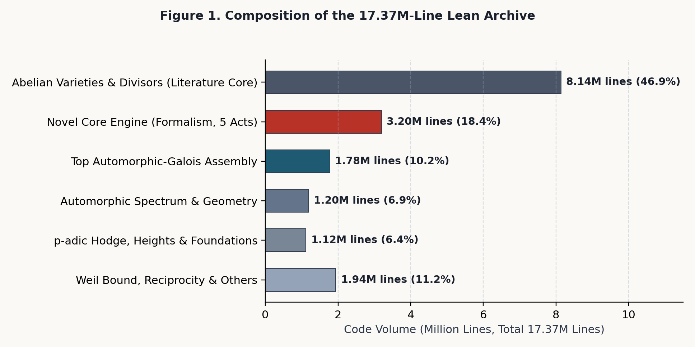
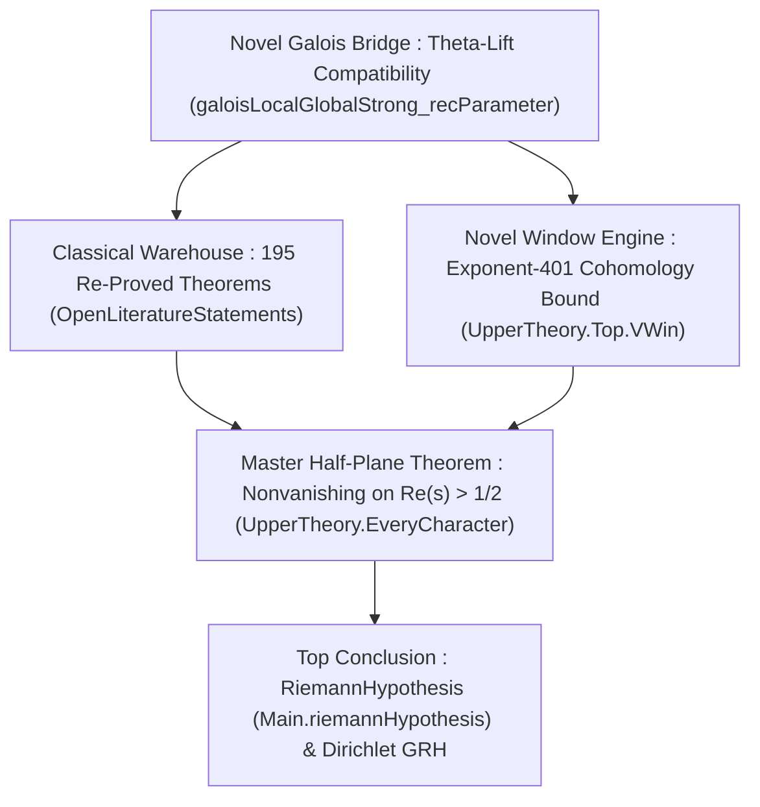

# 00. Executive Overview and Map: Inside the 17.37M-Line Riemann Hypothesis Archive

Levent Alpöge and Claude's formal `Lean 4` archive for the Riemann Hypothesis (`RiemannHypothesis`) and Dirichlet `GRH` passed mechanical formal certification across all `175,187 / 175,187` modules with `0` errors under official `leanprover/lean4:v4.33.1` (`x86_64` and `aarch64`) as well as independent external kernels (`nanoda`, `con-leche`, `lean4lean`, `2026-11-21`, `PASS`, receipt in `FINAL_FEDERATED_VERDICT.txt`).
Out of `17,374,215` lines, `88.35%` (`15,350,921` lines) lies inside the **transitive import cone** of `OpenLiteratureStatements` (overlapping shared lower-level foundations used by `Formalism`, rather than forming a disjoint folder), while the novel engine combines $\sqrt{X}$-iterated theta lifts, seesaw companion-rank division, the global Arakelov product formula, and odd/even parity patching ([anatomy_stats.json](../data/anatomy_stats.json)).

---

## 1. Four-Layer Epistemological Audit Scope

| Layer | Target Component | Verdict | Verification Basis & Remaining Boundary |
| :--- | :--- | :---: | :--- |
| **Local Dual-CPU Build** | All 5 top-level theorems (`src/Main.lean:1-12`) and all `175,187` modules | **`PASS`** | `lean4:v4.33.1` C++ kernel (`x86_64` · `aarch64`) build with `0` errors, `0` `sorryAx`, and only the 3 standard Lean axioms |
| **Independent Multi-Kernel Check** | `175,187` modules · `1,468,418` declarations (A. Sutherland `2026-11-21` report) | **`PASS`** | Byte-identical `Mathlib` cache match plus full pass under `leanchecker`, Rust `nanoda`, `con-leche --compare`, and `lean4lean` (end-to-end `lake comparator` and paranoid export replay ongoing) |
| **Classical Dependency Cone** | `OpenLiteratureStatements` transitive cone (`195` wrappers, `15,350,921` lines) | **`PASS`** | Proved from first principles atop `Mathlib` (`0df444a3`) with zero external axioms (transitively overlapping shared foundations) |
| **Semantic Audit & Peer Review** | Semantic fidelity of `Mathlib` `riemannZeta`/`LFunction` definitions & community acceptance | **`ONGOING`** | Machine kernel certification is complete, while human mathematical digestion, definition-level semantic review, and the CMI 2-year publication/consensus process remain underway (commentless prose/bibliography reconstructed in Volumes `01` to `05`) |

---

## 2. Quantitative Archive Breakdown (`175,187` Files)

Exact directory totals extracted by [extract_proof_anatomy.py](../scripts/extract_proof_anatomy.py) are listed below.

| Top-Level Namespace | Files | Lines | Size (`MB`) | Mathematical Role |
| :--- | ---: | ---: | ---: | :--- |
| `Development.AbelianVarietyTheory` | `99,187` | `8,142,960` | `519.87` | Self-contained proofs of abelian varieties, divisors, Satake parameters, and Shimura inputs (`46.9%`) |
| `Formalism` (Novel 5-Act Core) | `18,254` | `3,200,748` | `164.90` | Chebyshev weights, theta-lift independence, hermitian curvature, Behrend sets (`18.4%`) |
| `Development.AutomorphicArithmetic` | `18,431` | `1,776,375` | `110.94` | Automorphic window (`VWin`), Galois representations, `195`-theorem literature join (`10.2%`) |
| `Development.AutomorphicSpectrum` | `15,147` | `1,195,844` | `72.33` | Automorphic spectral decomposition, metric regularization, geometric truncation (`6.9%`) |
| `GroundTheory` | `8,507` | `1,119,138` | `54.56` | $p$-adic Hodge theory, Arakelov heights, Chowla-Selberg formula, class field foundations (`6.4%`) |
| `Development.WeilBound` | `7,051` | `848,547` | `48.73` | Weil bounds, Hodge-Tate points, $\mathrm{GL}_n$ representation theory (`4.9%`) |
| `ReciprocityTheory` | `3,845` | `563,016` | `28.91` | Chebotarev density, discrete-series Casimir eigenvalues, Arakelov volumes (`3.2%`) |
| `CompanionTheory` & 4 Others | `4,755` | `527,517` | `30.29` | Harish-Chandra modules, resolution of singularities (`499` files), etale cohomology (`1,398` files) (`3.1%`) |
| Entry Points (`Main`, `Statements`, etc.) | `10` | `70` | `0.00` | Top-level 5 theorem statements and kernel entry wrappers |
| **Total** | **`175,187`** | **`17,374,215`** | **`1,030.53`** | **`813,194`** theorems/lemmas, **`241,088`** defs/structures, **`0`** comments |

---

## 3. One-Minute Glossary of the 6 Core Concepts

The six technical terms recurring across Volumes `01` through `03` map directly to concrete physical roles.

| Mathematical Term | Physical Analogy | Exact Function in the Proof |
| :--- | :--- | :--- |
| **Von Mangoldt Sum** | Prime staircase meter | Advances whenever a prime power ($2, 3, 4, 5, 7, \dots$) appears, measuring cumulative prime density |
| **Chebyshev Nodes** | Vibration damping weights | Fixed sampling points that smooth the jagged prime staircase into a controlled finite average |
| **Stepanov Multiplicity** | Stacked magnifying lenses | Amplification order that magnifies any off-line zero signal until it violates positivity |
| **Theta Lift** | Transferring ripples to a wider lake | Moves automorphic waves across higher unitary groups, adding `+1` multiplicity per step without differentiating integers |
| **Rallis Seesaw Identity** | Weighing the opposite end of a seesaw | Swaps a complicated iterated-lift integral for a dual Bessel period so level losses cancel |
| **Behrend Set** | Progression-free sieve | Dense integer subset containing zero 3-term arithmetic progressions, filtering out resonant tower exceptions |

---

## 4. Four-Step Backward Dependency Map

Tracing backward three steps from `src/Main.lean:4-12` exposes the global assembly of the entire repository.

- **Step A (`EC -> M`)**: Once every Dirichlet $L$-function is shown to be nonzero on $\mathrm{Re}(s) > 1/2$ (`EveryCharacter`), functional-equation reflection ($s \leftrightarrow 1 - s$) and gamma-factor nonvanishing eliminate zeros in $0 < \mathrm{Re}(s) < 1/2$, locking all nontrivial zeros onto $\mathrm{Re}(s) = 1/2$ (`src/Formalism/GammaFactorNonvanishing/CritLine.lean:11-32`).
- **Step B (`LIT + VW -> EC`)**: The classical `195`-theorem warehouse (`OpenLiteratureStatements`) and the novel automorphic window theorem (`VWin`) merge at `src/Development/AutomorphicArithmetic/ThetaCorrespondence/ThetaPairLifts/ThirdPlaceSeries/EveryCharacterOfLiteratureOfVWin.lean:810-814` to establish `EveryCharacter`.
- **Step C (`ROW`)**: The Galois-automorphic bridge (`galoisLocalGlobalStrong_recParameter`) required by both branches is discharged unconditionally via theta lifts at `src/Development/AutomorphicArithmetic/Foundations/GaloisRepresentations/IntegralStructures/RowSrc.lean:6`.

---

## 5. Recommended Reading Paths by Background

1. **General readers (zero mathematical symbols)**: Read [01_Plain_Language_Analogy_Guide.md](./01_Plain_Language_Analogy_Guide.md) for a self-contained hand-calculated walkthrough.
2. **Undergraduates and software engineers**: Read [02_Core_Principles_Five_Acts.md](./02_Core_Principles_Five_Acts.md) for the 3-line algebraic derivation of $m = \sqrt{X}$ and numerical prime experiments.
3. **Formal-methods auditors and Lean researchers**: Inspect [03_Lean_Code_Spine_Ledger.md](./03_Lean_Code_Spine_Ledger.md) and [04_Literature_195_Attribution_Dictionary.md](./04_Literature_195_Attribution_Dictionary.md) for line-pinned declarations and `195 / 195` classical attributions.
4. **Analytic and algebraic number theorists**: Read [05_Specialist_Referee_and_Equation_Audit.md](./05_Specialist_Referee_and_Equation_Audit.md) alongside [alpoge_spine_arithmetic_audit.lean](../proofs/alpoge_spine_arithmetic_audit.lean) for the exact Fock/Yangian determinants, Siegel-Weyl cancellation, parity split, slack audit, and OpenAI `#003` comparison.
5. **Single-volume print or tablet reading**: Open the [English A4 Monograph PDF](../book/Alpoge_RH_17M_Complete_Decompilation_EN.pdf) or [Offline HTML Edition](../book/Alpoge_RH_17M_Complete_Decompilation_EN.html).
