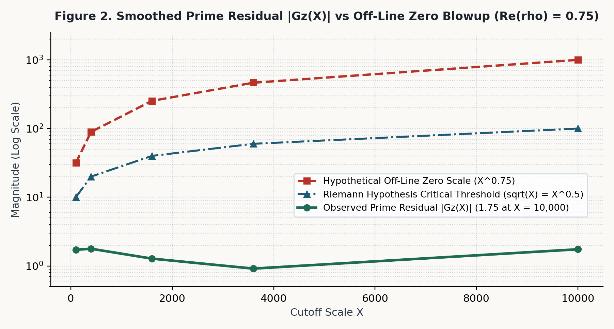
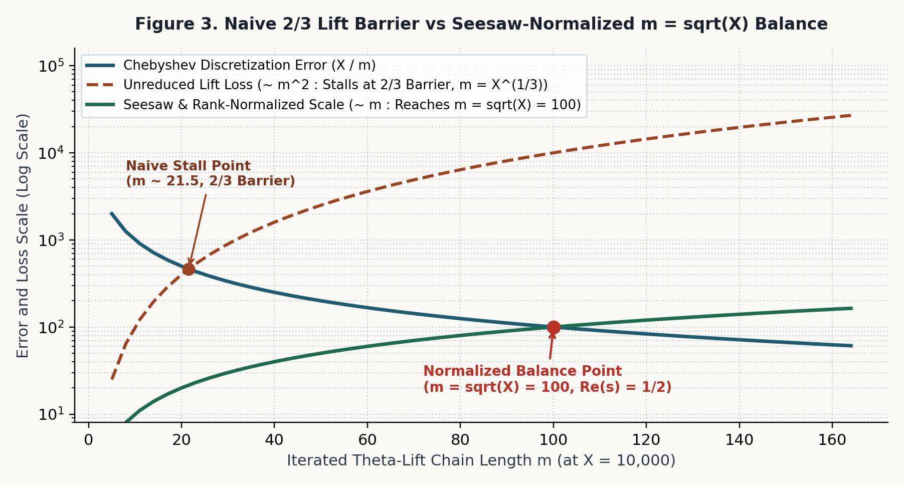

# 02. Core Principles in Five Acts: Algebraic Derivation of the $m \approx \sqrt{X}$ Chain

The signature parameter of Levent Alpöge and Claude's proof, the theta-lift chain length $m \approx \sqrt{X}$, follows directly from forcing the $m$-node Chebyshev discretization error $O(X \log m / m)$ below the critical-line target $O(X^{1/2+\varepsilon})$, yielding $m \ge X^{1 - \theta - \varepsilon}$ at $\theta = 1/2$ (`src/Formalism/ZetaNonvanishingChebyshevWeights.lean:26-35`, `PASS`).
This volume walks through all five acts at an undergraduate calculus and linear-algebra level alongside exact prime computations up to $X = 10,000$ ([prime_lab_results.json](../data/prime_lab_results.json)).

---

## Act 1. Smoothing the Prime Staircase into the Residual $G_z(x)$

The raw von Mangoldt sum $\psi(x) = \sum_{n \le x} \Lambda(n)$ (assigning $\log p$ to prime powers $n = p^k$) jumps discontinuously at every prime power, resisting finite-node quadrature.

Starting at `src/Formalism/StatementOC.lean:11-13`, the proof integrates once against the Cesaro-type kernel $(x/n - 1)$ to form the continuous sum $S_z(x)$ and subtracts the pole main term to isolate the residual $G_z(x)$:

$$S_z(x) = \sum_{1 \le n \le \lfloor x \rfloor} \Lambda(n)\left(\frac{x}{n} - 1\right)$$

$$G_z(x) = S_z(x) - x \log x + (1 + \gamma) x$$

Here $\gamma \approx 0.57721566$ denotes the Euler-Mascheroni constant. Applying the Mellin transform identity (`MellinSgen`, `src/Formalism/DefsOC.lean:12-19`) gives

$$\int_1^\infty S_z(x)\, x^{-s-1}\,dx = -\frac{\zeta'(s)}{\zeta(s)} \cdot \frac{1}{s(s-1)} \qquad (\mathrm{Re}(s) > 1)$$

The quadratic denominator $s(s-1)$ damps high-ordinate zeros, while $x\log x - (1+\gamma)x$ cancels the double residue at $s = 1$. Consequently, the growth exponent of $|G_z(x)|$ matches the supremum $\theta = \sup \mathrm{Re}(\rho)$ of nontrivial zeta zeros.

### Empirical Check of $G_z(x)$ on True Primes ([prime_intuition_lab.py](../scripts/prime_intuition_lab.py))

| Cutoff $X$ | Chain $m = \sqrt{X}$ | Smoothed Sum $S_z(X)$ | Main Trend $X\log X - (1+\gamma)X$ | Residual $G_z(X)$ | Ratio $\lvert G_z(X) \rvert / \sqrt{X}$ | Asymptotic Rate ($X^{0.75}$) |
| ---: | ---: | ---: | ---: | ---: | ---: | ---: |
| `100` | `10` | `304.5171` | `302.7955` | `+1.7217` | `0.17217` | `31.62` |
| `400` | `20` | `1,767.4809` | `1,765.6996` | `+1.7813` | `0.08907` | `89.44` |
| `1,600` | `40` | `9,282.1486` | `9,280.8692` | `+1.2794` | `0.03199` | `252.98` |
| `3,600` | `60` | `23,802.2198` | `23,801.3045` | `+0.9153` | `0.01526` | `464.76` |
| `10,000` | `100` | `76,332.9964` | `76,331.2471` | **`+1.7493`** | **`0.01749`** | **`1,000.00`** |

$$G_z(x) = \log(2\pi) - \sum_{\rho} \frac{x^\rho}{\rho(\rho - 1)} + O(x^{-1})$$

- **Explicit-Formula Constant & Denominator Damping**: In the finite-$X$ table above, $G_z(X)$ clusters near `+1.75` primarily because of the $s = 0$ residue constant $\log(2\pi) \approx 1.8379$, while oscillatory zero contributions are strongly damped by $\lvert \rho(\rho - 1) \rvert$.
  Even at the lowest zero $\gamma_1 \approx 14.13$, $\lvert\rho_1(\rho_1 - 1)\rvert \approx 200$ suppresses amplitude to roughly one two-hundredth, while high-ordinate zeros with large $\lvert\gamma\rvert$ remain tiny at $X = 10,000$.
  The rightmost column $X^{0.75}$ therefore serves as an **asymptotic growth-exponent benchmark ($x^\theta$ vs $x^{1/2}$ as $x \to \infty$)** rather than a raw amplitude prediction at $X = 10,000$.

> **Act 1 Summary**: At $X = 10,000$, $S_z(10000)$ reaches `76,332.9964`, while subtracting the $s = 1$ pole main term leaves $G_z(10000) = +1.7493$ near $\log(2\pi) \approx 1.8379$. Establishing the asymptotic upper bound $G_z(x) \lesssim x^{1/2+\varepsilon}$ as $x \to \infty$ rules out the $x^{\mathrm{Re}(\rho)} / \lvert\rho(\rho - 1)\rvert$ growth of any zero with $\mathrm{Re}(\rho) > 1/2$.

---

## Act 2. One-Sided Landau Positivity and the Weighted Zero-Order Identity (`OCAvg` · `OCAvgUpper`)

Because $G_z(x)$ oscillates in sign, a one-sided bound alone cannot analytically continue its Mellin transform across a vertical half-plane. In `src/Formalism/StatementOC.lean:11-64` and `src/Formalism/DefsOC.lean:26-47`, the proof pairs $\zeta(s)$ against real-valued Dirichlet characters $\chi_i$, separating the nonnegative raw prime-power difference from the main-term-subtracted residual:

$$S_z(x) - S_{\chi_i}(x) = \sum_{1 \le n \le \lfloor x \rfloor} \Lambda(n)\bigl(1 - \mathrm{Re}\,\chi_i(n)\bigr)\left(\frac{x}{n} - 1\right) \ge 0$$

$$G_z(x) - G_{\chi_i}(x) = \bigl(S_z(x) - S_{\chi_i}(x)\bigr) - x\log x + \left(1 + \gamma - \mathrm{Re}\frac{L'}{L}(1, \chi_i)\right)x$$

- **Why One-Sided Bounds Need Landau's Theorem (`LandauEq`, `DefsOC.lean:26-35`)**: A two-sided bound $\bigl\lvert\sum_i w_i(G_z(x) - G_{\chi_i}(x))\bigr\rvert \le C x^\theta$ would already imply analyticity on $\mathrm{Re}(s) > \theta$ by plain absolute convergence without any positivity condition.
  Landau's theorem does its real work in `OCAvg` (lines `39-51`, one-sided lower bound $-C x^\theta \le \sum_i w_i(G_z - G_{\chi_i})$) and `OCAvgUpper` (lines `52-64`, one-sided upper bound $\sum_i w_i(G_z - G_{\chi_i}) \le C x^\theta$): because $1 - \mathrm{Re}\,\chi_i(n) \ge 0$ makes the raw difference nonnegative, shifting by the one-sided $C x^\theta$ bound produces a nonnegative integrand $H(x) \ge 0$ (`DefsOC.lean:28`).
  Once real zeros $L(\sigma, \chi_i) \neq 0$ on $(\theta, 1)$ are excluded, Landau's theorem pushes convergence down to $\mathrm{Re}(s) > \theta$ and establishes `OrderLogDeriv` (lines `40-46`):

$$\left(\sum_i w_i\right) \cdot \mathrm{ord}_s(\zeta) = \sum_i w_i \cdot \mathrm{ord}_s\bigl(L(\cdot, \chi_i)\bigr)$$

> **Act 2 Summary**: By itself, this weighted identity does not force every $L(s, \chi_i)$ to vanish simultaneously (for instance, $w_1 = w_2 = 1$ and $\mathrm{ord}_s(\zeta) = 1$ is algebraically compatible with $\mathrm{ord}_s(L_1) = 2$ and $\mathrm{ord}_s(L_2) = 0$); rather, it proves that **the weighted average zero multiplicity across $\{L(s, \chi_i)\}$ equals $\mathrm{ord}_s(\zeta)$**.
> Hence $\mathrm{ord}_s(\zeta) \ge 1$ forces at least one $L(s, \chi_i)$ ($w_i > 0$) to vanish with conserved weighted multiplicity, and conversely showing $\mathrm{ord}_s(L(\cdot, \chi_i)) = 0$ across the family forces $\mathrm{ord}_s(\zeta) = 0$.

---

## Act 3. Three-Line Derivation of $m = \sqrt{X}$ (`ZetaNonvanishingChebyshevWeights`)

The exact algebra behind $m \approx \sqrt{X}$ appears in `src/Formalism/ZetaNonvanishingChebyshevWeights.lean:9-35`.

To replace continuous Chebyshev smoothing $G_{\text{cheb}}(x)$ by a finite determinant functional, the proof samples $m$ **Chebyshev nodes** $c_{m,j} = \sin^2\bigl(\frac{(2j-1)\pi}{4m}\bigr)$. By `ChebyshevWeightApproximation` (lines `26-28`), the quadrature discrepancy between the $m$-node average and the continuous integral is bounded by

$$\left|\text{chebAvg}(m, x, G_z) - G_{\text{cheb}}(x)\right| \le K \cdot \frac{x (1 + \log m)}{m}$$

To establish zero-freeness on $\mathrm{Re}(s) > \theta$, this quadrature error must fall below $x^{\theta + \varepsilon}$. Requiring $\frac{x \log m}{m} \lesssim x^{\theta + \varepsilon}$ yields the lower bound on $m$ stated at line `33` (`x ^ (1 - θ - ε) ≤ m`):

$$\frac{x}{m} \le x^{\theta + \varepsilon} \quad \Longleftrightarrow \quad m \ge x^{1 - \theta - \varepsilon}$$

Substituting the critical-line target $\theta = \frac{1}{2}$ fixes the exponent immediately:

$$m \ge x^{1 - 1/2 - \varepsilon} = x^{1/2 - \varepsilon} \approx \sqrt{x}$$

> **Act 3 Summary**: Each theta lift along the definite unitary chain $U(X_0) \to U(X_1) \to \dots \to U(X_m)$ increments the node multiplicity of the positive determinant functional $W(\cdot) \ge 0$ by `1`, so pushing $x/m$ down to $x^{1/2}$ uniquely demands $m \approx \sqrt{x}$ serial lifts.

---

## Act 4. Why Naive Iteration Stalls at `2/3` and How Seesaw Normalization Clears It

Acquiring multiplicity $m$ via $m$ serial lifts introduces an competing arithmetic cost: discriminant and level denominators grow at each step.
- Under a naive step-by-step product bound, the cumulative log-denominator penalty after $m$ lifts scales quadratically like $m^2$ (dashed brown curve in Figure 3). Balancing quadrature error $X/m$ against $m^2$ gives $X/m \approx m^2 \implies m \approx X^{1/3}$, stalling at $1 - \theta = 1/3$, namely **$\theta = 2/3$** (`remark.pdf` p. 4 item 14).
- Three mechanisms flatten the effective loss to linear scale $\sim m$ (solid green curve in Figure 3), unlocking $m = \sqrt{X}$:
    1. **Rallis Seesaw & Inner-Product Duality**: Dualizes iterated theta periods into Bessel periods on the opposite seesaw partner, isolating character dependence (`src/Formalism/ThetaLiftIndependence/FinalThetaLiftAMFKIndep.lean:1-15`).
    2. **CM Jacobi Theta Inverse-Norm Identity**: Evaluates inverse $L^2$-norms of complex-multiplication theta functions in closed form via $\vartheta_2$ (`src/Formalism/PeriodIntegrals/ThetaNormCM.lean:30-40`).
    3. **Companion Rank Division & Projected Poincaré Series Averaging**: Generalizing `remark.pdf` p. 4 item 16's $\mathrm{GL}_5$ six-fold cover heuristic, the code divides by companion rank $k \asymp x^{9/2+10\varepsilon}$ (`src/Formalism/GL3MeanSquares/MassLowerBoundClosed.lean:40`),
       projects onto level-filtered Poincaré series (`src/Development/AutomorphicArithmetic/ThetaCorrespondence/RealBands/ExistsMultTEqPoin.lean:15-109`), and applies Cauchy-Schwarz decay $q^{-(k - 2r - 5)}$ (`src/Formalism/FlagUnipotentLattices/MinkowskiFactorialBounds/GaussSumCharacterAverageBound.lean:21-98`).

### Finite-Dimensional Linear-Algebra Toy Model (Adjoint Seesaw & Rank Division)

Without any automorphic background, standard finite-dimensional matrices and inner products capture both core moves of Act 4:
- **Matrix Adjoint Seesaw (`KerAdjoint`)**: For any $M \times N$ transfer matrix $K$ and vectors $f \in \mathbb{C}^N$, $g \in \mathbb{C}^M$, the inner product shifts $K$ onto $g$ via its conjugate transpose $K^*$:

$$\langle K f,\, g \rangle = \langle f,\, K^* g \rangle$$

- Rather than expanding the tangled output vector $K f$ entry by entry, moving $K^*$ onto a clean test vector reduces the finite-field Gauss matrix product on mean-zero vectors to a character-free scalar $K^* K v = |\mathbb{F}| \cdot v$ (`src/Formalism/ThetaLiftIndependence/ThetaOrbitSums/GaussOp.lean:27-73`).
- **Companion Rank Division**: After $m \approx X^{1/2}$ lifts, cumulative quadratic log-loss is $m^2 \approx X$. Embedding the chain into an ambient companion space of huge dimension $k \approx X^{9/2}$ divides that cost across all $k$ coordinates:

$$\frac{m^2}{k} \approx \frac{X}{X^{9/2}} = X^{-\frac{7}{2}} \longrightarrow 0 \qquad (X \to \infty)$$

- Concretely, at $X = 100$ ($m = 10$), raw quadratic loss is $m^2 = 100$, whereas dividing by $k = 100^{9/2} = 10^9$ shrinks it to $10^{-7}$, leaving only the linear main term intact.

---

## Act 5. Mirror-Parity Wings and the Behrend Sieve (`VWin` · `BehrendSets`)

The final stage bounds the unramified Shafarevich-Tate cohomology length (`shaLen`) of $H^1(\mathcal{O}_E[1/\ell], \mathbb{Q}_\ell/\mathbb{Z}_\ell(-e))$ below $\sqrt{\exp(x^\varepsilon)}$ up to twist $e < \lfloor x^{401} \rfloor$ (`VWin`, `src/Development/AutomorphicArithmetic/CharacterBoxes/ExistsPageN.lean:12-50`).

### Complex-Conjugation Toy Model: Why Classical Gauges Go Blind on Half the Problem

Why Act 5 (`vwin_of_row`, `157,604` files / `16.09` million lines) pulls in vast algebraic geometry becomes transparent through elementary complex conjugation $c(a + bi) = a - bi$. Subtracting the conjugate isolates the imaginary (odd / `minus`) part:

$$z - \overline{z} = (a + bi) - (a - bi) = 2bi$$

Whenever $z = a$ is purely real ($b = 0$, the even / `plus` / Vandiver state satisfying $\overline{z} = z$), this difference evaluates to $a - a = 0$ identically. Because classical Stickelberger elements carry this exact odd projection (`Odd a`), bounding `shaLen` splits into two opposite wings:

- **Odd (`minus`, `ShaMinus`) Wing (`ThmBab K 401` + Behrend Sieve `ThmBcFree`)**: Where $z - \overline{z} \neq 0$, Stickelberger annihilation (`stick_of`) and Ferrero-Washington ($\mu = 0$) remain active. To block linear resonances $\alpha x_1 + \beta x_2 + \gamma x_3 = 0$ ($\alpha+\beta+\gamma=0$) across cyclotomic layers $e$, `src/Formalism/BehrendSets/Statement.lean:48-71` constructs dense progression-free sets $T \subseteq [1, N]$:

$$|T| \ge N \cdot \exp\left(-C \sqrt{\log N \cdot \log(K+1)}\right)$$

- Extracting the base-`5` sphere shell ($r^2 = 5$) below $N = 500$ in [prime_intuition_lab.py](../scripts/prime_intuition_lab.py) yields `{7, 11, 27, 35, 51, 55, 127, 135, 175, 251, 255, 275}` (`12` elements) with `0` three-term arithmetic progressions (`ap_violations = 0`), enforcing `WindowTwo` across the odd wing.
- **Even (`PsiEven` / Vandiver, `plusLen`) Wing (`PointHV` 7-Branch High-Rank Patching)**: On the even twist space $\psi(-1) = (-1)^e$ where Stickelberger acts as `0`, abelian cyclotomic tools cannot close Selmer length alone.
  Alpöge and Claude partition `PsiEven` into 7 branches (`CountI..CountZ`), coupling Kato's $\mathrm{GL}_2$ system to $U(3)$ rigidity (`rigIUE_alt`, `rigII_a_alt`) and deploying $\mathrm{GSp}_4$ (`sp4In0_alt`) plus $U(3)$ Hida patching (`THidaU`, `WindowBoundOfLiteratureLevel.lean:25-34`), whose `1.03M`-line novel core pulls in `15.06M` lines of classical re-proofs (totaling `16.09M` lines across `157,604` files).

---

## Bridge to Volumes 03 and 05: Three Specialist Terms Translated

Before moving to the specialist equation audit in [05_Specialist_Referee_and_Equation_Audit.md](./05_Specialist_Referee_and_Equation_Audit.md), keep three translations in mind:
- **Arakelov / DVR Cokernel Length (`StatementLA`)**: The prime-by-prime algebraic measurement of denominator loss; bounding integer divisibility prime by prime is equivalent to bounding the length of a quotient lattice $L / L^\vee$.
- **Siegel-Weil Mass Ratio (`D* / d*`)**: The exact volume-and-index ratio between the bottom rank-$k$ lattice and top rank-$(k-1+m)$ lattice where the $-C m^2 L / k$ cancellation occurs.
- **Mirror Parity (`minus` vs `plus` / Vandiver Wing)**: Complex conjugation splits cohomology into an odd half (`minus`, killed by classical Stickelberger elements) and an even half (`plus`, where Stickelberger acts as `0`, forcing the proof to import $\mathrm{GSp}_4$ and $U(3)$ deformation patching).
