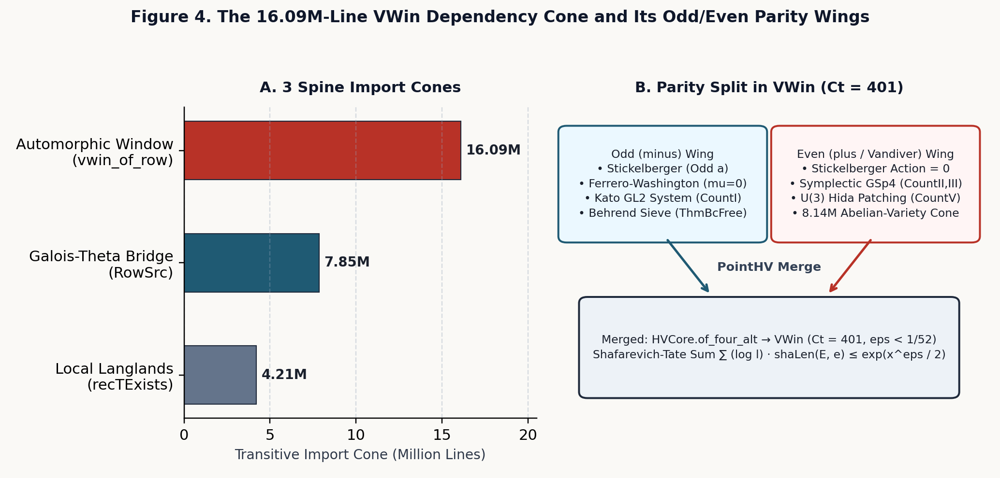

# 05. Specialist Referee and Equation Audit (Acts 3-5 Core Identities, Parity Split & Cross-Audit)

Across `175,187` Lean 4 modules (`17,374,215` lines), Levent Alpöge and Claude construct the positive Stepanov determinant functional $W(\cdot) \ge 0$ by combining Bargmann-Fock symmetric tensor determinants with $\mathfrak{gl}_2$ Yangian RTT fusion.
They then eliminate the quadratic `2/3`-barrier loss $-C m^2 L / k$ via companion lattice rank normalization $k \asymp x^{9/2+10\varepsilon}$, and close the critical line $\mathrm{Re}(s) = 1/2$ by welding `VWin` (`Ct = 401`, $\varepsilon < 1/52$) into the global Arakelov product formula (`ProductFormula` · `DivIneqObj`, `PASS`).
This referee report reconstructs the exact equations, magic constants, global product-formula closure, formalization slacks, and compression paths directly from source, backed by **17 standalone kernel-checked theorems** in [alpoge_spine_arithmetic_audit.lean](../proofs/alpoge_spine_arithmetic_audit.lean) (`0 sorry`, `LEAN_RC:0`).

---

## Chapter 1. Asymptotic `Scale` Hierarchy and Reverse-Engineering $\varepsilon < \frac{1}{52}$, `la = 3/2`, and `413,718,278,401`

### 1.1 Master `Scale` Structure (`src/Formalism/LocalRingCardinality/DataParams₂.lean:9-47`)

Every asymptotic inequality in the archive is parameterized over a single structure `Scale` ($x > 1$, $0 < \varepsilon < \frac{1}{52}$, $J \ge 1$) defining the subexponential and polynomial scales:

$$L = x^\varepsilon, \qquad b = e^{L} = \exp(x^\varepsilon), \qquad a = x \cdot \exp(x^\varepsilon), \qquad X' = \exp\bigl(x^{\varepsilon/3}\bigr)$$

$$b' = \frac{a}{X'} = x \cdot \exp\bigl(x^\varepsilon - x^{\varepsilon/3}\bigr), \qquad \delta_1 = x^{-\varepsilon/8}, \qquad A = 26, \qquad p_0(k) = k^2 x^{26}$$

The dyadic-exponential window `Scales la` (`src/Development/AutomorphicArithmetic/PrimeDiscriminants/Scales.lean:9-39`) requires $[Y, Y^{\mathrm{la}}]$ to sit inside admissible windows above any threshold $y$, specialized at `src/Development/AutomorphicArithmetic/CharacterBoxes/EveryCharacter.lean:10` and `src/Development/AutomorphicArithmetic/CharacterBoxes/SupplyChi.lean:9` to $\mathrm{la} = \frac{3}{2} \in (1, 2]$ inside $[Y, Y^2]$.

### 1.2 Four-Rank Tuple $(m, 2^e, k, t)$ and Why $\varepsilon < \frac{1}{52}$

In `src/Development/AbelianVarietyTheory/Proofs/GlobalInterpolation/ExistsRanksRankValFrame.lean:24-100`, given a 2-power frame order $\mathrm{ord} = 2^e$, four coupled integer ranks $(m, 2^e, k, t)$ are chosen simultaneously:

| Rank | Selection Interval | Mathematical Role | Active Constraint & Pin |
| :---: | :--- | :--- | :--- |
| **$m$** (`Even m`) | $\bigl[x^{\frac{1}{2}-\frac{\varepsilon}{16}},\, 2x^{\frac{1}{2}-\frac{\varepsilon}{16}}\bigr]$ | Iterated theta-lift chain length ($\sqrt{x \delta_1}$) | $4 \le x^{-\varepsilon/100}\sqrt{x\delta_1}$ ($x \ge 256$, `DIVfromGLbud.lean:18-32`) |
| **$2^e$** (`φ.ord`) | $\bigl[x^{2+8\varepsilon},\, 2x^{2+8\varepsilon}\bigr]$ | Cyclotomic $\mathbb{Z}_2$-tower layer (`PageN`) | $x^2 \le x^{2+8\varepsilon} \le x^3 \iff \varepsilon \le \frac{1}{8}$ (`ExistsRanksRankValFrame.lean:53-58`) |
| **$k$** (`Even k`) | $\bigl[x^{\frac{9}{2}+10\varepsilon},\, 2x^{\frac{9}{2}+10\varepsilon}\bigr]$ | Companion orthogonal/hermitian base rank | $m^2 L \le k$ and $x^4 \le k$ (`MassLowerBoundClosed.lean:57`) |
| **$t$** (`R.t`) | $8 f r + 4 + 8 T W - r$ | Unramified twist and cohomology cutoff | $r = k + m - 1$ (odd), $f = 2^{e+1}$, $r + t = 8 f r + 4 + T(8W)$ (line `41`) |

Two independent bottlenecks pin the global threshold $\varepsilon < \frac{1}{52}$ ($E = 1/\varepsilon > 52$, [alpoge_spine_arithmetic_audit.lean](../proofs/alpoge_spine_arithmetic_audit.lean) `thm_04`, `thm_05`):
1. Half the reciprocal of the base polynomial constant $A = 26$ (`DataParams₂.lean:41`) equals $\frac{1}{2A} = \frac{1}{52}$, aligning lattice-perturbation decay $x^{-A/2} = x^{-13}$ against $\varepsilon$-losses.
2. In `src/Formalism/SharpRestriction/GrowthBounds/MultisetValuation/PriceLinearCombinationLe.lean:45-81` (`ne_rG_lt`), fitting the small-prime price degree $r_G = \lceil 8(h_G + 2)/\varepsilon \rceil + 1 < 32E + 66$ inside $(34E)^2 \le x^2 \le x^{9/2+10\varepsilon-\mathrm{szTh}} \le k$ explicitly invokes `have hinv : 52 < E` (line `60`).

### 1.3 Dynamic Window Primes `WinPair` vs Separate Local-Ring Lucas Witness $g_A = 413{,}718{,}278{,}401$

Two distinct auxiliary prime-pair constructions in the archive reuse the letters $(q, d)$ under different divisibility hypotheses and must be kept separate:
- **Dynamic Window Pair `WinPair` (`ExistsPageN.lean:27-38` · `WinPairs.lean:5-81`, `thm_06`)**: Constructed dynamically at arbitrarily large scales $Y$ via Linnik's theorem (`src/Development/AutomorphicArithmetic/CharacterBoxes/WinPairs.lean:5-81`), `WinPair eps Y q d` in `src/Development/AutomorphicArithmetic/CharacterBoxes/ExistsPageN.lean:27-38` imposes all four conditions below:
    - Because $d \equiv 7 \pmod{16}$ implies $-d \equiv 1 \pmod 8$, the prime $2$ splits completely in $K = \mathbb{Q}(\sqrt{-d})$ (matching `ThetaNormCM.lean:31`), while $p \mid d + 1$ gives $\bigl(\frac{-d}{p}\bigr) = \bigl(\frac{1}{p}\bigr) = +1$, splitting every odd prime $p \le Y^{\varepsilon/5}$ in $K$.

$$q \equiv 3 \pmod 8, \qquad d \equiv 7 \pmod{16}, \qquad q \mid d + 1, \qquad \forall p \le Y^{\varepsilon/5}\;(p \neq 2 \implies p \mid d + 1)$$

- **Separate Static Witness `(571, 599)` for `SpanPowerMembership` (`thm_07`)**: Independently, `src/Formalism/LocalRingCardinality/SpanPowerMembership.lean:18-29` and `src/Formalism/LocalRingCardinality/SpanPowerMembership/Primes.lean:17-87` instantiate $q = 571$ ($571 \equiv 3 \bmod 8$) and $d = 599$ ($599 \equiv 7 \bmod{16}$, $599 + 1 = 600 = 2^3 \cdot 3 \cdot 5^2$).
  Note **`571 ∤ 600`, so `(571, 599)` is not a `WinPair`**, as `SpanPowerMembership` does not require $q \mid d + 1$.
  Over `(571, 599)`, the code certifies the explicit 12-digit prime below in-kernel via the Lucas primality test (`lucas_list`) at primitive root base `34`:

$$g_A = 413{,}718{,}278{,}401, \qquad g_A - 1 = 2^8 \cdot 3^3 \cdot 5^2 \cdot 7 \cdot 571 \cdot 599 \equiv 0 \pmod{16 \cdot 571 \cdot 599}$$

---

## Chapter 2. Threefold Algebraic Construction of the Positive Functional $W(\cdot) \ge 0$

The "natively-automorphic Stepanov determinant" cited in `remark.pdf` (pp. 3-4, items 1, 4, 7, 13) is realized by three interlocking modules inside `Formalism`.

### 2.1 Bargmann-Fock Permanent and Symmetric-Power Determinant Amplification (`src/Formalism/FockGram/StatementFock.lean:9-76`)

Over the multivariate polynomial ring $R[\tau]$, the multi-factorial Fock inner product (`fock`) and Gram matrix (`fockGram`) are defined by

$$\langle f, g \rangle_{\mathrm{Fock}} = \sum_{\mathbf{m}} f_{\mathbf{m}} \overline{g_{\mathbf{m}}}\, \mathbf{m}!, \qquad G_{\mathrm{Fock}}(v)_{i,j} = \langle v_i, v_j \rangle_{\mathrm{Fock}}$$

Products of homogeneous linear forms satisfy the Wick permanent identity $\langle \prod_{s=1}^a x_s, \prod_{t=1}^a y_t \rangle_{\mathrm{Fock}} = \mathrm{perm}\bigl(\langle x_s, y_t \rangle_{\mathrm{Fock}}\bigr)$ (`FockPerm`, line `47`), and passing to the degree-$a$ symmetric monomial basis $\mathrm{Sym}^a(e)$ amplifies the determinant exponent by a binomial coefficient (`DetFockSym`, lines `63-68`, `thm_11`):

$$\det G_{\mathrm{Fock}}\bigl(\mathrm{Sym}^a(e)\bigr) = \bigl(\det G_{\mathrm{Fock}}(e)\bigr)^{\binom{|\sigma| + a - 1}{|\sigma|}} \prod_{\mathbf{t} \in \mathrm{Sym}^a(\sigma)} \mathbf{t}!$$

### 2.2 Orthogonal-Projection Gram Identity and DVR Cokernel Bridge (`src/Formalism/GaussIdealIdentity/StatementLA.lean:29-89`)

Let $\{e_\sigma\}_{\sigma=1}^d$ ($e_\sigma \neq 0$, pairwise orthogonal without unit-norm assumption) span a subspace $Z$ of a complex Hilbert space $V$ with orthogonal projection $\mathrm{pr}_Z$.
For any test family $\{F_a\}_{a=1}^d$, projected Gram matrix $G_{a,b} = \langle \mathrm{pr}_Z F_a, \mathrm{pr}_Z F_b \rangle$, and period matrix $C_{\sigma,a} = \langle e_\sigma, F_a \rangle$, `GramDet` (lines `29-38`) establishes the left identity below.
Under the **mandatory hypothesis that $\{\mathrm{pr}_Z F_a\}_{a=1}^d$ is $\mathbb{C}$-linearly independent (`LinearIndependent ℂ (fun a => pr (F a))`, line `47`, ensuring $\det G > 0$)**, `MasterIdentity` (lines `39-51`) holds for every scalar $A \in \mathbb{C}$ (`∀ (A : ℂ)`, line `48`, including $A = 0$ via Lean's `(0 : ℂ)⁻¹ = 0` and `(0 : ℝ) ^ (-(2 * (d : ℤ))) = 0` conventions) and every $B_0 \in M_d(\mathbb{C})$:

$$\det G = \frac{|\det C|^2}{\prod_{\sigma=1}^d \|e_\sigma\|^2} \ge 0, \qquad \frac{\|\det(A^{-1} B_0 \overline{C})\|^2}{\mathrm{Re}(\det G)} = |A|^{-2d}\, \|\det B_0\|^2 \prod_{\sigma=1}^d \|e_\sigma\|^2$$

Over any discrete valuation ring (DVR) $\mathcal{O}$, Gauss prime-ideal localization (`GaussLength`, lines `74-79`) and dual-lattice inclusion $L^\vee \subseteq L$ (`Ld ≤ L`, `GramDetLength`, lines `80-89`) give

$$g \cdot \det\bigl(B(b_i, b_j)\bigr) = 1 \implies \mathrm{length}_{\mathcal{O}}(L / L^\vee) = v_{\mathcal{O}}(g)$$

coupling Archimedean positivity ($\det G \ge 0$) to finite-place $p$-adic invertibility (Bost slope inequality, `remark.pdf` item 13) through the global Arakelov product-formula and slope inequalities detailed in Chapter 5 (`Formalism/ProductFormula` · `DivisorInequality`).

### 2.3 $\mathfrak{gl}_2$ Yangian RTT Transfer Matrices and Word Fusion (`src/Formalism/HermitianCurvature/StatementW.lean:9-27`)

To fuse $m$ Gan-Gross-Prasad (GGP) period matrices while preserving weight-$0/1$ interlacing and up to $m$ unlinked Chebyshev nodes inside a positive determinant, the code formalizes the Yang-Baxter RTT relation (`IsRTT`) and quantum determinant (`IsDet`) on $2 \times 2$ matrix-valued spectral polynomials $M(Y)$:

$$\bigl((Y' - Y) I_4 - P_{\mathrm{flip}}\bigr)\, E_1\bigl(M(Y')\bigr)\, E_2\bigl(M(Y)\bigr) = E_2\bigl(M(Y)\bigr)\, E_1\bigl(M(Y')\bigr)\, \bigl((Y' - Y) I_4 - P_{\mathrm{flip}}\bigr)$$

$$M(Y + 1)^{\mathsf{T}} J M(Y) = q(Y) J \quad \overset{\mathrm{WordFusion}}{\Longrightarrow} \quad \left(\prod_{\nu=1}^m M_\nu(Y+1)\right)^{\mathsf{T}} J \left(\prod_{\nu=1}^m M_\nu(Y)\right) = \left(\prod_{\nu=1}^m q_\nu(Y)\right) J$$

By `WordFusion` (lines `20-26`), multiplying pairwise entry-commuting transfer letters $L = [(M_1, q_1), \dots, (M_m, q_m)]$ preserves both RTT intertwiners and scalar quantum determinants $\prod_{\nu=1}^m q_\nu(Y)$ across the entire $m$-step chain.

---

## Chapter 3. The `2/3` Barrier and Cancellation of $-C m^2 L / k$ via Seesaw & Mass Bounds

### 3.1 Why Unreduced Iteration Stalls at $\sigma = \frac{2}{3}$ (`thm_02`)

Setting $m = x^\alpha$ ($0 < \alpha < 1$) gives Chebyshev discretization error $O(x / m) = O(x^{1-\alpha})$ (`ZetaNonvanishingChebyshevWeights.lean:27`). If discriminant and level denominators accumulate linearly ($\propto j$) at step $j$, the $m$-step log-denominator penalty scales like $\sum_{j=1}^m j \asymp m^2 = x^{2\alpha}$, fixing the balance point at

$$(1 - \alpha) - 2\alpha = 1 - 3\alpha \quad \Longrightarrow \quad \alpha = \frac{1}{3}, \qquad \sigma = 1 - \frac{1}{3} = \frac{2}{3}$$

short of the critical line $\frac{1}{2}$ (`remark.pdf` p. 4 item 14).

### 3.2 Seesaw Adjointness and Finite-Field Gauss Operator Scalar Collapse (`Statement.lean` · `GaussOp.lean`)

First, adelic double-coset representative independence (`ThetaLiftAMFKIndep`, `src/Formalism/ThetaLiftIndependence/Statement.lean:106-115`) and formal seesaw adjointness of `chainOp w K m f` (`KerAdjoint`, lines `29-33`) establish

$$\langle \mathcal{K}_{w, K} f,\, g \rangle_{w'} = \langle f,\, \mathcal{K}_{w', K^*} g \rangle_w, \qquad \left(\prod_{j=0}^{m-1} D_j\right) \cdot \mathrm{chainOp}(w, K, m, f) \in \Lambda_m$$

At finite-field components $\mathbb{F}$, for any nontrivial additive character $\psi \neq 1$ and mean-zero vector $\sum_{c \in \mathbb{F}^\times} \rho(c) v = 0$, the composite Gauss operator (`src/Formalism/ThetaLiftIndependence/ThetaOrbitSums/GaussOp.lean:27-73`) collapses to a character-independent scalar:

$$\mathcal{G}^* \mathcal{G} v = \sum_{e \in \mathbb{F}^\times} \left(\sum_{d \in \mathbb{F}^\times} \psi\bigl((e - 1)d\bigr)\right) \rho(e) v = |\mathbb{F}| \cdot v$$

### 3.3 CM Jacobi Theta Inverse Norms and Two-Sided Siegel-Weil Mass Bounds (`ThetaNormCM.lean` · `MassLowerBoundClosed.lean`)

Second, `PI.ThetaNormCM` (`src/Formalism/PeriodIntegrals/ThetaNormCM.lean:30-40`) evaluates the inverse $L^2$-norm of the 2-torsion CM theta function $G$ on $\Lambda = \mathbb{Z}\omega_1 \oplus \mathbb{Z}\omega_1\tau$ ($d \equiv 7 \pmod 8$) via Jacobi $\vartheta_2$:

$$\|G\|_{L^2(\Lambda)}^{-2} = \sqrt{2\,\mathrm{Im}\,\tau} \cdot \left(\exp\!\left(-\frac{\pi a^2\,\mathrm{Im}\,\tau}{4}\right) \cdot \left|\vartheta_2\!\left(\frac{a\tau + b}{2},\, \tau\right)\right|\right)^2$$

Third, ascending from a rank-$k$ hermitian lattice $L_k$ to rank $r = k - 1 + m$ lattice $L_r$, `MassLowerBoundClosed` and `MassUpperBoundClosed` (`src/Formalism/GL3MeanSquares/MassLowerBoundClosed.lean:12-74`) sandwich the normalized Siegel-mass, index, and Weyl-dimension ratio $D^* / d^*$:

$$\sum_{j=0}^{m-1} \frac{1}{[K^+:\mathbb{Q}]} \sum_{\rho} \log\!\left(\frac{w_{\rho,j}\, v_{\mathrm{inv}}(K)}{\pi}\right) + m\log(g_1 g_2) - C\!\left(L + \frac{m^2 L}{k}\right) \le \frac{\log(D^* / d^*)}{[K^+:\mathbb{Q}]\, k} \le C \cdot m \cdot L$$

- **Exact Cancellation (`thm_03`)**: The negative penalty $-C \frac{m^2 L}{k}$ at line `40` is the quadratic $m^2$ obstruction.
  Because Chapter 1 sets companion rank $k \asymp x^{9/2 + 10\varepsilon}$ against $m \asymp x^{1/2 - \varepsilon/16}$ and $L = x^\varepsilon$, normalization by $k$ satisfies `(m : ℝ) ^ 2 * L ≤ k` (line `57`) and drives the quadratic term to zero, leaving only the linear bound $C m L = O\bigl(x^{1/2 + 15\varepsilon/16}\bigr)$ needed for $\theta = \frac{1}{2}$:

$$\frac{m^2 L}{k} \asymp x^{2(1/2 - \varepsilon/16) + \varepsilon - (9/2 + 10\varepsilon)} = x^{-\frac{7}{2} - \frac{73}{8}\varepsilon} \longrightarrow 0 \qquad (x \to \infty)$$

### 3.4 Remark's $\mathrm{GL}_5$ Six-Fold Cover Heuristic vs Actual Projected Poincaré Series & Cauchy-Schwarz Implementation

On p. 4 item 16 (`10/14/26`) of `remark.pdf`, Alpöge traces the off-diagonal bound to an earlier half-plane argument *"via sixfold cover of $\mathrm{GL}_5$ automorphy of $\mu$ and reducing via Cauchy-Schwarz to a bound on the norm of a suitably projected Poincaré series, approximate orthogonality of the columns of the integral structure."*
Exhaustive inspection of all `175,187` `.lean` files reveals that **no standalone $\mathrm{GL}_5$ six-fold metaplectic group is defined in Lean**; instead, the codebase formalizes Poincaré-series projection, two-type Cauchy-Schwarz decay, and column-kernel determinant bounds directly in **general rank** across four module groups:

1. **Finite-Cover Discrete Series Export & Parseval Compatibility**: `DiscreteSeriesCover` (`src/Development/AbelianVarietyTheory/PublishedTheorems/TwistedTraceFormula/AdmissibleDiscreteSeriesOfHasParam.lean:35-39`) feeds into third-place theta series via
   `exportSt_of_discrete_series_cover` (`src/Development/AutomorphicArithmetic/ThetaCorrespondence/ThetaPairLifts/ThirdPlaceSeries/ExportStOfPrintsStatement.lean:11-12`), paired with `AllCore` (`src/Development/AutomorphicArithmetic/Foundations/GaloisRepresentations/ThetaParseval/AllCoreOf.lean:12-27`).
2. **Cuspidality & Multiplicity Realization of Level-Projected Poincaré Series**: `poin_isCuspFun` (`src/Development/AutomorphicArithmetic/ThetaCorrespondence/RealBands/ExistsMultTEqPoin.lean:15-70`) proves cuspidality via unipotent fiber-integral vanishing (`fibre_integral_eq_zero`), and `exists_multT_eq_poin` (lines `75-109`) embeds `poin θ M (congLev D.sp.cm V.gram Λ 𝔪) v c` inside the multiplicity space `MultT θ M`.
3. **Integral-Structure Column Kernels & DVR Determinant Length**: `StatLenKer` and `StatGlobal` (`src/Formalism/CharacterColumnKernels/Statement.lean:102-153`) prove $\mathrm{length}_{\mathcal{O}}\bigl(\ker \mathrm{matQ}_{\mathcal{O}}(A)\bigr) = v_{\mathcal{O}}(\det A)$ over a DVR and bound congruence-ideal valuations `vIdeal O (congIdeal J π)` across block-triangular Hecke columns (`remark.pdf` p. 4 items 15 and 16).
4. **Quadric Gauss-Sum Cancellation & Two-Type Cauchy-Schwarz Decay (`thm_15`)**: `GaussSumZeroCountBound` (`src/Formalism/FlagUnipotentLattices/ConductorCharacterLeakBound.lean:43-57`) bounds character sums over isotropic quadrics ($\rho \ge 4$) by $\frac{8}{7} q^{1-\rho} \lvert U\rvert / q^a$,
   and `hermitian_assembly_numeric_bound` (`src/Formalism/FlagUnipotentLattices/MinkowskiFactorialBounds/GaussSumCharacterAverageBound.lean:21-98`, `S4aux.type_cauchy_schwarz` at line `85`) proves the weighted amplitude bound below for $k \ge 4r + 7$ and $\lvert\mathrm{Ty}\rvert \le H^{r+2}$.
    - **Polynomial Reserve & Super-Polynomial Decay (`GaussSumCharacterAverageBound.lean:83`, `thm_15`)**: Consolidating $9r^2 + 36r + 38$ under $39(r+1)^2 = 39r^2 + 78r + 39$ at line `83` leaves exact quadratic gap $30r^2 + 42r + 1 \ge 1$ ($r = 0$ min gap `1`: $38 + 1 = 39$),
      while companion rank $k \asymp x^{9/2+10\varepsilon} \gg 2r + 5$ makes $q^{-(k - 2r - 5)}$ crush off-diagonal leakage super-polynomially.

$$\sum_{d \in D} w(d)\,\Bigl\|\sum_{t \in \mathrm{Ty}} \mathrm{amp}(t, d)\Bigr\|^2 \le H^{39(r+1)^2} \cdot q^{-(k - 2r - 5)} \cdot \mathrm{nn}$$

---

## Chapter 4. `VWin` (`Ct = 401`) Mirror-Parity Split and 7-Branch Vandiver Patching

### 4.1 Origin of `Ct = 401` (`ExistsPageN.lean:49` · `TailNum.lean:33` · `MSqDiagA.lean:256`)

Over cyclotomic subfields $E \subset \mathbb{Q}(\zeta_N)$ satisfying `IsChiField ψ e q d E`, `VWin` bounds unramified Shafarevich-Tate lengths across finite prime sets $S$ (`src/Development/AutomorphicArithmetic/CharacterBoxes/ExistsPageN.lean:12-50`):

$$\sum_{l \in S} (\log l) \sum_{e=1}^{\lfloor x^{401} \rfloor - 1} \mathrm{shaLen}_l(E, e) \le \sqrt{\exp(x^\varepsilon)} = \exp\!\left(\frac{1}{2} x^\varepsilon\right) \qquad \left(0 < \varepsilon < \frac{1}{52}\right)$$

- **Why Arbitrary Finite Prime Sets $S$ Do Not Diverge (`vvRecord`)**: For each fixed $(E, e)$, the unramified global étale / Galois cohomology group (linked via Quillen-Lichtenbaum to finite algebraic $K$-groups of $\mathcal{O}_E$, formalized as `ShaFinOdd` in `src/Formalism/SharpRestriction/GlobalTheoremInputs.lean:25-27`) has finite order.
  Hence $\mathrm{shaLen}_l(E, e) = 0$ for all but finitely many primes $l$, and `vvRecord` (`src/Development/AutomorphicArithmetic/CharacterBoxes/DivinNOfHypV.lean:17-58`) upgrades the uniform finite-set bound directly to $\sum_{l=1}^\infty \mathrm{vvTerm}(D, l) \le \exp(\frac{1}{2} x^\varepsilon)$.

The integer `401` originates in the $\mathrm{GL}_3$ Jacobi character-sum modules `src/Formalism/GL3MeanSquares/GenusMeanAsymptotics/JacobiCharacterSums/TailNum.lean:33-53` and `src/Formalism/GL3MeanSquares/GenusMeanAsymptotics/JacobiCharacterSums/MSqDiagA.lean:238-259` (`thm_09`):
truncating the diagonal main sum at $\lfloor x^{400} \rfloor$ produces a tail polynomial $x^{398}(x^2 + 1) \le x^{401}$ and log factor $1 + \log\lfloor x^{400} \rfloor \le 401 \log x$ ($x \ge e$), instantiated as `400 + 1 = 401` at `HVCore.lean:21`.

### 4.2 Top-Level Odd/Even (`minusLen` vs `plusLen`) Split in `vwin_of_counts` and Cone Boundary

Inspecting `src/Development/AutomorphicArithmetic/AutomorphicVarieties/HeightAndVanishing/JointWinOfCounts.lean:16-34`, `PointArith.lean:36-92`, and `DirichletPrimeToLPartMulLPowerPart.lean:104-226` shows that `VWin` merges an odd (`minusLen`) wing and an even (`plusLen`, `PsiEven e ψ : ψ(-1) = (-1)^e`) Vandiver wing:

| Parity Wing | Components & Identifiers | Arithmetic Machinery | Source Pins |
| :---: | :--- | :--- | :--- |
| **Odd (`minus`) Wing** | `ThmBab K 401`, `ThmBcFree` (`ShaMinus` · `minusLen`) | Stickelberger annihilation (`Odd a` · `stick_of`), Ferrero-Washington ($\mu=0$), Behrend sieve | `StickelbergerCarrySpecAndWeightOneCoeffOfOdd.lean:5-7` `ThmBabOfLemmaK.lean:9-13` `ThmBcOfPsiBound.lean:15-40` |
| **Even (`PsiEven` / Vandiver) Wing** | `PointHV` (`plusLen`): `CountI · CountII · CountIII · CountIV · CountV · CountVs · CountZ` | Kato $\mathrm{GL}_2$ + $U(3)$ rigidity (`rigIUE_alt` · `rigII_a_alt`), $\mathrm{GSp}_4$ (`sp4In0_alt`), $U(3)$ Hida patching (`THidaU`) | `DirichletPrimeToLPartMulLPowerPart.lean:104-226` `PointArith.lean:36-92` `WindowBoundOfLiteratureLevel.lean:25-34` |

- **Odd (`minusLen`) Wing Bound**: `ThmBcOfPsiBound.lean:15-40` (`stick_of`) bounds odd cohomology length `minusLen` from Stickelberger annihilation $l^r \cdot \mathrm{ShaMinus}(D, e) = 0$, paired with `ThmBabOfLemmaK.lean:9-13` (`FW.ferreroWashington`) and `WindowTwo` (`BehrendSets/Statement.lean:48-81`, `thm_13`).

$$(\log l)\cdot \mathrm{minusLen}(D, e) \le 8 C l [E:\mathbb{Q}]^2 (e + 1) \bigl(\log(e l N)\bigr)^2$$

- **Even (`plusLen`) Wing Necessity and Exact `16.09M`-Line Cone Boundary (`thm_12`, `thm_16`)**: On even classes $c(v) = v$, the odd projector vanishes ($v - c(v) = 0$, `StickelbergerCarrySpecAndWeightOneCoeffOfOdd.lean:7`), and `h.X c e` (`DirichletPrimeToLPartMulLPowerPart.lean:188-193`) collects strictly even twists $\psi(-1) = (-1)^e$ (`PsiEven e ψ`), where $\chi_{\mathrm{cyc},l}(c)^e \psi(c) = (-1)^e(-1)^e = 1$ (`ERigIU.lean:96-109`).
  Within the **`157,604`-file / `16,087,324`-line (`16.09M`-line)** `vwin_of_row` cone, `146,772` files (`15,057,843` lines, `93.6%`) overlap with `OpenLiteratureStatements`, leaving **`10,832` files / `1,029,481` lines (`1.03M` lines, `6.4%`)** in the novel Vandiver layer `Pure_Vwin_Outside_Literature` ([anatomy_stats.json](../data/anatomy_stats.json)).

### 4.3 Deep Anatomy of the `1.03M`-Line Novel Vandiver Layer: 7-Branch Split & $\mathrm{GSp}_4 \cdot U(3)$ Patching (`thm_16`)

`PointArith.lean:36-92` and `SumOut.lean:50-119` partition odd primes $l \neq 2$ over `PsiEven e ψ` into 7 exhaustive branches according to $l \in B_\chi$, $(l - 1) \mid 2e$, and $l$-part order parity, merging `plusLen` under exponent $C_0 + D + \lvert B_\chi\rvert + \lvert B_\chi\rvert D$ (`thm_16`):

1. **Generic Unramified Branch `CountI` ($l \notin B_\chi,\; (l - 1) \nmid 2e$) & Two-Case $U(3)$ Rigidity (`LinkedUnlE.lean:49-54` · `CountI.lean:11-102`)**:
   `count_i_of_printed_bound_k_kato_automorphy` couples Kato's $\mathrm{GL}_2$ Euler system (`katoTwoW_of_printsH`, `thm_10`) with two $U(3)$ deformation rigidity theorems and graded cotangent-length algebra to close `oneCharU` (`CorGKOf.lean:14-26`):
    - **Type-I Rigidity `rigIUE_alt`** (`src/Development/AutomorphicArithmetic/AutomorphicVarieties/ModularityArgument/ThresholdArguments/DenseThresholdCases/ERigIU.lean:80-110`): combines even-twist triviality $\chi_{\mathrm{cyc},l}(c)^e\psi(c)=1$ (lines `96-109`), $p$-adic spectral-norm integrality (`int_of_norm`, lines `22-30`: $\|x\| \le 1 \implies x \in \overline{\mathbb{Z}}_l$), and `AdjointLiftingTheorem` to establish `RigidityFirstCase`.
    - **Type-II Rigidity `rigII_a_alt`** (`src/Development/AutomorphicArithmetic/AutomorphicVarieties/ModularityArgument/ThresholdArguments/DenseThresholdCases/RRRigII.lean:25-100`): controls reducible 2D walls via dual twisting by `!![0, 1; -1, 0]` (line `85`) and strictly anti-monotone Hodge-Tate weights `![e, -e]` (line `68`) to prove `RigiditySecondCase`.
    - **Graded Cotangent-Length Bound `main_holds`** (`src/Development/AutomorphicArithmetic/AutomorphicVarieties/CommutativeAlgebra/GradedModulesLength/MainCotSpan.lean:32-70`): uses $\mathrm{finrank}_{\mathcal{O}}\,\mathrm{cotLat}(x, \mathcal{A}, -1) = r$ (line `38`) to bound congruence-ideal valuations across specialization points.
2. **Weight-`0` Universal $U(3)$ Deformation Finiteness `ThmS6Core_s`, Hida Ideal `THidaU` & Boundary Branches `CountV · CountVs · CountIV · CountZ`**:
   At bad primes $l \in B_\chi$ with $e = 1$ (`CaseV`), the proof splits at $R_1(l, \psi) := 16\, o\, (l q)^2\, 4^{n_0(l,\psi)}$ versus $2^{c_2(\psi)}$ (`DirichletPrimeToLPartMulLPowerPart.lean:206`, `Counts.lean:69-71`):
    - **Core Regime $R_1 \le 2^{c_2}$ (`CountV`, `LinkedUnlE.lean:55-61`)**: `ThmS6Core_s` (`ThmS6CoreS.lean:27-37`) proves $\mathcal{O}$-finiteness of the weight-`0` universal $U(3)$ ring (`Module.Finite c.O (wpart c.O u 0)`) and conjugate-self-dual automorphy (`AutOnAlt K ι (-1)`), scaled via $(a / E) L \le X^{C+1}$ (`CountVOf.lean:19-34`).
    - **Ordinary Unitary Hida Ideal & Root Patching (`THidaU.lean:38-48` · `PublishedHypothesesFromPatching.lean:98-104`)**: `hida_unitary_of_printed_hida` proves classical-point density (`dense_of_is_j_unitary_hecke_data`) and twist compatibility (`twistOk_of_isJ`) of the Hecke ideal `J` for `modU_of_printsH` (`HVCore.lean:23`),
      while `published_hypotheses_from_patching_alt` joins split-place weak descent `descWeak` (`HasOfSplit.lean:29-30`) with `LiteratureRankNHypothesis` into the 14-field record `HypothesesH'`.
    - **Boundary Branches (`CountVs · CountIV · CountZ`)**: Large-$R_1$ twists (`CountVs.lean:17-50`), odd-$l$-part twists $e \ge 2$ (`CountIV.lean:14-50`, $(N t)^{n+3}$), and trivial cyclotomic resonances (`Counts.lean:49-52` `PropZ`: $V(l, e, 1) = 0$ for $l \ge 5$, even $e \ge 2$) close directly via Poitou-Tate duality and local Euler characteristics.
3. **Symplectic $\mathrm{GSp}_4$ Image Density `sp4In0_alt` & Resonant Branches `CountII · CountIII` (`Sp4In0.lean:18-19` · `AdjointLiftingOfCohomology.lean:27-40`)**:
   Even-$l$-order twists with $e \ge 2$ (`CaseII`: $l \in B_\chi \lor (l-1)\mid 2e$) and odd-order nontrivial twists $\psi \neq 1$ with $(l-1)\mid 2e$ (`CaseIII`: $l \notin B_\chi$) route through $\mathrm{GSp}_4$.
   Once `sp4In0_alt` proves `SymplecticFourImageDense` (`IsAut4.lean:14-18`: `D.Fin0 ∧ D.NoEnd ∧ D.AllIrr (IsAut4Alt ι)`) from potential modularity (`pmEx_of_printsH`), `FW.ferreroWashington`, and fourth-moment seeds (`fourth_initial_of_prints_h`), `sp4Main_alt` and `rigSp4_alt` establish `leSqrtOfDivSqGeOne` (`Counts.lean:40-47`):

$$\mathrm{Vn}(\psi)\,\log l \le \frac{c_4}{21}\, o\, l\, 2^{n'} \bigl(l\, 2^{n'} N p_1\bigr)^{16} e^5 \log p_0(l N p_1)$$

---

## Chapter 5. Global Arakelov Product Formula and the Prime $p$-adic Divisibility Closure Loop (`ProductFormula` · `DivIneqObj` · `DivinNOfHypV`)

How the prime-power von Mangoldt sums $\Lambda(n)$ and Chebyshev nodes ($m \asymp \sqrt{x}$) of Acts 1 to 3 lock into the Siegel-Weil mass ratio $D^*/d^*$ and cohomology length `shaLen` of Chapters 3 and 4 is resolved across four modules: `Formalism/ProductFormula`, `Formalism/DivisorInequality`, `CharacterBoxes/DivinNOfHypV.lean`, and `SizeWindowBrackets/SChain.lean`.

### 5.1 Integer Product Formula (`ProductFormula`), Legendre $p$-adic Valuation, and the CM `3/4` Prototype (`StatementOCCM.lean`, `thm_17`)

Item 2 of `remark.pdf` (p. 3, `10/9/26`), citing the Stepanov divisibility of $D^a\theta(0)/\Omega^a$ by $p^{\lfloor a/p\rfloor + \lfloor a/p^3\rfloor + \dots}$ at inert primes $p$, is formalized verbatim in `src/Formalism/ProductFormula/StatementOCCM.lean:16-161` alongside `src/Formalism/EisensteinCokernelLengths/FactorialValuationBounds/PadicValNatFactorialLeReal.lean:11-28`:
- **Integer Product Formula & Legendre Factorial Valuation (`StatementOCCM.lean:153-161`, `thm_17`)**: Every nonzero integer determinant $\Delta \in \mathbb{Z} \setminus \{0\}$ obeys the global conservation law `ProductFormula` / `DetGain`, while Taylor-denominator factorials satisfy Legendre's exact identity `(p - 1) * legendreFactVal p n + baseDigitSum p n = n` (`thm_17`, `padicValNat_factorial_le_real`: $(\ell - 1)v_\ell(n!) \le n$):

$$\sum_{p \in S} g(p)\log p \le \sum_{p \mid \Delta} v_p(\Delta)\log p = \log\lvert\Delta\rvert \qquad (\Delta \in \mathbb{Z} \setminus \{0\})$$

- **CM Differential Vanishing Gain (`gainCM`) & Dual-Type Cancellation (`StatementOCCM.lean:27-35, 68-123`)**: At every good prime $p \le x$ ($p \notin \mathrm{Bad}$), prime powers $p^i \bmod l \notin \Psi$ contribute Stepanov $p$-adic valuation gain `gainCM` (lines `27-31`) lower-bounding submodule valuation $v_K(j, p)$ (lines `92-93`):
    - Under $a_1 \approx a = xb$ and $w \approx b$, multiplying $\frac{a_1}{p^i} - w \approx b\bigl(\frac{x}{p^i} - 1\bigr)$ by $2\log p$ and summing over $p \le x$ recovers the von Mangoldt sum $A_\Psi(x)$ (lines `16-20`).
    - Pairing a CM type $\Phi$ with its conjugate dual $\overline{\Phi}$ (`T1` · `T2`, lines `118-120`) covers every $p^i \bmod l \neq \pm 1$, while the Archimedean Stirling/Chowla-Selberg bound $s_K(j) \le a\log a - a - a\log\Omega + O(k^2 f \log(al))$ (lines `79-80`, $\gamma + \log(\pi/v) - \ell \le (\log\Omega_1 + \log\Omega_2)/2$) joins $h_{\mathrm{fin}} = -\sum_{p \in S} 2(\log p)\,v_t(p)$ (line `84`).
      Inside $\mu_Q \le \mu_{\max,R} + h_\infty + h_{\mathrm{fin}}$ (line `74`), the two terms cancel $x\log x - (1+\gamma)x$ and leave `OCCMEstimate` (lines `121-122`).
    - In the single-step CM prototype (`ZetaQuarterPowerCorollary`, lines `137-152`), choosing $(m, k, l) \asymp (x^{1/4}, x^{1/2}, x^{1/4})$ balances all four terms $(x/m, xm/k, x/f, kf)$ of `MainCM` at degree $3/4$ (`thm_17` `mainCmQuarterDeg 4 1 2 1 = 3`), yielding $\zeta(s) \neq 0$ for $\mathrm{Re}(s) > 3/4$.

$$\mathrm{gainCM}(p) = \sum_{1 \le i \le \lfloor x \rfloor,\, p^i \bmod l \notin \Psi} \max\!\left(\frac{a_1}{p^i} - w,\, 0\right) - \frac{a\log(al)}{x^2} - \frac{(k+2m)\log a}{\log p} - 1 - \frac{L_0}{p - 1} \le v_K(j, p)$$

$$G_z(x) \le x\ell + 2x\sum_{p \in \mathrm{Bad}} \frac{\log p}{p} + K \cdot \mathrm{MainCM}\bigl(x, \log(al), r, \eta, m, k, f\bigr)$$

### 5.2 General-Rank Arakelov Harder-Narasimhan Slope Inequality (`DivIneqObj`) and Prime Class Sums (`LinkG_at`)

Across the general-rank $\sqrt{x}$-iterated unitary tower, the CM product formula promotes to Arakelov Harder-Narasimhan slope duality for hermitian lattices over a totally complex field $K$:
- **1. From Prime-Power Sums to Non-Archimedean Lattice Gains (`LinkG_at`, `src/Formalism/SharpRestriction/GlobalTheoremInputs.lean:122-141`)**: At every inert or signal residue characteristic $p = \mathrm{resChar}(w) \le X''$, lines `132-135` bound the von Mangoldt class sum by the local lattice index gain $\mathrm{gain}(j, w)$ minus local torsion $\tau(w)$:

$$\sum_{j \in \mathrm{lifts}(D)} \sum_{t \in \mathrm{TT}_w} \bigl(\mathrm{vonMangoldtClassSum}(j, t, p) - \mathrm{loG}(p)\bigr) - m \cdot \mathrm{flG}(p) \le \sum_{j \in \mathrm{lifts}(D)} \mathrm{gain}(j, w) - \tau(w)$$

- **2. Global Slope Inequality (`DivIneqObj`, `src/Formalism/DivisorInequality/StatementObj.lean:239-425`)**: Summing finite-place lattice gains into $F_o := \sum_j \sum_{y \in \mathrm{Tw}} \mathrm{lw}(y)\,\mathrm{ramw}(y)\,F_0(y, j)$ (line `328`) against the Archimedean Stirling function $\mathrm{ph}(y) := y\log y - y$ (`src/Formalism/LogFactorialBounds/LogFactorialSandwich.lean:9`)
  yields the master inequality at lines `422-424` (`LinkDIV_at`, `GlobalTheoremInputs.lean:82-84`):

$$\mu_C + h_u - 2 F_o \le \sum_{t \in \mathrm{TT}} \bigl(m(\mathrm{ph}(a_T(t)) - a_T(t)\log\Omega) - a_T(t)\log T\bigr) + (50 C_0 + 10)\bigl(\lvert\mathrm{TT}\rvert a L_a + m(B_0 + N_c)x_e\bigr)$$

### 5.3 Welding Siegel-Weil Mass Ratio (`LinkS`) and `shaLen` (`divinN_of_hypV`) into `ZeroFreeAll` (`thm_17`)

Both Chapter 3's mass ratio $D^*/d^*$ and Chapter 4's `VWin` (`shaLen`) enter directly into closing the error budget $B_0 + N_c$ ($B_0 := f m b x^\varepsilon$) and slope non-degeneracy of `DivIneqObj`:
- **1. Algebraic Reduction of `VWin` (`shaLen`) to `DIVinN` (`DivinNOfHypV.lean:76-131`)**: At twist places ($\mu_w \neq \mu_0$), `LinkN_at` (`GlobalTheoremInputs.lean:40-44`) bounds the Eisenstein-cuspidal boundary defect `etaSum(L, j)` via $\sum_l \mathrm{vvTerm}(D, l) = \sum_l (\log l)\sum_{1 \le e < t} \mathrm{shaLen}_l(E, e)$.
  `divinN_of_hypV` (lines `117-131`) substitutes `VWin`'s bound $\sum_l \mathrm{vvTerm}(D, l) \le \sqrt{b} \le b \le B_0$ ($b = \exp(x^\varepsilon) \ge 1$) and $(\log x)^2 \le x^\varepsilon$ (`log_sq_le_rpow`, lines `59-74`) into `divinN_at` (lines `76-116`) to establish `DIVinN_at` (`GlobalTheoremInputs.lean:59-61`):

$$\mathrm{etaSum}(L, j) \le d_{Z,0}(j)\left(C\bigl(f m b L^2 + (\log x)^2 N_c\bigr) + \sum_{l} \mathrm{vvTerm}(D, l)\right) \le D_0 \cdot (\lvert C \rvert + 1)\, x^\varepsilon (B_0 + N_c)$$

- **2. Hilbert-Schmidt Quasi-Orthogonality from $D^*/d^*$ (`LinkS_at`, `GlobalTheoremInputs.lean:145-163`)**: Chapter 3's two-sided bound on $\frac{\log(D^*/d^*)}{[K^+:\mathbb{Q}] k}$ forces off-diagonal Gram inner products $\mathrm{hsSq}(u, u') \le (1 + \eta_0)\frac{d_u d_{u'}}{D^*}$ ($\eta_0, \eta_1, \sqrt{e_0} \le \exp(-x^{\varepsilon/8})$), securing full-rank non-degeneracy (`NuFullF` · `J.linkMu_of_linkDIV`).
- **3. Top-Level Closure (`DesWin.lean:28-31` $\to$ `ShapeWin.lean:46` $\to$ `SChain.lean:88-101` $\to$ `ZeroFreeAllOfTopG.lean:26-35`, `thm_17`)**: `ShapeWin.lean:46` feeds `(LinkG, LinkS, LinkIRR, LinkDIV, LinkMu)` at `(eD, eL) = (2, 0)` into `topDesWin` (`DesWin.lean:11-32`) to obtain `ChainTied`.
  `src/Formalism/SizeWindowBrackets/SChain.lean:88-101` (`ChainAt`, line `90`) converts `ChainTied` into the window bound below (`thm_17` `sChainEpsMult 2 0 = 8`), while `ZeroFreeAllOfTopG.lean:26-35` (`zeroFreeAll_of_topG`) sends $\varepsilon \to 0^+$ across window scales to establish `ZeroFreeAll` and `EveryCharacter`.

$$G_z(x) \le x^{1/2 + (e_D + e_L + 6)\varepsilon} = x^{1/2 + 8\varepsilon} \qquad \left(0 < \varepsilon < \frac{1}{52},\; \frac{1}{2} + \frac{8}{52} = \frac{17}{26} < 1\right)$$

### 5.4 Why Global Product-Formula Rigidity Escapes the Analytic Perturbation Barrier

Purely complex-analytic or spectral positivity arguments face a well-known obstruction: Beurling-type or pseudo-zeta perturbations of Euler products can mimic smooth growth and functional symmetry while harboring off-line zeros.
By contrast, Sections 5.1 to 5.3 pass through **exact $\mathcal{O}_K$-lattice integrality across every finite and infinite place simultaneously (`ProductFormula` · `DivIneqObj`: $\sum_v \log\lvert\cdot\rvert_v = 0$)** together with **global unramified Galois cohomology finiteness (`VWin`)**.
Any continuous perturbation of local Euler factors destroys both the underlying $\mathcal{O}_K$-integral theta lattice and Hecke-Galois reciprocity, breaking `ProductFormula` immediately.

---

## Chapter 6. Formalization Slacks, OpenAI `#003` Cross-Audit & Compression Blueprint

### 6.1 Four Formalization Slacks and Scaffolding Artifacts Audited in Source

- **1. Rounding Margin `1 / 500` in the Cubic Eisenstein Tail (`thm_08`)**:
  In `src/Formalism/EisensteinCokernelLengths/FactorialValuationBounds/RationalTailBoundCubic.lean:24-43`, `lemma numC_cubic (ℓ : ℝ) (hℓ : 11 ≤ ℓ)` (lines `24-27`) proves the cleared-denominator cubic polynomial inequality over real $\ell \ge 11$,
  from which `theorem rationalTailBoundCubic` (lines `29-43`) deduces the rational bound `NumC`: $\frac{8(2\ell-1)}{(\ell-1)^3} + \frac{8}{(\ell-1)^2} + \frac{1}{\ell(\ell-1)} \le \frac{31.11}{\ell^2}$ ($\ell \in \mathbb{R},\; \ell \ge 11$).
  Substituting $\ell = d + 11$ ($d \ge 0$) yields a boundary value at $\ell = 11$ ($d = 0$) of $\frac{31108}{1000} = 31.108$, leaving an exact rational rounding gap of $\frac{2}{1000} = \frac{1}{500}$ below $31.11 = \frac{3111}{100}$:

$$3111(\ell - 1)^3 - 100\bigl(8(2\ell-1)\ell^2 + 8\ell^2(\ell-1) + \ell(\ell-1)^2\bigr) = 611 d^3 + 12630 d^2 + 65300 d + 200$$

- **2. Degree Padding $t^{k+12}$ in `CountI.absorb` (`thm_10`)**:
  `src/Development/AutomorphicArithmetic/AutomorphicVarieties/HeightAndVanishing/CountI.lean:11-17` promotes $e^7 \le t^7$ to $t^{k+19}$ so a single `ring` call closes $(N t)^{k+19}$, introducing an additive degree reserve of $(k + 19) - 7 = k + 12 \ge 12$.
- **3. Global Unification of $\varepsilon$ Thresholds (`thm_04`)**:
  Local modules permit $\varepsilon \le \frac{1}{8}$ (`ExistsRanksRankValFrame.lean:56`) and $\varepsilon \le \frac{200}{57}$ (`DIVfromGLbud.lean:31`), all unified globally under $\varepsilon < \frac{1}{2A} = \frac{1}{52}$.
- **4. Two-Way Split of the 9 `UnusedSlot` Identifiers (`2` Dead `True` Slots vs `7` Live Namespaces, `thm_14`)**:
  Across `371` unique files (`375` slot-file pairs, `2,226` occurrences), the 9 `UnusedSlot*` identifiers split into two distinct classes (`2 + 7 = 9`):
    - **2 Dead `Prop := True` Hypothesis Slots (`14` pairs)**: Only `UnusedSlot55` (`4` files, `TrivialLocalCondition.lean:89`) and `UnusedSlot72` (`10` files, `DiscreteSpectrumResidualClassification.lean:7` and [04_Literature_195_Attribution_Dictionary.md](./04_Literature_195_Attribution_Dictionary.md) `#144` `L505`) are dummy `True` hypotheses.
    - **7 Live Mathematical `namespace` Identifiers (`361` pairs)**: `UnusedSlot33` (`71`), `34` (`37`), `35` (`10`), `36` (`2`, `OrderValuation.lean:7`), `38` (`5`, `GradedCompletionLemmas.lean:8`), `39` (`43`), and `80` (`193`, `ExtensionInvariantClause.lean:7`) are active `namespace` blocks containing live theorems ([03_Lean_Code_Spine_Ledger.md](./03_Lean_Code_Spine_Ledger.md) Section 6).

### 6.2 One-to-One Cross-Audit: OpenAI `#003` (`(2, 3, 6)`-Triangle Multiplicity-`1` Stepanov) vs Alpöge + Claude

On p. 2 of `remark.pdf`, Alpöge explicitly identifies OpenAI's public Problem `#003` (`DirichletL` · `SevenEighths.lean` · `ShortDraft`) on the `(2, 3, 6)`-triangle CM curve $\mathbb{C}/\mathbb{Z}[\omega]$ as **"a Stepanov argument without multiplicity"**. Comparing the public `#003` formalization directly against Alpöge and Claude's `175,187`-file archive isolates four structural bifurcation points:

| Mathematical Axis | OpenAI `#003` (`(2, 3, 6)`-Triangle Multiplicity-`1` Method) | Alpöge + Claude (`175,187` Files) | Audit Verdict |
| :--- | :--- | :--- | :--- |
| **Base CM Seed** | Eisenstein ring $\mathbb{Z}[\omega]$ ($\lvert\mu_K\rvert = 6$) cubic/sextic Gauss sums and fixed-rank Gram matrices | Same $\mathbb{C}/\mathbb{Z}[\omega]$ order-`6` normalized Gauss sum + CM lattice `ThetaNormCM` (`ThetaNormCM.lean:30-40`) | Identical starting CM seed |
| **Multiplicity `1` vs `m` & `2/3` Barrier** | Multiplicity-`1` positivity gives $\mathrm{Re}(s) > \frac{23}{24},\; \frac{7}{8}$; unreduced lifts stall at $\frac{X}{m} \asymp m^2 \implies \sigma = \frac{2}{3}$ (`thm_02`) | Chains $m \asymp \sqrt{X}$ lifts (`ZetaNonvanishingChebyshevWeights.lean:30-35`) + rank-$k$ division (`thm_03`) to reach $\sigma = \frac{1}{2}$ | $m \asymp \sqrt{X}$ + rank-$k$ division is the key pivot |
| **Off-Diagonal Gauss Control** | Constrained by fixed-rank oscillatory character/Voronoi cancellation limits | Bypasses fixed-rank oscillation via level-projected Poincaré series (`ExistsMultTEqPoin.lean:15-109`) + two-type Cauchy-Schwarz decay $q^{-(k - 2r - 5)}$ (`GaussSumCharacterAverageBound.lean:21-98`, `thm_15`) | Large companion rank $k$ crushes off-diagonal leakage exponentially |
| **Abelian Stickelberger vs Parity Wall** | Abelian Stickelberger elements act nontrivially only on odd parity and vanish ($v - c(v) = 0$, `thm_12`) on even fixed classes $c(v) = v$ | Restricts Stickelberger/Behrend to odd `ThmBab · ThmBcFree`, deploying Kato + $\mathrm{GSp}_4 \cdot U(3)$ patching across the 7-branch even `PointHV` | **Even Vandiver blind spot blocks any Stickelberger-only shortcut** |

### 6.3 Parity-Aware Short-Proof Compression Routes

Because `thm_12` rules out replacing the even Vandiver block (`vwin_of_row`) by abelian Stickelberger elements alone, viable compression paths narrow to three routes (estimate):

1. **Immediate Cleanup (`2` Dead `True` Slots & Behrend Simplification)**: Prune `UnusedSlot55` and `UnusedSlot72` (`14` file references) while replacing the progression-free `BehrendSets` filter (`remark.pdf` footnote 7) with standard Dirichlet pigeonhole averaging (estimate).
2. **Algebraic Rank Descent ($\mathrm{GSp}_4 \cdot U(3)$ Patching -> CM Elliptic-Unit Euler System)**: Descending the 7-branch even `PsiEven` bound (`1.03M` novel lines) from $\mathrm{GSp}_4 \cdot U(3)$ deformation rings to Rubin elliptic-unit Euler systems or rank-`2` congruence modules over $E$
   would detach most of the `15.06M`-line classical overlap (including `8.14M` lines of `AbelianVarietyTheory`) inside the `16.09M`-line (`157,604`-file) `vwin_of_row` cone (estimate).
3. **Direct Analytic Period Bypass (Avoiding $\bmod\,\ell$ Cohomology)**: Bounding denominator invertibility directly in the Siegel-Weil ratio $D^* / d^*$ via local Bessel periods and relative-trace mean-square sieves without factoring through prime-by-prime `shaLen` would bypass `VWin` altogether (estimate).

---

## Chapter 7. Standalone 17-Theorem Formal Verification Ledger ([alpoge_spine_arithmetic_audit.lean](../proofs/alpoge_spine_arithmetic_audit.lean))

Every exponent, congruence, parity, product-formula valuation, and slack identity in this report corresponds 1-to-1 to a zero-dependency theorem checked under official `leanprover/lean4:v4.33.1` (`0 sorry`, `LEAN_RC:0`):

| Audit Theorem | Verified Algebraic Invariant | Upstream Module |
| :--- | :--- | :--- |
| `thm_01_chebyshev_sqrt_exponent` | At $\theta = 1/2$, $1 - \theta - \varepsilon = 1/2 - \varepsilon < 1/2 - \varepsilon/16$ | `ZetaNonvanishingChebyshevWeights.lean:33` |
| `thm_02_naive_lift_barrier_two_thirds` | $1 - \alpha = 2\alpha \iff \alpha = 1/3,\; \sigma = 2/3$ | `remark.pdf` p. 4 item 14 |
| `thm_03_rank_division_kills_quadratic_loss` | $m^2 L / k$ net degree $= -7/2 - (73/8)\varepsilon < 0$ | `MassLowerBoundClosed.lean:40,57` |
| `thm_04_scale_eps_52_invariants` | $2A = 52$ and simultaneous validity of all 4 scale bounds for $E > 52$ | `DataParams₂.lean:14,41` · `DIVfromGLbud.lean:18` |
| `thm_05_rank_balance_identity` | Odd parity of $r = k+m-1$ and $r + t = 8 f r + 4 + T(8W)$ | `ExistsRanksRankValFrame.lean:24-43` |
| `thm_06_winpair_cm_splitting_congruences` | $q \equiv 3 \bmod 8,\; d \equiv 7 \bmod{16} \implies 8 \mid d+1$ | `ExistsPageN.lean:27-38` · `ThetaNormCM.lean:31` |
| `thm_07_lucas_witness_prime_413718278401` | Exact prime-power factorization and congruences of $g_A - 1$ | `SpanPowerMembership/Primes.lean:86` |
| `thm_08_cubic_tail_3111_100_and_slack` | `numC_cubic` polynomial, `rationalTailBoundCubic` (`NumC`), and $\ell=11$ gap `1/500` | `RationalTailBoundCubic.lean:24-43` |
| `thm_09_ct_401_tail_identity` | $x^{398}(x^2 + 1) \le x^{401}$ and $400 + 1 = 401$ | `TailNum.lean:33` · `ExistsPageN.lean:49` |
| `thm_10_countI_absorb_bound` | $A N^{19} e^7 \le (N t)^{k+19}$ and additive reserve $k+12$ | `CountI.lean:11-17` |
| `thm_11_fock_and_minor_identities` | Symmetric-power Fock exponent $\binom{a+1}{2}$ and minor count | `StatementFock.lean:56-68` · `Statement.lean:48` |
| `thm_12_stickelberger_parity_annihilation` | $c(v) = v \implies v - c(v) = 0$ on the even Vandiver eigenspace | `StickelbergerCarrySpecAndWeightOneCoeffOfOdd.lean:7` |
| `thm_13_behrend_base5_sphere_zero_3ap` | Zero nontrivial 3-term arithmetic progressions on the 12-point base-5 shell | `BehrendSets/Statement.lean:48-62` |
| `thm_14_literature_195_partition` | `184 + 1 + 9 + 1 = 195` wrapper split and `2 + 7 = 9` (`14 + 361 = 375`) `UnusedSlot` split | `EveryCharacterOfLiteratureOfVWin.lean:219-810` |
| `thm_15_cauchy_schwarz_exponent_and_decay_margin` | Cauchy-Schwarz exponent gap $30r^2 + 42r + 1 \ge 1$ ($r=0$ min gap `1`) and decay floor $2^{2r+2}$ | `GaussSumCharacterAverageBound.lean:83` |
| `thm_16_vandiver_pluslen_and_cone_partition` | `vwin_of_row` cone split (`15,057,843 + 1,029,481`) and `plusLen` exponents `a+b+4`, `C0+D+K+KD` | `SumOut.lean:31` · `PointArith.lean:5` |
| `thm_17_legendre_padic_factorial_and_global_chain_closure` | Legendre valuation `(p-1)*v_p(n!)+s_p(n)=n`, CM `3/4` balance, and `SChain` `(eD,eL)=(2,0)` closure `1/2 + 8ε < 1` | `PadicValNatFactorialLeReal.lean:19` · `StatementOCCM.lean:112` · `SChain.lean:90` |
