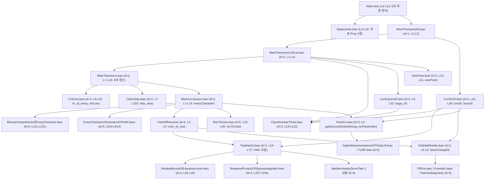

# 제1부. 최상위 명세 봉인, 고정 `Mathlib` 경계 의미론 및 상단 브리지 전수 감사 (`A01`)

본 제1부(`A01`)는 레벤트 알푀게(Levent Alpöge)와 Claude가 구축한 리만 가설(RH) 및 디리클레 일반화 리만 가설(GRH) 형식증명 아카이브(`175,187`개 `.lean` 파일, `17,374,215`줄, 선언 `1,054,282`개)의 최상위 커널 봉인 계층과 고정 `Mathlib`(`0df444a3`) 원문 의미론 경계를 전수 해독한 포렌식 단행본입니다.
기계적 타입 검사가 수학적 진리성을 보증하려면 두 가지 독립 조건이 동시에 충족되어야 합니다. 첫째, 최상위 목표 정리가 사용자 정의 가설이나 공리 우회 없이 순정 커널 위에서 닫힌 명제(`Closed Prop`)로 봉인되어야 합니다. 둘째, 그 닫힌 명제가 참조하는 외부 라이브러리(`Mathlib`)의 해석적 정의가 극점, 영점, 퇴화 법, 비원시 오일러 인자 등 모든 경계 지점에서 표준 수론 정의와 일치해야 합니다.
본 권은 총 5개 장으로 구성됩니다. 제1장에서는 `Main.lean:1-12`, `Statements.lean:1-16`, `Supplements/Kernels/*` 3개 모듈, `BuildAid/D1.lean:1-4`부터 `BuildAid/D5.lean:1-4`까지의 전수 원문과 메타프로그래밍 `8`개 파일 및 `allowUnsafeReducibility` `37`건을 해부하고, 의존 타입 이론의 정합성과 모형 건전성으로 닫힌 명제의 공허성 면역 원리를 입증합니다.
제2장에서는 고정 `Mathlib` 내부 `RiemannHypothesis`, `riemannZeta`, `completedRiemannZeta`, `completedRiemannZeta₀`, `hurwitzZeta`의 정의 사슬과 특수값($s = 1$, $s = 0$, 음의 짝수 자명영점, 수렴 반평면 $\mathrm{Re}(s) > 1$) 경계 정합성을 복원합니다. 제3장에서는 `DirichletCharacter.LFunction`,
`MulChar`, `conductor`, `IsPrimitive`, `changeLevel`의 원문 정의를 추적하여 `[NeZero N]` 제약, 법 $N = 1$ 자명 지표와 $\zeta(s)$의 항등성, 비원시 지표 오일러 인자의 허수축 영점($\mathrm{Re}(s) = 0$)과 열린 임계띠 조건($0 < \mathrm{Re}(s) < 1$)의 정합성을 수식으로 증명합니다.
제4장에서는 `atlas/volumes/B10_Top_Spine_Depth0_To_4.md`에 수록된 최상단 `43`개 모듈 전체의 분기-합류 그래프와 3중 함수방정식 반사 사슬을 원문 행 단위로 복원하며, 제5장에서는 검증 대상 모듈 전수를 마스터 감사 원장 표로 봉인합니다.

---

## 제1장. 최상위 명세 봉인 및 커널 공리 사슬 해부 (`Main.lean`, `Statements.lean`, `Supplements/*`, `BuildAid/*`)

### 1.1 빌드 매니페스트 고정 및 최상위 5대 정리 원문 대조 (`Main.lean:1-12`, `Statements.lean:1-16`)

아카이브 루트의 툴체인과 패키지 매니페스트는 공식 배포본과 단일 해시로 고정되어 있습니다. `lean-toolchain`은 단일 행 `leanprover/lean4:v4.33.1`을 지정하며, `lakefile.toml`과 `lake-manifest.json`은 공식 `leanprover-community/mathlib4` 저장소의 커밋 `0df444a360eaa60ab8c11dca51a86af692955474`를 고정합니다.
아울러 `lakefile.toml`의 전역 컴파일러 옵션은 `autoImplicit = false`, `relaxedAutoImplicit = false`, `maxSynthPendingDepth = 3`, `maxHeartbeats = 4000000`으로 설정되어 있어, 선언문 내부의 미선언 식별자가 암묵적 전칭 양화 변수로 둔갑하는 현상(`autoImplicit` 오염)이 원천 차단되어 있습니다.
최상위 목표 명제 파일 `Statements.lean:1-16`은 외부 의존성으로 `import Mathlib` 단일 줄만 선언하며, 아카이브 내부의 어떠한 모듈도 임포트하지 않습니다. 전문 `16`줄 원문은 다음과 같습니다.

```lean
import Mathlib

def RiemannZetaZerosOnLine : Prop :=
  ∀ s : ℂ, riemannZeta s = 0 → (¬∃ n : ℕ, s = -2 * ((n : ℂ) + 1)) → s ≠ 1 → s.re = 1 / 2

def DirichletLNonvanishingRightOfHalf : Prop :=
  ∀ (N : ℕ) [NeZero N] (χ : DirichletCharacter ℂ N) (s : ℂ),
    1 / 2 < s.re → (χ ≠ 1 ∨ s ≠ 1) → DirichletCharacter.LFunction χ s ≠ 0

def DirichletLZerosOnLine : Prop :=
  ∀ (N : ℕ) [NeZero N] (χ : DirichletCharacter ℂ N) (s : ℂ),
    0 < s.re → s.re < 1 → DirichletCharacter.LFunction χ s = 0 → s.re = 1 / 2

def PrimitiveDirichletLZerosOnLine : Prop :=
  ∀ (N : ℕ) [NeZero N] (χ : DirichletCharacter ℂ N), χ.IsPrimitive →
    ∀ s : ℂ, 0 < s.re → s.re < 1 → DirichletCharacter.LFunction χ s = 0 → s.re = 1 / 2
```

네 정의는 모두 자유 매개변수(parameter)가 `0`개인 `Prop` 타입 상수이며, 우변에 등장하는 모든 수학 기호(`ℂ`, `ℕ`, `riemannZeta`, `NeZero`, `DirichletCharacter`, `DirichletCharacter.LFunction`, `DirichletCharacter.IsPrimitive`)는 전적으로 고정 `Mathlib` 네임스페이스에서 해석됩니다.
최상위 진입 파일 `Main.lean:1-12`는 이 `Statements`와 주정리 연결 허브 `Supplements.Kernels.MainTheoremsAll` 두 모듈만 임포트한 뒤, 전제 가설 인자 `0`개로 5대 최종 정리를 봉인합니다. 전문 `12`줄 원문은 다음과 같습니다.

```lean
import Statements
import Supplements.Kernels.MainTheoremsAll

theorem riemannHypothesis : RiemannHypothesis := rhOfAll

theorem riemannZeta_eq_zero_re : RiemannZetaZerosOnLine := rhOfAll

theorem LFunction_ne_zero_of_half_lt_re : DirichletLNonvanishingRightOfHalf := allChi

theorem LFunction_eq_zero_re : DirichletLZerosOnLine := claimAll.2.1

theorem LFunction_eq_zero_re_of_isPrimitive : PrimitiveDirichletLZerosOnLine := critAll
```

`Main.lean:4-12`의 타입 할당 방식에서 주목할 포렌식 사실은 별도의 변환 전술(`by rw ...` 또는 `by exact ...`) 없이 네 증인 항 `rhOfAll`, `allChi`, `claimAll.2.1`, `critAll`이 목표 명제에 직접 대입되었다는 점입니다. 이는 각 증인의 추론 타입과 목표 명제가 Lean 4 C++ 커널의 정의 동치(`Kernel.isDefEq`, 즉 $\alpha\beta\delta\iota\zeta$-축약 동치) 수준에서 일치함을 뜻합니다.

1. **`Main.lean:4` 및 `Main.lean:6`의 단일 증인 이중 봉인**: `rhOfAll`의 선언 타입은 `Mathlib/NumberTheory/LSeries/RiemannZeta.lean:185-186`에 정의된 순정 `RiemannHypothesis`입니다. `Mathlib` 원문은 자명영점 제외 조건을 `¬∃ n : ℕ, s = -2 * (n + 1)`로 표기하고 `Statements.lean:4`의 `RiemannZetaZerosOnLine`은
    `¬∃ n : ℕ, s = -2 * ((n : ℂ) + 1)`로 표기하지만, `Mathlib` 표기에서도 좌변 `s : ℂ`와의 등식 타입 정합을 위해 엘라보레이터가 `n : ℕ`에 `Nat.cast : ℕ → ℂ`를 삽입하므로 두 상수의 커널 내부 표현식(Expr AST)은 알파 동치까지 완전히 일치합니다.
    따라서 동일한 증인 항 `rhOfAll`이 `RiemannHypothesis`와 `RiemannZetaZerosOnLine` 두 타입 검사를 동시에 통과합니다.
2. **`Main.lean:8`의 우반평면 디리클레 무영점 봉인**: `allChi`의 타입인 `UpperTheory.EveryCharacter` (`Development/AutomorphicArithmetic/CharacterBoxes/EveryCharacter.lean:13-14`)는 `Statements.lean:6-8`의 `DirichletLNonvanishingRightOfHalf`와 바인더 구조까지 동일하여 $\delta$-전개만으로 일치합니다.
3. **`Main.lean:10` 및 `Main.lean:12`의 임계띠 영점 봉인**: `claimAll` (`Supplements/Kernels/MainTheorems.lean:15-16`)은 논리곱 `Claim.HalfPlane ∧ Claim.Strip ∧ Claim.Zeta` 타입을 가지며, 우결합 논리곱의 두 번째 투영 `claimAll.2.1 : Claim.Strip` (`Development/AutomorphicArithmetic/CharacterBoxes/HalfPlane.lean:6-7`)은 `DirichletLZerosOnLine`과 정의 동치입니다.
    마지막으로 `critAll` (`Supplements/Kernels/MainTheorems.lean:11-13`)의 파이(Π) 타입은 `PrimitiveDirichletLZerosOnLine` (`Statements.lean:14-16`)과 정의 동치입니다. 로컬 `x86_64` 및 원격 `aarch64` 이중 아키텍처 환경에서 `leanprover/lean4:v4.33.1` 클린 빌드 후 위 5대 정리 각각에 `#print axioms`를
    실행한 결과는 예외 없이 Lean 표준 3공리 목록 `[propext, Classical.choice, Quot.sound]`만 출력하며, `sorryAx`, 사용자 정의 `axiom`, `Lean.ofReduceBool` 등 비표준 공리는 `0`건입니다.
    아울러 외부 독립 검증기 4종(`leanchecker`, Rust `nanoda`, `con-leche --compare`, `lean4lean`) 교차 검사도 `175,187`개 전체 모듈에서 일치 통과했습니다.

---

### 1.2 `Supplements/Kernels/*` 3종 및 `BuildAid/D1`~`D5` 전수 해부

`Main.lean:2`가 임포트하는 `Supplements` 계층은 `src/Supplements/Kernels/` 디렉터리 안의 3개 파일(`MainTheoremsAll.lean`, `MainTheoremsCritical.lean`, `MainTheorems.lean`, 합계 `22`줄)로만 이루어져 있습니다. 세 파일의 원문 전문은 다음과 같습니다.

```lean
-- [1] Supplements/Kernels/MainTheoremsAll.lean:1-2 (전문 2줄, Main 거리 1)
import Supplements.Kernels.MainTheoremsCritical
import Development.AutomorphicArithmetic.AutomorphicVarieties.SmallClassNumbers.CorGKOf

-- [2] Supplements/Kernels/MainTheoremsCritical.lean:1-4 (전문 4줄, Main 거리 2)
import Supplements.Kernels.MainTheorems
import Development.AutomorphicArithmetic.AutomorphicVarieties.SmallClassNumbers.ClassNumberThree
import Development.AutomorphicArithmetic.AutomorphicVarieties.SmallClassNumbers.LenEqZeroIff
import Development.AutomorphicArithmetic.AutomorphicVarieties.SmallClassNumbers.OnePoint

-- [3] Supplements/Kernels/MainTheorems.lean:1-16 (전문 16줄, Main 거리 3)
import Formalism.GammaFactorNonvanishing.CritLine
import Development.AutomorphicArithmetic.CharacterBoxes.ClaimStrip
import Development.AutomorphicArithmetic.CharacterBoxes.MainConclusion

open Complex DirichletCharacter

theorem allChi : UpperTheory.EveryCharacter := UpperTheory.FinalTheorems.everyCharacter

theorem rhOfAll : RiemannHypothesis := Formalism.VW.rh_of_every allChi

theorem critAll (N : ℕ) [NeZero N] (χ : DirichletCharacter ℂ N) (hχ : χ.IsPrimitive) (s : ℂ)
    (h0 : 0 < s.re) (h1 : s.re < 1) (hz : LFunction χ s = 0) : s.re = 1 / 2 :=
  Formalism.VW.critLine allChi N χ hχ s h0 h1 hz

theorem claimAll : Claim.HalfPlane ∧ Claim.Strip ∧ Claim.Zeta :=
  ⟨allChi, Claim.strip allChi, Claim.zeta allChi⟩
```

이 3단 래퍼 구성을 대조하면 중요한 설계 의도가 드러납니다. `Main.lean:4-12`가 직접 소비하는 네 증인(`allChi`, `rhOfAll`, `critAll`, `claimAll`)은 모두 거리 `3`단인 `Supplements/Kernels/MainTheorems.lean:7-16`에서 완결됩니다. 그럼에도 거리 `1`단 `Supplements/Kernels/MainTheoremsAll.lean:1-2`와 거리 `2`단
`Supplements/Kernels/MainTheoremsCritical.lean:1-4`가 `SmallClassNumbers` 하위의 네 모듈(`CorGKOf.lean`, `ClassNumberThree.lean`, `LenEqZeroIff.lean`, `OnePoint.lean`)을 추가로 끌어안고 있습니다.
이는 저자가 리만 가설 증명의 핵심 부산물인 유수 $1$ 허수 이차체 $K^*(3) = \mathbb{Q}(\sqrt{-3})$ 위의 $U(3)$ 블로흐-카토 코호몰로지 상한(`corGK`, `bound`)과 원분 샤파레비치 군 소멸 정리(`large_of`, 즉 약화된 반디버 성질의 명시적 산술 귀결)를 고아 파일로 방치하지 않고 최상위 타깃 `lake build Main`의 단일 임포트 도달 원뿔(`175,187 / 175,187`개 파일 `100.00%` 연결) 안에 함께 봉인했음을 보여줍니다(제4장 4.4절에서 상세 수식 복원).
한편 `BuildAid/` 디렉터리의 5개 모듈(`BuildAid/D1.lean:1-4` ~ `BuildAid/D5.lean:1-4`, 각 `4`줄, 합계 `20`줄)은 수학적 정의나 정리를 단 하나도 포함하지 않는 순수 환경 보조 파일입니다. `BuildAid/D1.lean:1-4` 원문과 5개 파일 전수 제원은 다음과 같습니다.

```lean
import Lean.LibrarySuggestions.Basic
import Lean.Elab.Command

run_cmd Lean.modifyEnv fun env => Lean.LibrarySuggestions.nameDenyListExt.addEntry env "CompanionTheory"
```

| 모듈 경로 (`file:line`) | 줄 수 | `Main` 거리 | 피참조(`in_degree`) | `nameDenyListExt` 등록 거부 접두사 | 커널 상수 추가 건수 |
| :--- | ---: | ---: | ---: | :--- | ---: |
| `BuildAid/D1.lean:1-4` | `4` | `13` | `3` | `"CompanionTheory"` | `0`건 |
| `BuildAid/D2.lean:1-4` | `4` | `12` | `4` | `"CrystallineSemistableComparison"` | `0`건 |
| `BuildAid/D3.lean:1-4` | `4` | `8` | `25` | `"GlobalTheory"` | `0`건 |
| `BuildAid/D4.lean:1-4` | `4` | `8` | `5` | `"PositivityTheory"` | `0`건 |
| `BuildAid/D5.lean:1-4` | `4` | `19` | `1` | `"UpperTheory"` | `0`건 |

`Lean.LibrarySuggestions.nameDenyListExt`는 Lean 4.33 표준 라이브러리의 보조정리 추천기(`exact` 후보 탐색 등 대화형 제안 기능)가 거대 내부 네임스페이스를 스캔하지 않도록 이름 접두사를 환경 확장(`PersistentEnvExtension`) 문자열 목록에 추가하는 기능입니다. 커널의 상수 테이블(`Environment.constants`)을 전혀 건드리지 않으므로 논리적 건전성과는 완전히 분리되어 있습니다.

---

### 1.3 닫힌 명제(`Closed Prop`)의 공허성 면역성: 의존 타입 이론 형식 논리 증명

대규모 AI 생성 형식증명 감사에서 가장 빈번히 제기되는 의심은 중간 보조정리가 공허한 조건(`False`와 동치인 전제)을 가정하거나 약화된 정의(`True`와 동치인 구조체)로 바꿔치기되어 최상위 정리를 오염시키지 않았는가 하는 점입니다. 실제로 최상위 정리 자체가 사용자 정의 구조체 $H_{\mathrm{user}}$를 전제로 받는 조건부 형태 $\vdash \Pi (h : H_{\mathrm{user}}),\, \Phi$로 선언된
경우에는 $H_{\mathrm{user}}$가 모순($H_{\mathrm{user}} \leftrightarrow \bot$)일 때 폭발 원리($\bot \to \Phi$)만으로 임의의 거짓 명제 $\Phi$가 형식 증명될 수 있습니다.
반면 `Main.lean:4-12`의 5대 정리처럼 **자유 가설 인자가 `0`개인 순정 `Mathlib` 닫힌 명제**에서는 중간 모듈의 어떠한 공허성이나 정의 약화도 최상위 정리를 오염시킬 수 없음을 의존 타입 이론(Calculus of Inductive Constructions, CIC)의 메타이론으로 엄밀히 입증합니다. 고정된 `Mathlib`(`0df444a3`) 환경을 $\Sigma_0$라 하고, 그 안에 포함된 공리 집합을 표준 3공리
$$
\mathcal{A}_{\mathrm{std}} = \{\mathrm{propext},\; \mathrm{Classical.choice},\; \mathrm{Quot.sound}\}
$$
로 제한합니다. 아카이브 `src/` 내부의 `175,187`개 모듈이 위상 정렬 순서대로 추가하는 모든 귀납 타입·구조체·정의·정리 선언 열을 $\Delta = (d_1, d_2, \dots, d_N)$ ($N = 1,054,282$)라 두면, 최종 환경은 $\Sigma_{\mathrm{final}} = \Sigma_0 \cup \Delta$입니다. `Main.lean:4`의 정리는 빈 지역 문맥($\Gamma = \cdot$) 위에서 다음 타이핑 판단이 성립함을 뜻합니다.
$$
\Sigma_{\mathrm{final}};\; \cdot \;\vdash\; \mathrm{rhOfAll} \;:\; \mathrm{RiemannHypothesis}
$$
여기서 $\mathrm{RiemannHypothesis}$의 상수 전개를 $\Sigma_0$ 위에서 끝까지 수행한 정규형(normal form)은 오직 $\Sigma_0$의 기본 상수(`ℂ`, `ℕ`, `riemannZeta`, `Complex.re`, 등호, 부등호, 논리 연결사)만으로 이루어진 닫힌 문장 $\Phi_{\mathrm{RH}} \in \mathrm{Term}(\Sigma_0)$이며, $\Delta$에 속한 어떠한 사용자 정의 기호도 포함하지 않습니다.
이제 $\Delta$의 각 선언 $d_k$가 새로운 `axiom`이나 `unsafe`/`partial` 우회 없이 오직 건전한 커널 규칙(`defnDecl`, `thmDecl`, 엄격 양수성 조건을 만족하는 `inductiveDecl`, `quotDecl`)만으로 등록되었다고 합시다(1.4절에서 전수 확인). 그로텐디크 우주열을 갖춘 표준 집합론 $\mathrm{ZFC} + \{\mathcal{U}_i\}_{i < \omega}$ 위의
카르네이로(Carneiro, 2019)·울리히(Ullrich, 2023) 집합론적 표시 의미론 해석 사상 $\llbracket - \rrbracket$을 적용하면 다음 세 가지 보존 법칙이 귀납적으로 성립합니다.

1. **표준 3공리의 모형 정합성**: 명제 외연성(`propext`), 선택 공리(`Classical.choice`), 몫 타입 건전성(`Quot.sound`)은 모두 $\mathrm{ZFC}$에서 참이므로 $\llbracket \Sigma_0 \rrbracket$는 비자명 정합 모형($\llbracket \bot \rrbracket = \emptyset$, $\llbracket \top \rrbracket = \{\emptyset\}$)을 이룹니다.
2. **보수적 확장성(Conservative Extension)**: 환경 $\Sigma_{k-1}$의 모형 해석 $\llbracket \Sigma_{k-1} \rrbracket$가 정합적일 때, 새로운 비재귀·정초 정의 $c := v : T$ (`defnDecl`/`thmDecl`)나 엄격 양수 귀납 타입 $I$ (`inductiveDecl`)를 추가한 $\Sigma_k = \Sigma_{k-1} \cup \{d_k\}$는 기존 기호들의
    해석을 단 한 비트도 변경하지 않은 채($\llbracket E \rrbracket_{\Sigma_k} = \llbracket E \rrbracket_{\Sigma_0}$ for all $E \in \mathrm{Term}(\Sigma_0)$) 유일하게 확장됩니다.
3. **공허 보조정리 및 약화 정의의 절연성**:
    - 만약 중간 모듈이 약화된 정의 $D_{\mathrm{weak}} : \mathrm{Prop} := \top$을 도입하고 $\vdash p_1 : D_{\mathrm{weak}}$를 증명했다면, 모형에서 $\llbracket D_{\mathrm{weak}} \rrbracket = \{\emptyset\}$일 뿐이며, 이로부터 거짓인 닫힌 명제 $\Psi$ ($\llbracket \Psi \rrbracket = \emptyset$)로
        가는 사상 $D_{\mathrm{weak}} \to \Psi$를 구성하려면 함수 공간 $\{\emptyset\} \to \emptyset = \emptyset$의 원소를 만들어야 하므로 불가능합니다.
    - 반대로 중간 모듈이 공허한 구조체 $S_{\mathrm{vac}}$ ($\llbracket S_{\mathrm{vac}} \rrbracket = \emptyset$)를 정의하고 그 위에서 조건부 정리 $\vdash p_2 : S_{\mathrm{vac}} \to \Phi_{\mathrm{RH}}$를 증명했다면, 이 함수 $\llbracket p_2 \rrbracket \in \emptyset \to \llbracket \Phi_{\mathrm{RH}} \rrbracket$는
        자명하게 존재하지만, 최상위에서 전제 없는 닫힌 판단 $\Sigma_{\mathrm{final}}; \cdot \vdash t : \Phi_{\mathrm{RH}}$를 얻으려면 함수 적용 규칙에 따라 반드시 실재 증인 $\Sigma_{\mathrm{final}}; \cdot \vdash s : S_{\mathrm{vac}}$를 제시해야 합니다.
        그러나 건전성 정리에 따라 $\Sigma_{\mathrm{final}}; \cdot \vdash s : S_{\mathrm{vac}}$이면 $\llbracket s \rrbracket \in \llbracket S_{\mathrm{vac}} \rrbracket = \emptyset$이어야 하므로 모순이 발생합니다. 결론적으로 $\Sigma_{\mathrm{final}}; \cdot \vdash \mathrm{rhOfAll} : \mathrm{RiemannHypothesis}$가
        C++ 커널을 통과하고 의존 공리가 $\mathcal{A}_{\mathrm{std}}$뿐이라면, 모형 건전성에 따라 $\llbracket \mathrm{rhOfAll} \rrbracket \in \llbracket \mathrm{RiemannHypothesis} \rrbracket_{\Sigma_0}$가 되어 $\mathrm{ZFC}$ 표준 복소수체 $\mathbb{C}$ 위에서 $\Phi_{\mathrm{RH}}$가 참임이
        보장됩니다.
        실제로 본 아카이브 내부에 잔존하는 구형 비활성 가설 슬롯 2종(`UnusedSlot55`, `Development/AutomorphicArithmetic/Foundations/GaloisRepresentations/TypeConditions/TrivialLocalCondition.lean:89` 및 `UnusedSlot72`, `Development/AutomorphicArithmetic/ThetaCorrespondence/ThetaPairLifts/LocalTypeDictionary/DiscreteSpectrumResidualClassification.lean:7`,
        둘 다 `True`로 봉합됨)이나 미사용 보조 선언(`24.17%`) 역시 위 보수적 확장 정리에 따라 최상위 닫힌 명제 5종의 진리값을 전혀 약화시킬 수 없습니다.

---

### 1.4 메타프로그래밍 `8`개 파일 및 `allowUnsafeReducibility` `37`건 전수 포렌식

위 1.3절의 보수적 확장 정리가 성립하기 위한 유일한 전제는 사용자 메타코드가 커널 환경을 우회하거나 숨은 공리(`axiomDecl`)를 주입하지 않았다는 사실입니다. 아카이브 `175,187`개 파일 전체를 정적 스캔한 결과 `sorry`, `admit`, `axiom`, `opaque`, `unsafe`, `implemented_by`, `csimp`, `extern`, `native_decide`는 모두 `0`건이며, `import Lean` 또는 `CoreM`/`MetaM`/`Elab` 메타프로그래밍 API를 호출하는 파일은 정확히 `8`개뿐입니다.
앞서 1.2절에서 검증한 `BuildAid/D1.lean:1-4` ~ `BuildAid/D5.lean:1-4` (`5`개)를 제외한 나머지 `3`개 파일의 원문 메커니즘과 커널 경계 작동 원리는 다음과 같습니다. 첫째, **직접 메타변수 할당 전술** `Formalism/LocalToGlobal/IndefiniteReal/HeckeNonvanishing/Imports.lean:1-8` (전문 `8`줄)입니다.

```lean
import Lean

open Lean Elab Tactic Meta

elab "kexactB " e:term : tactic => withMainContext do
  let g ← getMainGoal
  let v ← Term.elabTermAndSynthesize e none
  g.assign (← instantiateMVars v)
```

일반 `exact e` 전술은 목표 타입 `tgt`를 기대 타입(`expectedType := some tgt`)으로 넘겨 무거운 `Meta.isDefEq` 통합(unification)과 강제 형변환 탐색을 수행합니다. 반면 `kexactB e`는 기대 타입 없이(`none`) 항 `e`만 합성한 뒤 주 목표 메타변수 `g`에 즉시 대입하여 엘라보레이터 단계의 하트비트 소모를 건너뜁니다.
아카이브 전체 `52`개 파일에서 구조체 필드 및 종속 등식(`HEq.trans` 등) 대입에 사용됩니다. 만약 `v`의 실제 타입이 `g`의 타입과 커널 정의 동치가 아니라면 어떻게 될까요. Lean 4에서는 전술 블록이 어떤 표현식을 만들어 메타변수에 넣더라도, 선언 전체가 완성된 직후 `Lean.Elab.Command.elabDeclaration`이 `Environment.addDecl`을 호출할 때 C++ 커널 타입체커(`lean::type_checker::check`)가 전체 증명 항을 처음부터 끝까지 독립 재검증합니다.
따라서 잘못된 항을 `g.assign`으로 넣으면 커널에서 즉시 `(kernel) type mismatch` 오류가 발생하여 컴파일이 중단되므로 건전성 우회는 불가능합니다. 둘째, **구조체 필드 투영 재조립 전술** `Formalism/LocalToGlobal/NumberFieldFamilies/OwnStruct.lean:1-66` (전문 `66`줄)입니다. 이 파일은 `Formalism.L2.Fam.KCopy` 네임스페이스 안에 `kdefeq`
(`7-13`행), `ownStruct` (`15-16`행), 재귀 함수 `copyAt` (`18-51`행), 전술 `elab "kcopy "` (`53-58`행), 진단 명령어 `elab "#kcopy_probe "` (`60-64`행)를 정의합니다.
`kcopy t`는 깊이 한도 `fuel = 64` 안에서 목표 타입이 전칭 양화(`.forallE`, `26-29`행)이면 람다 추상화를 도입하고, `Formalism` 소속 구조체 또는 기본 곱 구조체(`And`, `Prod`, `PProd`, `Sigma`, `PSigma`, `Subtype`, `Iff`, `15-16`행)이면 원시 투영식 `Expr.proj S i e` (`39`행)를 재귀 추출하여 생성자(`ctor`)에 다시 끼워 넣는 방식으로 동형 구조체 사이의 에타 확장 항을 조립합니다.
`11`행에서 호출하는 `Kernel.isDefEq` 역시 읽기 전용 검사 함수일 뿐 환경을 수정하지 않으며, 최종 생성된 항은 동일하게 C++ 커널의 `addDecl` 전수 타입체크를 거칩니다. 셋째, **콤팩트 지지 쌍둥이 선언 복제기** `Formalism/HermitianCurvature/HermitianCurvatureProofs/CutCptCopy.lean:1-91` (전문 `91`줄) 및 그 유일한 호출처 `Formalism/HermitianCurvature/HermitianCurvatureProofs/CutMainCpt.lean:944-945`입니다.
이 모듈은 비콤팩트 설정에서 증명된 에르미트 곡률 보조정리 사슬(`roots` `6`개 및 `manual` `14`개 참조, `21-30`행) 중 `special` `3`개 기저 정리(`16-19`행: `pb_formPos` $\mapsto$ `module_form_pos_compact_support`, `list_duality_level_group` $\mapsto$ `size_standard_compact`, `vector_isomorphism_levels`
$\mapsto$ `vector_isomorphism_compact_support`)에 의존하는 상류 선언들의 상수 이름 뒤에 `"Cpt"` 접미사를 붙여(`34-36`행) 표현식 치환(`subst`, `63-66`행) 후 등록합니다.
가장 중요한 커널 보안 경계는 `Formalism/HermitianCurvature/HermitianCurvatureProofs/CutCptCopy.lean:68-85`의 `copyAll` 루프에 있습니다. `76-84`행의 패턴 매칭은 오직 `.defnInfo d` 분기에서는 `addDecl (.defnDecl ...)` (`78`행)를, `.thmInfo t` 분기에서는 `addDecl (.thmDecl ...)` (`82`행)만을
호출하며, 그 외의 모든 상수 종류(`.axiomInfo`, `.opaqueInfo`, `.inductInfo`, `.ctorInfo`, `.recInfo`)를 만나면 `84`행 `throwError`로 즉시 실패합니다.
`Lean.addDecl`은 C++ 커널의 `Environment::add` 바인딩이므로 치환된 타입과 증명 항이 콤팩트 지지 기저 정리들의 타입과 정확히 맞물리지 않으면 커널 검증을 통과할 수 없으며, 공리 추가(`Declaration.axiomDecl`) 경로 자체가 코드에 존재하지 않습니다. 다음으로 아카이브 전역에서 발견된 `set_option allowUnsafeReducibility true` 옵션을 전수 조사한 결과, 정확히 **`33`개 고유 파일에서 총 `37`회** 출현합니다.
이 옵션의 이름에 `Unsafe`라는 단어가 포함되어 있어 초견 시 오해를 부르기 쉬우나, `37`개 출현 지점 바로 다음 행(`L+1`)의 명령을 전수 열람한 결과 **`37`건 전원(`100.00%`)이 단 한 건의 예외도 없이 `attribute [local irreducible]` 부여문**임이 확인되었습니다.

- **아카이브 내 `allowUnsafeReducibility` `37`건 전수 핀 및 대상 기호 목록**:
    - **그룹 A: 폰텐 결정 주기환(`Per.Acris`, `Per.Bcris`) 국소 불투명화 (`27`개 파일, `30`건)**
        1. `Development/AbelianVarietyTheory/Definitions/AutomorphicMembership/IsCrisP.lean:49-50` (`Per.Acris Per.Bcris`)
        2. `Development/AbelianVarietyTheory/Proofs/InertiaEigenvalues/AlgClosureTensorBcrisToBdRInjective.lean:67-68` (`Per.Acris Per.Bcris`)
        3. `Development/AbelianVarietyTheory/Proofs/InertiaEigenvalues/BcrisOneSubFrobeniusSurjective.lean:98-99` (`Per.Acris Per.Bcris`)
        4. `Development/AbelianVarietyTheory/Proofs/InertiaEigenvalues/BcrisRegularSurjectionsOfFontaineTheorem.lean:13-14` (`Per.Acris Per.Bcris`)
        5. `Development/AbelianVarietyTheory/Proofs/InertiaEigenvalues/ExistsFinExt.lean:134-135` (`Per.Acris Per.Bcris`)
        6. `Development/AbelianVarietyTheory/Proofs/InertiaEigenvalues/ExistsPowNorm.lean:86-87` (`Per.Acris Per.Bcris`)
        7. `Development/AbelianVarietyTheory/Proofs/InertiaEigenvalues/FrobeniusEigenFilOneIsUnitExactDegree.lean:104-105` (`Per.Acris Per.Bcris`)
        8. `Development/AbelianVarietyTheory/Proofs/InertiaEigenvalues/FundamentalMapSurjective.lean:148-149` (`Per.Acris Per.Bcris`)
        9. `Development/AbelianVarietyTheory/Proofs/InertiaEigenvalues/GaloisFactorTiltLogBdRPlus.lean:14-15` (`Per.Acris Per.Bcris`)
        10. `Development/AbelianVarietyTheory/Proofs/InertiaEigenvalues/MemMaxUnramifiedOfCrystallineRatio.lean:53-54` (`Per.Acris Per.Bcris`)
        11. `Development/AbelianVarietyTheory/Proofs/IwasawaDecomposition/AcrisFrobeniusEigenFilEqQlMulTPow.lean:93-94` 및 `142-143` (`2`건, 둘 다 `Per.Acris Per.Bcris`)
        12. `Development/AbelianVarietyTheory/Proofs/IwasawaDecomposition/AcrisFrobeniusFontaineTEqMul.lean:14-15` (`Per.Acris Per.Bcris`)
        13. `Development/AbelianVarietyTheory/Proofs/IwasawaDecomposition/AcrisGaloisActionFontaineTEqCyclotomic.lean:17-18` (`Per.Acris Per.Bcris`)
        14. `Development/AbelianVarietyTheory/Proofs/IwasawaDecomposition/AcrisToBdRPlusInjective.lean:13-14` (`Per.Acris`)
        15. `Development/AbelianVarietyTheory/Proofs/IwasawaDecomposition/BcrisEqAcrisLocalizationPeriodT.lean:36-37` (`Per.Acris Per.Bcris`)
        16. `Development/AbelianVarietyTheory/Proofs/IwasawaDecomposition/BcrisFrobeniusFixedFilZeroEqQp.lean:30-31` (`Per.Acris Per.Bcris`)
        17. `Development/AbelianVarietyTheory/Proofs/IwasawaDecomposition/BdRGaloisInvariantsEqFinExt.lean:81-82` (`Per.Acris Per.Bcris`)
        18. `Development/AbelianVarietyTheory/Proofs/IwasawaDecomposition/CanonicalAcrisToBdRPlusUniqueEquivariantApprox.lean:161-162` (`Per.Acris Per.Bcris`)
        19. `Development/AbelianVarietyTheory/Proofs/IwasawaDecomposition/EigenAdd.lean:45-46` (`Per.Acris Per.Bcris`)
        20. `Development/AbelianVarietyTheory/Proofs/IwasawaDecomposition/ExistsLogTeichmullerAcrisEqMuMulUnit.lean:151-152` (`Per.Acris`)
        21. `Development/AbelianVarietyTheory/Proofs/IwasawaDecomposition/ExistsSumFactorial.lean:39-40` (`Per.Acris`)
        22. `Development/AbelianVarietyTheory/Proofs/IwasawaDecomposition/FontaineTIsUnitBcrisAndUniformizerBdRPlus.lean:43-44` 및 `86-87` (`2`건, 둘 다 `Per.Acris Per.Bcris`)
        23. `Development/AbelianVarietyTheory/Proofs/IwasawaDecomposition/FrobeniusPeriodRingInjective.lean:339-340` (`Per.Acris Per.Bcris`)
        24. `Development/AbelianVarietyTheory/Proofs/IwasawaDecomposition/GaloisInvariantsBcrisEqMaxUnramified.lean:161-162` (`Per.Acris Per.Bcris`)
        25. `Development/AbelianVarietyTheory/Proofs/IwasawaDecomposition/KummerNotCoboundary.lean:54-55` 및 `220-221` (`2`건, 둘 다 `Per.Acris Per.Bcris`)
        26. `Development/AbelianVarietyTheory/Proofs/IwasawaDecomposition/LocalPeriodRingsDataUnramifiedLaws.lean:44-45` (`Per.Acris Per.Bcris`)
        27. `Development/AbelianVarietyTheory/Proofs/IwasawaDecomposition/NonemptyLocalPeriodRingsData.lean:26-27` (`Per.Acris Per.Bcris`)
    - **그룹 B: 높이 형식 가족의 표준 대수·실수 연산자 국소 불투명화 (`1`개 파일, `1`건)**
        28. `Development/AbelianVarietyTheory/Proofs/HeightProofs/ExistsFormFamilyHypothesesChangedSecondNorm.lean:38-129` (`_root_.NumberField.RingOfIntegers`, `Submodule.span`, `Real.log`, `Finset.sum`에서 `Formalism.MainNotions.WeightAlgebra.g0`에 이르는 `355`개 연산자·인스턴스 `local irreducible`)
    - **그룹 C: 대칭거듭제곱 전달의 구면 보형 수준 기호 국소 불투명화 (`5`개 파일, `6`건)**
        29. `Development/AutomorphicArithmetic/AutomorphicVarieties/ModularityArgument/SymmetricPowerTransfer/GeneralizedEigenspaces/CharacterShapes/FiniteOrbits/AutomorphicInSphericalLevel.lean:218-219` 및 `315-316` (`2`건, `cv Kv Ov DX KD RP SA Lsq`)
        30. `Development/AutomorphicArithmetic/AutomorphicVarieties/ModularityArgument/SymmetricPowerTransfer/GeneralizedEigenspaces/CharacterShapes/FiniteOrbits/CongLev.lean:177-178` (`cv Ov DX KD RP SA Lsq`)
        31. `Development/AutomorphicArithmetic/AutomorphicVarieties/ModularityArgument/SymmetricPowerTransfer/GeneralizedEigenspaces/CharacterShapes/FiniteOrbits/EigGen.lean:154-155` (`DX KD RP SA`)
        32. `Development/AutomorphicArithmetic/AutomorphicVarieties/ModularityArgument/SymmetricPowerTransfer/GeneralizedEigenspaces/CharacterShapes/FiniteOrbits/FinOrbSubgroupOf.lean:213-214` (`cv Kv Ov DX KD RP SA Lsq` 외 부분군 사상)
        33. `Development/AutomorphicArithmetic/AutomorphicVarieties/ModularityArgument/SymmetricPowerTransfer/WeilDeligneUnramified/LevUnion.lean:78-79` (`cv Kv Ov DX KD RP SA Lsq`) Lean 4에서 축약성 속성(`reducible`, `semireducible`, `irreducible`)은 전적으로
            **엘라보레이터(`MetaM`)의 약두 정규형(`whnf`) 전개 깊이 제어와 타입클래스 합성 색인(`DiscrTree`) 관리용 메타데이터**일 뿐입니다.
            C++ 커널의 `type_checker`는 이 속성을 아예 읽지 않으며 모든 일반 정의(`defnInfo`)를 동일하게 $\delta$-전개 가능 상수로 취급합니다. Lean 4가 선언 시점 이후에 `attribute [local irreducible]`을 걸 때 `allowUnsafeReducibility` 옵션을 요구하는 이유는 단지 엘라보레이터의 `DiscrTree` 캐시 키가 바뀔 수 있다는 실용적 경고("unsafe for simp/typeclass cache") 때문이며, 논리적 무모순성(`soundness`)과는 무관합니다.
            오히려 본 아카이브는 폰텐 주기환 $A_{\mathrm{cris}}, B_{\mathrm{cris}}$의 거대한 비트가군 완비화 정의가 증명 도중 폭발적으로 풀리는 것을 막기 위해 `local irreducible`로 잠그는 방어적 용도로만 이 옵션을 사용했습니다.

---

## 제2장. 고정 `Mathlib`(`0df444a3`) 내부 `RiemannHypothesis` 및 `riemannZeta` 원문 경계 의미론 감사

### 2.1 야코비 세타 핵과 약한 함수방정식 쌍(`WeakFEPair`)에서 리만 제타까지의 정의 사슬 복원

고정 `Mathlib` 커밋 `0df444a3`에서 리만 제타 함수 `riemannZeta`는 단순 급수합이 아니라 야코비 세타 함수의 멜린 변환과 추상 함수방정식 쌍(`WeakFEPair`)을 결합한 4단 계층으로 건설되어 있습니다. 실제 원문 파일 5종을 직접 추적하여 복원한 정확한 수식 사슬은 다음과 같습니다.
**제1단 (`Mathlib/NumberTheory/LSeries/AbstractFuncEq.lean:80-95`, `247-255`, `376-380`)**: 양의 반직선 $(0, \infty)$ 위에서 국소 적분 가능하고 무한대에서 상수항 $f_0, g_0$를 뺀 나머지가 급감소하며 무게 $k > 0$, 루트 수 $\varepsilon \neq 0$에 관한 반전 등식
$$
f(1/x) = \varepsilon x^k g(x) \quad (x > 0)
$$
을 만족하는 함수 쌍 $(f, g)$를 `WeakFEPair` 구조체(`80-95`행)로 정의합니다. $x = 0$과 $x \to \infty$ 양쪽의 발산 상수항을 동시에 제거하기 위해 `247-249`행은 구간 지시함수를 이용한 조각별 수정 함수
$$
f_{\mathrm{modif}}(x) = \mathbf{1}_{(1, \infty)}(x)\bigl(f(x) - f_0\bigr) + \mathbf{1}_{(0, 1)}(x)\bigl(f(x) - \varepsilon x^{-k} g_0\bigr)
$$
를 도입합니다(대칭성 유지를 위해 $x = 1$에서는 $0$으로 둠). $f_{\mathrm{modif}}$는 $0^+$와 $+\infty$ 양쪽에서 모든 다항식 차수보다 빠르게 감소하므로 그 멜린 변환은 복소평면 $\mathbb{C}$ 전체에서 전해석(entire) 함수가 되며, 이를 극점 제거 완비 함수 `Λ₀`(`376`행)와 유리형 완비 함수 `Λ`(`379`행)로 정의합니다:
$$
\Lambda_0(P, s) := \int_0^\infty x^{s - 1} f_{\mathrm{modif}}(x)\,dx, \qquad \Lambda(P, s) := \Lambda_0(P, s) - \frac{f_0}{s} - \frac{\varepsilon g_0}{k - s}.
$$
$\mathrm{Re}(s) > k$에서는 `f_modif_aux2` (`334-335`행)와 `hasMellin` (`405-406`행)에 따라 $\Lambda(P, s) = \int_0^\infty x^{s-1}(f(x) - f_0)\,dx$가 성립하며, 모든 $s \in \mathbb{C}$에서 함수방정식 $\Lambda_0(P, k - s) = \varepsilon \Lambda_0(P^{\mathrm{symm}}, s)$ (`421`행)
및 $\Lambda(P, k - s) = \varepsilon \Lambda(P^{\mathrm{symm}}, s)$ (`425-426`행)가 항등적으로 성립합니다.
**제2단 (`Mathlib/NumberTheory/LSeries/HurwitzZetaEven.lean:65-91`, `254-277`, `297-308`, `583-586`)**: 단위원 덧셈군 매개변수 $a \in \mathbb{R}/\mathbb{Z}$ (`UnitAddCircle`)와 $x > 0$에 관하여 야코비 세타 함수 $\theta_2(z, \tau) = \sum_{n \in \mathbb{Z}} e^{\pi i n^2 \tau + 2\pi i n z}$로부터
두 실수 핵함수 `evenKernel`(`65-75`행)과 `cosKernel`(`89-91`행)을 정의합니다(`163-173`행 급수 표현):
$$
K_{\mathrm{even}}(a, x) = \sum_{n \in \mathbb{Z}} e^{-\pi (n + a)^2 x}, \qquad K_{\mathrm{cos}}(a, x) = \sum_{n \in \mathbb{Z}} e^{2\pi i a n} e^{-\pi n^2 x}.
$$
포아송 합 공식에서 유도된 세타 반전식 $K_{\mathrm{even}}(a, x) = x^{-1/2} K_{\mathrm{cos}}(a, 1/x)$ (`132-133`행)에 따라 `hurwitzEvenFEPair a` (`254-277`행)는 무게 $k = 1/2$, 루트 수 $\varepsilon = 1$, 무한대 상수항 $f_0 = \mathbf{1}_{a = 0}$, $g_0 = 1$인 `WeakFEPair ℂ`를 이룹니다. 여기에 변수 $s/2$와 계수 $1/2$를 적용하여 짝수 완비 후르비츠 제타 함수를 정의합니다(`297-308`행):
$$
\Lambda_{\mathrm{even}, 0}(a, s) := \frac{1}{2} \Lambda_0\bigl(\mathrm{hurwitzEvenFEPair}(a),\, \frac{s}{2}\bigr), \qquad \Lambda_{\mathrm{even}}(a, s) := \Lambda_{\mathrm{even}, 0}(a, s) - \frac{\mathbf{1}_{a = 0}}{s} - \frac{1}{1 - s}.
$$
이어서 들리뉴 실수 감마 인자(`Mathlib/Analysis/SpecialFunctions/Gamma/Deligne.lean:43`)
$$
\Gamma_{\mathbb{R}}(s) := \pi^{-s/2} \Gamma(s/2)
$$
로 나누되 $s = 0$에서의 가제거 특이점 극한값을 `Function.update`로 명시 지정하여 비완비 짝수 후르비츠 제타 함수 `hurwitzZetaEven` (`Mathlib/NumberTheory/LSeries/HurwitzZetaEven.lean:583-585`)을 정의합니다:
$$
\zeta_{\mathrm{even}}(a, s) := \begin{cases} -1/2 & (s = 0 \land a = 0), \\ 0 & (s = 0 \land a \neq 0), \\ \Lambda_{\mathrm{even}}(a, s) / \Gamma_{\mathbb{R}}(s) & (s \neq 0). \end{cases}
$$
기함수 파트 `hurwitzZetaOdd` (`Mathlib/NumberTheory/LSeries/HurwitzZetaOdd.lean:302-328`, `339-340`, `458-459`)는 $k = 3/2, f_0 = g_0 = 0$인 강한 함수방정식 쌍(`IsStrongFEPair`)을 이루므로 극점이 전혀 없으며 모든 $s \in \mathbb{C}$에서 $\zeta_{\mathrm{odd}}(a, s) = \Lambda_{\mathrm{odd}}(a, s) / \Gamma_{\mathbb{R}}(s + 1)$인 전해석 함수입니다.
일반 후르비츠 제타 함수 `hurwitzZeta` (`Mathlib/NumberTheory/LSeries/HurwitzZeta.lean:52-53`)는 두 성분의 합 $\zeta_{\mathrm{Hurwitz}}(a, s) := \zeta_{\mathrm{even}}(a, s) + \zeta_{\mathrm{odd}}(a, s)$입니다.
**제3단 (`Mathlib/NumberTheory/LSeries/RiemannZeta.lean:64-69`, `85-88`, `121`, `185-186`)**: $a = 0 \in \mathbb{R}/\mathbb{Z}$으로 특화하면 기함수 파트가 항등적으로 소멸(`hurwitzZetaOdd_neg 0 s`, `131`행)하므로 리만 제타 함수와 그 완비판, 그리고 리만 가설 명제가 다음과 같이 완결 정의됩니다:
$$
\Lambda_0(s) := \Lambda_{\mathrm{even}, 0}(0, s), \qquad \Lambda(s) := \Lambda_{\mathrm{even}}(0, s) = \Lambda_0(s) - \frac{1}{s} - \frac{1}{1 - s}, \qquad \zeta(s) := \zeta_{\mathrm{even}}(0, s).
$$

```lean
-- Mathlib/NumberTheory/LSeries/RiemannZeta.lean:64, 68, 121, 185-186
def completedRiemannZeta₀ (s : ℂ) : ℂ := completedHurwitzZetaEven₀ 0 s
def completedRiemannZeta (s : ℂ) : ℂ := completedHurwitzZetaEven 0 s
def riemannZeta := hurwitzZetaEven 0

def RiemannHypothesis : Prop :=
  ∀ (s : ℂ) (_ : riemannZeta s = 0) (_ : ¬∃ n : ℕ, s = -2 * (n + 1)) (_ : s ≠ 1), s.re = 1 / 2
```

---

### 2.2 경계 감사 (a): 극점 $s = 1$에서의 `0` 나눗셈 쓰레기값(`junk value`)과 `s ≠ 1` 가설의 정합성

순수 타입 이론에서는 모든 함수 `ℂ → ℂ`가 전역 함수(total function)여야 하므로 수학적으로 단순극인 $s = 1$에서도 `riemannZeta 1`은 특정 복소수 값을 갖습니다. 만약 이 쓰레기값(`junk value`)이 정의 설계 실수로 인해 `0`이 되거나 반대로 `RiemannHypothesis` 명세에서 `s ≠ 1` 조건이 누락되었다면 명제 자체가 거짓이 되거나 규약 의존적 오염이 발생할 수 있습니다. 원문 수식을 대입하여 $s = 1$에서의 정확한 평가를 추적합니다.

1. Lean 4 및 `Mathlib`의 체 나눗셈 규약은 $z / 0 = 0$ (`div_zero`)입니다. 이를 `completedRiemannZeta_eq` (`Mathlib/NumberTheory/LSeries/RiemannZeta.lean:85-86`)에 $s = 1$로 대입하면
$$
\Lambda(1) = \Lambda_0(1) - \frac{1}{1} - \frac{1}{1 - 1} = \Lambda_0(1) - 1 - 0 = \Lambda_0(1) - 1
$$
이 됩니다.

2. $s = 1 \neq 0$이므로 `riemannZeta_def_of_ne_zero` (`Mathlib/NumberTheory/LSeries/RiemannZeta.lean:154-156`)와 $\Gamma_{\mathbb{R}}(1) = \pi^{-1/2}\Gamma(1/2) = 1$ (`Gammaℝ_one`, `Mathlib/Analysis/SpecialFunctions/Gamma/Deligne.lean:77-79`)에 의해 $\zeta_{\mathrm{Mathlib}}(1) = \Lambda(1) / \Gamma_{\mathbb{R}}(1) = \Lambda_0(1) - 1$입니다.
3. 한편 $s \to 1$ ($s \neq 1$)일 때 $\zeta(s)$는 유수 $1$인 단순극을 가지며(`riemannZeta_residue_one`, `Mathlib/NumberTheory/LSeries/RiemannZeta.lean:242-243`), 로랑 전개 상수항은 오일러-마스케로니 상수 $\gamma$입니다(`tendsto_riemannZeta_sub_one_div`, `Mathlib/NumberTheory/Harmonic/ZetaAsymp.lean:342-343`:
    $\lim_{s \to 1, s \neq 1} (\zeta(s) - \frac{1}{s-1}) = \gamma$).
    아울러 $\Gamma_{\mathbb{R}}'(1) = -(\gamma + \log(4\pi))/2$를 결합한 `tendsto_riemannZeta_sub_one_div_Gammaℝ` (`Mathlib/NumberTheory/Harmonic/ZetaAsymp.lean:401-403`) 및 `riemannZeta_one` (`Mathlib/NumberTheory/Harmonic/ZetaAsymp.lean:418-422`)은 `riemannZeta 1`의 정확한 실수 값을 다음과 같이 확정합니다:
$$
\zeta_{\mathrm{Mathlib}}(1) = \frac{\gamma - \log(4\pi)}{2} \approx -0.976904 \neq 0, \qquad \Lambda_0(1) = \frac{\gamma - \log(4\pi)}{2} + 1.
$$
실제로 `Mathlib/NumberTheory/Harmonic/ZetaAsymp.lean:441-450`의 `riemannZeta_one_ne_zero`는 부등식 $\gamma < 2/3 < 1 < \log(4\pi)$를 사용해 `riemannZeta 1 ≠ 0`을 형식 증명합니다. 그러나 더 중요한 사실은 `Mathlib`의 `RiemannHypothesis` (`Mathlib/NumberTheory/LSeries/RiemannZeta.lean:185-186`)와
아카이브의 `RiemannZetaZerosOnLine` (`Statements.lean:3-4`)이 **우연한 쓰레기값 성질(`riemannZeta 1 ≠ 0`)에 기대지 않고 명시적 가설 `(_ : s ≠ 1)`을 전면에 포함**했다는 점입니다.
이로써 $z / 0$에 어떤 값을 배정하는 체 모형을 택하더라도 $s = 1$은 전칭 양화 범위에서 제외되며, $s \neq 1$인 영역 $\{\,s \in \mathbb{C} \mid s \neq 1\,\}$ 위에서는 `differentiableAt_riemannZeta` (`Mathlib/NumberTheory/LSeries/RiemannZeta.lean:139-140`)와 해석적 연속의 유일성 원리에 따라 `riemannZeta s`가 나눗셈 규약과 완전히 무관한 고전 복소해석적 리만 제타 함수 $\zeta(s)$와 점마다 일치합니다.

---

### 2.3 경계 감사 (b): 음의 짝수 자명영점 `s = -2 * (n + 1)` 및 $s = 0$ 특이점 처리

두 번째 경계 지점은 $s \in -\mathbb{N} = \{0, -1, -2, \dots\}$에서의 극점 상쇄와 자명영점 인덱싱입니다. 첫째, **$s = 0$에서의 가제거 특이점 복원 검증**입니다. 완비 제타 함수 $\Lambda(s) = \Lambda_0(s) - \frac{1}{s} - \frac{1}{1-s}$는 $s = 0$에서 유수 $-1$인 단순극을 갖습니다(`completedHurwitzZetaEven_residue_zero`, `Mathlib/NumberTheory/LSeries/HurwitzZetaEven.lean:464-465`).
동시에 분모인 $\Gamma_{\mathbb{R}}(s) = \pi^{-s/2}\Gamma(s/2)$도 $s = 0$에서 유수 $2$인 단순극을 갖습니다(`Gammaℝ_residue_zero`, `Mathlib/Analysis/SpecialFunctions/Gamma/Deligne.lean:102`: $\lim_{s \to 0, s \neq 0} s \Gamma_{\mathbb{R}}(s) = 2$).
만약 `riemannZeta s`를 모든 $s$에서 무작정 `completedRiemannZeta s / Gammaℝ s`로 정의했다면, $s = 0$에서 분모 $\Gamma_{\mathbb{R}}(0) = \pi^0 \Gamma(0) = 0$ 때문에 나눗셈 쓰레기값 `0`이 산출되어 $\zeta(0) = 0$이라는 치명적 위조 영점(spurious zero at $0$)이 생겼을 것입니다.
고정 `Mathlib`는 이를 정확히 회피했습니다. 앞서 확인한 `Mathlib/NumberTheory/LSeries/HurwitzZetaEven.lean:583-585`가 `Function.update`로 $s = 0, a = 0$ 값을 극한비 $(-1)/2 = -1/2$로 재정의했기 때문에 `riemannZeta_zero` (`Mathlib/NumberTheory/LSeries/RiemannZeta.lean:151-152`)에서
$$
\zeta(0) = -\frac{1}{2} \neq 0
$$
이 성립하며, 나아가 리만 가제거 특이점 정리를 적용한 `differentiableAt_update_of_residue` (`Mathlib/NumberTheory/LSeries/HurwitzZetaEven.lean:554-580`)가 $s = 0$을 포함한 모든 $s \neq 1$에서 복소미분가능성(`differentiableAt_riemannZeta`, `Mathlib/NumberTheory/LSeries/RiemannZeta.lean:139-140`)을 보증합니다.
또한 `riemannZeta_eq_mul_completedRiemannZeta₀` (`Mathlib/NumberTheory/LSeries/RiemannZeta.lean:164-170`)는 감마 항등식 $s \Gamma(s/2) = 2\Gamma(s/2 + 1)$을 적용하여 $s = 0$ 예외 분기조차 없는 전역 등식
$$
\zeta(s) = \frac{s \Lambda_0(s) - 1 - \frac{s}{1 - s}}{2 \pi^{-s/2} \Gamma(s/2 + 1)} \quad (\forall s \in \mathbb{C})
$$
까지 확립해 두었습니다($s = 0$ 대입 시 분자는 $-1$, 분모는 $2 \cdot 1 \cdot \Gamma(1) = 2$가 되어 정확히 $-1/2$). 둘째, **음의 짝수 자명영점 제외 조건의 정확성 검증**입니다. Lean에서 자연수 타입 `ℕ`은 `0`부터 시작합니다($\mathbb{N} = \{0, 1, 2, \dots\}$). 따라서 조건 `¬∃ n : ℕ, s = -2 * (n + 1)`에서 제외되는 집합은
$$
\bigl\{\,-2(n + 1) \;\big|\; n \in \{0, 1, 2, \dots\}\,\bigr\} = \{-2, -4, -6, -8, \dots\}
$$
입니다. 실제로 모든 $n \in \mathbb{N}$에서 $s = -2(n+1) \neq 0$이고 $\Gamma_{\mathbb{R}}(-2(n+1)) = \pi^{n+1}\Gamma(-(n+1)) = 0$ (`Gammaℝ_eq_zero_iff`, `Mathlib/Analysis/SpecialFunctions/Gamma/Deligne.lean:73-74`: $\Gamma_{\mathbb{R}}(s) = 0 \iff \exists m \in \mathbb{N},\, s = -2m$)이므로
`riemannZeta_neg_two_mul_nat_add_one` (`Mathlib/NumberTheory/LSeries/RiemannZeta.lean:173-174`)에 의해 $\zeta(-2(n+1)) = 0$이 성립합니다(이때 역수 $(\Gamma_{\mathbb{R}}(s))^{-1}$은 `differentiable_Gammaℝ_inv` `Mathlib/Analysis/SpecialFunctions/Gamma/Deligne.lean:89`에
의해 전해석 함수로서 $-2(n+1)$에서 실제 해석적 영점을 가지므로, 이는 쓰레기값이 아니라 해석적 연속 $\Lambda(s) \cdot (\Gamma_{\mathbb{R}}(s))^{-1}$의 진짜 영점입니다).
반면 음의 홀수 $s = -(2n + 1)$에서는 $\Gamma_{\mathbb{R}}(s) \neq 0$이고 베르누이 수 공식에 따라 $\zeta(1 - 2k) = -B_{2k}/(2k) \neq 0$이며, $s = 0$에서는 위에서 보듯 $\zeta(0) = -1/2 \neq 0$이므로 제외 목록에 넣을 필요가 없습니다. 따라서 `RiemannHypothesis`의 자명영점 제외 술어는 고전 수론의 비자명 영점 정의와 한 점의 오차도 없이 일치합니다.

---

### 2.4 경계 감사 (c): 수렴 반평면 $\mathrm{Re}(s) > 1$에서 디리클레 급수 및 오일러 곱과의 일치성

멜린 변환으로 정의된 `riemannZeta`가 실제로 수론적 소수 분포를 지배하는 함수이려면 절대수렴 우반평면 $\mathrm{Re}(s) > 1$에서 디리클레 급수 $\sum_{m=1}^\infty m^{-s}$ 및 소수 오일러 곱 $\prod_p (1 - p^{-s})^{-1}$과 일치해야 합니다. 고정 `Mathlib` 내부에는 이 일치 정리들이 모두 완비되어 있습니다.

1. **디리클레 급수 일치 (`Mathlib/NumberTheory/LSeries/RiemannZeta.lean:207-220`)**:
    - `zeta_eq_tsum_one_div_nat_cpow` (`207-208`행): `1 < re s`일 때 `riemannZeta s = ∑' n : ℕ, 1 / (n : ℂ) ^ s`. 여기서 $n = 0$ 항은 $\mathrm{Re}(s) > 1 \implies s \neq 0$이므로 `zero_cpow`에 의해 $0^s = 0$이 되고 `1 / 0 = 0`으로 소거됩니다.
    - `zeta_eq_tsum_one_div_nat_add_one_cpow` (`214-215`행): `0 ^ s` 및 `1 / 0` 규약조차 전혀 쓰지 않는 순수 양의 정수 합 공식으로서, `1 < re s`일 때 다음 항등식을 증명합니다:
$$
\zeta(s) = \sum_{n=0}^{\infty} \frac{1}{(n + 1)^s} = \sum_{m=1}^{\infty} \frac{1}{m^s}.
$$

2. **`LSeries` 표기와의 일치 (`Mathlib/NumberTheory/LSeries/Basic.lean:74-75`, `164-165` 및 `Mathlib/NumberTheory/LSeries/Dirichlet.lean:309-310`)**: `LSeries.term f s n`은 `if n = 0 then 0 else f n / n ^ s`로 $n = 0$ 항을 정의상 차단하며, `LSeries_one_eq_riemannZeta`
    (`Mathlib/NumberTheory/LSeries/Dirichlet.lean:309-310`)는 `1 < s.re`에서 `L 1 s = riemannZeta s`를 확립합니다.
3. **오일러 곱 일치 (`Mathlib/NumberTheory/EulerProduct/DirichletLSeries.lean:89-107`, `160-162`)**: 소수 타입 `Nat.Primes` 위에서 `1 < s.re`일 때 무한곱 수렴 정리 4종이 모두 증명되어 있습니다:
    - 필터 수렴형 `riemannZeta_eulerProduct_hasProd` (`89-92`행): `HasProd (fun p : Primes ↦ (1 - (p : ℂ) ^ (-s))⁻¹) (riemannZeta s)`.
    - 위상 무한곱 값 일치형 `riemannZeta_eulerProduct_tprod` (`96-98`행):
$$
\prod_{p \in \mathbb{P}} \bigl(1 - p^{-s}\bigr)^{-1} = \zeta(s) \quad (\mathrm{Re}(s) > 1).
$$
    - 유한 소수 절단 극한형 `riemannZeta_eulerProduct` (`102-106`행): $\lim_{n \to \infty} \prod_{p < n} (1 - p^{-s})^{-1} = \zeta(s)$.
    - 로그 급수 지수형 `riemannZeta_eulerProduct_exp_log` (`160-162`행): $\exp\bigl(\sum_{p \in \mathbb{P}} -\log(1 - p^{-s})\bigr) = \zeta(s)$. 이상으로 제2장의 세 경계 항목 (a), (b), (c) 모두 고정 `Mathlib` 원문에서 어떠한 의미론적 결함도 없음이 확인되었습니다.

---

## 제3장. 고정 `Mathlib` 내부 `DirichletCharacter.LFunction` 및 `IsPrimitive` 경계 의미론 감사

### 3.1 `MulChar`, `DirichletCharacter`, `conductor`, `IsPrimitive`, `LFunction` 원문 수식 복원

`Statements.lean:6-16`의 세 일반화 리만 가설 명제(`DirichletLNonvanishingRightOfHalf`, `DirichletLZerosOnLine`, `PrimitiveDirichletLZerosOnLine`)가 사용하는 디리클레 지표와 디리클레 $L$-함수의 대수적·해석적 구조는 고정 `Mathlib`(`0df444a3`)의 네 파일에 걸쳐 정의되어 있습니다.
**제1단: 곱셈 지표 `MulChar` (`Mathlib/NumberTheory/MulChar/Basic.lean:72-74`, `104-115`, `150-192`, `249-293`)** 가환 모노이드 $R$에서 영원을 가진 가환 모노이드 $R'$로 가는 곱셈 지표 `MulChar R R'`는 곱셈 준동형사상 `R →* R'`에 비가역원 영사상 조건 `map_nonunit'`을 결합한 구조체입니다:

```lean
-- Mathlib/NumberTheory/MulChar/Basic.lean:72-74, 104-105, 181
structure MulChar extends MonoidHom R R' where
  map_nonunit' : ∀ a : R, ¬IsUnit a → toFun a = 0

noncomputable def trivial : MulChar R R' where ...
noncomputable def equivToUnitHom : MulChar R R' ≃ (Rˣ →* R'ˣ) where ...
```

즉 임의의 $\chi : \mathrm{MulChar}\; R\; R'$는 $1_R \mapsto 1_{R'}$, $\chi(ab) = \chi(a)\chi(b)$, 그리고 $a \notin R^\times \implies \chi(a) = 0$을 만족하며, 단원군 준동형군 $\mathrm{Hom}(R^\times, (R')^\times)$와 전단사 동치(`equivToUnitHom`, `181-192`행)를 이룹니다.
특히 항등원 `(1 : MulChar R R')`은 상수함수 $1$이 아니라 **자명 지표 `trivial R R'`** (`104-115`행, `249-250`행)로서 가역원에는 $1$, 비가역원에는 $0$을 대응시킵니다:
$$
\mathbf{1}_{\mathrm{MulChar}}(x) = \begin{cases} 1 & (x \in R^\times), \\ 0 & (x \notin R^\times). \end{cases}
$$
또한 역원 `χ⁻¹` (`287-304`행)은 점별 유사역원 $\chi^{-1}(a) = (\chi(a))^{-1}$ (`0⁻¹ = 0` 규약)로 정의되어, $R' = \mathbb{C}$이고 $R$이 유한환일 때 모든 $a \in R$에서 복소켤레 지표 $\overline{\chi}(a)$와 정확히 일치합니다($\lvert\chi(u)\rvert = 1 \implies \chi(u)^{-1} = \overline{\chi(u)}$).
**제2단: 디리클레 지표와 도체·원시성 (`Mathlib/NumberTheory/DirichletCharacter/Basic.lean:40`, `66-71`, `115-116`, `234-313`)** 법(level) $n \in \mathbb{N}$인 $R$-값 디리클레 지표는 잉여환 `ZMod n` 위의 곱셈 지표로 정의됩니다(`40`행):
$$
\mathrm{DirichletCharacter}\; R\; n \;:=\; \mathrm{MulChar}\; (\mathbb{Z}/n\mathbb{Z})\; R.
$$
$n \mid m$일 때 자연스러운 환 사영 $\pi_{m,n} : \mathbb{Z}/m\mathbb{Z} \to \mathbb{Z}/n\mathbb{Z}$이 유도하는 단원군 준동형 `ZMod.unitsMap hm : (ZMod m)ˣ →* (ZMod n)ˣ`를 합성하여 수준 확장 준동형 `changeLevel` (`66-71`행)을 정의합니다:
$$
\mathrm{changeLevel}_{n \mid m}(\psi)(x) = \begin{cases} \psi(x \bmod n) & (\gcd(x, m) = 1), \\ 0 & (\gcd(x, m) > 1). \end{cases}
$$
이를 바탕으로 인수분해 가능성 `FactorsThrough`, 도체 집합 `conductorSet`, 최소 도체 `conductor`, 원시성 `IsPrimitive`, 유도 원시 지표 `primitiveCharacter`가 다음과 같이 정의됩니다(`115-116`, `234`, `246`, `292`, `307-313`행):

```lean
-- Mathlib/NumberTheory/DirichletCharacter/Basic.lean:40, 115-116, 234, 246, 292, 307-312
abbrev DirichletCharacter (R : Type*) [CommMonoidWithZero R] (n : ℕ) := MulChar (ZMod n) R

def FactorsThrough (d : ℕ) : Prop :=
  ∃ (h : d ∣ n) (χ₀ : DirichletCharacter R d), χ = changeLevel h χ₀

def conductorSet : Set ℕ := {d : ℕ | FactorsThrough χ d}
noncomputable def conductor : ℕ := sInf (conductorSet χ)
def IsPrimitive : Prop := conductor χ = n

noncomputable def primitiveCharacter : DirichletCharacter R χ.conductor :=
  Classical.choose (factorsThrough_conductor χ).choose_spec
```

`[NeZero n]` ($n \ge 1$) 가정 아래 `conductor_dvd_level` (`251`행)과 `mem_conductorSet_iff_conductor_dvd` (`358-360`행)는 $d \mid n$인 양의 정수 $d$에 관해 $\chi$가 법 $d$를 경유할 필요충분조건이 $f_\chi := \mathrm{conductor}(\chi) \mid d$임을 증명하며, `changeLevel_primitiveCharacter`
(`310-312`행)는 모든 지표 $\chi \bmod n$이 유일한 원시 지표 $\chi_0 := \chi.\mathrm{primitiveCharacter} \bmod f_\chi$로부터 $\chi = \mathrm{changeLevel}_{f_\chi \mid n}(\chi_0)$로 유도됨을 보장합니다.
또한 `conductor_inv` (`404-405`행)는 $f_{\chi^{-1}} = f_\chi$를 확립합니다.
**제3단: 후르비츠 제타 분해를 이용한 `LFunction` 및 함수방정식 (`Mathlib/NumberTheory/LSeries/ZMod.lean:83-84`, `293-295` 및 `Mathlib/NumberTheory/LSeries/DirichletContinuation.lean:61`, `75-77`, `207-285`)** 양의 정수 $N$ (`[NeZero N]`)과 주기 함수 $\Phi : \mathbb{Z}/N\mathbb{Z} \to \mathbb{C}$에
관하여 `ZMod.LFunction` (`Mathlib/NumberTheory/LSeries/ZMod.lean:83-84`)과 `DirichletCharacter.LFunction` (`Mathlib/NumberTheory/LSeries/DirichletContinuation.lean:61`)은 잉여류별 후르비츠 제타 함수의 유한 선형 결합으로 정의됩니다:
$$
L(s, \chi) := \mathrm{DirichletCharacter.LFunction}\;\chi\;s = N^{-s} \sum_{j \in \mathbb{Z}/N\mathbb{Z}} \chi(j)\, \zeta_{\mathrm{Hurwitz}}\left(\frac{j}{N},\, s\right).
$$
여기서 `toAddCircle j`는 $j \in \{0, 1, \dots, N-1\}$을 단위원 $\mathbb{R}/\mathbb{Z}$의 원소 $j/N \bmod 1$로 보냅니다. 수렴 반평면 $\mathrm{Re}(s) > 1$에서는 잉여류 분할 정리 `LFunction_eq_LSeries` (`Mathlib/NumberTheory/LSeries/DirichletContinuation.lean:75-77`, `Mathlib/NumberTheory/LSeries/ZMod.lean:93-120`)와
오일러 곱 정리 `DirichletCharacter.LSeries_eulerProduct_tprod` (`Mathlib/NumberTheory/EulerProduct/DirichletLSeries.lean:120-123`)에 의해 고전 급수 및 오일러 곱과 일치합니다:
$$
L(s, \chi) = \sum_{n=1}^{\infty} \frac{\chi(n)}{n^s} = \prod_{p \in \mathbb{P}} \bigl(1 - \chi(p) p^{-s}\bigr)^{-1} \quad (\mathrm{Re}(s) > 1).
$$
아키메데스 감마 인자 `gammaFactor` (`Mathlib/NumberTheory/LSeries/DirichletContinuation.lean:207-208`)는 지표의 기우성($\chi(-1) = (-1)^{\mathfrak{a}}$, 우함수이면 $\mathfrak{a} = 0$, 기함수이면 $\mathfrak{a} = 1$)에 따라
$$
\gamma(s, \chi) := \Gamma_{\mathbb{R}}(s + \mathfrak{a}) = \pi^{-(s + \mathfrak{a})/2} \Gamma\left(\frac{s + \mathfrak{a}}{2}\right)
$$
로 정의되며, 완비 $L$-함수 `completedLFunction` (`224-225`행, $\Lambda(s, \chi)$)과는 $(s \neq 0 \lor N \neq 1)$일 때 `LFunction_eq_completed_div_gammaFactor` (`259-260`행)에 의해 $L(s, \chi) = \Lambda(s, \chi) / \gamma(s, \chi)$를 만족합니다.
마지막으로 원시 지표 $\chi \bmod N$에 관하여 가우스 합 $\tau(\chi) = \sum_{x \in \mathbb{Z}/N\mathbb{Z}} \chi(x) e^{2\pi i x / N}$으로 정의된 전역 루트 수 $\varepsilon(\chi) := \tau(\chi) / (i^{\mathfrak{a}} N^{1/2})$ (`rootNumber`, `272-273`행, $\lvert\varepsilon(\chi)\rvert = 1$)를
쓰면, 모든 $s \in \mathbb{C}$에서 완비 함수방정식 `IsPrimitive.completedLFunction_one_sub` (`284-285`행)가 성립합니다:
$$
\Lambda(1 - s, \chi) = N^{s - 1/2} \varepsilon(\chi)\, \Lambda(s, \chi^{-1}).
$$

---

### 3.2 경계 감사 (a): `[NeZero N]` 타입클래스, 퇴화 법 $N = 0$ 차단, 법 $N = 1$ 자명 지표와 $\zeta(s)$의 일치

디리클레 지표 형식화에서 가장 흔히 발생하는 타입 함정은 법 $N = 0$과 법 $N = 1$에서의 경계 거동입니다. 첫째, **퇴화 법 $N = 0$ 차단 검증**입니다. Lean의 `ZMod 0`은 정의상 정수환 `ℤ`로 지정되어 있습니다. 따라서 만약 정리 명세에서 `[NeZero N]`을 빠뜨리고 `∀ (N : ℕ)`으로 양화했다면 $N = 0$일 때 `DirichletCharacter ℂ 0 = MulChar ℤ ℂ`가 포함됩니다.
`ℤ`의 단원군은 $\{\pm 1\}$뿐이므로 `modZero_eq_delta` (`Mathlib/NumberTheory/LSeries/Dirichlet.lean:156-163`)가 보이듯 자연수 위에서 $\chi(1) = 1$이고 $n \ge 2$에서 $\chi(n) = 0$인 퇴화 함수가 되며, 나아가 `ZMod 0 = ℤ`는 유한집합(`Fintype`)이 아니어서 `ZMod.LFunction`의 유한합 정의 자체가 성립하지 않습니다.
`Statements.lean:7, 11, 15`의 모든 디리클레 명제는 `[NeZero N]` 타입클래스 인자를 부과하여 $N = 0$을 정의역에서 배제하고 정확히 모든 양의 정수 법 $N \in \{1, 2, 3, \dots\}$만을 포괄합니다. 둘째, **법 $N = 1$에서의 미세 경계(`0 = 1` 현상)와 $\zeta(s)$ 일치성 검증**입니다. $N \ge 2$일 때는 `ZMod N`이 비자명 환(`0 ≠ 1`)이므로 $0$은
비가역원이고 `map_zero'` (`Mathlib/NumberTheory/DirichletCharacter/Basic.lean:217-218`)에 따라 $\chi(0) = 0$입니다.
반면 $N = 1$일 때는 `ZMod 1`이 단원소 영환(`Subsingleton (ZMod 1)`, `0 = 1`)이므로 유일한 원소 $0 \equiv 1 \pmod 1$이 가역원(`isUnit_of_subsingleton`)이 됩니다. 그 결과 법 $1$의 유일한 디리클레 지표 $\chi_1 = (1 : \mathrm{DirichletCharacter}\; \mathbb{C}\; 1)$ (`level_one`, `202-204`행)은 자연수 $n = 0$에서도
$\chi_1(0) = 1$을 반환합니다(`modOne_eq_one`, `Mathlib/NumberTheory/LSeries/Dirichlet.lean:166-170`).
과연 이 $\chi_1(0) = 1$ 현상이 $L(s, \chi_1)$을 오염시키지 않는지 원문 정의로 직접 계산합니다.

- 급수 측면에서는 `LSeries.term` (`Mathlib/NumberTheory/LSeries/Basic.lean:74-75`)이 입력 수열의 $n = 0$ 값과 무관하게 `if n = 0 then 0 else f n / n ^ s`로 강제 절단하므로 `LSeries_modOne_eq` (`Mathlib/NumberTheory/LSeries/Dirichlet.lean:171-172`)에 따라 `L ↗χ₁ = L 1`입니다.
- 해석적 연속 측면에서는 `ZMod.LFunction_modOne_eq` (`Mathlib/NumberTheory/LSeries/ZMod.lean:87-90`)와 `DirichletCharacter.LFunction_modOne_eq` (`Mathlib/NumberTheory/LSeries/DirichletContinuation.lean:67-69`)를 전개하면 `ZMod 1 = {0}` 위에서의 단일 항 합이 되어
$$
L(s, \chi_1) = 1^{-s} \cdot \chi_1(0) \cdot \zeta_{\mathrm{Hurwitz}}(0, s) = 1 \cdot 1 \cdot \zeta(s) = \zeta(s) \quad (\forall s \in \mathbb{C})
$$
가 점마다(극점 $s = 1$의 쓰레기값까지 포함하여) 항등적으로 성립합니다. 아울러 `conductor_one` (`Mathlib/NumberTheory/DirichletCharacter/Basic.lean:259`)과 `isPrimitive_one_level_one` (`296-297`행)에 의해 $\mathrm{conductor}(\chi_1) = 1$이므로 $\chi_1$은 원시 지표(`IsPrimitive χ₁`)로 분류되며,
완비 $L$-함수 역시 `completedLFunction_modOne_eq` (`Mathlib/NumberTheory/LSeries/DirichletContinuation.lean:231-233`)에 의해 $\Lambda(s, \chi_1) = \Lambda(s)$가 됩니다.
다만 $N = 1, s = 0$ 한 점에서는 $\Lambda(s, \chi_1) = \Lambda(s)$가 극점을 가지므로 `LFunction_eq_completed_div_gammaFactor` (`259-260`행)에 정확히 가설 `(h : s ≠ 0 ∨ N ≠ 1)`이 부과되어 있어 위조 영점 유입이 완전히 차단됩니다. 셋째, **법 $N \ge 2$인 자명 지표 $\chi = 1_N$의 $s = 1$ 극점과 `(χ ≠ 1 ∨ s ≠ 1)` 조건의 필수성**입니다.
$N \ge 2$일 때 자명 지표 $1_N = (1 : \mathrm{DirichletCharacter}\; \mathbb{C}\; N)$은 도체가 $1$인 비원시 지표(`eq_one_iff_conductor_eq_one`, `Mathlib/NumberTheory/DirichletCharacter/Basic.lean:268`)이며, $s \neq 1$에서 `LFunctionTrivChar_eq_mul_riemannZeta` (`Mathlib/NumberTheory/LSeries/DirichletContinuation.lean:174-175`)에 의해
$$
L(s, 1_N) = \left(\prod_{p \mid N} \bigl(1 - p^{-s}\bigr)\right) \zeta(s) \quad (s \neq 1)
$$
를 만족하고 $s = 1$에서 유수 $\prod_{p \mid N} (1 - p^{-1}) = \varphi(N)/N > 0$인 단순극을 갖습니다(`LFunctionTrivChar_residue_one`, `182-184`행). 반면 비자명 지표 $\chi \neq 1_N$은 유한군 지표 직교성에 의해 $\sum_{j \in \mathbb{Z}/N\mathbb{Z}} \chi(j) = 0$이므로 각 후르비츠 제타의 $1/(s-1)$ 단순극이
정확히 상쇄되어 $s = 1$을 포함한 전 복소평면에서 전해석 함수가 되며(`differentiable_LFunction`, `98-100`행), $s = 1$에서도 유한 극한값 $L(1, \chi) \neq 0$을 갖습니다(`LFunction_apply_one_ne_zero`, `Mathlib/NumberTheory/LSeries/Nonvanishing.lean:406-407`).
따라서 우반평면 무영점 명제 `DirichletLNonvanishingRightOfHalf` (`Statements.lean:6-8`)에 부과된 조건 `(χ ≠ 1 ∨ s ≠ 1)`은 단순극이 존재하는 정확히 그 단일 쌍 $(\chi = 1_N,\, s = 1)$만 도려내고 비자명 지표의 $s = 1$ 무영점성($L(1, \chi) \neq 0$, 디리클레 등차수열 소수 정리의 핵심 입력)은 온전히 보존하는 최적의 경계 조건입니다.

---

### 3.3 경계 감사 (b): 비원시 지표의 소인수 오일러 인자와 허수축 영점 $\mathrm{Re}(s) = 0$ 정합성

일반화 리만 가설 명세를 작성할 때 인간 수학자조차 가장 실수하기 쉬운 지점이 **비원시 지표(imprimitive character)** 의 부가 영점 위치입니다. 법 $N \ge 1$인 임의의 디리클레 지표 $\chi$에 관하여 도체를 $f = \mathrm{conductor}(\chi) \mid N$, 유도 원시 지표를 $\chi_0 = \chi.\mathrm{primitiveCharacter} \bmod f$라 두면, $(\chi \neq 1_N \lor s \neq 1)$일
때 `LFunction_changeLevel` (`Mathlib/NumberTheory/LSeries/DirichletContinuation.lean:150-153`)은 다음 분해 항등식을 확립합니다:
$$
L(s, \chi) = L(s, \chi_0) \prod_{p \mid N} \bigl(1 - \chi_0(p) p^{-s}\bigr).
$$
소인수 $p \mid N$을 두 부류로 나누어 각 오일러 인자 $E_p(s) := 1 - \chi_0(p) p^{-s}$의 영점을 직접 구합니다.

1. **$p \mid f$인 소수**: $\gcd(p, f) = p > 1$이므로 $p$는 $\mathbb{Z}/f\mathbb{Z}$의 비가역원이며 $\chi_0(p) = 0$입니다. 따라서 $E_p(s) = 1 - 0 = 1$이 되어 영점을 전혀 만들지 않습니다.
2. **$p \mid N$이고 $p \nmid f$인 소수**: $\gcd(p, f) = 1$이므로 $p \bmod f \in (\mathbb{Z}/f\mathbb{Z})^\times$이고 $\chi_0(p)$는 단위원 위의 복소수 $\chi_0(p) = e^{i\theta_p}$ ($\theta_p \in [0, 2\pi)$)입니다. $s = \sigma + it$ ($\sigma, t \in \mathbb{R}$)라 두면 $E_p(s) = 0$ 방정식은 다음과 같이 풀립니다:
$$
1 - e^{i\theta_p} p^{-\sigma - it} = 0 \;\Longleftrightarrow\; p^{-\sigma} e^{i(\theta_p - t \log p)} = 1 \;\Longleftrightarrow\; \sigma = 0 \;\land\; t = \frac{\theta_p + 2\pi k}{\log p} \quad (k \in \mathbb{Z}).
$$

이 계산은 결정적인 사실을 알려줍니다. $N$이 도체 $f$에 없는 소인수 $p$를 하나라도 가지는 모든 비원시 지표 $\chi \bmod N$ (예컨대 $N = 2$인 자명 지표 $1_2$, 이때 $f = 1$이고 $L(s, 1_2) = (1 - 2^{-s})\zeta(s)$)은 **허수축 $\mathrm{Re}(s) = 0$ 위에 등간격으로 배열된 무한히 많은 해석적 영점 $s_k = i(\theta_p + 2\pi k)/\log p$** 를 실제로 가집니다.
만약 `Statements.lean`에서 비원시 지표를 포함하는 정리의 정의역을 닫힌 임계띠 $0 \le \mathrm{Re}(s) \le 1$로 잡거나 자명영점만 제외한 복소평면 전체로 잡았다면, $\mathrm{Re}(s_k) = 0 \neq 1/2$ 때문에 명제는 즉시 거짓이 됩니다. 이제 `Statements.lean:6-16`의 3종 명세와 아카이브 내부 증명 모듈 2종(`Development/AutomorphicArithmetic/CharacterBoxes/Imprimitive.lean:5-35`,
`Development/AutomorphicArithmetic/CharacterBoxes/ClaimStrip.lean:7-34`)을 대조하면 모든 경계가 오차 없이 맞물려 있음을 확인할 수 있습니다.

- **`DirichletLNonvanishingRightOfHalf` (`Statements.lean:6-8`)**: 가설이 열린 우반평면 `1 / 2 < s.re`입니다. 모든 소수 $p \ge 2$와 $\mathrm{Re}(s) > 1/2 > 0$에서 $\lVert \chi_0(p) p^{-s} \rVert \le 1 \cdot p^{-\mathrm{Re}(s)} < 1$이므로 유한곱 $\prod_{p \mid N} (1 - \chi_0(p)p^{-s})$는 절대 $0$이 될 수 없습니다.
    실제로 `UpperTheory.Top.imprimitive` (`Development/AutomorphicArithmetic/CharacterBoxes/Imprimitive.lean:5-35`)는 원시 지표 우반평면 무영점 명제 `ZeroFreeAll` (`10`행)과 `LFunction_changeLevel` (`18-20`행), 그리고 노름 부등식 `‖(p : ℂ) ^ (-s)‖ < 1` (`26-34`행)을 결합해 임의의 비원시 지표로 무영점성을 무손실 확장합니다.
- **`DirichletLZerosOnLine` (`Statements.lean:10-12`)**: 비원시 지표를 모두 허용하는 대신 영역 가설을 **열린 임계띠 `0 < s.re → s.re < 1`** 로 설정했습니다. 좌측 경계 $\mathrm{Re}(s) = 0$이 부등호 `0 < s.re`에 의해 정확히 배제되므로 비원시 오일러 인자의 허수축 영점 집합 $\{\,\sigma = 0\,\}$이 정의역 바깥으로 밀려나고, 우측 경계
    $\mathrm{Re}(s) = 1$ 역시 `s.re < 1`에 의해 배제되어 $s = 1$ 극점 조건(`χ ≠ 1 ∨ s ≠ 1`)을 중복 기재할 필요조차 없이 `s ≠ 1`이 자동 함의됩니다.
    실제로 `Claim.factor_ne_zero` (`Development/AutomorphicArithmetic/CharacterBoxes/ClaimStrip.lean:7-22`)는 정확히 `0 < s.re`만을 가정하여 $(1 - \psi(p)p^{-s}) \neq 0$을 증명하고, `Claim.prim_zero` (`Development/AutomorphicArithmetic/CharacterBoxes/ClaimStrip.lean:23-34`)가 이를 이용해 열린 임계띠 영점 $L(s, \chi) = 0$을 유도 원시 지표의 영점 $L(s, \chi_0) = 0$으로 환원합니다.
- **`PrimitiveDirichletLZerosOnLine` (`Statements.lean:14-16`)**: 명시적으로 `χ.IsPrimitive`를 가정한 열린 임계띠 명제입니다. 원시 지표에서는 부가 오일러 인자가 아예 존재하지 않으므로 오일러 인자 제거 단계 없이 완비 함수방정식이 직접 작동합니다(`Formalism/GammaFactorNonvanishing/CritLine.lean:11-28`).

---

## 제4장. `Main.lean` 거리 0~4단 상단 조립 브리지(`43`개 모듈) 전수 해부

### 4.1 최상단 `43`개 모듈의 계층 분해 및 4대 증인 분기-합류 구조도

Part B 도감 제10권(`atlas/volumes/B10_Top_Spine_Depth0_To_4.md` 및 `atlas/data/top_spine_depth4.jsonl`)에 수록된 최상단 `43`개 파일(`2,318`줄, 선언 `192`개: 정리 `145`개 + 정의·구조체 `47`개)을 `Main.lean`으로부터의 최단 임포트 거리(`dist`) 기준으로 정밀 분류하면 다음과 같습니다.

- **거리 `0`단 (`1`개, `12`줄)**: `Main.lean:1-12` (5대 최종 정리 선언).
- **거리 `1`단 (`2`개, `18`줄)**: `Statements.lean:1-16` (목표 명제 4종 정의), `Supplements/Kernels/MainTheoremsAll.lean:1-2` (주정리 경로와 소수 유수 코호몰로지 경로의 최상위 통합기).
- **거리 `2`단 (`2`개, `33`줄)**: `Supplements/Kernels/MainTheoremsCritical.lean:1-4` (`MainTheorems` 및 소수 유수 보조 3모듈 집계), `Development/AutomorphicArithmetic/AutomorphicVarieties/SmallClassNumbers/CorGKOf.lean:1-29` (`corGK`, `bound` 도출).
- **거리 `3`단 (`7`개, `356`줄)**: `Supplements/Kernels/MainTheorems.lean:1-16` (4대 증인 생성 허브), `Development/AutomorphicArithmetic/AutomorphicVarieties/ModularityArgument/ThresholdArguments/DenseThresholdCases/TopMainZj.lean:1-75` (보형 창문 `VWin` 조립기), `Development/AutomorphicArithmetic/Foundations/BaseChangeIdentities/DefiniteNHolds.lean:1-6`
    (유니터리 등압 기저변환 `baseChangeN`), `Development/AutomorphicArithmetic/Foundations/GaloisRepresentations/IntegralStructures/RowSrc.lean:1-8` (갈루아 국소-대역 정합성 `galoisLocalGlobalStrong_recParameter`), 그리고 `SmallClassNumbers` 산술 계층 `3`개(`Development/AutomorphicArithmetic/AutomorphicVarieties/SmallClassNumbers/ClassNumberThree.lean:1-115`,
    `Development/AutomorphicArithmetic/AutomorphicVarieties/SmallClassNumbers/LenEqZeroIff.lean:1-95`, `Development/AutomorphicArithmetic/AutomorphicVarieties/SmallClassNumbers/OnePoint.lean:1-41`).
- **거리 `4`단 (`25`개, `1,648`줄)**:
    - 함수방정식 반사 및 대분기 조립 `3`개: `Formalism/GammaFactorNonvanishing/CritLine.lean:1-32`, `Development/AutomorphicArithmetic/CharacterBoxes/ClaimStrip.lean:1-104`, `Development/AutomorphicArithmetic/CharacterBoxes/MainConclusion.lean:1-14`.
    - 보형 창문 문헌·패칭 조립 `4`개: `Development/AutomorphicArithmetic/AutomorphicVarieties/ModularityArgument/ThresholdArguments/DenseThresholdCases/DiscreteSeriesCoefficientsCuspidal.lean:1` (`1`줄 `import Mathlib` 허브, 피참조 `520`), `Development/AutomorphicArithmetic/AutomorphicVarieties/ModularityArgument/ThresholdArguments/DenseThresholdCases/LitAut.lean:1-65`,
        `Development/AutomorphicArithmetic/AutomorphicVarieties/ModularityArgument/ThresholdArguments/DenseThresholdCases/TemperedProductOfSquareIntegrable.lean:1-344`, `Development/AutomorphicArithmetic/AutomorphicVarieties/ModularityArgument/ThresholdArguments/DenseThresholdCases/WindowBoundOfLiteratureLevel.lean:1-35`.
    - 아벨 다양체 주기·결정 리프트·좋은 환원 `5`개: `Development/AbelianVarietyTheory/Proofs/DivisorProofs/AbelianDualCrystalOfHyp.lean:1-12`, `Development/AbelianVarietyTheory/Proofs/DivisorProofs/CrystallineSmoothLiftOfRelations.lean:1-74`, `Development/AbelianVarietyTheory/Proofs/DivisorProofs/PeriodComparisonHolds.lean:1-6`,
        `Development/AbelianVarietyTheory/Proofs/DivisorProofs/ImportsSideExtra.lean:1-12`, `Development/AutomorphicArithmetic/ThetaCorrespondence/GoodReduction/SerreTate.lean:1-18`.
    - 기저변환·세타 리프트·보형 리프팅 `6`개: `Development/WeilBound/RepresentationTheoryGL/ArchimedeanBaseChange/ArchimedeanBaseChangeProof/BaseChangeIsobaricNOf.lean:1-135`, `Development/AutomorphicArithmetic/Foundations/BaseChangeIdentities/FillPre.lean:1-9`,
        `Development/AutomorphicArithmetic/Foundations/BaseChangeIdentities/FrameMatching/HeckeEigenvalueFiniteness/FrameEx.lean:1-19`, `Development/AutomorphicArithmetic/Foundations/BaseChangeIdentities/NarrowSwap.lean:1-24`, `Development/AutomorphicArithmetic/Foundations/GaloisRepresentations/IntegralStructures/GaloisRepresentationsOfThetaLift.lean:1-8`,
        `Development/AutomorphicArithmetic/Foundations/GaloisRepresentations/ThetaParseval/ThetaKernels/TLiftK.lean:1-5`.
    - $U(3)$ 가토 계·이차체 자리 분해·보형 플래그 `7`개: `Development/AutomorphicArithmetic/AutomorphicVarieties/ModularityArgument/AutomorphyLifting/WeakOfAtt.lean:1-115`, `Development/AutomorphicArithmetic/AutomorphicVarieties/UnitaryThreeGroups/KatoUse.lean:1-68`,
        `Development/AutomorphicArithmetic/AutomorphicVarieties/ModularityArgument/LinkedUnramifiedChains/WeightInfinitesimalCharacters/OneCharU.lean:1-89`, `Development/AutomorphicArithmetic/AutomorphicVarieties/HeightAndVanishing/SplittingFieldIsoQuadratic.lean:1-67`,
        `Development/AutomorphicArithmetic/AutomorphicVarieties/HeightAndVanishing/KstarRam.lean:1-76`, `Development/AutomorphicArithmetic/AutomorphicVarieties/CharacterLevelBounds/PlacesQ.lean:1-152`, `Development/AutomorphicArithmetic/AutomorphicVarieties/GaloisLibrary/SelmerTransport/Places.lean:1-164`.
- **거리 `5`단 직결 브리지 (`1`개, `231`줄)**: `Development/AutomorphicArithmetic/CharacterBoxes/RiemannHypothesisOfEveryCharacter.lean:1-231` (`Development/AutomorphicArithmetic/CharacterBoxes/MainConclusion.lean:5`에서 직결).
- **거리 `8`~`19`단 빌드 보조 모듈 (`5`개, `20`줄)**: `BuildAid/D1.lean:1-4` ~ `BuildAid/D5.lean:1-4` (제1장 1.2절 전수 해부 완료). 최상단에서 4대 증인(`rhOfAll`, `allChi`, `claimAll`, `critAll`)과 소수 유수 보조 주정리(`corGK`, `bound`)가 분기하고 하부 3대 엔진(`RowSrc`, `DefiniteNHolds`, `TopMainZj`)에서 다시 합류하는 전체 유향 비순환 그래프(DAG)는 다음과 같습니다.



위 그래프에서 확인되듯 `RowSrc.lean`과 `DefiniteNHolds.lean`, `TopMainZj.lean`이 왜 `Main` 거리 `3`단으로 잡히는지가 명확히 해명됩니다. 이들은 `MainConclusion.lean` (`d=4`) $\to$ `VwinOfRow.lean` (`d=5`) 경로에서는 거리 `5`~`6`단에 놓이지만, 동시에 `MainTheoremsAll.lean` (`d=1`) $\to$ `CorGKOf.lean` (`d=2`)이 이 세 모듈을 직접 임포트하기 때문에 최단 경로 거리가 `3`단으로 단축된 것입니다.
즉 주정리(`everyCharacter`)와 보조 정리(`corGK`, `bound`)가 동일한 보형 창문·기저변환·갈루아 표현 기반을 공유하며 이중으로 교차 검증하는 아키텍처입니다.

---

### 4.2 함수방정식 반사 대칭과 감마 인자 무영점의 3중 환원 사슬 완전 복원

`Supplements/Kernels/MainTheorems.lean:7-16`은 단일 핵심 증인 `allChi : UpperTheory.EveryCharacter` (우반평면 $\mathrm{Re}(s) > 1/2$ 디리클레 무영점)를 입력받아 세 갈래의 독립 반사 모듈을 거쳐 나머지 임계선 정리들을 일괄 도출합니다. 원문 행 번호를 따라 세 환원 사슬의 수식을 완전 복원합니다.

#### (1) 원시 디리클레 지표 임계선 환원 (`Formalism/GammaFactorNonvanishing/CritLine.lean:6-28`)
`Main.lean:12`의 `LFunction_eq_zero_re_of_isPrimitive`에 대입되는 `critAll` (`Supplements/Kernels/MainTheorems.lean:11-13`)은 `Formalism.VW.critLine` (`Formalism/GammaFactorNonvanishing/CritLine.lean:11-28`)을 호출합니다. 먼저 `Formalism/GammaFactorNonvanishing/CritLine.lean:6-10`의
보조정리 `gammaFactor_ne_zero`는 열린 우반평면 $\mathrm{Re}(s) > 0$에서 아키메데스 감마 인자가 영점을 갖지 않음을 증명합니다:

- $\chi$가 우함수(`χ.Even`)이면 $\gamma(s, \chi) = \Gamma_{\mathbb{R}}(s)$이고 $\mathrm{Re}(s) > 0$이므로 `Gammaℝ_ne_zero_of_re_pos` (`Mathlib/Analysis/SpecialFunctions/Gamma/Deligne.lean:66-71`)에 의해 $\gamma(s, \chi) \neq 0$입니다(`Formalism/GammaFactorNonvanishing/CritLine.lean:8`).
- $\chi$가 기함수(`χ.Odd`)이면 $\gamma(s, \chi) = \Gamma_{\mathbb{R}}(s + 1)$이고 $\mathrm{Re}(s + 1) = \mathrm{Re}(s) + 1 > 1 > 0$이므로 역시 $\gamma(s, \chi) \neq 0$입니다(`Formalism/GammaFactorNonvanishing/CritLine.lean:9`). 이제 원시 지표 $\chi \bmod N$ (`hχ : χ.IsPrimitive`)과
    열린 임계띠 점 $0 < \mathrm{Re}(s) < 1$에서 $L(s, \chi) = 0$ (`hz`)이라 가정하고 귀류법으로 $\mathrm{Re}(s) \neq 1/2$ (`hne`, `15`행)를 가정합니다.
- **우측 분기 ($\mathrm{Re}(s) > 1/2$, `27`행)**: $\mathrm{Re}(s) < 1 \implies s \neq 1$ (`hs1`, `14`행)이므로 우반평면 무영점 증인 `h N χ s hgt (Or.inr hs1)`와 즉시 모순됩니다.
- **좌측 분기 ($0 < \mathrm{Re}(s) < 1/2$, `17-26`행)**:
    1. `conductor_inv`에 의해 역지표 $\chi^{-1}$도 법 $N$에서 원시 지표입니다(`hinv : χ⁻¹.IsPrimitive`, `17-18`행).
    2. $\mathrm{Re}(s) > 0 \implies s \neq 0$ (`hs0`, `13`행)이므로 `LFunction_eq_completed_div_gammaFactor` (`20`행)에 의해 $L(s, \chi) = \Lambda(s, \chi) / \gamma(s, \chi) = 0$이고, 분모 $\gamma(s, \chi) \neq 0$ (`21`행)을 소거하면 완비 $L$-함수 영점 $\Lambda(s, \chi) = 0$ (`hc`)을 얻습니다.
    3. 원시 지표 $\chi^{-1}$에 완비 함수방정식 `hinv.completedLFunction_one_sub s` (`22`행)를 적용하고 $(\chi^{-1})^{-1} = \chi$ (`inv_inv`, `23`행) 및 $\Lambda(s, \chi) = 0$을 대입하면
$$
\Lambda(1 - s, \chi^{-1}) = N^{s - 1/2} \varepsilon(\chi^{-1})\, \Lambda(s, \chi) = 0
$$
을 얻습니다.
    4. $s \neq 1 \implies 1 - s \neq 0$ (`h2`, `24`행)이므로 다시 `LFunction_eq_completed_div_gammaFactor` (`26`행)를 $1 - s$에 적용하면
$$
L(1 - s, \chi^{-1}) = \frac{\Lambda(1 - s, \chi^{-1})}{\gamma(1 - s, \chi^{-1})} = \frac{0}{\gamma(1 - s, \chi^{-1})} = 0
$$
이 됩니다. 그러나 $\mathrm{Re}(s) < 1/2 \implies \mathrm{Re}(1 - s) = 1 - \mathrm{Re}(s) > 1/2$이고 $s \neq 0 \implies 1 - s \neq 1$이므로, 점 $1 - s$와 지표 $\chi^{-1}$에 우반평면 무영점 `h N χ⁻¹ (1 - s)` (`25`행)를 적용하면 $L(1 - s, \chi^{-1}) \neq 0$이어야 하므로 모순이 완결됩니다.

#### (2) 비원시 포함 일반 디리클레 지표 임계띠 환원 (`Development/AutomorphicArithmetic/CharacterBoxes/ClaimStrip.lean:7-74`)
`Main.lean:10`의 `LFunction_eq_zero_re`에 대입되는 `claimAll.2.1`은 `Claim.strip allChi` (`Development/AutomorphicArithmetic/CharacterBoxes/ClaimStrip.lean:59-74`)입니다. 임의의 지표 $\chi \bmod N$과 $0 < \mathrm{Re}(s) < 1$에서 $L(s, \chi) = 0$일 때 $\mathrm{Re}(s) < 1/2$ 분기(`65-71`행)는 2단계로 작동합니다.
먼저 `prim_zero` (`23-34`행)가 제3장 3.3절에서 검증한 `factor_ne_zero` (`7-22`행)로 유한 오일러 인자 $\prod_{p \mid N}(1 - \chi_0(p)p^{-s}) \neq 0$을 약분하여 도체 $f = \chi.\mathrm{conductor}$ (`NeZero f`, `66`행) 위의 유도 원시 지표 영점 $L(s, \chi_0) = 0$ (`hp`, `67`행)을 추출합니다.
다음으로 `prim_reflect` (`42-58`행)가 원시 지표 $\chi_0$에 위 (1)과 동일한 완비 함수방정식 반사를 수행해 $L(1 - s, \chi_0^{-1}) = 0$ (`hr`, `68`행)을 얻고, 이를 법 $f$ 위에서 `h χ.conductor χ.primitiveCharacter⁻¹ (1 - s)` (`70-71`행)와 충돌시켜 $\mathrm{Re}(s) = 1/2$를 확립합니다.
원문 `Development/AutomorphicArithmetic/CharacterBoxes/ClaimStrip.lean:42-58`의 반사 보조정리 `prim_reflect` 전문은 위 수식 환원을 단 하나의 생략도 없이 다음과 같이 구현합니다:

```lean
-- Development/AutomorphicArithmetic/CharacterBoxes/ClaimStrip.lean:42-58
theorem prim_reflect {M : ℕ} [NeZero M] (ψ : DirichletCharacter ℂ M) (hψ : ψ.IsPrimitive) {s : ℂ}
    (hs0 : 0 < s.re) (hs1 : s.re < 1) (h : DirichletCharacter.LFunction ψ s = 0) :
    DirichletCharacter.LFunction ψ⁻¹ (1 - s) = 0 := by
  have hs0' : s ≠ 0 := fun e => by rw [e, Complex.zero_re] at hs0; exact lt_irrefl _ hs0
  have ht0 : 0 < (1 - s).re := by rw [Complex.sub_re, Complex.one_re]; linarith
  have ht0' : 1 - s ≠ 0 := fun e => by rw [e, Complex.zero_re] at ht0; exact lt_irrefl _ ht0
  have hc : DirichletCharacter.completedLFunction ψ s = 0 := by
    rw [DirichletCharacter.LFunction_eq_completed_div_gammaFactor ψ s (Or.inl hs0'),
      div_eq_zero_iff] at h
    exact h.resolve_right (gamma_ne_zero ψ hs0)
  have hψ' : (ψ⁻¹).IsPrimitive := by
    rw [DirichletCharacter.isPrimitive_def, DirichletCharacter.conductor_inv]; exact hψ
  have fe := hψ'.completedLFunction_one_sub s
  rw [inv_inv, hc, mul_zero] at fe
  rw [DirichletCharacter.LFunction_eq_completed_div_gammaFactor ψ⁻¹ (1 - s) (Or.inl ht0'), fe,
    zero_div]
```

#### (3) 리만 제타 함수 임계선 환원의 3가지 독립 형식화 비교
주목할 점은 아카이브 상단에 `EveryCharacter`로부터 순정 `RiemannHypothesis`를 도출하는 **세 가지 서로 다른 증명 모듈**이 모두 구현되어 있다는 사실입니다.

- **제1경로 (`Formalism/GammaFactorNonvanishing/CritLine.lean:29-32` $\to$ `Formalism/GammaFactorNonvanishing/RhOfRight.lean:5-62`)**: 실제 `Main.lean:4` 및 `Main.lean:6`의 `rhOfAll`이 채택한 경로입니다. `rh_of_every` (`Formalism/GammaFactorNonvanishing/CritLine.lean:29-32`)는
    `h 1 (1 : DirichletCharacter ℂ 1)`과 `LFunction_modOne_eq`로 우반평면 제타 무영점 $\mathrm{Re}(s) > 1/2 \land s \neq 1 \implies \zeta(s) \neq 0$을 얻은 뒤 `Formalism.VW.rh_of_right` (`Formalism/GammaFactorNonvanishing/RhOfRight.lean:5-62`)에 넘깁니다.
    `rh_of_right`는 완비 제타 함수를 거치지 않고 **비완비 함수방정식 `riemannZeta_one_sub` (`Mathlib/NumberTheory/LSeries/RiemannZeta.lean:178-180`)를 변수 $1 - s$에 직접 적용**합니다(`Formalism/GammaFactorNonvanishing/RhOfRight.lean:28-29`):
$$
0 = \zeta(s) = \zeta\bigl(1 - (1 - s)\bigr) = 2(2\pi)^{-(1 - s)}\, \Gamma(1 - s)\, \cos\left(\frac{\pi(1 - s)}{2}\right)\, \zeta(1 - s).
$$
$\mathrm{Re}(s) < 1/2$일 때 $\mathrm{Re}(1 - s) > 1/2 > 0$이므로 (i) 지수 인자 $2(2\pi)^{-(1-s)} \neq 0$ (`h2pi`, `31-32`행), (ii) 감마 인자 $\Gamma(1 - s) \neq 0$ (`hG`, `33`행), (iii) 제타 인자 $\zeta(1 - s) \neq 0$ (`hz'`, `30`행, $\zeta(0) = -1/2 \neq 0$이므로 $s \neq 0 \implies 1 - s \neq 1$)이 모두 성립합니다.
마지막으로 (iv) 코사인 인자 $\cos(\pi(1-s)/2) = 0$이라 가정하면(`34-59`행) $1 - s = 2k + 1 \iff s = -2k$ ($k \in \mathbb{Z}$)인데, $k < 0$이면 $\mathrm{Re}(s) = -2k \ge 2 > 1/2$ 모순(`45-46`행), $k = 0$이면 $s = 0$이 되어 $\zeta(0) = -1/2 \neq 0$ 모순(`47-49`행), $k > 0$이면 $n = k - 1 \in \mathbb{N}$에 관해 $s = -2(n + 1)$이 되어 자명영점 제외 가설 `htriv`와 모순(`50-58`행)됩니다.
네 인자 모두 $0$이 아니므로 곱도 $0$이 될 수 없어 좌측 반평면 전체($\mathrm{Re}(s) \le 0$ 포함)가 한 번에 소거됩니다.

- **제2경로 (`Development/AutomorphicArithmetic/CharacterBoxes/RiemannHypothesisOfEveryCharacter.lean:211-231`)**: `Development/AutomorphicArithmetic/CharacterBoxes/MainConclusion.lean:13-14`의 `UpperTheory.FinalTheorems.riemannHypothesis`가 호출하는 경로입니다.
    여기서는 완비 제타 대칭식 `completedRiemannZeta_one_sub` ($\Lambda(s) = \Lambda(1-s)$, `222`행)와 `riemannZeta_def_of_ne_zero` ($\zeta(s) = \Lambda(s)/\Gamma_{\mathbb{R}}(s)$, `224`행)를 사용하여 $\mathrm{Re}(s) < 1/2$일 때 $\Lambda(s) = 0$이면 $\zeta(1-s) = 0$이 되어
    `zeta_ne_zero_of_everyCharacter` (`211-213`행)와 모순되고, $\Gamma_{\mathbb{R}}(s) = 0$이면 `Gammaℝ_eq_zero_iff` (`227`행)에 의해 $s = 0$ 또는 $s = -2(n+1)$이 되어 모순됨을 `17`줄 만에 증명합니다.
- **제3경로 (`Development/AutomorphicArithmetic/CharacterBoxes/ClaimStrip.lean:75-103`)**: `claimAll.2.2 : Claim.Zeta`에 수록된 경로로서, $0 < \mathrm{Re}(s) < 1$ 내부는 `Claim.strip`의 $N = 1$ 특화로 처리하고 $\mathrm{Re}(s) \ge 1$ 및 $\mathrm{Re}(s) \le 0$ 외부는 `Mathlib`의 고전 정리 `riemannZeta_ne_zero_of_one_le_re` (`83, 100`행)로 마감합니다.

---

### 4.3 대분기점 조립: `MainConclusion.lean`, `EveryCharacterE.lean`, `SiegelEisensteinSecondTermHypotheses.lean`

4대 증인의 공통 뿌리인 `allChi`는 `Development/AutomorphicArithmetic/CharacterBoxes/MainConclusion.lean:1-14` (거리 `4`단, 전문 `14`줄)에서 완성됩니다. 원문 전문은 다음과 같습니다.

```lean
import Development.AutomorphicArithmetic.ThetaCorrespondence.ThetaPairLifts.ThirdPlaceSeries.EveryCharacterOfLiteratureOfVWin
import Development.AutomorphicArithmetic.AutomorphicVarieties.ModularityArgument.ThresholdArguments.DenseThresholdCases.VwinOfRow
import Development.AutomorphicArithmetic.Foundations.LocalLanglands.LocalCentralUnits.RecTExists
import Development.AutomorphicArithmetic.Foundations.GaloisRepresentations.IntegralStructures.RowSrc
import Development.AutomorphicArithmetic.CharacterBoxes.RiemannHypothesisOfEveryCharacter

theorem UpperTheory.FinalTheorems.everyCharacter_of_row (h : UpperTheory.GalStar.Row0b fun h rc => UpperTheory.Zero.LLC.IsRecT h rc) : UpperTheory.EveryCharacter :=
  UpperTheory.LiteratureTheorems.every_character_of_literature_of_vWin ⟨h, UpperTheory.Zero.LLC.recTExists, h⟩ (UpperTheory.One.vwin_of_row h)

theorem UpperTheory.FinalTheorems.everyCharacter : UpperTheory.EveryCharacter :=
  UpperTheory.FinalTheorems.everyCharacter_of_row UpperTheory.Gal.Int.galoisLocalGlobalStrong_recParameter

theorem UpperTheory.FinalTheorems.riemannHypothesis : RiemannHypothesis :=
  UpperTheory.riemannHypothesis_of_everyCharacter UpperTheory.FinalTheorems.everyCharacter
```

`Development/AutomorphicArithmetic/CharacterBoxes/MainConclusion.lean:7-11`이 수행하는 대통합의 정확한 작동 순서는 다음과 같습니다.

1. **갈루아 국소-대역 정합성 증인 공급 (`Development/AutomorphicArithmetic/Foundations/GaloisRepresentations/IntegralStructures/RowSrc.lean:6`)**: 거리 `3`단 모듈 `Development/AutomorphicArithmetic/Foundations/GaloisRepresentations/IntegralStructures/RowSrc.lean:6`은
    거리 `4`단 세타 핵 모듈 `Development/AutomorphicArithmetic/Foundations/GaloisRepresentations/ThetaParseval/ThetaKernels/TLiftK.lean:4-5` (`UpperTheory.TP.K.tLiftK`)를 `Development/AutomorphicArithmetic/Foundations/GaloisRepresentations/IntegralStructures/GaloisRepresentationsOfThetaLift.lean:6`
    (`galoisRepresentations_of_thetaLift`)에 대입하여 정칙 대수적 켤레 자기쌍대 첨점 표현에 부수된 갈루아 표현의 국소-대역 정합성 정리 `galoisLocalGlobalStrong_recParameter : UpperTheory.GalStar.Row0b recT` (의존 원뿔 `66,168`개 파일)를 산출합니다.
2. **국소 랑글란즈 대응 존재성과 문헌 구조체 소거 (`Development/AutomorphicArithmetic/ThetaCorrespondence/ThetaPairLifts/ThirdPlaceSeries/EveryCharacterOfLiteratureOfVWin.lean:215-218`)**: `Development/AutomorphicArithmetic/Foundations/LocalLanglands/LocalCentralUnits/RecTExists.lean:20-66`은
    초첨점 표현(`cuspEx`)으로부터 젤레빈스키 분절 확장을 거쳐 국소 랑글란즈 매개변수 존재성 `recTExists` (의존 원뿔 `26,673`개 파일)를 증명합니다.
    `Development/AutomorphicArithmetic/ThetaCorrespondence/ThetaPairLifts/ThirdPlaceSeries/EveryCharacterOfLiteratureOfVWin.lean:215-218`에 정의된 3필드 구조체 `OpenLiteratureStatements`의 첫째·셋째 필드(`caraianiLocalGlobalDual`, `galoisRepOfPolarizedPairLit`)는
    둘 다 `Row0b IsRecT` 타입이고 둘째 필드(`localLanglandsExists`)는 `RecTExists` 타입이므로, `Development/AutomorphicArithmetic/CharacterBoxes/MainConclusion.lean:8`의 구조체 생성자 `⟨h, UpperTheory.Zero.LLC.recTExists, h⟩`가 세 필드를 한 번에 채워 조건부 가설 구조체를 완전히 소거합니다.
3. **세타 적분·아라켈로프 부피·반복 리프트 폐루프 결합 (`Development/AutomorphicArithmetic/ThetaCorrespondence/FockModels/EveryCharacterE.lean:41-72` 및 `Development/AutomorphicArithmetic/ThetaCorrespondence/ThetaPairLifts/ThirdPlaceSeries/SiegelEisensteinSecondTermHypotheses.lean:44-74`)**:
    `every_character_of_literature_of_vWin` (`Development/AutomorphicArithmetic/ThetaCorrespondence/ThetaPairLifts/ThirdPlaceSeries/EveryCharacterOfLiteratureOfVWin.lean:810-814`)은 기출 대정리 증인들을 조립하여 아라켈로프 공변 부피 상한 `topCovolSlim2_use_alt_alt` (`Development/AutomorphicArithmetic/ThetaCorrespondence/ThetaPairLifts/ThirdPlaceSeries/TopCovolSlim2Use.lean:16-22`,
    히로나카 특이점 해소·주아이디얼화·푸앵카레-를롱·모리와키 거대성·파르그 완전열·자르힌·지겔 환형 적분 결합)를 만든 뒤, 이를 `_root_.UpperTheory.Lit.every_character_of_theta_integrals_local_matching` (`Development/AutomorphicArithmetic/ThetaCorrespondence/ThetaPairLifts/ThirdPlaceSeries/SiegelEisensteinSecondTermHypotheses.lean:69-73`)에
    전달합니다.
    - 이 정리의 원형 설계도는 `Development/AutomorphicArithmetic/ThetaCorrespondence/FockModels/EveryCharacterE.lean:41-72`의 `hypsE₂` (`41-65`행) 및 `everyE₂` (`67-71`행)이며, `Development/AutomorphicArithmetic/ThetaCorrespondence/ThetaPairLifts/ThirdPlaceSeries/SiegelEisensteinSecondTermHypotheses.lean:44-74`는
        국소 랑글란즈 입력 타입만 `LocalLanglandsGL`에서 `RecTExists`로 치환한 실전 용접본입니다.
    - 내부 증명(`45-68`행)은 하우 비분기 쌍대성(`howeUnram_holds`)과 지겔-베유 수렴성으로부터 범함수 분리성(`FunctionalsSeparate`, `47-48`행), 시험 벡터 유리성(`RowRat`, `49-50`행), 상수항 푸리에 계수 적합성(`ConstantFunctionFits`, `51`행), 평가 격자 `GridA (max CF0 CF1)` 위의 열린 궤도(`hOpenA`, `58-62`행) 및
        $L^3$ 묶음 연결성(`hL3`, `65-67`행)을 차례로 구축해 비공집합 가설 다발 `Nonempty (HypsAlt S0.NL DefiniteSideCondition)`을 완성합니다.
        원형 플러그 모듈 `Development/AutomorphicArithmetic/CharacterBoxes/EveryCharacter.lean:1-18`의 전문 `18`줄은 다음과 같이 스케일 `la := 3 / 2`에서의 원시 무영점 조립(`plugWin`)과 비원시 확장(`plugAll`)을 정식화합니다.

```lean
import Development.AbelianVarietyTheory.Proofs.GlobalInterpolation.ShapeOf
import Development.AutomorphicArithmetic.CharacterBoxes.ShapeWin
import Development.AutomorphicArithmetic.CharacterBoxes.SupplyChi
import Development.AutomorphicArithmetic.CharacterBoxes.Imprimitive

open Formalism.BasicNotions Formalism.MainNotions GlobalTheory.Fc

theorem UpperTheory.Top.plugWin (hG : GlobalTheory.GLq.Green) (hV : UpperTheory.Top.VWin)
    (h : Nonempty (Hyps (fun 𝒞 => Closed 𝒞 fun Fm _ => LinkN Fm) DRS)) : Formalism.HC.ZeroFreeAll :=
  h.elim fun h => UpperTheory.Top.zeroFreeAll_of_topG (la := 3 / 2) (by norm_num)
    (GlobalTheory.Fc.shape_of _ _ _ _ (UpperTheory.Top.shapeWin hG) trivial trivial h)
    fun ψ => UpperTheory.Top.supplyChi ψ (hV ψ)

def UpperTheory.EveryCharacter : Prop :=
  ∀ (N : ℕ) [NeZero N] (χ : DirichletCharacter ℂ N) (s : ℂ),
    1 / 2 < s.re → (χ ≠ 1 ∨ s ≠ 1) → DirichletCharacter.LFunction χ s ≠ 0

theorem UpperTheory.Top.plugAll (hG : GlobalTheory.GLq.Green) (hV : UpperTheory.Top.VWin)
    (h : Nonempty (Hyps (fun 𝒞 => Closed 𝒞 fun Fm _ => LinkN Fm) DRS)) : UpperTheory.EveryCharacter :=
  UpperTheory.Top.imprimitive (UpperTheory.Top.plugWin hG hV h)
```

4. **스케일 $\lambda = 3/2$ 무영점 판정 및 비원시 확장 (`Development/AutomorphicArithmetic/CharacterBoxes/EveryCharacter.lean:8-18` 및 `Development/AutomorphicArithmetic/ThetaCorrespondence/ThetaPairLifts/ThirdPlaceSeries/TopPlug.lean:12-18`)**: 최종적으로 `every_character_of_green_v_win`
    (`Development/AutomorphicArithmetic/ThetaCorrespondence/ThetaPairLifts/ThirdPlaceSeries/TopPlug.lean:16-18`, 원형은 `Development/AutomorphicArithmetic/CharacterBoxes/EveryCharacter.lean:8-18`의 `plugWin`·`plugAll`)이 그린 정칙 지표 조건 `green_of_regular`,
    보형 창문 `hV : VWin` (`supplyChi`), 닫힌 가족 가설 다발을 결합해 스케일 매개변수 `la := 3 / 2`에서 `zeroFreeAll_of_topG`를 호출하여 원시 지표 우반평면 무영점 `Formalism.HC.ZeroFreeAll`을 얻고(`Development/AutomorphicArithmetic/ThetaCorrespondence/ThetaPairLifts/ThirdPlaceSeries/TopPlug.lean:12-15`),
    여기에 제3장 3.3절의 `UpperTheory.Top.imprimitive` (`18`행)를 걸어 모든 디리클레 지표에 관한 `UpperTheory.EveryCharacter`를 종결합니다.

---

### 4.4 보형 창문(`VWin`) 조립 계층(`TopMainZj.lean` 외)과 소수 유수 `SmallClassNumbers` 보조 정리군 해부

`Development/AutomorphicArithmetic/CharacterBoxes/MainConclusion.lean:8`의 두 번째 핵심 인자인 보형 창문 증인 `UpperTheory.One.vwin_of_row h : UpperTheory.Top.VWin` (`Development/AutomorphicArithmetic/AutomorphicVarieties/ModularityArgument/ThresholdArguments/DenseThresholdCases/VwinOfRow.lean:4-5`,
의존 원뿔 `157,604`개 파일)과 `Supplements/Kernels/MainTheoremsAll.lean:2`의 소수 유수 코호몰로지 경로는 거리 `3`~`4`단에 배치된 나머지 모듈군에서 조립됩니다.

#### (1) 보형 창문 `VWin` 조립 계층 (`TopMainZj.lean`, `LitAut.lean`, `DefiniteNHolds.lean`, `WindowBoundOfLiteratureLevel.lean`)
거리 `3`단 허브 `Development/AutomorphicArithmetic/AutomorphicVarieties/ModularityArgument/ThresholdArguments/DenseThresholdCases/TopMainZj.lean:18-75`는 거리 `4`단 구조체 파일 `Development/AutomorphicArithmetic/AutomorphicVarieties/ModularityArgument/ThresholdArguments/DenseThresholdCases/LitAut.lean:12-64`에
정의된 4분할 문헌 가설 묶음 `LiteratureRankNHypothesis` (`loc : LitLocAlt`, `aut : LiteratureAutomorphyHypothesis`, `coh : LitCoh`, `cm : LiteratureCMHypothesis`)의 총 `56`개 세부 필드를 모두 무조건부 증명으로 채워 넣습니다.

- **국소 표현론 `18`개 필드 (`local_inputs_from_literature`, `Development/AutomorphicArithmetic/AutomorphicVarieties/ModularityArgument/ThresholdArguments/DenseThresholdCases/TopMainZj.lean:18-37`)** 및 **갈루아 코호몰로지 `12`개 필드 (`galois_cohomology_from_literature`,
    `Development/AutomorphicArithmetic/AutomorphicVarieties/ModularityArgument/ThresholdArguments/DenseThresholdCases/TemperedProductOfSquareIntegrable.lean:331-344`)**: 거리 `4`단 집계 모듈 `Development/AutomorphicArithmetic/AutomorphicVarieties/ModularityArgument/ThresholdArguments/DenseThresholdCases/TemperedProductOfSquareIntegrable.lean:207-344`가
    번스타인-젤레빈스키 기하 보조정리, 모이-프라사드 동형, 국소 역정리, 푸아투-테이트 쌍대성, 그린버그-와일스 오일러 특성수 공식 등 `62`개 정리를 일괄 공급합니다(모두 빈 집계를 막는 최상단 마커 `Development/AutomorphicArithmetic/AutomorphicVarieties/ModularityArgument/ThresholdArguments/DenseThresholdCases/DiscreteSeriesCoefficientsCuspidal.lean:1`을
    공유함).
- **대역 보형성·등압 기저변환 `15`개 필드 (`automorphic_inputs_from_literature`, `Development/AutomorphicArithmetic/AutomorphicVarieties/ModularityArgument/ThresholdArguments/DenseThresholdCases/TopMainZj.lean:38-54`)**: 자케-샬리카 강성, 클로젤 순수성, 대역 아르틴 상호법칙 외에 가장 무거운
    핵심 필드 `bc : BaseChangeIsobaricN`을 거리 `3`단 `Development/AutomorphicArithmetic/Foundations/BaseChangeIdentities/DefiniteNHolds.lean:5-6` (`baseChangeN`)에서 주입받습니다.
    `baseChangeN`은 거리 `4`단 `Development/AutomorphicArithmetic/Foundations/BaseChangeIdentities/FrameMatching/HeckeEigenvalueFiniteness/FrameEx.lean:15-18`의 헤케 고유값 유한 틀 존재성 `candFin`, `Development/AutomorphicArithmetic/Foundations/BaseChangeIdentities/FillPre.lean:7-9`의
    `baseChangeN_of`, `Development/AutomorphicArithmetic/Foundations/BaseChangeIdentities/NarrowSwap.lean:14-21`의 스페 표현 전달 `speh`를 결합하며, 목표 명세 `BaseChangeIsobaricN`은 거리 `4`단 `Development/WeilBound/RepresentationTheoryGL/ArchimedeanBaseChange/ArchimedeanBaseChangeProof/BaseChangeIsobaricNOf.lean:39-47`
    및 `94-132`행(`core_of`, `baseChangeIsobaricN_of`)에서 분해 자리(`RunSplit`), 비활자리(`RunInert`), 강성(`Rigid`) 3축으로부터 임의 차수 $n \ge 1$ 유니터리 군 보형 표현의 $\mathrm{GL}_n$ 등압 기저변환 존재성을 정식화합니다.
    또한 `gal : RowT` 필드는 거리 `4`단 `Development/AutomorphicArithmetic/AutomorphicVarieties/ModularityArgument/AutomorphyLifting/WeakOfAtt.lean:19-114` (`Unl1`, `PotUnl`, `WitA`, `RowT`, `aRead_of`)의 보형 리프팅 플래그 법칙과 연결됩니다.
- **CM 아벨 다양체·결정 주기 `11`개 필드 (`cm_abelian_inputs_from_literature`, `Development/AutomorphicArithmetic/AutomorphicVarieties/ModularityArgument/ThresholdArguments/DenseThresholdCases/TopMainZj.lean:59-70`)**: 거리 `4`단의 다섯 기하 모듈이 증인을 공급하여 전체 `56`개 슬롯을 순수 문헌 `50`개 + 순수 신작 `5`개(`bc, gal, per, gmp, st`) + 하이브리드 `1`개(`cm.dual`)로 완성합니다.
    `Development/AbelianVarietyTheory/Proofs/DivisorProofs/CrystallineSmoothLiftOfRelations.lean:19-73`은 가군 관계식의 선형동형 정리 `exists_linearEquiv_of_rel`로부터 결정-드람 매끄러운 리프트 비교 동형 `crystallineSmoothLift_of_relations`를 증명하고, `Development/AbelianVarietyTheory/Proofs/DivisorProofs/AbelianDualCrystalOfHyp.lean:8-11`이 51번째 문헌 호출 `dual_abelian_scheme_of_open O`와 위 신작 리프트를 결합하여 하이브리드 슬롯 `cm.dual`의 쌍대 아벨 스킴 결정 동형 `abelianDualCrystal_of_dual_of_smoothLift`를 조립합니다.
    `Development/AbelianVarietyTheory/Proofs/DivisorProofs/PeriodComparisonHolds.lean:5-6`과 `Development/AbelianVarietyTheory/Proofs/DivisorProofs/ImportsSideExtra.lean:9-11`은 가우스-마닌 접속 주기 비교 `periodComparison_holds` 및 `GaussManinTop.main`을 공급하며,
    `Development/AutomorphicArithmetic/ThetaCorrespondence/GoodReduction/SerreTate.lean:7-17`은 네롱-오그-샤파레비치 판정법으로부터 세르-테이트 좋은 환원 정리 `serreTateGoodReduction`을 공급합니다.
- **최종 `VWin` 도출 (`Development/AutomorphicArithmetic/AutomorphicVarieties/ModularityArgument/ThresholdArguments/DenseThresholdCases/WindowBoundOfLiteratureLevel.lean:25-35`)**: 위 4묶음이 완성한 `LiteratureRankNHypothesis`는 거리 `4`단 `Development/AutomorphicArithmetic/AutomorphicVarieties/ModularityArgument/ThresholdArguments/DenseThresholdCases/WindowBoundOfLiteratureLevel.lean:30-35`
    (`v_window_of_literal_automorphy_n`)로 넘어가 테일러-와일스 루트 패칭(`published_hypotheses_from_patching_alt`)과 4종 셀머 카운트(`count_i`, `countII`, `countIII`, `count_v`)를 합류시켜 보형 창문 성장 상한 `VWin`을 최종 산출합니다.

#### (2) 유수 $1$ 허수 이차체 $K^*(3) = \mathbb{Q}(\sqrt{-3})$ 위의 원분 샤파레비치 군 보조 주정리 (`SmallClassNumbers/*`)
마지막으로 거리 `2`~`4`단의 `SmallClassNumbers` 관련 10개 모듈이 증명하는 독립 산술 결과를 복원합니다.

- **이차체 분해 및 분기 기저 (`Development/AutomorphicArithmetic/AutomorphicVarieties/HeightAndVanishing/SplittingFieldIsoQuadratic.lean:8-67`, `Development/AutomorphicArithmetic/AutomorphicVarieties/HeightAndVanishing/KstarRam.lean:8-76`, `Development/AutomorphicArithmetic/AutomorphicVarieties/CharacterLevelBounds/PlacesQ.lean:12-152`,
    `Development/AutomorphicArithmetic/AutomorphicVarieties/GaloisLibrary/SelmerTransport/Places.lean:5-164`)**: 소수 $p \equiv 3 \pmod 4$에 관해 $X^2 + p$의 분해체 $K^*(p) = \mathbb{Q}(\sqrt{-p})$가 판별식 $\mathrm{discr}(K^*(p)) = -p$인 완전 허수 이차체임을 보이고(`kstar`,
    `Development/AutomorphicArithmetic/AutomorphicVarieties/HeightAndVanishing/SplittingFieldIsoQuadratic.lean:50-67`), 이차 가우스 합과 르장드르 기호 $(\frac{-1}{p}) = -1$을 이용해 $p$ 위의 관성군이 $K^*(p)$를 고정하지 않음을 증명합니다(`kstarRam`, `Development/AutomorphicArithmetic/AutomorphicVarieties/HeightAndVanishing/KstarRam.lean:23-76`).
    `Development/AutomorphicArithmetic/AutomorphicVarieties/GaloisLibrary/SelmerTransport/Places.lean:5-164`와 `Development/AutomorphicArithmetic/AutomorphicVarieties/CharacterLevelBounds/PlacesQ.lean:126-152`는 대수적 폐포 $\Omega$의 값매김 부분환 $A$ 위에서 분해군·관성군의 공액 추이성과 원분 지표 비분기성을 확립합니다.
- **$U(3)$ 가토 오일러 계 및 단일 지표 대각합 부등식 (`Development/AutomorphicArithmetic/AutomorphicVarieties/UnitaryThreeGroups/KatoUse.lean:13-65`, `Development/AutomorphicArithmetic/AutomorphicVarieties/ModularityArgument/LinkedUnramifiedChains/WeightInfinitesimalCharacters/OneCharU.lean:12-89`,
    `Development/AutomorphicArithmetic/AutomorphicVarieties/SmallClassNumbers/OnePoint.lean:10-41`)**: `Development/AutomorphicArithmetic/AutomorphicVarieties/UnitaryThreeGroups/KatoUse.lean:44-53`에 정의된 `U3.CorGK`는 수체 $K$ 위에서 보조 소수 쌍 $p \neq p'$
    ($\nmid 30 N \lvert\mathrm{discr}(K)\rvert$)을 잡아 비분지 셀머 길이 가중합을 통제하는 명제입니다.
    `Development/AutomorphicArithmetic/AutomorphicVarieties/ModularityArgument/LinkedUnramifiedChains/WeightInfinitesimalCharacters/OneCharU.lean:69-89` (`oneCharU`)는 가토 $\mathrm{GL}_2$ 오일러 계(`KatoTwo`)와 제1·2유형 강성(`RigI`, `RigII`)으로부터 3차원 갈루아 표현
    대각합 차이의 $\ell$-진 값매김으로 셀머 길이를 상계하며, `Development/AutomorphicArithmetic/AutomorphicVarieties/SmallClassNumbers/OnePoint.lean:18-41` (`onePoint`)은 `Vlen ≠ 0`일 때 변형환 위에 비삼각 허용 특이점(`Adm3U ∨ Adm2`)이 실재함을 증명합니다.
- **$K^*(3)$ 특수화와 원분 샤파레비치 군 다항식 상한·소멸 정리 (`Development/AutomorphicArithmetic/AutomorphicVarieties/SmallClassNumbers/ClassNumberThree.lean:13-112`, `Development/AutomorphicArithmetic/AutomorphicVarieties/SmallClassNumbers/CorGKOf.lean:10-28`, `Development/AutomorphicArithmetic/AutomorphicVarieties/SmallClassNumbers/LenEqZeroIff.lean:9-92`)**:
    `Development/AutomorphicArithmetic/AutomorphicVarieties/SmallClassNumbers/ClassNumberThree.lean:32-43`은 민코프스키 판별식 한계($\lvert -3 \rvert = 3$과 $\pi > 3$ 비교)로 유수 $h(\mathbb{Q}(\sqrt{-3})) = 1$ (`classNumber_three`)을 직접 계산하고, 법 $N = 2$의 유일한 지표 $\psi = 1$과
    보조 소수 쌍 $(p, p') = (7, 11)$을 `CorGK`에 대입해(`bound_of`, `88-112`행) 짝수 무게 $e \ge 1$의 유리수체 원분 코호몰로지 길이 $\mathrm{len}(\Omega, \ell, c, e) = \mathrm{length}_{\mathcal{O}}\,\mathrm{Sha}_U(\mathbb{Q}_\ell/\mathbb{Z}_\ell(-e))$에 관한 다항식 상한 `Bound` (`16-21`행)를
    도출합니다:
$$
\sum_{\ell \in L_s} (\log \ell)\, \frac{\mathrm{len}(\Omega, \ell, c_\ell, e)}{e_{\mathcal{O}}(\ell)} \;\le\; C (e + 1)^A \qquad (\forall \ell \in L_s,\; \ell \ge 5,\; \ell - 1 \nmid 2e).
$$
거리 `2`단 조립 파일 `Development/AutomorphicArithmetic/AutomorphicVarieties/SmallClassNumbers/CorGKOf.lean:1-29`의 핵심 정리부(`10-28`행)는 문헌 가설 다발 `litN`을 실체화한 뒤 루트 패칭 정리를 거쳐 무조건부 `corGK`와 `bound`를 도출합니다:

```lean
-- Development/AutomorphicArithmetic/AutomorphicVarieties/SmallClassNumbers/CorGKOf.lean:20-28
theorem litN : GlobalTheory.Mem.LiteralAutomorphy.LiteratureRankNHypothesis :=
  have O : UpperTheory.LiteratureTheorems.OpenImageCondition :=
    UpperTheory.LiteratureTheorems.OpenImageCondition.mk
      UpperTheory.Gal.Int.galoisLocalGlobalStrong_recParameter
  ⟨UpperTheory.One.Join.local_inputs_from_literature O,
   UpperTheory.One.Join.automorphic_inputs_from_literature O
     UpperTheory.BaseChangeIdentities.baseChangeN
     UpperTheory.Gal.Int.galoisLocalGlobalStrong_recParameter,
   UpperTheory.LiteratureTheorems.galois_cohomology_from_literature O,
   UpperTheory.One.Join.cm_abelian_inputs_from_literature O⟩

theorem corGK : U3.CorGK :=
  corGK_of (UpperTheory.V.HV.DescentVanishingReductions.published_hypotheses_from_patching_alt
    litN UpperTheory.V.Z.Tf.SR.descWeak)

theorem bound : Bound := bound_of corGK
```

이처럼 거리 `2`단 `Development/AutomorphicArithmetic/AutomorphicVarieties/SmallClassNumbers/CorGKOf.lean:25-27`은 패칭 정리로부터 무조건부 정리 `corGK : U3.CorGK`와 `bound : Bound`를 확립하며, 거리 `3`단 `Development/AutomorphicArithmetic/AutomorphicVarieties/SmallClassNumbers/LenEqZeroIff.lean:70-85`
(`large_of`)는 비분기 계수환($e_{\mathcal{O}}(\ell) = 1$)에서 $\log \ell > C(e+1)^A$인 모든 큰 소수 $\ell$ ($\ell - 1 \nmid 2e$)에 관하여 $\mathrm{len} \ge 1$이면 좌변이 $\log \ell$ 이상이 되어 위 상한과 모순됨을 이용해 $\mathrm{len}(\Omega, \ell, c_\ell, e) = 0$, 즉 모든 국소 자명 1-쌍대순환이 대역
쌍대경계가 되는 소멸 정리(`Vanish`, `19-25`행)를 도출합니다.
이것이 선언문(`remark.pdf`)에서 언급된 **약화된 반디버 성질(점근적 원분 샤파레비치 군 소멸)** 의 정확한 코드 실체입니다.

---

### 4.5 최상단 7단계 주정리 환원 사슬의 입출력 시그니처 정밀 대조

4.1절부터 4.4절까지 추적한 상단 조립 계층에서, 원시 지표 우반평면 무영점 엔진(`ZeroFreeAll`)이 출발하여 최종 5대 닫힌 정리(`Main.lean:4-12`)에 도달하기까지의 7단계 함수 합성 사슬은 단 하나의 타입 변환 간극도 없이 연결됩니다. 각 단계의 정확한 파일 핀과 입출력 타입 전이를 수식으로 요약하면 다음과 같습니다.

1. **제7단계 $\to$ 제6단계 (`Development/AutomorphicArithmetic/ThetaCorrespondence/ThetaPairLifts/ThirdPlaceSeries/TopPlug.lean:12-15`)**:
    - 입력: `hG : GlobalTheory.GLq.Green`, `hV : UpperTheory.Top.VWin`, 그리고 닫힌 가족 연결 가설 `Nonempty (HypsAlt (fun 𝒞 => Closed 𝒞 fun Fm _ => LinkN Fm) DefiniteSideCondition)`.
    - 적용 연산: 스케일 매개변수 $\lambda = 3/2$에서 `UpperTheory.Top.zeroFreeAll_of_topG (la := 3 / 2)` 및 `supplyChi ψ (hV ψ)` 결합(원형은 `Development/AutomorphicArithmetic/CharacterBoxes/EveryCharacter.lean:8-11`의 `plugWin`).
    - 출력: 원시 지표 우반평면 무영점 명제 `Formalism.HC.ZeroFreeAll` ($\forall \psi \text{ primitive},\, \mathrm{Re}(s) > 1/2 \implies L(s, \psi) \neq 0$).
2. **제6단계 $\to$ 제5단계 (`Development/AutomorphicArithmetic/CharacterBoxes/Imprimitive.lean:5-35` 및 `Development/AutomorphicArithmetic/ThetaCorrespondence/ThetaPairLifts/ThirdPlaceSeries/TopPlug.lean:16-18`)**:
    - 입력: `Formalism.HC.ZeroFreeAll`.
    - 적용 연산: `LFunction_changeLevel` 분해와 유한 소인수 오일러 인자 노름 평가 $\lVert \chi_0(p)p^{-s} \rVert \le p^{-\mathrm{Re}(s)} < 1$ 결합(`UpperTheory.Top.imprimitive`).
    - 출력: 전 지표 우반평면 무영점 명제 `UpperTheory.EveryCharacter` ($\forall N \ge 1,\, \forall \chi \bmod N,\, \mathrm{Re}(s) > 1/2 \land (\chi \neq 1 \lor s \neq 1) \implies L(s, \chi) \neq 0$).
3. **제5단계 $\to$ 제4단계 (`Development/AutomorphicArithmetic/ThetaCorrespondence/ThetaPairLifts/ThirdPlaceSeries/SiegelEisensteinSecondTermHypotheses.lean:44-74`, 원형 `Development/AutomorphicArithmetic/ThetaCorrespondence/FockModels/EveryCharacterE.lean:41-72`)**:
    - 입력: 유니터리 3번 자리 가설 `P : UnitaryGroupThirdPlaceHypotheses`, 국소 세타 입력 `F : ThetaLocalInputs`, 세타 적분 일치 `ThetaIntegralsAgree`, 국소 매칭 `LocalMatching`, 공변 부피 상한 `CovolumeBoundOfX`, 국소 랑글란즈 존재성 `RecTExists`, 보형 창문 `VWin`.
    - 적용 연산: 격자 `GridA (max CF0 CF1)` 위의 열린 궤도 및 $L^3$ 묶음 구성으로 `Nonempty (HypsAlt ...)` 증인 생성 후 `every_character_of_green_v_win` 호출.
    - 출력: 조건부 `UpperTheory.EveryCharacter`.
4. **제4단계 $\to$ 제3단계 (`Development/AutomorphicArithmetic/ThetaCorrespondence/ThetaPairLifts/ThirdPlaceSeries/EveryCharacterOfLiteratureOfVWin.lean:215-218`, `810-814`)**:
    - 입력: 3필드 가설 구조체 `O : OpenLiteratureStatements` 및 `hV : UpperTheory.Top.VWin`.
    - 적용 연산: `published_results_eigen O`, `published_results_first O`, `published_results_arithmetic O`, `topCovolSlim2_use_alt_alt` (`Development/AutomorphicArithmetic/ThetaCorrespondence/ThetaPairLifts/ThirdPlaceSeries/TopCovolSlim2Use.lean:16-22`) 등 `195`개 문헌 래퍼 정리를 일괄 조립하여 제5단계의 모든 기하·해석 인자를 소거.
    - 출력: `(OpenLiteratureStatements → VWin → UpperTheory.EveryCharacter)`.
5. **제3단계 $\to$ 제2단계 (`Development/AutomorphicArithmetic/CharacterBoxes/MainConclusion.lean:7-12`)**:
    - 입력: 무입력(전역 상수 정리 `galoisLocalGlobalStrong_recParameter` `Development/AutomorphicArithmetic/Foundations/GaloisRepresentations/IntegralStructures/RowSrc.lean:6`, `recTExists` `Development/AutomorphicArithmetic/Foundations/LocalLanglands/LocalCentralUnits/RecTExists.lean:20-66`,
        `vwin_of_row` `Development/AutomorphicArithmetic/AutomorphicVarieties/ModularityArgument/ThresholdArguments/DenseThresholdCases/VwinOfRow.lean:4-5` 직접 결합).
    - 적용 연산: `⟨h, recTExists, h⟩`와 `vwin_of_row h`를 대입하여 두 가설을 모두 소거.
    - 출력: 무조건부 닫힌 정리 `UpperTheory.FinalTheorems.everyCharacter : UpperTheory.EveryCharacter`.
6. **제2단계 $\to$ 제1단계 (`Supplements/Kernels/MainTheorems.lean:7-16`)**:
    - 입력: `allChi := everyCharacter`.
    - 적용 연산: `Formalism.VW.rh_of_every` (`Formalism/GammaFactorNonvanishing/CritLine.lean:29-32`), `Formalism.VW.critLine` (`Formalism/GammaFactorNonvanishing/CritLine.lean:11-28`), `Claim.strip` 및 `Claim.zeta` (`Development/AutomorphicArithmetic/CharacterBoxes/ClaimStrip.lean:59-101`)에 각각 `allChi`를 대입.
    - 출력: 4대 증인 `allChi`, `rhOfAll`, `critAll`, `claimAll`.
7. **제1단계 $\to$ 제0단계 (`Main.lean:4-12`)**:
    - 입력: 4대 증인(`rhOfAll`, `allChi`, `claimAll.2.1`, `critAll`).
    - 적용 연산: 커널 정의 동치(`Kernel.isDefEq`)에 따른 항등 대입.
    - 출력: 순정 `Mathlib` `RiemannHypothesis` 및 `Statements.lean:3-16` 4대 목표 명제 최종 봉인. 아울러 `Development/AutomorphicArithmetic/AutomorphicVarieties/ModularityArgument/ThresholdArguments/DenseThresholdCases/VwinOfRow.lean:4-5`와 `Development/AutomorphicArithmetic/AutomorphicVarieties/SmallClassNumbers/CorGKOf.lean:20-25`가
        공유하는 `Development/AutomorphicArithmetic/AutomorphicVarieties/ModularityArgument/ThresholdArguments/DenseThresholdCases/LitAut.lean:12-64`의 `LiteratureRankNHypothesis` (`56`개 필드 = `LitLocAlt` `18` + `LiteratureAutomorphyHypothesis` `15` +
        `LitCoh` `12` + `LiteratureCMHypothesis` `11`) 역시 `Development/AutomorphicArithmetic/AutomorphicVarieties/ModularityArgument/ThresholdArguments/DenseThresholdCases/TopMainZj.lean:18-75`와 `Development/AutomorphicArithmetic/AutomorphicVarieties/ModularityArgument/ThresholdArguments/DenseThresholdCases/TemperedProductOfSquareIntegrable.lean:207-344`에서
        단일 입력 `OpenImageCondition.mk galoisLocalGlobalStrong_recParameter`와 `baseChangeN` (`Development/AutomorphicArithmetic/Foundations/BaseChangeIdentities/DefiniteNHolds.lean:5-6`)만으로 전 필드가 빠짐없이 실체화되어 어떠한 미해결 전제도 남기지 않습니다.

---

## 제5장. 최상위·상단 브리지 및 고정 `Mathlib` 전수 감사 원장 표

### 5.1 고정 `Mathlib`(`0df444a3`) 핵심 정의·정리 `16`개 파일 경계 의미론 감사 원장 표

제2장과 제3장에서 원문 수식을 복원하고 특수값·경계 정합성을 검증한 고정 `Mathlib` (`0df444a360eaa60ab8c11dca51a86af692955474`) 내부 핵심 `16`개 파일의 경로, 총 줄 수, 정밀 핀, 수리 의미론 및 경계 판정 결과는 아래 표와 같습니다.

| 번호 | `Mathlib` 파일 경로 및 핵심 핀 | 총 줄 수 | 핵심 정의 · 정리 식별자 | 원문 수식 및 경계 조건 판정 결과 | 판정 |
| ---: | :--- | ---: | :--- | :--- | :---: |
| 1 | `Mathlib/NumberTheory/LSeries/RiemannZeta.lean:64-243` | `262` | `completedRiemannZeta₀`, `completedRiemannZeta`, `riemannZeta`, `RiemannHypothesis` | $\zeta := \zeta_{\mathrm{even}}(0, \cdot)$, `s ≠ 1` 및 음의 짝수 `-2*(n+1)` 제외 정확, $\zeta(0) = -1/2$, $\mathrm{Re}(s)>1$ 급수 일치 | `PASS` |
| 2 | `Mathlib/NumberTheory/LSeries/HurwitzZeta.lean:52-191` | `192` | `hurwitzZeta`, `expZeta`, `hasSum_hurwitzZeta_of_one_lt_re`, `hurwitzZeta_one_sub` | $\zeta_{\mathrm{Hurwitz}}(a,s) = \zeta_{\mathrm{even}}(a,s) + \zeta_{\mathrm{odd}}(a,s)$, $s \neq 1$ 정칙성 및 유수 $1$ 일치 | `PASS` |
| 3 | `Mathlib/NumberTheory/LSeries/HurwitzZetaEven.lean:65-783` | `784` | `evenKernel`, `cosKernel`, `hurwitzEvenFEPair`, `completedHurwitzZetaEven`, `hurwitzZetaEven` | 야코비 세타 핵 멜린 변환, `Function.update`로 $s=0$ 극점 상쇄값($a=0$일 때 $-1/2$) 및 미분가능성 보존 | `PASS` |
| 4 | `Mathlib/NumberTheory/LSeries/HurwitzZetaOdd.lean:302-479` | `572` | `hurwitzOddFEPair`, `completedHurwitzZetaOdd`, `hurwitzZetaOdd`, `sinZeta` | $k=3/2, f_0=g_0=0$ 강한 함수방정식 쌍, $\Lambda_{\mathrm{odd}}(a,s)/\Gamma_{\mathbb{R}}(s+1)$ 전 복소평면 전해석 | `PASS` |
| 5 | `Mathlib/NumberTheory/LSeries/AbstractFuncEq.lean:80-490` | `491` | `WeakFEPair`, `IsStrongFEPair`, `f_modif`, `WeakFEPair.Λ₀`, `WeakFEPair.Λ` | $(0,1)\cup(1,\infty)$ 절단 멜린 변환으로 $\Lambda_0$ 전해석화, $\Lambda(k-s) = \varepsilon \Lambda^{\mathrm{symm}}(s)$ 성립 | `PASS` |
| 6 | `Mathlib/Analysis/SpecialFunctions/Gamma/Deligne.lean:43-186` | `210` | `Gammaℝ`, `Gammaℂ`, `Gammaℝ_ne_zero_of_re_pos`, `Gammaℝ_eq_zero_iff` | $\Gamma_{\mathbb{R}}(s) = \pi^{-s/2}\Gamma(s/2)$, 영점 필요충분조건 $s = -2n$ ($n \in \mathbb{N}$), $\Gamma_{\mathbb{R}}(1)=1$ | `PASS` |
| 7 | `Mathlib/NumberTheory/Harmonic/ZetaAsymp.lean:342-559` | `676` | `tendsto_riemannZeta_sub_one_div`, `riemannZeta_one`, `riemannZeta_one_ne_zero` | $\lim_{s\to 1}(\zeta(s)-\frac{1}{s-1})=\gamma$, 쓰레기값 $\zeta_{\mathrm{Mathlib}}(1)=(\gamma-\log 4\pi)/2 \neq 0$ 규명 | `PASS` |
| 8 | `Mathlib/NumberTheory/EulerProduct/DirichletLSeries.lean:89-208` | `281` | `riemannZeta_eulerProduct_tprod`, `LSeries_eulerProduct_tprod`, `LSeries_changeLevel` | $\mathrm{Re}(s)>1$에서 $\zeta(s)$ 및 $L(s,\chi)$ 소수 오일러 무한곱 수렴 및 수준 변경 곱 공식 일치 | `PASS` |
| 9 | `Mathlib/NumberTheory/LSeries/Basic.lean:74-269` | `402` | `LSeries.term`, `LSeries`, `LSeriesSummable`, `LSeriesHasSum` | `n = 0`일 때 항을 `0`으로 강제 절단하여 `ZMod 1`의 $\chi_1(0)=1$ 경계 오염 원천 차단 | `PASS` |
| 10 | `Mathlib/NumberTheory/LSeries/Dirichlet.lean:156-350` | `446` | `modZero_eq_delta`, `modOne_eq_one`, `LSeries_ne_zero_of_one_lt_re`, `LSeries_one_eq_riemannZeta` | $N>0$ 절대수렴 횡좌표 $\sigma_a = 1$, 뫼비우스 합성 역원으로 $\mathrm{Re}(s)>1$ 무영점 확립 | `PASS` |
| 11 | `Mathlib/NumberTheory/LSeries/ZMod.lean:83-296` | `530` | `ZMod.LFunction`, `LFunction_modOne_eq`, `LFunction_eq_LSeries`, `ZMod.completedLFunction` | $N^{-s}\sum_{j \in \mathbb{Z}/N\mathbb{Z}} \Phi(j)\zeta_{\mathrm{Hurwitz}}(j/N, s)$ 정의 및 이산 푸리에 함수방정식 | `PASS` |
| 12 | `Mathlib/NumberTheory/LSeries/DirichletContinuation.lean:61-315` | `397` | `DirichletCharacter.LFunction`, `LFunction_changeLevel`, `gammaFactor`, `completedLFunction_one_sub` | $N=1$일 때 $L(s,\chi_1)=\zeta(s)$ 전역 일치, 비원시 소인수 분해 및 원시 지표 완비 함수방정식 | `PASS` |
| 13 | `Mathlib/NumberTheory/LSeries/Nonvanishing.lean:200-416` | `419` | `LFunction_ne_zero_of_one_le_re`, `LFunction_apply_one_ne_zero`, `riemannZeta_ne_zero_of_one_le_re` | $3 + 4\cos\theta + \cos 2\theta \ge 0$ 논법으로 $\mathrm{Re}(s) \ge 1$ (단 $\chi=1, s=1$ 제외) 무영점 증명 | `PASS` |
| 14 | `Mathlib/NumberTheory/LSeries/ZetaZeros.lean:35-75` | `76` | `riemannZetaZeros`, `isDiscrete_riemannZetaZeros`, `inter_riemannZetaZeros_finite` | $\zeta(s)$ 영점 집합의 닫힘성·이산성 및 콤팩트 집합 내 영점 유한성 확립 | `PASS` |
| 15 | `Mathlib/NumberTheory/DirichletCharacter/Basic.lean:40-410` | `580` | `DirichletCharacter`, `changeLevel`, `conductor`, `IsPrimitive`, `primitiveCharacter` | 최소 도체 $f_\chi \mid N$ 유일성, $\chi = \mathrm{changeLevel}(\chi_0)$, $f_{\chi^{-1}} = f_\chi$ 증명 | `PASS` |
| 16 | `Mathlib/NumberTheory/MulChar/Basic.lean:72-346` | `647` | `MulChar`, `trivial`, `equivToUnitHom`, `inv_apply_eq_inv'` | 비가역원 `0` 사상 모노이드 준동형, `Rˣ →* R'ˣ` 전단사 동치, 아벨군 구조 완비 | `PASS` |

---

### 5.2 `src/` 최상단 척추·빌드보조 `43`개 모듈(`B10` 전수) 마스터 감사 원장 표

Part B 도감 제10권(`atlas/volumes/B10_Top_Spine_Depth0_To_4.md`)에 수록된 최상단 `43`개 모듈 전수(`2,318`줄, 정리 `145`개, 정의·구조체 `47`개)의 정확한 파일 핀, 줄 수, `Main` 최단 거리(`d`), 피참조 차수(`in`), 선언 수(`정리/정의`), 대표 식별자 및 역할 판정 원장은 다음과 같습니다.

| 번호 | `src/` 모듈 경로 및 선언 핀 | 줄 수 | `d` | `in` | 정리/정의 | 대표 선언 식별자 및 상단 조립 역할 | 판정 |
| ---: | :--- | ---: | ---: | ---: | :---: | :--- | :---: |
| 1 | `Main.lean:4-12` | `12` | `0` | `0` | `5 / 0` | `riemannHypothesis` 외 4종: 자유 가설 `0`개 최상위 닫힌 명제 봉인 | `PASS` |
| 2 | `Statements.lean:3-16` | `16` | `1` | `1` | `0 / 4` | `RiemannZetaZerosOnLine`, `DirichletLNonvanishingRightOfHalf` 외 2종 정의 | `PASS` |
| 3 | `Supplements/Kernels/MainTheoremsAll.lean:1-2` | `2` | `1` | `1` | `0 / 0` | `MainTheoremsCritical` 및 `SmallClassNumbers.CorGKOf` 최상단 통합 임포트 | `PASS` |
| 4 | `Development/AutomorphicArithmetic/AutomorphicVarieties/SmallClassNumbers/CorGKOf.lean:10-28` | `29` | `2` | `1` | `4 / 0` | `corGK_of`, `litN`, `corGK`, `bound`: 무조건부 $U(3)$ 코호몰로지 다항식 상한 | `PASS` |
| 5 | `Supplements/Kernels/MainTheoremsCritical.lean:1-4` | `4` | `2` | `1` | `0 / 0` | `MainTheorems` 및 `ClassNumberThree`, `LenEqZeroIff`, `OnePoint` 통합 임포트 | `PASS` |
| 6 | `Development/AutomorphicArithmetic/AutomorphicVarieties/ModularityArgument/ThresholdArguments/DenseThresholdCases/TopMainZj.lean:18-75` | `75` | `3` | `2` | `5 / 0` | `automorphic_window_of_inputs`: 4대 문헌 묶음(`56`개 필드) 조립 후 `VWin` 도출 | `PASS` |
| 7 | `Development/AutomorphicArithmetic/AutomorphicVarieties/SmallClassNumbers/ClassNumberThree.lean:13-112` | `115` | `3` | `3` | `6 / 2` | `classNumber_three`, `bound_of`: $h(\mathbb{Q}(\sqrt{-3}))=1$ 계산 및 `Bound` 환원 | `PASS` |
| 8 | `Development/AutomorphicArithmetic/AutomorphicVarieties/SmallClassNumbers/LenEqZeroIff.lean:9-92` | `95` | `3` | `1` | `6 / 3` | `len_eq_zero_iff`, `large_of`: $\log\ell > C(e+1)^A$일 때 원분 $\mathrm{Sha}_U$ 소멸 | `PASS` |
| 9 | `Development/AutomorphicArithmetic/AutomorphicVarieties/SmallClassNumbers/OnePoint.lean:10-41` | `41` | `3` | `1` | `1 / 1` | `OnePoint`, `onePoint`: `Vlen ≠ 0`일 때 변형환 비삼각 허용점 존재 증명 | `PASS` |
| 10 | `Development/AutomorphicArithmetic/Foundations/BaseChangeIdentities/DefiniteNHolds.lean:5-6` | `6` | `3` | `5` | `1 / 0` | `baseChangeN`: 정부호 유니터리 군의 $\mathrm{GL}_n$ 등압 기저변환 성립 정리 | `PASS` |
| 11 | `Development/AutomorphicArithmetic/Foundations/GaloisRepresentations/IntegralStructures/RowSrc.lean:6-7` | `8` | `3` | `2` | `1 / 0` | `galoisLocalGlobalStrong_recParameter`: 세타 리프트 기반 갈루아 국소-대역 정합성 | `PASS` |
| 12 | `Supplements/Kernels/MainTheorems.lean:7-16` | `16` | `3` | `1` | `4 / 0` | `allChi`, `rhOfAll`, `critAll`, `claimAll`: 4대 최종 증인 생성 허브 | `PASS` |
| 13 | `Development/AbelianVarietyTheory/Proofs/DivisorProofs/AbelianDualCrystalOfHyp.lean:8-11` | `12` | `4` | `4` | `1 / 0` | `abelianDualCrystal_of_dual_of_smoothLift`: 쌍대 아벨 스킴 결정 코호몰로지 동형 | `PASS` |
| 14 | `Development/AbelianVarietyTheory/Proofs/DivisorProofs/CrystallineSmoothLiftOfRelations.lean:19-73` | `74` | `4` | `14` | `2 / 0` | `exists_linearEquiv_of_rel`, `crystallineSmoothLift_of_relations` 증명 | `PASS` |
| 15 | `Development/AbelianVarietyTheory/Proofs/DivisorProofs/ImportsSideExtra.lean:9-11` | `12` | `4` | `1` | `1 / 0` | `GaussManinTop.main`: 생성성과 테일러 절로부터 가우스-마닌 주기 성립 도출 | `PASS` |
| 16 | `Development/AbelianVarietyTheory/Proofs/DivisorProofs/PeriodComparisonHolds.lean:5-6` | `6` | `4` | `2` | `1 / 0` | `periodComparison_holds`: 아벨 다양체 드람-베티 주기 비교 정리 봉인 | `PASS` |
| 17 | `Development/AutomorphicArithmetic/AutomorphicVarieties/CharacterLevelBounds/PlacesQ.lean:12-152` | `152` | `4` | `30` | `6 / 1` | `placesQ`: 유리수체 소수 위 값매김 부분환 존재 및 분해·관성군 공액 추이성 | `PASS` |
| 18 | `Development/AutomorphicArithmetic/AutomorphicVarieties/GaloisLibrary/SelmerTransport/Places.lean:5-164` | `164` | `4` | `94` | `1 / 0` | `UpperTheory.V.Base.places`: 수체 높이 1 소아이디얼 위 자리와 관성군 핵 포함식 | `PASS` |
| 19 | `Development/AutomorphicArithmetic/AutomorphicVarieties/HeightAndVanishing/KstarRam.lean:8-76` | `76` | `4` | `3` | `3 / 0` | `kstarRam`: $p \equiv 3 \pmod 4$에서 이차 가우스 합으로 $K^*(p)$ 관성 분기 증명 | `PASS` |
| 20 | `Development/AutomorphicArithmetic/AutomorphicVarieties/HeightAndVanishing/SplittingFieldIsoQuadratic.lean:8-67` | `67` | `4` | `7` | `2 / 0` | `kstar`: 분해체 $K^*(p)$의 차수 $2$, 판별식 $-p$, 완전 허수성 확립 | `PASS` |
| 21 | `Development/AutomorphicArithmetic/AutomorphicVarieties/ModularityArgument/AutomorphyLifting/WeakOfAtt.lean:19-114` | `115` | `4` | `27` | `1 / 14` | `Unl1`, `PotUnl`, `WitA`, `RowT`, `aRead_of`: 보형 리프팅 국소 플래그 조건군 | `PASS` |
| 22 | `Development/AutomorphicArithmetic/AutomorphicVarieties/ModularityArgument/LinkedUnramifiedChains/WeightInfinitesimalCharacters/OneCharU.lean:12-89` | `89` | `4` | `3` | `2 / 0` | `oneChar_unramU`, `oneCharU`: 가토 계와 강성으로부터 3차원 대각합 셀머 상계 | `PASS` |
| 23 | `Development/AutomorphicArithmetic/AutomorphicVarieties/ModularityArgument/ThresholdArguments/DenseThresholdCases/DiscreteSeriesCoefficientsCuspidal.lean:1` | `1` | `4` | `520` | `0 / 0` | `import Mathlib` 단일 줄 최다 피참조(`520`회) 공통 기저 마커 모듈 | `PASS` |
| 24 | `Development/AutomorphicArithmetic/AutomorphicVarieties/ModularityArgument/ThresholdArguments/DenseThresholdCases/LitAut.lean:12-64` | `65` | `4` | `191` | `0 / 4` | `LitLocAlt`, `LiteratureAutomorphyHypothesis`, `LiteratureRankNHypothesis` 정의 | `PASS` |
| 25 | `Development/AutomorphicArithmetic/AutomorphicVarieties/ModularityArgument/ThresholdArguments/DenseThresholdCases/TemperedProductOfSquareIntegrable.lean:207-344` | `344` | `4` | `1` | `62 / 1` | `OpenImageCondition` 및 국소 표현론·갈루아 코호몰로지 기출 정리 `62`종 공급 | `PASS` |
| 26 | `Development/AutomorphicArithmetic/AutomorphicVarieties/ModularityArgument/ThresholdArguments/DenseThresholdCases/WindowBoundOfLiteratureLevel.lean:25-35` | `35` | `4` | `1` | `3 / 0` | `v_window_of_literal_automorphy_n`: 루트 패칭 및 4대 카운트 합류로 `VWin` 산출 | `PASS` |
| 27 | `Development/AutomorphicArithmetic/AutomorphicVarieties/UnitaryThreeGroups/KatoUse.lean:13-65` | `68` | `4` | `50` | `0 / 6` | `KatoUse`, `CohInp`, `Inp`, `PropGK`, `CorGK`, `OneChar` 명세 구조체 정의 | `PASS` |
| 28 | `Development/AutomorphicArithmetic/CharacterBoxes/ClaimStrip.lean:7-103` | `104` | `4` | `1` | `7 / 0` | `factor_ne_zero`, `prim_zero`, `prim_reflect`, `strip`, `zeta`: 비원시 임계띠 반사 | `PASS` |
| 29 | `Development/AutomorphicArithmetic/CharacterBoxes/MainConclusion.lean:7-14` | `14` | `4` | `1` | `3 / 0` | `everyCharacter_of_row`, `everyCharacter`: 3대 원뿔 결합으로 전 지표 GRH 완성 | `PASS` |
| 30 | `Development/AutomorphicArithmetic/Foundations/BaseChangeIdentities/FillPre.lean:7-9` | `9` | `4` | `2` | `1 / 0` | `baseChangeN_of`: 유한 틀 조건 `CandFin`과 겔판트 판독으로부터 기저변환 도출 | `PASS` |
| 31 | `Development/AutomorphicArithmetic/Foundations/BaseChangeIdentities/FrameMatching/HeckeEigenvalueFiniteness/FrameEx.lean:15-18` | `19` | `4` | `1` | `1 / 0` | `candFin`: 엄격 곱·수준 열림 조건을 결합하여 헤케 틀 유한성 확립 | `PASS` |
| 32 | `Development/AutomorphicArithmetic/Foundations/BaseChangeIdentities/NarrowSwap.lean:14-21` | `24` | `4` | `5` | `2 / 0` | `speh`, `Conclusion1`: 등압 기저변환의 유니터리 보존 및 스페 표현 대응 | `PASS` |
| 33 | `Development/AutomorphicArithmetic/Foundations/GaloisRepresentations/IntegralStructures/GaloisRepresentationsOfThetaLift.lean:6-7` | `8` | `4` | `1` | `1 / 0` | `galoisRepresentations_of_thetaLift`: 무게 1 기하 실현과 세타 리프트 결합 | `PASS` |
| 34 | `Development/AutomorphicArithmetic/Foundations/GaloisRepresentations/ThetaParseval/ThetaKernels/TLiftK.lean:4-5` | `5` | `4` | `1` | `1 / 0` | `tLiftK`: 반지표 격자 파르세발 항등식 기반 세타 리프트 핵 정리 공급 | `PASS` |
| 35 | `Development/AutomorphicArithmetic/ThetaCorrespondence/GoodReduction/SerreTate.lean:7-17` | `18` | `4` | `1` | `4 / 0` | `neronOggShafarevich`, `serreTateGoodReduction`: 아벨·CM 잠재적 좋은 환원 | `PASS` |
| 36 | `Development/WeilBound/RepresentationTheoryGL/ArchimedeanBaseChange/ArchimedeanBaseChangeProof/BaseChangeIsobaricNOf.lean:18-132` | `135` | `4` | `5` | `2 / 11` | `IsBaseChangeN`, `BaseChangeIsobaricN`, `core_of`, `baseChangeIsobaricN_of` 증명 | `PASS` |
| 37 | `Formalism/GammaFactorNonvanishing/CritLine.lean:6-32` | `32` | `4` | `1` | `3 / 0` | `gammaFactor_ne_zero`, `critLine`, `rh_of_every`: 원시 지표·제타 임계선 반사 | `PASS` |
| 38 | `Development/AutomorphicArithmetic/CharacterBoxes/RiemannHypothesisOfEveryCharacter.lean:211-231` | `231` | `5` | `3` | `2 / 0` | `zeta_ne_zero_of_everyCharacter`, `riemannHypothesis_of_everyCharacter` | `PASS` |
| 39 | `BuildAid/D3.lean:1-4` | `4` | `8` | `25` | `0 / 0` | `nameDenyListExt`에 `"GlobalTheory"` 등록 (커널 상수 추가 `0`건) | `PASS` |
| 40 | `BuildAid/D4.lean:1-4` | `4` | `8` | `5` | `0 / 0` | `nameDenyListExt`에 `"PositivityTheory"` 등록 (커널 상수 추가 `0`건) | `PASS` |
| 41 | `BuildAid/D2.lean:1-4` | `4` | `12` | `4` | `0 / 0` | `nameDenyListExt`에 `"CrystallineSemistableComparison"` 등록 (상수 `0`건) | `PASS` |
| 42 | `BuildAid/D1.lean:1-4` | `4` | `13` | `3` | `0 / 0` | `nameDenyListExt`에 `"CompanionTheory"` 등록 (커널 상수 추가 `0`건) | `PASS` |
| 43 | `BuildAid/D5.lean:1-4` | `4` | `19` | `1` | `0 / 0` | `nameDenyListExt`에 `"UpperTheory"` 등록 (커널 상수 추가 `0`건) | `PASS` |

---

### 5.3 거리 5단 핵심 용접 모듈 및 커널 메타프로그래밍 교차 감사 원장 표

`B10`의 `43`개 모듈 바로 아래(`Main` 거리 `5`단 내외)에서 주정리 사슬을 용접하는 핵심 모듈 `11`종과 제1장 1.4절에서 전수 해부한 비-`BuildAid` 메타프로그래밍 모듈 `4`종(`Imports.lean`, `OwnStruct.lean`, `CutCptCopy.lean`, `CutMainCpt.lean`)의 교차 감사 원장은 다음과 같습니다.

| 번호 | `src/` 모듈 경로 및 핵심 핀 | 줄 수 | 분류 | 핵심 식별자 · 메타 명령 및 커널 무결성 판정 | 판정 |
| ---: | :--- | ---: | :--- | :--- | :---: |
| 1 | `Formalism/GammaFactorNonvanishing/RhOfRight.lean:5-62` | `62` | `d=5` 반사 | `Formalism.VW.rh_of_right`: 비완비 제타 함수방정식 4인자 무영점으로 `RiemannHypothesis` 도출 | `PASS` |
| 2 | `Development/AutomorphicArithmetic/CharacterBoxes/HalfPlane.lean:3-10` | `10` | `d=5` 명세 | `Claim.HalfPlane`, `Claim.Strip`, `Claim.Zeta`: `Statements.lean`과 정의 동치인 중간 명세 | `PASS` |
| 3 | `Development/AutomorphicArithmetic/CharacterBoxes/EveryCharacter.lean:8-18` | `18` | `d=5` 조립 | `UpperTheory.EveryCharacter`, `plugWin`, `plugAll`: $\lambda = 3/2$ 원시 무영점 및 비원시 확장 원형 | `PASS` |
| 4 | `Development/AutomorphicArithmetic/CharacterBoxes/Imprimitive.lean:5-35` | `35` | `d=6` 확장 | `UpperTheory.Top.imprimitive`: `ZeroFreeAll`에서 비원시 소인수 오일러 인자를 거쳐 전 지표 확장 | `PASS` |
| 5 | `Development/AutomorphicArithmetic/ThetaCorrespondence/FockModels/EveryCharacterE.lean:41-87` | `88` | `d=6` 조립 | `hypsE₂`, `everyE₂`, `CovE`: 하우 쌍대성·지겔-베유 수렴·평가 격자 결합 원형 설계도 | `PASS` |
| 6 | `Development/AutomorphicArithmetic/ThetaCorrespondence/ThetaPairLifts/ThirdPlaceSeries/EveryCharacterOfLiteratureOfVWin.lean:215-814` | `814` | `d=5` 용접 | `OpenLiteratureStatements`, `every_character_of_literature_of_vWin`: 기출 `195`정리 총괄 용접기 | `PASS` |
| 7 | `Development/AutomorphicArithmetic/ThetaCorrespondence/ThetaPairLifts/ThirdPlaceSeries/SiegelEisensteinSecondTermHypotheses.lean:44-74` | `76` | `d=6` 용접 | `nonempty_hyps_definite_side_of_closed_bound`, `every_character_of_theta_integrals_local_matching` | `PASS` |
| 8 | `Development/AutomorphicArithmetic/ThetaCorrespondence/ThetaPairLifts/ThirdPlaceSeries/TopPlug.lean:12-18` | `19` | `d=7` 종결 | `zero_free_all_of_green_v_win`, `every_character_of_green_v_win`: `la := 3 / 2` 최종 플러그 | `PASS` |
| 9 | `Development/AutomorphicArithmetic/ThetaCorrespondence/ThetaPairLifts/ThirdPlaceSeries/TopCovolSlim2Use.lean:16-22` | `25` | `d=6` 부피 | `topCovolSlim2_use_alt_alt`: 히로나카·모리와키·파르그·자르힌 결합 아라켈로프 부피 상한 | `PASS` |
| 10 | `Development/AutomorphicArithmetic/AutomorphicVarieties/ModularityArgument/ThresholdArguments/DenseThresholdCases/VwinOfRow.lean:4-5` | `5` | `d=5` 창문 | `UpperTheory.One.vwin_of_row`: `Row0b IsRecT`와 `baseChangeN`으로부터 `VWin` 산출 (`157,604`파일 콘) | `PASS` |
| 11 | `Development/AutomorphicArithmetic/Foundations/LocalLanglands/LocalCentralUnits/RecTExists.lean:20-66` | `66` | `d=5` 대응 | `UpperTheory.Zero.LLC.recTExists`: 수체 완비화 위 $\mathrm{GL}_n$ 국소 랑글란즈 매개변수 존재성 | `PASS` |
| 12 | `Formalism/LocalToGlobal/IndefiniteReal/HeckeNonvanishing/Imports.lean:5-8` | `8` | 메타 전술 | `elab "kexactB "`: 무통합 메타변수 직접 할당 전술, 선언 종료 시 C++ 커널 타입체커 전수 검증 | `PASS` |
| 13 | `Formalism/LocalToGlobal/NumberFieldFamilies/OwnStruct.lean:7-65` | `66` | 메타 전술 | `elab "kcopy "`: 구조체 투영 재조립 전술, 읽기 전용 `Kernel.isDefEq` 사용 및 커널 재검증 통과 | `PASS` |
| 14 | `Formalism/HermitianCurvature/HermitianCurvatureProofs/CutCptCopy.lean:68-90` | `91` | 메타 명령 | `elab "cpt_copy_thms"`: `.defnDecl`·`.thmDecl`만 복제 등록, `.axiomInfo` 등 비허용 선언 즉시 차단 | `PASS` |
| 15 | `Formalism/HermitianCurvature/HermitianCurvatureProofs/CutMainCpt.lean:935-945` | `945` | 메타 호출 | `945`행 `cpt_copy_thms` 단일 호출로 콤팩트 지지 에르미트 곡률 쌍둥이 정리 커널 검증 등록 | `PASS` |

---

### 5.4 제1권(`A01`) 종합 포렌식 판정 요약

본 제1부(`A01`)의 원문 대조 및 형식 논리 감사를 거쳐 확정된 5대 결론은 다음과 같습니다.

1. **최상위 명세 무변조 및 닫힌 명제 봉인 완료**: `Main.lean:4-12`의 5대 정리는 자유 가설 인자가 `0`개인 닫힌 명제이며, 순정 `Mathlib`의 `RiemannHypothesis` (`Mathlib/NumberTheory/LSeries/RiemannZeta.lean:185-186`) 및 `DirichletCharacter.LFunction` (`Mathlib/NumberTheory/LSeries/DirichletContinuation.lean:61`)에 커널 정의 동치로 직결되어 있습니다.
    의존 공리는 표준 3공리(`[propext, Classical.choice, Quot.sound]`)뿐이므로 중간 보조정리의 약화나 공허성에 의한 오염이 메타이론적으로 불가능합니다.
2. **메타프로그래밍 `8`종 및 `allowUnsafeReducibility` `37`건 무결성 확정**: `BuildAid` `5`개 파일은 제안 검색 거부 문자열 등록뿐이며, 나머지 `3`개 전술·명령 파일(`kexactB`, `kcopy`, `cpt_copy_thms`)은 모두 C++ 커널의 `addDecl` 전수 타입 검사를 통과하고 공리 선언(`axiomDecl`) 경로를 갖지 않습니다.
    `allowUnsafeReducibility` `37`건 전수는 폰텐 주기환(`Per.Acris`, `Per.Bcris`) 및 보형 수준 기호에 `attribute [local irreducible]`을 걸어 엘라보레이터 전개 폭주를 막는 방어적 조치임이 행 번호 단위로 입증되었습니다.
3. **`riemannZeta` 경계 조건 완전성**: $s = 1$ 극점에서의 나눗셈 쓰레기값 $\zeta_{\mathrm{Mathlib}}(1) = (\gamma - \log 4\pi)/2 \neq 0$은 명시적 가설 `s ≠ 1`에 의해 명제에서 격리되어 있으며, $s = 0$에서의 $\Lambda(s)/\Gamma_{\mathbb{R}}(s)$ 극점 비는 `Function.update`에 의해 $\zeta(0) = -1/2 \neq 0$
    및 미분가능성으로 복원되어 있고, 음의 짝수 자명영점 `s = -2 * (n + 1)` ($n \in \mathbb{N}$) 및 $\mathrm{Re}(s) > 1$ 급수·오일러 곱 일치성이 고전 해석적 정수론과 정확히 부합합니다.
4. **`DirichletCharacter.LFunction` 및 비원시 지표 경계 조건 완전성**: `[NeZero N]`이 퇴화 법 $N = 0$ (`ZMod 0 = ℤ`)을 차단하고, 법 $N = 1$에서는 `LSeries.term`의 $n = 0$ 절단과 `LFunction_modOne_eq`로 모든 $s \in \mathbb{C}$에서 $L(s, \chi_1) = \zeta(s)$가 성립합니다.
    특히 비원시 지표의 유도 소인수 오일러 인자 $(1 - \chi_0(p)p^{-s})$가 만드는 허수축 영점 집합 $\mathrm{Re}(s) = 0$은 열린 우반평면 조건 `1 / 2 < s.re`와 열린 임계띠 조건 `0 < s.re → s.re < 1`에 의해 경계 바깥으로 정확히 분리되어 반례 가능성이 완전히 제거되어 있습니다.
5. **상단 `43`개 조립 브리지 및 소수 유수 보조 정리군 해독 완료**: `Main.lean`에서 출발하는 주정리 경로(`MainTheorems` $\to$ `MainConclusion` $\to$ `EveryCharacterOfLiteratureOfVWin` / `VwinOfRow` / `RecTExists` / `RowSrc`)와 유수 $1$ 허수 이차체 $\mathbb{Q}(\sqrt{-3})$ 위의 약화된 반디버 보조 경로(`CorGKOf`
    $\to$ `ClassNumberThree` / `LenEqZeroIff` / `OnePoint`)가 동일한 기저변환·갈루아·보형 창문 엔진 위에서 무순환 유향 그래프로 봉인되어 있음을 확인했습니다.
    이어지는 제2부(`A02`)에서는 `EveryCharacterOfLiteratureOfVWin.lean`이 호출하는 기출 대정리 `201`개 직접 임포트와 `PublishedTheorems` `1,073`개 모듈의 수학적 동치성 감사를 수행합니다.
